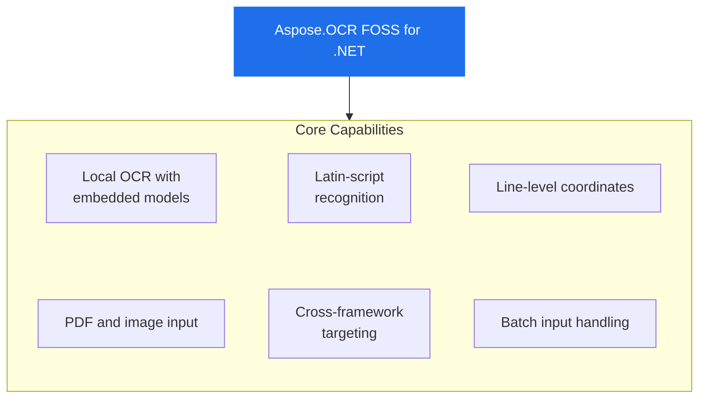

# Aspose.OCR FOSS for .NET

[](https://www.nuget.org/packages/Aspose.OCR.FOSS/)  [](https://github.com/aspose-ocr-foss/Aspose.OCR-FOSS-for-.NET/actions/workflows/build.yml) [](LICENSE)

[](https://products.aspose.org/ocr/net/)

Aspose.OCR FOSS for .NET reads images and PDF documents and converts them into machine-readable text. It supports input formats including single images and multi-page PDFs, and produces recognition results containing text and line-level bounding boxes. The product runs on .NET Standard and multiple .NET versions, as well as .NET Framework, and depends on `Microsoft.ML.OnnxRuntime` and `System.Drawing.Common`.

## Navigation

- [At a Glance](#at-a-glance)
- [Key Capabilities](#key-capabilities)
- [Installation](#installation)
- [Dependencies](#dependencies)
- [Quick Start](#quick-start)
- [Additional Examples](#additional-examples)
- [API Reference](#api-reference)
- [Documentation & Resources](#documentation--resources)
- [Scope and Limitations](#scope-and-limitations)
- [Development and Testing](#development-and-testing)
- [License](#license)

## At a Glance



## Key Capabilities

- **Local OCR with embedded models.** It performs local optical character recognition using embedded ONNX models, requiring no network access or external model files, and returns text and line coordinates through `Aspose.OCR.OcrOutput`.
- **Latin-script recognition.** It recognizes Latin-script text, including diacritical characters, and provides full-page text through `RecognitionResult.RecognitionText` and per-line results through `RecognitionResult.RecognitionLinesResult`.
- **Line-level coordinates.** It returns individual line bounding boxes as System.Drawing.Rectangle coordinates through `RecognitionResult.RecognitionLinesResult`, enabling pixel-precise layout analysis.
- **PDF and image input.** It accepts raster images and PDF documents through `Aspose.OCR.OcrInput`, supporting `InputType`.SingleImage for individual images and `InputType`.PDF for multi-page documents.
- **Cross-framework targeting.** It targets netstandard2.0, net48, net8.0, net9.0, and net10.0, enabling use across modern and legacy .NET applications.
- **Batch input handling.** It processes multiple files of the same `InputType` in a single `OcrInput` container, preserving their order and returning one `RecognitionResult` per input file.

They are processed sequentially
and returned in the order in which they were added.

## Installation

Install the published package from NuGet (`Aspose.OCR.FOSS`, version 26.10.0):

```bash
dotnet add package Aspose.OCR.FOSS
```

## Dependencies

### Required Package Dependencies

- `Aspose.PDF.FOSS 26.10.0`
- `Microsoft.ML.OnnxRuntime 1.22.1`
- `System.Drawing.Common 8.0.0`
- `System.Security.Cryptography.Pkcs 8.0.2`

### Native and System Requirements

- Requires .NET `netstandard2.0;net8.0;net9.0;net10.0;net48` (`TargetFrameworks` in `src/Aspose.Ocr.Foss.csproj`).

## Quick Start

```csharp
using Aspose.OCR;

var api = new AsposeOcr();
using var input = new OcrInput(InputType.PDF);
input.Add("document.pdf");

OcrOutput output = api.Recognize(input);

foreach (RecognitionResult page in output)
{
    Console.WriteLine(page.RecognitionText);

    foreach (RecognitionResult.LinesResult line in page.RecognitionLinesResult)
    {
        Console.WriteLine($"{line.Line}: {line.TextInLine}");
    }
}
```

## Additional Examples

```csharp
using Aspose.OCR;

var api = new AsposeOcr();
using var input = new OcrInput(InputType.SingleImage);
input.Add("scan.png");

RecognitionResult result = api.Recognize(input)[0];
Console.WriteLine(result.RecognitionText);
```

<details>
<summary>View Additional Examples</summary>

```csharp
using Aspose.OCR;

var api = new AsposeOcr();
using var input = new OcrInput(InputType.SingleImage);
input.Add("page-1.jpg");
input.Add("page-2.png");

OcrOutput output = api.Recognize(input);

for (int index = 0; index < output.Count; index++)
{
    Console.WriteLine($"Image {index + 1}");
    Console.WriteLine(output[index].RecognitionText);
}
```

```csharp
using Aspose.OCR;

var api = new AsposeOcr();
using var input = new OcrInput(InputType.SingleImage);
input.Add("document.jpg");

RecognitionResult result = api.Recognize(input)[0];

foreach (RecognitionResult.LinesResult line in result.RecognitionLinesResult)
{
    System.Drawing.Rectangle bounds = line.Line;
    Console.WriteLine(
        $"x={bounds.X}, y={bounds.Y}, width={bounds.Width}, " +
        $"height={bounds.Height}: {line.TextInLine}");
}
```

</details>

## API Reference

Aspose.OCR FOSS for .NET exposes a small set of public entry-point classes. The `AsposeOcr` class performs recognition, `OcrInput` collects source images or PDF pages, and `RecognitionResult` holds the extracted text and line-level data.

The public API has 6 types.

<details>
<summary>View the Complete Public API Surface</summary>

### Core API

| Class | Description |
| --- | --- |
| `AsposeOcr` | Provides the entry point for optical character recognition. |
| `LinesResult` | Represents the recognized text and bounds of one text line. |
| `OcrInput` | Represents input supplied to the OCR engine. |
| `OcrOutput` | Contains OCR recognition results. |
| `RecognitionResult` | Represents the recognition result for one image or one PDF page. |

#### Enumerations

| Enumeration | Description |
| --- | --- |
| `InputType` | Specifies the type of OCR input. |

#### Detailed Member Reference

### AsposeOcr

The `AsposeOcr.Recognize` method accepts an `OcrInput` container and returns an `OcrOutput` collection, where each element corresponds to one source image or PDF page.

- `Recognize`: Recognizes all files in the supplied input container.

### OcrInput

The `OcrInput` class is constructed with an `InputType` to specify whether sources are single raster images or PDF pages, and provides Add and Dispose members to populate and clear the container.

- `Add`: Adds a file to the input container.
- `Dispose`: Releases the references held by this input container.
- `OcrInput`: Initializes a new input container for the specified input type.

### RecognitionResult

Each `RecognitionResult` exposes `RecognitionText` for the full-page text and `RecognitionLinesResult` for ordered line text and bounding rectangles, with `LinesResult` providing `TextInLine` and Line members.

- `RecognitionLinesResult`: Gets recognized lines together with their source-image coordinates.
- `RecognitionText`: Gets or sets all recognized lines joined with line breaks.

The public API deliberately remains small.

- `Recognize(OcrInput input) -> OcrOutput`
  - Returns one result per source image or PDF page.
  - Throws `ArgumentNullException` for a null input.
  - Throws `FileNotFoundException` when a source file does not exist.
  - Throws `NotSupportedException` for an unsupported input type.

- `OcrInput(InputType type)` — creates an input container for one source type.
- `Add(string fullPath)` — adds a relative or absolute file path.
- `Dispose()` — clears all paths held by the container.

- `RecognitionText` — all non-empty recognized lines joined with line breaks.
- `RecognitionLinesResult` — ordered line text and rectangles.

- `TextInLine` — recognized text for one detected line.
- `Line` — `System.Drawing.Rectangle` in source-image pixels.

</details>

## Documentation & Resources

- **[Documentation & Resources](#documentation--resources)** — A section of this README.
- **[src/](src/)** — library source code, ONNX integration, and embedded models.
- **[tests/](tests/)** — xUnit validation and end-to-end OCR tests with sample documents.
- **[Aspose.Ocr.Foss.sln](Aspose.Ocr.Foss.sln)** — solution for Visual Studio and the .NET CLI.
- Found a bug or have a feature request? [Open an issue](https://github.com/aspose-ocr-foss/Aspose.OCR-FOSS-for-.NET/issues).

- [`src/`](src/) — library source code, ONNX integration, and embedded models.
- [`tests/`](tests/) — xUnit validation and end-to-end OCR tests with sample documents.
- [`Aspose.Ocr.Foss.sln`](Aspose.Ocr.Foss.sln) — solution for Visual Studio and the .NET CLI.
- [`LICENSE`](LICENSE) — MIT license text.

## Scope and Limitations

Each `RecognitionResult` corresponds to one rendered PDF page. Rectangle coordinates use the 150-DPI page image produced internally by the PDF renderer.

1. **Input validation** — all source paths and the selected `InputType` are validated before the ONNX sessions are created.
2. **PDF rendering** — PDF pages are rendered to 24-bit RGB images at 150 DPI with `Aspose.PDF.FOSS`. Raster images are loaded directly.
3. **Detector preprocessing** — the image is converted to Rec. 709 grayscale. If its longest side exceeds 1000 pixels, it is reduced with a separable Lanczos-8 filter. A 32-pixel white strip is appended to match the detector's training-time preprocessing.
4. **Region detection** — the first ONNX model produces text probability maps and intermediate visual features. The refinement model strengthens links between adjacent characters.
5. **Region post-processing** — text and link maps are thresholded, grouped with a four-connected breadth-first flood fill, dilated, fitted with a minimum-area rectangle, scaled back to source coordinates, and reduced to non-nested axis-aligned line rectangles.
6. **Line recognition** — each detected rectangle is padded by two pixels, cropped, resized to fit a 1200×32 white canvas while preserving its aspect ratio, converted to an NHWC grayscale tensor, and passed to the recognition model.
7. **CTC decoding** — greedy CTC decoding collapses repeated classes, removes the blank class, and maps the remaining classes to the model's Latin alphabet.
8. **Result assembly** — recognized lines are paired with their source-image rectangles and joined with platform line breaks to produce `RecognitionText`.

ONNX Runtime uses parallel graph execution with eight intra-operation worker threads. Input files and PDF pages themselves are processed sequentially.

- The public API is intentionally compact and may evolve as recognition capabilities are extended.
- Recognition supports Latin-script text and the diacritical characters present in the embedded recognition alphabet. There is no runtime language-selection API.
- Inputs are limited to raster images supported by `System.Drawing.Common` and PDF documents.
- Image processing is Windows-only because the OCR pipeline depends on `System.Drawing.Common` for bitmap loading, cropping, resizing, and pixel access.
- PDF pages are always rendered at 150 DPI; rendering resolution is not configurable yet.
- The detector returns axis-aligned text-line rectangles. Polygonal regions and layout labels are not part of the public output.
- Searchable PDF generation, text export helpers, confidence scores, font detection, spelling correction, table structure, and barcode detection are not implemented.
- Automatic page rotation, deskewing, color inversion, and user-configurable preprocessing are not implemented.
- GPU execution is not configured; inference uses the CPU execution provider.
- There is no dedicated input-level multithreading API. A single call processes files and PDF pages sequentially, although ONNX Runtime parallelizes operations inside each inference session.
- The NuGet package is large because the three models are embedded into every target-framework assembly.

These limitations don't apply to [full-featured Aspose.OCR for .NET — Enterprise Edition](https://products.aspose.com/ocr/net/). This project is licensed under the MIT License. The MIT License permits use, copying, modification, distribution, sublicensing, and commercial use, provided its copyright and permission notice are retained. The software is provided without warranty.

## Development and Testing

The suite covers 2 test files under `tests/`. Project documentation lives under `docs/`.

```bash
dotnet add package Aspose.OCR.FOSS --version 26.10.0
```

Or add a `<PackageReference>`:

```xml
<PackageReference Include="Aspose.OCR.FOSS" Version="26.10.0" />
```

Building all five targets from source requires the .NET 10 SDK; use `-f net8.0`, for example, to build one target.

```bash
dotnet build src/Aspose.Ocr.Foss.csproj -c Release
```

> [!IMPORTANT]
> Image processing uses `System.Drawing.Common 8.0.0`. On .NET 6 and later,
> `System.Drawing.Common` is supported on Windows only. The modern builds are marked with
> `SupportedOSPlatform("windows")` so platform analyzers report this requirement to consumers.

- Windows for OCR image processing with `System.Drawing.Common 8.0.0`.
- .NET Framework 4.8, a .NET Standard 2.0-compatible runtime, or .NET 8 or later.
- No separate OCR model download is required; all three ONNX models are embedded resources.
- ONNX Runtime supplies the native runtime binaries through its NuGet package.

The test project uses xUnit and `Microsoft.NET.Test.Sdk`. No separate test runner installation is required when tests are executed with `dotnet test`.

On Windows, run the complete restore, build, test, and package workflow by double-clicking `build-packages.bat` or from a terminal:

```bat
build-packages.bat
```

Use `build-packages.bat --no-pause` in scripts or CI environments.

Restore, build, and run the complete test matrix:

```bash
dotnet restore Aspose.Ocr.Foss.sln
dotnet build Aspose.Ocr.Foss.sln -c Release --no-restore
dotnet test Aspose.Ocr.Foss.sln -c Release --no-build
```

The xUnit test project targets **net48, net8.0, net9.0, and net10.0**. To run one target only:

```bash
dotnet test tests/Aspose.Ocr.Foss.Tests.csproj -c Release -f net8.0
```

Create the NuGet package:

```bash
dotnet pack src/Aspose.Ocr.Foss.csproj -c Release --no-build -o artifacts/packages
```

This creates `Aspose.OCR.FOSS.26.10.0.nupkg` in `artifacts/packages`.

## License

This project is licensed under the [MIT License](LICENSE). The MIT License permits use, copying, modification, distribution, sublicensing, and commercial use, provided its copyright and permission notice are retained. The software is provided without warranty.
