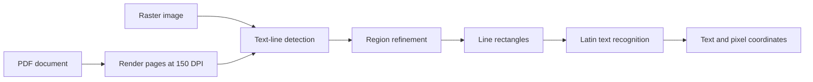

# Aspose.OCR.FOSS for .NET

[](https://www.nuget.org/packages/Aspose.OCR.FOSS/) [](LICENSE) [](src/Aspose.Ocr.Foss.csproj)

[](https://products.aspose.com/ocr/net/)

Aspose.OCR.FOSS for .NET is a free, open-source OCR library for .NET Framework 4.8,
.NET Standard 2.0, and .NET 8+. It detects text lines in raster images and PDF documents,
recognizes Latin-script text, and returns both the recognized text and the pixel coordinates of
every detected line. The detection, refinement, and recognition models are embedded in the
assembly and run locally through ONNX Runtime.

## Navigation

- [At a Glance](#at-a-glance)
- [Key Capabilities](#key-capabilities)
- [Installation](#installation)
- [Dependencies](#dependencies)
- [Quick Start](#quick-start)
- [Additional Examples](#additional-examples)
- [How Recognition Works](#how-recognition-works)
- [API Reference](#api-reference)
- [Documentation & Resources](#documentation--resources)
- [Scope and Limitations](#scope-and-limitations)
- [Development and Testing](#development-and-testing)
- [License](#license)

## At a Glance



## Key Capabilities

- Recognize a single raster image through `InputType.SingleImage`.
- Recognize every page of a PDF through `InputType.PDF`; pages are returned in source order.
- Detect text-line regions with embedded ONNX detection and refinement models.
- Recognize Latin-script text, including the diacritical characters included in the embedded
  recognition model.
- Return one `RecognitionResult` per image or PDF page.
- Return the complete page text through `RecognitionResult.RecognitionText`.
- Return individual lines and their `System.Drawing.Rectangle` coordinates through
  `RecognitionResult.RecognitionLinesResult`.
- Process multiple files in one `OcrInput` container, preserving their order.
- Run entirely on the local CPU without network services or external model files.
- Use an API shape compatible with the core Aspose.OCR recognition workflow:
  `api.Recognize(input)`.

## Installation

The NuGet package ID is
[`Aspose.OCR.FOSS`](https://www.nuget.org/packages/Aspose.OCR.FOSS/):

```bash
dotnet add package Aspose.OCR.FOSS --version 26.10.0
```

Or add a `<PackageReference>`:

```xml
<PackageReference Include="Aspose.OCR.FOSS" Version="26.10.0" />
```

The package ships builds for **netstandard2.0, net48, net8.0, net9.0, and net10.0**. Building all
five targets from source requires the .NET 10 SDK; use `-f net8.0`, for example, to build one
target.

```bash
dotnet build src/Aspose.Ocr.Foss.csproj -c Release
```

> [!IMPORTANT]
> Image processing uses `System.Drawing.Common 8.0.0`. On .NET 6 and later,
> `System.Drawing.Common` is supported on Windows only. The modern builds are marked with
> `SupportedOSPlatform("windows")` so platform analyzers report this requirement to consumers.

## Dependencies

### Required Package Dependencies

| Package | Version | Purpose |
|---|---:|---|
| `Aspose.PDF.FOSS` | 26.10.0 | Opens PDF documents and renders pages for OCR. |
| `System.Drawing.Common` | 8.0.0 | Loads, crops, resizes, and reads raster image pixels. |
| `Microsoft.ML.OnnxRuntime` | 1.22.1 | Runs the embedded detection, refinement, and recognition models on the CPU. |
| `System.Security.Cryptography.Pkcs` | 8.0.2 | Overrides an older transitive version on netstandard2.0 and net48. |

### Native and System Requirements

- Windows for OCR image processing with `System.Drawing.Common 8.0.0`.
- .NET Framework 4.8, a .NET Standard 2.0-compatible runtime, or .NET 8 or later.
- No separate OCR model download is required; all three ONNX models are embedded resources.
- ONNX Runtime supplies the native runtime binaries through its NuGet package.

### Development Dependencies

The test project uses xUnit and `Microsoft.NET.Test.Sdk`. No separate test runner installation is
required when tests are executed with `dotnet test`.

## Quick Start

Recognize a PDF and print every detected line with its coordinates:

```csharp
using Aspose.OCR;

var api = new AsposeOcr();
using var input = new OcrInput(InputType.PDF);
input.Add("document.pdf");

OcrOutput output = api.Recognize(input);

foreach (RecognitionResult page in output)
{
    Console.WriteLine(page.RecognitionText);

    foreach (RecognitionResult.LinesResult line in page.RecognitionLinesResult)
    {
        Console.WriteLine($"{line.Line}: {line.TextInLine}");
    }
}
```

Each `RecognitionResult` corresponds to one rendered PDF page. Rectangle coordinates use the
150-DPI page image produced internally by the PDF renderer.

## Additional Examples

### Recognize a Single Image

```csharp
using Aspose.OCR;

var api = new AsposeOcr();
using var input = new OcrInput(InputType.SingleImage);
input.Add("scan.png");

RecognitionResult result = api.Recognize(input)[0];
Console.WriteLine(result.RecognitionText);
```

<details>
<summary>View Additional Examples</summary>

### Recognize Multiple Images

All files in one input container must have the same `InputType`. They are processed sequentially
and returned in the order in which they were added.

```csharp
using Aspose.OCR;

var api = new AsposeOcr();
using var input = new OcrInput(InputType.SingleImage);
input.Add("page-1.jpg");
input.Add("page-2.png");

OcrOutput output = api.Recognize(input);

for (int index = 0; index < output.Count; index++)
{
    Console.WriteLine($"Image {index + 1}");
    Console.WriteLine(output[index].RecognitionText);
}
```

### Work With Detected Line Coordinates

```csharp
using Aspose.OCR;

var api = new AsposeOcr();
using var input = new OcrInput(InputType.SingleImage);
input.Add("document.jpg");

RecognitionResult result = api.Recognize(input)[0];

foreach (RecognitionResult.LinesResult line in result.RecognitionLinesResult)
{
    System.Drawing.Rectangle bounds = line.Line;
    Console.WriteLine(
        $"x={bounds.X}, y={bounds.Y}, width={bounds.Width}, " +
        $"height={bounds.Height}: {line.TextInLine}");
}
```

</details>

## How Recognition Works

1. **Input validation** — all source paths and the selected `InputType` are validated before the
   ONNX sessions are created.
2. **PDF rendering** — PDF pages are rendered to 24-bit RGB images at 150 DPI with
   `Aspose.PDF.FOSS`. Raster images are loaded directly.
3. **Detector preprocessing** — the image is converted to Rec. 709 grayscale. If its longest side
   exceeds 1000 pixels, it is reduced with a separable Lanczos-8 filter. A 32-pixel white strip is
   appended to match the detector's training-time preprocessing.
4. **Region detection** — the first ONNX model produces text probability maps and intermediate
   visual features. The refinement model strengthens links between adjacent characters.
5. **Region post-processing** — text and link maps are thresholded, grouped with a four-connected
   breadth-first flood fill, dilated, fitted with a minimum-area rectangle, scaled back to source
   coordinates, and reduced to non-nested axis-aligned line rectangles.
6. **Line recognition** — each detected rectangle is padded by two pixels, cropped, resized to fit
   a 1200×32 white canvas while preserving its aspect ratio, converted to an NHWC grayscale tensor,
   and passed to the recognition model.
7. **CTC decoding** — greedy CTC decoding collapses repeated classes, removes the blank class, and
   maps the remaining classes to the model's Latin alphabet.
8. **Result assembly** — recognized lines are paired with their source-image rectangles and joined
   with platform line breaks to produce `RecognitionText`.

ONNX Runtime uses parallel graph execution with eight intra-operation worker threads. Input files
and PDF pages themselves are processed sequentially.

## API Reference

The public API deliberately remains small.

| Type | Description |
|---|---|
| `AsposeOcr` | Entry point that validates input, renders PDFs, and coordinates OCR. |
| `OcrInput` | Disposable input container for image or PDF file paths. |
| `OcrOutput` | Ordered list of recognition results. |
| `RecognitionResult` | Recognized page text and line-level results. |
| `RecognitionResult.LinesResult` | Text and pixel rectangle for one detected line. |
| `InputType` | Selects `SingleImage` or `PDF` input. |

<details>
<summary>View Detailed Member Reference</summary>

### `AsposeOcr`

- `Recognize(OcrInput input) -> OcrOutput`
  - Returns one result per source image or PDF page.
  - Throws `ArgumentNullException` for a null input.
  - Throws `FileNotFoundException` when a source file does not exist.
  - Throws `NotSupportedException` for an unsupported input type.

### `OcrInput`

- `OcrInput(InputType type)` — creates an input container for one source type.
- `Add(string fullPath)` — adds a relative or absolute file path.
- `Dispose()` — clears all paths held by the container.

### `OcrOutput`

- Inherits `List<RecognitionResult>`.
- Preserves image and PDF-page order.

### `RecognitionResult`

- `RecognitionText` — all non-empty recognized lines joined with line breaks.
- `RecognitionLinesResult` — ordered line text and rectangles.

### `RecognitionResult.LinesResult`

- `TextInLine` — recognized text for one detected line.
- `Line` — `System.Drawing.Rectangle` in source-image pixels.

### `InputType`

- `SingleImage` — one raster image per source path.
- `PDF` — every page of each source PDF.

</details>

## Documentation & Resources

- [`src/`](src/) — library source code, ONNX integration, and embedded models.
- [`tests/`](tests/) — xUnit validation and end-to-end OCR tests with sample documents.
- [`Aspose.Ocr.Foss.sln`](Aspose.Ocr.Foss.sln) — solution for Visual Studio and the .NET CLI.
- [`LICENSE`](LICENSE) — MIT license text.

## Scope and Limitations

- The public API is intentionally compact and may evolve as recognition capabilities are extended.
- Recognition supports Latin-script text and the diacritical characters present in the embedded
  recognition alphabet. There is no runtime language-selection API.
- Inputs are limited to raster images supported by `System.Drawing.Common` and PDF documents.
- Image processing is Windows-only because the OCR pipeline depends on `System.Drawing.Common`
  for bitmap loading, cropping, resizing, and pixel access.
- PDF pages are always rendered at 150 DPI; rendering resolution is not configurable yet.
- The detector returns axis-aligned text-line rectangles. Polygonal regions and layout labels are
  not part of the public output.
- Searchable PDF generation, text export helpers, confidence scores, font detection, spelling
  correction, table structure, and barcode detection are not implemented.
- Automatic page rotation, deskewing, color inversion, and user-configurable preprocessing are not
  implemented.
- GPU execution is not configured; inference uses the CPU execution provider.
- There is no dedicated input-level multithreading API. A single call processes files and PDF pages
  sequentially, although ONNX Runtime parallelizes operations inside each inference session.
- The NuGet package is large because the three models are embedded into every target-framework
  assembly.

## Development and Testing

On Windows, run the complete restore, build, test, and package workflow by double-clicking
`build-packages.bat` or from a terminal:

```bat
build-packages.bat
```

Use `build-packages.bat --no-pause` in scripts or CI environments.

Restore, build, and run the complete test matrix:

```bash
dotnet restore Aspose.Ocr.Foss.sln
dotnet build Aspose.Ocr.Foss.sln -c Release --no-restore
dotnet test Aspose.Ocr.Foss.sln -c Release --no-build
```

The xUnit test project targets **net48, net8.0, net9.0, and net10.0**. To run one target only:

```bash
dotnet test tests/Aspose.Ocr.Foss.Tests.csproj -c Release -f net8.0
```

Create the NuGet package:

```bash
dotnet pack src/Aspose.Ocr.Foss.csproj -c Release --no-build -o artifacts/packages
```

This creates `Aspose.OCR.FOSS.26.10.0.nupkg` in `artifacts/packages`.

## License

This project is licensed under the [MIT License](LICENSE). The MIT License permits use, copying,
modification, distribution, sublicensing, and commercial use, provided its copyright and
permission notice are retained. The software is provided without warranty.
