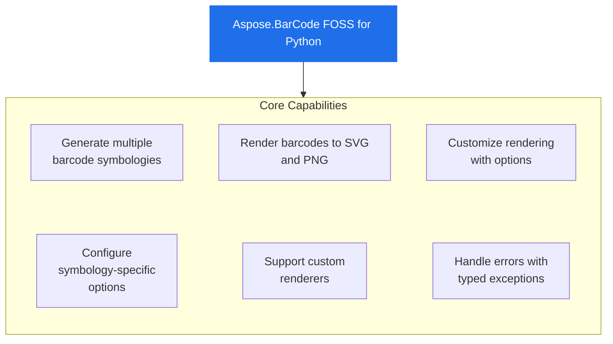

# Aspose.BarCode FOSS for Python

 [](LICENSE) [](https://github.com/aspose-barcode-foss/Aspose.BarCode-FOSS-for-Python/graphs/contributors)

[](https://products.aspose.org/barcode/python/)

Aspose.BarCode FOSS for Python generates barcodes in Code 128, Code 39, EAN-13, EAN-8, UPC-A, UPC-E, and QR Code formats. It renders barcodes to PNG and SVG using the `to_png` and `to_svg` methods, and supports custom renderers through the render method. Rendering behavior is controlled with `RenderOptions` and `ResolvedRenderOptions`, and the library raises `BarcodeError`, `EncodingError`, `RenderingError`, or `SymbologyNotFoundError` when operations fail.

## Navigation

- [At a Glance](#at-a-glance)
- [Key Capabilities](#key-capabilities)
- [Installation](#installation)
- [Dependencies](#dependencies)
- [Quick Start](#quick-start)
- [Additional Examples](#additional-examples)
- [API Reference](#api-reference)
- [Documentation & Resources](#documentation--resources)
- [Scope and Limitations](#scope-and-limitations)
- [Development and Testing](#development-and-testing)
- [License](#license)

## At a Glance



## Key Capabilities

- **Generate multiple barcode symbologies.** It generates barcodes using Code 128, Code 39, EAN-13, EAN-8, UPC-A, UPC-E, and QR Code symbologies, each accessible through dedicated factory functions.
- **Render barcodes to SVG and PNG.** It renders barcodes to SVG and PNG formats by calling the `to_svg` and `to_png` methods on a `Barcode` instance.
- **Customize rendering with options.** It customizes rendering by accepting `RenderOptions` or `ResolvedRenderOptions` to control scale, DPI, module width, quiet zone, colors, and text display.
- **Configure symbology-specific options.** It configures symbology-specific options using `Code128Options`, `Code39Options`, `Ean13Options`, and `QrOptions` to control encoding modes, error correction, and check-digit behavior.
- **Support custom renderers.** It supports custom renderers by allowing `SvgRenderer`, `PngRenderer`, and `PdfRenderer` subclasses to be passed to the render method.
- **Handle errors with typed exceptions.** It handles errors with typed exceptions including `BarcodeError`, `EncodingError`, `RenderingError`, and `SymbologyNotFoundError`.

- Encode Code 39 barcodes in the base 43-character set or the Extended/Full-ASCII form (via
  `code39()`/`code39ext()`), with an optional modulo-43 check character.
- Select any symbology by name — canonical or alias — through the generic `generate()`
  (`generate(symbology, data)`) entry point, independent of the dedicated per-symbology helpers.

## Installation

`aspose-barcode-foss` is not yet published on PyPI; build it from a source checkout instead:

```bash
git clone https://github.com/aspose-barcode-foss/Aspose.BarCode-FOSS-for-Python.git
cd Aspose.BarCode-FOSS-for-Python
pip install .
```

Verify the install:

```bash
python -c "import aspose_barcode_foss"
```

Requires Python 3.12 or later.

## Dependencies

### Required Package Dependencies

- `Pillow>=10.1.0`

### Native and System Requirements

- Requires Python 3.12 or later.

## Quick Start

This example creates a Code 128 barcode for the text Hello-World and renders it as an SVG string and a PNG byte array using the `to_svg` and `to_png` members.

```python
from aspose_barcode_foss import code128

barcode = code128("Hello-World")
svg = barcode.to_svg()   # -> str
png = barcode.to_png()   # -> bytes
```

The package is not yet published to PyPI. Install it from a source checkout.

Requires Python 3.12+ and Pillow >= 10.1.0 (a real, declared runtime dependency, used only for
PNG rendering) — otherwise the library has no system-level dependencies, and ships a `py.typed`
marker for full type-checker support.

## Additional Examples

Generate barcodes, customize QR encoding, and export to PNG or SVG using the Aspose.BarCode FOSS for Python library.

### Generate a QR Barcode and Save It as PNG

```python
from aspose_barcode_foss import generate

barcode = generate("qr", "https://example.com")
png = barcode.to_png()
```

<details>
<summary>View Additional Examples</summary>

### Create a QR Barcode with High Error Correction and Automatic Encoding Mode

```python
from aspose_barcode_foss import qr, QrOptions, QrErrorCorrectionLevel, QrEncodeMode

barcode = qr(
    "PAYLOAD",
    encode=QrOptions(
        error_correction_level=QrErrorCorrectionLevel.H,
        encoding_mode=QrEncodeMode.AUTO,
    ),
)
```

### Generate a Code 39 Barcode with an Added Check Digit

```python
from aspose_barcode_foss import code39, Code39Options

barcode = code39("ABC-123", encode=Code39Options(add_check_digit=True))
```

### Render a Code 128 Barcode to SVG and PNG with Custom Options

```python
from aspose_barcode_foss import code128, RenderOptions

barcode = code128("Hello-World")
svg = barcode.to_svg(options=RenderOptions(scale=2.0, show_text=True))
png = barcode.to_png(options=RenderOptions(dpi=300, module_width=3.0))
```

### Render a Code 128 Barcode Using a Dedicated SVG Renderer

```python
from aspose_barcode_foss import code128, SvgRenderer, RenderOptions

renderer = SvgRenderer()
barcode = code128("Hello-World")
artifact = barcode.render(renderer, options=RenderOptions(scale=3.0))
svg = artifact.data
```

Runnable scripts are available in the [`examples`](examples/) directory
(`all_symbologies.py`, `render_options.py`, `error_handling.py`, `quickstart.py`). Additional
worked examples cover the generic entry point and per-symbology encoding options below.

Runnable example scripts and what each one demonstrates are listed in
[`examples/README.md`](examples/README.md).

</details>

## API Reference

Aspose.BarCode FOSS for Python provides barcode generation through the `aspose_barcode_foss` module, which exposes helper functions for specific symbologies and a generic generate function. The `Barcode` class returned by these helpers offers `to_png`, `to_svg`, and render methods for output.

The public API has 51 types.

<details>
<summary>View the Complete Public API Surface</summary>

### Core API

| Class | Description |
| --- | --- |
| `Barcode` | Public barcode object returned by the high-level API (some members not implemented). |
| `aspose_barcode_foss.BarcodeError` | BarcodeError class is the base exception for barcode-related errors. |
| `aspose_barcode_foss.Code128Options` | Code128Options class holds configuration options for Code 128 barcode generation. |
| `aspose_barcode_foss.Code39Options` | Code39Options class holds configuration options for Code 39 barcode generation. |
| `aspose_barcode_foss.Ean13Options` | Ean13Options class holds configuration options for EAN-13 barcode generation. |
| `aspose_barcode_foss.Ean8Options` | Ean8Options class holds configuration options for EAN-8 barcode generation. |
| `aspose_barcode_foss.EncodeOptions` | EncodeOptions class holds common encoding options for barcode generation. |
| `aspose_barcode_foss.EncodingError` | EncodingError class represents errors that occur during barcode encoding. |
| `aspose_barcode_foss.InvalidInputError` | InvalidInputError class represents errors caused by invalid input data. |
| `aspose_barcode_foss.PdfRenderer` | PdfRenderer class is a renderer for PDF output, but its render method is not implemented. |
| `aspose_barcode_foss.PngRenderer` | PngRenderer class renders barcodes to PNG format and raises RenderingError conditionally. |
| `aspose_barcode_foss.QrOptions` | QrOptions class holds configuration options for QR barcode generation. |
| `aspose_barcode_foss.RenderOptions` | RenderOptions class holds common rendering options for barcode output. |
| `aspose_barcode_foss.Renderer` | Renderer class is a base renderer, but its render method is not implemented. |
| `aspose_barcode_foss.RenderingError` | RenderingError class represents errors that occur during barcode rendering. |
| `aspose_barcode_foss.ResolvedRenderOptions` | ResolvedRenderOptions class holds resolved rendering options for barcode output. |
| `aspose_barcode_foss.SvgRenderer` | SvgRenderer class renders barcodes to SVG format. |
| `aspose_barcode_foss.SymbologyNotFoundError` | SymbologyNotFoundError class represents errors when a symbology is not found. |
| `aspose_barcode_foss.UnsupportedCapabilityError` | UnsupportedCapabilityError class represents errors when a capability is not supported. |
| `aspose_barcode_foss.UnsupportedFeatureError` | UnsupportedFeatureError class represents errors when a feature is not supported. |
| `aspose_barcode_foss.UpcaOptions` | UpcaOptions class holds configuration options for UPC-A barcode generation. |
| `aspose_barcode_foss.UpceOptions` | UpceOptions class holds configuration options for UPC-E barcode generation. |
| `exceptions.BarcodeError` | aspose_barcode_foss.exceptions.BarcodeError is the base exception for barcode-related errors. |
| `exceptions.EncodingError` | aspose_barcode_foss.exceptions.EncodingError represents errors that occur during barcode encoding. |
| `exceptions.InvalidInputError` | aspose_barcode_foss.exceptions.InvalidInputError represents errors caused by invalid input data. |
| `exceptions.RenderingError` | aspose_barcode_foss.exceptions.RenderingError represents errors that occur during barcode rendering. |
| `exceptions.SymbologyNotFoundError` | aspose_barcode_foss.exceptions.SymbologyNotFoundError represents errors when a symbology is not found. |
| `exceptions.UnsupportedCapabilityError` | aspose_barcode_foss.exceptions.UnsupportedCapabilityError represents errors when a capability is not supported. |
| `exceptions.UnsupportedFeatureError` | aspose_barcode_foss.exceptions.UnsupportedFeatureError represents errors when a feature is not supported. |
| `options.Code128Options` | aspose_barcode_foss.options.Code128Options class holds configuration options for Code 128 barcode generation. |
| `options.Code39Options` | aspose_barcode_foss.options.Code39Options class holds configuration options for Code 39 barcode generation. |
| `options.Ean13Options` | aspose_barcode_foss.options.Ean13Options class holds configuration options for EAN-13 barcode generation. |
| `options.Ean8Options` | aspose_barcode_foss.options.Ean8Options class holds configuration options for EAN-8 barcode generation. |
| `options.EncodeOptions` | aspose_barcode_foss.options.EncodeOptions class holds common encoding options for barcode generation. |
| `options.QrOptions` | QrOptions class holds configuration options specific to QR barcode generation. |
| `options.RenderOptions` | RenderOptions class holds general rendering settings used across barcode renderers. |
| `options.ResolvedRenderOptions` | ResolvedRenderOptions class holds the final resolved rendering settings after applying defaults and overrides. |
| `options.UpcaOptions` | UpcaOptions class holds configuration options specific to UPCA barcode generation. |
| `options.UpceOptions` | UpceOptions class holds configuration options specific to UPCE barcode generation. |
| `renderers.PdfRenderer` | Public class. |
| `renderers.PngRenderer` | Public class. |
| `renderers.Renderer` | Public class. |
| `renderers.SvgRenderer` | SvgRenderer class is a barcode renderer for SVG output. |

#### Enumerations

| Enumeration | Description |
| --- | --- |
| `aspose_barcode_foss.Code128EncodeMode` | Code128EncodeMode enum lists the AUTO, CODE_A, CODE_AB, CODE_AC, CODE_B, CODE_BC and CODE_C encoding modes for Code 128 barcodes. |
| `aspose_barcode_foss.Code39EncodeMode` | Code39EncodeMode enum lists the BASE and FULL_ASCII encoding modes for Code 39 barcodes. |
| `aspose_barcode_foss.QrEncodeMode` | QrEncodeMode enum lists the ALPHANUMERIC, AUTO, BYTE, KANJI and NUMERIC encoding modes for QR barcodes. |
| `aspose_barcode_foss.QrErrorCorrectionLevel` | QrErrorCorrectionLevel enum lists the H, L, M and Q error correction levels for QR barcodes. |
| `options.Code128EncodeMode` | aspose_barcode_foss.options.Code128EncodeMode enum lists the AUTO, CODE_A, CODE_AB, CODE_AC, CODE_B, CODE_BC and CODE_C encoding modes for Code 128 barcodes. |
| `options.Code39EncodeMode` | aspose_barcode_foss.options.Code39EncodeMode enum lists the BASE and FULL_ASCII encoding modes for Code 39 barcodes. |
| `options.QrEncodeMode` | aspose_barcode_foss.options.QrEncodeMode enum lists the ALPHANUMERIC, AUTO, BYTE, KANJI and NUMERIC encoding modes for QR barcodes. |
| `options.QrErrorCorrectionLevel` | QrErrorCorrectionLevel enum lists the H, L, M, and Q error correction levels for QR codes. |

#### Detailed Member Reference

### aspose_barcode_foss

The `aspose_barcode_foss` module serves as the main entry point and exposes helper functions for specific symbologies as well as a generic generate function.

### generate

The generate function accepts a symbology name and payload to produce a `Barcode` instance, supporting QR Code and other symbologies through a unified interface.

### code128

The code128 function creates a `Barcode` instance for Code 128 barcodes and supports `to_png` and `to_svg` methods for output.

### qr

The qr function creates a `Barcode` instance for QR Code barcodes and accepts `QrOptions` to configure error correction level, encoding mode, and other QR-specific settings.

### Barcode

The `Barcode` class is the public barcode object returned by every encoding helper and generate, exposing `to_png`, `to_svg`, and render methods.

- `render`: Render the barcode with the provided renderer.
- `to_pdf`: Render the barcode as PDF when the backend is available.
- `to_png`: Render the barcode as PNG.
- `to_svg`: Render the barcode as SVG.

### options.RenderOptions

The `RenderOptions` class provides user-supplied rendering options such as scale, DPI, module width, colors, and text visibility for barcode output.

### aspose_barcode_foss.SvgRenderer

The `SvgRenderer` class renders a barcode to SVG output and is used via the `Barcode.render` method to produce SVG artifacts.

| Class | Description |
|---|---|
| `Barcode` | The public barcode object returned by every encoding helper and `generate()`. Exposes `to_svg()`, `to_png()`, and `render()`. |

| Class | Description |
|---|---|
| `BarcodeError` | Base exception for the barcode library. |
| `Code128Options` | Encoding options for Code 128, including `encode_mode`. |
| `Code39Options` | Encoding options for Code 39, including `add_check_digit`. |
| `Ean13Options` | Encoding options for EAN-13, including `allow_check_digit_input`. |
| `Ean8Options` | Encoding options for EAN-8, including `allow_check_digit_input`. |
| `EncodeOptions` | Base type for symbology-specific encoding options. |
| `EncodingError` | Raised on an encoder-level failure. |
| `InvalidInputError` | Raised when the supplied input fails validation (bad characters, wrong length, and similar). |
| `PdfRenderer` | Registered PDF renderer — `render()` raises `NotImplementedError` in this FOSS build (see Scope and Limitations). |
| `PngRenderer` | Renders a barcode to PNG output; used internally by `Barcode.to_png()`. |
| `QrOptions` | Encoding options for QR Code, including `error_correction_level`, `version`, `mask`, and `encoding_mode`. |
| `RenderOptions` | User-supplied rendering options (scale, DPI, module size, colors, text). |
| `Renderer` | Abstract renderer interface implemented by `SvgRenderer`/`PngRenderer`/`PdfRenderer`. |
| `RenderingError` | Raised on a renderer-level failure. |
| `ResolvedRenderOptions` | The fully-resolved rendering configuration after merging user options with symbology defaults. |
| `SvgRenderer` | Renders a barcode to SVG output; used internally by `Barcode.to_svg()`. |
| `SymbologyNotFoundError` | Raised when an unknown symbology name is passed to `generate()`. |
| `UnsupportedCapabilityError` | Raised when a requested feature/symbology combination is unsupported. |
| `UnsupportedFeatureError` | Raised when a requested feature exists in the spec but is not yet implemented. |
| `UpcaOptions` | Encoding options for UPC-A, including `allow_check_digit_input`. |
| `UpceOptions` | Encoding options for UPC-E, including `allow_check_digit_input`. |

| Enumeration | Description |
|---|---|
| `Code128EncodeMode` | Code 128 Code Set selection: `AUTO`, `CODE_A`, `CODE_B`, `CODE_C`, `CODE_AB`, `CODE_AC`, `CODE_BC`. |
| `Code39EncodeMode` | Supported Code 39 encode modes. |
| `QrEncodeMode` | QR Code encoding mode: `AUTO`, `NUMERIC`, `ALPHANUMERIC`, `BYTE`, `KANJI`. |
| `QrErrorCorrectionLevel` | QR Code error correction level: `L`, `M`, `Q`, `H`. |

</details>

## Documentation & Resources

- **[Getting started guide](https://docs.aspose.org/barcode/python/)** — installation, walkthroughs, and feature guides for this library.
- **[How-to articles and FAQ](https://kb.aspose.org/barcode/python/)** — task-focused how-tos and answers to common questions.
- **[Full API reference](https://reference.aspose.org/barcode/python/)** — complete, generated reference documentation for every public type. It covers all 51 public types; the [API Reference](#api-reference) section above covers the essentials.
- Found a bug or have a feature request? [Open an issue](https://github.com/aspose-barcode-foss/Aspose.BarCode-FOSS-for-Python/issues).

## Scope and Limitations

- This library only generates (encodes) barcodes — it does not read or decode existing barcode images for any symbology.
- PDF rendering is not implemented — `Barcode.to_pdf()` and `PdfRenderer.render()` both raise `NotImplementedError`. SVG and PNG rendering are implemented for every symbology.
- ECI (Extended Channel Interpretation) normalization and validation (`EciHelper.normalize`/ `.validate`) are not implemented in this FOSS build, even though `EncodeOptions` exposes an `eci_assignment_number` field on every symbology's options type.
- GS1 data parsing and validation (`Gs1Helper.parse`/`.validate`) are not implemented in this FOSS build, even though `EncodeOptions` exposes a `gs1_enabled` field on every symbology's options type.

<details>
<summary>View Other Unimplemented Members</summary>

- `Renderer`: `render` raises NotImplementedError.

</details>

See [Aspose.BarCode for Python — Enterprise Edition](https://products.aspose.com/barcode/python-net/). It adds the full commercial rendering pipeline and broader symbology coverage on top of this FOSS API surface.

## Development and Testing

The suite covers 37 test files under `tests/`. Example programs live under `examples/`.

- `pytest` >=8.0 and `ruff` >=0.15.7 — used only by the test suite and linter, never required to install or use the library.

```bash
git clone https://github.com/aspose-barcode-foss/Aspose.BarCode-FOSS-for-Python.git
cd Aspose.BarCode-FOSS-for-Python
pip install -e . pytest ruff
pytest
```

## License

This project is licensed under the [MIT License](LICENSE). The MIT License permits use, copying, modification, distribution, sublicensing, and commercial use, provided its copyright and permission notice are retained. The software is provided without warranty.
