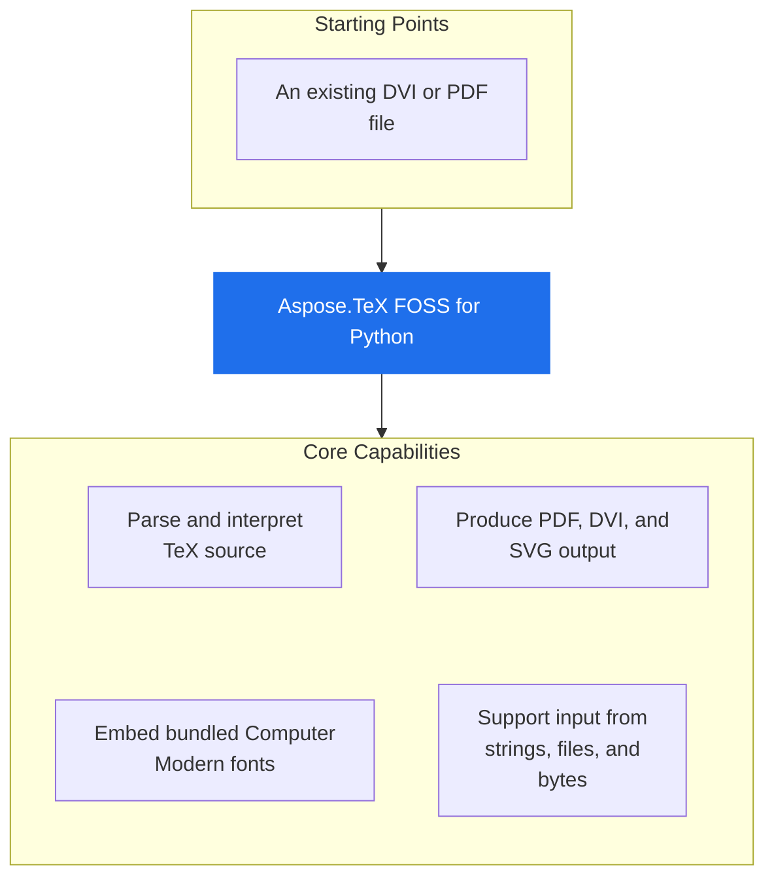

# Aspose.TeX FOSS for Python

[](https://pypi.org/project/aspose-tex-foss/)  [](LICENSE) [](https://github.com/aspose-tex-foss/Aspose.TeX-FOSS-for-Python#scope-and-limitations)

[](https://products.aspose.org/tex/python/)

Aspose.TeX FOSS for Python reads `TeX` input and converts it to output formats including `.pdf`, `.dvi`, and .svg. It writes `.pdf` and `.dvi` files directly to disk or returns their bytes in memory, and it writes .svg output to disk or returns the bytes of one or more SVG pages. The product provides a `TeXJob` class that executes `TeX` processing with configurable options and exposes messages for diagnostics.

- [At a Glance](https://github.com/aspose-tex-foss/Aspose.TeX-FOSS-for-Python#at-a-glance)
- [Key Capabilities](https://github.com/aspose-tex-foss/Aspose.TeX-FOSS-for-Python#key-capabilities)
- [Installation](https://github.com/aspose-tex-foss/Aspose.TeX-FOSS-for-Python#installation)
- [Dependencies](https://github.com/aspose-tex-foss/Aspose.TeX-FOSS-for-Python#dependencies)
- [Quick Start](https://github.com/aspose-tex-foss/Aspose.TeX-FOSS-for-Python#quick-start)
- [Additional Examples](https://github.com/aspose-tex-foss/Aspose.TeX-FOSS-for-Python#additional-examples)
- [API Reference](https://github.com/aspose-tex-foss/Aspose.TeX-FOSS-for-Python#api-reference)
- [Documentation & Resources](https://github.com/aspose-tex-foss/Aspose.TeX-FOSS-for-Python#documentation--resources)
- [Scope and Limitations](https://github.com/aspose-tex-foss/Aspose.TeX-FOSS-for-Python#scope-and-limitations)
- [Development and Testing](https://github.com/aspose-tex-foss/Aspose.TeX-FOSS-for-Python#development-and-testing)
- [License](https://github.com/aspose-tex-foss/Aspose.TeX-FOSS-for-Python#license)

## Navigation

- [At a Glance](#at-a-glance)
- [Key Capabilities](#key-capabilities)
- [Installation](#installation)
- [Dependencies](#dependencies)
- [Quick Start](#quick-start)
- [Additional Examples](#additional-examples)
- [API Reference](#api-reference)
- [Documentation & Resources](#documentation--resources)
- [Scope and Limitations](#scope-and-limitations)
- [Development and Testing](#development-and-testing)
- [Third-Party Notices](#third-party-notices)
- [License](#license)

## At a Glance



## Key Capabilities

- **Parse and interpret TeX source.** It parses and interprets real `TeX` source through `TeXJob`, driving the tokenizer, macro expander, and mode-machine dispatch that process control sequences, groups, and paragraph text, then builds lines and pages from typeset boxes with a real line-breaking and page-building pipeline.
- **Produce PDF, DVI, and SVG output.** It produces output in PDF, DVI, and SVG formats by writing finished pages through `PdfDevice`, `DviDevice`, or `SvgDevice`, supporting file output via a Path or in-memory bytes when no destination is specified.
- **Embed bundled Computer Modern fonts.** `SvgDevice` embeds glyph outlines straight from the bundled Computer Modern PFB fonts as path elements, so the rendered SVG needs no external fonts, and `get_all_pages` returns every page of a multi-page document as a list of byte strings.
- **Support input from strings, files, and bytes.** It supports input from strings, files, and bytes via `create_input_source`.
- **Support job diagnostics and logging.** It supports job diagnostics and logging by collecting run messages via `TeXJob.messages` and exposing a standard `aspose_tex` logger that can be configured with basicConfig and setLevel.

- Resolve font metrics and glyph outlines from the bundled Computer Modern `.tfm` / `.pfb` data,
  independent of the output format a job targets.

## Installation

Install the published package from PyPI (`aspose-tex-foss`, version 26.11.1):

```bash
pip install aspose-tex-foss
```

To work from a source checkout instead, install the clone with pip:

```bash
git clone https://github.com/aspose-tex-foss/Aspose.TeX-FOSS-for-Python.git
cd Aspose.TeX-FOSS-for-Python
pip install .
```

Verify the install:

```bash
python -c "import aspose_tex"
```

Requires Python 3.10 or later.

## Dependencies

### Required Package Dependencies

No required third-party package dependencies; in `pyproject.toml`, no `project.dependencies` is declared.

### Optional Dependencies

- `mcp>=1.0,<2` (extra `mcp`)

### Native and System Requirements

- Requires Python 3.10 or later.

### Development Dependencies

- `build>=1.2` (extra `dev`)
- `pytest>=7.4` (extra `dev`)
- `ruff>=0.4` (extra `dev`)
- `tomli>=2.0; python_version < '3.11'` (extra `dev`)
- `twine>=5.0` (extra `dev`)

## Quick Start

This example creates a PDF from a simple `TeX` string in memory and returns the PDF bytes in memory.

```python
from aspose_tex import TeXJob, TeXOptions, PdfDevice, create_input_source

source = create_input_source("Hello World\n\\bye")
device = PdfDevice()
job = TeXJob(source, device, options=TeXOptions(load_format=False))
pdf_bytes = job.run()
```

This example writes the PDF output directly to a file named `hello.pdf` on disk.

```python
from pathlib import Path
from aspose_tex import TeXJob, TeXOptions, PdfDevice, create_input_source

source = create_input_source("Hello World\n\\bye")
device = PdfDevice(Path("hello.pdf"))
job = TeXJob(source, device, options=TeXOptions(load_format=False))
job.run() # hello.pdf is written to disk
```

Install the package from PyPI.

## Additional Examples

The following examples demonstrate converting `TeX` content to DVI, SVG, and PDF formats, as well as enabling logging for the aspose-tex-foss package.

### Extract All Pages as SVG Bytes

```python
from aspose_tex import TeXJob, TeXOptions, SvgDevice, create_input_source

source = create_input_source("Page one\n\\eject\nPage two\n\\bye")
device = SvgDevice()
job = TeXJob(source, device, options=TeXOptions(load_format=False))
job.run()
pages = device.get_all_pages()  # list[bytes], one SVG per page
```

<details>
<summary>View Additional Examples</summary>

### DVI Output

```python
from aspose_tex import TeXJob, TeXOptions, DviDevice, create_input_source

source = create_input_source("Hello World\n\\bye")
device = DviDevice()
job = TeXJob(source, device, options=TeXOptions(load_format=False))
dvi_bytes = job.run()
```

### Save DVI Output to a File

```python
from pathlib import Path
from aspose_tex import TeXJob, TeXOptions, DviDevice, create_input_source

source = create_input_source("Hello World\n\\bye")
device = DviDevice(Path("hello.dvi"))
job = TeXJob(source, device, options=TeXOptions(load_format=False))
job.run()  # returns None; output is on disk
```

### SVG Output

```python
from aspose_tex import TeXJob, TeXOptions, SvgDevice, create_input_source

source = create_input_source("Hello World\n\\bye")
device = SvgDevice()
job = TeXJob(source, device, options=TeXOptions(load_format=False))
svg_bytes = job.run()  # UTF-8 encoded SVG 1.1 document
```

### Save SVG Output to a File

```python
from pathlib import Path
from aspose_tex import TeXJob, TeXOptions, SvgDevice, create_input_source

source = create_input_source("Hello World\n\\bye")
device = SvgDevice(Path("output/hello"))
job = TeXJob(source, device, options=TeXOptions(load_format=False))
job.run()  # writes output/hello.svg
```

### Render `TeX` to PDF with Options

```python
from aspose_tex import TeXJob, TeXOptions, PdfDevice, create_input_source

opts = TeXOptions(job_name="hello", magnification=1200, load_format=False)
source = create_input_source("Hello World\n\\bye")
device = PdfDevice()
job = TeXJob(source, device, options=opts)
pdf_bytes = job.run()
```

### Enable Logging for the Package

```python
import logging

logging.basicConfig(level=logging.INFO)
logging.getLogger("aspose_tex").setLevel(logging.INFO)
```

</details>

## API Reference

The primary entry point is `aspose_tex.TeXJob`, which combines an input source, an output device (`aspose_tex.PdfDevice`, `aspose_tex.DviDevice`, or `aspose_tex.SvgDevice`), and `aspose_tex.TeXOptions` into one runnable job.

The public API has 14 types.

<details>
<summary>View the Complete Public API Surface</summary>

### Core API

| Class | Description |
| --- | --- |
| `DviDevice` | DVI output device -- wraps DviWriter. |
| `FileInputSource` | Public class. |
| `InputSource` | InputSource class serves as a base for input sources. |
| `OutputDevice` | Abstract base class for all output devices. |
| `PdfDevice` | PDF output device -- wraps PdfWriter. |
| `StringInputSource` | Public class. |
| `SvgDevice` | SVG output device -- wraps SvgWriter. |
| `TeXJob` | Main entry point for processing TeX input. |
| `TeXOptions` | Configuration for a TeX processing job. |
| `AsposeTeXError` | Base exception for all aspose_tex errors. |
| `EngineError` | Raised for TeX engine errors (infinite recursion, undefined register, etc.). |
| `FontError` | Raised for font-related failures (TFM not found, corrupt file, invalid char, etc.). |
| `InputError` | Raised for input reading failures (file not found, stack underflow, etc.). |

#### Enumerations

| Enumeration | Description |
| --- | --- |
| `OutputFormat` | Supported output formats. |

#### Detailed Member Reference

### TeXJob

Main entry point for processing TeX input.

- `messages`: Messages collected during the most recent run.
- `run`: Process the TeX input and produce output.

### TeXOptions

Configuration for a TeX processing job.

### PdfDevice

PDF output device -- wraps PdfWriter.

- `finalize`: Write PDF font objects, page tree, xref and trailer; close streams.
- `get_bytes`: Return PDF content as bytes.

### DviDevice

DVI output device -- wraps DviWriter.

- `finalize`: Write DVI postamble and close streams.
- `get_bytes`: Return DVI content as bytes.

### SvgDevice

SVG output device -- wraps SvgWriter.

- `finalize`: Write SVG pages to destination.
- `get_all_pages`: Return all SVG pages as a list of byte strings.
- `get_bytes`: Return SVG content as bytes (first page).

### create_input_source

Create an InputSource from a file path, string, or bytes.

### OutputFormat

Supported output formats.

### exceptions

Project-wide exception hierarchy for aspose_tex.

### mcp

MCP server for aspose_tex — run with python -m aspose_tex.mcp.

### main

Entry point for the aspose-tex console script.

| Class | Description |
|---|---|
| `DviDevice` | DVI output device — wraps `DviWriter`. |
| `PdfDevice` | PDF output device — wraps `PdfWriter`. |
| `SvgDevice` | SVG output device — wraps `SvgWriter`. |
| `TeXOptions` | Configuration for a TeX processing job — job name, magnification, and font/format search paths. |

| Enumeration | Description |
|---|---|
| `OutputFormat` | Supported output formats: `DVI`, `PDF`, `SVG`. |

- `TeXJob`
  - `TeXJob(source, device, options=None)`
  - `run() -> bytes | None`
  - `messages -> list[str]`

- `TeXOptions`
  - `job_name: str = "texput"`
  - `magnification: int = 1000`
  - `extra_font_paths: list[Path]`
  - `load_format: bool | str | None = "plain"`
  - `extra_format_paths: list[Path]`

- `OutputDevice`
  - `destination -> Path | io.BytesIO`
  - `finalize()`
  - `get_bytes() -> bytes | None`
- `PdfDevice(destination=None)`
- `DviDevice(destination=None)`
- `SvgDevice(destination=None)`
  - `get_all_pages() -> list[bytes] | None`

- `create_input_source(source)` — factory returning a `FileInputSource` or `StringInputSource`
  from a `Path`, `str`, or `bytes`.

- `AsposeTeXError` — base exception for the package.

- `InputError`

- `EngineError`

- `FontError`

</details>

## Documentation & Resources

- **[Getting started guide](https://docs.aspose.org/tex/python/)** — installation, walkthroughs, and feature guides for this library.
- **[How-to guides & FAQ](https://kb.aspose.org/tex/python/)** — task-focused answers for common TeX/LaTeX-processing questions.
- **[Full API reference](https://reference.aspose.org/tex/python/)** — The complete, browsable reference for the public API. It covers all 14 public types; the [API Reference](#api-reference) section above covers the essentials.
- **[API Reference](https://github.com/aspose-tex-foss/Aspose.TeX-FOSS-for-Python#api-reference)** — On github.com.
- Found a bug or have a feature request? [Open an issue](https://github.com/aspose-tex-foss/Aspose.TeX-FOSS-for-Python/issues).

## Scope and Limitations

Bundled Computer Modern fonts are covered separately — see the [font license file](https://github.com/aspose-tex-foss/Aspose.TeX-FOSS-for-Python/blob/main/LICENSE-FONTS).

See [Aspose.TeX for Python — Enterprise Edition](https://products.aspose.com/tex/python-net/).

## Development and Testing

The suite covers 180 test files under `tests/`.

The package is imported as `aspose_tex`. To run the MCP server, install the `mcp` extra and start it with `python -m aspose_tex.mcp`:

```bash
pip install "aspose-tex-foss[mcp]"
```

```bash
git clone https://github.com/aspose-tex-foss/Aspose.TeX-FOSS-for-Python.git
cd Aspose.TeX-FOSS-for-Python
pip install -e ".[dev]"
```

The `dev` extra adds `pytest`, `ruff`, `build`, and `twine`.

No required third-party package dependencies. The published `aspose-tex-foss` package declares no runtime dependencies; the optional `mcp` extra installs the `mcp` package.

- Requires Python 3.10 or later (`requires-python = ">=3.10"`).

- `pytest` (>=7.4), `ruff` (>=0.4), `build` (>=1.2), and `twine` (>=5.0) — the test runner, linter, and packaging/publishing tools used for development; `tomli` (>=2.0) is an additional dev dependency on Python versions before 3.11. None of these are required to use the library itself.

Install the development extras and run the test suite:

```bash
pip install -e ".[dev]"
pytest
```

About 180 test modules cover the tokenizer, macro expander, box and page builder, font subsystem, and each output writer, including an automated end-to-end suite that compiles fixture documents through the public `TeXJob` API and compares the result against committed MiKTeX-generated DVI baselines — semantically (page count, glyph stream, line and rule positions, font metadata), not byte-for-byte, so the suite has no MiKTeX dependency at test time. Lint with:

```bash
ruff check .
```

The package registers a `logging.NullHandler` on the `aspose_tex` logger, so integrating applications can opt into standard Python logging without unexpected default-handler warnings.

## Third-Party Notices

See [Third-party notices](LICENSE-FONTS).

## License

This project is licensed under the [MIT License](LICENSE). The MIT License permits use, copying, modification, distribution, sublicensing, and commercial use, provided its copyright and permission notice are retained. The software is provided without warranty.
