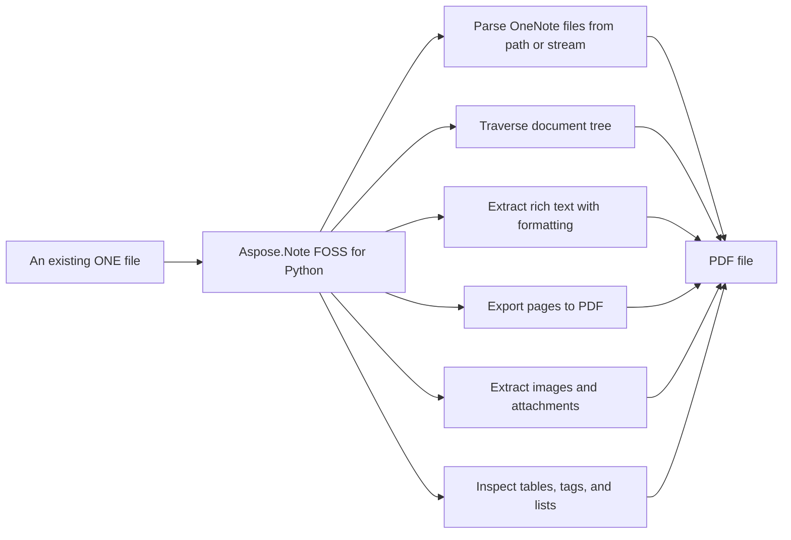

# Aspose.Note FOSS for Python

[](https://pypi.org/project/aspose-note-foss/)  [](https://github.com/aspose-note-foss/Aspose.Note-FOSS-for-Python/actions/workflows/ci.yml) [](LICENSE)

[](https://products.aspose.org/note/python/)

Aspose.Note FOSS for Python reads `.one` files and writes `.pdf` files. It converts documents containing pages, rich text, images, tables, attached files, note tags, and numbered lists from the `.one` format to `.pdf`. The product supports reading from file paths or binary streams and saving with configurable options such as JPEG quality for PDF output.

## Navigation

- [At a Glance](#at-a-glance)
- [Key Capabilities](#key-capabilities)
- [Installation](#installation)
- [Dependencies](#dependencies)
- [Quick Start](#quick-start)
- [Additional Examples](#additional-examples)
- [API Reference](#api-reference)
- [Documentation & Resources](#documentation--resources)
- [Scope and Limitations](#scope-and-limitations)
- [Development and Testing](#development-and-testing)
- [Third-Party Notices](#third-party-notices)
- [License](#license)

## At a Glance



## Key Capabilities

- **Parse OneNote files from path or stream.** It reads `.one` files from a file path or binary stream into a document object model using the `aspose.note.Document` class, supporting both direct file paths and file-like objects without requiring Microsoft OneNote or COM automation.
- **Traverse document tree.** It traverses the document tree using `CompositeNode.GetChildNodes` for type-based node search and the `DocumentVisitor` pattern for full hierarchical traversal, supporting `Page`, `Outline`, `OutlineElement`, `RichText`, `Image`, `Table`, and `AttachedFile` nodes.
- **Extract rich text with formatting.** It extracts rich text content with per-run formatting through `TextRun` and `TextStyle`, supporting bold, italic, underline, strikethrough, superscript, subscript, font, color, and hyperlink properties, as well as paragraph-level styling via `RichText.ParagraphStyle`.
- **Export pages to PDF.** It exports pages to `.pdf` files using `SaveFormat.Pdf` and `PdfSaveOptions`, allowing control over JPEG image quality and other export settings through the `aspose.note.saving` module.
- **Extract images and attachments.** It extracts embedded images and attached files by accessing their Bytes property and associated metadata such as `FileName`, enabling direct saving to disk using standard file I/O operations.
- **Inspect tables, tags, and lists.** It inspects tables through `Table`, rows, and cells; OneNote tags attached to text, images, and tables via `NoteTag` with labels and statuses; and numbered lists through `NumberList` properties including format, number format, and restart behavior.
- **Access page metadata and history.** It accesses page metadata including `Title`, Author, `CreationTime`, and Level, plus retrieves page revision history through `PageHistory` and `Document.GetPageHistory` for version inspection.
- **Handle exceptions for malformed or unsupported files.** It raises `FileCorruptedException` for malformed files, `IncorrectDocumentStructureException` for structural inconsistencies, and `UnsupportedFileFormatException` for unrecognized formats during document loading.

## Installation

Install the published package from PyPI (`aspose-note-foss`, version 26.9.0):

```bash
pip install aspose-note-foss
```

To work from a source checkout instead, install the clone with pip:

```bash
git clone https://github.com/aspose-note-foss/Aspose.Note-FOSS-for-Python.git
cd Aspose.Note-FOSS-for-Python
pip install .
```

Verify the install:

```bash
python -c "import aspose.note"
```

The package declares `python_requires` as `>=3.10`.

## Dependencies

### Required Package Dependencies

No required third-party package dependencies; in `pyproject.toml`, the `project.dependencies` list is empty.

### Optional Dependencies

- `reportlab>=3.6` (extra `pdf`)
- `Pillow>=10.0` (extra `test-pdf`)
- `PyMuPDF>=1.25` (extra `test-pdf`)
- `pypdf>=5.3` (extra `test-pdf`)

### Native and System Requirements

- Requires Python 3.10 or later (`python_requires=">=3.10"` in `pyproject.toml`).

### Development Dependencies

- `build>=1.2` (extra `dev`)
- `twine>=5.0` (extra `dev`)

## Quick Start

The example loads a OneNote file and exports it to PDF using the Save method with `SaveFormat.Pdf`.

```python
from aspose.note import Document, SaveFormat

doc = Document("SimpleTable.one")
doc.Save("out.pdf", SaveFormat.Pdf)
```

The example opens a OneNote file in binary mode, constructs a `Document` from the file handle, and prints its `DisplayName` and page count.

```python
from aspose.note import Document

with open("SimpleTable.one", "rb") as f:
    doc = Document(f)
print(doc.DisplayName, len(list(doc)))
```

PDF export needs the optional `pdf` extra, which pulls in [ReportLab](https://pypi.org/project/reportlab/):

```bash
pip install "aspose-note-foss[pdf]"
```

The PyPI distribution is named `aspose-note-foss`; the import package is
`aspose.note` — `from aspose.note import Document`.

- `reportlab` — pulled in by the `pdf` extra (`pip install "aspose-note-foss[pdf]"`); required only to export pages to PDF via `Document.Save(..., SaveFormat.Pdf)`.
- `pypdf`, `Pillow`, `PyMuPDF` — pulled in by the `test-pdf` extra; used by the PDF golden-output tests to compare generated PDFs against stored manifests, not by the library at runtime.

## Additional Examples

More real, runnable scripts are available in examples/. The most illustrative one beyond Quick Start is saving every embedded image to disk, and additional examples cover loading from a binary stream, traversing tables, extracting attached files, inspecting tags, counting nodes, extracting text, exporting to PDF, extracting hyperlinks, and inspecting numbered lists.

### Save Embedded Images to Disk by Iterating over `Image` Nodes, Reading Their Bytes and `FileName` Properties, and Writing Them to a Directory Created with Pathlib

```python
from pathlib import Path
from aspose.note import Document, Image

out_dir = Path("out_images")
out_dir.mkdir(exist_ok=True)

doc = Document("3ImagesWithDifferentAlignment.one")
for i, img in enumerate(doc.GetChildNodes(Image), start=1):
    name = img.FileName or f"image_{i}.png"
    (out_dir / name).write_bytes(img.Bytes)
```

<details>
<summary>View Additional Examples</summary>

### Traverse Tables by Iterating over `Table`, `TableRow`, and `TableCell` Nodes, Then Join `RichText.Text` Values from Each Cell to Extract Cell Content

```python
from aspose.note import Document, Table, TableRow, TableCell, RichText

doc = Document("SimpleTable.one")
for table in doc.GetChildNodes(Table):
    for row in table.GetChildNodes(TableRow):
        cells = row.GetChildNodes(TableCell)
        values = [" ".join(rt.Text for rt in cell.GetChildNodes(RichText)) for cell in cells]
        print(values)
```

### Extract Attached Files by Iterating over `AttachedFile` Nodes, Reading Their Bytes and `FileName` Properties, and Writing Them to Disk Using Pathlib

```python
from pathlib import Path
from aspose.note import Document, AttachedFile

doc = Document("OnePageWithFile.one")
for i, af in enumerate(doc.GetChildNodes(AttachedFile), start=1):
    name = af.FileName or f"attachment_{i}.bin"
    Path(name).write_bytes(af.Bytes)
```

### Inspect OneNote Tags by Iterating over `RichText` Nodes and Their Tags List, Printing Each Tag's Label and Status

```python
from aspose.note import Document, RichText

doc = Document("TagSizes.one")
for rt in doc.GetChildNodes(RichText):
    for tag in rt.Tags:
        print(tag.Label, tag.Status)
```

### Count Document Nodes by Subclassing `DocumentVisitor`, Overriding `VisitPageStart`, `VisitRichTextStart`, and `VisitImageStart` to Increment Counters, Then Calling `Document.Accept` with the Visitor Instance

```python
from aspose.note import Document, DocumentVisitor, Page, Image, RichText

class Counter(DocumentVisitor):
    def __init__(self):
        self.pages = 0
        self.rich_texts = 0
        self.images = 0

    def VisitPageStart(self, page: Page) -> None:
        self.pages += 1

    def VisitRichTextStart(self, rich_text: RichText) -> None:
        self.rich_texts += 1

    def VisitImageStart(self, image: Image) -> None:
        self.images += 1

doc = Document("3ImagesWithDifferentAlignment.one")
counter = Counter()
doc.Accept(counter)
print(counter.pages, counter.rich_texts, counter.images)
```

### Extract All Text by Iterating over `RichText` Nodes and Collecting Their Text Properties, Then Joining Them with Newlines

```python
from aspose.note import Document, RichText

doc = Document("FormattedRichText.one")
texts = [rt.Text for rt in doc.GetChildNodes(RichText)]
print("\n".join(texts))
```

### Export to PDF with Custom JPEG Quality by Creating `PdfSaveOptions` with `JpegQuality` Set and Passing It To `Document.Save`

```python
from aspose.note import Document, SaveFormat
from aspose.note.saving import PdfSaveOptions

doc = Document("TagSizes.one")
opts = PdfSaveOptions(JpegQuality=90)
doc.Save("out.pdf", opts)
```

### Extract Hyperlinks by Iterating over `RichText` Nodes, Their `TextRuns`, and Checking `TextStyle.IsHyperlink` And `TextStyle.HyperlinkAddress`

```python
from aspose.note import Document, RichText

doc = Document("FormattedRichText.one")
for rt in doc.GetChildNodes(RichText):
    for run in rt.TextRuns:
        if run.Style.IsHyperlink and run.Style.HyperlinkAddress:
            print(run.Text, "->", run.Style.HyperlinkAddress)
```

### Inspect Numbered List Formatting by Iterating over `OutlineElement` Nodes, Reading Their `NumberList` Properties, and Printing Format, `NumberFormat`, and Restart

```python
from aspose.note import Document, OutlineElement

doc = Document("NumberedListWithTags.one")
for oe in doc.GetChildNodes(OutlineElement):
    nl = oe.NumberList
    if nl is None:
        continue
    print("format=", nl.Format, "number_format=", nl.NumberFormat, "restart=", nl.Restart)
```

More real, runnable scripts are available in [`examples/`](examples/). The most illustrative one
beyond Quick Start is saving every embedded image to disk.

</details>

## API Reference

The primary entry point is `aspose.note.Document`, which loads a `.one` file and exposes its pages as a tree of nodes; `Document.Save()` writes the document to PDF. The supported public entry points are `aspose.note` and `aspose.note.saving`.

The verified public surface has 37 types.

<details>
<summary>View the Complete Public API Surface</summary>

### Core API

| Class | Description |
| --- | --- |
| `AttachedFile` | The aspose.note.AttachedFile class represents an attached file node in a document, inheriting from Node and providing access to its bytes and file name. |
| `Document` | The aspose.note.Document class represents a document node that inherits from CompositeNode and provides methods to load, save, and access its pages and layout changes. |
| `DocumentVisitor` | The aspose.note.DocumentVisitor class provides a visitor pattern implementation to traverse and process document nodes including the document itself, pages, outlines, and text elements. |
| `FileCorruptedException` | The aspose.note.FileCorruptedException class represents an error raised when a document file is corrupted and cannot be loaded. |
| `Image` | The aspose.note.Image class represents an image node in a document, inheriting from CompositeNode and providing access to its bytes, format, and dimensions. |
| `IncorrectDocumentStructureException` | The aspose.note.IncorrectDocumentStructureException class represents an error raised when a document has an incorrect or unsupported structure. |
| `IncorrectPasswordException` | The aspose.note.IncorrectPasswordException class represents an error raised when an incorrect password is provided for a protected document. |
| `License` | The aspose.note.License class provides functionality to set a license for the Aspose.Note library. |
| `LoadOptions` | The aspose.note.LoadOptions class provides options for loading a document. |
| `Metered` | The aspose.note.Metered class provides functionality to set metered key credentials for the Aspose.Note library. |
| `Node` | The aspose.note.Node class represents a base node in the document object model. |
| `NoteTag` | The aspose.note.NoteTag class represents a note tag that can be applied to text or other elements in a document. |
| `NumberList` | The aspose.note.NumberList class represents a numbered list that can be applied to text elements in a document. |
| `Outline` | The aspose.note.Outline class represents an outline node in a document, inheriting from CompositeNode and containing outline elements. |
| `OutlineElement` | The aspose.note.OutlineElement class represents an outline element node in a document, inheriting from CompositeNode and containing text or other content. |
| `Page` | The aspose.note.Page class represents a page node in a document, inheriting from CompositeNode and containing title, outline, and other content. |
| `PageHistory` | The aspose.note.PageHistory class represents a history of versions for a page in a document. |
| `ParagraphStyle` | The aspose.note.ParagraphStyle class represents a style that can be applied to paragraphs in a document. |
| `RichText` | The aspose.note.RichText class represents rich text content in a document, inheriting from Node and containing text runs with formatting. |
| `Table` | The aspose.note.Table class represents a table node in a document, inheriting from CompositeNode and containing rows. |
| `TableCell` | The aspose.note.TableCell class represents a table cell node in a document, inheriting from CompositeNode and containing content. |
| `TableColumn` | The aspose.note.TableColumn class represents a table column definition in a document. |
| `TableRow` | The aspose.note.TableRow class represents a table row node in a document, inheriting from CompositeNode and containing cells. |
| `TextRun` | The aspose.note.TextRun class represents a run of text with consistent formatting in a document. |
| `TextStyle` | The aspose.note.TextStyle class represents a style that can be applied to text in a document. |
| `Title` | The aspose.note.Title class represents a title node in a document, inheriting from Node and containing title text. |
| `UnsupportedFileFormatException` | The aspose.note.UnsupportedFileFormatException class represents an error raised when a file format is not supported. |
| `UnsupportedSaveFormatException` | The aspose.note.UnsupportedSaveFormatException class represents an error raised when a save format is not supported. |
| `AsposeNoteError` | The aspose.note.exceptions.AsposeNoteError class represents the base exception class for errors in the Aspose.Note library. |
| `CompositeNode` | The aspose.note.model.CompositeNode class represents a composite node that can contain child nodes in the document object model. |
| `PdfSaveOptions` | The aspose.note.model.PdfSaveOptions class provides options for saving a document to PDF format. |
| `SaveOptions` | The aspose.note.model.SaveOptions class provides base options for saving a document. |

#### Enumerations

| Enumeration | Description |
| --- | --- |
| `FileFormat` | The aspose.note.FileFormat class represents an enumeration of supported file formats for loading and saving documents. |
| `HorizontalAlignment` | The aspose.note.HorizontalAlignment class represents an enumeration of horizontal alignment options for content. |
| `NodeType` | The aspose.note.NodeType class represents an enumeration of node types in the document object model. |
| `SaveFormat` | The aspose.note.SaveFormat class represents an enumeration of supported save formats for exporting documents. |
| `TagStatus` | The aspose.note.TagStatus class represents an enumeration of status values for note tags. |

#### Detailed Member Reference

### Document

The `aspose.note.Document` class loads a `.one` file and exposes its pages as a tree of nodes; it provides `GetPageHistory()`, `DetectLayoutChanges()`, and `Save()` to write the document to PDF.

### Page

The `aspose.note.Page` class represents a page in a document and provides `Clone()`, while `aspose.note.Title` holds the page title text, date, and time, and `aspose.note.PageHistory` manages page revisions with methods such as `Add()`, `Remove()`, and Count.

### RichText

The `aspose.note.RichText` class holds formatted text with `TextRuns`, supports text manipulation via `Append()`, `Insert()`, `Remove()`, and `Replace()`, and exposes Tags and Alignment; `aspose.note.TextRun` and `aspose.note.TextStyle` provide per-run formatting details.

### Image

The `aspose.note.Image` class exposes image data via Bytes and `FileName`, and supports AlternativeTextTitle, AlternativeTextDescription, and HyperlinkUrl.

### AttachedFile

The `aspose.note.AttachedFile` class exposes attached file data via Bytes and `FileName`, and supports Tags.

### Table

The `aspose.note.Table` class represents a table with Columns, IsBordersVisible, and Tags; `aspose.note.TableRow` and `aspose.note.TableCell` provide the row and cell structure.

### NoteTag

The `aspose.note.NoteTag` class represents a tag with Label, Icon, Status, Highlight, `CreationTime`, `CompletedTime`, and `FontColor`, and provides factory methods such as `CreateYellowStar()` and `CreateQuestionMark()`.

### NumberList

The `aspose.note.NumberList` class provides list formatting via Format, `NumberFormat`, Font, `FontSize`, `FontColor`, `IsBold`, `IsItalic`, and Restart, and supports `GetNumberedListHeader()`.

### DocumentVisitor

The `aspose.note.DocumentVisitor` class provides a visitor pattern base with methods such as `VisitPageStart()`, `VisitRichTextStart()`, and `VisitImageStart()` to traverse document nodes.

### SaveFormat

The `aspose.note.SaveFormat` class specifies output formats, currently limited to Pdf.

### saving

The `aspose.note.saving` module provides `PdfSaveOptions` for configuring PDF export, including `JpegQuality` and other settings.

### exceptions

The `aspose.note.exceptions` module defines `FileCorruptedException`, `IncorrectDocumentStructureException`, and `UnsupportedFileFormatException` for error handling.

- `Document(source=None, load_options=None)`
  - `DisplayName: str | None`, `CreationTime: datetime | None`
  - `FileFormat -> FileFormat` — always reports `OneNote2010`, see Scope and Limitations
  - iteration: `for page in doc: ...`
  - `GetPageHistory(page) -> PageHistory`
  - `DetectLayoutChanges()` — compatibility stub, see Scope and Limitations
  - `Save(target, format_or_options=None)` — `SaveFormat.Pdf` only
- `PageHistory`
  - `Current: Page`, `Count: int`, `IsReadOnly: bool`
  - `Add(page)`, `AddRange(pages)`, `Remove(page)`, `RemoveAt(index)`, iteration/indexing
- `DocumentVisitor` — base visitor:
  - `VisitDocumentStart/End`, `VisitPageStart/End`, `VisitTitleStart/End`, `VisitOutlineStart/End`, `VisitOutlineElementStart/End`, `VisitRichTextStart/End`, `VisitImageStart/End`
- `Node`
  - `ParentNode: Node | None`, `Document: Document | None`, `Accept(visitor)`
- Container nodes (`Document`, `Page`, `Title`, `Outline`, `OutlineElement`, `Image`, `Table`, `TableRow`, `TableCell`)
  - `FirstChild`, `LastChild`
  - `AppendChildLast(node)`, `AppendChildFirst(node)`, `InsertChild(index, node)`, `RemoveChild(node)`
  - iteration `for child in node: ...`
  - `GetChildNodes(node_type) -> list[TNode]` — recursive search by type

- `Page`
  - `Title: Title | None`, `Author: str | None`
  - `CreationTime: datetime | None`, `LastModifiedTime: datetime | None`, `Level: int | None`
  - `Clone(cloneHistory=False) -> Page`

- `Title`
  - `TitleText: RichText | None`, `TitleDate: RichText | None`, `TitleTime: RichText | None`

- `OutlineElement`
  - `NumberList: NumberList | None`

- `RichText(Node)`
  - `Text: str`, `TextRuns: list[TextRun]`, `ParagraphStyle: ParagraphStyle`, `Length: int`
  - `Alignment: HorizontalAlignment | None`, `Tags: list[NoteTag]`
  - `Append(text, style=None)`, `Insert(index, text, style=None)`, `Remove(start, count)`, `Replace(old_value, new_value, style=None)`, `Trim()`/`TrimStart()`/`TrimEnd()`, `IndexOf(value, startIndex, count, comparison) -> int`
- `TextRun`
  - `Text: str`, `Style: TextStyle`
- `ParagraphStyle`
  - default paragraph-level text formatting; `ParagraphStyle.Default() -> ParagraphStyle`
- `TextStyle`
  - `IsBold/IsItalic/IsUnderline/IsStrikethrough/IsSuperscript/IsSubscript: bool`, `IsHidden: bool`, `IsMathFormatting: bool`
  - `FontName: str | None`, `FontSize: float | None`, `FontColor: int | None`, `Highlight: int | None`, `Language: int | None`
  - `IsHyperlink: bool`, `HyperlinkAddress: str | None`, `FontStyle: int`
  - `TextStyle.Default()`, `.DefaultMsOneNoteTitleTextStyle()`, `.DefaultMsOneNoteTitleDateStyle()`, `.DefaultMsOneNoteTitleTimeStyle()`
- `Image`
  - `FileName: str | None`, `Bytes: bytes`, `Width`, `Height`
  - `AlternativeTextTitle`, `AlternativeTextDescription`, `HyperlinkUrl`, `Tags: list[NoteTag]`
  - `Replace(image) -> None`
- `AttachedFile(Node)`
  - `FileName: str | None`, `Bytes: bytes`, `Tags: list[NoteTag]`
- `Table`
  - `Columns: list[TableColumn]`, `IsBordersVisible`, `Tags: list[NoteTag]`
- `TableColumn`
  - `Width: float | None`, `LockedWidth: bool`
- `NoteTag`
  - `Label`, `Icon`, `Status: TagStatus`, `Highlight`, `CreationTime`, `CompletedTime`, `FontColor`
  - `NoteTag.CreateYellowStar(label)`, `.CreateQuestionMark(label)`, `.CreateMusicalNote(label)`
- `NumberList`
  - `Format`, `NumberFormat`, `Font`, `FontSize`, `FontColor`, `IsBold`, `IsItalic`, `Restart`
  - `GetNumberedListHeader(number) -> str`

- `LoadOptions`
  - `DocumentPassword: str | None` — not supported, see Scope and Limitations
  - `LoadHistory: bool`
- `SaveOptions` (base)
  - `SaveFormat: SaveFormat`, `PageIndex: int`, `PageCount: int | None`, `FontsSubsystem`
- `PdfSaveOptions(SaveOptions)`
  - `ImageCompression`, `JpegQuality`, `PageSettings`, `PageSplittingAlgorithm`

</details>

## Documentation & Resources

- **[Getting started guide](https://docs.aspose.org/note/python/)** — The getting started guide covers installation, walkthroughs, and feature guides for this library.
- **[How-to guides & FAQ](https://kb.aspose.org/note/python/)** — The how-to guides and FAQ provide task-focused answers for common OneNote-parsing questions.
- **[Full API reference](https://reference.aspose.org/note/python/)** — The full API reference offers a complete, browsable reference for all 39 public types. It covers all 37 verified public types; the [API Reference](#api-reference) section above covers the essentials.
- Found a bug or have a feature request? [Open an issue](https://github.com/aspose-note-foss/Aspose.Note-FOSS-for-Python/issues).

## Scope and Limitations

Aspose.Note FOSS for Python reads `OneNote` files and exports them to PDF; it does not write back to `.one` files, support encrypted documents, or export to formats other than PDF.

- Writing back to `.one` files is not implemented, and `SaveFormat` currently declares only Pdf, so `Document.Save()` raises `UnsupportedSaveFormatException` for any other format or options object.
- `LoadOptions.DocumentPassword` and encrypted documents are not supported — supplying a password raises `IncorrectPasswordException`.
- `License.SetLicense()` and `Metered.SetMeteredKey()` are present for API-shape compatibility with the commercial product but are no-ops in this edition — no license is required to use this library.
- `DetectLayoutChanges()` is a compatibility stub and performs no layout computation.
- All exceptions inherit from `AsposeNoteError`, including `FileCorruptedException` for a malformed `OneStore` container, `IncorrectDocumentStructureException` for an unexpected object graph, and `UnsupportedFileFormatException` when the source isn't a recognized `OneNote` format.
- This project is licensed under the MIT `License`, and the optional PDF-export dependency `ReportLab` is BSD-3-Clause licensed.

The optional PDF-export
dependency, [ReportLab](https://pypi.org/project/reportlab/), is BSD-3-Clause licensed; see
[THIRD_PARTY_NOTICES.md](THIRD_PARTY_NOTICES.md) for the full text.

These limitations don't apply to [full-featured Aspose.Note — Enterprise Edition](https://products.aspose.com/note/). It adds full read/write support (including writing OneNote files back out), broader format conversion, and wider OneNote compatibility beyond what this free edition covers.

## Development and Testing

Aspose.Note FOSS for Python requires Python 3.10 or later and is tested on Python 3.10, 3.11, and 3.12. The test suite resides in the tests/ directory and includes smoke tests, DOM content and document tests, exception handling, rich text formatting, save options, and tag support. PDF golden-output tests compare generated PDFs against manifests in tests/goldens/PDF/ rather than raw bytes to remain stable across platforms and ReportLab internals, using deterministic Base-14 fonts by default. When a PDF test fails, the generated PDFs and manifests are written to tests/out/pdf_golden_failures/ for inspection, and if PyMuPDF is installed, visual diff artifacts are also produced; if PyMuPDF is unavailable but pdftoppm is on PATH, the tests fall back to pdftoppm. Regenerate PDF baselines after intentional changes using `tools/regenerate_pdf_goldens.py`, optionally specifying individual cases.

The suite covers 12 test files under `tests/`. The [ci workflow](.github/workflows/ci.yml) runs with Python 3.10, 3.11 and 3.12. Releases run through the [publish-pypi workflow](.github/workflows/publish-pypi.yml).

To build from a clone, run:

```bash
pip install build
python -m build
```

Clone the repository and install the package together with the test extras used in CI:

```bash
git clone https://github.com/aspose-note-foss/Aspose.Note-FOSS-for-Python.git
cd Aspose.Note-FOSS-for-Python
python -m pip install -e ".[pdf,test-pdf]"
```

```bash
python -m unittest tests.test_imports_smoke -v
python -m unittest tests.test_aspose_note_compat_smoke -v
python -m unittest tests.test_aspose_note_dom_content -v
python -m unittest tests.test_aspose_note_dom_document -v
python -m unittest tests.test_aspose_note_exceptions_and_stubs -v
python -m unittest tests.test_aspose_note_richtext_formatting -v
python -m unittest tests.test_aspose_note_save_options -v
python -m unittest tests.test_aspose_note_tags -v
```

```bash
python -m unittest tests.test_aspose_note_pdf_goldens -v
```

```bash
python tools/regenerate_pdf_goldens.py
```

```bash
python tools/regenerate_pdf_goldens.py --case formatted_richtext --case simple_table
```

Runnable example scripts have their own setup and usage notes in
[`examples/README.md`](examples/README.md).
[`publish-pypi.yml`](.github/workflows/publish-pypi.yml) shows the exact release-time commands
this project runs in CI.

## Third-Party Notices

See [Third-party notices](THIRD_PARTY_NOTICES.md).

## License

This project is licensed under the [MIT License](LICENSE). The MIT License permits use, copying, modification, distribution, sublicensing, and commercial use, provided its copyright and permission notice are retained. The software is provided without warranty.
