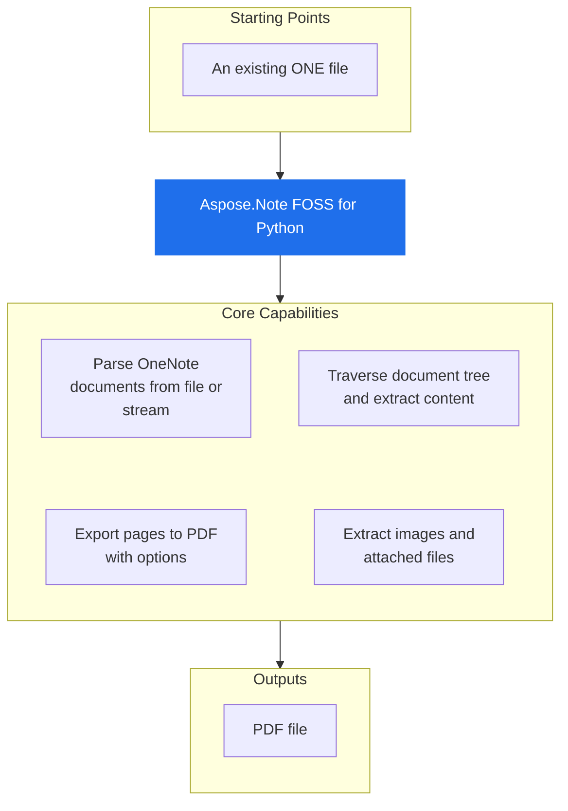

# Aspose.Note FOSS for Python

[](https://pypi.org/project/aspose-note-foss/)  [](https://github.com/aspose-note-foss/Aspose.Note-FOSS-for-Python/actions/workflows/ci.yml) [](LICENSE) [](https://pypi.org/project/aspose-note-foss/)

[](https://products.aspose.org/note/python/)

Aspose.Note FOSS for Python reads `.one` files and converts them to `.pdf`. It exposes classes such as `Document`, `Page`, `RichText`, `Image`, `Table`, `AttachedFile`, and `NoteTag` to inspect and manipulate document content. The product supports saving documents using `SaveFormat.Pdf` or `PdfSaveOptions`, and it provides access to text runs, tags, and number lists through its object model.

## Navigation

- [At a Glance](#at-a-glance)
- [Key Capabilities](#key-capabilities)
- [Installation](#installation)
- [Dependencies](#dependencies)
- [Quick Start](#quick-start)
- [Additional Examples](#additional-examples)
- [API Reference](#api-reference)
- [Documentation & Resources](#documentation--resources)
- [Scope and Limitations](#scope-and-limitations)
- [Development and Testing](#development-and-testing)
- [Third-Party Notices](#third-party-notices)
- [License](#license)

## At a Glance



## Key Capabilities

- **Parse OneNote documents from file or stream.** It reads `.one` files from a file path or binary stream into a document object model using the `aspose.note.Document` class, detecting the format automatically via `aspose.note.FileFormat` without requiring Microsoft OneNote or COM automation.
- **Traverse document tree and extract content.** It traverses the document tree using `CompositeNode.GetChildNodes` for type-based node search or the `DocumentVisitor` pattern to visit `Page`, `Outline`, `OutlineElement`, `RichText`, `Image`, `Table`, and `AttachedFile` nodes, exposing parent-child relationships through `Node.Document` and `Node.ParentNode`.
- **Extract rich text with per-run formatting.** It extracts rich text content with per-run formatting by iterating `TextRun` objects within `RichText`, reading run text and style properties such as bold, italic, underline, strikethrough, superscript, subscript, font, color, and hyperlinks via `TextStyle`.
- **Export pages to PDF with options.** It exports pages to `.pdf` files using `SaveFormat.Pdf` and `PdfSaveOptions`, supporting page range control through `PageIndex` and `PageCount` options.
- **Extract images and attached files.** It extracts embedded images and attached files by accessing their raw bytes, file names, and metadata through the `Image` and `AttachedFile` classes, enabling direct saving to disk.
- **Inspect tables, tags, and numbered lists.** It inspects tables through `Table`, `TableRow`, `TableCell`, and `TableColumn` objects, OneNote tags via `NoteTag` attached to text, images, and tables, and numbered lists through `NumberList` properties on `OutlineElement` nodes.
- **Support for page history and revision metadata.** It supports page history and revision metadata by exposing `PageHistory` through `Document.GetPageHistory` and providing page-level metadata such as `Title`, Author, `CreationTime`, and Level.

- Read page metadata through `Page.Title`, `Page.Author`, `Page.CreationTime`, and `Page.Level`, plus revision history via `PageHistory` and `Document.GetPageHistory()`.
- Extract rich text with per-run formatting through `TextRun` and `TextStyle` (bold, italic, underline, strikethrough, superscript, subscript, font, color, hyperlinks) and paragraph-level styling via `RichText.ParagraphStyle`.

## Installation

Install the published package from PyPI (`aspose-note-foss`, version 26.9.0):

```bash
pip install aspose-note-foss
```

To work from a source checkout instead, install the clone with pip:

```bash
git clone https://github.com/aspose-note-foss/Aspose.Note-FOSS-for-Python.git
cd Aspose.Note-FOSS-for-Python
pip install .
```

Verify the install:

```bash
python -c "import aspose.note"
```

Requires Python 3.10 or later.

## Dependencies

### Required Package Dependencies

No required third-party package dependencies; in `pyproject.toml`, the `project.dependencies` list is empty.

### Optional Dependencies

- `reportlab>=3.6` (extra `pdf`)
- `Pillow>=10.0` (extra `test-pdf`)
- `PyMuPDF>=1.25` (extra `test-pdf`)
- `pypdf>=5.3` (extra `test-pdf`)

### Native and System Requirements

- Requires Python 3.10 or later.

### Development Dependencies

- `build>=1.2` (extra `dev`)
- `twine>=5.0` (extra `dev`)

## Quick Start

This example loads a OneNote file and exports it to PDF using the Save method with `SaveFormat.Pdf`.

```python
from aspose.note import Document, SaveFormat

doc = Document("SimpleTable.one")
doc.Save("out.pdf", SaveFormat.Pdf)
```

This example opens a OneNote file in binary mode, loads it into a `Document` object, and prints its `DisplayName` and page count.

```python
from aspose.note import Document

with open("SimpleTable.one", "rb") as f:
    doc = Document(f)
print(doc.DisplayName, len(list(doc)))
```

PDF export needs the optional `pdf` extra, which pulls in [ReportLab](https://pypi.org/project/reportlab/):

```bash
pip install "aspose-note-foss[pdf]"
```

The PyPI distribution is named `aspose-note-foss`; the import package is
`aspose.note` — `from aspose.note import Document`.

- `reportlab` — pulled in by the `pdf` extra (`pip install "aspose-note-foss[pdf]"`); required only to export pages to PDF via `Document.Save(..., SaveFormat.Pdf)`.
- `pypdf`, `Pillow`, `PyMuPDF` — pulled in by the `test-pdf` extra; used by the PDF golden-output tests to compare generated PDFs against stored manifests, not by the library at runtime.

## Additional Examples

The following workflows demonstrate reading embedded content, traversing structures, inspecting tags and hyperlinks, exporting to PDF, and counting nodes.

### Save Embedded Images to Disk by Iterating `Image` Nodes and Writing Their Bytes to Files

```python
from pathlib import Path
from aspose.note import Document, Image

out_dir = Path("out_images")
out_dir.mkdir(exist_ok=True)

doc = Document("3ImagesWithDifferentAlignment.one")
for i, img in enumerate(doc.GetChildNodes(Image), start=1):
    name = img.FileName or f"image_{i}.png"
    (out_dir / name).write_bytes(img.Bytes)
```

<details>
<summary>View Additional Examples</summary>

### Traverse Tables and Extract Cell Text by Iterating `Table`, `TableRow`, `TableCell`, and `RichText` Nodes

```python
from aspose.note import Document, Table, TableRow, TableCell, RichText

doc = Document("SimpleTable.one")
for table in doc.GetChildNodes(Table):
    for row in table.GetChildNodes(TableRow):
        cells = row.GetChildNodes(TableCell)
        values = [" ".join(rt.Text for rt in cell.GetChildNodes(RichText)) for cell in cells]
        print(values)
```

### Extract Attached Files from a Document by Iterating `AttachedFile` Nodes and Writing Their Bytes to Files

```python
from pathlib import Path
from aspose.note import Document, AttachedFile

doc = Document("OnePageWithFile.one")
for i, af in enumerate(doc.GetChildNodes(AttachedFile), start=1):
    name = af.FileName or f"attachment_{i}.bin"
    Path(name).write_bytes(af.Bytes)
```

### Inspect OneNote Tags and Their Status by Iterating `RichText` Nodes and Reading Each Tag's Label and Status

```python
from aspose.note import Document, RichText

doc = Document("TagSizes.one")
for rt in doc.GetChildNodes(RichText):
    for tag in rt.Tags:
        print(tag.Label, tag.Status)
```

### Count Document Nodes Using a `DocumentVisitor` by Subclassing It and Overriding `VisitPageStart`, `VisitRichTextStart`, And `VisitImageStart`

```python
from aspose.note import Document, DocumentVisitor, Page, Image, RichText

class Counter(DocumentVisitor):
    def __init__(self):
        self.pages = 0
        self.rich_texts = 0
        self.images = 0

    def VisitPageStart(self, page: Page) -> None:
        self.pages += 1

    def VisitRichTextStart(self, rich_text: RichText) -> None:
        self.rich_texts += 1

    def VisitImageStart(self, image: Image) -> None:
        self.images += 1

doc = Document("3ImagesWithDifferentAlignment.one")
counter = Counter()
doc.Accept(counter)
print(counter.pages, counter.rich_texts, counter.images)
```

### Extract All Text from Rich Text Nodes by Iterating `RichText` Nodes and Reading Their Text Property

```python
from aspose.note import Document, RichText

doc = Document("FormattedRichText.one")
texts = [rt.Text for rt in doc.GetChildNodes(RichText)]
print("\n".join(texts))
```

### Export to PDF with Custom Options by Passing `PdfSaveOptions` with `JpegQuality` Set To `Document.Save`

```python
from aspose.note import Document, SaveFormat
from aspose.note.saving import PdfSaveOptions

doc = Document("TagSizes.one")
opts = PdfSaveOptions(JpegQuality=90)
doc.Save("out.pdf", opts)
```

### Extract Hyperlinks and Their Addresses by Iterating `TextRun` Objects Within `RichText` and Checking `IsHyperlink` And `HyperlinkAddress`

```python
from aspose.note import Document, RichText

doc = Document("FormattedRichText.one")
for rt in doc.GetChildNodes(RichText):
    for run in rt.TextRuns:
        if run.Style.IsHyperlink and run.Style.HyperlinkAddress:
            print(run.Text, "->", run.Style.HyperlinkAddress)
```

### Inspect Numbered List Formatting Properties by Iterating `OutlineElement` Nodes and Reading `NumberList.Format`, `NumberFormat`, and Restart

```python
from aspose.note import Document, OutlineElement

doc = Document("NumberedListWithTags.one")
for oe in doc.GetChildNodes(OutlineElement):
    nl = oe.NumberList
    if nl is None:
        continue
    print("format=", nl.Format, "number_format=", nl.NumberFormat, "restart=", nl.Restart)
```

More real, runnable scripts are available in [`examples/`](examples/). The most illustrative one
beyond Quick Start is saving every embedded image to disk.

Runnable example scripts have their own setup and usage notes in
[`examples/README.md`](examples/README.md).
[`publish-pypi.yml`](.github/workflows/publish-pypi.yml) shows the exact release-time commands
this project runs in CI.

</details>

## API Reference

The primary entry point is `aspose.note.Document`, which loads a `.one` file and exposes its pages as a tree of `Page`, `Outline`, `OutlineElement`, `RichText`, `Image`, `Table`, and `AttachedFile` nodes; `Document.Save()` is the sole write path, currently limited to PDF via `aspose.note.saving`.

The public API has 37 types.

<details>
<summary>View the Complete Public API Surface</summary>

### Core API

| Class | Description |
| --- | --- |
| `AttachedFile` | AttachedFile class holds the file bytes, file name, and tags of an attached file. |
| `Document` | Document class represents a OneNote document and provides methods to detect layout changes, get page history, and save the document. |
| `DocumentVisitor` | DocumentVisitor class provides methods to visit document, page, outline, outline element, rich text, image, and title nodes. |
| `FileCorruptedException` | FileCorruptedException class represents an error raised when a file is corrupted. |
| `Image` | Image class holds the image bytes, file name, file path, format, original dimensions, and alignment, and provides a method to replace the image. |
| `IncorrectDocumentStructureException` | Declared; not thrown by library code. |
| `IncorrectPasswordException` | IncorrectPasswordException class represents an error raised when a password is incorrect. |
| `License` | License class provides a method to set the license. |
| `LoadOptions` | LoadOptions class holds options for loading a document. |
| `Metered` | Metered class provides a method to set the metered key. |
| `Node` | Node class provides methods to accept a visitor, and read-only properties for the document and parent node. |
| `NoteTag` | NoteTag class provides methods to create musical note, question mark, and yellow star tags, and holds completed time, creation time, font color, highlight, and icon. |
| `NumberList` | NumberList class provides a method to get the number list header. |
| `Outline` | Outline class represents an outline node. |
| `OutlineElement` | OutlineElement class represents an outline element node. |
| `Page` | Page class represents a page node and provides a method to clone the page. |
| `PageHistory` | PageHistory class provides methods to add, remove, clear, and access pages, and its IsReadOnly property always returns False. |
| `ParagraphStyle` | ParagraphStyle class provides a method to get the default style and a read-only property for font style. |
| `RichText` | RichText class provides methods to append, insert, clear, and replace text, and holds alignment and title date information. |
| `Table` | Table class holds the table columns and tags. |
| `TableCell` | TableCell class represents a table cell node. |
| `TableColumn` | TableColumn class represents a table column. |
| `TableRow` | TableRow class represents a table row node. |
| `TextRun` | TextRun class represents a text run node. |
| `TextStyle` | TextStyle class provides methods to get default styles and holds font color, font name, font size, and font style. |
| `Title` | Title class holds the title text, title date, and title time. |
| `UnsupportedFileFormatException` | UnsupportedFileFormatException class represents an error raised when a file format is unsupported and holds the unsupported file format. |
| `UnsupportedSaveFormatException` | UnsupportedSaveFormatException class represents an error raised when a save format is unsupported. |
| `AsposeNoteError` | AsposeNoteError class is the base exception class for Aspose.Note errors. |
| `CompositeNode` | CompositeNode class provides methods to append, insert, and remove child nodes, and read-only properties for first and last child. |
| `PdfSaveOptions` | PdfSaveOptions class holds options for saving a document to PDF. |
| `SaveOptions` | SaveOptions class provides a read-only property for the save format and raises TypeError on initialization. |

#### Enumerations

| Enumeration | Description |
| --- | --- |
| `FileFormat` | FileFormat enum lists the OneNote2007, OneNote2010, OneNoteOnline, and Unknown file formats. |
| `HorizontalAlignment` | HorizontalAlignment enum lists the Left, Center, and Right horizontal alignment values. |
| `NodeType` | NodeType enum lists the AttachedFile, Document, Image, Outline, OutlineElement, Page, RichText, and Table node types. |
| `SaveFormat` | SaveFormat enum lists the Pdf save format. |
| `TagStatus` | TagStatus enum lists the Completed, Disabled, and Open tag statuses. |

#### Detailed Member Reference

### Document

The `aspose.note.Document` class loads a `.one` file and provides access to its pages through iteration, with `Document.GetPageHistory()` returning a `PageHistory` for the first page, and `Document.Save()` writing the document to PDF using `SaveFormat.Pdf`.

### RichText

The `aspose.note.RichText` class holds formatted text content with properties such as Text, `TextRuns`, Alignment, and `ParagraphStyle`, and supports operations like Append, Insert, Remove, and Trim to modify its content.

### Image

The `aspose.note.Image` class represents an image node with properties like Bytes, `FileName`, Format, and Alignment, and `aspose.note.AttachedFile` represents an attached file with properties such as `FileName`, `DisplayName`, and Bytes.

### Table

The `aspose.note.Table` class organizes content in rows and cells, with `TableRow` and `TableCell` providing access to their child nodes and formatting properties such as Style and Text.

### SaveFormat

The `aspose.note.SaveFormat` enumeration currently supports only Pdf, and `aspose.note.saving` provides the `PdfSaveOptions` class used by `Document.Save()` to control PDF export behavior.

The
supported public entry points are `aspose.note` and `aspose.note.saving` — everything under
`aspose.note._internal` is an implementation detail and may change.

| Class | Description |
|---|---|
| `AsposeNoteError` | Base exception for the library; all other library exceptions inherit from it. |
| `AttachedFile` | A file attached to a page — exposes its raw `Bytes`, `FileName`, and `Tags`. |
| `CompositeNode` | Base class for every container node (`Document`, `Page`, `Table`, ...); provides child-node access and `GetChildNodes()`. |
| `Document` | The root DOM object — loads a `.one` file or stream, exposes its `Page` children, and is the sole `Save()` entry point. |
| `DocumentVisitor` | Base visitor class for traversing the DOM via `Visit*Start`/`Visit*End` callbacks. |
| `FileCorruptedException` | Raised when the source file's OneStore container is malformed. |
| `Image` | An embedded image — bytes, file name, dimensions, alignment, and OneNote tags. |
| `IncorrectPasswordException` | Raised when `LoadOptions.DocumentPassword` is supplied — password-protected documents are not supported. |
| `License` | Compatibility surface for the commercial licensing API; see Scope and Limitations. |
| `LoadOptions` | Options passed to `Document()` — `DocumentPassword` and `LoadHistory`. |
| `Metered` | Compatibility surface for the commercial metered-licensing API; see Scope and Limitations. |
| `Node` | Base class for every DOM node — `ParentNode`, `Document`, and `Accept()`. |
| `NoteTag` | A OneNote tag (yellow star, question mark, musical note, or custom) attached to text, images, or tables. |
| `NumberList` | Numbered-list formatting applied to an `OutlineElement`. |
| `Outline` | A positioned container of `OutlineElement` nodes on a page. |
| `OutlineElement` | A single outline item — may hold `RichText`, `Image`, `Table`, or nested content, plus an optional `NumberList`. |
| `Page` | A single OneNote page — title, author, timestamps, level, and revision history. |
| `PageHistory` | The ordered revision history for a `Page`, returned by `Document.GetPageHistory()`. |
| `ParagraphStyle` | Default paragraph-level text formatting used by `RichText.ParagraphStyle`. |
| `RichText` | A run of formatted text content — `Text`, `TextRuns`, alignment, and tags. |
| `Table` | A table on a page — columns, border visibility, and tags. |
| `TableCell` | A single cell within a `TableRow`, holding rich text, images, or nested content as child nodes. |
| `TableColumn` | A table column's width and lock state. |
| `TableRow` | A row within a `Table`, containing one `TableCell` per column. |
| `TextRun` | A single formatted run within `RichText.Text` — `Text` plus its `TextStyle`. |
| `TextStyle` | Character-level formatting — bold, italic, underline, font, color, hyperlink, and more. |
| `Title` | A page's title — `TitleText`, `TitleDate`, and `TitleTime`, each a `RichText`. |
| `UnsupportedFileFormatException` | Raised when the source isn't a recognized OneNote format; carries the detected `FileFormat`. |
| `UnsupportedSaveFormatException` | Raised by `Document.Save()` for anything other than `SaveFormat.Pdf`. |

| Enumeration | Description |
|---|---|
| `FileFormat` | The detected OneNote source format (`Unknown`, `OneNote2010`, `OneNoteOnline`, `OneNote2007`). |
| `HorizontalAlignment` | Horizontal text/image alignment (`Left`, `Center`, `Right`). |
| `NodeType` | The DOM node kind used by `CompositeNode.GetChildNodes(node_type)`. |
| `SaveFormat` | The output format accepted by `Document.Save()` — currently only `Pdf`. |
| `TagStatus` | A `NoteTag`'s completion state (`Open`, `Completed`, `Disabled`). |

- `Page`
  - `Title: Title | None`, `Author: str | None`
  - `CreationTime: datetime | None`, `LastModifiedTime: datetime | None`, `Level: int | None`
  - `Clone(cloneHistory=False) -> Page`

- `Title`
  - `TitleText: RichText | None`, `TitleDate: RichText | None`, `TitleTime: RichText | None`

- `Outline`
  - `HorizontalOffset`, `VerticalOffset`, `MaxWidth`, `MaxHeight`, `MinWidth`, `ReservedWidth`, `IndentPosition`, `DescendantsCannotBeMoved`, `LastModifiedTime`

- `OutlineElement`
  - `NumberList: NumberList | None`

- `LoadOptions`
  - `DocumentPassword: str | None` — not supported, see Scope and Limitations
  - `LoadHistory: bool`
- `SaveOptions` (base)
  - `SaveFormat: SaveFormat`, `PageIndex: int`, `PageCount: int | None`, `FontsSubsystem`
- `PdfSaveOptions(SaveOptions)`
  - `ImageCompression`, `JpegQuality`, `PageSettings`, `PageSplittingAlgorithm`

- `License.SetLicense(license_path_or_stream)` — no-op in this edition, see Scope and Limitations
- `Metered.SetMeteredKey(public_key, private_key)` — no-op in this edition, see Scope and Limitations

- `FileFormat`: `Unknown`, `OneNote2010`, `OneNoteOnline`, `OneNote2007`

- `SaveFormat`: `Pdf`

- `HorizontalAlignment`: `Left`, `Center`, `Right`

- `NodeType`: `Document`, `Page`, `Outline`, `OutlineElement`, `RichText`, `Image`, `Table`, `AttachedFile`

- `TagStatus`: `Open`, `Completed`, `Disabled`

- `AsposeNoteError` — base exception for the library

- `FileCorruptedException` — the OneStore container is malformed

- `IncorrectDocumentStructureException` — the parsed object graph doesn't match the expected structure

- `IncorrectPasswordException` — a password was supplied; password-protected documents aren't supported

- `UnsupportedFileFormatException` — the source isn't a recognized OneNote format (carries `FileFormat`)

- `UnsupportedSaveFormatException` — `Document.Save()` was called with anything other than `SaveFormat.Pdf`

</details>

## Documentation & Resources

- **[Getting started guide](https://docs.aspose.org/note/python/)** — installation, walkthroughs, and feature guides for this library.
- **[How-to guides & FAQ](https://kb.aspose.org/note/python/)** — task-focused answers for common OneNote-parsing questions.
- **[Full API reference](https://reference.aspose.org/note/python/)** — the complete, browsable reference for all 37 public types (the [API reference](#api-reference) section above covers the essentials).
- Found a bug or have a feature request? [Open an issue](https://github.com/aspose-note-foss/Aspose.Note-FOSS-for-Python/issues).

## Scope and Limitations

- `Document(source=None, load_options=None)`
  - `DisplayName: str | None`, `CreationTime: datetime | None`
  - `FileFormat -> FileFormat` — always reports `OneNote2010`, see Scope and Limitations
  - iteration: `for page in doc: ...`
  - `GetPageHistory(page) -> PageHistory`
  - `DetectLayoutChanges()` — compatibility stub, see Scope and Limitations
  - `Save(target, format_or_options=None)` — `SaveFormat.Pdf` only
- `PageHistory`
  - `Current: Page`, `Count: int`, `IsReadOnly: bool`
  - `Add(page)`, `AddRange(pages)`, `Remove(page)`, `RemoveAt(index)`, iteration/indexing
- `DocumentVisitor` — base visitor:
  - `VisitDocumentStart/End`, `VisitPageStart/End`, `VisitTitleStart/End`, `VisitOutlineStart/End`, `VisitOutlineElementStart/End`, `VisitRichTextStart/End`, `VisitImageStart/End`
- `Node`
  - `ParentNode: Node | None`, `Document: Document | None`, `Accept(visitor)`

- Writing back to `.one` is not implemented — this library only reads OneNote files.
- `LoadOptions.DocumentPassword` / encrypted documents are not supported — supplying a password raises `IncorrectPasswordException`.
- `SaveFormat` currently declares only `Pdf` — `Document.Save()` raises `UnsupportedSaveFormatException` for any other format or options object.
- `License.SetLicense()` and `Metered.SetMeteredKey()` are present for API-shape compatibility with the commercial product but are no-ops in this edition — no license is required to use this library.
- `DetectLayoutChanges()` is a compatibility stub and performs no layout computation.

The optional PDF-export dependency, [ReportLab](https://pypi.org/project/reportlab/), is BSD-3-Clause licensed; see [THIRD_PARTY_NOTICES.md](THIRD_PARTY_NOTICES.md) for the full text.

<details>
<summary>View Other Unimplemented Members</summary>

- `IncorrectDocumentStructureException` is declared but unused by the library's own code.

</details>

These limitations don't apply to [full-featured Aspose.Note — Enterprise Edition](https://products.aspose.com/note/). It adds full read/write support (including writing OneNote files back out), broader format conversion, and wider OneNote compatibility beyond what this free edition covers.

## Development and Testing

The suite covers 12 test files under `tests/`. The [ci workflow](.github/workflows/ci.yml) runs with Python 3.10, 3.11 and 3.12. Releases run through the [publish-pypi workflow](.github/workflows/publish-pypi.yml). Example programs live under `examples/`.

To build from a clone, run:

```bash
pip install build
python -m build
```

Clone the repository and install the package together with the test extras used in CI:

```bash
git clone https://github.com/aspose-note-foss/Aspose.Note-FOSS-for-Python.git
cd Aspose.Note-FOSS-for-Python
python -m pip install -e ".[pdf,test-pdf]"
```

Run the unit test suite the same way [`ci.yml`](.github/workflows/ci.yml) does:

```bash
python -m unittest tests.test_imports_smoke -v
python -m unittest tests.test_aspose_note_compat_smoke -v
python -m unittest tests.test_aspose_note_dom_content -v
python -m unittest tests.test_aspose_note_dom_document -v
python -m unittest tests.test_aspose_note_exceptions_and_stubs -v
python -m unittest tests.test_aspose_note_richtext_formatting -v
python -m unittest tests.test_aspose_note_save_options -v
python -m unittest tests.test_aspose_note_tags -v
```

The PDF golden-output tests (`tests.test_aspose_note_pdf_goldens`) compare generated PDFs against manifests in `tests/goldens/pdf/`, not raw bytes, so they stay stable across platforms and ReportLab internals. The PDF writer uses deterministic Base-14 fonts by default; set `ASPOSE_NOTE_PDF_USE_SYSTEM_FONTS=1` before export if you want to try Windows system fonts for local inspection instead:

```bash
python -m unittest tests.test_aspose_note_pdf_goldens -v
```

On a mismatch, the generated PDFs and manifests are written to `tests/out/pdf_golden_failures/` for inspection. If `PyMuPDF` is installed, the failing test also renders baseline/generated pages to PNG and writes visual diff artifacts into the same output tree; if `PyMuPDF` is unavailable but `pdftoppm` is on `PATH`, the tests fall back to `pdftoppm` as the renderer.

Regenerate the golden baselines after an intentional PDF-output change with [`tools/regenerate_pdf_goldens.py`](tools/regenerate_pdf_goldens.py):

```bash
python tools/regenerate_pdf_goldens.py
```

Regenerate only selected cases:

```bash
python tools/regenerate_pdf_goldens.py --case formatted_richtext --case simple_table
```

## Third-Party Notices

See [Third-party notices](THIRD_PARTY_NOTICES.md).

## License

This project is licensed under the [MIT License](LICENSE). The MIT License permits use, copying, modification, distribution, sublicensing, and commercial use, provided its copyright and permission notice are retained. The software is provided without warranty.
