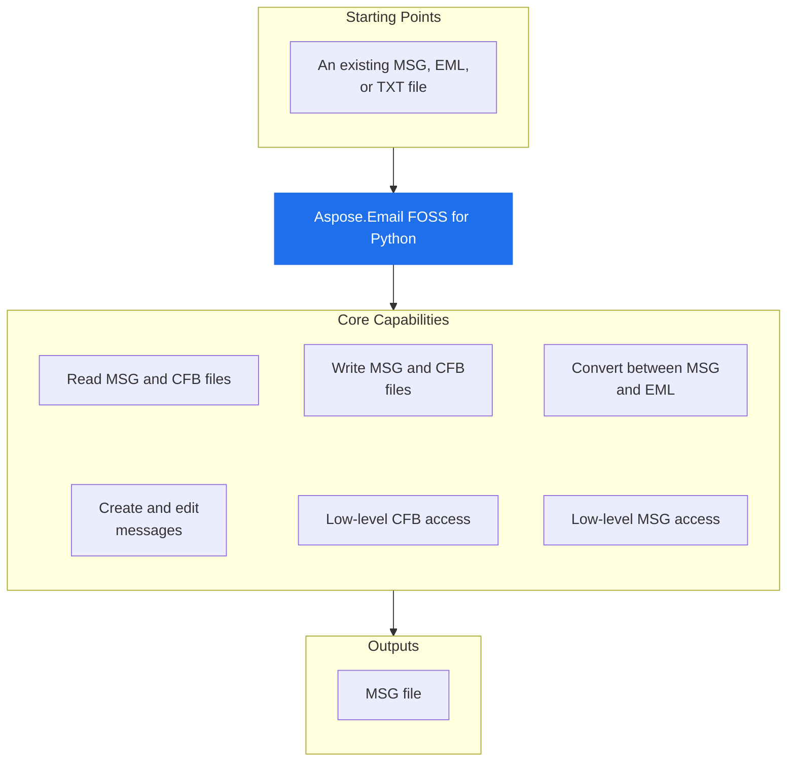

# Aspose.Email FOSS for Python

[](https://pypi.org/project/aspose-email-foss/)  [](https://github.com/aspose-email-foss/Aspose.Email-FOSS-for-Python/actions/workflows/ci.yml) [](LICENSE) [](https://github.com/aspose-email-foss/Aspose.Email-FOSS-for-Python/graphs/contributors) [](https://pypi.org/project/aspose-email-foss/)

[](https://products.aspose.org/email/python/)

Aspose.Email FOSS for Python reads `.msg`, `.eml`, and `.txt` files, writes `.msg` files, and converts between these formats. It reads `.msg` files using the CFB format and provides classes to parse and write message structures. It supports MAPI message objects through the `MapiMessage` class, which can be created from scratch, loaded from files, or converted to and from email messages.

Aspose.Email FOSS for Python is a free, open-source, MIT-licensed, pure-Python library for
deterministic Compound File Binary (CFB) and Outlook `.msg` message processing — no Microsoft
Outlook installation, COM interop, or compiled extensions required. It provides low-level CFB and
MSG readers/writers alongside a high-level, mutable `MapiMessage` API for creating, editing, and
saving messages, including two-way conversion with Python's own
[`email.message.EmailMessage`](https://docs.python.org/3/library/email.message.html#email.message.EmailMessage).

## Navigation

- [At a Glance](#at-a-glance)
- [Key Capabilities](#key-capabilities)
- [Installation](#installation)
- [Dependencies](#dependencies)
- [Quick Start](#quick-start)
- [Additional Examples](#additional-examples)
- [API Reference](#api-reference)
- [Documentation & Resources](#documentation--resources)
- [Scope and Limitations](#scope-and-limitations)
- [Development and Testing](#development-and-testing)
- [License](#license)

## At a Glance



## Key Capabilities

- **Read MSG and CFB files.** It reads Outlook `.msg` files and Compound File Binary (CFB) containers using `CFBReader`, supporting file paths and raw bytes, with directory traversal, path resolution, and stream data extraction.
- **Write MSG and CFB files.** It writes Outlook `.msg` files and Compound File Binary (CFB) containers using `CFBWriter`, enabling programmatic creation of CFB documents and direct serialization to bytes or files.
- **Convert between MSG and EML.** It converts between Outlook `.msg` and standard `.eml` formats by transforming `MapiMessage` objects to EmailMessage instances and vice versa, preserving message content and structure.
- **Create and edit messages.** It creates and edits messages through `MapiMessage`, supporting subject, body, recipients, attachments, MAPI properties, and named properties, with methods for adding attachments and saving to `.msg` files.
- **Low-level CFB access.** It provides low-level access to Compound File Binary structures through `CFBDocument`, `CFBStorage`, and `CFBReader`, enabling manual construction, traversal, and inspection of storages and streams.
- **Low-level MSG access.** It offers low-level Outlook `.msg` document access through `MsgReader`, `MsgDocument`, and `MsgWriter`, supporting direct parsing of property streams and subobject streams for detailed message inspection.

The following features are grouped by processing layer, from low-level CFB and MSG access up
through the high-level `MapiMessage` API and its `EmailMessage` bridge. Together they cover the
library's main supported scenarios.

- `CFBReader` reads Compound File Binary (CFB) containers from a file path or raw bytes
  (`CFBReader.from_file()` or `CFBReader(data)`), and traverses storages, streams, and the
  directory tree (`iter_storages()`, `iter_streams()`, `iter_tree()`, `resolve_path()`).
- Build and write CFB containers with `CFBStorage`, `CFBStream`, `CFBDocument`, and `CFBWriter`
  (`CFBWriter.to_bytes()` / `write_file()`).
- Regular attachments (`MapiMessage.add_attachment()`) and embedded-message attachments
  (`MapiAttachment.is_embedded_message`, `add_embedded_message_attachment()`) are both supported.
- Outlook-oriented compatibility defaults — a default `SMTP` sender address type, one-off
  recipient entry IDs, and search keys — are applied automatically when creating a new message
  from scratch, so authored messages interoperate cleanly with real Outlook clients.

## Installation

Install the published package from PyPI (`aspose-email-foss`, version 26.3):

```bash
pip install aspose-email-foss
```

To work from a source checkout instead, install the clone with pip:

```bash
git clone https://github.com/aspose-email-foss/Aspose.Email-FOSS-for-Python.git
cd Aspose.Email-FOSS-for-Python
pip install .
```

Verify the install:

```bash
python -c "import aspose.email_foss"
```

The package declares `requires-python` as `>=3.10`.

## Dependencies

### Required Package Dependencies

No required third-party package dependencies; in `pyproject.toml`, no `project.dependencies` is declared.

### Native and System Requirements

- Requires Python 3.10 or later (`requires-python=">=3.10"` in `pyproject.toml`).

## Quick Start

The first example reads a MSG file and prints its subject line using the `MapiMessage` class.

```python
from aspose.email_foss import msg

with msg.MapiMessage.from_file("sample.msg") as message:
    print(message.subject)
```

The second example creates a new MSG file with sender, recipient, and attachment properties, saves it, then loads and exports it to EML format.

```python
from aspose.email_foss import msg

message = msg.MapiMessage.create("Hello", "Body")
message.set_property(msg.PropertyId.SENDER_NAME, "Alice")
message.set_property(msg.PropertyId.SENDER_EMAIL_ADDRESS, "alice@example.com")
message.add_recipient("bob@example.com", display_name="Bob")
message.add_attachment("note.txt", b"abc", mime_type="text/plain")
message.save("hello.msg")

with msg.MapiMessage.from_file("hello.msg") as loaded:
    email_message = loaded.to_email_message()
    with open("hello.eml", "wb") as target:
        target.write(email_message.as_bytes())
```

## Additional Examples

The following workflows demonstrate converting messages between MSG and EML formats, and reading structured storage streams.

### Convert MSG to EML Using `MapiMessage` and Email Message APIs

```python
from aspose.email_foss import msg

with msg.MapiMessage.from_file("message.msg") as message:
    email_message = message.to_email_message()

with open("message.eml", "wb") as target:
    target.write(email_message.as_bytes())
```

<details>
<summary>View Additional Examples</summary>

### Convert EML to MSG Using Email Parser and `MapiMessage` APIs

```python
from email import policy
from email.parser import BytesParser

from aspose.email_foss import msg

with open("message.eml", "rb") as source:
    email_message = BytesParser(policy=policy.default).parse(source)

message = msg.MapiMessage.from_email_message(email_message)
message.save("message.msg")
```

### Read Structured Storage Streams Using CFB APIs

```python
from aspose.email_foss.cfb import CFBDocument, CFBReader, CFBStorage, CFBStream, CFBWriter, ROOT_ENTRY_NAME

root = CFBStorage(ROOT_ENTRY_NAME)
root.add_stream(CFBStream("Summary", b"hello"))

data = CFBWriter.to_bytes(CFBDocument(root=root, major_version=3))
reader = CFBReader(data)
entry = reader.resolve_path(["Summary"])
print(reader.get_stream_data(entry.stream_id))
```

### Inspect Low-Level MSG and CFB Structure

Open a `.msg` through `MsgReader` and inspect the underlying CFB container and property-stream
header (excerpted from `examples/msg_reader.py`):

```python
from aspose.email_foss import msg

with msg.MsgReader.from_file(msg_path) as reader:
    cfb = reader.cfb_reader
    print(f"major_version={cfb.major_version} sector_size={cfb.sector_size}")

    header = reader.top_level_header
    print(f"recipient_count={header.recipient_count} attachment_count={header.attachment_count}")

    for entry in reader.iter_recipient_storages():
        print(f"recipient storage: {entry.name}")
```

Full runnable examples are available under [`examples/`](examples/) (see
[`examples/README.md`](examples/README.md) for a task-to-script index).

</details>

## API Reference

Aspose.Email FOSS for Python provides high-level MSG and low-level MSG and CFB APIs for reading, writing, and converting email formats. The high-level MSG API centers on `MapiMessage` for message creation, editing, and conversion, while the low-level MSG API uses `MsgReader` and `MsgWriter` for direct property-stream access, and the low-level CFB API uses `CFBReader` and `CFBWriter` for raw Compound File Binary container access.

The public API has 30 types.

<details>
<summary>View the Complete Public API Surface</summary>

### Core API

| Class | Description |
| --- | --- |
| `CFBDocument` | Mutable Compound File Binary (CFB) document description. |
| `CFBError` | Raised for malformed or unsupported Compound File Binary (CFB) content. |
| `CFBReader` | Reusable reader for Compound File Binary (CFB) containers. |
| `CFBStorage` | Mutable storage node used by the CFB writer. |
| `CFBStream` | Mutable stream node used by the CFB writer. |
| `CFBWriter` | Deterministic serializer for Compound File Binary (CFB) containers. |
| `DirectoryEntry` | Fixed-size directory record for one storage/stream object and its tree links. |
| `Header` | Header record at file offset 0 defining Compound File Binary (CFB) geometry and allocation chain entry points. |
| `MapiAttachment` | Mutable attachment object. |
| `MapiMessage` | Mutable high-level MSG object with MSG and EmailMessage conversion support. |
| `MapiNamedProperty` | Identifier for a named MAPI property. |
| `MapiProperty` | Logical MAPI property with optional named-property identity. |
| `MapiRecipient` | Mutable recipient object. |
| `MsgDocument` | Mutable MSG document model that can be serialized through the CFB writer. |
| `MsgError` | Raised for malformed or unsupported MSG structures. |
| `MsgReader` | Normative top-level MSG containment and stream requirements for container traversal. |
| `MsgStorage` | Mutable MSG storage node with role classification and parsed property-stream metadata. |
| `MsgStream` | Mutable MSG stream node with raw bytes and CFB metadata. |
| `MsgWriter` | Serializer that writes a MsgDocument into a CFB-backed .msg payload. |
| `PropertyEntryFixedLength` | Fixed-length property stream entry containing property tag, flags, and inline 8-byte value payload. |
| `PropertyStreamHeaderSubobject` | Property stream header used in recipient and attachment storages, containing only reserved bytes. |
| `PropertyStreamHeaderTopLevel` | Top-level property stream header containing next-id counters and counts for recipients and attachments. |
| `StorageLayout` | Naming and containment rules for recipient, attachment, embedded message, and nameid storages. |
| `MapiPropertyCollection` | MapiPropertyCollection class provides methods to add, get, set, remove, and iterate over MAPI properties, with methods add, get, set, remove, and iter_properties. |

#### Enumerations

| Enumeration | Description |
| --- | --- |
| `DirectoryColorFlag` | Stores the red-black tree color used by directory sibling links. |
| `DirectoryObjectType` | Classifies the directory entry payload as unallocated, storage, stream, or root storage. |
| `SectorMarker` | Special FAT marker values reserved for sector allocation metadata. |
| `CommonMessagePropertyId` | Common MAPI property identifiers used by the MSG reader/writer for core message semantics. |
| `PropertyId` | Common property identifiers paired with their default MAPI property types. |
| `PropertyTypeCode` | MAPI property type codes used in MSG property tags and value stream names. |

#### Detailed Member Reference

### MapiMessage

The `MapiMessage` class provides methods to create messages from scratch, load them from files or email messages, and convert them to MSG or EML formats, as well as to inspect and modify properties, recipients, and attachments.

### CFBReader

The `CFBReader` class enables reading raw Compound File Binary data from bytes or files, providing access to directory entries, streams, and storages through iteration and path resolution methods.

- `iter_tree`: Yield a depth-first tree traversal as (depth, entry) tuples.
- `resolve_path`: Resolve a storage/stream path by exact directory-entry names.

### CFBWriter

The `CFBWriter` class provides class methods to serialize a `CFBDocument` into bytes or write it directly to a file.

### MsgReader

The `MsgReader` class parses MSG files at the property-stream level, exposing the underlying `CFBReader`, storage layout, and methods to iterate over recipients, attachments, and property streams.

- `parse_message_property_stream`: Read the property stream in the top level or an embedded-message storage.
- `parse_subobject_property_stream`: Read the property stream in recipient/attachment storage and decode fixed-length entries.
- `parse_subobject_property_stream_data`: Decode recipient/attachment property stream header and fixed-length entries.
- `parse_top_level_property_stream`: Decode top-level property stream header and fixed-length entries.

### MsgWriter

The `MsgWriter` class provides class methods to serialize a `MsgDocument` into bytes or write it directly to a file.

The library's package entry points are organized into three stable layers, all importable from
`aspose.email_foss`: the high-level MSG API, centered on `MapiMessage`, for creating, editing, and
converting messages; the low-level MSG API, centered on `MsgReader`, `MsgWriter`, and
`MsgDocument`, for direct property-stream access; and the low-level CFB API, centered on
`CFBReader`, `CFBWriter`, and `CFBDocument`, for raw Compound File Binary container access. The
CFB and MSG modules are listed separately in the tables below.

- `MapiMessage`
  - `create(subject, body, unicode_strings) -> "MapiMessage"`
  - `from_file(path, strict) -> "MapiMessage"`
  - `from_msg_document(document) -> "MapiMessage"`
  - `from_email_message(email_message, unicode_strings) -> "MapiMessage"`
  - `to_email_message() -> EmailMessage`
  - `to_bytes() -> bytes` / `save(path) -> None`
  - `set_property(property_id, property_type_or_value, value, flags)` /
    `get_property(property_id, property_type, storage_stream_id, decode)` /
    `get_property_value(...)`
  - `set_named_property(named_property, property_type, value, flags)` /
    `get_named_property(named_property, property_type)`
  - `add_recipient(email_address, display_name, recipient_type)`
  - `add_attachment(filename, data, mime_type, content_id)`
  - `add_embedded_message_attachment(message, filename, mime_type)`
  - `iter_properties()` / `iter_property_keys(storage_stream_id)` / `iter_attachments_info()`
  - `to_msg_document() -> MsgDocument`
  - properties: `subject`, `body`, `body_html`, `message_class`, `unicode_strings`, `properties`,
    `recipients`, `attachments`, `validation_issues`

- `MapiAttachment`
  - `from_bytes(filename, data, mime_type, content_id)` / `from_embedded_message(message, filename, mime_type)`
  - properties: `filename`, `data`, `mime_type`, `content_id`, `is_embedded_message`, `embedded_message`, `properties`

- `MapiRecipient` — properties: `display_name`, `email_address`, `recipient_type`, `address_type`, `properties`

- `MapiProperty` — properties: `property_tag`, `property_id`, `property_type`, `value`, `flags`, `named`

- `MapiPropertyCollection` — `set(property)`, `add(property_id, property_type, value, flags, named)`,
  `get(property_id, property_type)`, `remove(property_id, property_type)`, `iter_properties()`

- `MapiNamedProperty` — `string(name, property_set)` / `numeric(lid, property_set)`; properties: `property_set`, `kind`, `name`, `lid`

- `MsgReader`
  - `from_file(path, strict) -> "MsgReader"`
  - `iter_top_level_fixed_length_properties()` / `iter_recipient_storages()` / `iter_attachment_storages()`
  - `parse_message_property_stream(storage_stream_id)` / `parse_subobject_property_stream(storage_stream_id)`
  - `parse_top_level_property_stream(data)` (classmethod) / `parse_subobject_property_stream_data(data)` (classmethod)
  - properties: `cfb_reader`, `storage_layout`, `strict`, `validation_issues`

- `MsgWriter` (classmethod-only) — `to_bytes(document)`, `write_file(document, path)`

- `MsgDocument`
  - `from_reader(reader)`, `from_file(path, strict)`, `to_cfb_document() -> CFBDocument`
  - properties: `root`, `major_version`, `minor_version`, `transaction_signature_number`

- `MsgStorage` — `add_stream(stream)`, `add_storage(storage)`, `find_stream(name)`, `find_storage(name)`,
  `iter_streams()`, `iter_storages()`; properties: `name`, `role`, `streams`, `storages`

- `MsgStream` — properties: `name`, `data`, `clsid`, `state_bits`, `creation_time`, `modified_time`

- `StorageLayout` — properties: `recipient_storages`, `attachment_storages`,
  `named_property_mapping_storage`, `top_level_property_stream`

- `CFBReader`
  - `from_file(path) -> "CFBReader"` / `CFBReader(data)` (constructs directly from `bytes`)
  - `get_entry(stream_id)`, `get_stream_data(stream_id)`
  - `iter_storages()`, `iter_streams()`, `iter_children(storage_stream_id)`, `iter_tree(start_stream_id)`
  - `find_child_by_name(storage_stream_id, name)`, `resolve_path(names, start_stream_id)`
  - properties: `header`, `difat`, `fat`, `mini_fat`, `directory_entries`, `root_entry`, `data_size`,
    `major_version`, `sector_size`, `mini_sector_size`, `file_size`

- `CFBWriter` (classmethod-only) — `to_bytes(document)`, `write_file(document, path)`

- `CFBDocument` — `from_file(path)`, `from_reader(reader)`; properties: `root`, `major_version`,
  `minor_version`, `transaction_signature_number`

- `CFBStorage` — `add_storage(storage)`, `add_stream(stream)`; properties: `name`, `children`

- `CFBStream` — properties: `name`, `data`

- `DirectoryEntry` — `is_storage()`, `is_stream()`, `is_root()`

- `Header` — CFB header fields (`sector_size`, `mini_sector_size`, FAT/DIFAT layout counters)

- `CommonMessagePropertyId` / `PropertyId` — common MAPI property identifiers (`SUBJECT`,
  `SENDER_NAME`, `SENDER_EMAIL_ADDRESS`, `ATTACH_FILENAME`, `MESSAGE_DELIVERY_TIME`, and more)

- `PropertyTypeCode` — MAPI property type codes (`PTYP_STRING`, `PTYP_BINARY`, `PTYP_INTEGER32`,
  `PTYP_TIME`, and other MAPI property type codes, including their `PTYP_MULTIPLE_*` variants)

- `DirectoryObjectType`, `DirectoryColorFlag`, `SectorMarker`

- `CFBError`

- `MsgError`

</details>

## Documentation & Resources

- **[Getting started guide](https://docs.aspose.org/email/python/)** — Installation, walkthroughs, and feature guides for this library.
- **[How-to guides & FAQ](https://kb.aspose.org/email/python/)** — Task-focused answers for common CFB, MSG, and EML processing questions.
- **[Full API reference](https://reference.aspose.org/email/python/)** — The complete, browsable reference for all 30 public types. It covers all 30 public types; the [API Reference](#api-reference) section above covers the essentials.
- **[Stable API summary](PUBLIC_API.md)** — The maintained summary of the supported public surface and its package entry points.
- **[Contributor guide](AGENTS.md)** — Repository layout, API rules, and packaging and changelog conventions for contributors and AI agents.
- **[Contributing guide](CONTRIBUTING.md)** — Development setup and the release checklist.
- **[Security policy](SECURITY.md)** — How to report a vulnerability.
- **[Changelog](CHANGELOG.md)** — Release history.
- Found a bug or have a feature request? [Open an issue](https://github.com/aspose-email-foss/Aspose.Email-FOSS-for-Python/issues).

## Scope and Limitations

Aspose.Email FOSS for Python reads and writes local CFB and MSG files, and converts to/from EML through Python's own email package.

- It does not connect to mail servers because it lacks IMAP, SMTP, or POP3 support, and TNEF (Transport Neutral Encapsulation Format, `winmail.dat`) is not parsed or generated.
- There is no dedicated calendar/appointment API, although calendar-specific MAPI properties can still be accessed generically through `set_property()` and `get_property_value()`.
- Direct `.eml` file parsing is not implemented by this library itself; EML support goes through `MapiMessage.from_email_message()` and `to_email_message()` together with Python's own `email.parser` and `email.message.EmailMessage`, not a dedicated `load_from_eml()` method.
- The library requires Python version 3.10 or later.

These limitations don't apply to [full-featured Aspose.Email for Python — Enterprise Edition](https://products.aspose.com/email/python-net/). It adds broader mail-server connectivity and format coverage — IMAP/SMTP/POP3, TNEF parsing and generation, a dedicated calendar/appointment API, and direct EML file parsing — plus commercial support.

## Development and Testing

Aspose.Email FOSS for Python requires Python 3.10 or later and is tested on Python 3.10 through 3.13. The test suite resides in the tests directory and is executed with unittest discovery. The repository uses the build and twine tools to create and validate distributable packages.

The suite covers 2 test files under `tests/`. The [ci workflow](.github/workflows/ci.yml) runs with Python 3.10, 3.11, 3.12 and 3.13. Releases run through the [release workflow](.github/workflows/release.yml).

- Ships as pure Python source with no compiled extensions to build and no native/system
  libraries to install.

Install the package in editable mode and run the test suite:

```bash
pip install -e .
python -m unittest discover -s tests -v
```

```bash
python -m build
python -m twine check --strict dist/*
```

CI runs the test suite on Python 3.10 through 3.13 and validates packaging on every push and pull
request to `master`. Releases are tagged `vYY.M` (for example `v26.3`) and published to PyPI
automatically by the [`Release`](.github/workflows/release.yml) GitHub Actions workflow. See
[CONTRIBUTING.md](CONTRIBUTING.md) for the full development and release checklist.

## License

This project is licensed under the [MIT License](LICENSE). The MIT License permits use, copying, modification, distribution, sublicensing, and commercial use, provided its copyright and permission notice are retained. The software is provided without warranty.
