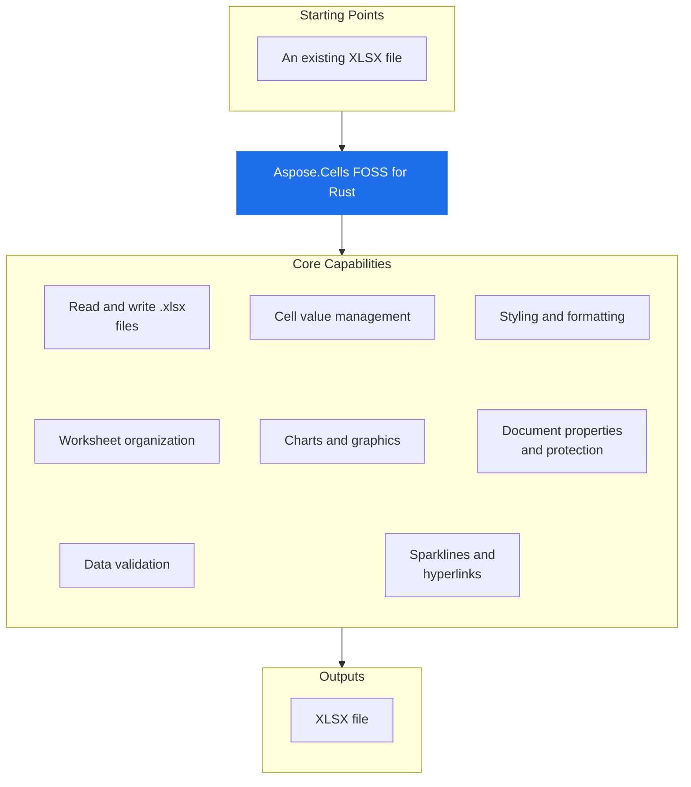

# Aspose.Cells FOSS for Rust

 [](https://github.com/aspose-cells-foss/Aspose.Cells-FOSS-for-Rust/actions/workflows/ci.yml) [](LICENSE.txt) [](Cargo.toml)

[](https://products.aspose.org/cells/rust/)

Aspose.Cells FOSS for Rust reads and writes `.xlsx` files. It creates new workbooks, loads existing ones with `Workbook.load_xlsx`, and saves them with `Workbook.save_xlsx`. It provides access to worksheets, cells, and their values through `Workbook`, `Worksheet`, and `Cells`, supporting string, integer, boolean, decimal, date-time, and formula values via `CellMut.put_value_string`, `CellMut.put_value_i32`, `CellMut.put_value_bool`, `CellMut.put_value_decimal`, `CellMut.put_value_date_time`, and `CellMut.put_formula_with_cached_value`.

Aspose.Cells FOSS for Rust is a free, open-source, pure-Rust library for creating,
loading, editing, and saving Excel `.xlsx` (Office Open XML / SpreadsheetML) workbooks.
It exposes an API modeled after Aspose.Cells, so
the familiar `Workbook` / `Worksheet` / `Cells` object model is available to Rust
programs with no proprietary runtime, no Microsoft Office installation, and no external
Aspose dependency. The OOXML packaging — ZIP container, relationships, shared strings,
styles, worksheet XML, and charts — is implemented from scratch on top of a small set of
general-purpose crates: `zip` (package container), `roxmltree` (XML parsing), `chrono`
(date/time), `sha2` / `base64` / `getrandom` (protection hashing), and `serde_json`.

## Navigation

- [At a Glance](#at-a-glance)
- [Key Capabilities](#key-capabilities)
- [Installation](#installation)
- [Dependencies](#dependencies)
- [Quick Start](#quick-start)
- [Additional Examples](#additional-examples)
- [API Reference](#api-reference)
- [Documentation & Resources](#documentation--resources)
- [Scope and Limitations](#scope-and-limitations)
- [Development and Testing](#development-and-testing)
- [License](#license)

## At a Glance



## Key Capabilities

- **Read and write .xlsx files.** It reads and writes `.xlsx` files using `Workbook.load_xlsx` and `Workbook.save_xlsx`.
- **Cell value management.** It manages cell values by storing strings, integers, booleans, decimals, dates, and formulas with cached results via `CellMut.put_value_string`, `CellMut.put_value_i32`, `CellMut.put_value_bool`, `CellMut.put_value_decimal`, `CellMut.put_value_date_time`, and `CellMut.put_formula_with_cached_value`.
- **Styling and formatting.** It applies styling and formatting through `CellStyle`, `Font`, `Fill`, `Border`, and `FormatCondition`.
- **Worksheet organization.** It organizes worksheets using `Worksheets`, `Worksheet`, `Rows`, `Columns`, `AutoFilter`, and `ListObject`.
- **Charts and graphics.** It creates charts, pictures, and shapes using `Chart`, `ChartType`, `Picture`, `Shape`, and `ShapeCollection`.
- **Document properties and protection.** It manages document properties and protection through `Workbook.document_properties`, `CoreDocumentProperties`, `WorkbookProtection`, and `DefinedName`.
- **Data validation.** It enforces data validation using `Validation`, `ValidationCollection`, `ValidationType`, and `OperatorType`.
- **Sparklines and hyperlinks.** It adds sparkline groups and hyperlinks using `SparklineGroup`, `Hyperlink`, and `HyperlinkCollection`.

- Create a new `Workbook` with `Workbook::new` (starts with one sheet, `"Sheet1"`), or
  load an existing `.xlsx` file from a path (`Workbook::load_xlsx`), a stream
  (`load_xlsx_from_stream`), or in-memory bytes (`load_xlsx_from_bytes`) — with defensive
  repair options via `LoadOptions` (`try_repair_package`, `try_repair_xml`) and structured
  `LoadDiagnostics` for the issues found along the way.
- Read and write typed cell values through `Cell` / `CellMut` — `put_value_string`,
  `put_value_i32`, `put_value_bool`, `put_value_decimal`, `put_value_date_time` —
  addressed by A1 name (`get`) or row/column index (`get_by_index`), and enter formulas
  with cached results via `put_formula_with_cached_value`.
- Embed pictures with `Picture` and drawing shapes with `Shape` / `AutoShapeType`
  (rectangles, stars, arrows, and other preset geometries).
- Save back to `.xlsx` — to a file path (`save` / `save_xlsx`), a stream
  (`save_xlsx_to_stream`), or in-memory bytes (`save_xlsx_to_bytes`) — with `SaveOptions`.

## Installation

`aspose-cells-foss-rust` is not yet published on crates.io; build it from a source checkout instead:

```bash
git clone https://github.com/aspose-cells-foss/Aspose.Cells-FOSS-for-Rust.git
cd Aspose.Cells-FOSS-for-Rust
cargo build
```

Verify the install:

```bash
cargo check
```

## Dependencies

### Required Package Dependencies

- `base64 0.22`
- `chrono 0.4`
- `getrandom 0.3`
- `roxmltree 0.20`
- `serde_json 1`
- `sha2 0.10`
- `zip 0.6`

### Native and System Requirements

- Requires Rust edition `2021` (`edition` in `Cargo.toml`).

## Quick Start

This example creates a new workbook, writes values and a formula to cells, saves the file as `hello.xlsx`, and then loads it back to print the value of cell A1.

```rust
use aspose_cells_foss_rust::{CellValue, Workbook};
use std::error::Error;

fn main() -> Result<(), Box<dyn Error>> {
    // Create a new workbook (starts with one sheet, "Sheet1").
    let mut workbook = Workbook::new();
    {
        let mut worksheets = workbook.get_worksheets_mut();
        let sheet = worksheets.get(0)?;
        let mut cells = sheet.get_cells_mut();

        cells.get("A1")?.put_value_string("Hello")?;
        cells.get("B1")?.put_value_i32(123)?;
        cells.get("C1")?.put_value_bool(true)?;
        cells.get("D1")?.put_value_decimal(12.5)?;
        cells.get("F1")?.put_value_i32(10)?;
        cells.get("G1")?
            .put_formula_with_cached_value("=F1*2", CellValue::Number(20.0))?;
    }
    workbook.save("hello.xlsx")?;

    // Load it back.
    let loaded = Workbook::load_xlsx("hello.xlsx")?;
    let sheet = loaded.worksheet("Sheet1")?;
    let cells = sheet.get_cells();
    println!("A1 = {}", cells.get("A1")?.display_string_value());

    Ok(())
}
```

## Additional Examples

More real, runnable examples are collected below — see [`samples/`](samples/) and
[`samples/README.md`](samples/README.md) for the complete set.

Open workbooks defensively with `LoadOptions` repair flags and inspect structured load
diagnostics:

```rust
let options = LoadOptions {
    try_repair_package: true,
    try_repair_xml: true,
    ..LoadOptions::default()
};

let loaded = Workbook::load_xlsx_with_options(&valid_path, &options)?;
let sheet = loaded.worksheet("Sheet1")?;
let cells = sheet.get_cells();

println!(
    "Loaded workbook with {} worksheet(s) and {} diagnostic issue(s).",
    loaded.get_worksheets().count(),
    loaded.get_load_diagnostics().issues().len()
);
```

<details>
<summary>View Additional Examples</summary>

```rust
let mut charts = sheet.get_charts();
charts.add(
    ChartType::Column,
    "Charts!$B$1:$B$13".to_string(),
    0, 4, 18, 8,
)?;
charts.add(
    ChartType::Line,
    "Charts!$C$1:$C$13".to_string(),
    0, 9, 18, 13,
)?;

let chart_count = charts.count();
let first = charts.get(0).expect("chart");
println!("Chart count: {}", chart_count);
println!("First chart type: {:?}", first.get_chart_type());
```

```rust
let mut collections = sheet.get_conditional_formattings();

let between_index = collections.add();
let mut between = collections.get(between_index).expect("collection should exist");
between.add_area(CellArea::create_cell_area_a1("A1", "A10")?)?;
let rule_index = between.add_condition_with_details(
    FormatConditionType::CellValue,
    OperatorType::Between,
    "3",
    "7",
);
let mut rule = between.get(rule_index).expect("rule should exist");
rule.set_priority(1)?;
let mut style = rule.get_style();
style.pattern = FillPattern::Solid;
style.fill_color = Some("FFFFC7CE".to_string());
rule.set_style(style);
```

```rust
let mut validations = sheet.get_validations();
let list_index = validations.add(CellArea::create_cell_area_a1("A1", "A3")?)?;
let mut list_validation = validations.get(list_index).expect("validation should exist");
list_validation.set_type(ValidationType::List);
list_validation.set_formula1("\"Open,Closed\"");
list_validation.set_in_cell_drop_down(true);
list_validation.set_show_error(true);
list_validation.set_error_title("Invalid");
list_validation.set_error_message("Choose from the list");
```

```rust
let mut tables = sheet.get_list_objects();
let table_index = tables.add_a1("A1", "D5", true)?;
let mut table = tables.get(table_index as usize).expect("table should exist");
table.set_display_name("Products")?;
table.set_table_style_type(TableStyleType::TableStyleMedium2);
table.set_show_totals(true);

let mut columns = table.get_list_columns();
columns.get(3).expect("quantity column").set_totals_calculation(TotalsCalculation::Sum);
```

```rust
let mut hyperlinks = links_sheet.get_hyperlinks();
let external_index = hyperlinks.add("A1", 1, 1, "https://example.com/docs?q=1")?;
let mut external_link = hyperlinks.get(external_index).expect("hyperlink should exist");
external_link.set_text_to_display("Docs");
external_link.set_screen_tip("External docs");

let mut defined_names = workbook.get_defined_names();
let global_index = defined_names.add("GlobalRange", "='Links'!$A$1:$D$5")?;
defined_names.get(global_index).expect("defined name should exist").set_hidden(true);
```

</details>

## API Reference

The Aspose.Cells FOSS for Rust library exposes workbook-level operations through the `Workbook` type, which owns a collection of `Worksheet` objects. Each `Worksheet` provides access to its cells, charts, shapes, pictures, and other elements through dedicated accessor methods.

The public API has 115 types.

<details>
<summary>View the Complete Public API Surface</summary>

### Core API

| Class | Description |
| --- | --- |
| `AutoFilter` | Represents auto filter. |
| `AutoFilterColorFilter` | Represents auto filter color filter. |
| `AutoFilterCustomFilter` | Represents auto filter custom filter. |
| `AutoFilterCustomFilterCollection` | Represents a collection of auto filter custom filter objects. |
| `AutoFilterDynamicFilter` | Represents auto filter dynamic filter. |
| `AutoFilterSortCondition` | Represents auto filter sort condition. |
| `AutoFilterSortConditionCollection` | Represents a collection of auto filter sort condition objects. |
| `AutoFilterSortState` | Represents auto filter sort state. |
| `AutoFilterTop10` | Represents auto filter top10. |
| `Border` | Represents border. |
| `Borders` | Represents borders. |
| `CalculationProperties` | Represents calculation properties. |
| `Cell` | Represents a single worksheet cell and exposes value, formula, and style operations. |
| `CellArea` | Represents cell area. |
| `CellMut` | Represents a single worksheet cell and exposes value, formula, and style operations. |
| `CellStyle` | Represents a mutable cell style facade that can be applied to one or more cells. |
| `Cells` | Provides access to worksheet cells, rows, columns, and merged ranges. |
| `CellsException` | Represents an error that occurs during cells. |
| `CellsMut` | Provides access to worksheet cells, rows, columns, and merged ranges. |
| `Chart` | Represents a chart embedded in a worksheet. |
| `ChartCollection` | Represents collection of charts on a worksheet. |
| `Color` | Represents color. |
| `Column` | Represents column. |
| `ColumnMut` | Represents column. |
| `ColumnProperties` | Encapsulates a single worksheet and its supported v0.1 worksheet features. |
| `Columns` | Represents a collection of column objects. |
| `ColumnsMut` | Represents a collection of column objects. |
| `Comment` | Represents a worksheet comment (legacy note) anchored to a single cell. |
| `CommentCollection` | Represents the collection of comments (legacy notes) on a worksheet. |
| `ConditionalFormattingCollection` | Represents a collection of conditional formatting objects. |
| `CoreDocumentProperties` | Represents core document properties. |
| `DefinedName` | Represents defined name. |
| `DefinedNameCollection` | Represents a collection of defined name objects. |
| `DocumentProperties` | Represents document properties. |
| `ExtendedDocumentProperties` | Represents extended document properties. |
| `Fill` | Represents a mutable cell style facade that can be applied to one or more cells. |
| `FilterColumn` | Represents filter column. |
| `FilterColumnCollection` | Represents a collection of filter column objects. |
| `FilterValueCollection` | Represents a collection of filter value objects. |
| `Font` | Represents font. |
| `FormatCondition` | Represents format condition. |
| `FormatConditionCollection` | Represents a collection of format condition objects. |
| `FormulaException` | Represents an error that occurs during formula. |
| `FreezePane` | Encapsulates a single worksheet and its supported v0.1 worksheet features. |
| `Hyperlink` | Represents hyperlink. |
| `HyperlinkCollection` | Encapsulates the hyperlinks defined for a worksheet. |
| `IWarningCallback` | Defines a callback that receives load warnings. |
| `InvalidFileFormatException` | Represents an error that occurs during invalid file format. |
| `ListColumn` | Represents a single column in an Excel table. |
| `ListColumnCollection` | Represents the ordered collection of columns in an Excel table. |
| `ListObject` | Represents an Excel table (structured reference / ListObject). |
| `ListObjectCollection` | Represents the collection of Excel tables on a worksheet. |
| `LoadDiagnostics` | Represents load diagnostics. |
| `LoadIssue` | Represents load issue. |
| `LoadOptions` | Specifies how a workbook should be loaded. |
| `NumberFormat` | Provides number format operations. |
| `PageSetup` | Represents worksheet print and page-layout settings. |
| `Picture` | Represents a picture (image) anchored to a worksheet. |
| `PictureCollection` | Represents collection of pictures anchored to a worksheet. |
| `Row` | Represents row. |
| `RowMut` | Represents row. |
| `RowProperties` | Encapsulates a single worksheet and its supported v0.1 worksheet features. |
| `Rows` | Represents a collection of row objects. |
| `RowsMut` | Represents a collection of row objects. |
| `SaveOptions` | Specifies how a workbook should be saved. |
| `Shape` | Represents a drawing object (auto shape) anchored to a worksheet. |
| `ShapeCollection` | Represents collection of drawing objects (shapes) on a worksheet. |
| `SparklineGroup` | A sparkline group contains sparkline items that share type and settings. |
| `SparklineGroupCollection` | Represents a collection of sparkline groups on a worksheet. |
| `StyleException` | Represents an error that occurs during style. |
| `StyleFlag` | Represents flags which indicate applied formatting properties. |
| `UnsupportedFeatureException` | Represents an error that occurs during unsupported feature. |
| `Validation` | Represents validation. |
| `ValidationCollection` | Represents a collection of validation objects. |
| `WarningInfo` | Represents warning info. |
| `Workbook` | Represents the root spreadsheet object used to create, load, modify, and save an XLSX workbook. |
| `WorkbookLoadException` | Represents an error that occurs during workbook load. |
| `WorkbookProperties` | Represents workbook properties. |
| `WorkbookProtection` | Represents workbook protection. |
| `WorkbookSaveException` | Represents an error that occurs during workbook save. |
| `WorkbookSettings` | Represents workbook-level settings that affect date handling and display formatting. |
| `WorkbookView` | Represents workbook view. |
| `Worksheet` | Encapsulates a single worksheet and its supported v0.1 worksheet features. |
| `WorksheetProtection` | Represents worksheet protection. |
| `Worksheets` | Encapsulates the workbook's worksheets and active-sheet state. |
| `WorksheetsMut` | Encapsulates the workbook's worksheets and active-sheet state. |

#### Enumerations

| Enumeration | Description |
| --- | --- |
| `AutoShapeType` | Specifies the type of an auto shape (preset geometry). |
| `BorderLineStyle` | Represents border. |
| `BorderStyleType` | Specifies border style type. |
| `CellObjectValue` | CellObjectValue enum lists the Bool, Empty, Number, and String cell object values, and provides a from method to construct them. |
| `CellValue` | CellValue enum lists the Bool, Empty, Error, Formula, Number, and String cell value types, and provides methods as_bool, as_f64, as_i32, as_i64, as_str, as_string, and get_type to access its contents. |
| `CellValueType` | Specifies cell value type. |
| `CellsError` | CellsError enum lists the Io, Unsupported, and csharp_exception_type_name, fmt, to_cells_exception, to_formula_exception, to_invalid_file_format_exception, to_style_exception, to_unsupported_feature_exception, to_workbook_load_exception methods. |
| `ChartType` | Specifies the chart type. |
| `DateSystem` | DateSystem enum lists the Mac1904 and Windows1900 date system values. |
| `DiagnosticSeverity` | DiagnosticSeverity enum lists the Fatal, Recoverable, and Warning diagnostic severity values. |
| `FillPattern` | Specifies fill pattern. |
| `FilterOperatorType` | Represents FilterOperatorType. |
| `FontUnderlineType` | Enumerates font underline types. |
| `FormatConditionType` | Specifies format condition type. |
| `HorizontalAlignment` | HorizontalAlignment enum lists the Center, Distributed, Fill, General, Justify, Left, and Right horizontal alignment values. |
| `ImageType` | Represents the format of an image stored in a worksheet. |
| `LoadFormat` | Specifies load format. |
| `OperatorType` | Specifies operator type. |
| `PageOrientationType` | Specifies page orientation type. |
| `PaperSizeType` | Specifies paper size type. |
| `SaveFormat` | Specifies save format. |
| `SparklineType` | Represents SparklineType. |
| `TableStyleType` | Represents the built-in Excel table style types. |
| `TargetModeType` | Specifies target mode type. |
| `TotalsCalculation` | Represents the aggregation function shown in a table totals row cell. |
| `ValidationAlertType` | Specifies validation alert type. |
| `ValidationType` | Specifies validation type. |
| `VerticalAlignment` | VerticalAlignment enum lists the Bottom, Center, Distributed, Justify, and Top vertical alignment values. |
| `VisibilityType` | Specifies visibility type. |

#### Detailed Member Reference

### AutoFilter

The `AutoFilter` type provides filtering and sorting controls for a worksheet range, with methods to set and retrieve the filtered range, apply column filters, and manage sort state.

- `clear`: Clears the current state.
- `filter_columns`: Gets the filter columns.
- `get_filter_columns`: Gets the filter columns.
- `get_range`: Gets the range.
- `get_sort_state`: Gets the sort state.
- `range`: Gets the range.
- `set_range`: Sets the range.
- `sort_state`: Gets the sort state.

### Cell

The `Cell` type represents a single cell in a worksheet and exposes methods to retrieve its value in various types including boolean, date-time, double, display string, formatted string, and formula cached value, as well as its column index.

- `bool_value`: Gets the associated value.
- `border`: Gets the associated value.
- `column`: Gets the associated value.
- `date_time_value`: Gets the associated value.
- `display_string_value`: Gets the display text generated from the cell value, style, and workbook culture.
- `double_value`: Gets the associated value.
- `formatted_string_value`: Gets the associated value.
- `formula_cached_value`: Gets the associated value.
- `get_bool_value`: Gets the associated value.
- `get_border`: Gets the associated value.
- `get_column`: Gets the associated value.
- `get_date_time_value`: Gets the associated value.
- `get_display_string_value`: Gets the display text generated from the cell value, style, and workbook culture.
- `get_double_value`: Gets the associated value.
- `get_formatted_string_value`: Gets the associated value.
- `get_formula_cached_value`: Gets the associated value.
- `get_int_value`: Gets the associated value.
- `get_long_value`: Gets the associated value.
- `get_name`: Gets the associated value.
- `get_raw_string_value`: Gets the associated value.
- `get_row`: Gets the associated value.
- `get_string_value`: Gets a stable string representation of the cell value without applying style-based display formatting.
- `get_style`: Gets the associated value.
- `get_style_with_borders`: Gets the associated value.
- `get_type`: Gets the current logical cell value type.
- `get_value`: Gets the logical cell value.
- `int_value`: Gets the associated value.
- `long_value`: Gets the associated value.
- `name`: Gets the associated value.
- `raw_string_value`: Gets the associated value.
- `row`: Gets the associated value.
- `string_value`: Gets a stable string representation of the cell value without applying style-based display formatting.
- `style`: Gets the associated value.
- `value`: Gets the logical cell value.
- `value_type`: Gets the current logical cell value type.

### Chart

The `Chart` type represents a chart object on a worksheet, exposing its type, data range, name, and position through methods such as `get_chart_type`, `get_data_range`, `get_name`, and `get_lower_right_column`.

- `chart_type`: Gets the chart type.
- `data_range`: Gets the chart data range formula.
- `delete`: Deletes the chart from its owning worksheet.
- `get_chart_type`: Gets the chart type.
- `get_data_range`: Gets the chart data range formula.
- `get_extent_cx`: Gets the width extent in EMU.
- `get_extent_cy`: Gets the height extent in EMU.
- `get_lower_right_column`: Gets the zero-based lower-right column of the chart anchor.
- `get_lower_right_row`: Gets the zero-based lower-right row of the chart anchor.
- `get_name`: Gets the chart display name.
- `get_upper_left_column`: Gets the zero-based upper-left column of the chart anchor.
- `get_upper_left_row`: Gets the zero-based upper-left row of the chart anchor.
- `lower_right_column`: Gets the zero-based lower-right column of the chart anchor.
- `lower_right_row`: Gets the zero-based lower-right row of the chart anchor.
- `name`: Gets the chart display name.
- `set_name`: Sets the chart display name.
- `upper_left_column`: Gets the zero-based upper-left column of the chart anchor.
- `upper_left_row`: Gets the zero-based upper-left row of the chart anchor.

### DefinedName

The `DefinedName` type represents a named range or formula at workbook or worksheet scope, with methods to get and set its name, formula, comment, local sheet index, and hidden status.

- `get_comment`: Gets the comment.
- `get_formula`: Gets the formula.
- `get_local_sheet_index`: Gets the local sheet index.
- `get_name`: Gets the name.
- `is_hidden`: Returns whether hidden.
- `set_comment`: Sets the comment.
- `set_formula`: Sets the formula.
- `set_hidden`: Sets a value indicating whether hidden.
- `set_local_sheet_index`: Sets the local sheet index.
- `set_name`: Sets the name.

### Font

The `Font` type describes text formatting attributes such as color, size, bold, italic, strikeout, underline, and name, with methods to get and set each property.

- `clear_color`: Clears color.
- `get_color`: Gets the color.
- `get_double_size`: Gets the font size.
- `get_is_bold`: Gets a value indicating whether bold.
- `get_is_italic`: Gets a value indicating whether italic.
- `get_is_strikeout`: Gets a value indicating whether single strikeout.
- `get_name`: Gets the name.
- `get_size`: Gets the size.
- `get_underline`: Gets the font underline type.
- `new`: Initializes a new instance.
- `set_color`: Sets the color.
- `set_double_size`: Sets the font size.
- `set_is_bold`: Sets a value indicating whether bold.
- `set_is_italic`: Sets a value indicating whether italic.
- `set_is_strikeout`: Sets a value indicating whether single strikeout.
- `set_name`: Sets the name.
- `set_size`: Sets the size.
- `set_underline`: Sets the font underline type.

### LoadOptions

The `LoadOptions` type controls how a workbook file is loaded, with options to enable strict mode, preserve unsupported parts, and attempt repair of the package or XML content.

### PageSetup

The `PageSetup` type manages page layout settings for a worksheet, including margins, headers, footers, centering options, and horizontal and vertical page breaks.

- `add_horizontal_page_break`: Adds an item.
- `add_vertical_page_break`: Adds an item.
- `bottom_margin`: Gets the bottom margin in centimeters.
- `bottom_margin_inch`: Gets the bottom margin in inches.
- `center_footer`: Gets the center footer text.
- `center_header`: Gets the center header text.
- `center_horizontally`: Gets whether content is centered horizontally on the page.
- `center_vertically`: Gets whether content is centered vertically on the page.
- `clear_horizontal_page_breaks`: Clears horizontal page breaks.
- `clear_vertical_page_breaks`: Clears vertical page breaks.
- `first_page_number`: Gets the first printed page number.
- `fit_to_pages_tall`: Gets the number of pages tall to fit when printing.
- `fit_to_pages_wide`: Gets the number of pages wide to fit when printing.
- `footer_margin`: Gets the footer margin in centimeters.
- `footer_margin_inch`: Gets the footer margin in inches.
- `get_bottom_margin`: Gets the bottom margin in centimeters.
- `get_bottom_margin_inch`: Gets the bottom margin in inches.
- `get_center_footer`: Gets the center footer text.
- `get_center_header`: Gets the center header text.
- `get_center_horizontally`: Gets whether content is centered horizontally on the page.
- `get_center_vertically`: Gets whether content is centered vertically on the page.
- `get_first_page_number`: Gets the first printed page number.
- `get_fit_to_pages_tall`: Gets the number of pages tall to fit when printing.
- `get_fit_to_pages_wide`: Gets the number of pages wide to fit when printing.
- `get_footer_margin`: Gets the footer margin in centimeters.
- `get_footer_margin_inch`: Gets the footer margin in inches.
- `get_header_margin`: Gets the header margin in centimeters.
- `get_header_margin_inch`: Gets the header margin in inches.
- `get_horizontal_page_breaks`: Gets the horizontal page breaks as sorted zero-based row indexes.
- `get_left_footer`: Gets the left footer text.
- `get_left_header`: Gets the left header text.
- `get_left_margin`: Gets the left margin in centimeters.
- `get_left_margin_inch`: Gets the left margin in inches.
- `get_orientation`: Gets the page orientation.
- `get_paper_size`: Gets the paper size.
- `get_print_area`: Gets the print area reference.
- `get_print_gridlines`: Gets whether gridlines are printed.
- `get_print_headings`: Gets whether row and column headings are printed.
- `get_print_title_columns`: Gets the repeating title columns reference.
- `get_print_title_rows`: Gets the repeating title rows reference.
- `get_right_footer`: Gets the right footer text.
- `get_right_header`: Gets the right header text.
- `get_right_margin`: Gets the right margin in centimeters.
- `get_right_margin_inch`: Gets the right margin in inches.
- `get_scale`: Gets the print scaling percentage.
- `get_top_margin`: Gets the top margin in centimeters.
- `get_top_margin_inch`: Gets the top margin in inches.
- `get_vertical_page_breaks`: Gets the vertical page breaks as sorted zero-based column indexes.
- `header_margin`: Gets the header margin in centimeters.
- `header_margin_inch`: Gets the header margin in inches.
- `horizontal_page_breaks`: Gets the horizontal page breaks as sorted zero-based row indexes.
- `left_footer`: Gets the left footer text.
- `left_header`: Gets the left header text.
- `left_margin`: Gets the left margin in centimeters.
- `left_margin_inch`: Gets the left margin in inches.
- `new`: Initializes a new instance.
- `orientation`: Gets the page orientation.
- `paper_size`: Gets the paper size.
- `print_area`: Gets the print area reference.
- `print_gridlines`: Gets whether gridlines are printed.
- `print_headings`: Gets whether row and column headings are printed.
- `print_title_columns`: Gets the repeating title columns reference.
- `print_title_rows`: Gets the repeating title rows reference.
- `right_footer`: Gets the right footer text.
- `right_header`: Gets the right header text.
- `right_margin`: Gets the right margin in centimeters.
- `right_margin_inch`: Gets the right margin in inches.
- `scale`: Gets the print scaling percentage.
- `set_bottom_margin`: Sets the bottom margin in centimeters.
- `set_bottom_margin_inch`: Sets the bottom margin in inches.
- `set_center_footer`: Sets the center footer text.
- `set_center_header`: Sets the center header text.
- `set_center_horizontally`: Sets whether content is centered horizontally on the page.
- `set_center_vertically`: Sets whether content is centered vertically on the page.
- `set_first_page_number`: Sets the first printed page number.
- `set_fit_to_pages_tall`: Sets the number of pages tall to fit when printing.
- `set_fit_to_pages_wide`: Sets the number of pages wide to fit when printing.
- `set_footer_margin`: Sets the footer margin in centimeters.
- `set_footer_margin_inch`: Sets the footer margin in inches.
- `set_header_margin`: Sets the header margin in centimeters.
- `set_header_margin_inch`: Sets the header margin in inches.
- `set_left_footer`: Sets the left footer text.
- `set_left_header`: Sets the left header text.
- `set_left_margin`: Sets the left margin in centimeters.
- `set_left_margin_inch`: Sets the left margin in inches.
- `set_orientation`: Sets the page orientation.
- `set_paper_size`: Sets the paper size.
- `set_print_area`: Sets the print area reference.
- `set_print_gridlines`: Sets whether gridlines are printed.
- `set_print_headings`: Sets whether row and column headings are printed.
- `set_print_title_columns`: Sets the repeating title columns reference.
- `set_print_title_rows`: Sets the repeating title rows reference.
- `set_right_footer`: Sets the right footer text.
- `set_right_header`: Sets the right header text.
- `set_right_margin`: Sets the right margin in centimeters.
- `set_right_margin_inch`: Sets the right margin in inches.
- `set_scale`: Sets the print scaling percentage.
- `set_top_margin`: Sets the top margin in centimeters.
- `set_top_margin_inch`: Sets the top margin in inches.
- `top_margin`: Gets the top margin in centimeters.
- `top_margin_inch`: Gets the top margin in inches.
- `vertical_page_breaks`: Gets the vertical page breaks as sorted zero-based column indexes.

### Picture

The `Picture` type represents an image embedded in a worksheet, exposing its data, extension, image type, and position through methods such as `get_data`, `get_extension`, and `get_lower_right_column`.

- `data`: Gets the raw binary bytes of the image.
- `delete`: Deletes this item from its owning collection.
- `extension`: Gets the associated value.
- `get_data`: Gets the raw binary bytes of the image.
- `get_extension`: Gets the associated value.
- `get_image_type`: Gets the image format derived from the file extension.
- `get_lower_right_column`: Gets the zero-based column index of the lower-right anchor cell.
- `get_lower_right_row`: Gets the zero-based row index of the lower-right anchor cell.
- `get_name`: Gets the display name of the picture.
- `get_upper_left_column`: Gets the zero-based column index of the upper-left anchor cell.
- `get_upper_left_row`: Gets the zero-based row index of the upper-left anchor cell.
- `image_type`: Gets the image format derived from the file extension.
- `lower_right_column`: Gets the zero-based column index of the lower-right anchor cell.
- `lower_right_row`: Gets the zero-based row index of the lower-right anchor cell.
- `name`: Gets the display name of the picture.
- `set_data`: Sets the raw binary bytes of the image.
- `set_lower_right_column`: Sets the zero-based column index of the lower-right anchor cell.
- `set_lower_right_row`: Sets the zero-based row index of the lower-right anchor cell.
- `set_name`: Sets the display name of the picture.
- `set_upper_left_column`: Sets the zero-based column index of the upper-left anchor cell.
- `set_upper_left_row`: Sets the zero-based row index of the upper-left anchor cell.
- `upper_left_column`: Gets the zero-based column index of the upper-left anchor cell.
- `upper_left_row`: Gets the zero-based row index of the upper-left anchor cell.

### Shape

The `Shape` type represents a drawing object such as an auto shape on a worksheet, exposing its type, position, and name through methods such as `get_auto_shape_type`, `get_lower_right_column`, and `get_upper_left_row`.

- `auto_shape_type`: Gets the shape type.
- `auto_shape_type_to_geometry`: Converts an auto shape type to its DrawingML geometry name.
- `delete`: Deletes this item from its owning collection.
- `geometry_to_auto_shape_type`: Converts a DrawingML geometry name to an auto shape type.
- `get_auto_shape_type`: Gets the shape type.
- `get_lower_right_column`: Gets the zero-based column index of the lower-right anchor cell.
- `get_lower_right_row`: Gets the zero-based row index of the lower-right anchor cell.
- `get_name`: Gets the display name of the shape.
- `get_upper_left_column`: Gets the zero-based column index of the upper-left anchor cell.
- `get_upper_left_row`: Gets the zero-based row index of the upper-left anchor cell.
- `lower_right_column`: Gets the zero-based column index of the lower-right anchor cell.
- `lower_right_row`: Gets the zero-based row index of the lower-right anchor cell.
- `name`: Gets the display name of the shape.
- `set_auto_shape_type`: Sets the shape type.
- `set_lower_right_column`: Sets the zero-based column index of the lower-right anchor cell.
- `set_lower_right_row`: Sets the zero-based row index of the lower-right anchor cell.
- `set_name`: Sets the display name of the shape.
- `set_upper_left_column`: Sets the zero-based column index of the upper-left anchor cell.
- `set_upper_left_row`: Sets the zero-based row index of the upper-left anchor cell.
- `upper_left_column`: Gets the zero-based column index of the upper-left anchor cell.
- `upper_left_row`: Gets the zero-based row index of the upper-left anchor cell.

### SparklineGroup

The `SparklineGroup` type manages a group of sparklines on a worksheet, exposing its data range, location range, and sparkline type through methods such as `get_data_range`, `get_location_range`, and `get_sparkline_type`.

- `data_range`: Gets the data range for the sparkline group.
- `get_data_range`: Gets the data range for the sparkline group.
- `get_location_range`: Gets the location range where sparkline cells are placed.
- `get_sparkline_type`: Gets the sparkline type.
- `location_range`: Gets the location range where sparkline cells are placed.
- `remove`: Removes this sparkline group from its owning worksheet.
- `set_data_range`: Sets the data range for the sparkline group.
- `set_location_range`: Sets the location range where sparkline cells are placed.
- `set_sparkline_type`: Sets the sparkline type.
- `sparkline_type`: Gets the sparkline type.

### StyleFlag

The `StyleFlag` type is a bitmask used to indicate which style attributes should be applied when setting cell styles, including alignments, borders, font, and fill properties.

- `get_alignments`: Gets the associated value.
- `get_all`: Gets the associated value.
- `get_borders`: Gets the associated value.
- `get_bottom_border`: Gets the associated value.
- `get_cell_shading`: Gets the associated value.
- `get_diagonal_down_border`: Gets the associated value.
- `get_diagonal_up_border`: Gets the associated value.
- `get_font`: Gets the associated value.
- `get_font_bold`: Gets the associated value.
- `get_font_color`: Gets the associated value.
- `get_font_italic`: Gets the associated value.
- `get_font_name`: Gets the associated value.
- `get_font_size`: Gets the associated value.
- `get_font_strike`: Gets the associated value.
- `get_font_underline`: Gets the associated value.
- `get_hidden`: Gets the associated value.
- `get_horizontal_alignment`: Gets the associated value.
- `get_indent`: Gets the associated value.
- `get_left_border`: Gets the associated value.
- `get_locked`: Gets the associated value.
- `get_number_format`: Gets the associated value.
- `get_quote_prefix`: Gets the associated value.
- `get_right_border`: Gets the associated value.
- `get_rotation`: Gets the associated value.
- `get_shrink_to_fit`: Gets the associated value.
- `get_text_direction`: Gets the associated value.
- `get_top_border`: Gets the associated value.
- `get_vertical_alignment`: Gets the associated value.
- `get_wrap_text`: Gets the associated value.
- `new`: Initializes a new instance.
- `set_alignments`: Sets the associated value.
- `set_all`: Sets the associated value.
- `set_borders`: Sets the associated value.
- `set_bottom_border`: Sets the associated value.
- `set_cell_shading`: Sets the associated value.
- `set_diagonal_down_border`: Sets the associated value.
- `set_diagonal_up_border`: Sets the associated value.
- `set_font`: Sets the associated value.
- `set_font_bold`: Sets the associated value.
- `set_font_color`: Sets the associated value.
- `set_font_italic`: Sets the associated value.
- `set_font_name`: Sets the associated value.
- `set_font_size`: Sets the associated value.
- `set_font_strike`: Sets the associated value.
- `set_font_underline`: Sets the associated value.
- `set_hidden`: Sets the associated value.
- `set_horizontal_alignment`: Sets the associated value.
- `set_indent`: Sets the associated value.
- `set_left_border`: Sets the associated value.
- `set_locked`: Sets the associated value.
- `set_number_format`: Sets the associated value.
- `set_quote_prefix`: Sets the associated value.
- `set_right_border`: Sets the associated value.
- `set_rotation`: Sets the associated value.
- `set_shrink_to_fit`: Sets the associated value.
- `set_text_direction`: Sets the associated value.
- `set_top_border`: Sets the associated value.
- `set_vertical_alignment`: Sets the associated value.
- `set_wrap_text`: Sets the associated value.

### CellMut

The `CellMut` type provides mutable access to a cell and exposes methods to apply formatting such as bold, italic, font, fill, border color, border line style, horizontal alignment, number format, and text wrap.

- `apply_bold`: Applies bold.
- `apply_border_color`: Applies border color.
- `apply_border_line_style`: Applies border line style.
- `apply_fill`: Applies fill.
- `apply_fill_color`: Applies fill color.
- `apply_font`: Applies font.
- `apply_horizontal_alignment`: Applies horizontal alignment.
- `apply_italic`: Applies italic.
- `apply_number_format`: Applies number format.
- `apply_text_wrap`: Applies text wrap.
- `apply_vertical_alignment`: Applies vertical alignment.
- `bool_value`: Gets the associated value.
- `border`: Gets the associated value.
- `clear_alignment`: Clears alignment.
- `clear_bold`: Clears bold.
- `clear_border`: Clears border.
- `clear_fill`: Clears fill.
- `clear_fill_color`: Clears fill color.
- `clear_font`: Clears font.
- `clear_horizontal_alignment`: Clears horizontal alignment.
- `clear_italic`: Clears italic.
- `clear_number_format`: Clears number format.
- `clear_style`: Clears style.
- `clear_text_wrap`: Clears text wrap.
- `clear_value`: Clears value.
- `clear_vertical_alignment`: Clears vertical alignment.
- `column`: Gets the associated value.
- `date_time_value`: Gets the associated value.
- `display_string_value`: Gets the display text generated from the cell value, style, and workbook culture.
- `double_value`: Gets the associated value.
- `formatted_string_value`: Gets the associated value.
- `formula_cached_value`: Gets the associated value.
- `get_bool_value`: Gets the associated value.
- `get_border`: Gets the associated value.
- `get_column`: Gets the associated value.
- `get_date_time_value`: Gets the associated value.
- `get_display_string_value`: Gets the display text generated from the cell value, style, and workbook culture.
- `get_double_value`: Gets the associated value.
- `get_formatted_string_value`: Gets the associated value.
- `get_formula_cached_value`: Gets the associated value.
- `get_int_value`: Gets the associated value.
- `get_long_value`: Gets the associated value.
- `get_name`: Gets the associated value.
- `get_raw_string_value`: Gets the associated value.
- `get_row`: Gets the associated value.
- `get_string_value`: Gets a stable string representation of the cell value without applying style-based display formatting.
- `get_style`: Gets the associated value.
- `get_style_with_borders`: Gets the associated value.
- `get_type`: Gets the current logical cell value type.
- `get_value`: Gets the logical cell value.
- `int_value`: Gets the associated value.
- `long_value`: Gets the associated value.
- `name`: Gets the associated value.
- `put_bool`: Sets bool.
- `put_date_time`: Sets date time.
- `put_datetime`: Sets datetime.
- `put_formula`: Sets formula.
- `put_formula_with_cached_value`: Sets formula with cached value.
- `put_number`: Sets number.
- `put_string`: Sets string.
- `put_value`: Sets value.
- `put_value_bool`: Sets value bool.
- `put_value_char`: Sets value char.
- `put_value_date_time`: Sets value date time.
- `put_value_decimal`: Sets value decimal.
- `put_value_f32`: Sets value f32.
- `put_value_f64`: Sets value f64.
- `put_value_i16`: Sets value i16.
- `put_value_i32`: Sets value i32.
- `put_value_i64`: Sets value i64.
- `put_value_object`: Sets value object.
- `put_value_string`: Sets value string.
- `put_value_string_converted`: Sets value string converted.
- `put_value_string_converted_with_style`: Sets value string converted with style.
- `put_value_u8`: Sets value u8.
- `raw_string_value`: Gets the associated value.
- `reset_style`: Resets the cell style to the workbook default style.
- `row`: Gets the associated value.
- `set_border`: Sets the associated value.
- `set_style`: Sets the associated value.
- `set_style_with_explicit_flag`: Sets the associated value.
- `set_style_with_flag`: Sets the associated value.
- `set_value`: Sets the logical cell value.
- `string_value`: Gets a stable string representation of the cell value without applying style-based display formatting.
- `style`: Gets the associated value.
- `update_style`: Updates the cell style in place using the provided callback.
- `value`: Gets the logical cell value.
- `value_type`: Gets the current logical cell value type.

The library source lives under `src/Aspose.Cells_FOSS/`, one module per public type, with
runnable samples alongside it at the repository root:

```
├── src/
│   ├── lib.rs                      # Crate root; re-exports the public API
│   └── Aspose.Cells_FOSS/
│       ├── api.rs                  # Wires the modules together
│       ├── Core/                   # Internal data models
│       ├── Packaging/              # OOXML package (ZIP) reading/writing
│       ├── Xml/                    # SpreadsheetML XML mappers
│       ├── Validation/             # Workbook validation
│       ├── ChartDefaults/          # Default chart XML templates
│       ├── Workbook.rs             #   Workbook entry point
│       ├── Worksheet.rs            #   Worksheet model
│       ├── Cell.rs / Cells.rs      #   Cell model and collection
│       ├── Style.rs                #   Styles (font, fill, alignment, border)
│       ├── Validation.rs           #   Data validation
│       ├── Chart.rs / ChartLive.rs #   Charts
│       └── ...                     # One module per public type (Comment, Hyperlink, ListObject, ...)
├── samples/                        # Runnable feature examples
│   ├── basic.rs
│   ├── styles.rs
│   ├── charts.rs
│   ├── ...                         # One sample per feature area
│   └── README.md                   # Sample overview
├── License/LICENSE.txt             # MIT license (also mirrored at the repository root)
├── AGENTS.md                       # AI-assisted development guide
├── Cargo.toml
└── README.md
```

- `Worksheet`
  - `get_name()` / `set_name(value)`, `get_visibility_type()` / `set_visibility_type(value)`
  - `get_tab_color()` / `set_tab_color(value)`
  - `get_show_gridlines()`, `get_show_row_column_headers()`, `get_right_to_left()`
  - `get_cells() -> Cells` / `get_cells_mut() -> CellsMut`
  - `get_hyperlinks()`, `get_validations()`, `get_conditional_formattings()`, `get_auto_filter()`
  - `get_page_setup_mut() -> PageSetup`, `get_charts() -> ChartCollection`
  - `get_pictures()`, `get_shapes()`, `get_list_objects()`, `get_sparkline_groups()`

- `Cells` / `CellsMut`
  - `get(a1_address) -> Result<Cell, CellsError>` / `get_by_index(row, column)`
  - `get_rows() -> Rows`, `get_columns() -> Columns`

- `Cell` / `CellMut`
  - `put_value_string(value)`, `put_value_i32(value)`, `put_value_f64(value)`,
    `put_value_bool(value)`, `put_value_decimal(value)`, `put_value_date_time(value)`
  - `put_formula_with_cached_value(formula, CellValue)`
  - `display_string_value() -> String`, `value_type() -> CellValueType`
  - `get_style() -> CellStyle` / `set_style(style)`

- `CellStyle`
  - `get_font_mut() -> &mut Font`, `pattern: FillPattern`, `fill_color: Option<String>`

- `Font`
  - `set_color(value)`, `set_is_bold(value)`, `set_is_italic(value)`, `set_underline(value)`

- `Color`
  - `from_argb(a, r, g, b) -> Color`

- `PageSetup`
  - `set_left_margin_inch(value)`, `set_right_margin_inch(value)`

- `LoadOptions`
  - `try_repair_package: bool`, `try_repair_xml: bool` (`..LoadOptions::default()`)

- `SaveOptions` — passed to `save_with_options` / `save_xlsx_to_stream_with_options`

- `Validation` — `set_type(ValidationType)`, `set_formula1(value)`, `set_formula2(value)`,
  `set_operator(OperatorType)`, `set_show_error(value)`, `set_error_title(value)`

- `FormatCondition` — `set_priority(value)`, `set_stop_if_true(value)`, `get_style()` / `set_style(style)`

- `ConditionalFormattingCollection` — `add()`, `add_condition_with_details(FormatConditionType, OperatorType, formula1, formula2)`

- `CellsError` (enum, 10 members including `Unsupported(&'static str)`, `Io(String)`)

- `WorkbookLoadException`, `WorkbookSaveException`, `CellsException`, `FormulaException`,
  `StyleException`, `InvalidFileFormatException`, `UnsupportedFeatureException`

</details>

## Documentation & Resources

- **[Getting started guide](https://docs.aspose.org/cells/rust/)** — The getting started guide covers installation, walkthroughs, and feature guides for this library.
- **[How-to guides & FAQ](https://kb.aspose.org/cells/rust/)** — The how-to guides and FAQ provide task-focused answers for common spreadsheet-processing questions.
- **[Full API reference](https://reference.aspose.org/cells/rust/)** — The full API reference offers the complete, browsable reference for the public API surface. It covers all 115 public types; the [API Reference](#api-reference) section above covers the essentials.
- **[samples/README.md](samples/README.md)** — The samples overview lists every runnable example, one per feature area.
- **[Contributor guide](AGENTS.md)** — The contributor guide provides architecture notes, module wiring, and conventions for contributors.
- Found a bug or have a feature request? [Open an issue](https://github.com/aspose-cells-foss/Aspose.Cells-FOSS-for-Rust/issues).

## Scope and Limitations

Aspose.Cells FOSS for Rust reads and writes `.xlsx` (OOXML/`SpreadsheetML`) files and provides a Rust API for workbook and worksheet manipulation, with version 26.7.0 targeting the Rust 2021 edition.

- The crate is not yet published to crates.io, requiring installation via git clone and cargo build as shown in the install command.
- No automated test suite ships yet, as cargo test --all-targets currently reports 0 tests.
- The public API surface is broad but, by the repository's own account, not a complete match for Aspose.Cells — some features are still partial, and the crate is early-stage and evolving.
- A workbook must always keep at least one worksheet: `WorksheetsMut.remove_at` returns a CellsError::Unsupported error when asked to remove the last remaining worksheet.

- A workbook must always keep at least one worksheet: `WorksheetsMut::remove_at` returns
  a `CellsError::Unsupported` error when asked to remove the last remaining worksheet.

These limitations don't apply to [full-featured Aspose.Cells — Enterprise Edition](https://products.aspose.com/cells/). It adds broader format coverage (including legacy XLS, CSV, and ODS), full feature completeness, and commercial support.

## Development and Testing

The Aspose.Cells FOSS for Rust package targets the Rust 2021 edition and requires a recent stable Rust toolchain. No proprietary Aspose runtime or Microsoft Office installation is required. The repository provides sample programs in the samples/ directory that serve as the de-facto verification suite, each creating a workbook, saving it under output/samples/, loading it back, and printing what it read. CI runs formatting, linting, testing, and the core samples as smoke tests on Ubuntu, Windows, and macOS.

The [ci workflow](.github/workflows/ci.yml) runs on Ubuntu, Windows, macOS 14 and macOS 13.

```toml
[dependencies]
aspose-cells-foss-rust = { git = "https://github.com/aspose-cells-foss/Aspose.Cells-FOSS-for-Rust" }
```

For local development against a cloned copy, use a path dependency instead:

```toml
[dependencies]
aspose-cells-foss-rust = { path = "../Aspose.Cells-FOSS-for-Rust" }
```

The package name is `aspose-cells-foss-rust`; the library is imported as
`aspose_cells_foss_rust`. Requires a recent stable Rust toolchain (2021 edition or later).
No proprietary Aspose runtime and no Microsoft Office installation is required.

The repository currently has no unit or integration test suite —
`cargo test --all-targets` reports 0 tests. After a change that touches
the read/write path, run the core samples and confirm they still round-trip:

```bash
cargo build
cargo check --all-targets
cargo fmt --all --check
cargo clippy --all-targets
cargo test --all-targets
cargo run --bin sample_basic
cargo run --bin sample_loading
cargo run --bin sample_styles
```

The `samples/` directory demonstrates every feature area — `basic.rs`,
`styles.rs`, `worksheet_settings.rs`, `validations.rs`, `conditional_formatting.rs`,
`hyperlinks_and_names.rs`, `pagesetup.rs`, `comments.rs`, `charts.rs`, `list_objects.rs`,
`pictures.rs`, `shapes.rs`, and `document_properties.rs` (see
[`samples/README.md`](samples/README.md) for the full overview). Generate local API docs
with `cargo doc --no-deps --open`; published API docs are deployed by GitHub Pages
through [`pages.yml`](.github/workflows/pages.yml) — enabling
`Settings -> Pages -> GitHub Actions` on the repository makes pushes to `main`
automatically rebuild and publish the rustdoc site.

## License

This project is licensed under the [MIT License](LICENSE.txt). The MIT License permits use, copying, modification, distribution, sublicensing, and commercial use, provided its copyright and permission notice are retained. The software is provided without warranty.
