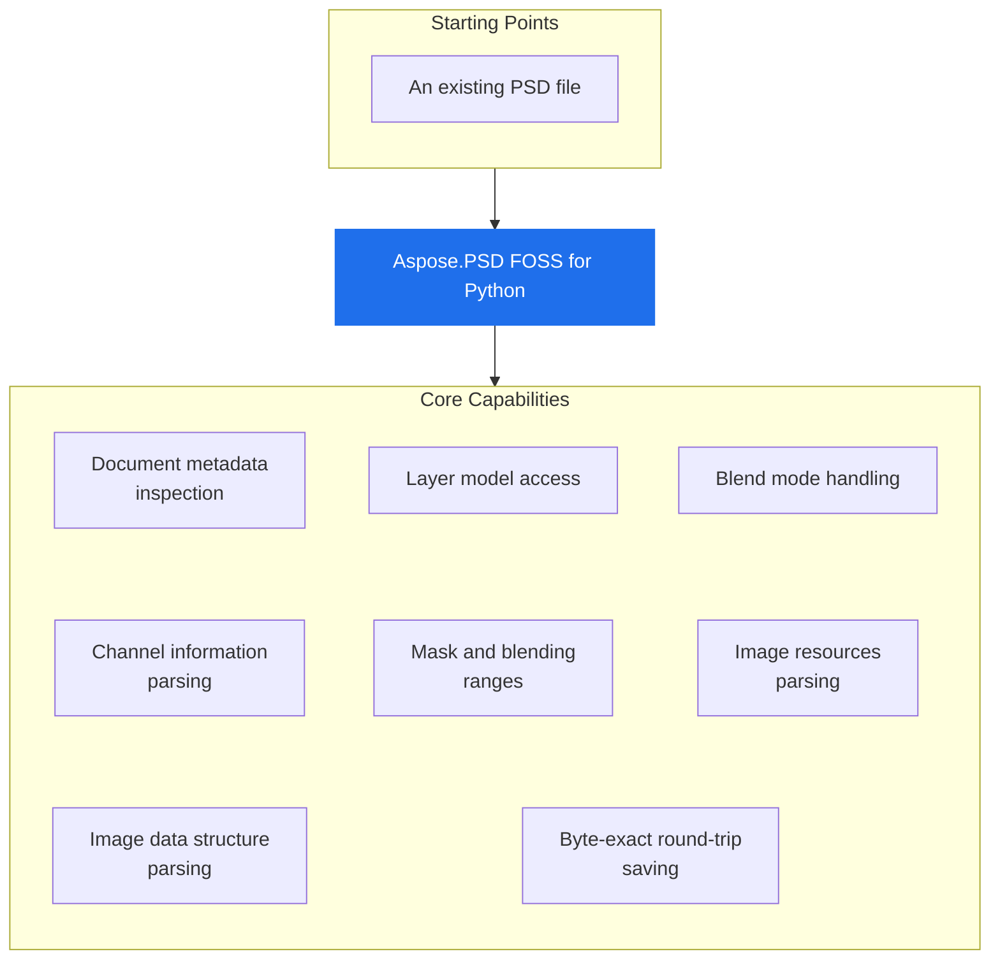

# Aspose.PSD FOSS for Python

[](LICENSE.txt) [](https://github.com/aspose-psd-foss/Aspose.PSD-FOSS-for-Python/graphs/contributors)

[](https://products.aspose.org/psd/python/)

Aspose.PSD FOSS for Python reads Adobe Photoshop `.psd` files and writes them back, preserving layers, channel information, blend modes, masks, image resources, and image-data structures with RLE and ZIP compression. It inspects document metadata including width, height, channels, `bits_per_channel`, `color_mode`, version, `is_psb`, `layer_count`, `resource_count`, compression, and `image_data_kind`. The library supports saving modified documents using the `PsdImage.save` method and works with Stream objects for stream-based input and output. It depends only on the Python standard library.

Aspose.PSD FOSS for Python is a free, open-source, pure-Python library for reading, inspecting and saving Adobe Photoshop `.psd`/`.psb` files without rendering. It runs on Python 3.7+ and depends only on the standard library. The library supports reading of document metadata, layers, channel information, blend modes, masks, image resources and image-data structures (RLE and ZIP compression).  

## Navigation

- [At a Glance](#at-a-glance)
- [Key Capabilities](#key-capabilities)
- [Installation](#installation)
- [Dependencies](#dependencies)
- [Quick Start](#quick-start)
- [Additional Examples](#additional-examples)
- [API Reference](#api-reference)
- [Scope and Limitations](#scope-and-limitations)
- [Development and Testing](#development-and-testing)
- [License](#license)

## At a Glance



## Key Capabilities

- **Document metadata inspection.** It inspects document metadata by exposing width, height, channels, `bits_per_channel`, `color_mode`, version, `is_psb`, `layer_count`, `resource_count`, compression, and `image_data_kind` on the `PsdImage` class.
- **Layer model access.** It provides access to the layer model through the layer class, which exposes name, bounds, opacity, visibility, and channelinformation per layer.
- **Blend mode handling.** It handles blend modes using the blendmode enum and layerblendmodemapper to map between 4-character PSD keys and enum values.
- **Channel information parsing.** It parses channel information using channelinformation to represent per-channel compression, length, and identifier, raising notsupportedexception on write attempts.
- **Mask and blending ranges.** It exposes raw length and basic properties of layer mask and blending range data without supporting mutations.
- **Image resources parsing.** It parses image resources using imageresourcessection, unknownresource, and psdresourceinfo to expose raw payloads and metadata such as `resource_id` and name.
- **Image data structure parsing.** It parses image data structure using imagedata and imagedatastructure to expose compression kind, `row_length_field_size`, `row_byte_counts`, `compressed_payload_length`, and `uses_prediction` without pixel decoding.
- **Byte-exact round-trip saving.** It performs byte-exact round-trip saving using `PsdImage.save`, preserving all unmodified sections to enable lossless save-load cycles.

[](https://pypi.org/project/aspose-psd-foss/)  
[](https://pypi.org/project/aspose-psd-foss/)  
  
[](https://github.com/aspose-psd-foss/Aspose.PSD-FOSS-for-Python/graphs/contributors)  

- **Layer model** – `Layer` provides `name`, `bounds`, `top/left/bottom/right`, `width`, `height`, `opacity`, `is_visible`, `clipping`, `blend_mode_key`, `channels_count`, `channel_information`. Mutations (name, visibility, opacity, blend mode, bounds) are tracked and saved preserving raw bytes when possible.
- **Image data parsing** – `ImageData` parses RLE and ZIP structures without pixel decoding, exposing `structure.kind`, `row_length_field_size`, `row_byte_counts`, `compressed_payload_length`, `uses_prediction`.
- **Non-seekable stream support** – loading works with streams that do not support seeking.

## Installation

The repository ships no package manifest (`pyproject.toml`, `setup.cfg`, or `setup.py`), so nothing can be built or installed from a checkout; use it from a source checkout by adding its source directory to the interpreter's path:

```bash
git clone https://github.com/aspose-psd-foss/Aspose.PSD-FOSS-for-Python.git
cd Aspose.PSD-FOSS-for-Python
export PYTHONPATH="src:.:$PYTHONPATH"
```

## Dependencies

### Required Package Dependencies

No required third-party package dependencies: the package imports only the Python standard library and the package's own modules (`src/aspose_psd_foss`).

## Quick Start

This example loads a PSD file and prints each layer's index, name, and bounds to inspect the image structure.

```python
from aspose_psd_foss.psdimage import PsdImage

with PsdImage.load("sample.psd") as img:
    for idx, layer in enumerate(img.layers):
        print(f"{idx}: {layer.name} – {layer.bounds}")
```

Requires Python 3.7 or later.  

## Additional Examples

```python
from aspose_psd_foss.psdimage import PsdImage

# Load a PSD file
with PsdImage.load("example.psd") as img:
    print(f"Size: {img.width}x{img.height}")
    print(f"Layers: {len(img.layers)}")
    first = img.layers[0]
    print(f"First layer name: {first.name}")
    print(f"Blend mode: {first.blend_mode_key}")

    # Change visibility and save
    first.is_visible = not first.is_visible
    img.save("modified.psd")
```  

<details>
<summary>View Additional Examples</summary>

```python
from aspose_psd_foss.psdimage import PsdImage
from aspose_psd_foss.layers.blendmode import BlendMode

with PsdImage.load("sample.psd") as img:
    img.layers[1].blend_mode_key = BlendMode.MULTIPLY
    img.save("blend_changed.psd")
```  

```python
from aspose_psd_foss.psdimage import PsdImage
from aspose_psd_foss.resources.imageresourceids import ImageResourceIds

with PsdImage.load("sample.psd") as img:
    for res in img.image_resources:
        if res.resource_id == ImageResourceIds.GLOBAL_ANGLE:
            print("Global angle resource found")
```  

```python
with open(input_path, "rb") as f:
    input_bytes = f.read()

    input_stream = io.BytesIO(input_bytes)
    original_position = input_stream.tell()
    image = Image.load(input_stream)  # type: PsdImage

    print("Aspose.PSD Stream Sample")
    print(f"Input: {input_path}")
    print(f"Output: {output_path}")
    print(f"InputBytes: {input_byte_count}")
    print(f"OriginalStreamPosition: {original_position}")
    print(f"StreamPositionAfterLoad: {current_position}")

    output_stream = io.BytesIO()
    image.save(output_stream)
    output_bytes = output_stream.getvalue()
    with open(output_path, "wb") as f:
        f.write(output_bytes)
```  

</details>

## API Reference

The public entry point is the `aspose_psd_foss` package. It provides the `PsdImage` class to load, inspect, and save Adobe Photoshop files, and exposes layer, resource, and section types for detailed manipulation.

The public API has 77 types.

<details>
<summary>View the Complete Public API Surface</summary>

### Core API

| Class | Description |
| --- | --- |
| `BigEndianBitConverter` | Provides helper methods for reading big-endian primitive values from byte arrays. |
| `BigEndianReader` | Reads big-endian data from a stream. |
| `BigEndianWriter` | BigEndianWriter class provides methods for writing binary data in big-endian order, including write_byte, write_bytes, write_all_bytes, write_int16, write_int32, write_uint16, and write_pascal_string_aligned_to_2. |
| `Image` | Abstract base class for image objects. |
| `ImageLoader` | Provides the load functionality for images. |
| `LayerAndMaskSectionReader` | LayerAndMaskSectionReader class provides a load method to read layer and mask section data, which raises PsdLoadException under certain conditions. |
| `LayerAndMaskSectionWriter` | Writes PSD/PSB Layer and Mask Information sections. |
| `Point` | Point class represents a point in two-dimensional space with members empty, equals, and is_empty. |
| `PsdImage` | Represents a PSD image that can be loaded, inspected, and saved without rendering. |
| `PsdSectionReader` | Provides bounded reads for PSD/PSB sections that are stored in memory by this implementation. |
| `Rectangle` | Stores a set of four integers that represent the location and size of a rectangle. |
| `RectangleF` | Stores a set of four floating-point numbers that represent the location and size of a rectangle. |
| `ResourceBlock` | Represents a PSD image resource block. |
| `Size` | Size class represents a size in two-dimensional space with members IsEmpty, empty, equals, and is_empty. |
| `StreamContainer` | Represents a stream container used by resource save APIs. |
| `ArgumentNullException` | Exception that is thrown when argument is null. |
| `NotSupportedException` | Exception that is thrown when operation is not supported. |
| `PsdLoadException` | Exception that is thrown when an error occurs while loading a PSD file. |
| `PsdSaveException` | Initializes a new instance of the PsdSaveException class. |
| `BlendRange` | Represents a PSD layer blend range. |
| `ChannelInformation` | Represents PSD layer channel information. |
| `GlobalLayerMaskInfo` | GlobalLayerMaskInfo class provides an empty method for creating an empty instance. |
| `Layer` | Layer class provides properties such as IsVisible, additional_layer_data, blend_mode_key, blending_ranges_info, bottom, bounds, channel_info, and channel_information, where channel_information, layer_blending_ranges_data, and layer_mask_data setters raise NotSupportedException. |
| `LayerBlendingRangesData` | Represents PSD layer blending ranges data. |
| `LayerBlendingRangesInfo` | LayerBlendingRangesInfo class provides read-only properties is_present and raw_data_length. |
| `LayerBlendModeMapper` | LayerBlendModeMapper class provides methods get_blend_mode_key and parse_blend_mode_key. |
| `LayerChannelInfo` | Stores one channel metadata entry from a layer record. |
| `LayerMaskData` | Defines the base class for PSD layer mask data. |
| `LayerMaskDataShort` | Defines layer mask data for layers that have only a raster or vector mask. |
| `LayerMaskInfo` | LayerMaskInfo class provides read-only properties is_present and raw_data_length. |
| `LayerRawData` | LayerRawData class provides methods WithBlendModeKey, empty, and with_blend_mode_key. |
| `LayerRecordReader` | LayerRecordReader class provides a load method and constants ADOBE_LAYER_SIGNATURE, ADOBE_LAYER_SIGNATURE_TEXT, and LAYER_INVISIBLE_FLAG, where load raises PsdLoadException under certain conditions. |
| `LayerRecordWriter` | Writes PSD/PSB layer records from the in-memory Layer model. |
| `LayerResource` | LayerResource class provides read-only properties key, length, psd_version, and signature, and a save method, where psd_version getter always returns 0. |
| `PsdLayerChannelInfo` | Provides a read-only summary of one parsed layer channel record. |
| `RawLayerBlendingRangesSection` | RawLayerBlendingRangesSection class provides methods empty and load, and a read-only property raw_data, where load raises PsdLoadException under certain conditions. |
| `RawLayerMaskSection` | RawLayerMaskSection class provides methods empty and load, and a read-only property raw_data, where load raises PsdLoadException under certain conditions. |
| `PsdImageLoader` | PsdImageLoader class provides a load method that raises PsdLoadException under certain conditions. |
| `ImageResourceIds` | Provides common PSD image resource identifiers used by tests and fixtures. |
| `IndexedColorPalette` | IndexedColorPalette class provides read-only property entries and methods parse and to_public_info. |
| `IndexedColorPaletteInfo` | Provides a read-only view over an indexed-color PSD palette. |
| `PreservedResourceBlock` | Adapts a raw‑preserved image resource to the official ResourceBlock surface. |
| `PsdResourceInfo` | Provides a read-only summary of one parsed PSD image resource block. |
| `UnknownResource` | Initializes a new instance of the UnknownResource class. |
| `ColorData` | Stores the PSD Color Mode Data section as raw bytes plus mode‑aware parsed |
| `ImageData` | Stores the PSD Image Data section as a compression header plus raw payload bytes. |
| `ImageDataStructure` | Describes the validated structural layout of the PSD Image Data payload. |
| `ImageResourcesSection` | Represents the PSD Image Resources section as raw‑preserved bytes plus unknown‑only parsed summaries. |
| `LayerAndMaskSection` | Represents the PSD/PSB Layer and Mask Information section and its |
| `PsdColorDataInfo` | Provides a read-only summary of the PSD Color Mode Data section. |
| `PsdHeader` | Contains the header information of a Photoshop document. |
| `PsdImageDataInfo` | PsdImageDataInfo class provides read-only properties compressed_payload_length, kind, row_byte_counts, row_length_field_size, and uses_prediction. |
| `PsdImageDocumentState` | Stores parsed PSD/PSB document sections used by PsdImage. |
| `PsdImageWriter` | Writes parsed PSD/PSB document state to a stream. |
| `TestAsposeCompatibility` | TestAsposeCompatibility class provides test methods test_channels_officialshape_readsonly, test_image_load_official_returns_psd, test_image_setters_updatemetadata, test_layermask_officialshape_reads, test_metadata_officialtypes_reads, test_rectangle_mutableshape_updates, test_resources_officialshape_reads, and test_save_officialmutation_persists. |
| `TestColorData` | TestColorData class provides test methods test_load_cmykpayload_classifies, test_load_indexeddata_parsespalette, test_load_indexedfixture_readsdata, test_load_rgbpayload_classifies, test_load_toolongcolormode_throws, and test_save_indexedfixture_isbyteexact. |
| `TestFixtureDocument` | TestFixtureDocument class provides test methods test_load_basiccmyk_readsmetadata, test_load_basicpsb_readsmetadata, test_load_basicrgb_readsmetadata, test_load_layeredpsb_readslayers, test_load_layervariants_readsflags, test_save_basiccmyk_isbyteexact, test_save_basicpsb_isbyteexact, and test_save_basicrgb_isbyteexact. |
| `TestImageData` | TestImageData class provides test methods test_load_psbrle_readsstructure, test_load_psdrle_readsstructure, test_load_psdzip_readsstructure, test_load_rlefixture_readsimagedata, test_load_truncatedrlerows_throws, test_load_zipfixture_readsimagedata, test_save_rlefixture_isbyteexact, and test_save_zipfixture_isbyteexact. |
| `TestImageResourcesSection` | TestImageResourcesSection class provides test methods test_load_resources_reads_blocks, test_load_resourcesfixture_reads, test_save_resources_preserves_raw, and test_save_resourcesfixture_raw. |
| `InspectionDtoTests` | InspectionDtoTests class provides test methods test_load_document_dtos_read_values and test_load_layer_dtos_read_values. |
| `TestLayerSection` | TestLayerSection class provides test methods test_load_layerinspection_readsvalues, test_load_negativelayerextra_throws, test_load_psblayerrecord_reads, test_load_toolonglayerextra_throws, test_load_toolonglayermask_throws, test_save_changesblendmode, test_save_changesbounds, and test_save_changesclipping. |
| `NonSeekableReadStream` | Wraps a readable in‑memory stream and intentionally disables seeking. |
| `TestPascalString` | TestPascalString class provides test methods test_read_aligned2_consumes_padding and test_read_aligned4_consumes_padding. |
| `TestPsdHeaderTests` | TestPsdHeaderTests class provides test methods test_load_invalid_header_field_throws, test_load_nonzero_reserved_throws, test_load_psbheader_reads_metadata, and test_load_psdheader_reads_metadata. |
| `TestPsdImageLoad` | TestPsdImageLoad class provides test methods test_load_docinspection_reads, test_load_document_readsproperties, test_load_invalidsignature_throws, test_load_layer_readsproperties, test_load_layers_indexable, test_load_missingfile_throws, test_load_nonseekablestream_succeeds, and test_load_nullstream_throws. |
| `TestPsdImagesaveTests` | TestPsdImagesaveTests class provides test methods test_save_changes_layer_name, test_save_changes_layer_opacity, test_save_changes_layer_visibility, test_save_mutation_preserves_flags, test_save_roundtrip_is_byte_exact, and test_save_roundtrip_loads_again. |
| `PsdTestFixtureBase` | Provides common temporary-file helpers and binary fixture builders for PSD tests. |

#### Enumerations

| Enumeration | Description |
| --- | --- |
| `ColorModes` | Defines the color modes supported by PSD files. |
| `CompressionMethod` | Defines the compression methods used for image data in PSD files. |
| `PsdVersion` | PsdVersion enum lists the Psb and Psd version values. |
| `ResourceBlockState` | Represents resource block state. |
| `SeekOrigin` | Defines seek origin for reader. |
| `BlendMode` | Defines the blend modes used for layers in PSD files. |
| `LayerMaskFlags` | Defines PSD layer mask flags. |
| `PsdResourceKind` | PsdResourceKind enum lists the GLOBAL_ANGLE, ICC_PROFILE, ICC_UNTAGGED_PROFILE, and UNKNOWN resource kind values. |
| `ImageDataKind` | Identifies the structural shape of the PSD Image Data payload. |
| `PsdColorDataKind` | Describes how the Color Mode Data payload was interpreted for the loaded document. |

#### Detailed Member Reference

### PsdImage

The `PsdImage` class represents a Photoshop document and exposes properties such as width, height, `color_mode`, compression, `layer_count`, `is_psb`, `resource_count`, and methods like load and save to read and write files, as well as access to layers and resources.

- `active_layer`: Gets the active layer.
- `bits_per_channel`: Gets the number of bits stored per channel.
- `channels`: Gets the document channel count from the PSD header.
- `channels_count`: Gets the PSD channels count.
- `color_data_info`: Gets a read-only summary of the parsed Color Mode Data section.
- `color_mode`: Gets the PSD color mode reported by the header.
- `compression`: Gets the compression method used by the merged image data section.
- `dispose`: Releases the image and optionally the underlying stream.
- `global_layer_mask_info`: Gets the global layer mask info.
- `global_layer_resources`: Gets or sets the global layer resources.
- `has_color_mode_data`: Gets whether the document contains Color Mode Data bytes.
- `has_icc_profile`: Gets whether an embedded ICC profile resource is present.
- `has_image_resources`: Gets whether the document contains any parsed image resources.
- `has_layers`: Gets whether the document contains at least one parsed layer.
- `has_merged_image_data`: Gets whether the document contains merged image data payload bytes.
- `has_transparency_data`: Gets or sets whether the first alpha channel contains transparency data.
- `header`: Gets the parsed PSD/PSB header object.
- `height`: Gets the document height in pixels.
- `image_data_info`: Gets a read-only summary of the parsed merged image data structure.
- `image_data_kind`: Gets the structural kind of the merged image data payload.
- `image_resources`: Gets or sets the PSD image resources.
- `indexed_palette`: Gets the parsed indexed palette summary, when present.
- `is_flatten`: Gets whether the PSD image is flattened.
- `is_icc_profile_untagged`: Gets the parsed untagged ICC profile flag, when present.
- `is_large_document`: Gets whether the loaded document uses the PSB large-document container.
- `is_psb`: Equivalent to is_large_document.
- `layer_count`: Gets the number of parsed layers in the document.
- `layers`: Gets the parsed layer collection.
- `load`: Loads a PSD image from a file path or a readable stream.
- `parsed_color_data`: Gets the parsed color mode data details for internal verification/tests.
- `parsed_resources`: Gets the parsed image resources for internal verification/tests.
- `resource_count`: Gets the number of parsed image resource blocks.
- `resources`: Gets a read-only summary of the parsed image resource blocks.
- `save`: Saves the image to a file path or a writable stream.
- `size`: Gets the image size.
- `uses_prediction`: Gets whether ZIP prediction is used by the merged image data payload.
- `version`: Gets or sets the Aspose.PSD-compatible API version number.
- `width`: Gets the document width in pixels.

### layers

Gets the parsed layer collection.

### resources

Gets a read-only summary of the parsed image resource blocks.

### image_data_info

Gets a read-only summary of the parsed merged image data structure.

### header

The header property of `PsdImage` returns a psdheader object that contains the file's structural metadata.

### color_data_info

Gets a read-only summary of the parsed Color Mode Data section.

### has_layers

Gets whether the document contains at least one parsed layer.

### has_image_resources

Gets whether the document contains any parsed image resources.

### has_color_mode_data

Gets whether the document contains Color Mode Data bytes.

The public entry point is the `aspose_psd_foss` package.  

</details>

## Scope and Limitations

See [Aspose.PSD for Python — Enterprise Edition](https://products.aspose.com/psd/python-net/).

## Development and Testing

Tests live under `src/aspose_psd_foss_test/`. Example programs live under `samples/`.

```bash
pip install aspose-psd-foss
```  

- `pytest` ≥ 7.0.0 – test runner.  
- `pytest-cov` ≥ 4.0.0 – coverage reporting.  

```  

</details>  

## Documentation & Resources  

- **[Getting Started Guide](https://products.aspose.org/psd/python/)** – Overview of loading, inspection and saving.  
- **[API Reference](https://reference.aspose.org/psd/python/)** – Full browsable documentation of public types.  
- **[Knowledge Base](https://kb.aspose.org/psd/python/)** – FAQs, troubleshooting and how-to articles.  
- **[GitHub Repository](https://github.com/aspose-psd-foss/Aspose.PSD-FOSS-for-Python)** – Source code, issue tracker and contribution guide.  

## Scope and Limitations  

- **Supported formats** – Only Photoshop `.psd` (≤ 30 000 px) and `.psb` (≤ 300 000 px) containers are read. Other Photoshop-related formats (e.g., `.psd` with 16-bit or 32-bit per channel beyond supported bit depths) are not parsed.  
- **No pixel rendering** – The library provides metadata and structural access; actual pixel rasterisation is out of scope.  
- **Read-only mask and blending-range data** – Modifying mask data or blending ranges throws `NotSupportedException`.  
- **Limited color-mode support** – Indexed palette, RGB and CMYK payloads are parsed; other modes (Bitmap, Grayscale, Multichannel, Duotone, Lab) are treated as raw preserved data.  
- **Compression** – Supports RAW, RLE and ZIP (with/without prediction) image data structures; other compression schemes are not implemented.  

## Development and Testing  

```bash
# Install development dependencies and the package in editable mode
pip install -e ".[dev]"

# Run the full test suite
pytest -o python_files="*tests.py"
```  

The test suite includes unit tests for header parsing, color data, image data structures, layer handling, resource parsing, non-seekable streams and byte-exact round-trip verification.  

## License

This project is licensed under the [MIT License](LICENSE.txt). The MIT License permits use, copying, modification, distribution, sublicensing, and commercial use, provided its copyright and permission notice are retained. The software is provided without warranty.
