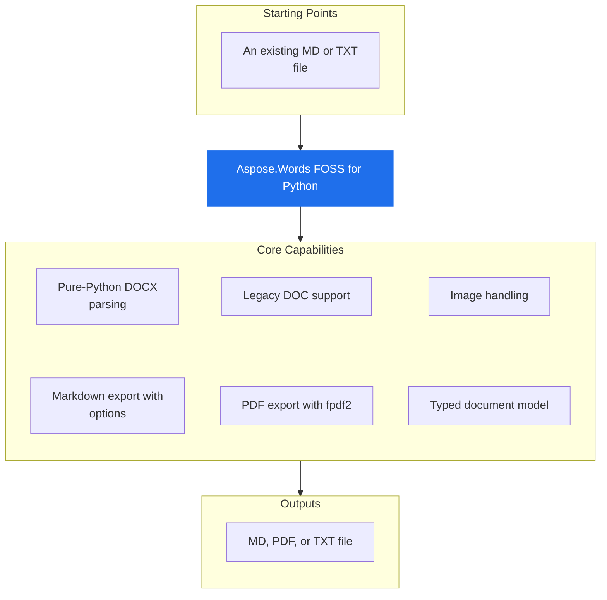

# Aspose.Words FOSS for Python

[](https://pypi.org/project/aspose-words-foss/)  [](LICENSE) [](https://github.com/aspose-words-foss/Aspose.Words-FOSS-for-Python/graphs/contributors) [](https://pypi.org/project/aspose-words-foss/)

[](https://products.aspose.org/words/python/)

Aspose.Words FOSS for Python reads MD and TXT files and writes MD, PDF and TXT files.

## Navigation

- [At a Glance](#at-a-glance)
- [Key Capabilities](#key-capabilities)
- [Installation](#installation)
- [Dependencies](#dependencies)
- [Quick Start](#quick-start)
- [Additional Examples](#additional-examples)
- [API Reference](#api-reference)
- [Documentation & Resources](#documentation--resources)
- [Scope and Limitations](#scope-and-limitations)
- [Development and Testing](#development-and-testing)
- [License](#license)

## At a Glance



## Key Capabilities

- **Read multiple input formats.** It reads `.md` and `.txt` files using the `aspose.words_foss.reader_factory`, automatically selecting the appropriate reader based on the file extension.

- Open any supported input with a single `Document(filepath)` constructor — the concrete reader is
  chosen automatically from the `.docx`/`.doc`/`.rtf`/`.md`/`.txt` file extension.
- Read DOCX with a pure-Python parser built on the standard library `zipfile`/`xml.etree` modules —
  no compiled dependencies.
- Read legacy Word 97-2003 `.doc` binary files via `olefile`, and RTF documents through the same
  OLE2 delegation path.
- Parse Markdown on import with `MarkdownReader`, not just read it as literal text — headings, lists,
  emphasis, tables, block quotes, fenced code blocks, links, and base64-embedded images all become
  proper document-model nodes, so a loaded `.md` file converts to DOCX or PDF like any other input.
- Export to Markdown with `LdmMarkdownWriter`: headings, bold/italic/underline/strikethrough runs,
  ordered and nested unordered lists, tables, block quotes, code blocks, and hyperlinks, all tunable
  through `MarkdownSaveOptions`.
- Export to PDF with `LdmPdfWriter` — a built-in paragraph, table, and shape renderer (backed by
  `fpdf2`) that needs no external PDF engine or system fonts, configurable through `PdfSaveOptions`.
- Inspect the parsed document model directly — sections, paragraphs, runs, tables, styles, and
  numbered/bulleted lists are all typed Pydantic models reachable from `Document.light_document_model`.

## Installation

Install the published package from PyPI (`aspose-words-foss`, version 26.7.0):

```bash
pip install aspose-words-foss
```

The package declares `requires-python` as `>=3.10,<3.13`.

## Dependencies

### Required Package Dependencies

- `fpdf2>=2.7.5`
- `olefile>=0.46`
- `pydantic>=2.0.0`

### Native and System Requirements

- Requires Python `>=3.10,<3.13` (`requires-python` in `pyproject.toml`).

### Development Dependencies

- `Pillow>=10.0.0` (extra `dev`)
- `pytest>=9.0.2` (extra `dev`)

## Quick Start

Load a document and export it to Markdown:

```python
import aspose.words_foss as aw

doc = aw.Document("report.docx")  # or .doc, .rtf, .txt, .md
doc.save("report.md", aw.SaveFormat.MARKDOWN)
```

## Additional Examples

Export the same document to PDF:

```python
import aspose.words_foss as aw

doc = aw.Document("report.docx")
doc.save("report.pdf", aw.SaveFormat.PDF)
```

<details>
<summary>View Additional Examples</summary>

More real, runnable examples are collected below, matching the standalone scripts under
[`ApiExamples/`](ApiExamples/).

### Save With Markdown and PDF Options

```python
import aspose.words_foss as aw

doc = aw.Document("report.docx")

md_opts = aw.saving.MarkdownSaveOptions()
md_opts.export_underline_formatting = True
doc.save("report.md", md_opts)

pdf_opts = aw.saving.PdfSaveOptions()
doc.save("report.pdf", pdf_opts)
```

### Extract Plain Text

```python
import aspose.words_foss as aw

doc = aw.Document("report.docx")
text = doc.get_text()
print(text)
```

```python
import aspose.words_foss as aw

for path in ("report.docx", "legacy.doc", "notes.rtf"):
    doc = aw.Document(path)
    doc.save(f"{path}.pdf", aw.SaveFormat.PDF)
```

```python
import io
import aspose.words_foss as aw

with io.FileIO("report.docx") as stream:
    doc = aw.Document(stream)  # DOCX / DOC / RTF from magic bytes

opts = aw.LoadOptions()
opts.load_format = aw.LoadFormat.MARKDOWN  # needed for .md, which has no magic bytes
with io.FileIO("notes.md") as stream:
    doc = aw.Document(stream, opts)
```

```python
import aspose.words_foss as aw

doc = aw.Document("report.docx")
md_opts = aw.saving.MarkdownSaveOptions()
md_opts.encoding = "utf-8-sig"
doc.save("report.md", md_opts)
```

```python
import aspose.words_foss as aw

doc = aw.Document("report.docx")
ooxml_opts = aw.saving.OoxmlSaveOptions()
ooxml_opts.pretty_format = True
doc.save("report-pretty.docx", ooxml_opts)
```

```python
import aspose.words_foss as aw

doc = aw.Document("report.docx")
ooxml_opts = aw.saving.OoxmlSaveOptions()
ooxml_opts.compression_level = aw.saving.CompressionLevel.MAXIMUM
doc.save("report-max-compression.docx", ooxml_opts)
```

```python
import aspose.words_foss as aw

image_containing_files = [
    "simple_inline.docx",
    "image_with_caption.docx",
    "image_in_table.docx",
    "image_in_header.docx",
    "image_in_footer.docx",
]
for filename in image_containing_files:
    doc = aw.Document(filename)
    doc.save(f"{filename}.md", aw.SaveFormat.MARKDOWN)   # images embed as base64 by default
    doc.save(f"{filename}.pdf", aw.SaveFormat.PDF)        # rendered via ShapeRenderer
    doc.save(f"{filename}.txt", aw.SaveFormat.TEXT)
```

```python
import io
import aspose.words_foss as aw

markdown_bytes = b"# Release Notes\n\nThis build adds **bold** and *italic* support.\n"

load_opts = aw.MarkdownLoadOptions()
doc = aw.Document(io.BytesIO(markdown_bytes), load_opts)
print(doc.get_text())

load_opts.preserve_empty_lines = True
doc = aw.Document(
    io.BytesIO(b"# Title\n\n\nParagraph after two blank lines.\n"), load_opts
)
```

```python
import io
import aspose.words_foss as aw

markdown_with_image = (
    "# Report\n\n"
    "\n\n"
    "See the [documentation](https://example.com/docs) for details.\n"
)

doc = aw.Document(io.BytesIO(markdown_with_image.encode("utf-8")), aw.MarkdownLoadOptions())
doc.save("report.docx", aw.SaveFormat.DOCX)  # image becomes a real embedded Shape
doc.save("report.pdf", aw.SaveFormat.PDF)    # link becomes a real clickable PDF annotation
```

</details>

## API Reference

The `aspose.words_foss.Document` class serves as the primary entry point for reading and writing documents, while the `aspose.words_foss.light_document_model` module provides an abstract representation used internally by readers and writers. It converts documents to and from DOCX, DOC, RTF, Markdown, and plain text formats, and can export to PDF using the `aspose.words_foss.saving` module.

The public API has 189 types.

<details>
<summary>View the Complete Public API Surface</summary>

### Core API

| Class | Description |
| --- | --- |
| `Document` | Represents a Word document. |
| `LoadOptions` | Options for loading a document. |
| `MarkdownLoadOptions` | Load options specific to Markdown (.md) input. |
| `NodeType` | Node type discriminators, valued as in aspose.words. |
| `ListHandler` | Handles parsing and conversion of lists. |
| `ParagraphConverter` | Handles conversion of paragraphs to Markdown. |
| `TableConverter` | Handles conversion of tables to Markdown. |
| `DocFileReader` | Full DOC reader with LDM (Light Document Model) building capability. |
| `DocFileReaderCore` | Core reader for Word 97-2003 (.doc) files. |
| `FibData` | Parsed FIB (File Information Block) data. |
| `BlipInfo` | Parsed BSE (Blip Store Entry) with location of image data. |
| `ChildAnchorInfo` | Position of a child shape within its parent group's coordinate system. |
| `GroupShapeInfo` | Coordinate system of a shape group (from Spgr record). |
| `ShapeAnchor` | Parsed SPA (Shape Address) from PlcSpaMom / PlcSpaHdr. |
| `ShapeCropInfo` | Escher crop properties for a shape (from FOpt records). |
| `ShapeLineProps` | Escher line/fill properties for a shape (from FOpt records). |
| `ListDef` | Parsed list definition with full level information. |
| `ListLevelData` | One parsed LVL record (measurements in points). |
| `CharProps` | Properties extracted from CHPX for a text run. |
| `ParaProps` | Properties extracted from PAPX for a single paragraph. |
| `TableRowProps` | Properties extracted from PAPX SPRMs on table row-end paragraphs. |
| `StyleData` | Properties parsed from a style definition (STSH UPX). |
| `DocTableBuilderMixin` | Mixin that adds table-building helpers to the DOC reader. |
| `CellData` | Table cell. |
| `DocumentReader` | Reads DOCX documents and produces abstracted data structures. |
| `NumberingInfo` | Numbering definition. |
| `NumberingLevel` | List level definition. |
| `ParagraphData` | Paragraph with style and content. |
| `RowData` | Table row. |
| `RunData` | Text run with formatting. |
| `TableData` | Table structure. |
| `LdmBuilderMixin` | Mixin that adds to_light_document to DocumentReader. |
| `FontBuilder` | Build a non-cascaded ldm.Font from one <w:rPr>. |
| `FontResolver` | Compose a fully cascaded ldm.Font. |
| `ParagraphFormatBuilder` | Build a non-cascaded ldm.ParagraphFormat from one <w:pPr>. |
| `ParagraphFormatResolver` | Compose a fully cascaded ldm.ParagraphFormat. |
| `StyleChainResolver` | Walk the <w:basedOn> graph for a styleId. |
| `ListBuilder` | Translate <w:numbering> into a list of ldm.DocList. |
| `StyleBuilder` | Translate <w:styles> into a list of ldm.Style. |
| `ParagraphBuilder` | Build ldm.Paragraph from a <w:p> element. |
| `RunBuilder` | Build a single ldm.Run with a resolved font cascade. |
| `PageSetupBuilder` | Build ldm.PageSetup from a <w:sectPr> element. |
| `SectionBuilder` | Split the body into ldm.Section\ s at sectPr boundaries. |
| `CellBuilder` | Build ldm.Cell from a <w:tc> element. |
| `RowBuilder` | Build ldm.Row from a <w:tr> element. |
| `TableBuilder` | Build ldm.Table from a <w:tbl> element. |
| `ShapeParserMixin` | Mixin providing drawing/shape parsing methods for DocumentReader. |
| `DocxWriterLossyWarning` | Warns the caller that the writer is dropping known LDM constructs. |
| `LdmDocxWriter` | Convert an ldm.Document into a DOCX file. |
| `BookmarkState` | Hands out monotonically increasing bookmark ids and pairs |
| `ImageEntry` | One image to add to word/media/ plus its relationship row. |
| `ImageRenderState` | Accumulator threaded through paragraph rendering for inline shapes. |
| `ImageData` | ImageData class holds image data and provides content_type read-only property for the MIME content-type string derived from image_type, and from_mime method to map a MIME content-type string to an ImageType constant. |
| `ImageType` | Specifies the type (format) of an image in a document. |
| `Shape` | Shape class represents a drawing shape in the document model. |
| `WrapType` | Specifies how text is wrapped around a shape or picture. |
| `Body` | Body class gives the paragraphs and tables of a section body, with paragraphs and tables read-only properties for direct Paragraph and Table children, and get_child_nodes method for child nodes optionally filtered by NodeType. |
| `BookmarkEnd` | BookmarkEnd class represents the end node of a bookmark. |
| `BookmarkStart` | Marks the beginning of a Word bookmark (<w:bookmarkStart>). |
| `Border` | Border class represents a border of a document element. |
| `Cell` | Cell class represents a table cell in the document model. |
| `CellFormat` | CellFormat class holds formatting properties for a table cell. |
| `ConditionalStyleMask` | Parsed <w:cnfStyle> 12-bit bitmask for banded-table regions. |
| `DocList` | DocList class represents a list in the document model. |
| `FieldEnd` | FieldEnd class represents the end node of a field. |
| `FieldSeparator` | FieldSeparator class represents the separator node of a field. |
| `FieldStart` | FieldStart class represents the start node of a field. |
| `Font` | Font class holds font formatting properties. |
| `FrameFormat` | Floating text-frame definition. Numeric dimensions are in points. |
| `HeaderFooter` | HeaderFooter class holds paragraphs and tables of a header or footer, with paragraphs and tables read-only properties for direct Paragraph and Table children. |
| `ListFormat` | ListFormat class holds list formatting properties. |
| `ListLabel` | Snapshot of a list-item's rendered bullet/number label. |
| `ListLevel` | ListLevel class holds formatting properties for a list level. |
| `ListLevelOverride` | One <w:lvlOverride> inside a concrete <w:num>. |
| `NodeCastMixin` | as_*() casts mirroring aspose.words.Node; identity here. |
| `PageSetup` | PageSetup class holds page setup properties. |
| `Paragraph` | A paragraph whose children — Run, BookmarkStart / End, |
| `ParagraphFormat` | ParagraphFormat class holds paragraph formatting properties. |
| `PreferredWidth` | Preferred width of a table / cell. |
| `Row` | Row class represents a table row in the document model. |
| `RowFormat` | RowFormat class holds formatting properties for a table row. |
| `Run` | Run class represents a run of text with the same formatting in the document model. |
| `Section` | Section class represents a section in the document model. |
| `Shading` | Shading class holds shading properties for a document element. |
| `Style` | Style class holds formatting properties for a style. |
| `TabStop` | TabStop class represents a tab stop. |
| `TabStopCollection` | TabStopCollection class holds a collection of tab stops with add, after, before, clear, and remove_by_position methods. |
| `light_document_model.Table` | Table class represents a table in the document model with first_row and last_row read-only properties. |
| `TableStyleFormat` | Table-level properties stored on table styles (w:tblPr inside w:style). |
| `TableStyleProperty` | Conditional formatting for a table region (w:tblStylePr). |
| `TextColumn` | TextColumn class represents a text column. |
| `TextColumns` | TextColumns class holds a collection of text columns. |
| `UnknownNode` | UnknownNode class represents an unknown node type in the document model. |
| `MarkdownReader` | MarkdownReader class reads Markdown content with encoding property for the text encoding used to decode the Markdown source, and load_bytes, load_file, and load_stream methods to load from raw bytes, a .md file from filepath, or a binary stream, respectively, and to_light_document method to convert the loaded content to a light document. |
| `AtxHeadingBlock` | AtxHeadingBlock class represents an ATX-style heading block in Markdown. |
| `AutolinkBlock` | AutolinkBlock class represents an autolink block in Markdown. |
| `Block` | Base class for every node in the Markdown block tree. |
| `BoldInlineBlock` | BoldInlineBlock class represents a bold inline block in Markdown. |
| `BulletListItemBlock` | BulletListItemBlock class represents a bullet list item block in Markdown. |
| `CellBlock` | CellBlock class represents a table cell block in Markdown. |
| `DocumentBlock` | DocumentBlock class represents a document block in Markdown. |
| `FencedCodeBlock` | FencedCodeBlock class represents a fenced code block in Markdown. |
| `FootnoteDefinitionBlock` | FootnoteDefinitionBlock class represents a footnote definition block in Markdown. |
| `FootnoteReferenceBlock` | FootnoteReferenceBlock class represents a footnote reference block in Markdown. |
| `HeadingBlock` | HeadingBlock class represents a heading block in a Markdown document. |
| `HorizontalRuleBlock` | HorizontalRuleBlock class represents a horizontal rule block in a Markdown document. |
| `HtmlInsertOptions` | Flags for MarkdownDocumentBuilder.insert_html (mirrors |
| `HtmlTagBlock` | A raw HTML tag, block-level or inline (Markdig's HtmlBlock |
| `IndentedCodeBlock` | IndentedCodeBlock class represents an indented code block in a Markdown document. |
| `InlineCodeBlock` | InlineCodeBlock class represents an inline code block in a Markdown document. |
| `ItalicInlineBlock` | ItalicInlineBlock class represents an italic inline element in a Markdown document. |
| `LineBreakBlock` | LineBreakBlock class represents a line break block in a Markdown document. |
| `LinkTextBlock` | LinkTextBlock class represents a link text block in a Markdown document and exposes a read-only property has_destination. |
| `ListBlock` | Container grouping sibling ListItemBlocks (Markdig's ListBlock). |
| `ListItemBlock` | ListItemBlock class represents a list item block in a Markdown document and provides methods get_level and get_list_container. |
| `MarkdownDocumentBuilder` | LDM cursor/writer used by MarkdownReaderContext. |
| `MarkdownReaderContext` | Drives Markdown block-tree events into a fresh LDM Document. |
| `OrderedListItemBlock` | OrderedListItemBlock class represents an ordered list item block in a Markdown document. |
| `ParagraphBlock` | ParagraphBlock class represents a paragraph block in a Markdown document. |
| `QuoteBlock` | QuoteBlock class represents a quote block in a Markdown document. |
| `RowBlock` | RowBlock class represents a row block in a Markdown table and exposes a read-only property count. |
| `SetextHeadingBlock` | SetextHeadingBlock class represents a Setext heading block in a Markdown document. |
| `StrikethroughBlock` | StrikethroughBlock class represents a strikethrough element in a Markdown document. |
| `TableBlock` | TableBlock class represents a table block in a Markdown document and exposes a read-only property columns_count. |
| `TextBlock` | A literal run of text (Markdig's LiteralInline). |
| `UnderlineBlock` | UnderlineBlock class represents an underline element in a Markdown document. |
| `LdmMarkdownWriter` | Converts a light_document_model.Document to a Markdown string. |
| `CellMerge` | Specifies how a cell in a table is merged with other cells. |
| `CellVerticalAlignment` | Specifies vertical justification of text inside a table cell. |
| `HeightRule` | Specifies the rule for determining the height of an object. |
| `LineSpacingRule` | Specifies values for line spacing. |
| `LineStyle` | Specifies line style of a border. |
| `NumberStyle` | Specifies the number style for a list, footnotes, endnotes, |
| `Orientation` | Specifies page orientation. |
| `ParagraphAlignment` | Specifies text alignment in a paragraph. |
| `PreferredWidthType` | Specifies the unit of measurement for the preferred width of a table or cell. |
| `SectionStart` | Specifies the type of break at the beginning of the section. |
| `StyleIdentifier` | Locale-independent built-in style identifier. |
| `StyleType` | Specifies type of the style. |
| `TabAlignment` | Tab stop alignment. |
| `TabLeader` | Tab stop leader character. |
| `Underline` | Specifies type of the underline applied to a font. |
| `ConversionOptions` | Options for controlling DOCX to Markdown conversion. |
| `ParagraphInfo` | Information about a paragraph's style and context. |
| `RunFormatting` | Text run formatting properties. |
| `models.Table` | Represents a table structure. |
| `TableCell` | Represents a table cell. |
| `TableRow` | Represents a table row. |
| `NumberingParser` | Parser for DOCX numbering definitions. |
| `StyleParser` | Parser for DOCX style names and properties. |
| `ListInfo` | Information about a list. |
| `ListLevelInfo` | Information about a list level. |
| `ParsedStyle` | Parsed style information. |
| `LdmPdfWriter` | Converts a light_document_model.Document to a PDF file. |
| `ParagraphRenderer` | Renders LDM paragraphs into PDF. |
| `RunRenderer` | Renders formatted runs (text segments with fonts, colors, links). |
| `ShapeRenderer` | Renders shapes, images, and positioned elements. |
| `TableRenderer` | Renders LDM tables into PDF. |
| `DocumentFormatReader` | Protocol defining the interface all document readers must implement. |
| `RtfFileReader` | Reads RTF files (OLE2-format) and produces the same data structures |
| `MarkdownSaveOptions` | Options for saving documents as Markdown. |
| `OoxmlSaveOptions` | Options for saving a document as DOCX (Office Open XML) (some members not implemented). |
| `OutlineOptions` | Controls how outlines (bookmarks panel) are generated in the PDF. |
| `PdfSaveOptions` | Options for saving documents as PDF. |
| `MarkdownFileReader` | Reads Markdown (.md) files and yields one Paragraph per line. |
| `TextFileReader` | Reads plain-text (.txt) files and yields one Paragraph per line. |

#### Enumerations

| Enumeration | Description |
| --- | --- |
| `LoadFormat` | Document load format constants, valued as in aspose.words. |
| `SaveFormat` | Document save format constants, valued as in aspose.words (some members not implemented). |
| `BlockType` | BlockType enum lists the ATX_HEADING, AUTOLINK, BOLD_INLINE, BULLET_LIST_ITEM, CELL, DOCUMENT, FENCED_CODE, FOOTNOTE_DEFINITION, FOOTNOTE_REFERENCE, HORIZONTAL_RULE, HTML_TAG, and INDEDENT_CODE block types. |
| `md_import.ListMarker` | Bullet/ordered list marker, mirroring Aspose.Words' ListMarker. |
| `MarkdownBlockLevel` | Where a block sits in the tree. |
| `CodeBlockStyle` | Code block style preference. |
| `HeadingStyle` | Heading export style preference. |
| `models.ListMarker` | Bullet list marker style. |
| `ColorMode` | Color rendering mode. |
| `CompressionLevel` | Compression level for OOXML files. |
| `MarkdownEmptyParagraphExportMode` | Controls how empty paragraphs are exported. Note NONE is 2, not 0. |
| `MarkdownExportAsHtml` | Controls which elements are exported as raw HTML. |
| `MarkdownLinkExportMode` | Link export mode options. |
| `MarkdownListExportMode` | List export mode options. |
| `OoxmlCompliance` | OOXML standards compliance level (some members not implemented). |
| `PdfCompliance` | PDF standards compliance level. |
| `PdfFontEmbeddingMode` | Font embedding mode in PDF. Note EMBED_NONE is 2, not 1. |
| `PdfImageCompression` | Image compression in PDF. |
| `PdfPageMode` | PDF page display mode. |
| `PdfTextCompression` | Text compression in PDF. |
| `PdfZoomBehavior` | Mirrors public API. |
| `TableContentAlignment` | Table content alignment options. |
| `Zip64Mode` | Controls when to use ZIP64 format extensions for OOXML files. |

#### Detailed Member Reference

### Document

The `aspose.words_foss.Document` class represents a Word document and provides access to its content through properties such as sections, paragraphs, and styles; it supports loading from file paths or streams and saving to various formats using `SaveFormat` constants or save options.

- `first_section`: The first section of the document.
- `get_child_nodes`: Child nodes, optionally filtered by NodeType.
- `get_text`: Extract plain text from the loaded document.
- `last_section`: The last section of the document.
- `light_document_model`: Access the internal Light Document Model.
- `lists`: All document list definitions.
- `page_count`: Estimated page count.
- `save`: Save the document to the specified format.
- `sections`: All document sections.
- `styles`: All document styles.

### docx_reader

The `aspose.words_foss.docx_reader` module provides the `DocumentReader` class, which reads DOCX files and produces an abstracted data structure via `load_file`, `load_stream`, or `load_bytes` methods followed by `to_light_document`.

### doc_reader

The `aspose.words_foss.doc_reader` module provides the `DocFileReader` class, which reads legacy DOC files and exposes a `to_light_document` method to convert them into the Light `Document` Model.

### md_writer

The `aspose.words_foss.md_writer` module provides the `LdmMarkdownWriter` class, which converts a document from the Light `Document` Model to a Markdown string, respecting options such as heading style, list marker, and link export mode defined in `MarkdownLoadOptions`.

### pdf_writer

The `aspose.words_foss.pdf_writer` module provides the `LdmPdfWriter` class, which converts a document from the Light `Document` Model to a PDF file using internal renderers for paragraphs, runs, tables, and shapes, and accepts `PdfSaveOptions` for compression, font embedding, and compliance settings.

### model

The `aspose.words_foss.model` module exposes the Light `Document` Model, a set of classes such as `Document`, `Section`, `Paragraph`, and `Table` that provide a simplified, format-agnostic representation of document content used by readers and writers.

| Class | Description |
|---|---|
| `Body` | Class that inherits from BaseModel and NodeCastMixin and declares the method get_child_nodes and the properties paragraphs and tables. |
| `BookmarkEnd` | Class that inherits from BaseModel and declares the fields type and name. |
| `BookmarkStart` | Marks the beginning of a Word bookmark (`<w:bookmarkStart>`). |
| `Border` | Class that inherits from BaseModel and declares the fields line_style, line_width, is_visible, color, distance_from_text and shadow. |
| `Cell` | Class that inherits from BaseModel and NodeCastMixin and declares the fields type, cell_format, paragraphs and tables. |
| `CellFormat` | Class that inherits from BaseModel and declares fields including width, preferred_width, vertical_alignment, vertical_merge, horizontal_merge and top_padding. |
| `ColorMode` | Color rendering mode. |
| `CompressionLevel` | Compression level for OOXML files. |
| `ConversionOptions` | Options for controlling DOCX to Markdown conversion. |
| `DocList` | Class that inherits from BaseModel and declares the fields list_id, is_multi_level, list_levels and overrides. |
| `Document` | Represents a Word document. |
| `Document-light_document_model` | Class with 2 methods and 13 properties. |
| `DocumentFormatReader` | Protocol defining the interface all document readers must implement. |
| `FieldEnd` | Class that inherits from BaseModel and declares the fields type, field_type and has_separator. |
| `FieldSeparator` | Class that inherits from BaseModel and declares the fields type and field_type. |
| `FieldStart` | Class that inherits from BaseModel and declares the fields type and field_type. |
| `Font` | Class that inherits from BaseModel and declares fields including name, size, bold, italic, underline and color. |
| `FrameFormat` | Floating text-frame definition. |
| `HeaderFooter` | Class that inherits from BaseModel and declares the properties paragraphs and tables. |
| `ImageData` | Class that inherits from BaseModel and declares the method from_mime and the property content_type. |
| `LdmMarkdownWriter` | Converts a `light_document_model.Document` to a Markdown string. |
| `ListFormat` | Class that inherits from BaseModel and declares the fields is_list_item, list_level_number and list_id. |
| `ListLabel` | Snapshot of a list-item's rendered bullet/number label. |
| `ListLevel` | Class that inherits from BaseModel and declares fields including number_format, number_style, start_at, alignment, number_position and text_position. |
| `ListLevelOverride` | One `<w:lvlOverride>` inside a concrete `<w:num>`. |
| `LoadFormat` | Document load format constants. |
| `MarkdownEmptyParagraphExportMode` | Controls how empty paragraphs are exported. |
| `MarkdownExportAsHtml` | Controls which elements are exported as raw HTML. |
| `MarkdownFileReader` | Reads Markdown (.md) files and yields one Paragraph per line. |
| `MarkdownLinkExportMode` | Link export mode options. |
| `MarkdownListExportMode` | List export mode options. |
| `MarkdownSaveOptions` | Options for saving documents as Markdown. |
| `OoxmlCompliance` | OOXML standards compliance level. |
| `OoxmlSaveOptions` | Options for saving a document as DOCX (Office Open XML). |
| `OutlineOptions` | Controls how outlines (bookmarks panel) are generated in the PDF. |
| `PageSetup` | Class that inherits from BaseModel and declares fields including paper_size, orientation, top_margin, bottom_margin, left_margin and right_margin. |
| `Paragraph` | A paragraph whose children — `Run`, `BookmarkStart` / `End`, `FieldStart` / `Separator` / `End` and inline `ShapeNode` — sit in a single ordered collection in document order. |
| `ParagraphFormat` | Class that inherits from BaseModel and declares fields including style_name, alignment, left_indent, right_indent, first_line_indent and space_before. |
| `ParagraphInfo` | Information about a paragraph's style and context. |
| `PdfCompliance` | PDF standards compliance level. |
| `PdfFontEmbeddingMode` | Font embedding mode in PDF. |
| `PdfImageCompression` | Image compression in PDF. |
| `PdfPageMode` | PDF page display mode. |
| `PdfSaveOptions` | Options for saving documents as PDF. |
| `PdfTextCompression` | Text compression in PDF. |
| `PdfZoomBehavior` | Mirrors public API. |
| `Row` | Class that inherits from BaseModel and NodeCastMixin and declares the fields type, row_format, cells and preferred_width. |
| `RowFormat` | Class that inherits from BaseModel and declares the fields height, height_rule, heading_format, allow_break_across_pages, conditional_style and borders. |
| `RtfFileReader` | Reads RTF files (OLE2-format) and produces the same data structures as DocumentReader (for .docx) and DocFileReader (for .doc). |
| `Run` | Class that inherits from BaseModel and NodeCastMixin and declares the fields type, text and font. |
| `RunFormatting` | Text run formatting properties. |
| `SaveFormat` | Document save format constants. |
| `Section` | Class that inherits from BaseModel and NodeCastMixin and declares the fields type, page_setup, body and headers_footers. |
| `Shading` | Class that inherits from BaseModel and declares the fields background_pattern_color and foreground_pattern_color. |
| `Style` | Class that inherits from BaseModel and declares fields including name, type, is_heading, base_style_name, next_paragraph_style_name and paragraph_format. |
| `TabStop` | Class that inherits from BaseModel and declares the fields position, alignment, leader and is_clear. |
| `TabStopCollection` | Class that inherits from BaseModel and declares the methods add, after, before, clear and remove_by_position and the field tab_stops. |
| `Table` | Class with 11 properties. |
| `Table-models` | Represents a table structure. |
| `TableCell` | Represents a table cell. |
| `TableContentAlignment` | Table content alignment options. |
| `TableRow` | Represents a table row. |
| `TableStyleFormat` | Table-level properties stored on table styles (`w:tblPr` inside `w:style`). |
| `TextColumn` | Class that inherits from BaseModel and declares the fields width and space_after. |
| `TextColumns` | Class that inherits from BaseModel and declares the fields count, evenly_spaced, spacing, line_between and columns. |
| `TextFileReader` | Reads plain-text (.txt) files and yields one Paragraph per line. |
| `UnknownNode` | Class that inherits from BaseModel and declares the field type. |
| `Zip64Mode` | Controls when to use ZIP64 format extensions for OOXML files. |

| Enumeration | Description |
|---|---|
| `ListMarker` | Bullet list marker style. |

| Class | Description |
|---|---|
| `CellBuilder` | Build `ldm.Cell` from a `<w:tc>` element. |
| `FontBuilder` | Build a non-cascaded `ldm.Font` from one `<w:rPr>`. |
| `FontResolver` | Compose a fully cascaded `ldm.Font`. |
| `LdmBuilderMixin` | Mixin that adds `to_light_document` to `DocumentReader`. |
| `ListBuilder` | Translate `<w:numbering>` into a list of `ldm.DocList`. |
| `PageSetupBuilder` | Build `ldm.PageSetup` from a `<w:sectPr>` element. |
| `ParagraphBuilder` | Build `ldm.Paragraph` from a `<w:p>` element. |
| `ParagraphFormatBuilder` | Build a non-cascaded `ldm.ParagraphFormat` from one `<w:pPr>`. |
| `ParagraphFormatResolver` | Compose a fully cascaded `ldm.ParagraphFormat`. |
| `RowBuilder` | Build `ldm.Row` from a `<w:tr>` element. |
| `RunBuilder` | Build a single `ldm.Run` with a resolved font cascade. |
| `SectionBuilder` | Split the body into `ldm.Section` objects at sectPr boundaries. |
| `StyleBuilder` | Translate `<w:styles>` into a list of `ldm.Style`. |
| `StyleChainResolver` | Walk the `<w:basedOn>` graph for a styleId. |
| `TableBuilder` | Build `ldm.Table` from a `<w:tbl>` element. |

| Class | Description |
|---|---|
| `BookmarkState` | Hands out monotonically increasing bookmark ids and pairs starts/ends across paragraphs. |
| `ImageEntry` | One image to add to `word/media/` plus its relationship row. |
| `LdmDocxWriter` | Convert an `ldm.Document` into a DOCX file. |

| Class | Description |
|---|---|
| `NumberStyle` | Specifies the number style for a list, footnotes, endnotes, page numbers. |

| Class | Description |
|---|---|
| `LdmPdfWriter` | Converts a `light_document_model.Document` to a PDF file. |
| `PDFWriterContext` | Protocol requiring a `PdfSaveOptions` options property. |

- `DocumentReader` (DOCX) — combines `LdmBuilderMixin` and `ShapeParserMixin`; `load_file()` /
  `load_stream()` / `load_bytes()`, then `to_light_document()`

- `DocFileReader` (DOC, Word 97-2003 binary) — combines `DocTableBuilderMixin` and
  `DocFileReaderCore`, backed by `olefile`

- `RtfFileReader` — OLE2-delegated RTF reader with the same `to_light_document()` contract

- `MarkdownFileReader`, `TextFileReader` — yield one `Paragraph` per line

- `DocumentFormatReader` — the `Protocol` all four readers implement

- `LdmMarkdownWriter.write(doc, output_path) -> str`
- `MarkdownSaveOptions` — `heading_style` (`HeadingStyle.ATX` / `SETEXT`), `list_marker`
  (`ListMarker.DASH` / `ASTERISK` / `PLUS`), `code_block_style`, `table_content_alignment`,
  `link_export_mode`, `export_as_html`, `export_underline_formatting`, `export_images_as_base64`,
  `encoding`, `paragraph_break`

- `LdmPdfWriter.write(doc, output_path) -> None`
- `PdfSaveOptions` — `compliance`, `export_document_structure`, `image_compression`,
  `jpeg_quality`, `zoom_factor`, `zoom_behavior`, `export_bookmarks_outline`, `outline_options`,
  `display_doc_title` (all applied by the writer); `text_compression`, `embed_full_fonts`,
  `use_core_fonts`, `font_embedding_mode`, `page_mode`, `color_mode`, `preserve_form_fields`, and
  `memory_optimization` (accepted but not yet consumed — see
  [Scope and Limitations](#scope-and-limitations))
- `ParagraphRenderer`, `RunRenderer`, `TableRenderer`, `ShapeRenderer` — the internal rendering
  pipeline `LdmPdfWriter` drives, built on `fpdf2`

- `LdmDocxWriter.write(doc, output_path) -> None` / `write_to_bytes(doc) -> bytes`
- `OoxmlSaveOptions` — `compliance` (`OoxmlCompliance.ECMA376_2006` / `ISO29500_2008_TRANSITIONAL`;
  `ISO29500_2008_STRICT` is not implemented), `compression_level` (`CompressionLevel.NORMAL` /
  `MAXIMUM` / `FAST` / `SUPER_FAST`), `zip_64_mode`, `pretty_format`
- `DocxWriterLossyWarning` — a `UserWarning` subclass callers can opt into with
  `warnings.simplefilter("error", DocxWriterLossyWarning)`

- `Document` (LDM) — `all_paragraphs`, `tables`, `all_tables`, `text`, `styles`, `lists`,
  `sections`, `header_paragraphs`, `footer_paragraphs`, `find_style(name)`, `headings(max_level)`

- `Section` — `page_setup`, `body`, `headers_footers`

- `Paragraph` — `runs`, `paragraph_format`, `list_format`, `list_label`, `text`

- `Table` / `Row` / `Cell` — `rows`, `cells`, `cell_format`, `row_format`

- `Style` — `paragraph_format`, `font`, `base_style_name`, `built_in`

- `Font` / `ParagraphFormat` / `PageSetup` — cascaded formatting attributes resolved during DOCX
  read

- `LineStyle`, `LineSpacingRule`, `HeightRule`, `CellMerge`, `CellVerticalAlignment`, `Orientation`,
  `ParagraphAlignment`, `SectionStart`, `StyleType`, `StyleIdentifier`, `TabAlignment`, `TabLeader`,
  `Underline`, `WrapType`

</details>

## Documentation & Resources

- **[Getting started guide](https://docs.aspose.org/words/python/)** — installation, walkthroughs, and feature guides for this library.
- **[How-to guides & FAQ](https://kb.aspose.org/words/python/)** — task-focused answers for common Word-processing questions.
- **[Full API reference](https://reference.aspose.org/words/python/)** — the complete, browsable reference for all 189 public types (the [API reference](#api-reference) section above covers the essentials).
- **[aspose-words](https://github.com/aspose-words/Aspose.Words-for-Python-via-.NET)** — The `ApiExamples/` scripts are written against the API this library shares with the commercial `aspose-words` package — the same sources run there too, by replacing `aspose.words_foss` with `aspose.words` in the imports.
- Found a bug or have a feature request? [Open an issue](https://github.com/aspose-words-foss/Aspose.Words-FOSS-for-Python/issues).

## Scope and Limitations

- `Document(filepath=None, *, stream=None, data=None)` — loads a `.doc`, `.docx`, `.rtf`, `.txt`, or `.md` file (or DOCX bytes/stream) and populates the Light Document Model immediately at construction time.
  - `light_document_model: ldm.Document` — the underlying parsed model
  - `sections`, `first_section`, `last_section`, `styles`, `lists`, `page_count`
  - `get_text() -> str` — plain-text extraction
  - `save(output_path, save_format_or_options=None)` — accepts a `SaveFormat` constant or a `MarkdownSaveOptions` / `PdfSaveOptions` / `OoxmlSaveOptions` instance; otherwise the target format is inferred from the output file's extension
- `SaveFormat`: `MARKDOWN`, `DOC` (reserved for API compatibility, not implemented — see [Scope and Limitations](#scope-and-limitations)), `DOCX`, `TEXT`, `PDF`
- `LoadFormat`: `AUTO`, `DOC`, `DOCX`, `RTF`, `TEXT`, `MARKDOWN`

- `SaveFormat.DOC` is defined as a save-format constant for API compatibility with the commercial product, but `Document.save()` does not implement a DOC writer — `.doc` files can be read, not written. Saving with an unsupported target raises `ValueError` (`Markdown`, `Text`, `PDF`, and `DOCX` are the four save formats actually implemented).
- Saving DOCX with `OoxmlSaveOptions.compliance` set to `OoxmlCompliance.ISO29500_2008_STRICT` is not implemented — the writer raises `NotImplementedError` rather than silently emitting non-strict output. Use `ECMA376_2006` or `ISO29500_2008_TRANSITIONAL` instead, both of which this edition treats as producing the same, compliant output.
- Of `PdfSaveOptions`'s 17 fields, 8 — `text_compression`, `embed_full_fonts`, `use_core_fonts`, `font_embedding_mode`, `page_mode`, `color_mode`, `preserve_form_fields`, and `memory_optimization` — exist for API forward-compatibility with the commercial Aspose.Words API and are not yet consumed by the PDF writer.

See [Aspose.Words for Python — Enterprise Edition](https://products.aspose.com/words/python-net/). It adds strict ISO 29500 compliance for DOC writing, additional load/save formats, and page-layout features beyond this edition's scope.

## Development and Testing

```bash
pip install aspose-words-foss>=26.5.0
```

Or install the latest nightly build directly from GitHub:

```bash
pip install git+https://github.com/aspose-words-foss/Aspose.Words-FOSS-for-Python.git
```

Requires Python 3.10 or later; runtime dependencies install automatically via pip — see [Dependencies](#dependencies) below for the full required and native-requirement breakdown.

Verify the install:

```bash
python -c "import aspose_words_foss; print('aspose_words_foss OK')"
```

- `Pillow>=10.0.0` — used by the `dev` extra's example/test tooling for image-containing documents.
- `pytest>=9.0.2` — the test runner used to execute `ApiExamples/`.

None of these are required to install or use the published package; they apply only when installing with `pip install -e ".[dev]"` for local development and testing.

Install the development dependencies and run the example test suite:

```bash
pip install -e ".[dev]"
python -m pytest ApiExamples/ -v --rootdir=ApiExamples -c ApiExamples/pytest.ini
```

Run an individual example script directly:

```bash
python ApiExamples/convert_document.py
```

Test fixtures live under `tests/data/input/` (shared input files for `ApiExamples/`); generated output is written to `ApiExamples/output/` (git-ignored).

## License

This project is licensed under the [MIT License](LICENSE). The MIT License permits use, copying, modification, distribution, sublicensing, and commercial use, provided its copyright and permission notice are retained. The software is provided without warranty.
