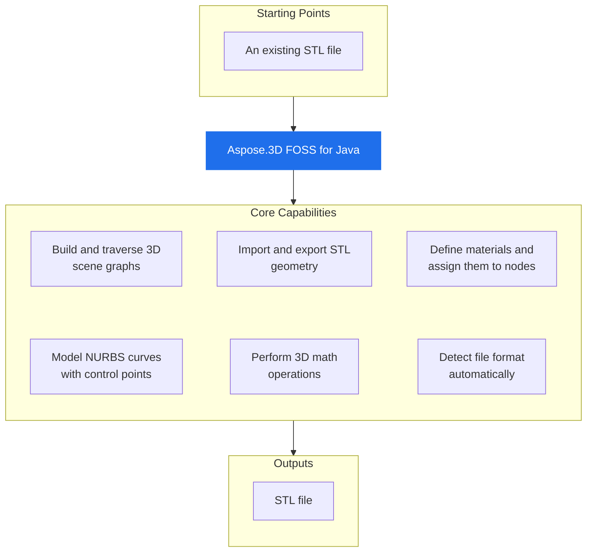

# Aspose.3D FOSS for Java

[](https://repo1.maven.org/maven2/org/aspose/aspose-3d-foss/)  [](LICENSE) [](https://github.com/aspose-3d-foss/Aspose.3D-FOSS-for-Java/graphs/contributors)

[](https://products.aspose.org/3d/java/)

Aspose.3D FOSS for Java reads `.obj` and `.stl` files and writes `.stl` files. It constructs scene graphs using `Scene`, `Node`, and `Entity` classes, supports primitive mesh geometry such as `Box`, `Cylinder`, `Sphere`, and `Dish`, and defines PBR materials. It also provides NURBS curve control-point and knot data, and vector, matrix, and quaternion math operations.

## Navigation

- [At a Glance](#at-a-glance)
- [Key Capabilities](#key-capabilities)
- [Installation](#installation)
- [Dependencies](#dependencies)
- [Quick Start](#quick-start)
- [Additional Examples](#additional-examples)
- [API Reference](#api-reference)
- [Documentation & Resources](#documentation--resources)
- [Scope and Limitations](#scope-and-limitations)
- [Development and Testing](#development-and-testing)
- [License](#license)

## At a Glance



## Key Capabilities

- **Build and traverse 3D scene graphs.** It builds and traverses 3D scene graphs using `Scene`, `Node`, and `Entity` classes, attaching geometry through `Node.addEntity` or `Node.createChildNode` and organizing nodes into a parent-child hierarchy.
- **Import and export STL geometry.** It imports and exports STL geometry in binary or ASCII format using `StlLoadOptions` and `StlSaveOptions`, dispatched through `Scene.fromFile` and `Scene.save`, with the `.stl` format fully functional end to end.
- **Define materials and assign them to nodes.** It defines materials with `LambertMaterial`, `PhongMaterial`, and `PbrMaterial` classes supporting albedo, metallic/roughness, occlusion, and emissive channels plus texture references, and assigns them per node via `Node.setMaterial`.
- **Model NURBS curves with control points.** It models NURBS curves using `NurbsCurve`, exposing control points, knot vectors, and degree/order data.
- **Perform 3D math operations.** It performs 3D math operations using `Vector2`, `Vector3`, `Vector4`, `Matrix4`, `Quaternion`, and `BoundingBox` classes that underlie every scene operation.
- **Detect file format automatically.** It detects file format automatically or resolves an explicit format from a file path or binary stream using `FileFormat.detect` and `FileFormat.getFormatByExtension`.

- Build a 3D scene graph with `Scene`, `Node`, and `Entity`, attaching geometry through `Node.addEntity`/`Node.createChildNode` and organizing it into a parent-child hierarchy.
- Detect a 3D file's format automatically, or resolve an explicit format from a file path or
  binary stream (`FileFormat.detect`, `FileFormat.getFormatByExtension`).
- Generate primitive solids as ready-to-use geometry — `Box`, `Cylinder`, `Sphere`, and `Dish` each implement `toMesh()` to produce a `Mesh` — and IFC-style 2D profiles such as `CircleShape` and `EllipseShape`.
- Define materials with `LambertMaterial`, `PhongMaterial`, and `PbrMaterial` — albedo, metallic/roughness, occlusion, and emissive channels, plus texture references — and assign them per node via `Node.setMaterial`.
- Model NURBS curves through `NurbsCurve`, exposing control points, knot vectors, and degree/order data (curve sampling is not implemented; see [Scope and Limitations](#scope-and-limitations)).
- Work with the transform and geometry math that underlies every scene operation — `Vector2`/`Vector3`/`Vector4`, `Matrix4`, `Quaternion`, and `BoundingBox`.
- Import and export STL geometry (binary or ASCII) with `StlLoadOptions`/`StlSaveOptions`, dispatched through `Scene.fromFile`/`Scene.save` — the one format that is fully functional end to end in the published package (see [Scope and Limitations](#scope-and-limitations)).

## Installation

Install the published package from Maven Central (`org.aspose:aspose-3d-foss`, version 26.5.0):

```bash
mvn dependency:get -Dartifact=org.aspose:aspose-3d-foss:26.5.0
```

Or declare it in Maven:

```xml
<dependency>
  <groupId>org.aspose</groupId>
  <artifactId>aspose-3d-foss</artifactId>
  <version>26.5.0</version>
</dependency>
```

Or declare it in Gradle:

```groovy
implementation 'org.aspose:aspose-3d-foss:26.5.0'
```

## Dependencies

### Required Package Dependencies

No required third-party package dependencies; in `pom.xml`, every `<dependency>` the POM declares is `test`, `provided` or optional.

### Native and System Requirements

- Requires Java `21` (`maven.compiler.target` in `pom.xml`).

### Development Dependencies

- `org.junit.jupiter:junit-jupiter 5.10.0`

## Quick Start

This example creates a 2.0 unit cube and saves it as an STL file named `box.stl`.

```java
import java.io.*;
import java.util.*;
import com.aspose.threed.*;
import com.aspose.threed.Box;
import com.aspose.threed.Scene;

Scene scene = new Scene();
Box box = new Box(2.0, 2.0, 2.0);
scene.getRootNode().createChildNode("box", box);
scene.save("box.stl");
```

## Additional Examples

The following examples demonstrate common workflows using the library's scene-graph and geometry APIs.

### Create a NURBS Curve and Define Its Control Points

```java
import java.io.*;
import java.util.*;
import com.aspose.threed.*;
import com.aspose.threed.NurbsCurve;
import com.aspose.threed.Vector4;

NurbsCurve curve = new NurbsCurve("profile");
curve.setDegree(3);
curve.getControlPoints().add(new Vector4(0, 0, 0, 1));
curve.getControlPoints().add(new Vector4(1, 2, 0, 1));
curve.getControlPoints().add(new Vector4(2, 0, 0, 1));
```

<details>
<summary>View Additional Examples</summary>

Typical usage: load a 3D file and convert it to another format:

```java
import com.aspose.threed.Scene;

// Load an STL file (format is detected automatically)
Scene scene = Scene.fromFile("input/cube.stl");

// Save it back out
scene.save("output.stl");
```

To explicitly specify the output format, or load with custom save options:

```java
import com.aspose.threed.FileFormat;
import com.aspose.threed.Scene;
import com.aspose.threed.StlSaveOptions;

Scene scene = Scene.fromFile("input/cube.stl");

// Save in an explicit format
scene.save("output.stl", FileFormat.STLASCII);

// ...or with save options
scene.save("output.stl", new StlSaveOptions());
```

### Assign a PBR Material

```java
import com.aspose.threed.Node;
import com.aspose.threed.PbrMaterial;
import com.aspose.threed.Scene;
import com.aspose.threed.Vector3;

Scene scene = Scene.fromFile("input/cube.stl");
Node node = scene.getRootNode().getChildNodes().get(0);

PbrMaterial material = new PbrMaterial();
material.setAlbedo(new Vector3(0.8, 0.2, 0.2));
material.setMetallicFactor(0.1);
material.setRoughnessFactor(0.6);
node.setMaterial(material);

scene.save("output.stl");
```

### Detect a Format From a Stream and Load It

```java
import com.aspose.threed.FileFormat;
import com.aspose.threed.Scene;
import com.aspose.threed.Stream;

FileInputStream stream = new FileInputStream(new File("input/cube.stl"));
Scene scene = new Scene();
FileFormat format = FileFormat.getFormatByExtension(".stl");
scene.open(Stream.wrap(stream), format);
stream.close();
```

### Read and Set a Node's Transform

```java
import com.aspose.threed.Node;
import com.aspose.threed.Vector3;

Node node = scene.getRootNode().createChildNode("TestNode");
Vector3 translation = node.getTransform().getTranslation();
node.getTransform().setTranslation(new Vector3(1, 2, 3));
```

A few more common operations, built directly from the library's own scene-graph and geometry
APIs, are collected below.

</details>

## API Reference

The `Scene` class serves as the primary entry point, with `Scene.fromFile` and `Scene.fromStream` loading geometry using automatic format detection, getRootNode exposing the scene graph, and `Scene.save` writing it back out. The `com.aspose.threed` package contains the full public API surface for 3D operations.

The public API has 266 types.

<details>
<summary>View the Complete Public API Surface</summary>

### Core API

| Class | Description |
| --- | --- |
| `A3DObject` | A3DObject class provides a base object with a name property and a properties collection, supporting property lookup, retrieval, and removal. |
| `A3dwSaveOptions` | Options for A3DW saving. |
| `AmfSaveOptions` | Options for AMF saving. |
| `AnimationChannel` | Animation channel. |
| `AnimationClip` | AnimationClip class represents an animation clip with a name property and a properties collection, supporting property lookup, retrieval, and removal. |
| `AnimationNode` | Animation node. |
| `ArbitraryProfile` | This class allows you to construct a 2D profile directly from arbitrary curve. |
| `ArrayListAdapter` | ArrayListAdapter class provides an adapter for a list with methods to add, remove, and access elements, check for containment, and determine size and emptiness. |
| `AssetInfo` | AssetInfo class holds metadata about a 3D asset, including application name, version, author, comments, copyright, creation date, keywords, name, revision, subject, and title. |
| `AxisSystem` | AxisSystem class defines an axis system with a coordinate system, front direction, and up direction, supporting transformation to another axis system and creation from asset info. |
| `Bone` | A bone defines the subset of the geometry's control point, and defined blend weight for each control point. |
| `BonePose` | The BonePose contains the transformation matrix for a bone node |
| `BooleanOperand` | This class encapsulates the transformed mesh as Boolean operation's operand. |
| `BooleanOperator` | Boolean operator allows you to apply Boolean operation on two IMeshConvertible instances. |
| `BoundingBox` | The axis-aligned bounding box |
| `BoundingBox2D` | The axis-aligned bounding box for Vector2 |
| `Box` | Box primitive. |
| `CShape` | IFC compatible C-shape profile that defined by parameters. |
| `Camera` | Camera class represents a camera with an aspect ratio, direction, and far plane distance, and a moveForward member that is not implemented. |
| `Cancellation` | Cancellation class provides a mechanism to signal cancellation with methods to cancel and check cancellation status. |
| `CenterLineProfile` | IFC compatible center line profile. |
| `Circle` | A Circle curve consists of a set of points in the edge of the circle shape. |
| `CircleShape` | IFC compatible circle profile, which can be used to construct a mesh through LinearExtrusion. |
| `ColladaSaveOptions` | ColladaSaveOptions class provides options for saving Collada files with encoding, exportTextures, fileName, fileSystem, and fileSystemFactory properties, where exportTextures and fileSystemFactory always return false and null respectively. |
| `CompositeCurve` | A CompositeCurve is consisting of several curve segments. |
| `CryptoUtils` | Utility class for cryptographic operations. |
| `CullFaceMode` | What face to cull. |
| `Curve` | The base class of all curve implementations. |
| `CustomObject` | CustomObject class provides a base object with a name property and a properties collection, supporting property lookup, retrieval, and removal. |
| `Cylinder` | Parameterized Cylinder. |
| `Deformer` | Deformer class represents a deformer with an owner property referencing the geometry that owns it, and a name property and properties collection. |
| `Discreet3dsLoadOptions` | Load options for 3DS file. |
| `Discreet3dsSaveOptions` | Save options for 3DS file. |
| `Dish` | Parameterized dish. |
| `DracoFormat` | Google Draco format Example: The following code shows how to encode and decode a Mesh to/from byte array: Mesh mesh = (new Sphere()).toMesh(); //encode mesh into D |
| `DracoSaveOptions` | Options for Draco compression. |
| `DrawOperation` | DrawOperation enum lists the LINES, LINE_STRIP, POINTS, TRIANGLES, TRIANGLE_FAN, and TRIANGLE_STRIP draw operation constants, and its valueOf method throws IllegalArgumentException conditionally. |
| `DummyFileSystem` | DummyFileSystem class provides dummy file system operations with methods to create dummy, local, memory, and zip file systems, and to read and write files. |
| `Ellipse` | An Ellipse defines a set of points that form the shape of ellipse. |
| `EllipseShape` | IFC compatible ellipse profile, which can be used to construct a mesh through LinearExtrusion. |
| `EndPoint` | The end point to trim the curve, can be a parameter value or a Cartesian point. |
| `Entity` | Entity class represents an entity with a bounding box, entity renderer key, and excluded flag, and supports property lookup and retrieval. |
| `EntityRendererKey` | The key of registered entity renderer. |
| `Enumerable` | Generic enumerable interface for collection of type T |
| `Enumerator` | Generic enumerator for collection of type T |
| `EventCallback` | Event callback interface for handling events with arguments. |
| `ExportException` | Declared; not thrown by library code. |
| `Extrapolation` | Extrapolation defines how to do when sampled value is out of the range which defined by the first and last key-frames. |
| `FMatrix4` | FMatrix4 class represents a 4x4 matrix with identity and methods to clone, concatenate, copy from, compare, and hash, where clone throws RuntimeException conditionally. |
| `FVector2` | FVector2 class represents a 2D float vector with methods to add, clone, compare, copy from, create, compare, and hash, where clone throws RuntimeException conditionally. |
| `FVector3` | FVector3 class represents a 3D float vector with methods to add, clone, compare, copy from, create, cross, and divide, where clone throws RuntimeException conditionally, get throws IndexOutOfBoundsException conditionally, and set throws IndexOutOfBoundsException conditionally. |
| `FVector4` | FVector4 class represents a 4D float vector with a constructor. |
| `FbxLoadOptions` | Load options for FBX format. |
| `FbxSaveOptions` | Save options for FBX format. |
| `FileFormat` | FileFormat class represents file formats with fields for AMF, ASE, ASPOSE3D_WEB, BLENDER, COLLADA, DISCREET3DS, DRACO, and DXF, where canDetect always returns false, createLoadOptions throws ImportException conditionally, and createSaveOptions throws UnsupportedOperationException conditionally. |
| `FileFormatType` | FileFormatType class represents file format types with fields for AMF, ASE, ASPOSE3D_WEB, BLENDER, COLLADA, DISCREET3DS, DRACO, and DXF. |
| `FileStream` | File stream for reading and writing files. |
| `FileSystem` | File system encapsulation. |
| `FileSystemFactory` | Factory for creating file system instances. |
| `Frustum` | The base class of Camera and Light |
| `Geometry` | Geometry class represents a geometry with a bounding box, cast shadows flag, control points, and methods to add a deformer, add an element, create an element, and create a UV element. |
| `GlobalTransform` | Global transform is similar to Transform but it's immutable while it represents the final evaluated transformation. |
| `GltfLoadOptions` | Load options for glTF format. |
| `GltfSaveOptions` | Save options for glTF format. |
| `Group` | A Group represents the logical relationships of Node. |
| `HShape` | The HShape provides the defining parameters of an 'H' or 'I' shape. |
| `HalfSpace` | HalfSpace represents a infinity space which is split by a plane, this can be used with BooleanOperator. |
| `HollowCircleShape` | IFC compatible hollow circle profile. |
| `HollowRectangleShape` | IFC compatible hollow rectangular shape with both inner/outer rounding corners. |
| `Html5SaveOptions` | Options for HTML5 saving. |
| `IBuffer` | IBuffer interface represents a buffer. |
| `IDescriptorSet` | IDescriptorSet interface represents a descriptor set. |
| `IIndexBuffer` | IIndexBuffer interface represents an index buffer. |
| `IIndexedVertexElement` | VertexElement with indices data. |
| `IMeshConvertible` | IMeshConvertible interface represents an object that can be converted to a mesh with a toMesh method. |
| `INamedObject` | INamedObject interface represents an object with a name property and methods to get and set the name. |
| `IOConfig` | IO config for serialization/deserialization. |
| `IOExtension` | Utilities to write matrix/vector to binary writer. |
| `IOrientable` | Orientable entities shall implement this interface. |
| `IPipeline` | IPipeline interface represents a pipeline. |
| `IRenderQueue` | IRenderQueue interface represents a render queue. |
| `IRenderTarget` | IRenderTarget interface represents a render target. |
| `IRenderTexture` | IRenderTexture interface represents a render texture. |
| `IRenderWindow` | IRenderWindow interface represents a render window. |
| `ITextureUnit` | ITextureUnit interface represents a texture unit. |
| `IVertexBuffer` | IVertexBuffer interface represents a vertex buffer. |
| `ImageRenderOptions` | ImageRenderOptions class provides options for rendering images with assetDirectories, backgroundColor, enableShadows, encoding, exportTextures, fileName, and fileSystem properties, where exportTextures and fileSystemFactory always return false and null respectively. |
| `ImportException` | ImportException class represents an exception thrown during import operations. |
| `InitializationException` | Initialization exception |
| `JtLoadOptions` | Options for JPEG2000 loading. |
| `KeyFrame` | KeyFrame class holds animation keyframe data including time, value, interpolation, tension, continuity, flat, bias, step mode, tangent weight mode, and tangent properties. |
| `KeyframeSequence` | The sequence of key-frames, it describes the transformation of a sampled value over time. |
| `LShape` | IFC compatible L-shape profile that defined by parameters. |
| `LambertMaterial` | Material for lambert shading model. |
| `License` | License management class (not available in FOSS version). |
| `Light` | Light class holds light properties including bounding box, color, enabled state, entity renderer key, excluded state, falloff start, and falloff end. |
| `Line` | A polyline is a path defined by a set of points with getControlPoints(), and connected by getSegments(), which means it can also be a set of connected line segments. |
| `LinearExtrusion` | Linear extrusion takes a 2D shape as input and extends the shape in the 3rd dimension. |
| `LoadOptions` | The base class to configure options in file loading for different types. |
| `LocalFileSystem` | LocalFileSystem class provides file system operations including creating dummy, local, memory, and zip file systems, and reading and writing files. |
| `Material` | Material defines the parameters necessary for visual appearance of geometry. |
| `MaterialConverter` | Custom converter to convert the geometry's original material to GLTF's PBR material. |
| `MathUtils` | Utility class with mathematical functions. |
| `Matrix4` | Matrix4 class holds a 4x4 matrix and provides methods for decomposition, concatenation, cloning, copying, and determinant calculation. |
| `MemoryFileSystem` | MemoryFileSystem class provides file system operations including creating dummy, local, memory, and zip file systems, and reading and writing files. |
| `MemoryStream` | Memory stream for reading and writing data in memory. |
| `Mesh` | Mesh class holds geometry data including control points, bounding box, and provides methods to add control points, elements, and deformers. |
| `Metered` | Metered license management class (not available in FOSS version). |
| `Microsoft3MFSaveOptions` | Microsoft3MFSaveOptions class holds export options including encoding, export textures, file name, file system, and file system factory. |
| `MirroredProfile` | IFC compatible mirror profile. |
| `MorphTargetChannel` | A MorphTargetChannel is used by MorphTargetDeformer to organize the target geometries. |
| `MorphTargetDeformer` | MorphTargetDeformer provides per-vertex animation. |
| `Node` | Node class holds scene nodes and provides methods to accept visitors, add child nodes and entities, and manage bounding box and asset info. |
| `NodeVisitor` | A callback to travel through the whole node hierarchy. |
| `NotImplementedException` | Exception thrown when a feature is not implemented. |
| `NurbsCurve` | NurbsCurve class holds NURBS curve data including control points, color, curve type, and provides a constructor, but evaluate and evaluateAt methods are not implemented. |
| `NurbsDirection` | NurbsDirection class holds NURBS direction data including count, degree, divisions, and provides methods to get knot vectors and multiplicity. |
| `ObjLoadOptions` | ObjLoadOptions class holds load options including encoding, file name, file system, file system factory, enable materials, and flip coordinate system. |
| `ObjSaveOptions` | ObjSaveOptions class holds save options including encoding, export textures, file name, file system, apply unit scale, axis system, and enable materials. |
| `ObjectProperty` | Concrete property implementation for Object values. |
| `ParameterizedProfile` | The base class of all parameterized profiles. |
| `ParseException` | ParseException class is thrown when parsing fails. |
| `PbrMaterial` | Material for physically based rendering based on albedo color/metallic/roughness. |
| `PbrSpecularMaterial` | Material for physically based rendering based on diffuse color/specular/glossiness |
| `PdfLoadOptions` | Options for PDF loading. |
| `PdfSaveOptions` | The save options in PDF exporting. |
| `PhongMaterial` | Material for blinn-phong shading model. |
| `Plane` | Parameterized plane. |
| `PlyLoadOptions` | PlyLoadOptions class holds load options including encoding, file name, file system, and file system factory. |
| `PlySaveOptions` | PlySaveOptions class holds save options including encoding, export textures, file name, file system, and file system factory. |
| `PointCloud` | A point cloud represents a collection of points in 3D space. |
| `PolygonModifier` | Polygon modifier utilities. |
| `Pose` | The pose is used to store transformation matrix when the geometry is skinned. |
| `Primitive` | Base class for all primitives. |
| `Profile` | 2D Profile in xy plane. |
| `Property` | Class to hold user-defined properties. |
| `PropertyCollection` | PropertyCollection class holds a collection of properties and provides methods to add, find, get, remove, set, and iterate properties. |
| `Pyramid` | Parameterized pyramid. |
| `Quaternion` | Quaternion class holds a quaternion and provides methods for conjugation, conversion from angle-axis and Euler angles, identity, multiplication, and normalization. |
| `Rect` | A class to represent the rectangle |
| `RectangleShape` | IFC compatible rectangular shape with rounding corners. |
| `RectangularTorus` | Parameterized rectangular torus. |
| `RelativeRectangle` | Relative rectangle The formula between relative component to absolute value is: Scale * (Reference Width) + offset So if we want it to represent an absolute value, leave all scale fields zero, and use offset fields instead. |
| `RenderFactory` | RenderFactory class provides methods to create render resources including cube render textures, descriptor sets, index buffers, pipelines, render textures, render windows, shader programs, and texture units. |
| `RenderParameters` | RenderParameters class holds render parameters. |
| `RenderQueueGroupId` | RenderQueueGroupId class holds a render queue group identifier. |
| `RenderResource` | RenderResource class is the base class for render resources. |
| `RenderStage` | RenderStage class holds a render stage. |
| `RenderState` | RenderState class holds a render state. |
| `Renderer` | Renderer class is the base class for renderers. |
| `RendererException` | Declared; not thrown by library code. |
| `RendererVariableManager` | RendererVariableManager class manages renderer variables. |
| `RevolvedAreaSolid` | This class represents a solid model by revolving a cross section provided by a profile about an axis. |
| `RvmLoadOptions` | Load options for AVEVA Plant Design Management System's RVM file. |
| `RvmSaveOptions` | Save options for Aveva PDMS RVM file. |
| `SaveOptions` | The base class to configure options in file saving for different types. |
| `Scene` | Scene class holds a 3D scene and provides methods to clear, create animation clips, find properties, and manage animation clips and asset info, but render and save methods are not implemented. |
| `SceneObject` | SceneObject class holds scene objects and provides methods to find properties, get name and properties, and get the parent scene. |
| `Segment` | Segment of CompositeCurve. |
| `ShaderMaterial` | A shader material that allows describing the material by external rendering engine or shader language. |
| `ShaderProgram` | ShaderProgram class holds a shader program, but the close method is not implemented. |
| `ShaderSource` | ShaderSource class holds shader source code. |
| `ShaderTechnique` | A shader technique represents a concrete rendering implementation. |
| `Shape` | The shape describes the deformation on a set of control points, which is similar to the cluster deformer in Maya. |
| `Skeleton` | A skeleton defines a hierarchical structure of bones for skinning. |
| `SkinDeformer` | A skin deformer contains multiple bones to work, each bone blends a part of the geometry by control point's weights. |
| `Sphere` | Parameterized sphere. |
| `StlLoadOptions` | Load options for STL. |
| `StlSaveOptions` | Save options for STL. |
| `Stream` | Stream class provides a stream abstraction and provides methods to close, flush, copy to another stream, get input stream and length, and supports seeking from start, current, or end. |
| `Struct` | Struct class is the base class for value types and provides methods to clone and copy from another struct. |
| `Structs` | Base class of struct array. |
| `TShape` | IFC compatible T-shape defined by parameters. |
| `Texture` | This class defines the texture from an external file. |
| `TextureBase` | Base class for all concrete textures. |
| `TextureData` | TextureData class holds texture data. |
| `TextureSlot` | Texture slot in Material, can be enumerated through material instance. |
| `Torus` | Parameterized torus. |
| `Transform` | Transform class holds geometric transformations with properties for eulerAngles, geometricRotation, geometricScaling, geometricTranslation and methods to get and set transform components. |
| `TransformBuilder` | Utility class for building transformation matrices. |
| `TrapeziumShape` | IFC compatible Trapezium shape defined by parameters. |
| `TriMesh` | A TriMesh contains raw data that can be used by GPU directly. |
| `TrialException` | Trial exception for evaluation mode. |
| `U3dLoadOptions` | Options for U3D loading. |
| `U3dSaveOptions` | Save options for universal 3d. |
| `UShape` | IFC compatible U-shape defined by parameters. |
| `UsdSaveOptions` | Options for USD saving. |
| `Vector2` | Vector2 class provides two-dimensional vector operations with methods for add, compareTo, cross, div, dot, equals and getLength. |
| `Vector3` | Vector3 class provides three-dimensional vector operations and its get method throws IndexOutOfBoundsException conditionally. |
| `Vector4` | Vector4 class provides a constructor for four-dimensional vector initialization. |
| `Version` | Version class holds version information with properties for build, major and minor numbers and methods to get and compare version values. |
| `Vertex` | Vertex reference, used to access the raw vertex in TriMesh. |
| `VertexDeclaration` | VertexDeclaration class manages vertex declarations with methods to add fields and clear contents, where addField and clear throw IllegalStateException conditionally. |
| `VertexElement` | Base class for all vertex element types. |
| `VertexElementBinormal` | VertexElementBinormal class represents a binormal vertex element with methods to get indices, mapping mode, name and reference mode. |
| `VertexElementDoublesTemplate` | VertexElementDoublesTemplate class provides a template for double-precision vertex elements with methods to get indices, mapping mode, name and reference mode. |
| `VertexElementEdgeCrease` | VertexElementEdgeCrease class represents an edge crease vertex element with methods to get indices, mapping mode, name and reference mode. |
| `VertexElementFVector` | VertexElementFVector class provides a template for floating-point vector vertex elements with methods to get indices, mapping mode, name and reference mode. |
| `VertexElementHole` | VertexElementHole class represents a hole vertex element with a method to get its vertex element type. |
| `VertexElementIntsTemplate` | VertexElementIntsTemplate class provides a template for integer vertex elements with methods to get indices, mapping mode, name and reference mode. |
| `VertexElementMaterial` | VertexElementMaterial class represents a material vertex element with methods to get indices, mapping mode, name and reference mode. |
| `VertexElementNormal` | VertexElementNormal class represents a normal vertex element with methods to get indices, mapping mode, name and reference mode. |
| `VertexElementPolygonGroup` | VertexElementPolygonGroup class represents a polygon group vertex element with methods to get indices, mapping mode, name and reference mode. |
| `VertexElementSmoothingGroup` | VertexElementSmoothingGroup class represents a smoothing group vertex element with methods to get indices, mapping mode, name and reference mode. |
| `VertexElementSpecular` | VertexElementSpecular class represents a specular vertex element with methods to get indices, mapping mode, name and reference mode. |
| `VertexElementTangent` | VertexElementTangent class represents a tangent vertex element with methods to get indices, mapping mode, name and reference mode. |
| `VertexElementTemplate` | VertexElementTemplate class provides a template for vertex elements with methods to get indices, mapping mode, name and reference mode. |
| `VertexElementUV` | VertexElementUV class represents a UV coordinate vertex element with methods to get indices, mapping mode, name and reference mode. |
| `VertexElementUserData` | VertexElementUserData class represents user data vertex element with methods to get indices, mapping mode, name and reference mode. |
| `VertexElementVector4` | VertexElementVector4 class provides a template for four-component vector vertex elements with methods to get indices, mapping mode, name and reference mode. |
| `VertexElementVertexColor` | VertexElementVertexColor class represents a vertex color vertex element with methods to get indices, mapping mode, name and reference mode. |
| `VertexElementVertexCrease` | VertexElementVertexCrease class represents a vertex crease vertex element with methods to get indices, mapping mode, name and reference mode. |
| `VertexElementVisibility` | VertexElementVisibility class represents a visibility vertex element with a method to get its vertex element type. |
| `VertexElementWeight` | VertexElementWeight class represents a weight vertex element with methods to get indices, mapping mode, name and reference mode. |
| `VertexField` | VertexField class describes a vertex field with properties for alias and data type and methods to get index, offset and compare fields. |
| `Watermark` | Utility to encode/decode blind watermark to/from a mesh. |
| `WeightedMode` | Weighted mode. |
| `WindowHandle` | WindowHandle class provides static methods to create window handles from Wayland, Win32 and Xlib platforms. |
| `XLoadOptions` | Options for X (DirectX) loading. |
| `ZShape` | IFC compatible Z-shape profile defined by parameters. |
| `ZipFileSystem` | ZipFileSystem class provides file system implementations with methods to create dummy, local, memory and zip file systems, where readFile and writeFile throw UnsupportedOperationException. |

#### Enumerations

| Enumeration | Description |
| --- | --- |
| `AlphaSource` | Defines whether the texture contains the alpha channel. |
| `ApertureMode` | Camera aperture modes. |
| `Axis` | Axis enum lists the X_AXIS, Y_AXIS, Z_AXIS, NEGATIVE_X_AXIS, NEGATIVE_Y_AXIS, and NEGATIVE_Z_AXIS axis constants. |
| `BindPoint` | Animation binding point. |
| `BlendFactor` | Blend factor specify pixel arithmetic. |
| `BoneLinkMode` | A bone's link mode refers to the way in which a bone is connected or linked to its parent bone within a hierarchical structure. |
| `BooleanOperation` | Mesh's Boolean operation |
| `BoundingBoxExtent` | The extent of the bounding box. |
| `ColladaTransformStyle` | ColladaTransformStyle enum lists the Components and Matrix transform style constants. |
| `CompareFunction` | The compare function used in depth/stencil testing. |
| `ComposeOrder` | The order to compose transform matrix. |
| `CoordinateSystem` | CoordinateSystem enum lists the LEFT_HANDED and RIGHT_HANDED coordinate system constants. |
| `CubeFace` | CubeFace enum lists the POSITIVEX, NEGATIVEX, POSITIVEY, NEGATIVEY, POSITIVEZ, and NEGATIVEZ cube face constants. |
| `CurveDimension` | The dimension of the curves. |
| `DracoCompressionLevel` | Compression level for Draco format. |
| `ExtrapolationType` | Extrapolation type. |
| `FileContentType` | FileContentType enum lists the ASCII and BINARY file content type constants. |
| `FrontFace` | Define front- and back-facing polygons. |
| `GltfEmbeddedImageFormat` | How glTF exporter will embed the textures during the exporting. |
| `IndexDataType` | IndexDataType enum lists the INT16 and INT32 index data types. |
| `Interpolation` | Interpolation enum lists the BEZIER, B_SPLINE, CARDINAL_SPLINE, CONSTANT, LINEAR, and TCB_SPLINE interpolation types. |
| `LightType` | LightType enum lists the AREA, DIRECTIONAL, ENVIRONMENT, POINT, and SPOT light types. |
| `MappingMode` | MappingMode enum lists the ALL_SAME, CONTROL_POINT, POLYGON, and POLYGON_VERTEX mapping modes. |
| `NurbsType` | NURBS types. |
| `PatchDirection` | The direction of a patch. |
| `PatchDirectionType` | The type of patch direction. |
| `PdfLightingScheme` | LightingScheme specifies the lighting to apply to 3D artwork. |
| `PdfRenderMode` | Render mode specifies the style in which the 3D artwork is rendered. |
| `PolygonMode` | The polygon rasterization mode. |
| `PoseType` | Pose type. |
| `PresetShaders` | PresetShaders enum lists the CUSTOMIZED and DEFAULT shader presets. |
| `ProjectionType` | Camera's projection types. |
| `ReferenceMode` | ReferenceMode enum lists the DIRECT, INDEX, and INDEX_TO_DIRECT reference modes. |
| `RotationMode` | The frustum's rotation mode |
| `RotationOrder` | The order controls which rx ry rz are applied in the transformation matrix. |
| `SkeletonType` | The type of skeleton. |
| `SplitMeshPolicy` | Share vertex/control point data between sub-meshes or each sub-mesh has its own compacted data. |
| `StepMode` | Interpolation step mode. |
| `TextureFilter` | Filter options during texture sampling. |
| `TextureMapping` | TextureMapping enum lists the AMBIENT, BUMP, DIFFUSE, EMISSIVE, GLOW, NORMAL, REFLECTION, SPECULAR, and TRANSPARENCY texture mapping types. |
| `TextureType` | TextureType enum lists the ARRAY2D, CUBE_MAP, TEXTURE1D, TEXTURE2D and TEXTURE3D texture type values. |
| `VertexElementType` | VertexElementType enum lists the BINORMAL, EDGE_CREASE, HOLE, MATERIAL, NORMAL, POLYGON_GROUP, SMOOTHING_GROUP, SPECULAR, TANGENT, USER_DATA, UV and VERTEX_COLOR vertex element type values. |
| `VertexFieldDataType` | Vertex field's data type. |
| `VertexFieldSemantic` | The semantic of the vertex field. |
| `WrapMode` | Texture's wrap mode. |

#### Detailed Member Reference

### com

The com package namespace hosts the top-level public API for Aspose.3D FOSS for Java, with `com.aspose` and `com.aspose.threed` forming the core hierarchy.

### aspose

The `com.aspose` namespace provides shared infrastructure and base types used across the 3D API, including core interfaces, enumerations, and utility classes that support 3D scene operations.

### threed

The `com.aspose.threed` namespace contains the 3D-specific classes such as `Scene`, `Node`, `Mesh`, `Material`, and `PbrMaterial` that enable loading, manipulating, and saving 3D scenes.

`Scene` is the central entry point: `Scene.fromFile` loads geometry with automatic format
detection, `getRootNode()` exposes the scene graph for building or traversal, and `Scene.save`
writes it back out. The full 266-type public surface is listed below by module, with curated
detail following for the classes used most often.

| Interface | Description |
|---|---|
| `Enumerable` | Generic enumerable interface for collection of type T /. |
| `Enumerator` | Generic enumerator for collection of type T /. |
| `IBuffer` | Interface in the 3D JAVA API. |
| `IDescriptorSet` | Interface in the 3D JAVA API. |
| `IIndexBuffer` | Interface in the 3D JAVA API. |
| `IMeshConvertible` | IMeshConvertible.toMesh converts the implementing object to a Mesh instance. |
| `INamedObject` | INamedObject.getName returns the object's current name. |
| `IPipeline` | Interface in the 3D JAVA API. |
| `IRenderQueue` | Interface in the 3D JAVA API. |
| `IRenderTarget` | Interface in the 3D JAVA API. |
| `IRenderTexture` | Interface in the 3D JAVA API. |
| `IRenderWindow` | Interface in the 3D JAVA API. |
| `ITextureUnit` | Interface in the 3D JAVA API. |
| `IVertexBuffer` | Interface in the 3D JAVA API. |
| `Struct` | Struct.clone() creates a copy of the struct instance while preserving its generic type. |

| Enumeration | Description |
|---|---|
| `Axis` | Axis enum supplies constants for the six principal directions, allowing developers to specify orientation vectors such as X_AXIS or NEGATIVE_Z_AXIS. |
| `BooleanOperation` | Mesh's Boolean operation /. |
| `ColladaTransformStyle` | ColladaTransformStyle enum defines two ways to write transforms in Collada files: as separate components or as a single matrix. |
| `CoordinateSystem` | CoordinateSystem.RIGHT_HANDED represents a right‑handed coordinate system orientation. |
| `CubeFace` | Enumerates NEGATIVEX, NEGATIVEY, NEGATIVEZ, POSITIVEX, POSITIVEY and POSITIVEZ. |
| `FileContentType` | FileContentType.BINARY represents a binary file content type. |
| `IndexDataType` | Enumerates INT16 and INT32. |
| `Interpolation` | The Interpolation enum defines the supported interpolation curves for key‑frame animation, including CONSTANT, LINEAR, BEZIER, B_SPLINE, CARDINAL_SPLINE, and TCB_SPLINE. |
| `LightType` | LightType enum defines the supported categories of lights: DIRECTIONAL, POINT, SPOT, AREA, and ENVIRONMENT. |
| `MappingMode` | MappingMode.CONTROL_POINT represents mapping values per control point. |
| `PresetShaders` | Enumerates CUSTOMIZED and DEFAULT. |
| `ReferenceMode` | ReferenceMode enum defines how vertex attributes reference data, supporting DIRECT, INDEX_TO_DIRECT, and INDEX modes. |
| `RotationMode` | The frustum's rotation mode /. |
| `TextureMapping` | TextureMapping enum enumerates material texture slots such as DIFFUSE, NORMAL, SPECULAR, BUMP, and others. |
| `TextureType` | Enumerates ARRAY2D, CUBE_MAP, TEXTURE1D, TEXTURE2D and TEXTURE3D. |
| `VertexElementType` | VertexElementType enum defines the set of supported vertex element categories such as NORMAL, TANGENT, UV, and MATERIAL. |

- `Scene` — `Scene.fromFile(path)` / `Scene.fromStream(stream, ...)` with format auto-detection;
  `save(path[, format | options])`; `getRootNode()`.

- `Node` — `addEntity(entity)`, `addChildNode(node)`, `createChildNode(name, entity[, material])`,
  `getChildNodes()`, `getVisible()`/`setVisible(...)`, `getAssetInfo()`/`setAssetInfo(...)`,
  `setMaterial(material)`.

- `Entity`, `SceneObject`, `A3DObject` — the base hierarchy every scene object derives from.

- `Group` — a container node for organizing child nodes without its own geometry.

- `Mesh` — control points, polygons, and per-vertex elements; `IMeshConvertible.toMesh()` is
  implemented by `Box`, `Cylinder`, `Sphere`, and `Dish` (see
  [Scope and Limitations](#scope-and-limitations) for the primitives whose `toMesh()` is not yet
  implemented).

- `NurbsCurve` — `getControlPoints()`, `getKnotVectors()`, `getDegree()`/`setDegree(...)`,
  `getOrder()`/`setOrder(...)`, `getCurveType()`/`setCurveType(...)`, `getRational()`/
  `setRational(...)`.

- `BoundingBox` — minimum/maximum extents for a mesh or node.

- `Material` — the base material type shared by all material kinds.

- `PbrMaterial` — `getAlbedo()`/`setAlbedo(...)`, `getMetallicFactor()`/`setMetallicFactor(...)`,
  `getRoughnessFactor()`/`setRoughnessFactor(...)`, `getEmissiveColor()`/`setEmissiveColor(...)`,
  `getOcclusionFactor()`/`setOcclusionFactor(...)`, plus texture-slot accessors
  (`getAlbedoTexture()`, `getNormalTexture()`, `getMetallicRoughness()`, and others).

- `TextureData` — raw texture bytes backing a texture slot.

- `ObjLoadOptions` — options for importing Wavefront OBJ geometry.

- `StlLoadOptions` / `StlSaveOptions` — `FileContentType` (binary or ASCII) controls STL import
  and export.

- `FileFormat` — `detect(fileName)`, `getFormatByExtension(...)`, format constants such as
  `FileFormat.STLASCII`, `FileFormat.STL_BINARY`, and `FileFormat.WAVEFRONTOBJ`.

- `Vector2` / `Vector3` / `Vector4` / `FVector3` / `FVector4` — component vectors used throughout
  the geometry and transform APIs.

- `Matrix4`, `Quaternion`, `Transform`, `GlobalTransform` — node positioning: translation,
  rotation, and scale.

</details>

## Documentation & Resources

- **[Getting started guide](https://docs.aspose.org/3d/java/)** — installation, walkthroughs, and feature guides for this FOSS library.
- **[How-to guides & FAQ](https://kb.aspose.org/3d/java/)** — task-focused answers for common 3D-processing questions.
- **[Full API reference](https://reference.aspose.org/3d/java/)** — the complete, browsable reference for all 266 public types (the [API reference](#api-reference) section above covers the essentials).
- **[Publishing guide](PUBLISHING.md)** — how this package is released to Maven Central, in the repository.
- **[API diff for 26.1.0](docs/api-diff-26.1.0.md)** — API changes for that release, in the repository.
- **[Directory structures](docs/directory-structures.md)** — repository layout notes, in the repository.
- **[Implementation progress notes](docs/foss-java-progress.md)** — current FOSS-edition implementation status, in the repository.
- Found a bug or have a feature request? [Open an issue](https://github.com/aspose-3d-foss/Aspose.3D-FOSS-for-Java/issues).

## Scope and Limitations

See [Aspose.3D for Java — Enterprise Edition](https://products.aspose.com/3d/java/). It adds broader format support (including glTF, FBX, USD, PDF, A3DW, and JT), full mesh conversion for every primitive, NURBS curve evaluation, rendering, and additional API surface — simply swap to the commercial package; no separate trial download is required.

## Development and Testing

The suite covers 11 test files under `src/test/`. Releases run through the [maven-central-release workflow](.github/workflows/maven-central-release.yml). Project documentation lives under `docs/`.

Add it to your project as a dependency — no extra repositories or configuration required.

```kotlin
implementation("org.aspose:aspose-3d-foss:26.5.0")
```

Other build tools that resolve dependencies from Maven Central — SBT, Apache Ivy, Leiningen, and similar — can use the same `org.aspose:aspose-3d-foss:26.5.0` coordinates.

- No native/system libraries beyond the JVM itself.

This is a Maven project; build and test it from source:

```bash
mvn clean package
mvn test
```

**Project status:** this is a work-in-progress port — see [TODO.md](TODO.md) for current progress. [AGENTS.md](AGENTS.md) documents the API-compatibility rules this port follows for anyone contributing changes.

The test suite ([`src/test/java/com/aspose/threed/`](src/test/java/com/aspose/threed/)) covers scene construction, vector math, format detection, STL round-tripping, glTF option handling, and NURBS curve data. See [FILE_FORMATS.md](FILE_FORMATS.md) for format-support notes.

## License

This project is licensed under the [MIT License](LICENSE). The MIT License permits use, copying, modification, distribution, sublicensing, and commercial use, provided its copyright and permission notice are retained. The software is provided without warranty.
