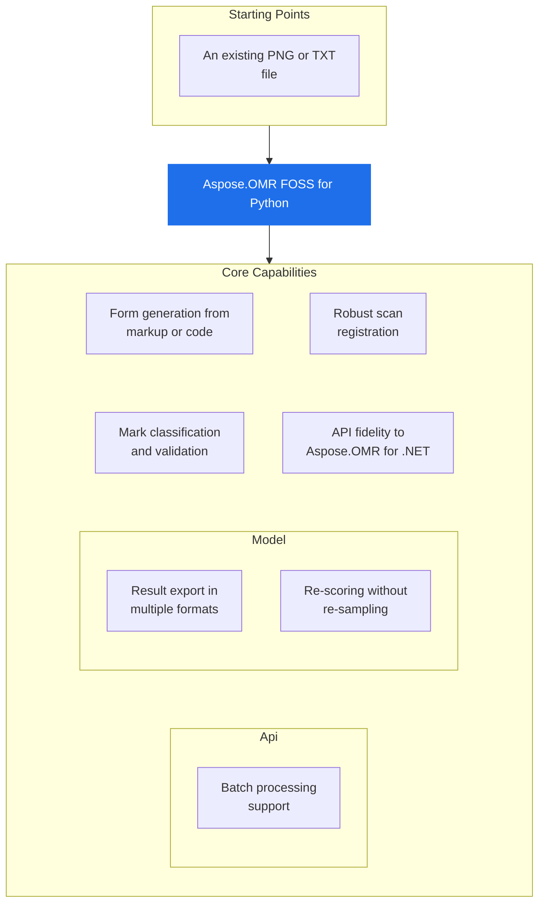

# Aspose.OMR FOSS for Python

[](https://pypi.org/project/omr-python-for-foss/)  [](License/LICENSE.txt) [](https://pypi.org/project/omr-python-for-foss/)

[](https://products.aspose.org/omr/python/)

Aspose.OMR FOSS for Python reads `.png` images and `.txt` template definitions, converts them into optical mark recognition results, and writes output in multiple formats. It generates templates from text definitions and recognizes scanned forms by processing images against those templates. The product exposes core functionality through `OmrEngine`, `TemplateProcessor`, and related classes, supporting operations such as Generate, Recalculate, and Recognize. It is built only on numpy + opencv-python + Pillow.

A **FOSS Python OMR (Optical Mark Recognition) library** whose public API is a
**name-preserving port** of [Aspose.OMR for .NET](https://docs.aspose.com/omr/net/)
v26.1.0. You author a bubble-sheet form (in code or in the text-markup DSL), generate
a printable PNG plus a machine-readable `.omr` descriptor, print/scan/fill it, and
recognize the marks back into answers — all through the exact Aspose class, method,
property and enum names.

It is built only on **`numpy` + `opencv-python` + `Pillow`** (no Windows/.NET
dependency). The computer-vision recognition math uses standard image-processing
techniques; the public surface is purely the Aspose port.

## Navigation

- [At a Glance](#at-a-glance)
- [Key Capabilities](#key-capabilities)
- [Installation](#installation)
- [Dependencies](#dependencies)
- [Quick Start](#quick-start)
- [API Reference](#api-reference)
- [Documentation & Resources](#documentation--resources)
- [Scope and Limitations](#scope-and-limitations)
- [Development and Testing](#development-and-testing)
- [Third-Party Notices](#third-party-notices)
- [License](#license)

## At a Glance



## Key Capabilities

- **Form generation from markup or code.** It creates printable bubble-sheet forms by generating PNG pages and a machine-readable .omr descriptor from markup (`.txt`) or code-first `TemplateConfig`, using `OmrEngine.Generate`.
- **Robust scan registration.** It registers scans robustly by handling arbitrary orientation, skew, perspective distortion, scanner-line suppression, and fiducial reconstruction before recognition.
- **Mark classification and validation.** It classifies marks using fixed-threshold or auto-calibrated logic and validates responses with `FormValidationLogic`, including light-shade processing and multiselect exception handling.
- **Result export in multiple formats.** It exports recognition results in CSV, JSON, and XML formats through `RecognitionResult` methods such as `GetCsv`, `GetJson`, and `GetXml`.
- **API fidelity to Aspose.OMR for .NET.** It preserves API fidelity to Aspose.OMR for .NET by exposing the same class hierarchy (`omr.api`, `omr.exceptions`) and exception types (`ChildOverflowException`, `InvalidConfigurationException`, `MultiselectException`, `OMRException`) with matching method names.
- **Batch processing support.** It supports batch processing by accepting a folder of scan images through `TemplateProcessor.RecognizeFolder`.
- **Re-scoring without re-sampling.** It enables re-scoring without re-sampling by calling `TemplateProcessor.Recalculate` on an existing `RecognitionResult`.

**1. Text markup (the DSL).** Pass a `.txt` file, a `list[str]` of lines, or a binary
stream to `Generate`. Markup tokens are byte-identical to Aspose's. See
`examples/final-exam.txt`. Attribute lines must begin with
a real **TAB**. (Note: `#` begins a **comment** line, matching the reference sample;
author choiceboxes with `?choicebox=` + `?option=` or inline `(char) Answer` lines.)

Both feed the same render engine and produce the same `.omr`.

## Installation

`omr-python-for-foss` is not yet published on PyPI; build it from a source checkout instead:

```bash
git clone https://github.com/aspose-omr-foss/Aspose.OMR-FOSS-for-Python.git
cd Aspose.OMR-FOSS-for-Python
pip install .
```

Verify the install:

```bash
python -c "import omr.api"
```

Requires Python 3.10 or later.

## Dependencies

### Required Package Dependencies

- `numpy>=1.23`
- `opencv-python>=4.6`
- `Pillow>=9.2`

### Native and System Requirements

- Requires Python 3.10 or later.

### Development Dependencies

- `pytest>=7` (extra `dev`)

## Quick Start

This example shows how to generate a template from a text file, save the template image and metadata, then recognize an image of a filled form and export the results as CSV.

```python
from omr.api import OmrEngine, FormValidationLogic

engine = OmrEngine()
gen = engine.Generate("final-exam.txt")          # or a code-first TemplateConfig
gen.Save("out", "final-exam")                    # -> out/final-exam.png + out/final-exam.omr

processor = engine.GetTemplateProcessor("out/final-exam.omr", FormValidationLogic.Ignore)
result = processor.Recognize("scan.png")         # -100 = auto-calibrated threshold
print(result.GetCsv())                           # also GetJson() / GetXml()
```

- Browse the executable [examples](examples) — [`quickstart_codefirst.py`](examples/quickstart_codefirst.py),
  [`quickstart_markup.py`](examples/quickstart_markup.py), and [`advanced_demo.py`](examples/advanced_demo.py).
- See the engine's public exports in [`omr/api/__init__.py`](omr/api/__init__.py).
- Read the [changelog](CHANGELOG.md) and the deferred-feature [roadmap](ROADMAP.md).
- Review development conventions in [AGENTS.md](AGENTS.md).
- For a condensed, LLM-oriented usage guide, see [llms.md](llms.md).
- Found a bug or have a feature request? Open an issue.

## API Reference

The omr package exposes the core API through `omr.api.OmrEngine`, which produces template generation results and template processors for recognition. The `omr.api.TemplateProcessor` performs recognition on scanned images, returning `omr.model.RecognitionResult` objects that provide multiple export formats.

The public API has 68 types.

<details>
<summary>View the Complete Public API Surface</summary>

### Core API

| Class | Description |
| --- | --- |
| `ImageCollection` | Append-only, case-sensitive name -> image-bytes map for in-memory images |
| `OmrEngine` | OmrEngine class provides methods to generate a template and obtain a TemplateProcessor, where Generate dispatches on the source type to build a template into a GenerationResult and GetTemplateProcessor returns a TemplateProcessor instance. |
| `TemplateProcessor` | TemplateProcessor class provides methods to recognize forms, recalculate recognition results at a new threshold in place, and recognize every supported image in a folder as independent forms. |
| `ChildOverflowException` | ChildOverflowException class is an exception type that inherits from OMRException. |
| `InvalidConfigurationException` | Raised when a template / element configuration is invalid or unsupported. |
| `MultiselectException` | Raised when more than one bubble is marked for a question that does not |
| `OMRException` | Base class for every exception raised by the OMR library. |
| `RuntimeExceptionOMR` | Raised on an internal, unrecoverable generation/recognition failure. |
| `BaseOffset` | BaseOffset class represents a base offset setting in generation. |
| `GenerationResult` | GenerationResult class represents the result of template generation, and its SaveAsPdf member is not implemented. |
| `GlobalPageSettings` | GlobalPageSettings class holds global page configuration settings. |
| `MemoryGenerationResult` | MemoryGenerationResult class represents a generation result stored in memory, and its GetPDF member is not implemented. |
| `PixelOffset` | PixelOffset class represents a pixel offset setting in generation. |
| `ReferencePointsSettings` | ReferencePointsSettings class holds settings for reference points in generation. |
| `TemplateConfig` | The document root that contains everything else (normally PageConfigs). |
| `BaseConfig` | Root abstraction; the required fields of every OMR element. |
| `BorderStyle` | BorderStyle class represents a border style configuration. |
| `ParentConfig` | Marks an element that can contain children. |
| `AnswerSheetConfig` | Numbered question/answer bubble matrix. Returns <Name><id> per line. |
| `ChoiceBoxAnswerConfig` | One answer bubble + label. BubbleValue sets the glyph (else auto A, B, |
| `ChoiceBoxConfig` | ChoiceBoxConfig class is a configuration element that inherits from ParentConfig. |
| `CompositeGridConfig` | Flexible grid with custom symbols; marks merge into one value. |
| `ContentConfig` | One styled text line inside a parent. Name holds the displayed text. |
| `EmptyLineConfig` | Vertical spacer. Height = 0 means one line of the default font. |
| `GridConfig` | Digit matrix (SectionsCount sections x OptionsCount 0-9 bubbles) |
| `ImageConfig` | Picture referenced by name. XPosition/YPosition = -1 means not |
| `TextConfig` | Top-level multi-line raw text block. Name holds the displayed text. |
| `BlockConfig` | Bordered/padded box; lays out its non-block children with overflow handling. |
| `CheckBoxConfig` | Labeled group of blank boxes accepting any mark, with a tunable fill |
| `ContainerConfig` | Invisible layout element arranging child blocks into columns or a footer. |
| `PageConfig` | One per physical page. Zero margins / undefined paper/orientation mean |
| `PositionedBlockConfig` | Places children at absolute XPosition/YPosition with optional size. |
| `Clip` | Truncate overflowing content at the parent's border. |
| `NoClip` | Do nothing; overflowing content is drawn past the parent's border (default). |
| `OverflowAction` | Base class for child-overflow handling algorithms. |
| `Wrap` | Relocate an overflowing child (column reflow / element splitting). |
| `Arabic` | Right-to-left; optionally Eastern-Arabic digits. |
| `Bengali` | Left-to-right; optionally Bengali digits. |
| `Hebrew` | Right-to-left; optionally Hebrew numbering. |
| `Persian` | Right-to-left; optionally Persian digits. |
| `Urdu` | Right-to-left; optionally Urdu digits. |
| `Western` | Default writing system: left-to-right, Western (0-9) digits. |
| `WritingSystem` | Base writing system (LTR, Western digits). |
| `IOmrElement` | The interface for the OMR elements (one recognized question/element). |
| `RecognitionResult` | The result of image recognition. Contains all OMR elements with detailed |

#### Enumerations

| Enumeration | Description |
| --- | --- |
| `FormValidationLogic` | Controls engine behavior when a template validation rule is broken during |
| `BubbleSize` | BubbleSize enum lists the Extralarge, Extrasmall, Large, Normal, Small, and undefined bubble size values. |
| `FontStyle` | FontStyle enum lists the Bold, Italic, Regular, Strikeout, Underline, and undefined font style values. |
| `LongWordHandling` | Behavior when generation meets a word wider than its parent container. |
| `Orientation` | Orientation enum lists the Horizontal, Vertical, and undefined orientation values. |
| `PaperSize` | PaperSize enum lists the A3, A4, Legal, Letter, Tabloid, p8519, p8521, and undefined paper size values. |
| `RotationPointPosition` | RotationPointPosition enum lists the BottomLeft1, BottomLeft2, BottomRight1, BottomRight2, TopLeft1, TopLeft2, TopRight1, and TopRight2 rotation point position values. |
| `AlignmentEnum` | Horizontal alignment of an element relative to its parent. |
| `BarcodeType` | The symbology used by a BarcodeConfig. Default QR (0). 67 members, 0-66. |
| `BubblePositionType` | Where the bubble sits relative to its main content (answer text). |
| `BubbleType` | The shape of an answer bubble. |
| `ConfigType` | ConfigType enum lists the Answer, AnswerSheet, Barcode, Block, BubbleArray, CheckBox, ChoiceBox, ChoiceBoxAnswer, CompositeGrid, Container, Content, and CustomAnswerSheet configuration type values. |
| `ContainerTypeEnum` | How a ContainerConfig is placed on the page. |
| `ContentType` | How text content is rendered. (Markup DSL: content_type=Normal / Cells.) |
| `Directionality` | Direction in which elements and text are drawn (RTL/LTR support). |
| `GridHeaderTypeEnum` | The style of a grid's header. |
| `ParagraphTypeEnum` | How a ParagraphConfig arranges its children. |
| `QRVersion` | QR symbol version for a QR-family BarcodeConfig. Auto (0) lets the library |
| `ScoreDisplay` | Controls whether/how a score value is shown. Consumed by score-group headers. |
| `ScoreGroupType` | Drawing mode of a score-group element. Only one member defined. |
| `ScoreHeaderType` | Role of a column header inside a score group. |
| `TriggerType` | Behavior of a trigger (used by CustomTriggerConfig). One defined behavior. |
| `VerticalAlignment` | Vertical positioning of a child element inside its parent. |

#### Detailed Member Reference

### OmrEngine

The `OmrEngine` class provides the Generate method to create template images and descriptors from a text description or a `TemplateConfig`, returning a `GenerationResult` that can be saved to disk.

- `Generate`: Build a template -> GenerationResult (dispatches on the source type:

### TemplateProcessor

The `TemplateProcessor` class is obtained from `OmrEngine.GetTemplateProcessor` and provides Recalculate, Recognize, and `RecognizeFolder` methods to process scanned images using a specified `FormValidationLogic`.

- `Recalculate`: Re-score a prior RecognitionResult at a new threshold, in place,
- `RecognizeFolder`: Recognize every supported image in a folder, each as an INDEPENDENT form.

### RecognitionResult

The `RecognitionResult` class exposes `GetCsv`, `GetCsvAsStream`, `GetJson`, `GetJsonAsStream`, `GetXml`, and `GetXmlAsStream` methods to export recognition results in multiple structured formats.

### exceptions

The `omr.exceptions` module defines `ChildOverflowException`, `InvalidConfigurationException`, `MultiselectException`, and `OMRException` as the exception types raised during template processing and recognition.

### generation

The `omr.generation` package contains classes such as `TemplateConfig`, `GenerationResult`, and `GlobalPageSettings` that configure and represent template generation behavior and output.

### omr

The omr package is the top-level import path for the Aspose.OMR FOSS for Python library, which provides optical mark recognition capabilities under the MIT license.

Class / method / property / enum-type / enum-member names are copied
**character-for-character** from Aspose.OMR for .NET (this intentionally overrides
PEP 8 — methods and properties stay PascalCase, e.g. `GetCsv`, `RecognizeFolder`,
`ErrorCode`). Source quirks are preserved deliberately, including:

- `BubbleSize.Extrasmall` / `Extralarge` (not `ExtraSmall` / `ExtraLarge`)
- `FontStyle.Strikeout`, and the `undefined = 0` sentinels
- `BorderType["None"]` / `TableType["None"]` (the reserved Python keyword `None` is
  kept as the exact member name via the enum functional API)
- the misspelled `recogintion_values` markup attribute (on the out-of-scope
  `bubble_array`)

Enum **integer values** are verbatim from the .NET source and are what the `.omr`
descriptor serializes. The module tree mirrors the `Aspose.OMR.*` namespaces under a
lowercased `omr` root (e.g. `Aspose.OMR.Api` → `omr.api`,
`Aspose.OMR.Generation.Config.Enums` → `omr.generation.config.enums`).

No licensing or metering: a FOSS build has nothing to gate, so Aspose's `License` /
`Metered` classes are **not** ported. Also removed as inapplicable to a headless FOSS
library: the correction UI (`GetCorrectionControl`, `CorrectionControl`), the buffer
pool (`PoolFactory`; `OmrEngine()` is parameterless), the plugin hooks (`AddPlugin` /
`IPlugin`), the legacy aliases (`GenerateTemplate`, `GenerateJSONTemplate`,
`RecognizeImage`), `SaveAsInteractivePdf`, the `ConfigType.Column`/`Header` aliases and
the obsolete `ContainerConfig.ColumnsCount`.

JSON with, per page, the pixel size, the reference-mark centroids, and every
recognizable element reduced to a uniform shape: a list of **fields** (sampling
units), each with ordered **bubbles** carrying a returned value and an `[x, y, w, h]`
box. Two grouping modes drive result assembly: `"Field"` (each field → one recognized
element, e.g. one per `answer_sheet` line) and `"Element"` (fields' marked values
concatenated into one element, e.g. the `grid` digit string).

</details>

## Documentation & Resources

- **[examples](examples)** — The `examples` directory in this repository.
- **[quickstart_codefirst.py](examples/quickstart_codefirst.py)** — `examples/quickstart_codefirst.py` in this repository.
- **[quickstart_markup.py](examples/quickstart_markup.py)** — `examples/quickstart_markup.py` in this repository.
- **[advanced_demo.py](examples/advanced_demo.py)** — `examples/advanced_demo.py` in this repository.
- **[changelog](CHANGELOG.md)** — In this repository.
- **[roadmap](ROADMAP.md)** — In this repository.
- **[AGENTS.md](AGENTS.md)** — `AGENTS.md` in this repository.
- **[llms.md](llms.md)** — `llms.md` in this repository.
- Found a bug or have a feature request? [Open an issue](https://github.com/aspose-omr-foss/Aspose.OMR-FOSS-for-Python/issues).

## Scope and Limitations

This build implements **Layers 0-2** of the feature plan, focused on the **core bubble-sheet slice**:

| Layer | What | Status |
|---|---|---|
| **0 — Foundation** | Package layout, all enums + 140-name color set, exception hierarchy, `FormValidationLogic`, `.omr` serializer, code-first config tree, `GlobalPageSettings`, `OmrEngine` | ✅ complete |
| **1 — Generation** | Render/layout engine, text-markup parser, `Generate` dispatch, `GenerationResult.Save` (PNG + `.omr`), reference-point drawing, bubble geometry | ✅ core element set |
| **2 — Recognition** | `.omr` loader, image decode, rotation/perspective/damage-robust reference-point registration (0/90/180/270° + skew + torn-corner reconstruction), scanner-line suppression, fill-ratio sampling, threshold + auto-calibration, `Recalculate`, light-shade processing, multiselect validation, CSV/JSON/XML export | ✅ complete |

**Supported elements (generation + recognition):**

- **Layout:** `page`, `container` (columns), `block` (borders/padding), `positioned_block`, `text`, `content` (incl. `content_type=cells`), `empty_line`, `image`
- **Bubble:** `answer_sheet`, `choicebox` + `option`, `checkbox`, `grid`, `composite_grid`

**Out of scope for this build** (per the chosen "core bubble-sheet slice"): tables & score groups, `vertical_choicebox`/`answer`, `write_in`/ICR, `custom_answer_sheet`, barcode/QR generation & decode, RTL/complex-script writing systems, PDF export (`SaveAsPdf`), and all of **Layer 3** (batch processing, presets). The enums for every feature are still present and correct (e.g. the full 67-member `BarcodeType`); only the heavier element rendering and the deferred surfaces are omitted. Stubs raise `NotImplementedError` where a method exists but is intentionally unimplemented.

1. **Decode** the scan (JPG/PNG/TIFF/BMP/GIF, path/stream/`ndarray`/`PIL.Image`) to grayscale.
2. **Register** the scan into template pixel space. The four solid corner fiducials are detected rotation-invariantly (minAreaRect + a 4-vertex/circularity test tells a square fiducial from a round mark or a hollow box), and a perspective transform (`cv2.getPerspectiveTransform` + `warpPerspective`) de-skews them onto the template corners. Orientation (0/90/180/270°) is resolved by trying each and keeping the one that restores the asymmetric rotation marker to its template spot; a torn/occluded corner (only 3 fiducials) is reconstructed by parallelogram completion; and when the scan is already aligned (a flatbed scan or digital fill) a plain resize is used directly. Long thin dark runs (scanner banding, roller streaks) are suppressed before sampling so they cannot inflate a bubble's fill. See `tests/test_distortion_recognition.py` and `examples/advanced_demo.py`.
3. **Sample fill ratios** — for every bubble, measure the percentage of *ink* pixels (below a fixed cutoff) in its inset ROI on a min-max-normalized page, as a 0-100 fill value. The cutoff is chosen so the light in-bubble guide glyph is never counted, so an unmarked bubble reads ~0%.
4. **Classify** filled vs blank. With a fixed `recognitionThreshold` (0-100) a bubble is marked when `fill >= threshold`. With the default `-100` (auto), the cut is found per question by sorting the field's fills and taking the midpoint of the first convincing gap (2-wide window), falling back to a page-global threshold — a gap-detection approach with its constants rescaled to 0-100.
5. **Assemble** a `RecognitionResult`; per-bubble fills are cached so `TemplateProcessor.Recalculate(result, newThreshold)` re-scores without re-reading pixels.

The generation **drawer** and the recognition **sampler** share one geometry module (`omr/_internal/geometry.py`), so a drawn bubble box and its sampled ROI are the same rectangle by construction. The `.omr` JSON is the frozen contract between the two pipelines.

- **Registration** is robust to the degradations a real scan or phone photo introduces, each handled individually: any cardinal rotation (0/90/180/270°), skew and perspective, scanner banding, ink smudges/scribbles, and a torn corner on an otherwise upright scan (an aligned same-size scan recovers directly, so the missing corner is irrelevant; the 3-fiducial reconstruction additionally helps a torn corner under mild skew). It assumes the four corner marks are visible at a reasonable resolution (the Aspose design assumption is ≥300 DPI). **Known limits** (the registration objective is a single rotation-marker ROI, which the following defeat): extreme oblique perspective (keystone beyond a firm hand-held angle); and a **torn corner *combined* with significant skew/perspective** or the worst-case stacking of skew + heavy banding + a fiducial- covering smudge — in those a stray mark can satisfy the marker check and the scan may be **silently misregistered**. See the envelope note in `tests/test_distortion_recognition.py`.
- **`#` in markup is a comment**, not the choicebox shorthand — the reference DSL documents both and the provided sample uses `#` for comments, so the sample wins.
- **Grid orientation** follows the .NET spec: `horizontal` (default) = each digit is a *column* of bubbles; `vertical` = each digit is a *row*.
- A few attributes are accepted for API fidelity but **not rendered** in the core slice: `choicebox.display_number` (questions carry their own number in the text), `option.row_index` (options auto-wrap), and `block.background_color` (border only).
- Rendering is pragmatic (fixed spacing, LTR), not the pixel-faithful Aspose typesetter; complex tables, hyphenation and RTL are out of scope.
- `SaveAsPdf` / `GetPDF` raise `NotImplementedError` (deferred output formats).

<details>
<summary>View Other Unimplemented Members</summary>

</details>

See [Aspose.OMR — Enterprise Edition](https://products.aspose.com/omr/).

## Development and Testing

The suite covers 8 test files under `tests/`.

```bash
pip install -r requirements.txt     # numpy, opencv-python, Pillow
# or, as a package:
pip install -e .
```

1. **Create the environment** — run the task **`env: create (.venv + install all)`** (Terminal ▸ Run Task…). It creates `./.venv`, installs `requirements-dev.txt` (runtime deps **+ pytest**) and does `pip install -e .`. Then choose that interpreter via **Python: Select Interpreter** (it is already the configured default).
2. **Run the library via client code** — press **F5** on any script that imports `omr` (e.g. `examples/quickstart_codefirst.py`), or use the **"Example: …"** / **"Python: Current file"** launch configs, or the **`run: …`** tasks.

```
omr/
  __init__.py                 __version__ (no License/Metered in a FOSS build)
  api/                        OmrEngine, TemplateProcessor, ImageCollection, FormValidationLogic
  model/                      RecognitionResult, IOmrElement
  generation/                 enums, GlobalPageSettings, GenerationResult, offsets, ...
    config/                   BaseConfig, ParentConfig, TemplateConfig, BorderStyle
      enums/                  all config enums (ConfigType, BarcodeType, QRVersion, ...)
      elements/              leaf element configs (+ parents/ for container elements)
    overflowactions/          OverflowAction, Clip, NoClip, Wrap
    writingsystems/           WritingSystem, Western, Arabic, ...
  recognition/enums/          FormValidationLogic (canonical)
  exceptions/                 OMRException hierarchy
  _internal/                  render engine, recognizer, .omr format, markup parser,
                              geometry, fonts, color table (NOT part of the public API)
examples/                     quickstart scripts + final-exam.txt
tests/                        pytest suite (enums, generation, markup, round trip)
```

```bash
python -m pytest -q
```

The suite covers enum name/value fidelity, generation + `.omr` structure, the text-markup parser, and the full **generate → fill bubbles → recognize → verify** round trip (including a skew/perspective registration path, `Recalculate`, multiselect validation, and CSV/JSON/XML export).

## Third-Party Notices

See [Third-party notices](License/ThirdPartyNotices.txt).

## License

This project is licensed under the [MIT License](License/LICENSE.txt). The MIT License permits use, copying, modification, distribution, sublicensing, and commercial use, provided its copyright and permission notice are retained. The software is provided without warranty.
