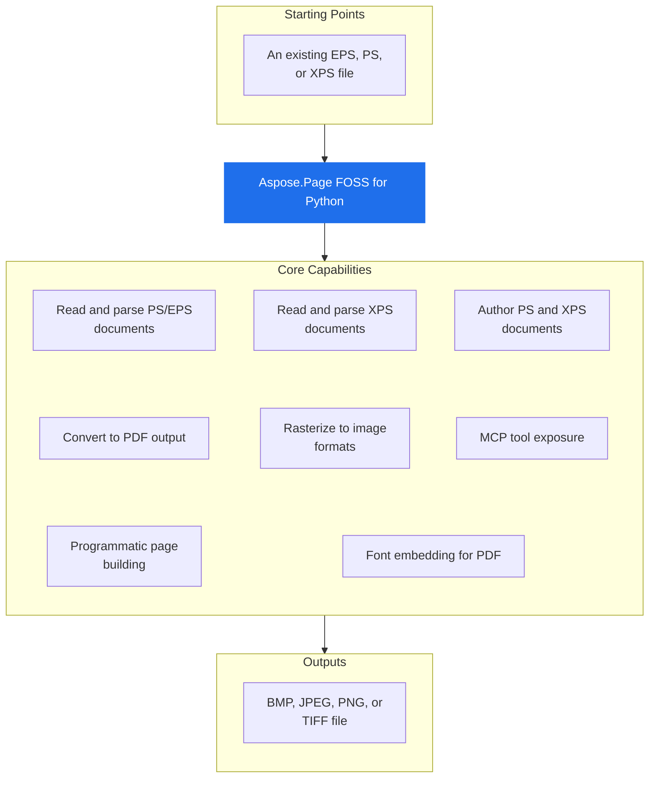

# Aspose.Page FOSS for Python

[](https://pypi.org/project/aspose-page-foss/)  [](LICENSE.txt) [](https://github.com/aspose-page-foss/Aspose.Page-FOSS-for-Python/graphs/contributors)

[](https://products.aspose.org/page/python/)

Aspose.Page FOSS for Python reads EPS, JXR, PNG, PS, TIF, TIFF, WDP and XPS files and writes BMP, JPEG, PNG and TIFF files.

## Navigation

- [At a Glance](#at-a-glance)
- [Key Capabilities](#key-capabilities)
- [Installation](#installation)
- [Dependencies](#dependencies)
- [Quick Start](#quick-start)
- [Additional Examples](#additional-examples)
- [API Reference](#api-reference)
- [Documentation & Resources](#documentation--resources)
- [Scope and Limitations](#scope-and-limitations)
- [Development and Testing](#development-and-testing)
- [License](#license)

## At a Glance



## Key Capabilities

- **Read and parse XPS documents.** It reads and parses `.xps` documents by walking fixed pages and print tickets through the XPS parser and renderer.

- Read and parse PS/EPS documents with `PsDocument.from_file()` / `from_bytes()`, backed by a
  full PostScript interpreter (`PsInterpreter`, `PsParser`, `PsTokenizer`, `OperatorRegistry`)
  and DSC/EPS metadata extraction (`DscMetadata`).
- Read XPS packages with `XpsDocument.from_file()` / `from_bytes()`, walking fixed pages and
  print tickets through `XpsParser`, `XpsPackage`, and `XpsRenderer`.
- Create and edit PS/EPS and XPS documents from scratch with `PsDocument.create()` /
  `XpsDocument.create()`, drawing through `PsCanvas` (`move_to`, `line_to`, `curve_to`, `stroke`,
  `fill`, `draw_text`, `draw_image`) or the `XpsDocumentBuilder` page API, then `save()` back to
  the source format.
- Build page content programmatically with `RenderModelBuilder` — paths, text, images, and a
  clip/state stack — independent of any PS/XPS input, producing a `RenderDocument`.
- Write PDF 1.4 output with `PdfWriter`, including TrueType/Type1 font embedding resolved through
  `FontResolver` and `FontCache`.
- Rasterize PS/EPS content to PNG, JPEG, BMP, or TIFF with `RasterRenderer`; the Skia backend
  (`skia-python`, installed with the package) is used by default for speed, and a pure-Python
  renderer (`DefaultRasterWriter`) remains available — set `ASPOSE_PAGE_RASTERIZER=python` or
  pass a writer through `ImageSaveOptions.raster_writer`. XPS-to-image conversion has no such
  fallback — it always needs the Skia backend (see Scope and Limitations).
- Expose every conversion as an MCP tool (`ps_to_pdf`, `ps_to_image`, `xps_to_pdf`,
  `xps_to_image`, `eps_metadata`) through `create_server()`, for FastMCP-based automation.

## Installation

No install command for `aspose-page-foss` is available.

Verify the install:

```bash
python -c "import aspose.page"
```

Requires Python 3.10 or later.

## Dependencies

### Required Package Dependencies

- `skia-python`

### Native and System Requirements

- Requires Python 3.10 or later.

### Development Dependencies

- `Pillow` (extra `test`)
- `pypdf` (extra `test`)
- `pypdfium2` (extra `test`)

## Quick Start

This example converts a PostScript file to PDF using the `ps_to_pdf` handler from the aspose-page-foss package.

```python
from aspose.page.mcp.handlers import ps_to_pdf
from aspose.page.mcp.types import McpInput, McpOutput

result = ps_to_pdf(
    McpInput(input_path="input.ps", input_bytes_b64=None),
    McpOutput(output_path="output.pdf", return_bytes=False),
)
```

## Additional Examples

The following workflows demonstrate reading, writing, and converting document formats, extracting metadata, and rendering pages to images.

### Build a PDF Directly from the Render Model

```python
import aspose.page.ps  # works around a module import-order issue in aspose.page.pdf.writer
from aspose.page.common.render_model import RenderModelBuilder, Matrix
from aspose.page.pdf.writer import PdfWriter, PdfMetadata

builder = RenderModelBuilder()
builder.begin_page(100, 100)
builder.add_text("Hello, Aspose.Page", "Helvetica", 12, Matrix.identity(), None)
builder.end_page()
doc = builder.document()

metadata = PdfMetadata(
    title="", creator="", producer="Aspose.Page FOSS for Python",
    creation_date="D:20260101000000", mod_date="D:20260101000000", trapped=False,
)
writer = PdfWriter(metadata)
pdf_bytes = writer.write(doc)
```

<details>
<summary>View Additional Examples</summary>

### Extract EPS Metadata

```python
from aspose.page.mcp.handlers import eps_metadata
from aspose.page.mcp.types import McpInput

meta = eps_metadata(McpInput(input_path="input.eps", input_bytes_b64=None))
print(meta["bounding_box"], meta["title"])
```

### Convert XPS to PDF via the MCP Handler

```python
from aspose.page.mcp.handlers import xps_to_pdf
from aspose.page.mcp.types import McpInput, McpOutput

result = xps_to_pdf(
    McpInput(input_path="input.xps", input_bytes_b64=None),
    McpOutput(output_path="output.pdf", return_bytes=False),
)
```

### Render a Page to PNG Without Any PS/XPS Input

```python
import aspose.page.ps  # works around a module import-order issue in aspose.page.image.raster_renderer
from aspose.page.common.render_model import RenderDocument, RenderPage
from aspose.page.image.raster_renderer import RasterRenderer
from aspose.page.image.encoders import encode_png

doc = RenderDocument()
doc.pages.append(RenderPage(width=200, height=100))

surface = RasterRenderer(dpi=144).render(doc)
png_bytes = encode_png(surface, dpi=144)

with open("blank.png", "wb") as f:
    f.write(png_bytes)
```

Convert a PS or EPS file to a raster image directly through the document API:

```python
from aspose.page.ps.document import PsDocument
from aspose.page.ps.output import ImageSaveOptions

ps = PsDocument.from_file("input.ps")
data = ps.to_image(ImageSaveOptions(format="png", dpi=150))

with open("output.png", "wb") as f:
    f.write(data)
```

### Convert XPS to a Raster Image (Needs the Skia Backend)

Unlike PS/EPS rasterization, XPS-to-image conversion has no pure-Python fallback — it always
uses the Skia backend (`skia-python`, installed with the package):

```python
from aspose.page.xps.document import XpsDocument
from aspose.page.ps.output import ImageSaveOptions

doc = XpsDocument.from_file("input.xps")
data = doc.to_image(ImageSaveOptions(format="png", dpi=150))

with open("output.png", "wb") as f:
    f.write(data)
```


PS/EPS-to-image conversion:


</details>

## API Reference

The `aspose.page` module provides entry points for working with PostScript, EPS, XPS, and PDF content, with dedicated submodules for each format. The `aspose.page.ps` submodule supports reading and writing PostScript and EPS files, the `aspose.page.xps` submodule handles XPS documents, the `aspose.page.pdf` submodule serializes render models to PDF, the `aspose.page.image` submodule renders documents to raster images, and the `aspose.page.mcp` submodule offers high-level conversion and metadata extraction tools.

The public API has 139 types.

<details>
<summary>View the Complete Public API Surface</summary>

### Core API

| Class | Description |
| --- | --- |
| `AxialShading` | AxialShading class represents an axial shading pattern. |
| `CieBasedColorSpace` | CieBasedColorSpace class represents a CIE-based color space. |
| `ColorSpacePaint` | ColorSpacePaint class represents a paint based on a color space. |
| `DeviceColorSpace` | DeviceColorSpace class represents a device color space. |
| `DeviceNColorSpace` | Defined as `class DeviceNColorSpace`. |
| `ExponentialFunction` | ExponentialFunction class represents an exponential function; its evaluate method raises ValueError (conditionally). |
| `IndexedColorSpace` | IndexedColorSpace class represents an indexed color space. |
| `PatternColorSpace` | PatternColorSpace class represents a pattern color space. |
| `PatternPaint` | PatternPaint class represents a paint based on a pattern. |
| `RadialShading` | RadialShading class represents a radial shading pattern. |
| `SampledFunction` | SampledFunction class represents a sampled function; its evaluate method raises ValueError (conditionally). |
| `SeparationColorSpace` | SeparationColorSpace class represents a separation color space. |
| `ShadingPattern` | ShadingPattern class represents a shading pattern. |
| `StitchingFunction` | StitchingFunction class represents a stitching function; its evaluate method raises ValueError (conditionally). |
| `TilingPattern` | TilingPattern class represents a tiling pattern. |
| `ClipCommand` | Set the current clipping path. |
| `ImageCommand` | Render an image resource with a transform. |
| `Matrix` | Affine transform matrix (a, b, c, d, e, f). |
| `Paint` | Fill/stroke paint descriptor. |
| `Path` | A sequence of path segments. |
| `PathCommand` | Render a path with optional stroke/fill. |
| `PathSegment` | A path segment with a kind and control points. |
| `Point` | 2D point in the render model. |
| `Rect` | Axis-aligned rectangle with min/max coordinates. |
| `RenderDocument` | A collection of render pages. |
| `RenderImageResource` | Image payload used by raster backends. |
| `RenderModelBuilder` | Build render documents incrementally. |
| `RenderPage` | A single renderable page with commands. |
| `RenderResources` | Shared render resources for a document. |
| `StateRestoreCommand` | Restore the previous graphics state. |
| `StateSaveCommand` | Save the current graphics state. |
| `StrokeStyle` | Stroke style settings for path rendering. |
| `TextCommand` | Render text using a font reference and transform. |
| `RasterRenderer` | Render a RenderDocument to a raster surface. |
| `RasterSurface` | In-memory RGBA pixel surface. |
| `DefaultRasterWriter` | DefaultRasterWriter class is a default implementation of RenderModelRasterWriter for raster writing. |
| `RasterWriter` | RasterWriter class is a protocol for writing raster data; its write method renders a document to raster bytes. |
| `RenderModelRasterWriter` | RenderModelRasterWriter class is a raster writer that uses a render model; its write method renders a document to raster bytes using the render model and raises ValueError (conditionally). |
| `SkiaRasterWriter` | Rasterize a RenderDocument using Skia (requires skia-python). |
| `McpConversionOptions` | Conversion options for MCP operations. |
| `McpInput` | MCP input payload. |
| `McpOutput` | MCP output configuration. |
| `McpResult` | MCP output payload. |
| `ImageResource` | Image resource payload for PDF XObject embedding. |
| `PdfMetadata` | PDF metadata fields for the document info dictionary. |
| `PdfWriter` | Serialize a render document into PDF 1.4 bytes. |
| `PdfEmbeddedFont` | PdfEmbeddedFont class represents an embedded font in a PDF document. |
| `RectWrapper` | RectWrapper class wraps a rectangle; its x_min and y_min getters always return 0.0. |
| `ImageSaveOptions` | ImageSaveOptions class holds options for saving images. |
| `PdfSaveOptions` | PdfSaveOptions class holds options for saving PDF documents. |
| `PsDocument` | Represents a loaded or editable PS/EPS document. |
| `ClipType` | ClipType class represents a clipping type. |
| `Clipper` | Clipper class performs clipping operations; its build_intersect_list, do_maxima, execute, process_horizontal, process_intersections, and update_edge_into_ael methods raise ClipperException (conditionally). |
| `ClipperBase` | ClipperBase class is a base class for clipper implementations; its add_path method raises ClipperException (conditionally). |
| `ClipperException` | ClipperException class represents an exception thrown by the clipper. |
| `Direction` | Direction class represents a direction. |
| `DoublePoint` | DoublePoint class represents a point with double coordinates. |
| `EdgeSide` | EdgeSide class represents an edge side. |
| `EndType` | EndType class represents an end type. |
| `IntPoint` | IntPoint class represents a point with integer coordinates. |
| `IntRect` | IntRect class represents a rectangle with integer coordinates. |
| `IntersectNode` | IntersectNode class represents an intersection node. |
| `Join` | Join class represents a join. |
| `JoinType` | JoinType class represents a join type. |
| `LocalMinima` | LocalMinima class represents a local minima. |
| `OutPt` | OutPt class represents an output point. |
| `OutRec` | OutRec class represents an output record. |
| `PolyFillType` | PolyFillType class represents a polygon fill type. |
| `PolyNode` | PolyNode class represents a polygon node; its add_child method adds a child node, and its child_count, contour, and is_hole members provide read-only properties. |
| `PolyOffsetBuilder` | PolyOffsetBuilder class provides methods to build polygon offsets, including add_point, build, do_miter, do_round, do_square, and offset_point. |
| `PolyTree` | PolyTree class, which extends PolyNode, provides methods to manage polygon trees, including clear, get_first, and the total read-only property. |
| `PolyType` | PolyType class represents a polygon type in the clipping library. |
| `Scanbeam` | Scanbeam class is part of the clipping algorithm's internal data structures. |
| `TEdge` | TEdge class represents an edge in the clipping algorithm. |
| `ExecutionContext` | Holds interpreter stacks, dictionaries, and metadata for execution. |
| `GraphicsState` | Tracks current graphics state parameters. |
| `DscMetadata` | Container for DSC metadata extracted from PS/EPS comments. |
| `PsCanvas` | Canvas that appends PostScript operators to a page. |
| `PsImage` | Raster image container for embedding in PS/EPS. |
| `PsPage` | Editable PS/EPS page. |
| `PsError` | Base PostScript error. |
| `PsIOError` | PsIOError class is an error type for input/output failures in PostScript processing. |
| `PsInvalidAccess` | PsInvalidAccess class is an error type for invalid access attempts in PostScript processing. |
| `PsLimitCheck` | PsLimitCheck class is an error type for limit check violations in PostScript processing. |
| `PsQuit` | Internal non-error signal used by PostScript quit. |
| `PsRangeError` | PsRangeError class is an error type for range errors in PostScript processing. |
| `PsSyntaxError` | PsSyntaxError class is an error type for syntax errors in PostScript processing. |
| `PsTypeError` | PsTypeError class is an error type for type errors in PostScript processing. |
| `PsUndefinedError` | PsUndefinedError class is an error type for undefined errors in PostScript processing. |
| `FilterResult` | Result of decoding a filter chain. |
| `FontCache` | FontCache class provides methods to manage font resources, including find_font, load, and metrics_for, where metrics_for raises PsTypeError conditionally. |
| `FontMetrics` | FontMetrics class holds font metrics data. |
| `FontRecord` | FontRecord class represents a font record in the font cache. |
| `EmbeddedType42` | EmbeddedType42 class represents an embedded Type 42 font. |
| `FontResolver` | Resolve fonts from names or PostScript dictionaries. |
| `FontResource` | Represents a resolved font resource. |
| `ImageInfo` | Decoded raster image data. |
| `PsImageResource` | Represents a decoded image resource. |
| `PsImageStore` | Store image resources by id. |
| `PsInterpreter` | Execute PostScript/EPS objects using a registry of operators. |
| `PsArray` | PsArray class represents a PostScript array object. |
| `PsDict` | PsDict class represents a PostScript dictionary object. |
| `PsFile` | PsFile class represents a PostScript file object. |
| `PsFontId` | PsFontId class represents a PostScript font identifier. |
| `PsGState` | PsGState class represents a PostScript graphics state object. |
| `PsMark` | PsMark class represents a PostScript mark object. |
| `PsName` | PsName class represents a PostScript name object. |
| `PsOperator` | PsOperator class represents a PostScript operator object. |
| `PsPattern` | PsPattern class represents a PostScript pattern object. |
| `PsProcedure` | PsProcedure class represents a PostScript procedure object. |
| `PsSave` | PsSave class represents a PostScript save object. |
| `PsString` | PsString class represents a PostScript string object. |
| `OperatorEntry` | Descriptor for a registered PostScript operator. |
| `OperatorRegistry` | Register and resolve PostScript operator implementations. |
| `PsParser` | Parse PostScript/EPS tokens into language objects. |
| `PsConversionPipeline` | Convert PS/EPS byte streams into render model documents. |
| `PsStack` | Simple stack implementation for PostScript execution. |
| `PsToken` | Represents a token from a PostScript/EPS input stream. |
| `PsTokenizer` | Tokenize PostScript/EPS bytes into language tokens. |
| `GlyphPoint` | GlyphPoint class represents a point in a TrueType glyph outline. |
| `TrueTypeFont` | TrueTypeFont class provides methods to access TrueType font metrics and outlines, including glyph_advance, glyph_id_for_code, glyph_outline, glyph_sideways_advance, glyph_top_origin_x, glyph_top_origin_y_and_descender, glyph_vertical_advance, and glyph_vertical_metrics. |
| `Type1Metrics` | Type1Metrics class holds metrics data for Type 1 fonts. |
| `PsSaveState` | PsSaveState class represents a PostScript save state object. |
| `XpsDocument` | Represents a loaded or editable XPS document. |
| `XpsCanvas` | XPS canvas element for grouping content. |
| `XpsDocumentBuilder` | Builder for XPS document creation/editing. |
| `XpsFixedPage` | Editable XPS fixed page. |
| `XpsGlyphs` | XPS glyphs element. |
| `XpsImage` | XPS image element. |
| `XpsPath` | XPS path element. |
| `XpsImageResource` | Decoded image resource. |
| `XpsImageStore` | XpsImageStore class manages image resources, providing get to return a previously registered image resource and register to register an image resource and return its ID, where get raises ValueError conditionally. |
| `XpsPackage` | Represents an XPS package. |
| `XpsParser` | Parse XPS package relationships to locate pages. |
| `PrintTicket` | Print ticket payload descriptor. |
| `Relationship` | Represents a package relationship. |
| `XpsRenderer` | Render XPS XML to the shared render model. |
| `XpsResourceDictionary` | Resource dictionary with parent lookup. |

#### Enumerations

| Enumeration | Description |
| --- | --- |
| `PrintTicketScope` | Print ticket scopes supported by XPS. |

#### Detailed Member Reference

### page

The `aspose.page` module serves as the top-level namespace for the Aspose.Page FOSS for Python library, exposing submodules for PostScript, EPS, XPS, PDF, and image processing operations.

### ps

The `aspose.page.ps` submodule enables reading and writing PostScript and EPS files, and can convert them to PDF using `PdfWriter` or to raster images using `RasterRenderer`.

### xps

The `aspose.page.xps` submodule supports loading and editing XPS documents, and can convert them to PDF or raster images.

### pdf

The `aspose.page.pdf` submodule provides `PdfWriter` to serialize a `RenderDocument` into PDF 1.4 bytes, and supports metadata configuration via `PdfMetadata`.

### image

The `aspose.page.image` submodule offers `RasterRenderer` to render a `RenderDocument` to a raster surface, and encode it to PNG using `encode_png`.

### mcp

The `aspose.page.mcp` submodule provides high-level handlers such as `ps_to_pdf`, `eps_metadata`, and `xps_to_pdf` for converting and inspecting input files via `McpInput` and `McpOutput` payloads.

| Class | Description |
|---|---|
| `AxialShading` | Class that declares the fields color_space, coords, domain, function and extend. |
| `CieBasedColorSpace` | Class that declares the fields icc_profile, components and ranges. |
| `ColorSpacePaint` | Class that declares the fields space_id and components. |
| `DeviceColorSpace` | Class that declares the field name. |
| `DeviceNColorSpace` | Class that declares the fields names, alternate and tint. |
| `ExponentialFunction` | ExponentialFunction.evaluate() computes function values for given inputs based on the defined domain, range, and coefficients. |
| `IndexedColorSpace` | Class that declares the fields base, hival and lookup. |
| `PatternColorSpace` | Class that declares the field base. |
| `PatternPaint` | Class that declares the fields pattern_id, base_space_id and base_components. |
| `RadialShading` | Class that declares the fields color_space, coords, domain, function and extend. |
| `SampledFunction` | Class that declares the method evaluate and fields including domain, range, size, bits_per_sample, order and encode. |
| `SeparationColorSpace` | Class that declares the fields name, alternate and tint. |
| `ShadingPattern` | Class that declares the fields shading and matrix. |
| `StitchingFunction` | Class that declares the method evaluate and the fields domain, range, functions, bounds and encode. |
| `TilingPattern` | Class that declares fields including paint_type, tiling_type, bbox, x_step, y_step and matrix. |

| Class | Description |
|---|---|
| `DefaultRasterWriter` | The DefaultRasterWriter.write(document, options) method returns the rendered document as a byte array. |
| `RasterWriter` | Class that inherits from Protocol and declares the method write. |
| `RenderModelRasterWriter` | Class that declares the method write. |

| Class | Description |
|---|---|
| `PdfEmbeddedFont` | Class that declares fields including base_name, subset_name, subtype, encoding, symbolic and first_char. |
| `RectWrapper` | Class that declares the properties x_max, x_min, y_max and y_min. |

| Class | Description |
|---|---|
| `ClipType` | Class in the Page PYTHON API. |
| `Clipper` | The Clipper class offers methods such as execute() and add_edge_to_sel() to perform polygon clipping and edge management. |
| `ClipperBase` | Class that declares methods including add_bounds_to_lml, add_path, add_paths, all_horizontal, ascend_to_max and clear and the fields minima_list, current_lm, edges, use_full_range, has_open_paths and preserve_collinear. |
| `ClipperException` | Class extending Exception. |
| `Direction` | Class in the Page PYTHON API. |
| `DoublePoint` | Class that declares the fields x and y. |
| `EdgeSide` | Class in the Page PYTHON API. |
| `EmbeddedType42` | Class that declares the fields data, units_per_em and code_widths. |
| `EndType` | Class in the Page PYTHON API. |
| `FontCache` | Class that declares the methods find_font, load and metrics_for. |
| `FontMetrics` | Class that declares the fields units_per_em and code_widths. |
| `FontRecord` | Class that declares the fields name, style, path and is_monospace. |
| `GlyphPoint` | Class that declares the fields x, y and on_curve. |
| `ImageSaveOptions` | Class that declares the fields format, dpi, raster_writer, additional_fonts_folder, opaque_background and font_resolver. |
| `IntPoint` | Class that declares the fields x and y. |
| `IntRect` | Class that declares the fields left, top, right and bottom. |
| `IntersectNode` | Class that declares the fields edge1, edge2, pt and next. |
| `Join` | Class that declares the fields out_pt1, out_pt2 and off_pt. |
| `JoinType` | Class in the Page PYTHON API. |
| `LocalMinima` | Class that declares the fields y, left_bound, right_bound and next. |
| `OutPt` | Class that declares the fields idx, pt, next and prev. |
| `OutRec` | Class that declares fields including idx, is_hole, is_open, first_left, pts and bottom_pt. |
| `PdfSaveOptions` | Class that declares the fields no_compression and additional_fonts_folder. |
| `PolyFillType` | Class in the Page PYTHON API. |
| `PolyNode` | Class that declares the method add_child and the properties child_count, contour and is_hole. |
| `PolyOffsetBuilder` | PolyOffsetBuilder.add_point(pt) adds a vertex to the polygon before computing offset geometry, and build() finalizes the construction. |
| `PolyTree` | Class that inherits from PolyNode and declares the methods clear and get_first and the property total. |
| `PolyType` | Class in the Page PYTHON API. |
| `PsArray` | Class that declares the field items. |
| `PsDict` | Class that declares the field items. |
| `PsFile` | Class that declares the fields name, mode and data. |
| `PsFontId` | Class that declares the field id. |
| `PsGState` | Class that declares the field state. |
| `PsIOError` | Class that inherits from PsError. |
| `PsInvalidAccess` | Class that inherits from PsError. |
| `PsLimitCheck` | Class that inherits from PsError. |
| `PsMark` | Class that declares the field kind. |
| `PsName` | Class that declares the fields value and literal. |
| `PsOperator` | Class that declares the field name. |
| `PsPattern` | Class that declares the fields pattern_id and pattern. |
| `PsProcedure` | Class that declares the field items. |
| `PsQuit` | Internal non-error signal used by PostScript `quit`. |
| `PsRangeError` | Class that inherits from PsError. |
| `PsSave` | Class that declares the field state. |
| `PsSaveState` | Class that declares the fields operand_stack, execution_stack, dictionary_stack and graphics_state_stack. |
| `PsString` | Class that declares the fields value, remaining_filter and filter_params. |
| `PsSyntaxError` | Class that inherits from PsError. |
| `PsTypeError` | Class that inherits from PsError. |
| `PsUndefinedError` | Class that inherits from PsError. |
| `Scanbeam` | Class that declares the fields y and next. |
| `TEdge` | Class that declares fields including bot, curr, top, delta, dx and poly_typ. |
| `TrueTypeFont` | TrueTypeFont offers low‑level glyph metrics such as advance width, vertical advance, and outline points for precise text layout. |
| `Type1Metrics` | Class that declares fields including font_name, units_per_em, glyph_widths, code_widths, encoding and font_bbox. |

| Class | Description |
|---|---|
| `XpsImageStore` | Class that declares the methods get and register. |

- `PsDocument` — `create(is_eps, page_size)` / `from_bytes(data)` / `from_file(path)`;
  `add_page(size)` / `insert_page(index, size)` / `remove_page(index)` / `get_page(index)`;
  `save(path)` / `as_bytes()`; `get_xmp()` / `set_xmp(xmp_xml)` / `remove_xmp()`;
  `to_pdf(options)` / `to_image(options)`; `pages: list[PsPage]`, `dsc: DscMetadata | None`.

- `XpsDocument` — `create(title)` / `from_bytes(data)` / `from_file(path)`;
  `add_page(width, height)` / `insert_page(index, page)` / `remove_page(index)`; `save(path)`;
  `get_print_tickets()` / `set_print_ticket(scope, xml, page_index)`; `to_pdf(options)` /
  `to_image(options)`.

- `PsCanvas` — `move_to(x, y)`, `line_to(x, y)`, `curve_to(...)`, `rect(...)`, `ellipse(...)`,
  `stroke()`, `fill()`, `fill_stroke()`, `set_stroke_color(color)`, `set_fill_color(color)`,
  `draw_text(text, x, y, font_name, size)`, `draw_image(image, x, y, w, h)`,
  `save_state()` / `restore_state()`, `clip()` / `init_clip()`.

- `DscMetadata` — `bounding_box`, `hires_bounding_box`, `crop_box`, `document_media_size`,
  `title`, `creator`, `creation_date`, `language_level`, `extensions`.

- `RenderModelBuilder` — `begin_page(width, height)` / `end_page()`; `add_path(...)`,
  `add_text(...)`, `add_image(...)`; `clip(path, fill_rule)`; `save_state()` /
  `restore_state()`; `document() -> RenderDocument`.

- `RenderDocument` — `pages: list[RenderPage]`, `resources: RenderResources`.

- `PdfWriter` — `write(document) -> bytes`. `PdfMetadata` — `title`, `creator`, `producer`,
  `creation_date`, `mod_date`, `trapped`. `PdfSaveOptions` — `no_compression`,
  `additional_fonts_folder`.

- `RasterRenderer` — `render(document, page_index) -> RasterSurface`. `DefaultRasterWriter` /
  `SkiaRasterWriter` — `write(document, options) -> bytes`. `ImageSaveOptions` — `format`, `dpi`,
  `raster_writer`, `additional_fonts_folder`, `font_resolver`.

- `FontResolver` — `resolve(font_name)`, `resolve_ttf_path(font_name)`,
  `resolve_from_dict(font_dict)`, `register_embedded_type42(...)`,
  `register_defined_font(name, resource)`. `FontCache` — `load(additional_fonts_folder)`,
  `find_font(font_name, font_style)`, `metrics_for(path)`.

- `ps_to_pdf(input, output, options=None)`, `ps_to_image(input, output, options)`,
  `xps_to_pdf(input, output, options=None)`, `xps_to_image(input, output, options)`,
  `eps_metadata(input) -> dict` — all in `aspose.page.mcp.handlers`.
- `McpInput` — `input_path`, `input_bytes_b64`. `McpOutput` — `output_path`, `return_bytes`.
  `McpConversionOptions` — `format`, `dpi`, `no_compress`. `McpResult` — `output_path`,
  `output_bytes_b64`.
- `create_server()` / `run(host, port)` in `aspose.page.mcp.server` — registers all five tools
  above on a `FastMCP("Aspose.Page")` server.

- `Clipper` (extends `ClipperBase`) — a full port of the Vatti polygon-clipping algorithm used
  internally for clip-path handling; `execute(clip_type, solution, subj_fill, clip_fill)` is the
  primary entry point, alongside `add_path(...)` / `add_paths(...)` inherited from `ClipperBase`.

</details>

## Documentation & Resources

- **[Getting started guide](https://docs.aspose.org/page/python/)** — installation, walkthroughs, and feature guides for this library.
- **[How-to guides & FAQ](https://kb.aspose.org/page/python/)** — task-focused answers for common PS/EPS/XPS-processing questions.
- **[Full API reference](https://reference.aspose.org/page/python/)** — the complete, browsable reference for all 139 public types.
- Found a bug or have a feature request? [Open an issue](https://github.com/aspose-page-foss/Aspose.Page-FOSS-for-Python/issues).

## Scope and Limitations

- This library converts and authors documents; it does not read existing PDF files (there is no PDF import/parsing API).
- PS/EPS raster output can use a pure-Python renderer instead of Skia (when `skia-python` can't be loaded, or when `ASPOSE_PAGE_RASTERIZER=python` is set) — a performance difference, not a functional gap. XPS-to-image conversion has no such fallback and always needs `skia-python`, or it raises a runtime error.
- Importing `aspose.page.pdf.writer` or `aspose.page.image.raster_renderer` directly, or calling `XpsDocument.to_pdf()` / `to_image()`, before anything has imported `aspose.page.ps` raises a circular-import `ImportError` in a fresh Python interpreter — a structural property of the package's own module graph. Import `aspose.page.ps` first, as the Additional Examples above do, to avoid it; converting a PS/EPS document directly, and every MCP handler, already do this internally and never need the workaround.
- Font embedding resolves TrueType/Type1 glyphs from an explicit `additional_fonts_folder` path via `FontResolver` / `FontCache`; there is no automatic system-font-directory discovery.
- The MCP server exposes the five conversion/metadata tools (`ps_to_pdf`, `ps_to_image`, `xps_to_pdf`, `xps_to_image`, `eps_metadata`) only — document creation/authoring (`PsDocument.create`, `XpsDocument.create`) is available through the direct Python API, not as an MCP tool.

<details>
<summary>View Other Unimplemented Members</summary>

- `PsIOError` is declared but unused by the library's own code.

</details>

See [Aspose.Page for Python — Enterprise Edition](https://products.aspose.com/page/python-net/). It adds broader format coverage, including PDF reading, and commercial support.

## Development and Testing

The suite covers 50 test files under `tests/`.

To build and verify a wheel from a clone of the repository instead, install `uv`, `setuptools`, and `wheel`, then run:

```bash
git clone https://github.com/aspose-page-foss/Aspose.Page-FOSS-for-Python.git
cd Aspose.Page-FOSS-for-Python
python package.py build
python package.py verify
```

The wheel version comes from `local/Version.txt`. `verify` installs it with all dependencies in `.package-venv` and tests PS/XPS to PDF/PNG conversion. To upload the built wheel, use `python package.py publish-test` for TestPyPI or `python package.py publish` for PyPI; these commands read credentials from the matching files in `local/`.

The library targets Python 3.10+ (`pyproject.toml`'s `requires-python = ">=3.10"`). See [Dependencies](#dependencies) below for the full required/optional/native breakdown.

- `skia-python` — the Skia rasterization backend behind PNG, JPEG, BMP, and TIFF output; it has native components and is installed automatically with the package. XPS-to-image conversion always needs it; PS/EPS-to-image rendering uses it by default and can fall back to the pure-Python renderer (`DefaultRasterWriter`).

Sync dependencies and run the test suite with `uv`:

```bash
make sync
make test
```

`make test` runs `python3 -m unittest discover -s tests` (see [`Makefile`](Makefile)); `make build` produces wheel and sdist artifacts, and `make check` runs both test and build.

```bash
python3 -m unittest tests.mcp.test_handlers tests.mcp.test_server
```

```bash
make build
```

## License

This project is licensed under the [MIT License](LICENSE.txt). The MIT License permits use, copying, modification, distribution, sublicensing, and commercial use, provided its copyright and permission notice are retained. The software is provided without warranty.
