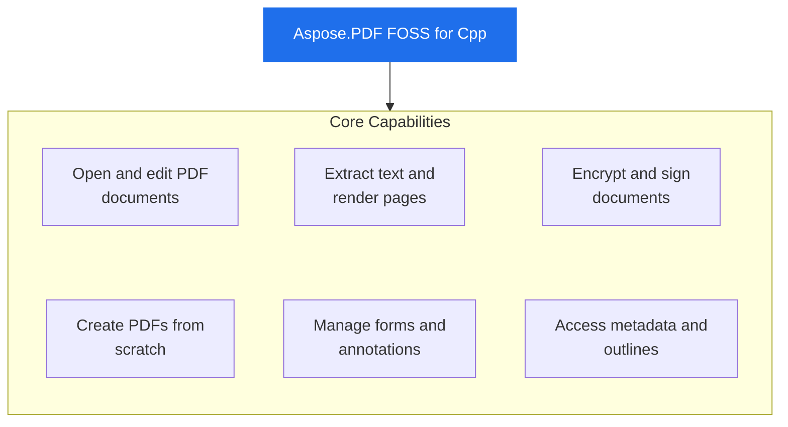

# Aspose.PDF FOSS for Cpp

 [](https://github.com/aspose-pdf-foss/Aspose.PDF-FOSS-for-Cpp/actions/workflows/ci.yml) [](LICENSE)  [](https://cmake.org/)

[](https://products.aspose.org/pdf/cpp/)

Aspose.PDF FOSS for Cpp reads and writes PDF documents, extracts text, converts pages to images, and manages document metadata, encryption, and permissions. It supports reading encrypted files when provided with a user or owner password and writing encrypted files using AESx256 encryption. It exposes classes for document information, text absorption, and rendering via devices such as PNG output. It operates without external dependencies and is implemented in C++.

Aspose.PDF FOSS for Cpp is a free, open-source, modern C++20 library for working with PDF
documents — opening and saving existing files, extracting text, rasterising pages to image
formats, and building documents from scratch (text, tables, vector graphics, watermarks,
annotations, AcroForm fields, and bookmarks). It links against nothing but the C++ standard
library: every primitive, including the TIFF, JPEG, and PNG codecs and the page rasteriser, is
implemented from scratch with no dependency on any commercial PDF stack. Its public API is a
strict subset of the commercial Aspose.PDF for .NET library — class names, method names, and
shapes mirror it where natural for migrants — and spec references throughout follow ISO 32000-1
(PDF 1.7) and ISO 32000-2 (PDF 2.0).

## Navigation

- [At a Glance](#at-a-glance)
- [Key Capabilities](#key-capabilities)
- [Installation](#installation)
- [Dependencies](#dependencies)
- [Quick Start](#quick-start)
- [Additional Examples](#additional-examples)
- [API Reference](#api-reference)
- [Documentation & Resources](#documentation--resources)
- [Scope and Limitations](#scope-and-limitations)
- [Development and Testing](#development-and-testing)
- [Third-Party Notices](#third-party-notices)
- [License](#license)

## At a Glance



## Key Capabilities

- **Open and edit PDF documents.** It opens existing PDF files with `Aspose.Pdf.Document`, supports password-protected files by passing the user or owner password to the constructor, and reports encryption status via `IsEncrypted()`; it also allows editing document information through `Document.Info()` and saving changes with `Document.Save()`.
- **Extract text and render pages.** It extracts text from documents or individual pages using `Aspose.Pdf.Text.TextAbsorber`, and renders pages to raster images in PNG, JPEG, BMP, or TIFF formats through `Aspose.Pdf.Devices.PngDevice`, `JpegDevice`, `BmpDevice`, and `TiffDevice` with configurable resolution and color depth.
- **Encrypt and sign documents.** It encrypts documents using `Document.Encrypt()` with algorithms including RC4-40, RC4-128, AES-128, or AES-256, and controls permissions such as printing, modifying, extracting, and annotating via `Aspose.Pdf.Permissions` flags; it also supports signing documents with `Aspose.Pdf.Facades.PdfFileSignature` using detached PKCS#7 signatures.
- **Create PDFs from scratch.** It builds documents from scratch using positioned text via `Aspose.Pdf.Text.TextBuilder` and `TextFragment`, tabular layout with `Aspose.Pdf.Table` including column widths, borders, and background colors, vector shapes through `Aspose.Pdf.Drawing.Graph`, and interactive AcroForm fields via `Aspose.Pdf.Forms.Form`.
- **Manage forms and annotations.** It adds and manages annotations such as highlight, underline, text sticky notes, links, stamps, and file attachments through `Aspose.Pdf.Annotations`, and creates interactive form fields like text boxes, checkboxes, and combo boxes using `Aspose.Pdf.Forms.Form` with support for flattening fields into static content.
- **Access metadata and outlines.** It reads and writes document metadata through typed `Aspose.Pdf.DocumentInfo` accessors for title, author, subject, keywords, creator, and producer, plus custom entries via Add/Remove/`ClearCustomData`, and accesses XMP metadata using `Aspose.Pdf.Metadata`.

- Extract text with `Text::TextAbsorber`, which walks a whole `Document` or a single `Page`, or
  `Text::TextFragmentAbsorber` for positioned fragments with font, size, and colour.
- Build documents from scratch: positioned and word-wrapped text through `Text::TextBuilder`,
  `TextFragment`, and `TextParagraph` (with font lookup via `FontRepository::FindFont`), tabular
  layout through `Table`/`Row`/`Cell` (column widths, per-cell and default borders, background
  colours, and column-spanning cells), vector shapes through `Drawing::Graph` (`Line`, `Rectangle`,
  `Circle`, `Ellipse`), and rotated, semi-transparent text overlays through `WatermarkArtifact`.
- References to the Standard-14 fonts (`/Helvetica`, `/Times-Roman`, `/Courier`, four styles
  each) without an embedded `/FontFile` paint correctly via system fonts, falling back to bundled
  Liberation substitutes (SIL OFL 1.1) so glyphs render even in fontless Linux/CI containers; text
  extracted through `TextDevice` goes through a pluggable `Encoding` — a BCL
  `System.Text.Encoding`-style charset codec supporting UTF-8, UTF-16LE, UTF-16BE, Latin-1, and
  Windows-1252 output.
- Add and manage annotations across a gallery of subtypes — `Highlight`, `Underline`, `Squiggly`,
  `StrikeOut`, `Square`, `Circle`, `Line`, `Ink`, `Text` (sticky note), `FreeText`, `Stamp`, `Link`
  (with `GoToAction`/`GoToURIAction`), and `FileAttachment` — each with a pre-generated `/AP`
  appearance stream so it renders in any spec-conforming viewer.
- Add interactive AcroForm fields — `TextBoxField`, `CheckboxField`, `RadioButtonField`,
  `ComboBoxField`, `ListBoxField`, and push-button `ButtonField` — through the `Form` class
  (`Document::Form()`), and flatten every field into static page content with `Form::Flatten()`.
- Define a hierarchical outline (bookmark) tree with `OutlineItemCollection`, bold/italic styling,
  and `XYZExplicitDestination` targets; define reusable `NamedDestination`s; and attach
  document-level companion files via `Document::EmbeddedFiles()`.
- Use the classic `Aspose::Pdf::Facades` API — `PdfConverter` (rasterise a PDF to multi-page TIFF
  or per-page PNG), `PdfExtractor` (text extraction honouring `StartPage`/`EndPage`),
  `PdfFileSecurity` (encrypt/decrypt/change passwords), `PdfFileSignature` (sign),
  `PdfBookmarkEditor` (create/extract bookmarks), `PdfFileEditor` (concatenate and split
  documents via `Concatenate`/`SplitFromFirst`/`SplitToEnd`/`SplitToPages`), and `PdfFileStamp`
  (page header/footer/page-number stamping via `AddHeader`/`AddFooter`/`AddPageNumber`) — each
  binding independently to a `Document`.

Available subtypes: `Highlight`, `Underline`, `Squiggly`, `StrikeOut`, `Square`, `Circle`, `Line`,
`Ink`, `Text`, `FreeText`, `Stamp`, `Link` (with `GoToAction`/`GoToURIAction`), `FileAttachment`.

## Installation

The library is published on NuGet as `Aspose.PDF.Cpp.FOSS`.

To build it from a source checkout instead:

```bash
git clone https://github.com/aspose-pdf-foss/Aspose.PDF-FOSS-for-Cpp.git
cd Aspose.PDF-FOSS-for-Cpp
cmake -S . -B build
cmake --build build
```

## Dependencies

### Required Package Dependencies

No required third-party package dependencies; in `CMakeLists.txt`, no dependency is on the library target's public link interface, so a consumer links nothing beyond the library itself.

### Native and System Requirements

- Requires C++ `20` (`CMAKE_CXX_STANDARD` in `CMakeLists.txt`).
- Requires CMake 3.20 or later (`cmake_minimum_required` in `CMakeLists.txt`).

### Development Dependencies

- `aspose_pdf_foss`
- `googletest`
- `Python3`

## Quick Start

This example opens a PDF file, prints the page count, extracts all text, and renders the first page as a PNG image at 150 DPI.

```cpp
#include <aspose/pdf/document.hpp>
#include <aspose/pdf/page_collection.hpp>
#include <aspose/pdf/text_absorber.hpp>
#include <aspose/pdf/png_device.hpp>
#include <aspose/pdf/resolution.hpp>
#include <fstream>
#include <iostream>

int main() {
    Aspose::Pdf::Document doc("input.pdf");
    std::cout << "Pages: " << doc.Pages().Count() << "\n";

    Aspose::Pdf::Text::TextAbsorber absorber;
    absorber.Visit(doc);
    std::cout << absorber.Text() << "\n";

    Aspose::Pdf::Devices::PngDevice png(Aspose::Pdf::Devices::Resolution(150));
    std::ofstream out("page1.png", std::ios::binary);
    png.Process(doc.Pages()[1], out);
}
```

## Additional Examples

The following workflows demonstrate opening encrypted files, reading and updating document metadata, and applying AES-256 encryption.

### Encrypt a Document with AES-256

```cpp
#include <aspose/pdf/document.hpp>

int main() {
    Aspose::Pdf::Document doc("input.pdf");
    doc.Encrypt("user-password", "owner-password",
                Aspose::Pdf::Permissions(),
                Aspose::Pdf::CryptoAlgorithm::AESx256);
    doc.Save("encrypted.pdf");
}
```

<details>
<summary>View Additional Examples</summary>

### Open a Password-Protected PDF Document

```cpp
#include <aspose/pdf/document.hpp>

// Encrypted files: pass the user or owner password
Aspose::Pdf::Document locked("locked.pdf", "secret");
if (locked.IsEncrypted()) {
    // proceed to read pages, extract text, etc.
}
```

### Read and Update Document Metadata

```cpp
#include <aspose/pdf/document.hpp>
#include <aspose/pdf/document_info.hpp>
#include <iostream>

int main() {
    Aspose::Pdf::Document doc("input.pdf");
    auto& info = doc.Info();
    std::cout << "Title: " << info.Title() << "\n";
    std::cout << "Author: " << info.Author() << "\n";

    doc.SetTitle("Updated Report Title");
    doc.Save("output.pdf");
}
```

### Include the Main Header for Aspose.PDF FOSS for Cpp

```cpp
#include <aspose.pdf.foss.hpp>
```

`CryptoAlgorithm` covers `RC4x40`, `RC4x128`, `AESx128`, and `AESx256`. `Permissions` is a
`[Flags]` enum (ISO 32000-1 §7.6.3.2 Table 22) — compose with `|`. Permissions are enforced by
viewers; the library itself is not a DRM mechanism.

### Sign a Document

```cpp
#include <aspose/pdf/facades/pdf_file_signature.hpp>

Aspose::Pdf::Facades::PdfFileSignature sig{"input.pdf", "signed.pdf"};
// configure the signature (certificate + key), then sign and save — a detached PKCS#7
// (adbe.pkcs7.detached) signature with a byte-exact /ByteRange. Output verifies under the
// OpenSSL CLI. See tests/facades_pdf_file_signature_smoke_test.cpp for the full signing flow.
```

See [`tests/facades_pdf_file_signature_smoke_test.cpp`](tests/facades_pdf_file_signature_smoke_test.cpp)
for the full signing flow.

### Add an Annotation

```cpp
#include <aspose/pdf/annotations/highlight_annotation.hpp>

namespace ann = Aspose::Pdf::Annotations;
ann::HighlightAnnotation a(page, pdf::Rectangle(60, 700, 210, 716, true));  // keep alive until Save()
a.Color(pdf::Color::FromRgb(1.0, 0.95, 0.0));
a.Contents("Highlight");
page.Annotations().Add(a);
```

### Build an AcroForm Field

```cpp
#include <aspose/pdf/forms/text_box_field.hpp>

namespace frm = Aspose::Pdf::Forms;
frm::TextBoxField name(doc, pdf::Rectangle(190, 700, 470, 720, true));  // keep alive until Save()
name.PartialName("fullName");
name.Value("Alice Sample");
doc.Form().Add(name, /*pageNumber=*/1);
// doc.Form().Flatten();   // bake every field into static page content
```

### Build an Outline (Bookmark) Tree

```cpp
#include <aspose/pdf/outline_collection.hpp>
#include <aspose/pdf/outline_item_collection.hpp>
#include <aspose/pdf/annotations/xyz_explicit_destination.hpp>

auto& root = doc.Outlines();
pdf::OutlineItemCollection item(root);               // keep alive until Save()
item.Title("Chapter 1");
item.Bold(true);
item.Destination(ann::XYZExplicitDestination(page, 0.0, 842.0, 0.0));
root.Add(item);
```

### Use a Facade (PdfConverter / PdfExtractor)

```cpp
#include <aspose/pdf/facades/pdf_converter.hpp>
#include <aspose/pdf/facades/pdf_extractor.hpp>

namespace facades = Aspose::Pdf::Facades;

// Rasterise every page to a multi-page TIFF via the real Devices::TiffDevice pipeline
facades::PdfConverter converter;
converter.BindPdf("input.pdf");
converter.SaveAsTIFF("output.tiff");

// Extract text honouring a StartPage/EndPage range, via the foundation TextAbsorber
facades::PdfExtractor extractor;
extractor.BindPdf("input.pdf");
extractor.StartPage(1);
extractor.EndPage(1);
extractor.ExtractText();
extractor.GetText("page1.txt");
```

Additional Examples below extends this into a from-scratch showcase
([`examples/12_create_features.cpp`](examples/12_create_features.cpp), one of the 12 programs
under `examples/` — see `examples/README.md`, built via `cmake --build build` into
`build/examples/<name>`): `Table`/`Row`/`Cell` layouts, `Drawing::Graph`
shapes (`Line`, `Rectangle`, `Circle`, `Ellipse`), annotations and AcroForm fields with a
pre-generated `/AP` appearance stream, `Form::Flatten()`-ready fields (`TextBoxField`,
`CheckboxField`, `RadioButtonField`, `ComboBoxField`, `ListBoxField`, `ButtonField`), an outline
(bookmark) tree, `CryptoAlgorithm`-based encryption (`RC4x40`/`RC4x128`/`AESx128`/`AESx256`) with
a `[Flags]` `Permissions` enum (not a DRM mechanism), a digital-signature walkthrough (see
`tests/facades_pdf_file_signature_smoke_test.cpp`), the `/Info`-metadata gotcha for from-scratch
documents, and the by-reference lifetime rule for `Paragraphs`/`Annotations`/`Form`/`Artifacts`/
`Outlines` — each parked in a `shared_ptr` until `Save()`.

12 runnable examples live in [`examples/`](examples/), covering the whole public surface —
opening documents, metadata, text extraction, save round-trips, every raster device, and a
from-scratch content-creation showcase. After `cmake --build build`, executables land at
`build/examples/<name>`; run them in numeric order, since each builds on the previous (see
[`examples/README.md`](examples/README.md) for the full tour).

> **Lifetime rule for creation.** `Paragraphs`, `Annotations`, `Form`, `Artifacts`, and `Outlines`
> store the object added to them **by reference**, so every table, graph, annotation, field,
> watermark, and outline item must outlive `Save()`.

| Example | Shows |
|---|---|
| `01_pages` | open a PDF, count pages, iterate the 1-based indexer |
| `02_read_metadata` / `03_write_metadata` | read `DocumentInfo`; edit + incremental-update save |
| `04_text_extraction` | `TextAbsorber::Visit(Document)` |
| `05_save_roundtrip` | byte-verbatim save |
| `06_devices_surface` | construct + round-trip device properties |
| `07_render_png` | end-to-end `PngDevice::Process(Page, ostream)` |
| `08_render_tiff` | multi-page TIFF via `TiffDevice::Process(Document, …)` |
| `09_indexed_tiff` | 8-bpp palettised TIFF (median-cut) |
| `10_render_text_pdf` | render a page with an embedded TrueType font |
| `11_render_standard14` | render `/Helvetica` with no embedded font (fallback path) |
| `12_create_features` | from-scratch 10-page showcase: text, image, tables, graphics, annotations, AcroForm fields, bookmarks |

`PdfConverter` also exposes a per-page cursor — `HasNextImage()`/`GetNextImage(outputFile)` — for
walking pages one at a time as PNGs via `Devices::PngDevice`, and `PageCount()` for the real page
count.

</details>

## API Reference

Aspose.PDF FOSS for Cpp exposes the `Aspose.Pdf.Document` class as the primary entry point for loading, creating, and saving PDF documents. It provides access to page collections, document information, forms, and other core features through its members.

The public API has 249 types.

<details>
<summary>View the Complete Public API Surface</summary>

### Core API

| Class | Description |
| --- | --- |
| `Annotation` | Annotation class provides the Accept, ActiveState, Alignment, AnnotationType, Border, Characteristics, Color, and Contents members for annotation objects. |
| `AnnotationCollection` | AnnotationCollection class provides the Accept, Add, Clear, Contains, Count, Delete, IsReadOnly, and Remove members for managing a collection of annotations. |
| `AnnotationSelector` | AnnotationSelector class provides the AnnotationSelector constructor and Visit method for selecting annotations. |
| `BleedMarkAnnotation` | BleedMarkAnnotation class provides the Accept method for bleed mark annotations. |
| `Border` | Border class provides the Effect, EffectIntensity, HCornerRadius, Style, VCornerRadius, and Width members for annotation borders. |
| `CaretAnnotation` | CaretAnnotation class provides the Accept, Frame, and Symbol members for caret annotations. |
| `Characteristics` | Characteristics class provides the Characteristics and Rotate members for annotation characteristics. |
| `CircleAnnotation` | CircleAnnotation class provides the Accept method for circle annotations. |
| `ColorBarAnnotation` | ColorBarAnnotation class provides the Accept and ColorOfCMYK members for color bar annotations. |
| `CommonFigureAnnotation` | CommonFigureAnnotation class provides the CommonFigureAnnotation constructor, Frame, and InteriorColor members for common figure annotations. |
| `CornerPrinterMarkAnnotation` | CornerPrinterMarkAnnotation class provides the Position member for corner printer mark annotations. |
| `DefaultAppearance` | DefaultAppearance class provides the DefaultAppearance constructor, FontName, FontResourceName, FontSize, and Text members for default appearance settings. |
| `ExplicitDestination` | ExplicitDestination class provides the ExplicitDestination constructor, PageNumber, and ToString members for explicit destinations. |
| `FileAttachmentAnnotation` | FileAttachmentAnnotation class provides the Accept, File, Icon, and Opacity members for file attachment annotations. |
| `FitBExplicitDestination` | Class that inherits from ExplicitDestination and declares the method ToString. |
| `FitBHExplicitDestination` | Class that inherits from ExplicitDestination and declares the methods Top and ToString. |
| `FitBVExplicitDestination` | Class that inherits from ExplicitDestination and declares the methods Left and ToString. |
| `FitExplicitDestination` | FitExplicitDestination class provides the ToString member for Fit explicit destinations. |
| `FitHExplicitDestination` | Class that inherits from ExplicitDestination and declares the methods Top and ToString. |
| `FitRExplicitDestination` | Class that inherits from ExplicitDestination and declares the methods Bottom, Left, Right, Top and ToString. |
| `FitVExplicitDestination` | Class that inherits from ExplicitDestination and declares the methods Left and ToString. |
| `FreeTextAnnotation` | FreeTextAnnotation class provides the Accept, Callout, DefaultAppearance, DefaultAppearanceObject, DefaultStyle, EndingStyle, Intent, and Justification members for free text annotations. |
| `GoToAction` | Class that inherits from PdfAction and declares the methods Destination, GetECMAScriptString and ToString. |
| `GoToURIAction` | Class that inherits from PdfAction and declares the methods GetECMAScriptString, ToString and URI. |
| `HighlightAnnotation` | HighlightAnnotation class provides the Accept method for highlight annotations. |
| `IAppointment` | IAppointment class provides an interface for appointment annotations. |
| `InkAnnotation` | InkAnnotation class represents an ink annotation that contains freehand drawing. |
| `JavascriptAction` | JavascriptAction class represents a JavaScript action that executes a script. |
| `LineAnnotation` | LineAnnotation class represents a line annotation that displays a straight line. |
| `LinkAnnotation` | LinkAnnotation class represents a link annotation that creates a clickable area. |
| `MarkupAnnotation` | MarkupAnnotation class provides base functionality for markup annotations. |
| `MovieAnnotation` | MovieAnnotation class represents a movie annotation that plays a video clip. |
| `NamedAction` | NamedAction class represents a named action that performs a predefined operation. |
| `NamedDestination` | NamedDestination class represents a named destination that points to a location in the document. |
| `PageInformationAnnotation` | PageInformationAnnotation class represents a page information annotation. |
| `PdfAction` | PdfAction class provides base functionality for PDF actions. |
| `PolyAnnotation` | PolyAnnotation class provides base functionality for polygon and polyline annotations. |
| `PolygonAnnotation` | PolygonAnnotation class represents a polygon annotation that displays a closed polygon. |
| `PolylineAnnotation` | PolylineAnnotation class represents a polyline annotation that displays a series of connected line segments. |
| `PopupAnnotation` | PopupAnnotation class represents a popup annotation that displays a pop-up window. |
| `PrinterMarkAnnotation` | PrinterMarkAnnotation class provides functionality to add printer marks to a document. |
| `RedactionAnnotation` | RedactionAnnotation class represents a redaction annotation that hides content. |
| `RegistrationMarkAnnotation` | RegistrationMarkAnnotation class represents a registration mark annotation. |
| `RichMediaAnnotation` | RichMediaAnnotation class represents a rich media annotation that embeds interactive content. |
| `ScreenAnnotation` | ScreenAnnotation class represents a screen annotation that creates a media player area. |
| `SoundAnnotation` | SoundAnnotation class represents a sound annotation that plays an audio clip. |
| `SquareAnnotation` | SquareAnnotation class represents a square annotation that displays a rectangle. |
| `SquigglyAnnotation` | SquigglyAnnotation class represents a squiggly annotation that underlines text with a wavy line. |
| `StampAnnotation` | StampAnnotation class represents a stamp annotation that displays a graphic or text overlay. |
| `StrikeOutAnnotation` | StrikeOutAnnotation class represents a strikeout annotation that strikes through text. |
| `SubmitFormAction` | SubmitFormAction class represents a submit form action that sends form data. |
| `TextAnnotation` | TextAnnotation class represents a text annotation that displays a note. |
| `TextMarkupAnnotation` | TextMarkupAnnotation class provides methods to get marked text and quad points, and to construct a text markup annotation. |
| `TextStyle` | TextStyle class provides methods to get alignment, font name, font size, and horizontal alignment, and to construct a text style. |
| `TrimMarkAnnotation` | TrimMarkAnnotation class provides an Accept method to accept the annotation. |
| `UnderlineAnnotation` | UnderlineAnnotation class provides an Accept method to accept the annotation. |
| `WatermarkAnnotation` | WatermarkAnnotation class provides Accept and Opacity methods to accept the annotation and control its opacity. |
| `WidgetAnnotation` | WidgetAnnotation class provides methods to accept the annotation, get default appearance, exportable state, checked state name, highlighting mode, parent, read-only, and required flags. |
| `XYZExplicitDestination` | XYZExplicitDestination class provides methods to get left, top, and zoom values, and to convert the destination to a string. |
| `Artifact` | Artifact class provides methods to get or set background state, opacity, position, rotation, image, text and state, text content, and text state. |
| `ArtifactCollection` | ArtifactCollection class provides methods to add, count, delete, and update artifacts, and to construct the collection. |
| `BaseParagraph` | BaseParagraph class provides methods to construct the paragraph, get horizontal alignment, hyperlink, first-in-column state, inline state, new-page state, kept-with-next state, and margin. |
| `BitmapInfo` | BitmapInfo class provides methods to construct the object, get format, height, pixel bytes, pixel format, and width. |
| `BorderInfo` | BorderInfo class provides methods to get bottom, left, right, rounded border radius, and top border values. |
| `Cell` | Cell class provides methods to get alignment, background color, background image, background image file, border, column span, default cell text state, and no-border state. |
| `Cells` | Cells class provides methods to add, count, insert, remove, and remove a range of cells. |
| `Color` | Color class provides methods to get alpha component and predefined colors such as AliceBlue, AntiqueWhite, Aqua, Aquamarine, Azure, Beige, and Bisque. |
| `BmpDevice` | BmpDevice class provides a Process method to render a document to BMP format. |
| `Device` | Device class provides a Device constructor. |
| `DocumentDevice` | DocumentDevice class provides a Process method to render a document. |
| `ImageDevice` | ImageDevice class provides methods to get coordinate type, form presentation mode, bitmap, height, rendering options, resolution, and width. |
| `JpegDevice` | JpegDevice class provides a Process method to render a document to JPEG format. |
| `Margins` | Margins class provides methods to get bottom, left, right, and top margin values. |
| `PageDevice` | PageDevice class provides a Process method to render a page. |
| `PngDevice` | PngDevice class provides Process and TransparentBackground methods to render a document to PNG format and control transparent background. |
| `Resolution` | Resolution class provides methods to get X and Y resolution values. |
| `TextDevice` | TextDevice class provides methods to get encoding, process a document, and set encoding. |
| `TiffDevice` | TiffDevice class provides methods to binarize with Bradley, get form presentation mode, height, process a document, rendering options, resolution, settings, and width. |
| `TiffSettings` | TiffSettings class provides methods to get brightness, compression, coordinate type, depth, margins, shape, and skip blank pages settings. |
| `Document` | Document class provides methods to decrypt, construct, get embedded files, encrypt, form, info, encrypted state, and metadata. |
| `DocumentInfo` | DocumentInfo class provides methods to add, get author, clear, clear custom data, creator, construct, check predefined key, and keywords. |
| `Circle` | Circle class provides methods to check bounds, get position X, position Y, and radius. |
| `Ellipse` | Ellipse class provides methods to get bottom, check bounds, height, left, and width. |
| `Graph` | Graph class provides methods to get border, graph info, height, change position state, left, shapes, top, and width. |
| `Line` | Line class provides methods to check bounds and get position array. |
| `Drawing.Rectangle` | Rectangle class provides methods to check bounds, get height, width, left, bottom, and rounded corner radius, and perform geometric operations such as intersection, containment, and movement. |
| `Shape` | Shape class provides methods to check bounds, access graph information, and retrieve the underlying shape. |
| `EmbeddedFileCollection` | EmbeddedFileCollection class provides methods to add, delete, find by name, and count embedded files, as well as retrieve keys and construct the collection. |
| `AlignmentType` | AlignmentType enum provides methods to represent center, left, and right alignment, and convert the value to a string. |
| `Bookmark` | Bookmark class provides methods to access action, bold flag, child items, destination, italic flag, level, and other properties. |
| `Bookmarks` | Bookmarks class provides a constructor to create a bookmarks collection. |
| `DocumentPrivilege` | DocumentPrivilege class provides methods to allow all, assembly, copy, degraded printing, fill-in, modify annotations, modify contents, and print. |
| `Facade` | Facade class provides methods to bind a PDF document, close resources, dispose, access the document, and construct the facade. |
| `FormEditor` | FormEditor class provides methods to add fields, field scripts, list items, submit buttons, convert fields, copy inner and outer fields, and decorate fields. |
| `FormFieldFacade` | FormFieldFacade class provides fields to align content at bottom, center, justified, left, middle, right, top, and undefined positions. |
| `IFacade` | IFacade interface provides methods to bind a PDF document, close resources, and construct the facade. |
| `ISaveableFacade` | ISaveableFacade interface provides methods to construct the facade and save the document. |
| `PdfAnnotationEditor` | PdfAnnotationEditor class provides methods to delete annotations, flatten annotations, import annotations from XFDF and FDF, and modify annotations. |
| `PdfBookmarkEditor` | PdfBookmarkEditor class provides methods to create bookmarks, delete bookmarks, export bookmarks to HTML and XML, extract bookmarks, and import bookmarks with XML. |
| `PdfContentEditor` | PdfContentEditor class provides methods to add document additional actions and attachments, change viewer preferences, and delete attachments, images, and stamps. |
| `PdfConverter` | PdfConverter class provides methods to set coordinate type, perform conversion, set end page, form presentation mode, get next image, check for next image, get page count, and set password. |
| `PdfExtractor` | PdfExtractor class provides methods to set end page, extract attachments, images, and text, set text extraction mode, get attachment names and info, and retrieve attachments. |
| `PdfFileEditor` | PdfFileEditor class provides methods to add margins and page breaks, allow concatenation exceptions, append and concatenate files, and set concatenation packet size. |
| `PdfFileInfo` | PdfFileInfo class provides methods to access author and creation information, bind a PDF file, clear info, get metadata, page height, and page rotation. |
| `PdfFileSecurity` | PdfFileSecurity class provides methods to allow exceptions, bind a PDF file, change password, decrypt and encrypt files, and set input and output file paths. |
| `PdfFileSignature` | PdfFileSignature class provides methods to certify documents, check for signatures and usage rights, verify coverage, get access permissions, and retrieve blank signature names and contact info. |
| `PdfFileStamp` | PdfFileStamp class provides methods to add footers, headers, and page numbers, convert files, set input and output file paths, keep security, and optimize size. |
| `PdfPageEditor` | PdfPageEditor class provides methods to set alignment, apply changes, and configure display duration, as well as fields for transition effects. |
| `PdfXmpMetadata` | PdfXmpMetadata class provides methods to add, clear, check for keys and values, get count and namespace URIs, and check if the collection is fixed size. |
| `SaveableFacade` | SaveableFacade class provides methods to save the document and construct the facade. |
| `SignatureName` | SignatureName class provides methods to get hash code, check for signatures, and convert to string, as well as fields for full name and name. |
| `VerticalAlignmentType` | VerticalAlignmentType enum lists the Bottom, Center, and Top vertical alignment values. |
| `FileSpecification` | FileSpecification class provides methods to manage file specification members including AFRelationship, Description, Encoding, FileSystem, IncludeContents, MIMEType, Name, and UnicodeName. |
| `FloatingBox` | FloatingBox class provides methods to manage background color, border, height, repeating behavior, paragraphs, and width of a floating box. |
| `BarcodeField` | BarcodeField class provides methods to manage barcode caption, error correction code level, resolution, symbology, symbol height, and symbol width. |
| `ButtonField` | ButtonField class provides methods to manage alternate caption, icon caption position, icon fit, normal caption, and rollover caption. |
| `CheckboxField` | CheckboxField class provides methods to manage active state, allowed states, checked status, export value, and style. |
| `ChoiceField` | ChoiceField class provides methods to manage options, selection, commit behavior, and multi-select capability. |
| `ComboBoxField` | ComboBoxField class provides methods to manage editable state and spell check behavior. |
| `DateField` | DateField class provides methods to manage date format and initialization. |
| `DocMDPSignature` | DocMDPSignature class provides a method to manage document-level digital signature access permissions. |
| `ExternalSignature` | ExternalSignature class represents an external digital signature. |
| `Field` | Field class provides methods to manage alternate name, annotation index, count, fit into rectangle, flattening, group status, shared field status, and mapping name. |
| `FileSelectBoxField` | FileSelectBoxField class provides a method to manage file selection box fields. |
| `Form` | Form class provides methods to manage form fields including adding, deleting, calculating, and setting default appearance. |
| `IconFit` | IconFit class provides methods to manage icon scaling mode and scaling reason. |
| `ListBoxField` | ListBoxField class provides methods to manage list box fields including top index. |
| `NumberField` | NumberField class provides methods to manage allowed characters and number field behavior. |
| `Option` | Option class provides methods to manage option index, name, selection status, and value. |
| `OptionCollection` | OptionCollection class provides methods to manage a collection of options including adding, clearing, removing, and checking containment. |
| `PKCS1` | PKCS1 class provides a method to manage PKCS#1 digital signatures. |
| `PKCS7` | PKCS7 class provides a method to manage PKCS#7 digital signatures. |
| `PKCS7Detached` | PKCS7Detached class provides a method to manage detached PKCS#7 digital signatures. |
| `PasswordBoxField` | PasswordBoxField class provides a method to manage password box fields. |
| `RadioButtonField` | RadioButtonField class provides methods to manage radio button fields including adding options, position, style, and toggle behavior. |
| `RadioButtonOptionField` | RadioButtonOptionField class provides methods to manage radio button option name and style. |
| `RichTextBoxField` | RichTextBoxField class provides methods to manage formatted value, justification, rich text value, and style. |
| `Signature` | Signature class provides methods to manage signature authority, contact information, location, reason, custom appearance, and byte range. |
| `SignatureCustomAppearance` | SignatureCustomAppearance class provides methods to manage signature appearance including background color, contact info label, date signed label, date time format, digital signed label, digital subject format, and font family name. |
| `SignatureField` | SignatureField class provides methods to sign and manage signature appearance. |
| `TextBoxField` | TextBoxField class provides methods to manage text box properties including barcode addition, comb forcing, maximum length, multiline behavior, scrollability, spell check, vertical alignment, and value. |
| `XFA` | Aspose.Pdf.Forms.XFA class provides access to XFA field names and the XFA data through its FieldNames and XFA methods. |
| `GraphInfo` | Aspose.Pdf.GraphInfo class holds graph rendering attributes including Color, DashArray, DashPhase, FillColor, IsDoubled, LineWidth, and RotationAngle. |
| `Hyperlink` | Aspose.Pdf.Hyperlink class provides a constructor to create a hyperlink object. |
| `IIndexBitmapConverter` | Aspose.Pdf.IIndexBitmapConverter interface provides methods Get1BppImage, Get4BppImage, and Get8BppImage to convert indexed bitmaps. |
| `LoadOptions` | Aspose.Pdf.LoadOptions class provides a constructor and the DisableFontLicenseVerifications option for loading PDF documents. |
| `MarginInfo` | Aspose.Pdf.MarginInfo class holds margin values for Bottom, Left, Right, and Top sides. |
| `Metadata` | Aspose.Pdf.Metadata class provides methods Add, Clear, Contains, ContainsKey, Count, GetNamespaceUriByPrefix, GetPrefixByNamespaceUri, and IsFixedSize to manage document metadata. |
| `NamedDestinationCollection` | Aspose.Pdf.NamedDestinationCollection class provides methods Add, Count, Names, and Remove to manage named destinations. |
| `OutlineCollection` | Aspose.Pdf.OutlineCollection class represents the collection of outlines in a PDF document. |
| `OutlineItemCollection` | Aspose.Pdf.OutlineItemCollection class provides methods Action, Bold, Destination, HasNext, Insert, Italic, Level, and Next to manage outline items. |
| `Outlines` | Aspose.Pdf.Outlines class provides methods Add, Clear, Contains, Count, Delete, First, IsReadOnly, and Last to manage the outline tree. |
| `Page` | Aspose.Pdf.Page class provides methods AddImage, Annotations, ArtBox, Artifacts, BleedBox, CropBox, GetPageRect, and MediaBox to access page content and properties. |
| `PageCollection` | Aspose.Pdf.PageCollection class provides methods Add, Count, Delete, Insert, and PageCollection to manage pages in a document. |
| `PageLabel` | Aspose.Pdf.PageLabel class provides methods NumberingStyle, Prefix, and StartingValue to define page labeling. |
| `PageLabelCollection` | Aspose.Pdf.PageLabelCollection class provides methods GetLabel, GetPages, RemoveLabel, and UpdateLabel to manage page labels. |
| `PageSize` | Aspose.Pdf.PageSize class provides methods A0, A1, A2, A3, A4, A5, A6, and B5 to access standard page sizes. |
| `Paragraphs` | Aspose.Pdf.Paragraphs class provides methods Add, Clear, Count, Insert, Remove, and RemoveRange to manage paragraph objects. |
| `Point` | Aspose.Pdf.Point class provides methods Distance, Trivial, X, and Y to represent a point in two-dimensional space. |
| `Pdf.Rectangle` | Aspose.Pdf.Rectangle class provides methods Center, Contains, ContainsLine, ContainsPoint, Empty, Equals, Height, and Intersect to represent and query rectangles. |
| `RenderingOptions` | Aspose.Pdf.RenderingOptions class provides methods AnalyzeFonts, BarcodeOptimization, ConvertFontsToUnicodeTTF, DefaultFontName, HeightExtraUnits, IgnoreResourceFontErrors, InterpolationHighQuality, and MaxFontsCacheSize to control rendering behavior. |
| `Resources` | Aspose.Pdf.Resources class provides methods Images and Resources to access page resources. |
| `Row` | Aspose.Pdf.Row class provides methods BackgroundColor, Border, Cells, DefaultCellBorder, DefaultCellPadding, DefaultCellTextState, FixedRowHeight, and IsInNewPage to manage table row properties. |
| `Rows` | Aspose.Pdf.Rows class provides methods Add, Count, IndexOf, Remove, RemoveAt, RemoveRange, and Rows to manage table rows. |
| `SvgLoadOptions` | Aspose.Pdf.SvgLoadOptions class provides the AdjustPageSize method to control page sizing when loading SVG content. |
| `Table` | Aspose.Pdf.Table class provides methods Alignment, BackgroundColor, Border, ColumnWidths, DefaultCellBorder, DefaultCellPadding, DefaultCellTextState, and DefaultColumnWidth to manage table properties. |
| `Encoding` | Aspose.Pdf.Text.Encoding class provides methods BigEndianUnicode, CodePage, Encoding, GetByteCount, GetBytes, GetCharCount, GetEncoding, and GetString to handle text encoding. |
| `Font` | Aspose.Pdf.Text.Font class provides methods BaseFont, FontName, IsEmbedded, and IsSubset to represent font properties. |
| `FontRepository` | Aspose.Pdf.Text.FontRepository class provides methods FindFont and OpenFont to locate and open fonts. |
| `Position` | Aspose.Pdf.Text.Position class provides methods XIndent and YIndent to specify text position. |
| `TextAbsorber` | Aspose.Pdf.Text.TextAbsorber class provides methods HasErrors, Text, TextAbsorber, and Visit to extract text from a document. |
| `TextBuilder` | Aspose.Pdf.Text.TextBuilder class provides methods AppendParagraph and AppendText to build text content on a page. |
| `TextFragment` | Aspose.Pdf.Text.TextFragment class provides methods Position, Rectangle, Text, TextFragment, and TextState to represent a fragment of text. |
| `TextFragmentAbsorber` | Aspose.Pdf.Text.TextFragmentAbsorber class provides methods TextFragments and Visit to extract text fragments from a document. |
| `TextFragmentCollection` | TextFragmentCollection class holds a collection of text fragments and exposes a Count method to retrieve the number of items. |
| `TextFragmentState` | TextFragmentState class provides state settings for text fragments and exposes a constructor to initialize its instance. |
| `TextParagraph` | TextParagraph class represents a paragraph of text and exposes methods such as AppendLine, FirstLineIndent, HorizontalAlignment, Margin, Position, Rectangle, SubsequentLinesIndent, and VerticalAlignment. |
| `TextState` | TextState class defines text formatting properties and exposes methods such as BackgroundColor, CharacterSpacing, Font, FontSize, ForegroundColor, HorizontalAlignment, HorizontalScaling, and Invisible. |
| `WatermarkArtifact` | WatermarkArtifact class represents a watermark artifact that can be added to a page. |
| `XImage` | XImage class represents an image and exposes methods such as ContainsTransparency, GetRawImageData, Height, ImageMask, Name, and Width. |
| `XImageCollection` | XImageCollection class manages a collection of XImage objects and exposes methods such as Add, Clear, Contains, Count, Delete, GetImageName, Names, and Remove. |
| `XmpValue` | XmpValue class represents an XMP value and exposes methods such as IsArray, IsDouble, IsInteger, IsString, ToArray, ToDouble, ToInteger, and ToString, while IsDateTime, IsField, IsNamedValue, IsNamedValues, IsRaw, and IsStructure always return false. |

#### Enumerations

| Enumeration | Description |
| --- | --- |
| `AFRelationship` | AFRelationship enum lists the Alternative, Data, EncryptedPayload, None, Source, Supplement, and Unspecified relationship values. |
| `AnnotationFlags` | AnnotationFlags enum lists the Default, Hidden, Invisible, Locked, LockedContents, NoRotate, NoView, NoZoom, Print, ReadOnly, and ToggleNoView flag values. |
| `AnnotationState` | AnnotationState enum lists the Accepted, Cancelled, Completed, Marked, None, Rejected, and Unmarked state values. |
| `AnnotationStateModel` | AnnotationStateModel enum lists the Marked, None, and Review state model values. |
| `AnnotationType` | AnnotationType enum lists the BleedMark, Caret, Circle, ColorBar, FileAttachment, FreeText, Highlight, Ink, Line, Link, Movie, and PDF3D annotation type values. |
| `BorderEffect` | BorderEffect enum lists the Cloudy and None border effect values. |
| `BorderStyle` | BorderStyle enum lists the Beveled, Dashed, Inset, Solid, and Underline border style values. |
| `CapStyle` | CapStyle enum lists the Butt and Rounded cap style values. |
| `CaptionPosition` | CaptionPosition enum lists the Inline and Top caption position values. |
| `CaretSymbol` | CaretSymbol enum lists the None and Paragraph caret symbol values. |
| `ColorsOfCMYK` | ColorsOfCMYK enum lists the Black, Cyan, Magenta, and Yellow color values. |
| `ExplicitDestinationType` | ExplicitDestinationType enum lists the Fit, FitB, FitBH, FitBV, FitH, FitR, FitV, and XYZ destination type values. |
| `FileIcon` | FileIcon enum lists the Graph, Paperclip, PushPin, and Tag file icon values. |
| `FreeTextIntent` | FreeTextIntent enum lists the FreeText, FreeTextCallout, FreeTextTypeWriter, and Undefined intent values. |
| `HighlightingMode` | HighlightingMode enum lists the Invert, None, Outline, Push, and Toggle highlighting mode values. |
| `Justification` | Justification enum lists the Centered, LeftJustify and RightJustify text justification options. |
| `LineEnding` | LineEnding enum lists the Butt, Circle, ClosedArrow, Diamond, None, OpenArrow, RClosedArrow, ROpenArrow, Slash and Square line ending styles. |
| `LineIntent` | LineIntent enum lists the LineArrow, LineDimension and Undefined line intent values. |
| `PolyIntent` | PolyIntent enum lists the PolyLineDimension, PolygonCloud, PolygonDimension and Undefined polygon intent values. |
| `PredefinedAction` | PredefinedAction enum lists the Bookmarks_ExpanCurrentBookmark, Bookmarks_HightlightCurrentBookmark, Document_AttachFile, Document_CropPages, Document_DeletePages, Document_ExtractPages, Document_InsertPages, Document_ReplacePages, Document_RotatePages, Edit_CheckSpelling_InComFieldEdit, Edit_Find and Edit_Preferences predefined actions. |
| `PrinterMarkCornerPosition` | PrinterMarkCornerPosition enum lists the BottomLeft, BottomRight, TopLeft and TopRight corner positions for printer marks. |
| `PrinterMarkSidePosition` | PrinterMarkSidePosition enum lists the Bottom, Left, Right and Top side positions for printer marks. |
| `PrinterMarksKind` | PrinterMarksKind enum lists the All, BleedMarks, ColorBars, None, PageInformation, RegistrationMarks and TrimMarks printer mark kinds. |
| `ReplyType` | ReplyType enum lists the Group, Reply and Undefined reply type values. |
| `RichTextFontStyles` | RichTextFontStyles enum lists the Bold, BoldItalic, Italic and Plain font styles for rich text. |
| `SoundIcon` | SoundIcon enum lists the Mic and Speaker sound icon types. |
| `StampIcon` | StampIcon enum lists the Approved, AsIs, Confidential, Departmental, Draft, Experimental, Expired, Final, ForComment, ForPublicRelease, NotApproved and NotForPublicRelease stamp icon types. |
| `TextAlignment` | TextAlignment enum lists the Center, Left and Right text alignment options. |
| `TextIcon` | TextIcon enum lists the Check, Circle, Comment, Cross, Help, Insert, Key, NewParagraph, Note, Paragraph, RightArrow, and RightPointer text icon values. |
| `BorderSide` | BorderSide enum lists the All, Bottom, Box, Left, None, Right, and Top border side values. |
| `CryptoAlgorithm` | CryptoAlgorithm enum lists the AESx128, AESx256, RC4x128, and RC4x40 encryption algorithm values. |
| `ColorDepth` | ColorDepth enum lists the Default, Format1bpp, Format24bpp, Format4bpp, and Format8bpp color depth values. |
| `CompressionType` | CompressionType enum lists the CCITT3, CCITT4, LZW, None, and RLE compression type values. |
| `FormPresentationMode` | FormPresentationMode enum lists the Editor and Production form presentation mode values. |
| `ShapeType` | ShapeType enum lists the Landscape, None, and Portrait shape type values. |
| `Algorithm` | Algorithm enum lists the AES and RC4 encryption algorithms. |
| `AutoRotateMode` | AutoRotateMode enum lists the AntiClockWise, ClockWise, and None rotation modes. |
| `BlendingColorSpace` | BlendingColorSpace enum lists the Auto, DeviceCMYK, DeviceRGB, and DontChange blending color spaces. |
| `DataType` | DataType enum lists the FDF, ODBC, OLEDB, PDF, XFDF, and XML data types. |
| `DefaultMetadataProperties` | DefaultMetadataProperties enum lists the Advisory, BaseURL, CreateDate, CreatorTool, Identifier, MetadataDate, ModifyDate, Nickname, and Thumbnails metadata properties. |
| `EncodingType` | EncodingType enum lists the Cp1250, Cp1252, Cp1257, Identity_h, Identity_v, Macroman, and Winansi encoding types. |
| `FieldType` | FieldType enum lists the Barcode, CheckBox, ComboBox, DateTime, Image, InvalidNameOrType, ListBox, MultiLineText, Numeric, PushButton, Radio, and Signature field types. |
| `FontStyle` | FontStyle enum lists the CjkFont, Courier, CourierBold, CourierBoldOblique, CourierOblique, Helvetica, HelveticaBold, HelveticaBoldOblique, HelveticaOblique, Symbol, TimesBold, and TimesBoldItalic font styles. |
| `ImageMergeMode` | ImageMergeMode enum lists the Center, Horizontal, and Vertical image merge modes. |
| `KeySize` | KeySize enum lists the x128, x256, and x40 key sizes. |
| `PositioningMode` | PositioningMode enum lists the Current, Legacy, and ModernLineSpacing positioning modes. |
| `PropertyFlag` | PropertyFlag enum lists the InvalidFlag, NoExport, ReadOnly, and Required property flags. |
| `StampType` | StampType enum lists the Form and Image stamp types. |
| `SubmitFormFlag` | SubmitFormFlag enum lists the Fdf, FdfWithComments, Html, Pdf, Xfdf, and XfdfWithComments submit form flags. |
| `WordWrapMode` | WordWrapMode enum lists the ByWords and Default word wrap modes. |
| `FileEncoding` | FileEncoding enum lists the None and Zip file encoding options. |
| `BoxStyle` | BoxStyle enum lists the Check, Circle, Cross, Diamond, Square, and Star box styles. |
| `DocMDPAccessPermissions` | DocMDPAccessPermissions enum lists the AnnotationModification, FillingInForms, and NoChanges access permission levels. |
| `FormType` | FormType enum lists the Dynamic, Standard, and Static form types. |
| `IconCaptionPosition` | IconCaptionPosition enum lists the CaptionAboveIcon, CaptionBelowIcon, CaptionOverlaid, CaptionToTheLeft, CaptionToTheRight, NoCaption, and NoIcon positions. |
| `ScalingMode` | ScalingMode enum lists the Anamorphic and Proportional scaling modes. |
| `ScalingReason` | ScalingReason enum lists the Always, IconIsBigger, IconIsSmaller, and Never scaling reasons. |
| `SubjectNameElements` | SubjectNameElements enum lists the C, CN, E, L, O, OU, and S subject name elements. |
| `Symbology` | Symbology enum lists the DataMatrix, PDF417, and QRCode barcode symbologies. |
| `HorizontalAlignment` | Aspose.Pdf.HorizontalAlignment enum lists the Center, FullJustify, Justify, Left, None, and Right horizontal alignment values. |
| `NumberingStyle` | Aspose.Pdf.NumberingStyle enum lists the LettersLowercase, LettersUppercase, None, NumeralsArabic, NumeralsRomanLowercase, and NumeralsRomanUppercase numbering styles. |
| `PageCoordinateType` | Aspose.Pdf.PageCoordinateType enum lists the CropBox and MediaBox coordinate type values. |
| `PasswordType` | Aspose.Pdf.PasswordType enum lists the Inaccessible, None, Owner, and User password type values. |
| `PdfFormat` | Aspose.Pdf.PdfFormat enum lists the PDF_A_1A, PDF_A_1B, PDF_A_2A, PDF_A_2B, PDF_A_2U, PDF_A_3A, PDF_A_3B, PDF_A_3U, PDF_A_4, PDF_A_4E, PDF_A_4F, and PDF_E_1 format values. |
| `Permissions` | Aspose.Pdf.Permissions enum lists the AssembleDocument, ExtractContent, ExtractContentWithDisabilities, FillForm, ModifyContent, ModifyTextAnnotations, PrintDocument, and PrintingQuality permission values. |
| `Rotation` | Aspose.Pdf.Rotation enum lists the None, on180, on270, and on90 rotation values. |
| `VerticalAlignment` | VerticalAlignment enum lists the Bottom, Center, None, and Top vertical alignment options. |

#### Detailed Member Reference

### Document

The `Aspose.Pdf.Document` class supports opening existing PDFs, creating new documents, encrypting or decrypting files, and saving to disk; it exposes collections for pages, outlines, embedded files, and named destinations, and provides access to form, metadata, and document info objects.

### Text

The `Aspose.Pdf.Text` namespace provides text extraction capabilities via `Aspose.Pdf.Text.TextAbsorber` and `Aspose.Pdf.Text.TextFragmentAbsorber`, which visit document pages and populate text or fragment collections for inspection.

### Devices

The `Aspose.Pdf.Devices` namespace includes rendering devices such as `Aspose.Pdf.Devices.PngDevice`, which converts a document or page to an image stream, and `Aspose.Pdf.Devices.Resolution`, which defines horizontal and vertical DPI settings.

### CryptoAlgorithm

The `Aspose.Pdf.CryptoAlgorithm` enum lists supported encryption algorithms including RC4x40, RC4x128, AESx128, and AESx256, while `Aspose.Pdf.Permissions` is a flags enum that controls allowed operations per ISO 32000-1 §7.6.3.2 `Table` 22.

### Annotations

The `Aspose.Pdf.Annotations` namespace provides the base `Aspose.Pdf.Annotations.Annotation` class and per-page `Aspose.Pdf.Annotations.AnnotationCollection`, with concrete subtypes for highlight, text, free text, stamp, link, ink, and redaction annotations.

### Forms

The `Aspose.Pdf.Forms` namespace exposes the `Aspose.Pdf.Forms.Form` class for managing AcroForm fields and subtypes such as `Aspose.Pdf.Forms.TextBoxField`, `CheckboxField`, and `RadioButtonField`.

### Drawing

The `Aspose.Pdf.Drawing` namespace includes `Aspose.Pdf.Drawing.Graph` for vector graphics, and shapes such as `Aspose.Pdf.Drawing.Rectangle`, `Circle`, and `Line` that can be added to pages.

### Facades

The `Aspose.Pdf.Facades` namespace provides high-level utilities including `Aspose.Pdf.Facades.PdfFileSignature` for detached PKCS#7 signing and `Aspose.Pdf.Facades.PdfConverter` for rasterising PDFs to multi-page TIFF or per-page PNG.

| Class | Description |
|---|---|
| `Annotation` | Class that inherits from BaseParagraph and declares methods including Accept, ActiveState, Alignment, AnnotationType, Border and Characteristics. |
| `AnnotationCollection` | Class that declares methods including Accept, Add, Clear, Contains, Count and Delete. |
| `AnnotationSelector` | Class that declares the method Visit. |
| `BleedMarkAnnotation` | BleedMarkAnnotation.Accept(visitor) implements the visitor pattern, allowing external visitor objects to process the annotation without exposing its internal structure. |
| `Border` | Border appearance can be customized by setting its Width, Style, Effect, EffectIntensity, and corner radii via the Border class methods. |
| `CaretAnnotation` | Class that inherits from MarkupAnnotation and declares the methods Accept, Frame and Symbol. |
| `Characteristics` | Class that declares the method Rotate. |
| `CircleAnnotation` | Class that inherits from CommonFigureAnnotation and declares the method Accept. |
| `ColorBarAnnotation` | Class that inherits from PrinterMarkAnnotation and declares the methods Accept and ColorOfCMYK. |
| `CommonFigureAnnotation` | Class that inherits from MarkupAnnotation and declares the methods Frame and InteriorColor. |
| `CornerPrinterMarkAnnotation` | Class that inherits from PrinterMarkAnnotation and declares the method Position. |
| `DefaultAppearance` | Class that declares the methods FontName, FontResourceName, FontSize and Text. |
| `ExplicitDestination` | Class that inherits from IAppointment and declares the methods PageNumber and ToString. |
| `FileAttachmentAnnotation` | FileAttachmentAnnotation.File() gets or sets the attached file via a FileSpecification object, allowing embedding of external resources in a PDF. |
| `FitExplicitDestination` | Class that inherits from ExplicitDestination and declares the method ToString. |
| `FreeTextAnnotation` | Class that inherits from MarkupAnnotation and declares methods including Accept, Callout, DefaultAppearance, DefaultAppearanceObject, DefaultStyle and EndingStyle. |
| `HighlightAnnotation` | Class that inherits from TextMarkupAnnotation and declares the method Accept. |
| `InkAnnotation` | InkAnnotation represents free‑hand ink strokes; its InkList property holds a StrokeList that can be read or replaced. |
| `JavascriptAction` | JavascriptAction encapsulates a JavaScript snippet attached to PDF objects; the script can be retrieved or updated via Script() getter/setter. |
| `LineAnnotation` | Class that inherits from MarkupAnnotation and declares methods including Accept, CaptionOffset, CaptionPosition, Ending, EndingStyle and Intent. |
| `LinkAnnotation` | LinkAnnotation enables clickable areas in a PDF that can trigger a PdfAction or navigate to a named destination. |
| `MarkupAnnotation` | MarkupAnnotation provides methods to set review state, opacity, title, and rich text for comment‑type annotations. |
| `MovieAnnotation` | MovieAnnotation lets you embed a video file in a PDF, with properties for title, poster flag, aspect ratio, and rotation. |
| `NamedAction` | Class that inherits from PdfAction and declares the methods Name and ToString. |
| `NamedDestination` | Class that inherits from IAppointment and declares the methods Name and ToString. |
| `PageInformationAnnotation` | Class that inherits from PrinterMarkAnnotation and declares the method Accept. |
| `PdfAction` | PdfAction.GetECMAScriptString() returns the JavaScript code attached to a PDF action, enabling inspection or modification of interactive scripts. |
| `PolyAnnotation` | Class that inherits from MarkupAnnotation and declares the methods EndingStyle, Intent, InteriorColor, StartingStyle and Vertices. |
| `PolygonAnnotation` | Class that inherits from PolyAnnotation and declares the method Accept. |
| `PolylineAnnotation` | Class that inherits from PolyAnnotation and declares the method Accept. |
| `PopupAnnotation` | Class that inherits from Annotation and declares the methods Accept, Open and Parent. |
| `PrinterMarkAnnotation` | PrinterMarkAnnotation can insert printer marks such as trim, bleed, registration, or colour bars into an entire document or a single page via AddPrinterMarks. |
| `RedactionAnnotation` | RedactionAnnotation lets you permanently remove content while optionally overlaying custom text, fill colour, border colour and font size. |
| `RegistrationMarkAnnotation` | Class that inherits from PrinterMarkAnnotation and declares the methods Accept and Position. |
| `RichMediaAnnotation` | RichMediaAnnotation enables embedding of Flash or other rich media with activation events and custom variables. |
| `ScreenAnnotation` | Class that inherits from Annotation and declares the methods Accept and Title. |
| `SoundAnnotation` | Class that inherits from MarkupAnnotation and declares the methods Accept and Icon. |
| `SquareAnnotation` | Class that inherits from CommonFigureAnnotation and declares the method Accept. |
| `SquigglyAnnotation` | Class that inherits from TextMarkupAnnotation and declares the method Accept. |
| `StampAnnotation` | Class that inherits from MarkupAnnotation and declares the methods Accept, Icon and Image. |
| `StrikeOutAnnotation` | Class that inherits from TextMarkupAnnotation and declares the method Accept. |
| `SubmitFormAction` | Class that inherits from PdfAction and declares the methods Flags, ToString and Url. |
| `TextAnnotation` | Class that inherits from MarkupAnnotation and declares the methods Accept, Icon and Open. |
| `TextMarkupAnnotation` | Class that inherits from MarkupAnnotation and declares the methods GetMarkedText and QuadPoints. |
| `TextStyle` | Class that declares the methods Alignment, FontName, FontSize and HorizontalAlignment. |
| `TrimMarkAnnotation` | TrimMarkAnnotation and UnderlineAnnotation both support the visitor pattern via an Accept method that forwards the annotation to a visitor object. |
| `UnderlineAnnotation` | Class that inherits from TextMarkupAnnotation and declares the method Accept. |
| `WatermarkAnnotation` | WatermarkAnnotation enables adding a visual watermark to a PDF page and lets developers control its transparency. |
| `WidgetAnnotation` | WidgetAnnotation provides access to AcroForm field attributes such as ReadOnly, Required, Exportable, and DefaultAppearance. |
| `XYZExplicitDestination` | XYZExplicitDestination supplies explicit page view coordinates via Left(), Top() and Zoom() methods. |

| Enumeration | Description |
|---|---|
| `AnnotationFlags` | AnnotationFlags enum includes a Locked flag that, when set, prevents further modifications to the annotation's properties. |
| `AnnotationState` | Enumerates Accepted, Cancelled, Completed, Marked, None, Rejected and Unmarked. |
| `AnnotationStateModel` | Enumerates Marked, None and Review. |
| `AnnotationType` | Enumerates values including BleedMark, Caret, Circle, ColorBar, FileAttachment, FreeText, Highlight and Ink. |
| `BorderEffect` | Enumerates Cloudy and None. |
| `BorderStyle` | Enumerates Beveled, Dashed, Inset, Solid and Underline. |
| `CapStyle` | Enumerates Butt and Rounded. |
| `CaptionPosition` | Enumerates Inline and Top. |
| `CaretSymbol` | Enumerates None and Paragraph. |
| `ColorsOfCMYK` | Enumerates Black, Cyan, Magenta and Yellow. |
| `ExplicitDestinationType` | Enumerates Fit, FitB, FitBH, FitBV, FitH, FitR, FitV and XYZ. |
| `FileIcon` | Enumerates Graph, Paperclip, PushPin and Tag. |
| `FreeTextIntent` | Enumerates FreeText, FreeTextCallout, FreeTextTypeWriter and Undefined. |
| `HighlightingMode` | Enumerates Invert, None, Outline, Push and Toggle. |
| `Justification` | Enumerates Centered, LeftJustify and RightJustify. |
| `LineEnding` | Enumerates values including Butt, Circle, ClosedArrow, Diamond, None, OpenArrow, RClosedArrow and ROpenArrow. |
| `LineIntent` | Enumerates LineArrow, LineDimension and Undefined. |
| `PolyIntent` | Enumerates PolyLineDimension, PolygonCloud, PolygonDimension and Undefined. |
| `PredefinedAction` | Enumerates values including Bookmarks_ExpanCurrentBookmark, Bookmarks_HightlightCurrentBookmark, Document_AttachFile, Document_CropPages, Document_DeletePages, Document_ExtractPages, Document_InsertPages and Document_ReplacePages. |
| `PrinterMarkCornerPosition` | Enumerates BottomLeft, BottomRight, TopLeft and TopRight. |
| `PrinterMarkSidePosition` | Enumerates Bottom, Left, Right and Top. |
| `PrinterMarksKind` | Enumerates All, BleedMarks, ColorBars, None, PageInformation, RegistrationMarks and TrimMarks. |
| `ReplyType` | ReplyType enum distinguishes between Reply, Group, and Undefined reply categories. |
| `RichTextFontStyles` | Enumerates Bold, BoldItalic, Italic and Plain. |
| `SoundIcon` | Enumerates Mic and Speaker. |
| `StampIcon` | Enumerates values including Approved, AsIs, Confidential, Departmental, Draft, Experimental, Expired and Final. |
| `TextAlignment` | Enumerates Center, Left and Right. |
| `TextIcon` | Enumerates values including Check, Circle, Comment, Cross, Help, Insert, Key and NewParagraph. |

| Class | Description |
|---|---|
| `Circle` | Class that inherits from Shape and declares the methods CheckBounds, PosX, PosY and Radius. |
| `Ellipse` | Class that inherits from Shape and declares the methods Bottom, CheckBounds, Height, Left and Width. |
| `Graph` | Class that inherits from BaseParagraph and declares methods including Border, GraphInfo, Height, IsChangePosition, Left and Shapes. |
| `Line` | Class that inherits from Shape and declares the methods CheckBounds and PositionArray. |
| `Rectangle-Aspose_Pdf_Drawing` | Class with 11 methods. |
| `Shape` | Class that declares the methods CheckBounds and GraphInfo. |

| Enumeration | Description |
|---|---|
| `Algorithm` | Enumerates AES and RC4. |
| `AutoRotateMode` | Enumerates AntiClockWise, ClockWise and None. |
| `BlendingColorSpace` | Enumerates Auto, DeviceCMYK, DeviceRGB and DontChange. |
| `DataType` | Enumerates FDF, ODBC, OLEDB, PDF, XFDF and XML. |
| `DefaultMetadataProperties` | Enumerates values including Advisory, BaseURL, CreateDate, CreatorTool, Identifier, MetadataDate, ModifyDate and Nickname. |
| `EncodingType` | Enumerates Cp1250, Cp1252, Cp1257, Identity_h, Identity_v, Macroman and Winansi. |
| `FieldType` | Enumerates values including Barcode, CheckBox, ComboBox, DateTime, Image, InvalidNameOrType, ListBox and MultiLineText. |
| `FontStyle` | Enumerates values including CjkFont, Courier, CourierBold, CourierBoldOblique, CourierOblique, Helvetica, HelveticaBold and HelveticaBoldOblique. |
| `ImageMergeMode` | Enumerates Center, Horizontal and Vertical. |
| `KeySize` | Enumerates x128, x256 and x40. |
| `PositioningMode` | Enumerates Current, Legacy and ModernLineSpacing. |
| `PropertyFlag` | Enumerates InvalidFlag, NoExport, ReadOnly and Required. |
| `StampType` | Enumerates Form and Image. |
| `SubmitFormFlag` | Enumerates Fdf, FdfWithComments, Html, Pdf, Xfdf and XfdfWithComments. |
| `WordWrapMode` | WordWrapMode enum defines two text wrapping strategies: Default and ByWords. |

| Class | Description |
|---|---|
| `BarcodeField` | Class that inherits from TextBoxField and declares the methods Caption, ECC, Resolution, Symbology, XSymHeight and XSymWidth. |
| `ButtonField` | Class that inherits from Field and declares the methods AlternateCaption, IconFit, ICPosition, NormalCaption and RolloverCaption. |
| `CheckboxField` | Class that inherits from Field and declares methods including ActiveState, AddOption, AllowedStates, Checked, Clone and ExportValue. |
| `ChoiceField` | Class that inherits from Field and declares methods including AddOption, CommitImmediately, DeleteOption, MultiSelect, Options and Selected. |
| `ComboBoxField` | Class that inherits from ChoiceField and declares the methods Editable and SpellCheck. |
| `DateField` | Class that inherits from TextBoxField and declares the methods DateFormat and Init. |
| `DocMDPSignature` | Class that declares the method AccessPermissions. |
| `ExternalSignature` | Class that inherits from Signature. |
| `Field` | Field.Recalculate() recomputes the value of a form field and returns true on success. |
| `FileSelectBoxField` | Class that inherits from TextBoxField and declares a public no-argument constructor. |
| `Form` | Form text box fields can have a barcode added programmatically by calling `AddBarcode(code)` on a `TextBoxField` instance. |
| `IconFit` | IconFit allows fine‑grained control of form field scaling; developers can set ScalingReason, ScalingMode, and leftover margins before rendering. |
| `ListBoxField` | Class that inherits from ChoiceField and declares the method TopIndex. |
| `NumberField` | Class that inherits from TextBoxField and declares the method AllowedChars. |
| `Option` | Class that declares the methods Index, Name, Selected and Value. |
| `OptionCollection` | Class that declares methods including Add, Clear, Contains, Count, Get and IsReadOnly. |
| `PKCS1` | Class that inherits from Signature and declares a public no-argument constructor. |
| `PKCS7` | Class that inherits from Signature and declares a public no-argument constructor. |
| `PKCS7Detached` | Class that inherits from Signature and declares a public no-argument constructor. |
| `PasswordBoxField` | Class that inherits from TextBoxField and declares a public no-argument constructor. |
| `RadioButtonField` | Class that inherits from ChoiceField and declares the methods Add, AddOption, NoToggleToOff, SetPosition and Style. |
| `RadioButtonOptionField` | Class that inherits from Field and declares the methods OptionName and Style. |
| `RichTextBoxField` | RichTextBoxField provides a form field that stores rich text with styling, justification, and formatted value. |
| `Signature` | Signature objects allow creation and verification of detached PKCS#7 signatures on PDF documents. |
| `SignatureCustomAppearance` | Class that declares methods including BackgroundColor, ContactInfoLabel, DateSignedAtLabel, DateTimeFormat, DateTimeLocalFormat and DigitalSignedLabel. |
| `SignatureField` | Class that inherits from Field and declares the methods Sign and Signature. |
| `TextBoxField` | Class that inherits from Field and declares methods including AddBarcode, ForceCombs, MaxLen, Multiline, Scrollable and SpellCheck. |
| `XFA` | XFA provides access to XML‑based XFA form data; calling FieldNames() yields a list of all field identifiers present in the XFA document. |

| Enumeration | Description |
|---|---|
| `BoxStyle` | Enumerates Check, Circle, Cross, Diamond, Square and Star. |
| `DocMDPAccessPermissions` | The DocMDPAccessPermissions enum defines the allowed modifications on a signed PDF: NoChanges prevents any edits, FillingInForms allows form filling, and AnnotationModification permits annotation changes. |
| `FormType` | Enumerates Dynamic, Standard and Static. |
| `IconCaptionPosition` | Enumerates CaptionAboveIcon, CaptionBelowIcon, CaptionOverlaid, CaptionToTheLeft, CaptionToTheRight, NoCaption and NoIcon. |
| `ScalingMode` | ScalingMode enum defines Proportional and Anamorphic scaling options for image transformations. |
| `ScalingReason` | ScalingReason enum indicates when scaling should be applied: Always, IconIsBigger, IconIsSmaller, or Never. |
| `SubjectNameElements` | Enumerates C, CN, E, L, O, OU and S. |
| `Symbology` | Enumerates DataMatrix, PDF417 and QRCode. |

- `Document` — `Document()` (from scratch), `Document(path)`, `Document(path, password)`
  - `Pages() -> PageCollection` (1-based indexer), `Info() -> DocumentInfo`, `Form() -> Forms::Form`, `Outlines()`, `EmbeddedFiles()`
  - `Save(path)`, `SetTitle(value)`
  - `Encrypt(user, owner, permissions, algorithm)` / `Decrypt(password)`, `IsEncrypted()`

- `Page` — `SetPageSize(width, height)`, `Paragraphs()`, `Annotations()`, `Artifacts()`, `AddImage(bytes, rect)`

- `PageCollection` — `Add()`, `Insert(index)`, `Delete(pageNumber)`, `Count()`

- `PngDevice`, `JpegDevice`, `BmpDevice`, `TiffDevice` — each `Process(page, ostream)`; `TiffDevice` also accepts `TiffSettings` for palettised output

- `Resolution` — horizontal/vertical DPI

- `DocumentDevice`/`PageDevice` — base rendering surfaces

- `Table` — `Rows()`, `ColumnWidths(value)`, `Border(value)`, `DefaultCellBorder(value)`
- `Row`/`Cell` — `Cells().Add(text)`, `Cell::ColSpan`, `BackgroundColor`, `BackgroundImage`
- `Drawing::Graph(width, height)` — `Shapes()` holding `Line`, `Rectangle`, `Circle`, `Ellipse`
- `WatermarkArtifact` — configured via the inherited `Artifact` surface (`SetTextAndState`, `SetImage`, `Position`, `Rotation`, `Opacity`, `IsBackground`)

- `Forms::Form` — `Document::Form()`, `Add(field, pageNumber)`, `Delete(field)`, `Flatten()`
- `Forms::Field` subtypes — `TextBoxField`, `CheckboxField`, `RadioButtonField`, `ComboBoxField`, `ListBoxField`, `ButtonField`, `DateField`, `NumberField`, `PasswordBoxField`, `FileSelectBoxField`, `RichTextBoxField`, `BarcodeField`

- `OutlineCollection`/`OutlineItemCollection` — `Title`, `Bold`, `Destination`, `Add`

- `NamedDestinationCollection`, `ExplicitDestination` subtypes (`XYZExplicitDestination`, `FitExplicitDestination`, and more)

- `DocumentInfo` — `Title`/`Author`/`Creator`/`Producer`/`Subject`/`Keywords`, `Add`/`Remove`/`ClearCustomData`

- `Metadata`/`XmpValue` — dictionary-style XMP property access

- `CryptoAlgorithm` — `RC4x40`, `RC4x128`, `AESx128`, `AESx256`
- `Permissions` — `[Flags]` enum per ISO 32000-1 §7.6.3.2 Table 22
- `Facades::PdfFileSignature` — detached PKCS#7 signing with a byte-exact `/ByteRange`
- `Facades::PdfFileSecurity` — encrypt/decrypt/change passwords

- `Facades::Facade` — base type; `BindPdf` overloads accept a file path or an existing `Document`
- `Facades::PdfConverter` — rasterise a PDF to multi-page TIFF or per-page PNG
- `Facades::PdfExtractor` — `StartPage`/`EndPage`-scoped text extraction
- `Facades::PdfBookmarkEditor` — `CreateBookmarkOfPage(title, pageNumber)`
- `Facades::PdfFileEditor` — `Concatenate(files, out)`, `SplitFromFirst`/`SplitToEnd`/`SplitToPages`/`SplitToBulks`, plus `Try*` non-throwing variants
- `Facades::PdfFileStamp` — `AddHeader(text, margin)`, `AddFooter(text, margin)`, `AddPageNumber(...)`, drawn as real text into each page

</details>

## Documentation & Resources

- **[Getting started guide](https://docs.aspose.org/pdf/cpp/)** — installation, walkthroughs, and feature guides for this library.
- **[How-to guides & FAQ](https://kb.aspose.org/pdf/cpp/)** — task-focused answers for common PDF-processing questions.
- **[Full API reference](https://reference.aspose.org/pdf/cpp/)** — the complete, browsable reference for all 249 public types (the [API Reference](#api-reference) section above covers the essentials).
- **[Changelog](CHANGELOG.md)** — what changed in each release.
- **[Contributing guide](CONTRIBUTING.md)** — how to propose changes and the project's coding conventions.
- Found a bug or have a feature request? [Open an issue](https://github.com/aspose-pdf-foss/Aspose.PDF-FOSS-for-Cpp/issues).

## Scope and Limitations

Each [GitHub release](https://github.com/aspose-pdf-foss/Aspose.PDF-FOSS-for-Cpp/releases) ships prebuilt archives for Linux x64 (GCC 13) and Windows x64 (MSVC, with Release and Debug libraries). Each archive contains the public headers, the static library, and a CMake package. Extract it and point `CMAKE_PREFIX_PATH` at the extracted folder:

```cmake
find_package(aspose_pdf_foss 1.0 CONFIG REQUIRED)
target_link_libraries(your_app PRIVATE aspose_pdf_foss::aspose_pdf_foss)
```

Public-facing headers and their implementations sit under `include/aspose/pdf/` and `src/public/`; internal foundation primitives (codecs, the rasteriser, crypto) live separately under `include/internal/` and `src/internal/`.

- A handful of `XmpValue` type-checking helpers — `IsDateTime`, `IsField`, `IsNamedValue`, `IsRaw`, `IsNamedValues`, and `IsStructure` — are stubs that always return `false`; use `IsString`/`IsInteger`/`IsDouble`/`IsArray` instead.
- Standard-14 font fallback covers 12 of the 14 standard fonts (Helvetica, Times-Roman, and Courier, four styles each) via bundled Liberation substitutes; Symbol and ZapfDingbats have no bundled fallback.
- The incremental-update metadata writer patches an existing `/Info` object; a from-scratch document has no `/Info` to patch, so setting metadata on one and saving throws.
- `Permissions` set via encryption are enforced by the consuming PDF viewer, not by this library — the encryption bitfield is written into the file, but the library itself is not a DRM mechanism.

See [Aspose.PDF for Cpp — Enterprise Edition](https://products.aspose.com/pdf/cpp/). It adds full support for every Facades method (including `PdfFileEditor` and `PdfFileStamp`), complete XMP type-checking, and broader format coverage beyond this FOSS edition's v1 scope.

## Development and Testing

The suite covers 176 test files under `tests/`. The [ci workflow](.github/workflows/ci.yml) runs on Ubuntu and Windows. Releases run through the [release workflow](.github/workflows/release.yml).

This library builds as a static library you link into your project. Either way, include the whole public API through the single-entry header, or include individual headers from `aspose/pdf/`.

Install the [`Aspose.PDF.Cpp.FOSS`](https://www.nuget.org/packages/Aspose.PDF.Cpp.FOSS) package into a C++ project (`Install-Package Aspose.PDF.Cpp.FOSS`). It ships static libraries for x64, x86, and ARM64 in Release and Debug. It adds the include path, links the matching library, and raises the project to C++20.

```cmake
add_subdirectory(aspose.pdf-foss-for-cpp)
target_link_libraries(your_app PRIVATE aspose_pdf_foss::aspose_pdf_foss)
```

Both forms of the target make your code compile as C++20.

- A C++20 compiler (clang 16+, gcc 13+, or MSVC 2022 17.5+)
- Python 3, build-time only — a generator step embeds the bundled font outlines into a generated source file

**Runtime dependencies: none.** The test suite alone fetches [GoogleTest](https://github.com/google/googletest) v1.14.0 via CMake `FetchContent` at configure time; it is not needed to build or consume the library itself.

The static library lands at `build/libaspose_pdf_foss.a` (or `aspose_pdf_foss.lib` on MSVC), built out-of-source under `build/`. For a release build, pass `-DCMAKE_BUILD_TYPE=Release` to the configure step. `CMakePresets.json` also carries host-conditional Windows-MSVC presets — e.g. `cmake --preset windows-msvc-debug`.

- `googletest` (1.14.0) — fetched via CMake FetchContent in `CMakeLists.txt`; builds the `aspose_pdf_foss_tests` ctest binary only, never linked into the shipped `aspose_pdf_foss` library.

Field types: `TextBoxField`, `CheckboxField`, `RadioButtonField`, `ComboBoxField`, `ListBoxField`, `ButtonField`.

```
├── include/
│   ├── aspose/pdf/            # Public-API headers (consumer-facing)
│   └── internal/              # Foundation primitive headers
├── src/
│   ├── public/                # Public-API implementation
│   └── internal/              # Foundation primitives (codecs, renderer, crypto)
├── tests/                     # GoogleTest unit + smoke tests
├── examples/                  # 12 runnable demo programs
├── pdfs/                      # Tiny sample PDFs for the examples
└── CMakeLists.txt
```

- `Text::TextAbsorber` — `Visit(Document)` / `Visit(Page)`, `Text() -> string`
- `Text::TextFragmentAbsorber` — `TextFragments() -> TextFragmentCollection`
- `Text::TextBuilder(page)` — `AppendText(fragment)`, `AppendParagraph(paragraph)`
- `Text::TextFragment`, `Text::TextParagraph`, `Text::TextState` (font, size, colours, decorations)
- `FontRepository::FindFont(name)`

```bash
cmake --build build
cd build && ctest
```

A GoogleTest suite covers both the public-API surface and the foundation primitives; GoogleTest is fetched at configure time and is the only test-time dependency. Public-API bodies under `src/public/` call directly into foundation primitives under `src/internal/`; foundation primitives never reach back into the public API.

The compiled library links against nothing but the C++ standard library, and all codecs (TIFF,
JPEG, PNG, and more) are implemented from scratch within the library. It bundles the Liberation
font family (SIL Open Font License 1.1) to provide metrically-compatible substitutes for the
Standard-14 PDF fonts — see
[`src/internal/standard14_outlines.fonts/OFL.txt`](src/internal/standard14_outlines.fonts/OFL.txt).
GoogleTest (BSD 3-Clause) is fetched via CMake `FetchContent` for the test suite only and is not
part of the shipped library. Full detail: [THIRD_PARTY_NOTICES.md](THIRD_PARTY_NOTICES.md).

It bundles metric-compatible Liberation fonts (Sans / Serif / Mono), compiled into the static
library to render the PDF Standard-14 fonts when no embedded or system font is available. These
are licensed under the SIL Open Font License 1.1, which permits bundling with software under any
license — see [`src/internal/standard14_outlines.fonts/OFL.txt`](src/internal/standard14_outlines.fonts/OFL.txt).
The MIT license above covers the library's own code (SPDX: `MIT AND OFL-1.1` for the distribution
as a whole).

## Third-Party Notices

See [Third-party notices](THIRD_PARTY_NOTICES.md).

## License

This project is licensed under the [MIT License](LICENSE). The MIT License permits use, copying, modification, distribution, sublicensing, and commercial use, provided its copyright and permission notice are retained. The software is provided without warranty.
