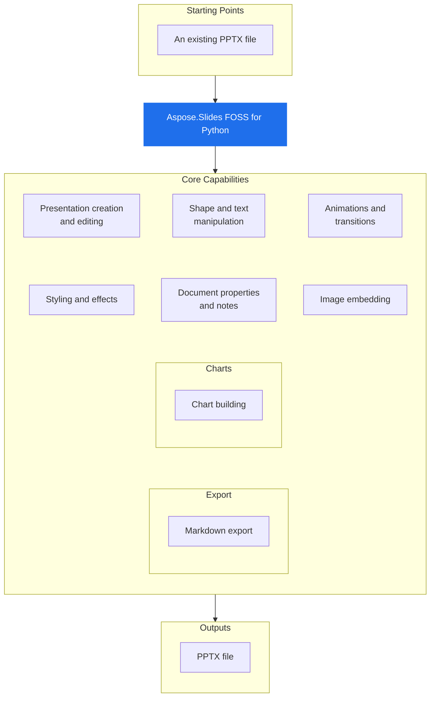

# Aspose.Slides FOSS for Python

[](https://pypi.org/project/aspose-slides-foss/)  [](https://github.com/aspose-slides-foss/Aspose.Slides-FOSS-for-Python/actions/workflows/ci.yml) [](LICENSE) [](https://github.com/aspose-slides-foss/Aspose.Slides-FOSS-for-Python/graphs/contributors) [](https://pypi.org/project/aspose-slides-foss/)

[](https://products.aspose.org/slides/python/)

Aspose.Slides FOSS for Python reads and writes `.pptx` presentations, creates new presentations from scratch, and saves them as `.pptx`. It supports adding `AutoShape`, `Table`, and `Chart` objects to slides, applying text formatting via `PortionFormat`, and configuring slide transitions with `TransitionType`. It also handles images by reading `.png` files and embedding them, manages speaker notes through `NotesSlideManager`, and stores document metadata and comments via `DocumentProperties` and `CommentAuthorCollection`.

Aspose.Slides FOSS for Python is the official open-source Python library by Aspose.Slides for
creating, reading, and editing PowerPoint `.pptx` presentations. It models a presentation the way
PowerPoint itself does — `Presentation`, `Slide`, `Shape`, `TextFrame` — so slides, shapes, and
text feel native to work with, with no Microsoft Office installation or COM interop required.

## Navigation

- [At a Glance](#at-a-glance)
- [Key Capabilities](#key-capabilities)
- [Installation](#installation)
- [Dependencies](#dependencies)
- [Quick Start](#quick-start)
- [Additional Examples](#additional-examples)
- [API Reference](#api-reference)
- [Documentation & Resources](#documentation--resources)
- [Scope and Limitations](#scope-and-limitations)
- [Development and Testing](#development-and-testing)
- [License](#license)

## At a Glance



## Key Capabilities

- **Presentation creation and editing.** It opens, creates, and saves presentations through `Presentation` as a context manager, ensuring proper disposal, and writes them to `.pptx` or related Office Open XML variants using `SaveFormat`.
- **Shape and text manipulation.** It adds and formats AutoShapes, tables, and connectors, and applies character-level text formatting through `PortionFormat`, including font height, bold styling, and solid fill color.
- **Chart building.** It builds charts with various types using `ChartType`, populates them with data through an embedded `ChartDataWorkbook`, and supports series, categories, titles, legends, and data labels.
- **Animations and transitions.** It applies slide transitions with different types, including CIRCLE, and configures per-slide advance behavior with click and time-based triggers.
- **Styling and effects.** It styles shapes with solid, gradient, pattern, and picture fills via `FillFormat`, line properties through `LineFormat`, and visual effects such as outer shadow, inner shadow, glow, blur, reflection, and soft edge via `EffectFormat`.
- **Document properties and notes.** It manages presentation metadata with `DocumentProperties`, adds speaker notes per slide using `NotesSlideManager`, and handles threaded comments with `CommentAuthorCollection` including authors, timestamps, and positions.
- **Image embedding.** It embeds images from file handles or bytes using `ImageCollection.add_image` and places them on slides as picture frames.
- **Markdown export.** It exports presentations to Markdown in various flavor dialects through `SaveFormat`.MD, preserving text frames, tables, lists, headings, comments, and chart data.

- Add, remove, clone, hide, and iterate slides through `SlideCollection` (`add_empty_slide()`,
  `remove_at()`, `add_clone()`) and `Slide` / `LayoutSlide` / `MasterSlide`, including per-slide
  visibility (`slide.hidden`) and layout/master relationships.
- Format text at the character, paragraph, and frame level with `TextFrame`, `Paragraph`, and
  `Portion`, including bullet formatting through `BulletFormat` and tri-state boolean properties
  (`font_bold`, `font_italic`) via `NullableBool`.
- Attach an external hyperlink, with an optional tooltip, to a single text portion
  (`portion_format.hyperlink_click`) or to a whole shape, including a "mouse over" variant
  (`shape.hyperlink_mouse_over`), through `Hyperlink`; assigning `None` removes the link and the
  relationship it owns. See [Installation](#installation) — this needs the from-source install.
- Manage presentation themes through `Theme` (reached via `prs.master_theme`) — color schemes
  (`ColorScheme`: dark/light/accent1-6/hyperlink colors), font schemes (`FontScheme`: major/minor
  font collections), and format schemes (`FormatScheme`: fill, line, effect, and background-fill
  styles) — and override individual master themes with `MasterThemeManager` (`override_theme`,
  `is_override_theme_enabled`).
- Embed images from a file, bytes, or stream with `Images.from_file()` / `Images.from_stream()`,
  or add one directly to a slide with `ImageCollection.add_image()`, which accepts image bytes or
  a file-like object — not a file path; open the file yourself and pass the handle or its bytes.

## Installation

Install the published package from PyPI (`aspose-slides-foss`, version 26.8.0):

```bash
pip install aspose-slides-foss
```

To work from a source checkout instead, install the clone with pip:

```bash
git clone https://github.com/aspose-slides-foss/Aspose.Slides-FOSS-for-Python.git
cd Aspose.Slides-FOSS-for-Python
pip install .
```

Verify the install:

```bash
python -c "import aspose.slides_foss"
```

Requires Python 3.10 or later.

## Dependencies

### Required Package Dependencies

- `lxml>=4.9`

### Native and System Requirements

- Requires Python 3.10 or later.

### Development Dependencies

- `pytest>=7` (extra `test`)
- `python-pptx>=1.0` (extra `test`)

## Quick Start

This example opens an existing presentation to count its slides and save it, then creates a new presentation and saves it, demonstrating basic file I/O with Aspose.Slides FOSS for Python.

```python
import aspose.slides_foss as slides
from aspose.slides_foss.export import SaveFormat

# Open an existing presentation
with slides.Presentation("input.pptx") as prs:
    print(f"Slides: {len(prs.slides)}")
    prs.save("output.pptx", SaveFormat.PPTX)

# Create a new presentation
with slides.Presentation() as prs:
    slide = prs.slides[0]
    prs.save("new.pptx", SaveFormat.PPTX)
```

## Additional Examples

The following examples demonstrate common tasks using Aspose.Slides FOSS for Python.

### Build a Clustered Column Chart from Scratch

```python
from aspose.slides_foss.charts import ChartType
import aspose.slides_foss as slides
from aspose.slides_foss.export import SaveFormat

with slides.Presentation() as prs:
    slide = prs.slides[0]

    # Pass has_default_data=False to start with an empty workbook
    chart = slide.shapes.add_chart(ChartType.CLUSTERED_COLUMN, 50, 50, 600, 400, False)
    chart.chart_title.add_text_frame_for_overriding("Quarterly Sales")

    cd = chart.chart_data
    wb = cd.chart_data_workbook  # embedded XLSX workbook backing the chart

    cd.series.clear()
    cd.categories.clear()

    # Workbook layout (worksheet 0):
    #          col 0   col 1      col 2
    #  row 0            "Revenue"  "Expenses"   <- series name row
    #  row 1   "Q1"     1200       800
    #  row 2   "Q2"     1500       900
    #  row 3   "Q3"     1800       1000
    #  row 4   "Q4"     2100       1100

    # Categories — column 0, rows 1..4
    for row, name in enumerate(["Q1", "Q2", "Q3", "Q4"], start=1):
        cd.categories.add(wb.get_cell(0, row, 0, name))

    # Series 1 (Revenue) — name at (row 0, col 1), values at (rows 1..4, col 1)
    s1 = cd.series.add(wb.get_cell(0, 0, 1, "Revenue"), chart.type)
    for row, value in enumerate([1200, 1500, 1800, 2100], start=1):
        s1.data_points.add_data_point_for_bar_series(wb.get_cell(0, row, 1, value))

    # Series 2 (Expenses) — name at (row 0, col 2), values at (rows 1..4, col 2)
    s2 = cd.series.add(wb.get_cell(0, 0, 2, "Expenses"), chart.type)
    for row, value in enumerate([800, 900, 1000, 1100], start=1):
        s2.data_points.add_data_point_for_bar_series(wb.get_cell(0, row, 2, value))

    prs.save("chart.pptx", SaveFormat.PPTX)
```

<details>
<summary>View Additional Examples</summary>

### Add a Rectangle Shape with Text

```python
from aspose.slides_foss import ShapeType
import aspose.slides_foss as slides
from aspose.slides_foss.export import SaveFormat

with slides.Presentation() as prs:
    slide = prs.slides[0]
    shape = slide.shapes.add_auto_shape(ShapeType.RECTANGLE, 50, 50, 300, 100)
    shape.add_text_frame("Hello, world!")
    prs.save("shapes.pptx", SaveFormat.PPTX)
```

### `Format` Text with Font Height, Bold, and Solid Fill Color

```python
from aspose.slides_foss import ShapeType, NullableBool, FillType
from aspose.slides_foss.drawing import Color
import aspose.slides_foss as slides
from aspose.slides_foss.export import SaveFormat

with slides.Presentation() as prs:
    shape = prs.slides[0].shapes.add_auto_shape(ShapeType.RECTANGLE, 50, 50, 400, 150)
    tf = shape.add_text_frame("Formatted text")
    fmt = tf.paragraphs[0].portions[0].portion_format
    fmt.font_height = 24
    fmt.font_bold = NullableBool.TRUE
    fmt.fill_format.fill_type = FillType.SOLID
    fmt.fill_format.solid_fill_color.color = Color.from_argb(255, 0, 70, 127)
    prs.save("text.pptx", SaveFormat.PPTX)
```

### Add a Table with Rows and Columns

```python
import aspose.slides_foss as slides
from aspose.slides_foss.export import SaveFormat

with slides.Presentation() as prs:
    table = prs.slides[0].shapes.add_table(50, 50, [120.0, 120.0, 120.0], [40.0, 40.0])
    table.rows[0][0].text_frame.text = "Name"
    table.rows[0][1].text_frame.text = "Value"
    prs.save("table.pptx", SaveFormat.PPTX)
```

### Connect Two Shapes with a Bent Connector

```python
from aspose.slides_foss import ShapeType
import aspose.slides_foss as slides
from aspose.slides_foss.export import SaveFormat

with slides.Presentation() as prs:
    slide = prs.slides[0]
    box1 = slide.shapes.add_auto_shape(ShapeType.RECTANGLE, 50, 100, 150, 60)
    box2 = slide.shapes.add_auto_shape(ShapeType.RECTANGLE, 350, 100, 150, 60)
    conn = slide.shapes.add_connector(ShapeType.BENT_CONNECTOR3, 0, 0, 10, 10)
    conn.start_shape_connected_to = box1
    conn.start_shape_connection_site_index = 3  # right
    conn.end_shape_connected_to = box2
    conn.end_shape_connection_site_index = 1    # left
    prs.save("connector.pptx", SaveFormat.PPTX)
```

### Fill a Shape with a Solid Color

```python
from aspose.slides_foss import ShapeType, FillType
from aspose.slides_foss.drawing import Color
import aspose.slides_foss as slides
from aspose.slides_foss.export import SaveFormat

with slides.Presentation() as prs:
    shape = prs.slides[0].shapes.add_auto_shape(ShapeType.RECTANGLE, 50, 50, 300, 150)
    shape.fill_format.fill_type = FillType.SOLID
    shape.fill_format.solid_fill_color.color = Color.from_argb(255, 30, 120, 200)
    prs.save("fill.pptx", SaveFormat.PPTX)
```

### Embed an Image from a File

```python
import aspose.slides_foss as slides
from aspose.slides_foss import ShapeType
from aspose.slides_foss.export import SaveFormat

with slides.Presentation() as prs:
    with open("picture.png", "rb") as fh:
        image = prs.images.add_image(fh)      # or add_image(fh.read())
    prs.slides[0].shapes.add_picture_frame(ShapeType.RECTANGLE, 50, 50, 300, 200, image)
    prs.save("picture.pptx", SaveFormat.PPTX)
```

### Add Speaker Notes to a Slide

```python
import aspose.slides_foss as slides
from aspose.slides_foss.export import SaveFormat

with slides.Presentation() as prs:
    notes = prs.slides[0].notes_slide_manager.add_notes_slide()
    notes.notes_text_frame.text = "Speaker notes go here."
    prs.save("notes.pptx", SaveFormat.PPTX)
```

### Add a Threaded Comment to a Slide

```python
from aspose.slides_foss.drawing import PointF
from datetime import datetime
import aspose.slides_foss as slides
from aspose.slides_foss.export import SaveFormat

with slides.Presentation() as prs:
    author = prs.comment_authors.add_author("Jane Smith", "JS")
    slide = prs.slides[0]
    author.comments.add_comment("Review this slide", slide, PointF(2.0, 2.0), datetime.now())
    prs.save("comments.pptx", SaveFormat.PPTX)
```

### Set Document Properties and Custom Values

```python
import aspose.slides_foss as slides
from aspose.slides_foss.export import SaveFormat

with slides.Presentation() as prs:
    prs.document_properties.title = "Q1 Results"
    prs.document_properties.author = "Finance Team"
    prs.document_properties.set_custom_property_value("Version", 3)
    prs.save("deck.pptx", SaveFormat.PPTX)
```

### Apply a Circle Slide Transition with Timing

```python
from aspose.slides_foss.slideshow import TransitionType
import aspose.slides_foss as slides
from aspose.slides_foss.export import SaveFormat

with slides.Presentation() as prs:
    slide = prs.slides[0]
    slide.slide_show_transition.type = TransitionType.CIRCLE
    slide.slide_show_transition.advance_on_click = True
    slide.slide_show_transition.advance_after_time = 3000  # ms
    prs.save("transition.pptx", SaveFormat.PPTX)
```

### Group Multiple Shapes Under One Name

```python
from aspose.slides_foss import ShapeType
import aspose.slides_foss as slides
from aspose.slides_foss.export import SaveFormat

with slides.Presentation() as prs:
    slide = prs.slides[0]
    group = slide.shapes.add_group_shape()
    group.shapes.add_auto_shape(ShapeType.RECTANGLE, 300, 100, 100, 100)
    group.shapes.add_auto_shape(ShapeType.RECTANGLE, 500, 100, 100, 100)
    group.name = "TwoRectangles"
    prs.save("group.pptx", SaveFormat.PPTX)
```

### Import the Aspose-Slides-Foss Package

```python
import aspose.slides_foss as slides
```

### Export to Markdown

```python
import aspose.slides_foss as slides
from aspose.slides_foss.export import SaveFormat, MarkdownSaveOptions, Flavor, NewLineType

with slides.Presentation("input.pptx") as prs:
    # Save the whole presentation with default options
    prs.save("output.md", SaveFormat.MD)

    # Or customize the output
    options = MarkdownSaveOptions()
    options.flavor = Flavor.GITHUB
    options.new_line_type = NewLineType.UNIX
    options.show_slide_number = True
    options.slide_number_format = "## Slide {0}"
    options.show_hidden_slides = True
    options.show_comments = True
    prs.save("custom.md", SaveFormat.MD, options)

    # Save only selected slides (1-based, order and repeats respected)
    prs.save("subset.md", [2, 1], SaveFormat.MD, options)
```

`wb.get_cell(worksheet_index, row, column, value)` writes the value to the embedded XLSX workbook
and returns a cell reference that the chart's series and categories bind to.

Text frames, tables, lists, titles/subtitles (as headings), comments, and chart data are
exported; the export is text-only, so images, media, and SmartArt are skipped.

</details>

## API Reference

The primary entry point is `slides_foss.Presentation`, which owns a `SlideCollection` of `Slide` objects, each exposing its shapes through `Slide.shapes` (a `ShapeCollection`).

The public API has 516 types.

<details>
<summary>View the Complete Public API Surface</summary>

### Core API

| Class | Description |
| --- | --- |
| `AdjustValue` | Represents a geometry shape's adjustment value. These values affect shape's form. |
| `AdjustValueCollection` | Reprasents a collection of shape's adjustments. |
| `AutoShape` | Represents an AutoShape. |
| `Background` | Represents background of a slide. |
| `BaseHandoutNotesSlideHeaderFooterManager` | BaseHandoutNotesSlideHeaderFooterManager class manages header and footer elements for handout and notes slides. |
| `BasePortionFormat` | Common text portion formatting properties. |
| `BaseShapeLock` | BaseShapeLock class provides base locking functionality for shapes. |
| `BaseSlide` | Represents common data for all slide types. |
| `BulletFormat` | Represents paragraph bullet formatting properties. |
| `Camera` | Represents Camera. |
| `Cell` | Represents a cell of a table. |
| `CellCollection` | Represents a collection of cells. |
| `CellFormat` | Represents format of a table cell. |
| `ColorFormat` | Represents a color used in a presentation. |
| `Column` | Represents a column in a table. |
| `ColumnCollection` | Represents collection of columns in a table. |
| `Comment` | Represents a comment on a slide. |
| `CommentAuthor` | Represents an author of comments. |
| `CommentAuthorCollection` | Represents a collection of comment authors. |
| `CommentCollection` | Represents a collection of comments of one author. |
| `Connector` | Represents a connector. |
| `DocumentProperties` | Represents properties of a presentation. |
| `EffectFormat` | Represents effect properties of shape. |
| `FillFormat` | Represents a fill formatting options. |
| `FontData` | Represents a font definition. Immutable. |
| `Fonts` | Fonts collection. |
| `GeometryShape` | GeometryShape class represents a shape with geometric properties derived from Shape, IGeometryShape, and ABC. |
| `GlobalLayoutSlideCollection` | Represents a collection of all layout slides in presentation. Extends LayoutSlideCollection class with methods for adding/cloning layout slides in context of uniting of the individual collections of master's layout slides. |
| `GradientFormat` | Represent a gradient format. |
| `GradientStop` | Represents a gradient format. |
| `GradientStopCollection` | Represnts a collection of gradient stops. |
| `GraphicalObject` | GraphicalObject class represents a graphical object derived from Shape, IGraphicalObject, and ABC. |
| `GraphicalObjectLock` | GraphicalObjectLock class provides locking functionality for graphical objects derived from BaseShapeLock. |
| `GroupShape` | Represents a group of shapes on a slide. |
| `GroupShapeLock` | Determines which operations are disabled on the parent GroupShape. |
| `HeadingPair` | Represents a 'Heading pair' property of the document. It indicates the group name of document parts and the number of parts in group. |
| `Hyperlink` | Not implemented. |
| `IAdjustValue` | Represents a geometry shape's adjustment value. These values affect shape's form. |
| `IAdjustValueCollection` | Reprasents a collection of shape's adjustments. |
| `IAnimationTimeLine` | Represents timeline of animation. |
| `IAutoShape` | Represents an AutoShape. |
| `IBackground` | Represents background of a slide. |
| `IBackgroundEffectiveData` | Immutable object which contains effective background properties. |
| `IBasePortionFormat` | IBasePortionFormat interface defines base formatting properties for text portions including alternative_language_id, complex_script_font, east_asian_font, effect_format, escapement, fill_format, font_bold, font_height, and spell_check. |
| `IBaseShapeLock` | Represents Shape lock (disabled operation). |
| `IBaseSlide` | Represents common data for all slide types. |
| `IBulkTextFormattable` | Represents an object with possibility of bulk setting child text elements' formats. |
| `IBulletFormat` | Represents paragraph bullet formatting properties. |
| `ICamera` | Represents Camera. |
| `ICell` | Represents a cell in a table. |
| `ICellCollection` | Represents a collection of cells. |
| `ICellFormat` | Represents format of a table cell. |
| `IColorFormat` | Represents a color used in a presentation. |
| `IColumn` | Represents a column in a table. |
| `IColumnCollection` | Represents collection of columns in a table. |
| `IComment` | Represents a comment on a slide. |
| `ICommentAuthor` | Represents an author of comments. |
| `ICommentAuthorCollection` | Represents a collection of comment authors. |
| `ICommentCollection` | Represents a collection of comments of one author. |
| `IConnector` | Represents a connector. |
| `IDocumentProperties` | Represents properties of a presentation. |
| `IEffectFormat` | Represents effect properties of shape. |
| `IEffectParamSource` | IEffectParamSource interface represents a source of effect parameters. |
| `IFillFormat` | Represents a fill formatting options. |
| `IFillParamSource` | IFillParamSource interface represents a source of fill parameters. |
| `IFontData` | Represents a font definition. |
| `IFonts` | Represents fonts collection. |
| `IGeometryShape` | Represents the parent class for all geometric shapes. |
| `IGlobalLayoutSlideCollection` | Represents a collection of all layout slides in presentation. Extends ILayoutSlideCollection interface with methods for adding/cloning layout slides in context of uniting of the individual collections of master's layout slides. |
| `IGradientFormat` | Represent a gradient format. |
| `IGradientStop` | Represents a gradient format. |
| `IGradientStopCollection` | Represnts a collection of gradient stops. |
| `IGraphicalObject` | Represents abstract graphical object. |
| `IGroupShape` | Represents a group of shapes on a slide. |
| `IGroupShapeLock` | Determines which operations are disabled on the parent GroupShape. |
| `IHeadingPair` | Represents a 'Heading pair' property of the document. It indicates the group name of document parts and the number of parts in group. |
| `IHyperlink` | Represents a hyperlink. |
| `IHyperlinkContainer` | Represents an object that can carry hyperlinks. |
| `IImage` | Represents a raster or vector image. |
| `IImageCollection` | Represents collection of PPImage. |
| `ILayoutSlide` | Represents a layout slide. |
| `ILayoutSlideCollection` | Represents a base class for collection of a layout slides. |
| `ILightRig` | Represents LightRig. |
| `ILineFillFormat` | Represents properties for lines filling. |
| `ILineFormat` | Represents format of a line. |
| `ILineParamSource` | ILineParamSource interface represents a source of line parameters. |
| `ILoadOptions` | ILoadOptions interface defines options for loading presentations. |
| `IMasterLayoutSlideCollection` | IMasterLayoutSlideCollection interface represents a collection of master layout slides derived from ILayoutSlideCollection and ABC. |
| `IMasterSlide` | Represents a master slide in a presentation. |
| `IMasterSlideCollection` | Represents a collection of master slides. |
| `INotesSize` | Represents a size of notes slide. |
| `INotesSlide` | Represents a notes slide in a presentation. |
| `INotesSlideHeaderFooterManager` | Represents manager which holds behavior of the notes slide placeholders, including header placeholder. |
| `INotesSlideManager` | Notes slide manager. |
| `IPPImage` | Represents an image in a presentation. |
| `IParagraph` | Represents a paragraph of a text. |
| `IParagraphCollection` | Represents a collection of a paragraphs. |
| `IParagraphFormat` | IParagraphFormat interface defines paragraph formatting properties including alignment, bullet, default_portion_format, default_tab_size, depth, east_asian_line_break, font_alignment, and hanging_punctuation. |
| `IPatternFormat` | Represents a pattern to fill a shape. |
| `IPictureFillFormat` | Represents a picture fill style. |
| `IPictureFrame` | Represents a frame with a picture inside. |
| `IPictureFrameLock` | Determines which operations are disabled on the parent PictureFrameEx. |
| `IPortion` | Represents a portion of text inside a text paragraph. |
| `IPortionCollection` | Represents a collection of a portions. |
| `IPortionFormat` | IPortionFormat interface defines portion formatting properties derived from IBasePortionFormat, IHyperlinkContainer, and ABC. |
| `IPresentation` | Presentation document |
| `IPresentationComponent` | Represents a component of a presentation. |
| `IRow` | Represents a row in a table. |
| `IRowCollection` | Represents table row collection. |
| `ISection` | ISection interface represents a section in a presentation. |
| `IShape` | Represents a shape on a slide. |
| `IShapeBevel` | Represents properties of shape's main face relief. |
| `IShapeCollection` | Represents a collection of shapes. |
| `IShapeFrame` | Represents shape frame's properties. |
| `ISlide` | Represents a slide in a presentation. |
| `ISlideCollection` | Represents a collection of a slides. |
| `ISlideComponent` | Represents a component of a slide. |
| `ISlideShowTransition` | Represents slide show transition. |
| `ISlidesPicture` | Represents a picture in a presentation. |
| `ITable` | Represents a table on a slide. |
| `ITableFormat` | Represents format of a table. |
| `ITextFrame` | Represents a TextFrame. |
| `ITextFrameFormat` | Contains the TextFrame's formatting properties. |
| `IThreeDFormat` | Represents 3-D properties. |
| `IThreeDParamSource` | IThreeDParamSource interface represents a source of three-dimensional parameters. |
| `Image` | Represents a raster or vector image. |
| `ImageCollection` | Represents collection of PPImage. |
| `Images` | Images class provides methods from_file and from_stream to create image objects, and raises TypeError conditionally. |
| `LayoutSlide` | Represents a layout slide. |
| `LayoutSlideCollection` | Represents a base class for collection of a layout slides. |
| `LightRig` | Represents LightRig. |
| `LineFillFormat` | Represents properties for lines filling. |
| `LineFormat` | Represents format of a line. |
| `MasterLayoutSlideCollection` | Represents a collections of all layout slides of defined master slide. Extends LayoutSlideCollection class with methods for adding/inserting/removing/cloning/reordering layout slides in context of the individual collections of master's layout slides. |
| `MasterSlide` | Represents a master slide in a presentation. |
| `MasterSlideCollection` | Represents a collection of master slides. |
| `NotesSize` | Represents a size of notes slide. |
| `NotesSlide` | Represents a notes slide in a presentation. |
| `NotesSlideHeaderFooterManager` | Represents manager which holds behavior of the notes slide placeholders, including header placeholder. |
| `NotesSlideManager` | Notes slide manager. |
| `PPImage` | Represents an image in a presentation. |
| `PVIObject` | Encapsulates basic service infrastructure for objects can be a subject of property value inheritance. |
| `Paragraph` | Represents a paragraph of text. |
| `ParagraphCollection` | Represents a collection of a paragraphs. |
| `ParagraphFormat` | ParagraphFormat class implements paragraph formatting properties including alignment, bullet, default_portion_format, default_tab_size, depth, east_asian_line_break, font_alignment, and hanging_punctuation. |
| `PatternFormat` | Represents a pattern to fill a shape. |
| `Picture` | Represents a picture in a presentation. |
| `PictureFillFormat` | Represents a picture fill style. |
| `PictureFrame` | Represents a frame with a picture inside. |
| `PictureFrameLock` | Determines which operations are disabled on the parent PictureFrame. |
| `Portion` | Represents a portion of text inside a text paragraph. |
| `PortionCollection` | Represents a collection of portions. |
| `PortionFormat` | PortionFormat class implements portion formatting properties including hyperlink_click and hyperlink_mouse_over derived from BasePortionFormat and IPortionFormat. |
| `Presentation` | Represents a Microsoft PowerPoint presentation. |
| `Row` | Represents a row in a table. |
| `RowCollection` | Represents table row collection. |
| `Shape` | Represents a shape on a slide. This is an abstract base class. |
| `ShapeBevel` | Contains the properties of shape's main face relief. |
| `ShapeCollection` | Represents a collection of shapes. |
| `ShapeFrame` | Represents shape frame's properties. |
| `Slide` | Represents a slide in a presentation. |
| `SlideCollection` | Represents a collection of a slides. |
| `Table` | Represents a table on a slide. |
| `TableFormat` | Represents format of a table. |
| `TextFrame` | Represents a TextFrame. |
| `TextFrameFormat` | Contains the TextFrame's formatTextFrameFormatting properties. |
| `ThreeDFormat` | Represents 3-D properties. |
| `AnimationTimeLine` | Represents timeline of animation. |
| `Behavior` | Represent base class behavior of effect. |
| `BehaviorCollection` | Represents collection of behavior effects. |
| `BehaviorFactory` | Factory for creating behavior effect instances. |
| `BehaviorProperty` | BehaviorProperty class represents animation behavior properties including extrusion_auto_rotation_center, extrusion_back_depth, extrusion_color, and extrusion_color_mode. |
| `BehaviorPropertyCollection` | Represents collection of behavior properties. |
| `ColorEffect` | Represent color effect behavior of effect. |
| `ColorOffset` | Represent color offset. |
| `CommandEffect` | Represent command effect behavior of effect. |
| `Effect` | Represents animation effect. |
| `FilterEffect` | Represent filter effect behavior of effect. |
| `IBehavior` | Represent base class behavior of effect. |
| `IBehaviorCollection` | Represents collection of behavior effects. |
| `IBehaviorFactory` | Allows to create animation effects |
| `IBehaviorProperty` | IBehaviorProperty interface defines behavior property properties including is_custom and value. |
| `IBehaviorPropertyCollection` | Represents timing properties for the effect behavior. |
| `IColorEffect` | Represents a color effect for an animation behavior. |
| `IColorOffset` | Represent color offset. |
| `ICommandEffect` | Represents a command effect for an animation behavior. |
| `IEffect` | Represents animation effect. |
| `IFilterEffect` | Represent filter effect of behavior. |
| `IMotionCmdPath` | Represent one command of a path. |
| `IMotionEffect` | Represent motion effect behavior of effect. |
| `IMotionPath` | Represent motion path. |
| `IPoint` | Represent animation point. |
| `IPointCollection` | Represents a collection of portions. |
| `IPropertyEffect` | Represent property effect behavior. |
| `IRotationEffect` | Represent rotation behavior of effect. |
| `IScaleEffect` | Represents animation scale effect. |
| `ISequence` | Represents sequence (collection of effects). |
| `ISequenceCollection` | Represents collection of interactive sequences. |
| `ISetEffect` | Represents a set effect for an animation behavior. |
| `ITextAnimation` | Represent text animation. |
| `ITextAnimationCollection` | Represents collection of text animations. |
| `ITiming` | Represents animation timing. |
| `MotionCmdPath` | Represent one command of a path. |
| `MotionEffect` | Represent motion effect behavior of effect. |
| `MotionPath` | Represent motion path. |
| `Point` | Represents animation point. |
| `PointCollection` | Represents a collection of animation points. |
| `PropertyEffect` | Represent property effect behavior of effect. |
| `RotationEffect` | Represent rotation effect behavior of effect. |
| `ScaleEffect` | Represent scale effect behavior of effect. |
| `Sequence` | Represents sequence (collection of effects). |
| `SequenceCollection` | Represents collection of interactive sequences. |
| `SetEffect` | Represent set effect behavior of effect. |
| `TextAnimation` | Represent text animation (some members not implemented). |
| `TextAnimationCollection` | Represents collection of text animations. |
| `Timing` | Represents animation timing. |
| `AxesManager` | Provides access to chart axes. |
| `Axis` | Encapsulates the object that represents a chart's axis. |
| `BaseChartValue` | Base class for chart value types. |
| `Chart` | Represents a chart on a slide. |
| `ChartCategory` | Represents a chart category. |
| `ChartCategoryCollection` | Represents collection of chart categories. |
| `ChartData` | Represents data used for chart plotting. |
| `ChartDataCell` | Represents a cell in the chart data workbook. |
| `ChartDataPoint` | Represents a series data point. |
| `ChartDataPointCollection` | Represents collection of data points for a series. |
| `ChartDataWorkbook` | Provides access to the embedded Excel workbook for chart data. |
| `ChartDataWorksheet` | Represents a worksheet in the chart data workbook. |
| `ChartLinesFormat` | Represents gridlines format properties. |
| `ChartPlotArea` | Represents rectangle where chart should be plotted. |
| `ChartPortionFormat` | ChartPortionFormat class represents formatting for chart text portions derived from IChartPortionFormat and BasePortionFormat. |
| `ChartSeries` | Represents a chart series. |
| `ChartSeriesCollection` | Represents collection of chart series. |
| `ChartSeriesGroup` | Represents group of series. |
| `ChartSeriesGroupCollection` | Collection of ChartSeriesGroup objects. |
| `ChartSeriesReadonlyCollection` | Readonly view of chart series belonging to a single series group. |
| `ChartTextFormat` | Specifies default text formatting for chart text elements. |
| `ChartTitle` | Represents chart title properties. |
| `ChartWall` | Represents walls on 3D charts. |
| `DataLabel` | Represents a series data point label. |
| `DataLabelCollection` | Represents the labels of a chart series. |
| `DataLabelFormat` | Represents formatting options for DataLabel. |
| `DataSourceTypeForErrorBarsCustomValues` | Specifies types of values in ChartDataPoint.ErrorBarsCustomValues properties list. |
| `DataTable` | Represents data table properties. |
| `DoubleChartValue` | Represents a double value backed by a workbook cell or literal. |
| `ErrorBarsCustomValues` | Specifies the error bar values for a single data point. |
| `ErrorBarsFormat` | Represents error bars of chart series. |
| `Format` | Represents chart format properties (fill, line, effect, 3D). |
| `IActualLayout` | Specifies actual position of a chart element. |
| `IAxesManager` | Provides access to chart axes. |
| `IAxis` | Encapsulates the object that represents a chart's axis. |
| `IAxisFormat` | Represents chart format properties. |
| `IBaseChartValue` | Represents a value of a chart. |
| `IChart` | Represents an graphic chart on a slide. |
| `IChartCategory` | Represents chart categories. |
| `IChartCategoryCollection` | IChartCategoryCollection interface defines methods for managing chart categories including add, clear, index_of, remove, remove_at, and use_cells. |
| `IChartCategoryLevelsManager` | Managed container of the values of the chart category levels. |
| `IChartCellCollection` | Represents collection of a cells with data. |
| `IChartComponent` | Represents a component of a chart. |
| `IChartData` | Represents data used for a chart plotting. |
| `IChartDataCell` | Represents cell for chart data. |
| `IChartDataPoint` | Represents series data point. |
| `IChartDataPointCollection` | Represents collection of a series data point. |
| `IChartDataWorkbook` | Provides access to embedded Excel workbook |
| `IChartDataWorksheet` | IChartDataWorksheet interface defines properties index and name for chart data worksheets. |
| `IChartDataWorksheetCollection` | Represents the collection of worksheets of chart data workbook. |
| `IChartLinesFormat` | Represents gridlines format properties. |
| `IChartParagraphFormat` | Represents a paragraph formatting properties of a chart. |
| `IChartPlotArea` | Represents chart title properties. |
| `IChartPortionFormat` | Represents the chart portion formatting properties used in charts. |
| `IChartSeries` | Represents a chart series. |
| `IChartSeriesCollection` | IChartSeriesCollection interface defines methods for managing chart series including add, clear, index_of, insert, remove, and remove_at. |
| `IChartSeriesGroup` | Represents group of series. |
| `IChartSeriesGroupCollection` | Represents the collection of groups of combinable series. |
| `IChartSeriesReadonlyCollection` | IChartSeriesReadonlyCollection interface represents a read-only collection of chart series. |
| `IChartTextBlockFormat` | Represents formatting properties for chart text elements. |
| `IChartTextFormat` | Chart operate with restricted set of text format properties. IChartTextFormat, IChartTextBlockFormat, IChartParagraphFormat, IChartPortionFormat interfaces describe this restricted set. |
| `IChartTitle` | Represents chart title properties. |
| `IChartWall` | Represents walls on 3d charts. |
| `IDataLabel` | Represents a series labels. |
| `IDataLabelCollection` | Represents a series labels. |
| `IDataLabelFormat` | Represents formatting options for DataLabel. |
| `IDataSourceTypeForErrorBarsCustomValues` | Specifies types of values in ChartDataPoint.ErrorBarsCustomValues properties list |
| `IDataTable` | Represents data table properties. |
| `IDoubleChartValue` | Represent double value which can be stored in PPTX presentation document in two ways: 1) in cell/cells of workbook related to chart; 2) as literal value. |
| `IErrorBarsCustomValues` | Specifies the errors bar values. It shall be used only when the Error bars value type is Custom. |
| `IErrorBarsFormat` | Represents error bars of chart series. ErrorBars custom values are in IChartDataPointCollection (in property). |
| `IFormat` | Represents chart format properties. |
| `IFormattedTextContainer` | Represents chart text format. |
| `ILayoutable` | Specifies the exact position of a chart element. |
| `ILegend` | Represents chart's legend properties. |
| `ILegendEntryCollection` | Represents legends collection. |
| `ILegendEntryProperties` | Represents legend properties of a chart. |
| `IMarker` | Represents marker of a chert. |
| `IMultipleCellChartValue` | Represents a collection of a chart cells. |
| `IOverridableText` | Represents overridable text for a chart. |
| `IPieSplitCustomPointCollection` | Represents a collection of points that shall be drawn in the second pie or bar on a bar-of-pie or pie-of-pie chart with a custom split. |
| `IRotation3D` | Represents 3D rotation of a chart. |
| `ISingleCellChartValue` | Represents a chart data cell. |
| `IStringChartValue` | Represent string value which can be stored in PPTX presentation document in two ways: 1) in cell/cells of workbook related to chart; 2) as literal value. |
| `IStringOrDoubleChartValue` | Represent string or double value which can be stored in PPTX presentation document in two ways: 1) in cell/cells of workbook related to chart; 2) as literal value. |
| `ITrendline` | Class represents trend line of chart series |
| `ITrendlineCollection` | Represents a collection of TrendlineEx |
| `IUpDownBarsManager` | Provide access to up/down bars of Line- or Stock-chart. |
| `Legend` | Represents chart's legend properties. |
| `LegendEntryCollection` | Collection of legend entries. |
| `LegendEntryProperties` | Represents legend properties of a chart entry. |
| `Marker` | Represents a chart marker (symbol at data points). |
| `Rotation3D` | Represents 3D rotation of a chart. |
| `StringChartValue` | Represents a string value backed by workbook cells or literal. |
| `StringOrDoubleChartValue` | Represents a value that can be string or double, backed by a cell or literal. |
| `Trendline` | Represents a trend line of a chart series. |
| `TrendlineCollection` | Represents a collection of Trendline objects for a chart series. |
| `Color` | Represents an ARGB color, equivalent to System.Drawing.Color. |
| `PointF` | Represents a 2D point with float coordinates, equivalent to System.Drawing.PointF. |
| `Size` | Represents a 2D size with integer dimensions, equivalent to System.Drawing.Size. |
| `SizeF` | Represents a 2D size with float dimensions, equivalent to System.Drawing.SizeF. |
| `Blur` | Represents a Blur effect that is applied to the entire shape, including its fill. All color channels, including alpha, are affected. |
| `FillOverlay` | Represents a Fill Overlay effect. A fill overlay may be used to specify an additional fill for an object and blend the two fills together. |
| `Glow` | Represents a Glow effect, in which a color blurred outline is added outside the edges of the object. |
| `IBlur` | Represents a Blur effect that is applied to the entire shape, including its fill. All color channels, including alpha, are affected. |
| `IFillOverlay` | Represents a Fill Overlay effect. A fill overlay may be used to specify an additional fill for an object and blend the two fills together. |
| `IGlow` | Represents a Glow effect, in which a color blurred outline is added outside the edges of the object. |
| `IImageTransformOperation` | IImageTransformOperation interface represents an image transform operation. |
| `IInnerShadow` | Represents a inner shadow effect. |
| `IOuterShadow` | Represents an Outer Shadow effect. |
| `IPresetShadow` | Represents a Preset Shadow effect. |
| `IReflection` | Represents a reflection effect. |
| `ISoftEdge` | Represents a Soft Edge effect. The edges of the shape are blurred, while the fill is not affected. |
| `ImageTransformOperation` | ImageTransformOperation class implements image transform operations derived from PVIObject, ISlideComponent, IPresentationComponent, and IImageTransformOperation. |
| `InnerShadow` | Represents a Inner Shadow effect. |
| `OuterShadow` | Represents an Outer Shadow effect. |
| `PresetShadow` | Represents a Preset Shadow effect. |
| `Reflection` | Represents a Reflection effect. |
| `SoftEdge` | Represents a soft edge effect. The edges of the shape are blurred, while the fill is not affected. |
| `ISaveOptions` | Options that control how a presentation is saved. |
| `MarkdownSaveOptions` | Represents options that control how presentation should be saved to markdown. |
| `SaveOptions` | Abstract class with options that control how a presentation is saved. |
| `CornerDirectionTransition` | Corner direction slide transition effect. |
| `EightDirectionTransition` | Eight direction slide transition effect. |
| `EmptyTransition` | Empty slide transition effect. |
| `FlyThroughTransition` | Fly-through slide transition effect. |
| `GlitterTransition` | Glitter slide transition effect. |
| `ICornerDirectionTransition` | Corner direction slide transition effect. |
| `IEightDirectionTransition` | Eight direction slide transition effect. |
| `IEmptyTransition` | Empty slide transition effect. |
| `IFlyThroughTransition` | Fly-through slide transition effect. |
| `IGlitterTransition` | Glitter slide transition effect. |
| `IInOutTransition` | In-Out slide transition effect. |
| `ILeftRightDirectionTransition` | Left-right direction slide transition effect. |
| `IMorphTransition` | Ripple slide transition effect. |
| `IOptionalBlackTransition` | Optional black slide transition effect. |
| `IOrientationTransition` | Orientation slide transition effect. |
| `IRevealTransition` | Reveal slide transition effect. |
| `IRippleTransition` | Ripple slide transition effect. |
| `IShredTransition` | Shred slide transition effect. |
| `ISideDirectionTransition` | Side direction slide transition effect. |
| `ISplitTransition` | Split slide transition effect. |
| `ITransitionValueBase` | Represents base class for slide transition effects. |
| `IWheelTransition` | Wheel slide transition effect. |
| `InOutTransition` | In-Out slide transition effect. |
| `LeftRightDirectionTransition` | Left-right direction slide transition effect. |
| `MorphTransition` | Morph slide transition effect. |
| `OptionalBlackTransition` | Optional black slide transition effect. |
| `OrientationTransition` | Orientation slide transition effect. |
| `RevealTransition` | Reveal slide transition effect. |
| `RippleTransition` | Ripple slide transition effect. |
| `ShredTransition` | Shred slide transition effect. |
| `SideDirectionTransition` | Side direction slide transition effect. |
| `SlideShowTransition` | Represents slide show transition. |
| `SplitTransition` | Split slide transition effect. |
| `TransitionValueBase` | Base class for slide transition effects. |
| `WheelTransition` | Wheel slide transition effect. |
| `BaseOverrideThemeManager` | Base class for classes that provide access to different types of overriden themes. |
| `BaseThemeManager` | Base class for classes that provide access to different types of themes. |
| `ColorScheme` | Stores theme-defined colors. |
| `EffectStyle` | Represents an effect style. |
| `EffectStyleCollection` | Represents a collection of effect styles. |
| `ExtraColorScheme` | Represents an additional color scheme which can be assigned to a slide. |
| `ExtraColorSchemeCollection` | Represents a collection of additional color schemes. |
| `FillFormatCollection` | Represents the collection of fill styles. |
| `FontScheme` | Stores theme-defined fonts. |
| `FormatScheme` | Stores theme-defined formats for the shapes. |
| `IColorScheme` | Stores theme-defined colors. |
| `IEffectStyle` | Represents an effect style. |
| `IEffectStyleCollection` | Represents a collection of effect styles. |
| `IExtraColorScheme` | Represents an additional color scheme which can be assigned to a slide. |
| `IExtraColorSchemeCollection` | Represents a collection of additional color schemes. |
| `IFillFormatCollection` | Represents the collection of fill styles. |
| `IFontScheme` | Stores theme-defined fonts. |
| `IFormatScheme` | Stores theme-defined formats for the shapes. |
| `ILineFormatCollection` | Represents the collection of line styles. |
| `IMasterTheme` | Represents a master theme. |
| `IMasterThemeManager` | Provides access to presentation master theme. |
| `IMasterThemeable` | Represent master theme manager. |
| `IOverrideTheme` | Represents a overriding theme. |
| `IOverrideThemeManager` | Provides access to different types of overriden themes. |
| `IOverrideThemeable` | Represents override theme manager. |
| `ITheme` | Represents a theme. |
| `IThemeManager` | Represent theme properties. |
| `IThemeable` | IThemeable interface defines properties as_i_presentation_component, as_i_slide_component, presentation, and slide for themeable objects. |
| `LayoutSlideThemeManager` | Provides access to layout slide theme overriden. |
| `LineFormatCollection` | Represents the collection of line styles. |
| `MasterTheme` | Represents a master theme. |
| `MasterThemeManager` | Provides access to presentation master theme. |
| `NotesSlideThemeManager` | Provides access to notes slide theme overriden. |
| `OverrideTheme` | Represents a overriding theme. |
| `SlideThemeManager` | Provides access to slide theme overriden. |
| `Theme` | Represents a theme. |

#### Enumerations

| Enumeration | Description |
| --- | --- |
| `BackgroundType` | Defines the slide background fill source. |
| `BevelPresetType` | Constants which define 3D bevel of shape. |
| `BulletType` | Represents the type of the extended bullets. |
| `CameraPresetType` | Constants which define camera preset type. |
| `ColorType` | Represents different color modes. |
| `FillBlendMode` | Determines blend mode. |
| `FillType` | Specifies the interior fill type of various visual objects. |
| `FontAlignment` | Represents vertical font alignment. |
| `GradientDirection` | Represents the gradient style. |
| `GradientShape` | Represents the shape of gradient fill. |
| `LightRigPresetType` | Constants which define light preset types. |
| `LightingDirection` | Constants which define light directions. |
| `LineAlignment` | Represents the lines alignment type. |
| `LineArrowheadLength` | Represents the length of an arrowhead. |
| `LineArrowheadStyle` | Represents the style of an arrowhead. |
| `LineArrowheadWidth` | Represents the width of an arrowhead. |
| `LineCapStyle` | Represents the line cap style. |
| `LineDashStyle` | Represents the line dash style. |
| `LineJoinStyle` | Represents the lines join style. |
| `LineStyle` | Represents the style of a line. |
| `MaterialPresetType` | Constants which define material of shape. |
| `NullableBool` | Represents triple boolean values. |
| `NumberedBulletStyle` | Represents the style of the numbered bullets. |
| `Orientation` | Represents the orientation of a shape. |
| `PatternStyle` | Represents the pattern style. |
| `PictureFillMode` | Determines how picture will fill area. |
| `PresetColor` | Represents predefined color presets. |
| `PresetShadowType` | Represents a preset for a shadow effect. |
| `RectangleAlignment` | Defines 2-dimension allignment. |
| `SchemeColor` | Represents colors in a color scheme. |
| `ShapeType` | Represents preset geometry of geometry shapes. |
| `SlideLayoutType` | Represents the slide layout type. |
| `SourceFormat` | Represents source file format. |
| `TableStylePreset` | Represents builtin table styles. |
| `TextAlignment` | Represents different text alignment styles. |
| `TextAnchorType` | text box alignment within a text area. |
| `TextAutofitType` | Represents text autofit mode. |
| `TextCapType` | Represents the type of text capitalisation. |
| `TextShapeType` | Represents text wrapping shape. |
| `TextStrikethroughType` | Represents the type of text strikethrough. |
| `TextUnderlineType` | Represents the type of text underline. |
| `TextVerticalType` | Determines vertical writing mode for a text. |
| `TileFlip` | Defines tile flipping mode. |
| `AfterAnimationType` | Represents the after animation type of an animation effect. |
| `AnimateTextType` | Represents the animate text type of an animation effect. |
| `BehaviorAccumulateType` | Represents types of accumulation of effect behaviors. |
| `BehaviorAdditiveType` | Represents additive type for effect behavior. |
| `BuildType` | Determines how text will appear on a shape during animation. |
| `ColorDirection` | Represents color direction for color effect behavior. |
| `ColorSpace` | Represents color space for color effect behavior. |
| `CommandEffectType` | Represents command effect type for command effect behavior. |
| `EffectChartMajorGroupingType` | Represents the type of an animation effect for chart's element. |
| `EffectChartMinorGroupingType` | Represents the type of an animation effect for chart's element in series or category. |
| `EffectFillType` | Represent fill types. |
| `EffectPresetClassType` | Represent effect class types. |
| `EffectRestartType` | Represent restart types for timing. |
| `EffectSubtype` | Represents subtypes of animation effect. |
| `EffectTriggerType` | Represent trigger type of effect. |
| `EffectType` | Represents the type of an animation effect. |
| `FilterEffectRevealType` | Represents filter reveal type. |
| `FilterEffectSubtype` | Represents filter effect subtypes. |
| `FilterEffectType` | Represents filter effect types. |
| `MotionCommandPathType` | Represent types of command for animation motion effect behavior. |
| `MotionOriginType` | Specifies what the origin of the motion path is relative to. Such as the layout of the slide, or the parent. |
| `MotionPathEditMode` | Specifies how the motion path moves when the target shape is moved |
| `MotionPathPointsType` | Represent types of points in animation motion path. |
| `PropertyCalcModeType` | Represent calc mode for animation property. |
| `PropertyValueType` | Represent property value types. |
| `AxisPositionType` | Determines a position of axis. |
| `BubbleSizeRepresentationType` | Specifies the possible ways to represent data as bubble chart sizes. |
| `CategoryAxisType` | Represents a type of a category axis. |
| `ChartDataSourceType` | Represents a type of data source of the chart. |
| `ChartType` | Represents a type of chart. |
| `CombinableSeriesTypesGroup` | Enumeration of groups of combinable series types. Each element relates to group of types of chart series that can persist simultaneously in one ChartSeriesGroup. For example: ChartType.PercentsStackedArea series cannot be simultaneously with ChartType.StackedArea series in one ChartSeriesGroup. But two or more ChartType.PercentsStackedArea can be in one ChartSeriesGroup simultaneously (CombinableSeriesTypesGroup.AreaChart_PercentsStackedArea). And ChartType.Line series can be with ChartType.LineWithMarkers series simultaneously in one CombinableSeriesTypesGroup.LineChart_Line ChartSeriesGroup. |
| `CrossesType` | Determines where axis will cross. |
| `DataSourceType` | Data source types. |
| `DisplayBlanksAsType` | Determines how missing data will be displayed. |
| `DisplayUnitType` | Determines multiplicity of the displayed data. |
| `ErrorBarType` | Represents type of error bar |
| `ErrorBarValueType` | Represents type of error bar value |
| `LayoutTargetType` | If layout of the plot area defined manually this property specifies whether |
| `LegendDataLabelPosition` | Determines position of data labels. |
| `LegendPositionType` | Determines a position of legend on a chart. |
| `MarkerStyleType` | Determines form of marker on chart's data point. |
| `PieSplitType` | Represents a type of splitting points in the second pie or bar on a pie-of-pie or bar-of-pie chart. |
| `StyleType` | Represents chart style. |
| `TickLabelPositionType` | Represents the position type of tick-mark labels on the specified axis. |
| `TickMarkType` | Represents the tick mark type for the specified axis. |
| `TimeUnitType` | Represents the base unit for the category axis |
| `TrendlineType` | Represents type of trend line |
| `Flavor` | All markdown specifications used in program. |
| `HandleRepeatedSpaces` | Specifies how repeated regular space characters should be handled during Markdown export. |
| `MarkdownExportType` | Type of rendering document. |
| `NewLineType` | Type of new line that will be used in generated document. |
| `SaveFormat` | Constants which define the format of a saved presentation. |
| `TransitionCornerAndCenterDirectionType` | Specifies a direction restricted to the corners and center. |
| `TransitionCornerDirectionType` | Represent corner direction transition types. |
| `TransitionEightDirectionType` | Represent eight direction transition types. |
| `TransitionInOutDirectionType` | Represent in or out direction transition types. |
| `TransitionLeftRightDirectionType` | Specifies a direction restricted to the values of left and right. |
| `TransitionMorphType` | Represent a type of morph transition. |
| `TransitionPattern` | Specifies a geometric pattern that tiles together to fill a larger area. |
| `TransitionShredPattern` | Specifies a geometric shape that tiles together to fill a larger area. |
| `TransitionSideDirectionType` | Represent side direction transition types. |
| `TransitionSoundMode` | Represent sound mode of transition. |
| `TransitionSpeed` | Represent transition speed types. |
| `TransitionType` | Represent slide show transition type. |

#### Detailed Member Reference

### slides_foss

The `slides_foss.Presentation` class provides access to slides, masters, layout slides, images, document properties, and comment authors, and supports saving presentations in formats defined by `slides_foss.export.SaveFormat`. The `slides_foss.slideshow.TransitionType` enumeration defines slide transition effects, while `slides_foss.animation.Sequence` and `slides_foss.charts.Chart` provide programmatic control over animation sequences and chart rendering, respectively.

The primary entry point is `Presentation`, which owns a `SlideCollection` of `Slide` objects,
each exposing its shapes through `Slide.shapes` (a `ShapeCollection`).

| Class | Description |
|---|---|
| `AdjustValue` | Represents a geometry shape's adjustment value. |
| `BaseHandoutNotesSlideHeaderFooterManager` | Common base class for the header/footer visibility managers shared by handout and notes slides. |
| `BaseShapeLock` | Common base class for shape-specific lock settings, extended by `GroupShapeLock` and `PictureFrameLock`. |
| `FontData` | Represents a font definition. |
| `GeometryShape` | Abstract base class for shapes with adjustable preset geometry, extended by `AutoShape` and `PictureFrame`. |
| `GlobalLayoutSlideCollection` | Represents a collection of all layout slides in presentation. |
| `GraphicalObject` | Abstract base class for slide-embedded graphical objects that support placeholder association, locking, and custom data (extends `Shape`). |
| `GraphicalObjectLock` | Class extending BaseShapeLock. |
| `HeadingPair` | Represents a 'Heading pair' property of the document. |
| `Images` | Methods to instantiate and work with . |
| `MasterLayoutSlideCollection` | Represents a collections of all layout slides of defined master slide. |
| `ParagraphFormat` | This class contains the paragraph formatting properties. |
| `PortionFormat` | This class contains the text portion formatting properties. |
| `Shape` | Represents a shape on a slide. |

| Class | Description |
|---|---|
| `BehaviorProperty` | Represent property types for animation behavior. |
| `TextAnimation` | Represent text animation. |

| Enumeration | Description |
|---|---|
| `MotionOriginType` | Specifies what the origin of the motion path is relative to. |
| `MotionPathEditMode` | Specifies how the motion path moves when the target shape is moved. |

| Class | Description |
|---|---|
| `ChartPortionFormat` | Chart portion formatting — wraps `<a:defRPr>` inside `<c:txPr>`. |

| Enumeration | Description |
|---|---|
| `CombinableSeriesTypesGroup` | Enumeration of groups of combinable series types. |
| `ErrorBarType` | Represents type of error bar. |
| `ErrorBarValueType` | Represents type of error bar value. |
| `LayoutTargetType` | If layout of the plot area defined manually this property specifies whether to layout the plot area by its inside (not including axis and axis labels) or outside (including axis and axis labels). |
| `TimeUnitType` | Represents the base unit for the category axis. |
| `TrendlineType` | Represents type of trend line. |

| Class | Description |
|---|---|
| `Blur` | Represents a Blur effect that is applied to the entire shape, including its fill. |
| `FillOverlay` | Represents a Fill Overlay effect. |
| `ImageTransformOperation` | Common base class for shape visual effects (`Blur`, `Glow`, `OuterShadow`, `InnerShadow`, `Reflection`, `SoftEdge`, and more). |
| `SoftEdge` | Represents a soft edge effect. |

- `Presentation`
  - `slides -> SlideCollection`
  - `layout_slides -> LayoutSlideCollection`
  - `masters -> MasterSlideCollection`
  - `images -> ImageCollection`
  - `document_properties -> DocumentProperties`
  - `comment_authors -> CommentAuthorCollection`
  - `master_theme -> Theme`, `notes_size -> NotesSize`, `first_slide_number`
  - `save(fileName, format)` / `save(stream, format)`, `dispose()`

- `SlideCollection`
  - `add_empty_slide(layout) -> Slide`
  - `add_clone(slide) -> Slide`
  - `remove_at(index)`

- `BaseSlide` (common base for `Slide` / `LayoutSlide` / `MasterSlide`)
  - `shapes -> ShapeCollection`
  - `background -> Background`
  - `slide_show_transition -> SlideShowTransition`

- `Slide`
  - `hidden` (get/set)
  - `notes_slide_manager -> NotesSlideManager`

- `ShapeCollection`
  - `add_auto_shape(shapeType, x, y, width, height) -> AutoShape`
  - `add_table(x, y, columnWidths, rowHeights) -> Table`
  - `add_connector(shapeType, x, y, width, height) -> Connector`
  - `add_group_shape() -> GroupShape`
  - `add_picture_frame(shapeType, x, y, width, height, image) -> PictureFrame`
  - `add_chart(chartType, x, y, width, height, hasDefaultData) -> Chart`

- `Shape`
  - `name` (get/set), `fill_format -> FillFormat`, `line_format -> LineFormat`,
    `effect_format -> EffectFormat`, `three_d_format -> ThreeDFormat`

- `AutoShape`
  - `add_text_frame(text) -> TextFrame`

- `TextFrame`
  - `paragraphs -> ParagraphCollection`, `text` (get/set)

- `Paragraph`
  - `portions -> PortionCollection`, `paragraph_format -> ParagraphFormat`

- `ParagraphFormat`
  - `bullet -> BulletFormat`

- `Portion`
  - `portion_format -> PortionFormat`

- `PortionFormat`
  - `font_height`, `font_bold` / `font_italic` (tri-state booleans), `fill_format -> FillFormat`

- `Chart`
  - `chart_data -> ChartData`, `chart_title -> ChartTitle`, `axes -> AxesManager`,
    `legend -> Legend`, `type -> ChartType`

- `ChartData`
  - `chart_data_workbook -> ChartDataWorkbook`, `series -> ChartSeriesCollection`,
    `categories -> ChartCategoryCollection`

- `ChartDataWorkbook`
  - `get_cell(worksheetIndex, row, column, value) -> ChartDataCell`

- `ChartSeries`
  - `data_points -> ChartDataPointCollection`

- `Sequence`
  - `add_effect(shape, effectType, subtype, triggerType) -> Effect`

- `BehaviorFactory`
  - creates `ColorEffect`, `MotionEffect`, `RotationEffect`, `ScaleEffect`, `PropertyEffect`, and
    related behavior objects for a custom `Effect`

- `MotionPath`
  - `points -> PointCollection`

- `SlideShowTransition`
  - `type -> TransitionType`, `advance_on_click`, `advance_after_time`, `duration`,
    `speed -> TransitionSpeed`

- `MorphTransition`
  - `morph_type -> TransitionMorphType`

- `FillFormat`
  - `fill_type -> FillType`, `solid_fill_color -> ColorFormat`, `gradient_format -> GradientFormat`,
    `pattern_format -> PatternFormat`, `picture_fill_format -> PictureFillFormat`

- `LineFormat`
  - `width`, `dash_style -> LineDashStyle`, `cap_style -> LineCapStyle`,
    `join_style -> LineJoinStyle`, `alignment -> LineAlignment`,
    `begin_arrowhead_style` / `end_arrowhead_style`

- `EffectFormat`
  - `enable_outer_shadow_effect()` / `outer_shadow_effect -> OuterShadow`
  - `enable_inner_shadow_effect()` / `inner_shadow_effect -> InnerShadow`
  - `enable_glow_effect()` / `glow_effect -> Glow`
  - `set_blur_effect(radius, grow)` / `blur_effect -> Blur`
  - `enable_reflection_effect()` / `reflection_effect -> Reflection`
  - `enable_soft_edge_effect()` / `soft_edge_effect -> SoftEdge`

- `Theme` (via `Presentation.master_theme`)
  - `color_scheme -> ColorScheme`, `font_scheme -> FontScheme`, `format_scheme -> FormatScheme`

- `ColorScheme`
  - `dark1`, `light1`, `dark2`, `light2`, `accent1`-`accent6`, `hyperlink`,
    `followed_hyperlink` (all `-> ColorFormat`)

- `FontScheme`
  - `major -> Fonts`, `minor -> Fonts`, `name`

- `FormatScheme`
  - `fill_styles -> FillFormatCollection`, `line_styles -> LineFormatCollection`,
    `effect_styles -> IEffectStyleCollection`, `background_fill_styles -> FillFormatCollection`

- `MasterThemeManager`
  - `override_theme -> IMasterTheme`, `is_override_theme_enabled`

- `ThreeDFormat`
  - `bevel_top -> ShapeBevel`, `bevel_bottom -> ShapeBevel`, `camera -> Camera`,
    `light_rig -> LightRig`, `extrusion_height`, `material -> MaterialPresetType`

- `DocumentProperties`
  - `title`, `subject`, `author`, `keywords`, `category`, `company` (core/app properties)
  - `get_custom_property_value(name)` / `set_custom_property_value(name, value)` /
    `remove_custom_property(name)` (custom properties)

- `NotesSlideManager`
  - `add_notes_slide() -> NotesSlide`

- `NotesSlide`
  - `notes_text_frame -> TextFrame`, `header_footer_manager -> NotesSlideHeaderFooterManager`

- `CommentAuthorCollection`
  - `add_author(name, initials) -> CommentAuthor`

- `CommentAuthor`
  - `comments -> CommentCollection`

- `CommentCollection`
  - `add_comment(text, slide, position, creationTime) -> Comment`

- `Images` (static factory)
  - `from_file(path) -> Image`, `from_stream(stream) -> Image`

- `ImageCollection`
  - `add_image(data) -> PPImage`

- `SaveFormat`: `Pptx`, `Pptm`, `Ppsx`, `Ppsm`, `Potx`, `Potm`, plus additional values declared but
  not currently exportable (see [Scope and Limitations](#scope-and-limitations))

- `ShapeType`: `Rectangle`, `Ellipse`, `BentConnector3`, and 186 more preset geometries

- `ChartType`: 74 values, e.g. `ClusteredColumn`, `Pie`, `Line`, `Scatter`, `Radar`

- `TransitionType`: 57 values (including `None`), e.g. `Circle`, `Fade`, `Dissolve`, `Wheel`

</details>

## Documentation & Resources

- **[Getting started guide](https://docs.aspose.org/slides/python/)** — installation, walkthroughs, and feature guides for this library.
- **[How-to guides & FAQ](https://kb.aspose.org/slides/python/)** — task-focused answers for common presentation-processing questions.
- **[Full API reference](https://reference.aspose.org/slides/python/)** — the complete, browsable reference for the public API surface (the [API reference](#api-reference) section above covers the essentials). It covers all 516 public types; the [API Reference](#api-reference) section above covers the essentials.
- **[GitHub repository](https://github.com/aspose-slides-foss/Aspose.Slides-FOSS-for-Python)** — browse the source, star the project, or fork it.
- **[Publishing guide](PUBLISHING.md)** — how a release is cut and published to PyPI.
- **[Contributor guide](agents.md)** — architecture notes and conventions for contributors and AI agents working in this repository.
- Found a bug or have a feature request? [Open an issue](https://github.com/aspose-slides-foss/Aspose.Slides-FOSS-for-Python/issues).

## Scope and Limitations

- **Rendering and conversion of any kind** — no PDF, HTML, XPS, or image export. This is a design boundary, not a gap: the library writes OOXML, it does not lay out or rasterize.
- Reading is limited to `.pptx`; `SaveFormat` declares additional values (`Ppt`, `Pdf`, `Xps`, `Tiff`, `Odp`, `Html`, `Swf`, `Otp`, and more), and only two save paths actually write output: the OOXML presentation family — `Pptx`, `Pptm`, `Ppsx`, `Ppsm`, `Potx`, `Potm` — through a registered exporter, and `SaveFormat.MD` through a separate Markdown export path; every other `SaveFormat` value raises `ValueError` at save time, naming the formats that do work.
- SmartArt, OLE objects, and mathematical text are not yet implemented and raise `NotImplementedError`.
- VBA macros and digital signatures are not yet implemented.
- Action settings other than external hyperlinks are not yet implemented.
- `TextAnimation.add_effect` is explicitly stubbed and raises `NotImplementedError`.
- **Presentation sections**: `Presentation.sections` does not exist.
- **Slide size**: there is no public API to read or change it, so a new deck is whatever the bundled template says — 16:9, `12192000 × 6858000` EMU.
- Assigning to a property a shape or a formatting object does not have raises `AttributeError` rather than being silently accepted and discarded, so a misspelt property name fails where it is written; names beginning with an underscore are unaffected.
- The file name's extension and the `SaveFormat` passed to `save()` are independent — saving as `SaveFormat.POTX` under a `.pptx` name writes a genuine template whose declared content type disagrees with the extension, and PowerPoint will refuse to open it; give the file the extension that matches the requested format.
- Comment threads are written using only the classic comment-list schema on every save; reply-to-a-reply chains are preserved (via each comment's `parent_comment`), but any features that require a modern PowerPoint-authored thread format are not represented. Loading and saving without touching comments leaves existing threads untouched.

Unknown XML parts encountered during load are preserved verbatim on save, so opening and re-saving a file never strips content this library does not yet understand.

See [Aspose.Slides for Python — Enterprise Edition](https://products.aspose.com/slides/python-net/). It adds full non-PPTX export (PDF, HTML, images, and more), SmartArt and OLE support, VBA and digital signature handling, and commercial support.

## Development and Testing

The suite covers 44 test files under `tests/`. The [ci workflow](.github/workflows/ci.yml) runs on Ubuntu, Windows and macOS, with Python 3.10, 3.11, 3.12, 3.13 and 3.14. Releases run through the [publish workflow](.github/workflows/publish.yml).

**The PyPI release predates the source tree behind this page.** `pip install` gets `26.8.0`, and the changes listed in [CHANGELOG.md](CHANGELOG.md) under `## [Unreleased]` — including hyperlinks, which several examples on this page use, and the six distinct PowerPoint save formats — are not in that release. For the behaviour described here, install from the repository instead:

```bash
pip install git+https://github.com/aspose-slides-foss/Aspose.Slides-FOSS-for-Python.git
```

**`aspose` is a shared namespace package.** If the commercial `aspose` package is installed in the same environment, it takes the name over and this library becomes unimportable, with a bare `ModuleNotFoundError: No module named 'aspose.slides_foss'`. Install this one into its own virtual environment.

- Python 3.10 or later (`requires-python = ">=3.10"` in `pyproject.toml`). Pure Python — there is nothing to compile.
- Continuous integration runs the full test suite on Python 3.10, 3.11, 3.12, 3.13, and 3.14, on Linux, Windows, and macOS — fifteen jobs, and a release is gated on all of them passing.

- `pytest` >= 7 — the test runner, installed via the `test` extra (`pip install -e .[test]`).
- `python-pptx` >= 1.0 — a second, independent reader one conformance test uses to check this library's own output; that test skips if it is absent.

Install the repository in editable mode and run the test suite with `pytest`:

```bash
pip install -e .[test]
python -m pytest
```

[`.github/workflows/ci.yml`](.github/workflows/ci.yml) runs that same suite across the full Python/OS matrix on every push and pull request; releases publish to PyPI through [`.github/workflows/publish.yml`](.github/workflows/publish.yml).

See [`agents.md`](agents.md) for the package's internal structure and contribution conventions, and [CONTRIBUTING.md](CONTRIBUTING.md) (https://github.com/aspose-slides-foss/Aspose.Slides-FOSS-for-Python/blob/main/CONTRIBUTING.md) for how to build, how to run the tests, and how to report a fix. What changed, and what changed in a way you will notice, is recorded in [CHANGELOG.md](https://github.com/aspose-slides-foss/Aspose.Slides-FOSS-for-Python/blob/main/CHANGELOG.md); the security policy for how to report a vulnerability privately is [SECURITY.md](https://github.com/aspose-slides-foss/Aspose.Slides-FOSS-for-Python/blob/main/SECURITY.md) rather than a public issue; participation is governed by [CODE_OF_CONDUCT.md](https://github.com/aspose-slides-foss/Aspose.Slides-FOSS-for-Python/blob/main/CODE_OF_CONDUCT.md).

View it directly on
GitHub:
https://github.com/aspose-slides-foss/Aspose.Slides-FOSS-for-Python/blob/main/LICENSE.

## License

This project is licensed under the [MIT License](LICENSE). The MIT License permits use, copying, modification, distribution, sublicensing, and commercial use, provided its copyright and permission notice are retained. The software is provided without warranty.
