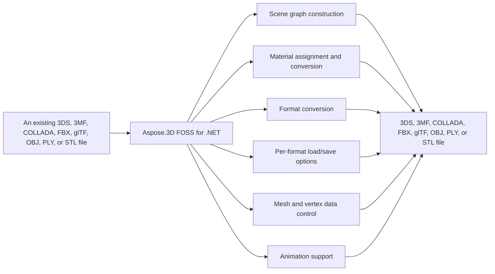

# Aspose.3D FOSS for .NET

[](https://www.nuget.org/packages/Aspose.3D.FOSS/)  [](LICENSE) [](https://github.com/aspose-3d-foss/Aspose.3D-FOSS-for-.NET/graphs/contributors)

[](https://products.aspose.org/3d/net/)

Aspose.3D FOSS for .NET reads and writes 3D formats including `.fbx`, `.gltf`, `.obj`, `.stl`, `.dae`, `.3mf`, `.3ds`, and `.ply`. It converts scenes between these formats and supports scene graph construction with `Scene`, `Node` hierarchy, primitive geometry, and material assignment. The product handles skeletal animation with bones, keyframes, and morph targets, and provides NURBS curve and surface definition capabilities.

## Navigation

- [At a Glance](#at-a-glance)
- [Key Capabilities](#key-capabilities)
- [Installation](#installation)
- [Dependencies](#dependencies)
- [Quick Start](#quick-start)
- [Additional Examples](#additional-examples)
- [API Reference](#api-reference)
- [Documentation & Resources](#documentation--resources)
- [Scope and Limitations](#scope-and-limitations)
- [Development and Testing](#development-and-testing)
- [License](#license)

## At a Glance



## Key Capabilities

- **Scene graph construction.** `Scene` graph construction with `Aspose.ThreeD.Scene` and `Aspose.ThreeD.Node` supports creating a root node, attaching child nodes via `CreateChildNode` or `AddChildNode`, and managing entities, transforms, and materials on each node.
- **Material assignment and conversion.** `Material` assignment and conversion supports assigning `LambertMaterial`, `PhongMaterial`, `PbrMaterial`, `PbrSpecularMaterial`, and `ShaderMaterial` to nodes, and converting standard materials to physically based rendering materials via `PbrMaterial.FromMaterial`.
- **Format conversion.** Format conversion supports reading and writing `.fbx`, `.gltf`, `.obj`, `.stl`, `.dae`, and `.3mf` files through `Scene.Open`, `Scene.FromFile`, `Scene.Save`, and `Scene.FromStream` with full round-trip fidelity.
- **Per-format load/save options.** Per-format load/save options supports configuring behavior for each format through dedicated types such as `ObjLoadOptions`, `ColladaSaveOptions`, and their equivalents for FBX, glTF, STL, and 3MF.
- **Mesh and vertex data control.** `Mesh` and vertex data control supports defining primitives like `Box`, `Cylinder`, `Sphere`, and IFC-compatible 2D profiles, as well as custom meshes with normals, UVs, vertex color, tangent/binormal, smoothing groups, and user data via `VertexDeclaration` and `VertexElement`.
- **Animation support.** Animation support supports creating and managing animation clips with `AnimationClip` and `AnimationChannel`, skinning meshes with `Bone`, `Skeleton`, and `SkinDeformer`, and morph-target animation via `MorphTargetDeformer` and `MorphTargetChannel`.

- Build, traverse, and manage a 3D scene graph with `Scene` and `Node` — every `Scene` starts
  with a `RootNode`, and `Node.CreateChildNode()` / `AddChildNode()` attach child nodes carrying
  entities, transforms, and materials.
- Define NURBS curves and surfaces with `NurbsCurve` and `NurbsSurface`, specifying control
  points, weights, and knot vectors directly.

## Installation

Install the published package from NuGet (`Aspose.3D.FOSS`, version 26.1.0):

```bash
dotnet add package Aspose.3D.FOSS
```

## Dependencies

### Required Package Dependencies

No required third-party package dependencies; in `src/main/Aspose.ThreeD/Aspose.ThreeD.csproj`, no `PackageReference` a consumer would install is declared.

### Native and System Requirements

- Requires .NET `netcoreapp3.1;net6.0;net8.0;net10.0` (`TargetFrameworks` in `src/main/Aspose.ThreeD/Aspose.ThreeD.csproj`).

## Quick Start

The first example creates a new scene, adds a box primitive with a Lambert material, and saves it as an FBX file.

```csharp
using Aspose.ThreeD.Utilities;
using Aspose.ThreeD;
using Aspose.ThreeD.Entities;
using Aspose.ThreeD.Shading;

// Create a new scene and add a box primitive to the root node
var scene = new Scene();
var material = new LambertMaterial("Body")
{
    DiffuseColor = new Vector3(0.6, 0.6, 0.6),
};
scene.RootNode.CreateChildNode("Box", new Box(2, 2, 2), material);

// Save to FBX
scene.Save("output.fbx", FileFormat.FBX7400Binary);
```

The second example loads a GLTF file and converts it to OBJ format.

```csharp
using Aspose.ThreeD;

var scene = Scene.FromFile("input.gltf");
scene.Save("output.obj", FileFormat.WavefrontOBJ);
```

## Additional Examples

The following examples demonstrate converting materials, loading files with custom options, saving scenes to streams, and handling unrecognized formats in Aspose.3D FOSS for .NET.

### Save a Scene to COLLADA Through a Stream

```csharp
using Aspose.ThreeD;
using Aspose.ThreeD.Entities;
using Aspose.ThreeD.Formats;

var scene = new Scene();
var box = new Box(2, 2, 2);
scene.RootNode.CreateChildNode("BoxNode", box);

using var stream = new MemoryStream();
var options = new ColladaSaveOptions();
scene.Save(stream, options);
```

<details>
<summary>View Additional Examples</summary>

### Convert a Lambert Material to PBR Using Aspose.3D FOSS for .NET

```csharp
using Aspose.ThreeD.Shading;

var lambert = new LambertMaterial("Body");
var pbr = PbrMaterial.FromMaterial(lambert);
```

### Load OBJ with Custom Options and Export to STL

```csharp
using Aspose.ThreeD;
using Aspose.ThreeD.Formats;

var scene = new Scene();
var opts = new ObjLoadOptions();
opts.FlipCoordinateSystem = true;
opts.NormalizeNormal = true;
scene.Open("mesh.obj", opts);

scene.Save("mesh.stl");
```

### Handle an Unrecognized 3D File Format

```csharp
using Aspose.ThreeD;

var scene = new Scene();
try
{
    scene.Open("unknown.xyz");
}
catch (ArgumentException)
{
    // No matching FileFormat could be resolved for the extension.
}
```

</details>

## API Reference

Aspose.3D FOSS for .NET provides core 3D scene management through the `Scene` class, which owns a hierarchy of `Node` objects and supports loading and saving via static and instance methods. The library organizes functionality into modules including Entities for geometric primitives, Shading for materials, Formats for file I/O, Animation for keyframe data, and Deformers for mesh modification.

The verified public surface has 293 types.

<details>
<summary>View the Complete Public API Surface</summary>

### Core API

| Class | Description |
| --- | --- |
| `A3DObject` | The base class of all Aspose.ThreeD objects, all sub classes will support dynamic properties. |
| `AnimationChannel` | Aspose.ThreeD.Animation.AnimationChannel is a public symbol with members Add, BindPoint, ComponentType, DefaultValue, FindProperty, GetEnumerator, GetProperty, and KeyFrames; FindProperty, GetProperty, RemoveProperty, and SetProperty throw ArgumentNullException (conditionally). |
| `AnimationClip` | The Animation clip is a collection of animations. |
| `AnimationNode` | Aspose.3D's supports animation hierarchy, each animation can be composed by several animations and animation's key-frame definition. |
| `BindPoint` | A BindPoint is usually created on an object's property, some property types contains multiple component fields(like a Vector3 field), will generate channel for each component field and connects the field to one or more keyframe sequence instance(s) through the channels. |
| `Extrapolation` | Aspose.ThreeD.Animation.Extrapolation is a public symbol with members RepeatCount and Type. |
| `KeyFrame` | Aspose.ThreeD.Animation.KeyFrame is a public symbol with members Bias, Continuity, Flat, IndependentTangent, Interpolation, KeyFrame, NextInTangent, and NextInWeight. |
| `KeyframeSequence` | Aspose.ThreeD.Animation.KeyframeSequence is a public symbol with members Add, BindPoint, FindProperty, GetEnumerator, GetProperty, KeyFrames, KeyframeSequence, and Name; FindProperty, GetProperty, RemoveProperty, and SetProperty throw ArgumentNullException (conditionally). |
| `AssetInfo` | Information of asset. |
| `AxisSystem` | Axis system is an combination of coordinate system, up vector and front vector. |
| `BonePose` | Aspose.ThreeD.BonePose is a public symbol with members BonePose, FindProperty, GetProperty, IsLocal, Matrix, Name, Node, and Properties; FindProperty, GetProperty, RemoveProperty, and SetProperty throw ArgumentNullException (conditionally). |
| `CustomObject` | Represents custom object data. |
| `Bone` | A bone defines the subset of the geometry's control point, and defined blend weight for each control point. |
| `Deformer` | Aspose.ThreeD.Deformers.Deformer is a public symbol with members Deformer, FindProperty, GetProperty, Name, Owner, Properties, RemoveProperty, and SetProperty; FindProperty, GetProperty, RemoveProperty, and SetProperty throw ArgumentNullException (conditionally) and Owner throws InvalidOperationException (conditionally). |
| `MorphTargetChannel` | Aspose.ThreeD.Deformers.MorphTargetChannel is a public symbol with members ChannelWeight, DefaultWeight, FindProperty, GetProperty, GetWeight, MorphTargetChannel, Name, and Properties; FindProperty, GetProperty, RemoveProperty, and SetProperty throw ArgumentNullException (conditionally). |
| `MorphTargetDeformer` | MorphTargetDeformer provides per-vertex animation. |
| `SkinDeformer` | A skin deformer contains multiple bones to work, each bone blends a part of the geometry by control point's weights. |
| `BooleanOperand` | Not implemented. |
| `BooleanOperator` | Not implemented. |
| `Box` | Box. |
| `Camera` | The camera describes the eye point of the viewer looking at the scene. |
| `Circle` | Aspose.ThreeD.Entities.Circle is a public symbol with members Circle, Color, Excluded, FindProperty, GetBoundingBox, GetEntityRendererKey, GetProperty, and Name; FindProperty, GetProperty, RemoveProperty, and SetProperty throw ArgumentNullException (conditionally). |
| `CompositeCurve` | Aspose.ThreeD.Entities.CompositeCurve is a public symbol with members AddSegment, Color, CompositeCurve, Excluded, FindProperty, GetBoundingBox, GetEntityRendererKey, and GetProperty; FindProperty, GetProperty, RemoveProperty, and SetProperty throw ArgumentNullException (conditionally). |
| `Curve` | The base class of all curve implementations. |
| `Cylinder` | Parameterized Cylinder. |
| `Dish` | Parameterized dish. |
| `Ellipse` | An Ellipse defines a set of points that form the shape of ellipse. |
| `EndPoint` | The end point to trim the curve, can be a parameter value or a Cartesian point. |
| `Frustum` | The base class of Camera and Light. |
| `Geometry` | The base class of all renderable geometric objects (like Mesh, Box, Cylinder and etc.). |
| `HalfSpace` | Aspose.ThreeD.Entities.HalfSpace is a public symbol with members Excluded, FindProperty, GetBoundingBox, GetEntityRendererKey, GetProperty, HalfSpace, Name, and Normal; FindProperty, GetProperty, RemoveProperty, and SetProperty throw ArgumentNullException (conditionally). |
| `IIndexedVertexElement` | VertexElement with indices data. |
| `IMeshConvertible` | Entities that implemented this interface can be converted to mesh. |
| `IOrientable` | Orientable entities shall implement this interface. |
| `Light` | The light illuminates the scene. |
| `Line` | A polyline is a path defined by a set of points with segments, and connected by edges, which means it can also be a set of connected line segments. |
| `LinearExtrusion` | Linear extrusion takes a 2D shape as input and extends the shape in the 3rd dimension. |
| `Mesh` | A mesh is made of many n-sided polygons. |
| `NurbsCurve` | NURBS curve is a curve represented by NURBS(Non-uniform rational basis spline), A NURBS curve is defined by its control points, a set of weighted control points and a knot vector The w component in control point is used as control point's weight, whatever it is a 2D or 3D (some members not implemented). |
| `NurbsDirection` | A 3D surface has two direction, the U and V, the NurbsDirection defines data for each direction. |
| `NurbsSurface` | Aspose.ThreeD.Entities.NurbsSurface is a public symbol with members AddElement, CastShadows, ControlPoints, CreateElement, CreateElementUV, Deformers, Excluded, and FindProperty; AddElement, FindProperty, GetProperty, RemoveProperty, and SetProperty throw ArgumentNullException (conditionally) (some members not implemented). |
| `Patch` | Aspose.ThreeD.Entities.Patch is a public symbol with members AddElement, CastShadows, ControlPoints, CreateElement, CreateElementUV, Deformers, Excluded, and FindProperty; AddElement, FindProperty, GetProperty, RemoveProperty, and SetProperty throw ArgumentNullException (conditionally). |
| `PatchDirection` | Patch's U and V direction. |
| `Plane` | Parameterized plane. |
| `PointCloud` | The point cloud contains no topology information but only the control points and the vertex elements. |
| `PolygonBuilder` | Aspose.ThreeD.Entities.PolygonBuilder is a public symbol with members AddVertex, Begin, End, and PolygonBuilder; AddVertex throws InvalidOperationException (conditionally) and End throws InvalidOperationException (conditionally). |
| `PolygonModifier` | Not implemented. |
| `Primitive` | Base class for all primitives. |
| `Pyramid` | Parameterized pyramid. |
| `RectangularTorus` | Parameterized rectangular torus. |
| `RevolvedAreaSolid` | This class represents a solid model by revolving a cross section provided by a profile about an axis. |
| `Segment` | A segment in composite curve. |
| `Shape` | The shape describes the deformation on a set of control points, which is similar to the cluster deformer in Maya. |
| `Skeleton` | The Skeleton is mainly used by CAD software to help designer to manipulate the transformation of skeletal structure, it's usually useless outside the CAD softwares. |
| `Sphere` | Parameterized sphere. |
| `SweptAreaSolid` | A SweptAreaSolid constructs a geometry by sweeping a profile along a directrix. |
| `Torus` | Parameterized torus. |
| `TransformedCurve` | A TransformedCurve gives a curve a placement by using a transformation matrix. |
| `TriMesh` | A TriMesh contains raw data that can be used by GPU directly. |
| `TrimmedCurve` | A bounded curve that trimmed the basis curve at both ends. |
| `VertexElement` | Base class of vertex elements. |
| `VertexElementBinormal` | Aspose.ThreeD.Entities.VertexElementBinormal is a public symbol with members Clear, CopyTo, Data, Indices, MappingMode, Name, ReferenceMode, and SetData; CopyTo throws ArgumentNullException (conditionally). |
| `VertexElementDoublesTemplate` | A helper class for defining concrete implementations. |
| `VertexElementEdgeCrease` | Defines the edge crease for specified components. |
| `VertexElementFVector` | A helper class for defining concrete implementations. |
| `VertexElementHole` | Defines if specified polygon is hole. |
| `VertexElementIntsTemplate` | A helper class for defining concrete implementations. |
| `VertexElementMaterial` | Defines material index for specified components. |
| `VertexElementNormal` | Aspose.ThreeD.Entities.VertexElementNormal is a public symbol with members Clear, CopyTo, Data, Indices, MappingMode, Name, ReferenceMode, and SetData; CopyTo throws ArgumentNullException (conditionally). |
| `VertexElementPolygonGroup` | Defines polygon group for specified components to group related polygons together. |
| `VertexElementSmoothingGroup` | A smoothing group is a group of polygons in a polygon mesh which should appear to form a smooth surface. |
| `VertexElementSpecular` | Defines specular color for specified components. |
| `VertexElementTangent` | Aspose.ThreeD.Entities.VertexElementTangent is a public symbol with members Clear, CopyTo, Data, Indices, MappingMode, Name, ReferenceMode, and SetData; CopyTo throws ArgumentNullException (conditionally). |
| `VertexElementTemplate` | A helper class for defining concrete implementations. |
| `VertexElementUV` | Defines the UV coordinates for specified components. |
| `VertexElementUserData` | Defines custom user data for specified components. |
| `VertexElementVector4` | A helper class for defining concrete implementations. |
| `VertexElementVertexColor` | Defines the vertex color for specified components. |
| `VertexElementVertexCrease` | Defines the vertex crease for specified components. |
| `VertexElementVisibility` | Defines if specified components is visible. |
| `VertexElementWeight` | Defines blend weight for specified components. |
| `Entity` | The base class of all entities. |
| `ExportException` | Export exception. |
| `FileFormat` | File format definition (some members not implemented). |
| `FileFormatType` | File format type. |
| `A3dwSaveOptions` | Not implemented. |
| `AmfSaveOptions` | Save options for AMF. |
| `Chunk` | Represents a 3DS chunk header. |
| `ColladaSaveOptions` | Save options for Collada format. |
| `Discreet3dsLoadOptions` | Load options for 3DS file. |
| `Discreet3dsSaveOptions` | Save options for 3DS file. |
| `DracoFormat` | Google Draco format. |
| `DracoSaveOptions` | Save options for Google draco files. |
| `FbxLoadOptions` | Load options for FBX format. |
| `FbxSaveOptions` | Save options for FBX format. |
| `ClassType` | Aspose.ThreeD.Formats.GLTF.ClassType is a public symbol with members AddProperty, ClassType, Description, DisplayName, Name, Properties, and ToString; AddProperty and ToString throw NotImplementedException. |
| `EnumType` | Aspose.ThreeD.Formats.GLTF.EnumType is a public symbol with members AddValue, EnumType, Name, ToString, and Values; AddValue and ToString throw NotImplementedException. |
| `EnumValue` | Aspose.ThreeD.Formats.GLTF.EnumValue is a public symbol with members EnumValue, Name, ToString, and Value; ToString throws NotImplementedException. |
| `GLTF.Property` | Aspose.ThreeD.Formats.GLTF.Property is a public symbol with members Count, Description, DisplayName, EnumType, Name, Normalized, Property, and ToString; ToString throws NotImplementedException. |
| `PropertyTable` | Aspose.ThreeD.Formats.GLTF.PropertyTable is a public symbol with members AddValue, Attach, From, GetValue, MetaClass, Name, PropertyTable, and Values; AddValue, Attach, From, and GetValue throw NotImplementedException. |
| `StructuralMetadata` | This class provides support for EXT_structural_metadata, only used in glTF. |
| `GltfLoadOptions` | Load options for glTF format. |
| `GltfSaveOptions` | Save options for glTF format. |
| `Html5SaveOptions` | Save options for HTML5. |
| `IOConfig` | IO config for serialization/deserialization. |
| `JtLoadOptions` | Not implemented. |
| `LoadOptions` | The base class to configure options in file loading for different types. |
| `Microsoft3MFFormat` | File format instance for Microsoft 3MF with 3MF related utilities. |
| `Microsoft3MFSaveOptions` | Aspose.ThreeD.Formats.Microsoft3MFSaveOptions is a public symbol with members BuildAll, EnableCompression, Encoding, ExportTextures, FileFormat, FileName, FileSystem, and FileSystemFactory. |
| `ObjLoadOptions` | Load options for Wavefront OBJ format. |
| `ObjSaveOptions` | Save options for Wavefront OBJ format. |
| `PdfFormat` | Adobe's Portable Document Format. |
| `PdfLoadOptions` | Options for PDF loading. |
| `PdfSaveOptions` | The save options in PDF exporting. |
| `PlyFormat` | Not implemented. |
| `PlyLoadOptions` | Aspose.ThreeD.Formats.PlyLoadOptions is a public symbol with members Encoding, FileFormat, FileName, FileSystem, FileSystemFactory, FlipCoordinateSystem, LookupPaths, and PlyLoadOptions. |
| `PlySaveOptions` | Aspose.ThreeD.Formats.PlySaveOptions is a public symbol with members AxisSystem, ColorComponents, Encoding, ExportTextures, FaceElement, FaceProperty, FileFormat, and FileName. |
| `RvmFormat` | The RVM Format (some members not implemented). |
| `RvmLoadOptions` | Load options for AVEVA Plant Design Management System's RVM file. |
| `RvmSaveOptions` | Save options for Aveva PDMS RVM file. |
| `SaveOptions` | The base class to configure options in file saving for different types. |
| `StlLoadOptions` | Load options for STL format. |
| `StlSaveOptions` | Save options for STL format. |
| `U3dLoadOptions` | Load options for universal 3d. |
| `U3dSaveOptions` | Save options for universal 3d. |
| `UsdSaveOptions` | Not implemented. |
| `XLoadOptions` | The Load options for DirectX X files. |
| `GlobalTransform` | Aspose.ThreeD.GlobalTransform is a public symbol with members EulerAngles, Rotation, Scale, TransformMatrix, and Translation. |
| `Group` | Aspose.ThreeD.Group is a public symbol with members Excluded, FindProperty, GetBoundingBox, GetEntityRendererKey, GetProperty, Group, Groups, and Name; FindProperty, GetProperty, RemoveProperty, and SetProperty throw ArgumentNullException (conditionally). |
| `INamedObject` | Object that has a name. |
| `ImageRenderOptions` | Aspose.ThreeD.ImageRenderOptions is a public symbol with members AssetDirectories, BackgroundColor, EnableShadows, FindProperty, GetProperty, ImageRenderOptions, Name, and Properties; FindProperty, GetProperty, RemoveProperty, and SetProperty throw ArgumentNullException (conditionally). |
| `ImportException` | Import exception. |
| `License` | License management class (not available in FOSS version). |
| `Metered` | Metered license management class (not available in FOSS version). |
| `Node` | Represents an element in the scene graph. |
| `Pose` | The pose is used to store transformation matrix when the geometry is skinned. |
| `ArbitraryProfile` | This class allows you to construct a 2D profile directly from arbitrary curve. |
| `CShape` | IFC compatible C-shape profile that defined by parameters. |
| `CenterLineProfile` | IFC compatible center line profile. |
| `CircleShape` | IFC compatible circle profile, which can be used to construct a mesh through. |
| `EllipseShape` | IFC compatible ellipse profile. |
| `FontFile` | Font file contains definitions for glyphs, this is used to create text profile. |
| `HShape` | Aspose.ThreeD.Profiles.HShape is a public symbol with members BottomFlangeEdgeRadius, BottomFlangeFilletRadius, BottomFlangeThickness, BottomFlangeWidth, Excluded, FindProperty, GetBoundingBox, and GetEntityRendererKey; FindProperty, GetProperty, RemoveProperty, and SetProperty throw ArgumentNullException (conditionally). |
| `HollowCircleShape` | IFC compatible hollow circle profile. |
| `HollowRectangleShape` | IFC compatible hollow rectangular shape with both inner/outer rounding corners. |
| `LShape` | IFC compatible L-shape profile that defined by parameters. |
| `MirroredProfile` | IFC compatible mirror profile. |
| `ParameterizedProfile` | The base class of all parameterized profiles. |
| `Profile` | 2D Profile in xy plane. |
| `RectangleShape` | IFC compatible rectangular shape with rounding corners. |
| `TShape` | IFC compatible T-shape defined by parameters. |
| `Text` | Text profile, this profile describes contours using font and text. |
| `TrapeziumShape` | IFC compatible Trapezium shape defined by parameters. |
| `UShape` | IFC compatible U-shape defined by parameters. |
| `ZShape` | IFC compatible Z-shape profile that defined by parameters. |
| `ThreeD.Property` | Class to hold user-defined properties. |
| `PropertyCollection` | The collection of properties. |
| `CubeFaceData` | Data for each face of the cube map texture. |
| `DescriptorSetUpdater` | Aspose.ThreeD.Render.DescriptorSetUpdater is a public symbol with members Bind and Dispose. |
| `DriverException` | The exception raised by internal rendering drivers. |
| `EntityRenderer` | Subclass this to implement rendering for different kind of entities. |
| `EntityRendererKey` | The key of registered entity renderer. |
| `GLSLSource` | The source code of shaders in GLSL. |
| `IBuffer` | The base interface of all managed buffers used in rendering. |
| `ICommandList` | Encodes a sequence of commands which will be sent to GPU to render. |
| `IDescriptorSet` | The descriptor sets describes different resources that can be used to bind to the render pipeline like buffers, textures. |
| `IIndexBuffer` | The index buffer describes the geometry used in rendering pipeline. |
| `IPipeline` | Pipeline interface. |
| `IRenderQueue` | Entity renderer uses this queue to manage render tasks. |
| `IRenderTarget` | Not implemented. |
| `IRenderTexture` | The interface of render texture. |
| `IRenderWindow` | Not implemented. |
| `ITexture1D` | 1D texture. |
| `ITexture2D` | 2D texture. |
| `ITextureCodec` | Codec for textures. |
| `ITextureCubemap` | Cube map texture. |
| `ITextureDecoder` | External texture decoder should implement this interface for decoding. |
| `ITextureEncoder` | External texture encoder should implement this interface for encoding. |
| `ITextureUnit` | Aspose.ThreeD.Render.ITextureUnit is a public symbol with members Depth, Dispose, Height, Magnification, Minification, Mipmap, Scale, and Scroll. |
| `IVertexBuffer` | The vertex buffer holds the polygon vertex data that will be sent to rendering pipeline. |
| `InitializationException` | Initialization exception. |
| `PixelMapping` | Aspose.ThreeD.Render.PixelMapping is a public symbol with members Data, Dispose, Height, Stride, and Width. |
| `PostProcessing` | The post-processing effects. |
| `PushConstant` | A utility to provide data to shader through push constant. |
| `RenderFactory` | Not implemented. |
| `RenderParameters` | Describe the parameters of the render target. |
| `RenderResource` | Render resource base class. |
| `RenderState` | Render state for building the pipeline The changes made on render state will not affect the created pipeline instances. |
| `Renderer` | The context about renderer. |
| `RendererVariableManager` | This class manages variables used in rendering. |
| `SPIRVSource` | The compiled shader in SPIR-V format. |
| `ShaderException` | Shader related exceptions. |
| `ShaderProgram` | The shader program. |
| `ShaderSet` | Shader programs for each kind of materials. |
| `ShaderSource` | The source code of shader. |
| `ShaderVariable` | Shader variable. |
| `StencilState` | Stencil states per face. |
| `TextureCodec` | Class to manage encoders and decoders for textures. |
| `TextureData` | This class contains the raw data and format definition of a texture. |
| `Viewport` | Aspose.ThreeD.Render.Viewport is a public symbol with members Area, BackgroundColor, DepthClear, Enabled, Frustum, RenderTarget, and ZOrder. |
| `WindowHandle` | Encapsulated window handle for different platforms. |
| `Scene` | A scene is a top-level object that contains the nodes, geometries, materials, textures, animation, poses, sub-scenes and etc (some members not implemented). |
| `SceneObject` | The root class of objects that will be stored inside a scene. |
| `LambertMaterial` | Material for lambert shading model. |
| `Material` | Material defines the parameters necessary for visual appearance of geometry. |
| `PbrMaterial` | Material for physically based rendering based on albedo color/metallic/roughness. |
| `PbrSpecularMaterial` | Material for physically based rendering based on diffuse color/specular/glossiness. |
| `PhongMaterial` | Material for blinn-phong shading model. |
| `ShaderMaterial` | A shader material allows to describe the material by external rendering engine or shader language. |
| `ShaderTechnique` | A shader technique represents a concrete rendering implementation. |
| `Texture` | This class defines the texture from an external file. |
| `TextureBase` | Base class for all concrete textures. |
| `TextureSlot` | Texture slot in Material, can be enumerated through material instance. |
| `Transform` | A transform contains information that allow access to object's translate/scale/rotation or transform matrix at minimum cost This is used by local transform. |
| `TrialException` | Trial exception. |
| `BoundingBox` | The axis-aligned bounding box. |
| `BoundingBox2D` | Aspose.ThreeD.Utilities.BoundingBox2D is a public symbol with members BoundingBox2D, Extent, Infinite, Maximum, Merge, Minimum, Null, and ToString. |
| `FMatrix4` | Aspose.ThreeD.Utilities.FMatrix4 is a public symbol with members Concatenate, FMatrix4, Identity, Inverse, and Transpose. |
| `FVector2` | Aspose.ThreeD.Utilities.FVector2 is a public symbol with members CompareTo, Equals, FVector2, GetHashCode, and ToString. |
| `FVector3` | Represents a 3D vector. |
| `FVector4` | Aspose.ThreeD.Utilities.FVector4 is a public symbol with members CompareTo, FVector4, and ToString. |
| `FileSystem` | File system encapsulation. |
| `IArrayList` | Aspose.3D has its own highly optimized implementation of List for better loading/saving performance Only this interface is exposed for user with IList compatible and similar interfaces. |
| `IOExtension` | Aspose.ThreeD.Utilities.IOExtension is a public symbol with member Write. |
| `MathUtils` | Aspose.ThreeD.Utilities.MathUtils is a public symbol with members CalcNormal, Clamp, FindIntersection, PointInsideTriangle, RayIntersect, ToDegree, and ToRadian; Aspose.ThreeD.Utilities.MathUtils.CalcNormal throws ArgumentException (conditionally). |
| `Matrix4` | Aspose.ThreeD.Utilities.Matrix4 is a public symbol with members Concatenate, Decompose, Determinant, Identity, Inverse, Matrix4, Normalize, and Rotate; Aspose.ThreeD.Utilities.Matrix4.Determinant always returns 1.0. |
| `ParseException` | Aspose.ThreeD.Utilities.ParseException is a public symbol with member ParseException. |
| `Quaternion` | Quaternion is usually used to perform rotation in computer graphics. |
| `Rect` | Aspose.ThreeD.Utilities.Rect is a public symbol with members Bottom, Contains, Height, Left, Rect, Right, Top, and Width. |
| `RelativeRectangle` | Aspose.ThreeD.Utilities.RelativeRectangle is a public symbol with members FromScale, OffsetHeight, OffsetWidth, OffsetX, OffsetY, RelativeRectangle, ScaleHeight, and ScaleWidth. |
| `SemanticAttribute` | Aspose.ThreeD.Utilities.SemanticAttribute is a public symbol with members Alias, Semantic, and SemanticAttribute. |
| `TransformBuilder` | Aspose.ThreeD.Utilities.TransformBuilder is a public symbol with members Append, Compose, ComposeOrder, Matrix, Prepend, Rearrange, Reset, and Rotate. |
| `Vector2` | Aspose.ThreeD.Utilities.Vector2 is a public symbol with members CompareTo, Cross, Dot, Equals, GetHashCode, Length, Normalize, and ToString. |
| `Vector3` | Aspose.ThreeD.Utilities.Vector3 is a public symbol with members AngleBetween, CompareTo, Cos, Cross, Dot, Equals, GetHashCode, and Item; Aspose.ThreeD.Utilities.Vector3.Parse throws ParseException (conditionally). |
| `Vector4` | Aspose.ThreeD.Utilities.Vector4 is a public symbol with members CompareTo, Equals, GetHashCode, Length, Set, ToString, and Vector4. |
| `Vertex` | Aspose.ThreeD.Utilities.Vertex is a public symbol with members CompareTo, ReadDouble, ReadFVector2, ReadFVector3, ReadFVector4, ReadFloat, ReadVector2, and ReadVector3. |
| `VertexDeclaration` | Aspose.ThreeD.Utilities.VertexDeclaration is a public symbol with members AddField, Clear, CompareTo, Count, Equals, FromGeometry, FromType, and GetEnumerator; Aspose.ThreeD.Utilities.VertexDeclaration.AddField throws InvalidOperationException (conditionally) and Aspose.ThreeD.Utilities.VertexDeclaration.Clear throws InvalidOperationException (conditionally). |
| `VertexField` | Aspose.ThreeD.Utilities.VertexField is a public symbol with members Alias, CompareTo, DataType, Equals, GetHashCode, Index, Offset, and Semantic. |
| `Watermark` | Not implemented. |

#### Enumerations

| Enumeration | Description |
| --- | --- |
| `ExtrapolationType` | Extrapolation type. |
| `Interpolation` | The key frame's interpolation type. |
| `StepMode` | Interpolation step mode. |
| `WeightedMode` | Weighted mode. |
| `Axis` | Axis. |
| `CoordinateSystem` | Coordinate system. |
| `BoneLinkMode` | A bone's link mode refers to the way in which a bone is connected or linked to its parent bone within a hierarchical structure. |
| `ApertureMode` | Camera aperture modes. |
| `BooleanOperation` | Mesh's Boolean operation. |
| `CurveDimension` | The dimension of the curves. |
| `LightType` | Light types. |
| `MappingMode` | Mapping mode. |
| `NurbsType` | NURBS types. |
| `PatchDirectionType` | Patch direction's types. |
| `ProjectionType` | Camera's projection types. |
| `ReferenceMode` | defines how mapping information is stored and referenced by. |
| `RotationMode` | The frustum's rotation mode. |
| `SkeletonType` | Aspose.ThreeD.Entities.SkeletonType is a public symbol. |
| `SplitMeshPolicy` | Share vertex/control point data between sub-meshes or each sub-mesh has its own compacted data. |
| `TextureMapping` | The texture mapping type for Describes which kind of texture mapping is used. |
| `VertexElementType` | The type of the vertex element, defined how it will be used in modeling. |
| `FileContentType` | File content type. |
| `ColladaTransformStyle` | The node's transformation style of node. |
| `DracoCompressionLevel` | Not implemented. |
| `GltfEmbeddedImageFormat` | How glTF exporter will embed the textures during the exporting. |
| `PdfLightingScheme` | Not implemented. |
| `PdfRenderMode` | Not implemented. |
| `PoseType` | Pose type. |
| `PropertyFlags` | Property's flags. |
| `BlendFactor` | Blend factor specify pixel arithmetic. |
| `CompareFunction` | Compare function for depth/stencil testing. |
| `CubeFace` | Cube face selection. |
| `CullFaceMode` | Cull face mode. |
| `DrawOperation` | The primitive types to render. |
| `EntityRendererFeatures` | The extra features that the entity renderer will provide. |
| `FrontFace` | Front face winding. |
| `IndexDataType` | The data type of the elements in. |
| `PixelFormat` | The pixel's format used in texture unit. |
| `PixelMapMode` | Aspose.ThreeD.Render.PixelMapMode is a public symbol. |
| `PolygonMode` | Polygon mode. |
| `PresetShaders` | This defines the preset internal shaders used by the renderer. |
| `RenderQueueGroupId` | The group id of render queue. |
| `RenderStage` | The render stage. |
| `ShaderStage` | Shader stage. |
| `StencilAction` | Stencil action. |
| `TextureType` | Aspose.ThreeD.Render.TextureType is a public symbol. |
| `AlphaSource` | Defines whether the texture contains the alpha channel. |
| `TextureFilter` | Filter options during texture sampling. |
| `WrapMode` | Texture's wrap mode. |
| `BoundingBoxExtent` | The extent of the bounding box. |
| `ComposeOrder` | The order to compose transform matrix. |
| `RotationOrder` | The order controls which rx ry rz are applied in the transformation matrix. |
| `VertexFieldDataType` | Vertex field's data type. |
| `VertexFieldSemantic` | The semantic of the vertex field. |

#### Detailed Member Reference

### Scene

The `Scene` class serves as the primary entry point, owning a `RootNode` hierarchy and providing static `FromFile` and `FromStream` methods as well as instance Save methods for format-aware loading and saving through the `FileFormat` registry.

- `AnimationClips`: Gets all AnimationClip defined in the scene.
- `AssetInfo`: Gets or sets the top-level asset information.
- `Clear`: Clears the scene content and restores the default settings.
- `CurrentAnimationClip`: Gets or sets the active AnimationClip.
- `FindProperty`: Finds the property.
- `FromFile`: Opens the scene from given path using specified file format.
- `FromStream`: Opens the scene from given stream using specified file format.
- `GetAnimationClip`: Gets a named AnimationClip.
- `GetProperty`: Get the value of specified property.
- `Library`: Objects that not directly used in scene hierarchy can be defined in Library.
- `Name`: Gets or sets the name.
- `Open`: Opens the scene from given stream using specified file format.
- `Poses`: Gets all Pose used in this scene.
- `Properties`: Gets the collection of all properties.
- `RemoveProperty`: Removes a dynamic property.
- `Render`: Render the scene into external file from given camera's perspective.
- `RootNode`: Gets the root node of the scene.
- `Save`: Saves the scene to stream using specified file format.
- `SetProperty`: Sets the value of specified property.
- `SubScenes`: Gets all sub-scenes.
- `Version`: Version of the Aspose.3D library.

### Shading

The Shading module provides material classes such as `LambertMaterial` and `PbrMaterial`, supporting creation of physical materials from standard ones and integration with scene rendering.

### Formats

The Formats module supports loading and saving 3D scenes in various file formats including OBJ, STL, and Collada, with options such as `FlipCoordinateSystem`, `NormalizeNormal`, and save-specific configurations.

### Animation

The Animation module provides support for animation clips and pose management, while the Deformers module enables mesh modification through deformation operations.

### Entities

The Entities module includes geometric primitives such as `Box` and provides the `Node` class for building the scene hierarchy, supporting child nodes, entities, and transformation properties.

`Scene` is the primary entry point: it owns a `RootNode` (`Node`) hierarchy, and its static
`FromFile()`/`FromStream()` and instance `Save()` methods perform format-aware loading and
saving via the `FileFormat` registry.

| Class | Description |
|---|---|
| `A3DObject` | The base class of all Aspose.ThreeD objects; all subclasses support dynamic properties. |
| `A3dwSaveOptions` | Save options for the A3DW format (registered, not implemented in this FOSS build). |
| `AmfSaveOptions` | Save options for AMF. |
| `AnimationChannel` | Stores a sequence of keyframes and provides `Add(time, value)` to insert new keyframe data. |
| `AnimationClip` | A collection of animations. |
| `AnimationNode` | Aspose.3D's animation hierarchy — each animation can be composed of several animations and their key-frame definitions. |
| `ArbitraryProfile` | Constructs a 2D profile directly from an arbitrary curve. |
| `AssetInfo` | Information about an asset. |
| `AxisSystem` | A combination of coordinate system, up vector, and front vector. |
| `BindPoint` | Created on an object's property; multi-component fields (like `Vector3`) generate a channel per component, connected to one or more keyframe sequences. |
| `Bone` | Defines the subset of the geometry's control points and the blend weight for each control point. |
| `BonePose` | Contains the transformation matrix for a bone node. |
| `BooleanOperand` | Encapsulates the transformed mesh as a Boolean operation's operand (the operation itself is not executed in this FOSS build — see Scope and Limitations). |
| `BooleanOperator` | Combines two `BooleanOperand`s with a `BooleanOperation` (union, intersection, subtraction). |
| `Box` | Parameterized box primitive. |
| `CShape` | IFC-compatible C-shape profile defined by parameters. |
| `Camera` | Describes the eye point of the viewer looking at the scene. |
| `CenterLineProfile` | IFC-compatible center line profile. |
| `Circle` | A curve consisting of a set of points on the edge of a circle shape. |
| `CircleShape` | IFC-compatible circle profile that can be extruded into a mesh. |
| `ClassType` | Class definition metadata. |
| `ColladaSaveOptions` | Save options for COLLADA. |
| `CompositeCurve` | A curve consisting of several curve segments. |
| `Curve` | The base class of all curve implementations. |
| `CustomObject` | Represents custom object data. |
| `Cylinder` | Parameterized cylinder primitive. |
| `Deformer` | Base class for `SkinDeformer` and `MorphTargetDeformer`. |
| `DescriptorSetUpdater` | Updates a descriptor set in a chain operation. |
| `Discreet3dsLoadOptions` | Load options for 3DS files. |
| `Discreet3dsSaveOptions` | Save options for 3DS files. |
| `Dish` | Parameterized dish primitive. |
| `DracoFormat` | Google Draco format registration — encode and decode both throw in this FOSS build (see Scope and Limitations). |
| `DracoSaveOptions` | Save options for Draco files. |
| `DriverException` | Exception raised by internal rendering drivers. |
| `Ellipse` | A curve defining the shape of an ellipse. |
| `EllipseShape` | IFC-compatible ellipse profile. |
| `Entity` | The base class of all entities (geometry, cameras, lights). |
| `EntityRenderer` | Base class to implement rendering for different kinds of entities. |
| `EntityRendererKey` | The key of a registered entity renderer. |
| `EnumType` | Reflection metadata describing an enum type. |
| `EnumValue` | A single named value of an `EnumType`. |
| `ExportException` | Exception raised on export failure. |
| `Extrapolation` | Controls the extrapolation mode (via `ExtrapolationType`) applied outside a keyframe sequence's range. |
| `FbxLoadOptions` | Load options for FBX format. |
| `FbxSaveOptions` | Save options for FBX format. |
| `FileFormat` | File format registry — `Detect`/`GetFormatByExtension` plus per-format static members (`WavefrontOBJ`, `STLBinary`, `GLTF2`, `Collada`, `Discreet3DS`, `Microsoft3MF`) used with `Scene.Save()`/`FromFile()`. |
| `FileFormatType` | File format family type. |
| `FileSystem` | File system encapsulation used during load/save. |
| `FontFile` | Font glyph definitions, used to create a `Text` profile. |
| `Frustum` | Base class of `Camera` and `Light`. |
| `GLSLSource` | Shader source code in GLSL. |
| `Geometry` | The base class of all renderable geometric objects (`Mesh`, `Box`, `Cylinder`, and similar). |
| `GlobalTransform` | The immutable final evaluated transformation, similar to `Transform` but read-only. |
| `GltfLoadOptions` | Load options for glTF format. |
| `GltfSaveOptions` | Save options for glTF format. |
| `Group` | Represents the logical relationships between entities. |
| `HShape` | IFC-compatible H/I-shape profile defined by parameters. |
| `HalfSpace` | An infinite space split by a plane. |
| `HollowCircleShape` | IFC-compatible hollow circle profile. |
| `HollowRectangleShape` | IFC-compatible hollow rectangular profile with inner/outer rounding. |
| `Html5SaveOptions` | Save options for HTML5 (Aspose 3D Web viewer) export. |
| `IOConfig` | IO configuration for serialization/deserialization. |
| `IOExtension` | Writes a `Matrix4` value to a `BinaryWriter`. |
| `ImageRenderOptions` | Options for image rendering (rendering itself is out of scope in this FOSS build). |
| `ImportException` | Exception raised on import failure. |
| `InitializationException` | Exception raised on initialization failure. |
| `JtLoadOptions` | Load options for Siemens JT (registered, not functional — see Scope and Limitations). |
| `KeyFrame` | A single keyframe in an animation sequence. |
| `KeyframeSequence` | An ordered sequence of `KeyFrame`s for a single property. |
| `LShape` | IFC-compatible L-shape profile defined by parameters. |
| `LambertMaterial` | Material for the Lambert shading model. |
| `License` | License management class (not applicable to this open-source edition). |
| `Light` | Illuminates the scene. |
| `Line` | A polyline defined by a set of points connected by segments. |
| `LinearExtrusion` | Extrudes a 2D profile shape along the third dimension. |
| `LoadOptions` | Base class for per-format load options. |
| `Material` | Base class defining the parameters for a geometry's visual appearance. |
| `MathUtils` | Vector/normal math helpers, e.g. `CalcNormal` for a polygon defined by `Vector3` points. |
| `Mesh` | A mesh made of many n-sided polygons. |
| `Metered` | Metered license management class (not applicable to this open-source edition). |
| `Microsoft3MFFormat` | Microsoft 3MF format registration and utilities — core geometry import/export works; build-instruction metadata is not implemented (see Scope and Limitations). |
| `Microsoft3MFSaveOptions` | Save options for Microsoft 3MF. |
| `MirroredProfile` | IFC-compatible mirrored profile. |
| `MorphTargetChannel` | Used by `MorphTargetDeformer` to organize target geometries. |
| `MorphTargetDeformer` | Provides per-vertex morph-target animation. |
| `Node` | An element in the scene graph — carries a transform, an optional entity, and child nodes; `CreateChildNode`/`AddChildNode`/`Merge`/`EvaluateGlobalTransform` attach and manage them. |
| `NurbsCurve` | A curve represented by NURBS (Non-Uniform Rational B-Spline) control points and a knot vector. |
| `NurbsDirection` | Per-direction data for a `NurbsSurface`'s U or V direction. |
| `NurbsSurface` | A surface represented by NURBS, defined by its U and V `NurbsDirection`s. |
| `ObjLoadOptions` | Load options for Wavefront OBJ format. |
| `ObjSaveOptions` | Save options for Wavefront OBJ format. |
| `ParameterizedProfile` | Base class of all parameterized 2D profiles. |
| `ParseException` | Exception raised on a parse failure. |
| `Patch` | A parametric modeling surface defined by two `NurbsDirection`s, similar to `NurbsSurface`. |
| `PatchDirection` | A `Patch`'s U or V direction. |
| `PbrMaterial` | Material for physically based rendering using albedo/metallic/roughness. |
| `PbrSpecularMaterial` | Material for physically based rendering using diffuse/specular/glossiness. |
| `PdfFormat` | Adobe PDF format registration — extraction/import throws in this FOSS build; export is not registered (see Scope and Limitations). |
| `PdfLoadOptions` | Options for PDF loading. |
| `PdfSaveOptions` | Options for PDF exporting. |
| `PhongMaterial` | Material for the Blinn-Phong shading model. |
| `PixelMapping` | Maps pixel coordinates for a texture unit. |
| `Plane` | Parameterized plane primitive. |
| `PlyFormat` | PLY format registration; its own direct `Encode`/`Decode` methods throw, but this is not the path `Scene.Save()`/`Scene.Open()` use — see PLY note in Scope and Limitations. |
| `PlyLoadOptions` | Load options for PLY files. |
| `PlySaveOptions` | Save options for PLY files. |
| `PointCloud` | Contains control points and vertex elements with no topology information. |
| `PolygonBuilder` | Helper to build a polygon for `Mesh`. |
| `PolygonModifier` | Mesh utility surface (triangulation, normal/UV generation, merge) — every operation throws in this FOSS build (see Scope and Limitations). |
| `Pose` | Stores the transformation matrix used when geometry is skinned. |
| `PostProcessing` | Post-processing effect settings (rendering is out of scope in this FOSS build). |
| `Primitive` | Base class for all parameterized primitives (`Box`, `Cylinder`, `Sphere`, and similar). |
| `Profile` | A 2D profile in the XY plane. |
| `Property-GLTF` | Exposes `GetExtra`/`SetExtra` for arbitrary user data and `GetBindPoint` for animation bind points. |
| `Property-ThreeD` | Holds user-defined properties. |
| `PropertyCollection` | A collection of `Property` instances. |
| `PropertyTable` | A table of `PropertyCollection` entries indexed by name. |
| `PushConstant` | Provides data to a shader through a push constant. |
| `Pyramid` | Parameterized pyramid primitive. |
| `RectangleShape` | IFC-compatible rectangular profile with rounded corners. |
| `RectangularTorus` | Parameterized rectangular torus primitive. |
| `RenderFactory` | Creates resources used in the rendering pipeline (rendering is out of scope in this FOSS build). |
| `RenderParameters` | Describes the parameters of a render target. |
| `RenderResource` | Base class for render resources. |
| `RenderState` | Pipeline render state. |
| `Renderer` | Rendering context. |
| `RendererVariableManager` | Manages variables used during rendering. |
| `RevolvedAreaSolid` | A solid built by revolving a profile's cross-section around an axis. |
| `RvmFormat` | AVEVA PDMS RVM format registration — core geometry import/export works; attribute loading is not implemented (see Scope and Limitations). |
| `RvmLoadOptions` | Load options for AVEVA PDMS RVM files. |
| `RvmSaveOptions` | Save options for AVEVA PDMS RVM files. |
| `SPIRVSource` | A shader compiled to SPIR-V. |
| `SaveOptions` | Base class for per-format save options. |
| `Scene` | The top-level container for nodes, geometries, materials, textures, animation, and poses. |
| `SceneObject` | The root class of objects stored inside a `Scene`. |
| `Segment` | A segment within a `CompositeCurve`. |
| `SemanticAttribute` | Declares the vertex field semantic for a custom vertex element. |
| `ShaderException` | Shader-related exceptions. |
| `ShaderMaterial` | A material described by an external rendering engine or shader language. |
| `ShaderProgram` | A compiled shader program. |
| `ShaderSet` | The set of shader programs for each material kind. |
| `ShaderSource` | Shader source code. |
| `ShaderTechnique` | A concrete rendering implementation for a technique. |
| `ShaderVariable` | A shader variable. |
| `Shape` | Describes deformation on a set of control points, similar to a Maya cluster deformer. |
| `Skeleton` | Manipulates the transformation of a skeletal structure. |
| `SkinDeformer` | Blends geometry across multiple bones using per-control-point weights. |
| `Sphere` | Parameterized sphere primitive. |
| `StencilState` | Per-face stencil states. |
| `StlLoadOptions` | Load options for STL format. |
| `StlSaveOptions` | Save options for STL format. |
| `StructuralMetadata` | glTF `EXT_structural_metadata` support — not implemented in this FOSS build. |
| `SweptAreaSolid` | A solid built by sweeping a profile along a directrix. |
| `TShape` | IFC-compatible T-shape profile defined by parameters. |
| `Text` | A profile describing contours from a font and text. |
| `Texture` | A texture sourced from an external file. |
| `TextureBase` | Base class for all concrete textures. |
| `TextureCodec` | Manages texture encoders and decoders. |
| `TextureData` | Raw pixel data and format definition of a texture. |
| `TextureSlot` | A texture slot on a `Material`. |
| `Torus` | Parameterized torus primitive. |
| `Transform` | Access to an object's local translate/scale/rotation or transform matrix. |
| `TransformBuilder` | Composes multiple transform matrices via `Append`/`Prepend`/`Scale`/`RotateDegree`, exposing the composed `Matrix`. |
| `TransformedCurve` | Gives a curve a placement via a transformation matrix. |
| `TrapeziumShape` | IFC-compatible trapezium profile defined by parameters. |
| `TriMesh` | Raw GPU-ready mesh buffer representation — most conversion/read helpers throw in this FOSS build (see Scope and Limitations). |
| `TrialException` | Trial-related exception (not applicable to this open-source edition). |
| `TrimmedCurve` | A bounded curve trimmed from a basis curve at both ends. |
| `U3dLoadOptions` | Load options for Universal 3D (U3D). |
| `U3dSaveOptions` | Save options for Universal 3D (U3D). |
| `UShape` | IFC-compatible U-shape profile defined by parameters. |
| `UsdSaveOptions` | Save options for USD/USDZ (registered, not implemented in this FOSS build). |
| `Vertex` | Reads component vectors (e.g. `ReadVector3`) from a vertex field. |
| `VertexDeclaration` | Defines a custom vertex layout via `AddField`; sealed once built. |
| `VertexElement` | Base class of vertex elements. |
| `VertexElementBinormal` | Per-vertex binormal data. |
| `VertexElementDoublesTemplate` | Helper base for `double`-typed vertex elements. |
| `VertexElementEdgeCrease` | Edge crease values for specified components. |
| `VertexElementFVector` | Helper base for `FVector`-typed vertex elements. |
| `VertexElementHole` | Marks whether a polygon is a hole. |
| `VertexElementIntsTemplate` | Helper base for `int`-typed vertex elements. |
| `VertexElementMaterial` | Material index for specified components. |
| `VertexElementNormal` | Per-vertex normal data. |
| `VertexElementPolygonGroup` | Groups related polygons together. |
| `VertexElementSmoothingGroup` | Groups polygons that should appear to form a smooth surface. |
| `VertexElementSpecular` | Per-vertex specular color. |
| `VertexElementTangent` | Per-vertex tangent data, exposed via `Tangents`. |
| `VertexElementTemplate` | Generic helper base for typed vertex elements. |
| `VertexElementUV` | Per-vertex UV coordinates. |
| `VertexElementUserData` | Custom user data for specified components. |
| `VertexElementVector4` | Helper base for `Vector4`-typed vertex elements. |
| `VertexElementVertexColor` | Per-vertex color. |
| `VertexElementVertexCrease` | Vertex crease values. |
| `VertexElementVisibility` | Marks whether specified components are visible. |
| `VertexElementWeight` | Per-vertex blend weight. |
| `VertexField` | Describes a custom vertex attribute's data type, semantic, alias, index, offset, and size. |
| `Viewport` | One or more render viewports for a scene (rendering is out of scope in this FOSS build). |
| `WindowHandle` | Encapsulated window handle for different platforms. |
| `XLoadOptions` | Load options for DirectX `.x` files. |
| `ZShape` | IFC-compatible Z-shape profile defined by parameters. |

</details>

## Documentation & Resources

- **[Implementation progress notes](docs/foss-net-progress.md)** — Implementation progress notes describe the current state of the Aspose.3D FOSS for .NET library's feature coverage and remaining work.
- **[Release 26.2.0 notes](docs/release-26.2.0.md)** — Release 26.2.0 notes summarize changes, improvements, and fixes introduced in that version of Aspose.3D FOSS for .NET.
- **[AGENTS.md](AGENTS.md)** — `AGENTS.md` outlines the project's contribution guidelines and expectations for community participants.
- Found a bug or have a feature request? [Open an issue](https://github.com/aspose-3d-foss/Aspose.3D-FOSS-for-.NET/issues).

## Scope and Limitations

Aspose.3D FOSS for .NET reads and writes `.ply` and `.3mf` files through the `Scene.Open` and `Scene.Save` methods, supporting the netcoreapp3.1, net6.0, net8.0, and net10.0 target frameworks.

- Rendering is not implemented in this FOSS build — `Scene.Render`, `RenderFactory`, and the `IRenderTarget`/`IRenderWindow` rendering pipeline all throw `NotImplementedException`.
- PLY import and export work through `Scene.Open` and `Scene.Save`, but the public `FileFormat.PLY` field and its Encode/Decode methods throw `NotImplementedException` and should not be called directly.
- `PolygonModifier`, `TriMesh` helpers, `NurbsCurve.Evaluate`/`EvaluateAt`, and `NurbsSurface.ToMesh` throw `NotImplementedException`, and `Microsoft3MFFormat` metadata and `RvmFormat.LoadAttributes` are not implemented.
- `Text` watermarking is not currently functional, and `License` and `Metered` APIs are present for API-surface compatibility but are not applicable to this open-source edition.
- Core 3MF geometry import/export works, but `Microsoft3MFFormat` build-instruction metadata including `IsBuildable`, `GetTransformForBuild`, and `SetBuildable` is not implemented.
- This project is licensed under the MIT `License`, as stated in the LICENSE file.

- **[Getting started guide](https://docs.aspose.org/3d/net/)** — installation, walkthroughs, and feature guides for this library.
- **[How-to articles and FAQ](https://kb.aspose.org/3d/net/)** — task-focused how-tos and answers to common questions.
- **[Full API reference](https://reference.aspose.org/3d/net/)** — complete, generated reference documentation for every public type.
- **[Implementation progress notes](docs/foss-net-progress.md)** — current FOSS-edition implementation status, in the repository.
- **[Release 26.2.0 notes](docs/release-26.2.0.md)** — change log for this release, in the repository.
- **[AGENTS.md](AGENTS.md)** — implementation status and development guidelines for contributors.
- **[Issues and feature requests](https://github.com/aspose-3d-foss/Aspose.3D-FOSS-for-.NET/issues)** — report a bug or request a feature on GitHub.

These limitations don't apply to [full-featured Aspose.3D for .NET — Enterprise Edition](https://products.aspose.com/3d/net/). It adds the full commercial rendering pipeline, additional proprietary format support, and license management on top of this FOSS API surface.

## Development and Testing

Aspose.3D FOSS for .NET targets netcoreapp3.1, net6.0, net8.0, and net10.0 in Release builds and requires no third-party package dependencies. The test suite resides in src/test/ and is executed using the dotnet test command against the test project file. The console converter tool, located at `src/converter/Converter.csproj`, builds separately as a project reference to the library and is not published to NuGet. Development guidelines and current implementation status are documented in `AGENTS.md`.

The suite covers 16 test files under `src/test/`.

```bash
dotnet add package Aspose.3D.FOSS --version 26.1.0
```

- Targets `netcoreapp3.1`, `net6.0`, `net8.0`, and `net10.0` in Release builds — runs on any
  compatible .NET Core 3.1 or later .NET/.NET Core runtime.

Clone the repository and run the test suite with the .NET SDK:

```bash
git clone https://github.com/aspose-3d-foss/Aspose.3D-FOSS-for-.NET.git
cd Aspose.3D-FOSS-for-.NET
dotnet test src/test/Aspose.ThreeD.Tests/Aspose.ThreeD.Tests.csproj
```

The console converter tool builds separately as a project reference to the library:

```bash
dotnet build src/converter/Converter.csproj
```

See [AGENTS.md](AGENTS.md) in the repository root for current implementation status and
development guidelines.

## License

This project is licensed under the [MIT License](LICENSE). The MIT License permits use, copying, modification, distribution, sublicensing, and commercial use, provided its copyright and permission notice are retained. The software is provided without warranty.
