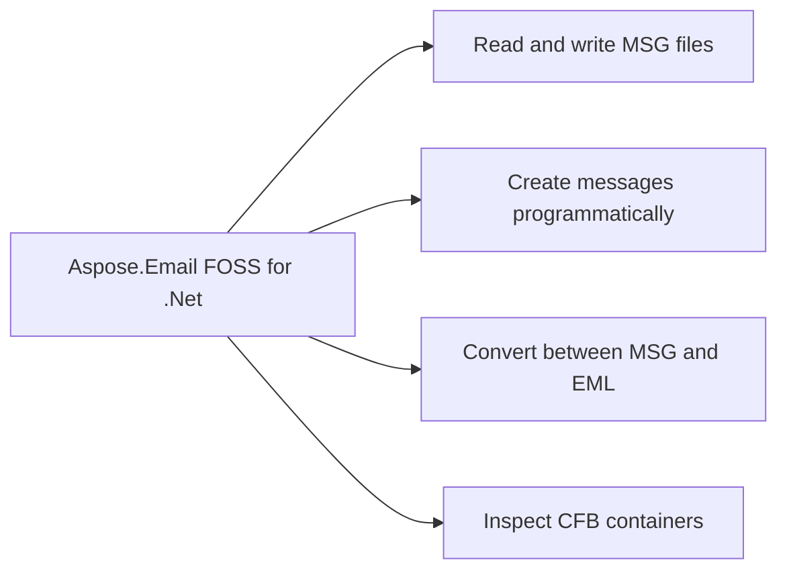

# Aspose.Email FOSS for .Net

[](https://www.nuget.org/packages/Aspose.Email.Foss/)  [](LICENSE) [](https://github.com/aspose-email-foss/Aspose.Email-FOSS-for-.Net/graphs/contributors)

[](https://products.aspose.org/email/net/)

Aspose.Email FOSS for .Net reads and writes MSG files using the `MapiMessage` class, and converts between MSG and EML formats. It reads CFB containers using the `CfbReader` class to inspect structured storage. It creates new messages, adds recipients, attachments, and properties, and saves them to streams or files. It loads existing messages from streams or files and exposes their properties, recipients, and attachments for inspection and modification.

## Navigation

- [At a Glance](#at-a-glance)
- [Key Capabilities](#key-capabilities)
- [Installation](#installation)
- [Dependencies](#dependencies)
- [Quick Start](#quick-start)
- [Additional Examples](#additional-examples)
- [API Reference](#api-reference)
- [Documentation & Resources](#documentation--resources)
- [Scope and Limitations](#scope-and-limitations)
- [Development and Testing](#development-and-testing)
- [License](#license)

## At a Glance



## Key Capabilities

- **Read and write MSG files.** It reads MSG files from streams or files using `MapiMessage.FromStream` or `MapiMessage.FromFile`, and writes them back to streams or files using `MapiMessage.Save`, preserving the original MAPI structure and metadata.
- **Create messages programmatically.** It creates new messages from scratch using `MapiMessage.Create`, then populates sender information, recipients, and attachments before saving the complete message to a file or stream.
- **Convert between MSG and EML.** It converts standard EML files (RFC 5322 / MIME) into `MapiMessage` objects using `MapiMessage.LoadFromEml` and serializes `MapiMessage` instances back to EML format using `MapiMessage.SaveToEml`, without requiring external MIME parsers.
- **Inspect CFB containers.** It inspects Compound File Binary (CFB) containers by loading them via `CfbReader.FromFile` or `CfbReader.FromStream`, then traverses the internal directory tree and accesses streams and storages using `IterTree`, `IterStreams`, and `IterStorages`.
- **Access arbitrary MAPI properties.** It accesses arbitrary MAPI properties beyond the strongly-typed members exposed by `MapiMessage` using `SetProperty` and `GetPropertyValue`, enabling full control over custom or extended properties stored in MSG files.
- **Attach recipients and files.** It attaches recipients using `AddRecipient` with To, Cc, and Bcc types, and attaches files or embedded messages using `AddAttachment` and `AddEmbeddedMessageAttachment`, supporting multiple attachment methods such as by value, embedded, or storage.

## Installation

Install the published package from NuGet (`Aspose.Email.Foss`, version 26.7.0):

```bash
dotnet add package Aspose.Email.Foss
```

To work from a source checkout instead, build the clone with dotnet build:

```bash
git clone https://github.com/aspose-email-foss/Aspose.Email-FOSS-for-.Net.git
cd Aspose.Email-FOSS-for-.Net
dotnet build
```

## Dependencies

### Required Package Dependencies

No required third-party package dependencies; in `src/Aspose.Email.Foss/Aspose.Email.Foss.csproj`, no `PackageReference` a consumer would install is declared.

### Native and System Requirements

- Requires .NET `net8.0` (`TargetFramework` in `src/Aspose.Email.Foss/Aspose.Email.Foss.csproj`).

## Quick Start

This example reads a MSG file and prints its subject line using `Aspose.Email.Foss` version 26.7.0 targeting net8.0.

```csharp
using System.IO;
using Aspose.Email.Foss.Msg;

using var stream = File.OpenRead("sample.msg");
var message = MapiMessage.FromStream(stream);
Console.WriteLine(message.Subject);
```

## Additional Examples

The following examples demonstrate creating and saving MSG messages, converting EML to MSG, and inspecting CFB container structures.

### Convert an EML File to MSG and Back to EML

```csharp
using System.IO;
using Aspose.Email.Foss.Msg;

using var input = File.OpenRead("message.eml");
var message = MapiMessage.LoadFromEml(input);
using var msgOutput = File.Create("message.msg");
message.Save(msgOutput);
using var emlOutput = File.Create("roundtrip.eml");
message.SaveToEml(emlOutput);
```

<details>
<summary>View Additional Examples</summary>

### Create and Save an MSG Message with Sender, Recipient, and Attachment

```csharp
using System.IO;
using Aspose.Email.Foss.Msg;

var message = MapiMessage.Create("Hello", "Body");
message.SenderName = "Alice";
message.SenderEmailAddress = "alice@example.com";
message.AddRecipient("bob@example.com", "Bob");
using var attachmentStream = new MemoryStream("abc"u8.ToArray());
message.AddAttachment("note.txt", attachmentStream, "text/plain");
using var output = File.Create("hello.msg");
message.Save(output);
```

### Inspect the CFB Container Structure of a MSG File

```csharp
using Aspose.Email.Foss.Cfb;

using var cfb = CfbReader.FromFile("sample.msg");
Console.WriteLine($"Sector size: {cfb.SectorSize}");
Console.WriteLine($"Directory entries: {cfb.DirectoryEntryCount}");

foreach (var (depth, entry) in cfb.IterTree())
{
    Console.WriteLine(new string(' ', depth * 2) + entry.Name);
}
```

</details>

## API Reference

Aspose.Email FOSS for .Net exposes `Aspose.Email.Foss.Msg.MapiMessage` as the high-level entry point for creating, editing, and converting messages, while `Aspose.Email.Foss.Cfb.CfbReader`, `Aspose.Email.Foss.Cfb.CfbWriter`, `Aspose.Email.Foss.Msg.MsgReader`, and `Aspose.Email.Foss.Msg.MsgWriter` provide lower-level access to the underlying CFB and MSG structures.

The verified public surface has 29 types.

<details>
<summary>View the Complete Public API Surface</summary>

### Core API

| Class | Description |
| --- | --- |
| `CfbConstants` | CfbConstants provides constant values used in Compound File Binary format processing. |
| `CfbDocument` | CfbDocument represents a Compound File Binary structure and provides methods to load it from files, streams, or readers. |
| `CfbException` | CfbException represents errors that occur during Compound File Binary format processing. |
| `CfbNode` | CfbNode represents a node in a Compound File Binary structure with properties such as name, class identifier, timestamps, and state bits. |
| `CfbReader` | CfbReader provides functionality to read and navigate a Compound File Binary structure, including accessing directory entries, streams, and storage nodes. |
| `CfbStorage` | CfbStorage represents a storage node in a Compound File Binary structure that can contain child storages and streams. |
| `CfbStream` | CfbStream represents a stream node in a Compound File Binary structure that holds binary data. |
| `CfbWriter` | CfbWriter provides functionality to write a Compound File Binary structure. |
| `DirectoryEntry` | DirectoryEntry represents an entry in the directory of a Compound File Binary structure. |
| `DirectoryEntryNameComparer` | DirectoryEntryNameComparer provides a comparer for directory entries based on their names. |
| `Header` | Header represents the header information of a Compound File Binary structure. |
| `MapiAttachment` | MapiAttachment represents an attachment in a MAPI message. |
| `MapiMessage` | MapiMessage represents a MAPI message and provides access to its properties, recipients, and attachments. |
| `MapiProperty` | MapiProperty represents a single property in a MAPI message. |
| `MapiPropertyCollection` | MapiPropertyCollection represents a collection of MAPI properties. |
| `MapiRecipient` | MapiRecipient represents a recipient in a MAPI message. |
| `MsgConstants` | MsgConstants provides constant values used in MSG format processing. |
| `MsgDocument` | MsgDocument represents an MSG format file and provides methods to load it from files, streams, or readers. |
| `MsgException` | MsgException represents errors that occur during MSG format processing. |
| `MsgReader` | MsgReader provides functionality to read and navigate an MSG format file. |
| `MsgStorage` | MsgStorage represents a storage node in an MSG format file. |
| `MsgStream` | MsgStream represents a stream node in an MSG format file. |
| `MsgWriter` | MsgWriter provides functionality to write an MSG format file. |

#### Enumerations

| Enumeration | Description |
| --- | --- |
| `DirectoryColorFlag` | Stores the red-black tree color used by directory sibling links. |
| `DirectoryObjectType` | Classifies the directory entry payload as unallocated, storage, stream, or root storage. |
| `SectorMarker` | Special FAT marker values reserved for sector allocation metadata. |
| `CommonMessagePropertyId` | Common MAPI property identifiers used by the MSG reader and writer for core message semantics, body fields, transport headers, and attachments. |
| `MsgStorageRole` | MsgStorageRole specifies the role of a storage node in an MSG format file. |
| `PropertyTypeCode` | MAPI property type codes that appear in property tags and stream names in MSG files. |

#### Detailed Member Reference

### Foss

The `Aspose.Email.Foss` namespace provides direct access to CFB and MSG formats through `Aspose.Email.Foss.Cfb.CfbReader` for reading structured storage, `Aspose.Email.Foss.Cfb.CfbWriter` for writing it, `Aspose.Email.Foss.Cfb.CfbDocument` for in-memory construction, `Aspose.Email.Foss.Msg.MsgReader` for parsing MSG files, and `Aspose.Email.Foss.Msg.MsgWriter` for serializing MSG documents.

- `CfbReader` (implements `IDisposable`)
  - `FromFile(path)`, `FromStream(stream)`, `CfbReader(data)`
  - `IterStorages()`, `IterStreams()`, `IterChildren(storageStreamId)`, `IterTree(startStreamId = 0)`, `FindChildByName(storageStreamId, name)`, `ResolvePath(names, startStreamId)`
  - `GetEntry(streamId)`, `GetStreamData(streamId)`
  - Properties: `Header`, `Difat`, `Fat`, `MiniFat`, `DirectoryEntries`, `RootEntry`, `MajorVersion`, `SectorSize`, `MiniSectorSize`, `DirectoryEntryCount`, `FileSize`

- `CfbWriter` (static)
  - `ToBytes(document)`, `WriteFile(document, path)`

- `CfbDocument` / `CfbStorage` / `CfbStream`
  - Build a document in memory with `CfbStorage.AddStorage()`/`AddStream()`, then hand the root `CfbDocument` to `CfbWriter`.

- `MsgReader` (implements `IDisposable`)
  - `FromFile(path, strict)`, `FromStream(stream, strict)`
  - `ValidationIssues: IReadOnlyList<string>`

- `MsgWriter` (static)
  - `ToBytes(document)`, `WriteFile(document, path)`

- `MsgDocument`
  - `FromFile(path, strict)`, `FromStream(stream, strict)`, `ToCfbDocument()`
  - `Root: MsgStorage`

- `MsgStorage`
  - `AddStream(stream)`, `AddStorage(storage)`, `FindStream(name)`, `FindStorage(name)`
  - Properties: `Role: MsgStorageRole`, `Streams: IList<MsgStream>`, `Storages: IList<MsgStorage>`

- `MapiMessage` (implements `IDisposable`)
  - `Create(subject, body, unicodeStrings)`, `FromFile(path, strict)`, `FromStream(stream, strict)`, `FromMsgDocument(document)`
  - `LoadFromEml(path)` / `LoadFromEml(stream)` / `LoadFromEml(data)`
  - `Save()`, `Save(path)`, `Save(stream)`
  - `SaveToEml()`, `SaveToEml(path)`, `SaveToEml(stream)`
  - `AddRecipient(emailAddress, displayName, recipientType)`, `AddAttachment(filename, data, mimeType, contentId)`, `AddAttachment(filename, stream, mimeType, contentId)`, `AddEmbeddedMessageAttachment(message, filename, mimeType)`
  - `SetProperty(propertyId, propertyType, value, flags)`, `GetPropertyValue(propertyId, propertyType, decode)`, `IterProperties()`, `IterPropertyKeys()`
  - Properties: `Subject`, `Body`, `HtmlBody`, `SenderName`, `SenderEmailAddress`, `MessageClass`, `InternetMessageId`, `MessageDeliveryTime`, `Recipients`, `Attachments`, `ValidationIssues`

- `MapiAttachment`
  - `FromBytes(filename, data, mimeType, contentId)`, `FromStream(filename, stream, mimeType, contentId)`, `OpenRead()`
  - Properties: `Filename`, `Data`, `MimeType`, `ContentId`, `IsEmbeddedMessage`, `EmbeddedMessage: MapiMessage?`

- `MapiPropertyCollection`
  - `Set(property)`, `Add(propertyId, propertyType, value, flags)`, `Get(propertyId, propertyType)`, `Remove(propertyId, propertyType)`, `IterProperties()`

</details>

## Documentation & Resources

- **[Getting started guide](https://docs.aspose.org/email/net/)** — The getting started guide covers installation, walkthroughs, and feature guides for this library.
- **[How-to guides & FAQ](https://kb.aspose.org/email/net/)** — The how-to guides and FAQ provide task-focused answers for common MSG, CFB, and EML questions.
- **[Full API reference](https://reference.aspose.org/email/net/)** — The full API reference offers the complete, browsable reference for all 29 public types. It covers all 29 verified public types; the [API Reference](#api-reference) section above covers the essentials.
- **[Public API summary](PUBLIC_API.md)** — The public API summary lists the repository's own stable-namespace and primary-type list.
- **[Changelog](CHANGELOG.md)** — The changelog documents the release history.
- Found a bug or have a feature request? [Open an issue](https://github.com/aspose-email-foss/Aspose.Email-FOSS-for-.Net/issues).

## Scope and Limitations

Aspose.Email FOSS for .Net reads and writes local email files in formats supported by the library, including EML, MSG, MHTML, and OST, and converts between them; it is a file-based library for .NET 8.0 and later with no network protocol or server connectivity.

- It does not support IMAP, SMTP, or POP3 and does not connect to mail servers, as stated in the inherited list of limitations.
- It does not parse or generate Transport Neutral Encapsulation Format files (`winmail.dat`), as stated in the inherited list of limitations.
- It does not provide a dedicated calendar or appointment API, though calendar-specific MAPI properties can be accessed generically via `SetProperty` and `GetPropertyValue`, as stated in the inherited list of limitations.
- It requires .NET 8.0 or later and does not support classic .NET Framework 4.x, as stated in the inherited list of limitations.

These limitations don't apply to [full-featured Aspose.Email for .Net — Enterprise Edition](https://products.aspose.com/email/net/). It adds broader format and protocol coverage: direct IMAP/SMTP/POP3 mail-server connectivity, TNEF (winmail.dat) support, calendar and appointment APIs, and classic .NET Framework support alongside this edition's MSG, CFB, and EML processing.

## Development and Testing

Aspose.Email FOSS for .Net targets net8.0 and is built using the dotnet CLI. The test project at `tests/Aspose.Email.Foss.Tests/Aspose.Email.Foss.Tests.csproj` uses Microsoft.NET.Test.Sdk 17.8.0, xunit 2.5.3, and xunit.runner.visualstudio 2.5.3 for the xUnit test host and adapter, along with coverlet.collector 6.0.0 for code-coverage collection; none of these dependencies are referenced by the main library project and they are never shipped with the published package. The test suite asserts CFB round-trips, MSG reading, and EML round-trip conversion through CfbRoundTripTests, MsgReaderTests, MapiMessageTests, MapiMessageEmlTests, and MetadataSmokeTests. Runnable example programs including `create_msg_and_eml.cs`, `msg_reader.cs`, and `msg_summary.cs` reside under examples/ and each has its own project file.

The suite covers 5 test files under `tests/`.

```xml
<PackageReference Include="Aspose.Email.Foss" Version="26.7.0" />
```

Clone the repository and run the xUnit test suite:

```bash
git clone https://github.com/aspose-email-foss/Aspose.Email-FOSS-for-.Net.git
cd Aspose.Email-FOSS-for-.Net
dotnet build src/Aspose.Email.Foss/Aspose.Email.Foss.csproj -c Release
dotnet test tests/Aspose.Email.Foss.Tests/Aspose.Email.Foss.Tests.csproj
```

Three runnable example programs — `create_msg_and_eml.cs`, `msg_reader.cs`,
and `msg_summary.cs` — live under [`examples/`](examples/), each with its own project file and
listed in [examples/README.md](examples/README.md); run one directly, for example:

```bash
dotnet run --project examples/create_msg_and_eml/create_msg_and_eml.csproj
```

## License

This project is licensed under the [MIT License](LICENSE). The MIT License permits use, copying, modification, distribution, sublicensing, and commercial use, provided its copyright and permission notice are retained. The software is provided without warranty.
