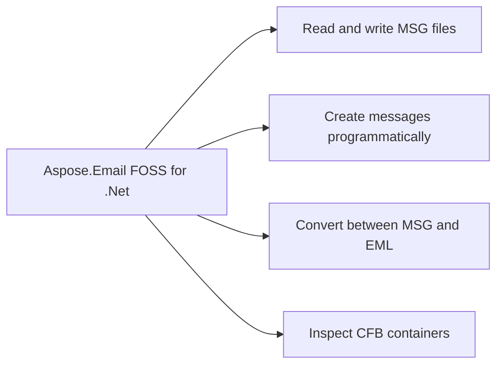

# Aspose.Email FOSS for .Net

[](https://www.nuget.org/packages/Aspose.Email.Foss/)  [](LICENSE) [](https://github.com/aspose-email-foss/Aspose.Email-FOSS-for-.Net/graphs/contributors)

[](https://products.aspose.org/email/net/)

Aspose.Email FOSS for .Net reads and writes CFB containers and MSG documents. It converts between EML and MSG formats through a built-in MIME implementation. It supports high-level message creation, editing, and property access, and provides low-level access to CFB structure.

Aspose.Email FOSS for .Net is a free, open source email library for .NET — a C# toolkit for
deterministic binary and message processing: reading, creating, and inspecting Outlook `.msg`
files, Compound File Binary (CFB) containers, and EML message data. It ships with no required
third-party package dependencies and needs no Microsoft Outlook installation, making it a
lightweight fit for services, desktop tools, and command-line utilities that work with mailbox
data directly.

## Navigation

- [At a Glance](#at-a-glance)
- [Key Capabilities](#key-capabilities)
- [Installation](#installation)
- [Dependencies](#dependencies)
- [Quick Start](#quick-start)
- [Additional Examples](#additional-examples)
- [API Reference](#api-reference)
- [Documentation & Resources](#documentation--resources)
- [Scope and Limitations](#scope-and-limitations)
- [Development and Testing](#development-and-testing)
- [License](#license)

## At a Glance



## Key Capabilities

- **Read and write MSG files.** It reads MSG files from streams or files using `MapiMessage.FromStream` and writes them back with Save, preserving MAPI structure and metadata.
- **Create messages programmatically.** It creates new messages with `MapiMessage.Create`, sets sender and recipient details, attaches files via streams, and saves the result as a complete MSG file.
- **Convert between MSG and EML.** It converts EML files to MSG using `MapiMessage.LoadFromEml` and writes them back to EML format with `SaveToEml`, using native parsing without external dependencies.
- **Inspect CFB containers.** It opens CFB containers from files with `CfbReader.FromFile`, reports sector size and directory entry count, and iterates the internal tree structure depth-first.
- **Access MAPI properties.** It reads and writes arbitrary MAPI properties on messages using `SetProperty` and `GetPropertyValue`, beyond the strongly-typed properties exposed directly by `MapiMessage`.
- **Attach recipients and files.** It adds recipients with `AddRecipient` and attaches files or embedded messages using `AddAttachment` and `AddEmbeddedMessageAttachment`, supporting in-memory streams.
- **Validate message structure.** It exposes a read-only `ValidationIssues` list on loaded messages and MSG documents to report structural anomalies encountered during strict parsing.
- **Build CFB containers.** It builds CFB containers programmatically using `CfbDocument`, `CfbStorage`, and `CfbStream`, then serializes them to files or byte arrays with `CfbWriter.WriteFile` or `CfbWriter.ToBytes`.

- **Open and traverse CFB containers** from a file, stream, or byte array via `CfbReader.FromFile()`, `CfbReader.FromStream()`, or `new CfbReader(data)`, then walk the directory tree with `IterStorages()`, `IterStreams()`, `IterChildren()`, and `IterTree()`.
- **Create, edit, save, and reload complete, high-level mutable message objects** through `MapiMessage`: set `Subject`, `Body`, `HtmlBody`, `SenderName`, and `SenderEmailAddress`, then persist with `Save()` and reload with `FromFile()` or `FromStream()` — a free .NET API for building and processing email messages entirely in memory.

## Installation

Install the published package from NuGet (`Aspose.Email.Foss`, version 26.7.0):

```bash
dotnet add package Aspose.Email.Foss
```

## Dependencies

### Required Package Dependencies

No required third-party package dependencies; in `src/Aspose.Email.Foss/Aspose.Email.Foss.csproj`, no `PackageReference` a consumer would install is declared.

### Native and System Requirements

- Requires .NET `net8.0` (`TargetFramework` in `src/Aspose.Email.Foss/Aspose.Email.Foss.csproj`).

## Quick Start

The first example reads a MSG file and prints its subject line using `Aspose.Email.Foss` version 26.7.0 for net8.0.

```csharp
using System.IO;
using Aspose.Email.Foss.Msg;

using var stream = File.OpenRead("sample.msg");
var message = MapiMessage.FromStream(stream);
Console.WriteLine(message.Subject);
```

The second example creates a new MSG file with a sender, recipient, attachment, and body, then saves it to disk using `Aspose.Email.Foss` version 26.7.0 for net8.0.

```csharp
using System.IO;
using Aspose.Email.Foss.Msg;

var message = MapiMessage.Create("Hello", "Body");
message.SenderName = "Alice";
message.SenderEmailAddress = "alice@example.com";
message.AddRecipient("bob@example.com", "Bob");
using var attachmentStream = new MemoryStream("abc"u8.ToArray());
message.AddAttachment("note.txt", attachmentStream, "text/plain");
using var output = File.Create("hello.msg");
message.Save(output);
```

## Additional Examples

Additional workflows demonstrate converting EML to MSG and inspecting the CFB structure of MSG files.

### Convert an EML File to MSG and Back to EML Using Aspose.Email FOSS for .Net

```csharp
using System.IO;
using Aspose.Email.Foss.Msg;

using var input = File.OpenRead("message.eml");
var message = MapiMessage.LoadFromEml(input);
using var msgOutput = File.Create("message.msg");
message.Save(msgOutput);
using var emlOutput = File.Create("roundtrip.eml");
message.SaveToEml(emlOutput);
```

<details>
<summary>View Additional Examples</summary>

### Inspect the CFB Container Structure of an MSG File Using Aspose.Email FOSS for .Net

```csharp
using Aspose.Email.Foss.Cfb;

using var cfb = CfbReader.FromFile("sample.msg");
Console.WriteLine($"Sector size: {cfb.SectorSize}");
Console.WriteLine($"Directory entries: {cfb.DirectoryEntryCount}");

foreach (var (depth, entry) in cfb.IterTree())
{
    Console.WriteLine(new string(' ', depth * 2) + entry.Name);
}
```

A few more real, runnable patterns beyond the Quick Start example above.

</details>

## API Reference

Aspose.Email FOSS for .Net provides high-level message handling through `MapiMessage` and low-level CFB container access through `CfbReader`. `MapiMessage` serves as the primary entry point for creating, editing, and converting messages, while `CfbReader` enables direct inspection and manipulation of the underlying structured storage format.

The verified public surface has 29 types.

<details>
<summary>View the Complete Public API Surface</summary>

### Core API

| Class | Description |
| --- | --- |
| `CfbConstants` | Aspose.Email.Foss.Cfb.CfbConstants is a public symbol that exposes the constants ByteOrderLittleEndian, MAXREGSECT, MAXREGSID, MiniStreamCutoffSize, NOSTREAM, RootEntryName, and RootStreamId. |
| `CfbDocument` | Aspose.Email.Foss.Cfb.CfbDocument is a public symbol that exposes the constructors CfbDocument, FromFile, FromReader, FromStream, and the properties MajorVersion, MinorVersion, Root, and TransactionSignatureNumber. |
| `CfbException` | Aspose.Email.Foss.Cfb.CfbException is a public symbol that exposes the constructor CfbException. |
| `CfbNode` | Aspose.Email.Foss.Cfb.CfbNode is a public symbol that exposes the properties Clsid, CreationTime, ModifiedTime, Name, and StateBits. |
| `CfbReader` | Aspose.Email.Foss.Cfb.CfbReader is a public symbol that exposes the constructors CfbReader, FromFile, FromStream, and the properties Difat, DirectoryEntries, DirectoryEntryCount, Fat, FileSize, Header, MajorVersion, MaterializedStreamCount, MiniFat, MiniSectorSize, MiniStream, RootEntry, SectorSize, and the methods FindChildByName, Dispose, GetEntry, and GetStreamData; CfbReader.CfbReader throws ArgumentNullException (conditionally), CfbReader.GetEntry throws CfbException (conditionally), and CfbReader.GetStreamData throws CfbException (conditionally). |
| `CfbStorage` | Aspose.Email.Foss.Cfb.CfbStorage is a public symbol that exposes the constructor CfbStorage, the properties Clsid, CreationTime, ModifiedTime, Name, and the methods AddStorage, AddStream, and Children. |
| `CfbStream` | Aspose.Email.Foss.Cfb.CfbStream is a public symbol that exposes the constructor CfbStream and the properties Clsid, CreationTime, Data, ModifiedTime, Name, and StateBits. |
| `CfbWriter` | Aspose.Email.Foss.Cfb.CfbWriter is a public symbol that exposes the methods ToBytes and WriteFile. |
| `DirectoryEntry` | Aspose.Email.Foss.Cfb.DirectoryEntry is a public symbol that exposes the properties IsRoot, IsStorage, and IsStream. |
| `DirectoryEntryNameComparer` | Aspose.Email.Foss.Cfb.DirectoryEntryNameComparer is a public symbol that exposes the method Compare. |
| `Header` | Aspose.Email.Foss.Cfb.Header is a public symbol that exposes the properties MiniSectorSize and SectorSize. |
| `MapiAttachment` | Aspose.Email.Foss.Msg.MapiAttachment is a public symbol that exposes the properties ContentId, Data, EmbeddedMessage, Filename, IsEmbeddedMessage, and IsStorageAttachment, and the methods FromBytes and FromStream. |
| `MapiMessage` | Aspose.Email.Foss.Msg.MapiMessage is a public symbol that exposes the properties Attachments and Body, and the methods AddAttachment, AddEmbeddedMessageAttachment, AddRecipient, AttachMethodByValue, AttachMethodEmbedded, and AttachMethodStorage. |
| `MapiProperty` | Aspose.Email.Foss.Msg.MapiProperty is a public symbol that exposes the constructor MapiProperty and the properties Flags, PropertyId, PropertyTag, PropertyType, and Value. |
| `MapiPropertyCollection` | Aspose.Email.Foss.Msg.MapiPropertyCollection is a public symbol that exposes the methods Add, Get, IterProperties, Remove, and Set. |
| `MapiRecipient` | Aspose.Email.Foss.Msg.MapiRecipient is a public symbol that exposes the properties AddressType, DisplayName, EmailAddress, Properties, and RecipientType. |
| `MsgConstants` | Aspose.Email.Foss.Msg.MsgConstants is a public symbol that exposes the constants AttachmentStoragePrefix, EmbeddedMessageStorageName, MaxAttachmentStorages, MaxRecipientStorages, NamedPropertyMappingStorageName, PROPATTR_MANDATORY, PROPATTR_READABLE, and PROPATTR_WRITABLE. |
| `MsgDocument` | Aspose.Email.Foss.Msg.MsgDocument is a public symbol that exposes the constructor MsgDocument, the properties MajorVersion, MinorVersion, Root, Strict, and the methods FromFile, FromStream, and ToCfbDocument; MsgDocument.MsgDocument throws ArgumentNullException (conditionally). |
| `MsgException` | Aspose.Email.Foss.Msg.MsgException is a public symbol that exposes the constructor MsgException. |
| `MsgReader` | Aspose.Email.Foss.Msg.MsgReader is a public symbol that exposes the methods Dispose, FromFile, FromStream, and the property ValidationIssues. |
| `MsgStorage` | Aspose.Email.Foss.Msg.MsgStorage is a public symbol that exposes the constructor MsgStorage, the properties Clsid, CreationTime, ModifiedTime, and the methods AddStorage, AddStream, FindStorage, and FindStream; MsgStorage.MsgStorage throws ArgumentNullException (conditionally). |
| `MsgStream` | Aspose.Email.Foss.Msg.MsgStream is a public symbol that exposes the constructor MsgStream and the properties Clsid, CreationTime, Data, ModifiedTime, Name, and StateBits; MsgStream.MsgStream throws ArgumentNullException (conditionally). |
| `MsgWriter` | Aspose.Email.Foss.Msg.MsgWriter is a public symbol that exposes the methods ToBytes and WriteFile. |

#### Enumerations

| Enumeration | Description |
| --- | --- |
| `DirectoryColorFlag` | Stores the red-black tree color used by directory sibling links. |
| `DirectoryObjectType` | Classifies the directory entry payload as unallocated, storage, stream, or root storage. |
| `SectorMarker` | Special FAT marker values reserved for sector allocation metadata. |
| `CommonMessagePropertyId` | Common MAPI property identifiers used by the MSG reader and writer for core message semantics, body fields, transport headers, and attachments. |
| `MsgStorageRole` | Aspose.Email.Foss.Msg.MsgStorageRole is a public symbol. |
| `PropertyTypeCode` | MAPI property type codes that appear in property tags and stream names in MSG files. |

#### Detailed Member Reference

### Foss

The `Aspose.Email.Foss` package exposes `MapiMessage` for high-level message operations and `CfbReader` for low-level CFB container inspection, with `MapiMessage` built on top of the lower-level `CfbReader` and `MsgReader` APIs.

`MapiMessage` is the primary high-level entry point for creating, editing, and converting
messages; `CfbReader`/`CfbWriter` and `MsgReader`/`MsgWriter`/`MsgDocument` provide direct,
lower-level access to the `Aspose.Email.Foss.Cfb` and `Aspose.Email.Foss.Msg` namespaces the
high-level API is built on. The public surface spans 29 classes and enumerations in a single
module, summarized below.

| Class | Description |
|---|---|
| `CfbConstants` | CfbConstants.ByteOrderLittleEndian identifies little-endian integer encoding in CFB files. |
| `CfbDocument` | CfbDocument can be instantiated directly, or created from existing data using CfbDocument.FromFile(path), FromStream(stream), or FromReader(reader). |
| `CfbException` | CfbException.CfbException creates an exception instance containing the provided error message. |
| `CfbNode` | CfbNode provides metadata for each entry in a CFB container, including Name, Clsid, CreationTime, and ModifiedTime. |
| `CfbReader` | CfbReader.FromFile(path) opens a CFB file and provides access to its header, FAT, MiniFAT, and directory entries via properties such as MajorVersion and SectorSize. |
| `CfbStorage` | CfbStorage.CfbStorage initializes a new storage node with the specified name. |
| `CfbStream` | CfbStream.CfbStream creates a new CfbStream with the specified name and optional byte array data. |
| `CfbWriter` | CfbWriter.WriteFile(document, path) serializes a CfbDocument to a file, while ToBytes(document) returns the binary representation as a byte array. |
| `DirectoryEntry` | DirectoryEntry methods IsStorage(), IsStream(), and IsRoot() let developers determine the type of a directory entry when traversing a CFB structure. |
| `DirectoryEntryNameComparer` | DirectoryEntryNameComparer.Compare compares two name strings and returns an int indicating sort order. |
| `Header` | Header.SectorSize represents the size of a regular sector in bytes. |
| `MapiAttachment` | MapiAttachment.FromBytes(filename, data, mimeType, contentId) creates an attachment object that can be added to a message; its properties Filename, MimeType, and Data expose the attachment metadata and content. |
| `MapiMessage` | MapiMessage.Create(subject, body, unicodeStrings) constructs a new mutable message with the given subject and body. |
| `MapiProperty` | MapiProperty.MapiProperty constructs a property with given id, type, value, and flags. |
| `MapiPropertyCollection` | MapiPropertyCollection.Set(property:MapiProperty) adds or updates the specified MapiProperty in the collection. |
| `MapiRecipient` | MapiRecipient.DisplayName gets or sets the recipient's display name. |
| `MsgConstants` | MsgConstants.PropertyStreamName provides the standard name of the top‑level property stream used in MSG files. |
| `MsgDocument` | MsgDocument.FromFile(path, strict) loads an MSG file into a MsgDocument object for inspection or modification. |
| `MsgException` | MsgException.MsgException creates a new exception with the given message. |
| `MsgReader` | MsgReader.FromFile(path, strict) creates a MsgReader that reads an Outlook MSG file from the specified file path. |
| `MsgStorage` | MsgStorage.AddStream(stream) adds a MsgStream to the storage, allowing custom binary data to be embedded in the MSG file. |
| `MsgStream` | MsgStream.MsgStream initializes a new stream with a name and optional data bytes. |
| `MsgWriter` | MsgWriter.WriteFile(document, path) writes a MsgDocument to the given file path in MSG format. |

- `CfbReader` (implements `IDisposable`)
  - `FromFile(path)`, `FromStream(stream)`, `CfbReader(data)`
  - `IterStorages()`, `IterStreams()`, `IterChildren(storageStreamId)`, `IterTree(startStreamId = 0)`, `FindChildByName(storageStreamId, name)`, `ResolvePath(names, startStreamId)`
  - `GetEntry(streamId)`, `GetStreamData(streamId)`
  - Properties: `Header`, `Difat`, `Fat`, `MiniFat`, `DirectoryEntries`, `RootEntry`, `MajorVersion`, `SectorSize`, `MiniSectorSize`, `DirectoryEntryCount`, `FileSize`

- `CfbWriter` (static)
  - `ToBytes(document)`, `WriteFile(document, path)`

- `CfbDocument` / `CfbStorage` / `CfbStream`
  - Build a document in memory with `CfbStorage.AddStorage()`/`AddStream()`, then hand the root `CfbDocument` to `CfbWriter`.

- `MsgReader` (implements `IDisposable`)
  - `FromFile(path, strict)`, `FromStream(stream, strict)`
  - `ValidationIssues: IReadOnlyList<string>`

- `MsgWriter` (static)
  - `ToBytes(document)`, `WriteFile(document, path)`

- `MsgDocument`
  - `FromFile(path, strict)`, `FromStream(stream, strict)`, `ToCfbDocument()`
  - `Root: MsgStorage`

- `MsgStorage`
  - `AddStream(stream)`, `AddStorage(storage)`, `FindStream(name)`, `FindStorage(name)`
  - Properties: `Role: MsgStorageRole`, `Streams: IList<MsgStream>`, `Storages: IList<MsgStorage>`

- `MapiMessage` (implements `IDisposable`)
  - `Create(subject, body, unicodeStrings)`, `FromFile(path, strict)`, `FromStream(stream, strict)`, `FromMsgDocument(document)`
  - `LoadFromEml(path)` / `LoadFromEml(stream)` / `LoadFromEml(data)`
  - `Save()`, `Save(path)`, `Save(stream)`
  - `SaveToEml()`, `SaveToEml(path)`, `SaveToEml(stream)`
  - `AddRecipient(emailAddress, displayName, recipientType)`, `AddAttachment(filename, data, mimeType, contentId)`, `AddAttachment(filename, stream, mimeType, contentId)`, `AddEmbeddedMessageAttachment(message, filename, mimeType)`
  - `SetProperty(propertyId, propertyType, value, flags)`, `GetPropertyValue(propertyId, propertyType, decode)`, `IterProperties()`, `IterPropertyKeys()`
  - Properties: `Subject`, `Body`, `HtmlBody`, `SenderName`, `SenderEmailAddress`, `MessageClass`, `InternetMessageId`, `MessageDeliveryTime`, `Recipients`, `Attachments`, `ValidationIssues`

- `MapiAttachment`
  - `FromBytes(filename, data, mimeType, contentId)`, `FromStream(filename, stream, mimeType, contentId)`, `OpenRead()`
  - Properties: `Filename`, `Data`, `MimeType`, `ContentId`, `IsEmbeddedMessage`, `EmbeddedMessage: MapiMessage?`

- `MapiPropertyCollection`
  - `Set(property)`, `Add(propertyId, propertyType, value, flags)`, `Get(propertyId, propertyType)`, `Remove(propertyId, propertyType)`, `IterProperties()`

</details>

## Documentation & Resources

- **[Documentation & Resources](#documentation--resources)** — Documentation & Resources provides links to the public API summary, changelog, and issue tracker for Aspose.Email FOSS for .Net.
- **[Public API summary](PUBLIC_API.md)** — The public API summary in `PUBLIC_API.md` lists the namespaces and classes exposed by Aspose.Email FOSS for .Net.
- **[Changelog](CHANGELOG.md)** — The changelog in `CHANGELOG.md` records version-specific changes and improvements for Aspose.Email FOSS for .Net.
- Found a bug or have a feature request? [Open an issue](https://github.com/aspose-email-foss/Aspose.Email-FOSS-for-.Net/issues).

## Scope and Limitations

Aspose.Email FOSS for .Net reads and writes local email files in MSG, EML, and CFB formats; it does not connect to mail servers and provides no dedicated IMAP, SMTP, or POP3 functionality.

- The library does not support IMAP, SMTP, or POP3 protocols and works only with local files, so it cannot connect to mail servers.
- Transport Neutral Encapsulation Format files (`winmail.dat`) are not parsed or generated.
- Calendar or appointment support is not provided; calendar-specific MAPI properties can be accessed generically via `SetProperty()` or `GetPropertyValue()` but there is no dedicated calendar API.
- The library requires .NET 8.0 or later and does not support classic .NET Framework (4.x).

- **[Getting started guide](https://docs.aspose.org/email/net/)** — installation, walkthroughs, and feature guides for this library.
- **[How-to guides & FAQ](https://kb.aspose.org/email/net/)** — task-focused answers for common MSG, CFB, and EML questions.
- **[Full API reference](https://reference.aspose.org/email/net/)** — the complete, browsable reference for all 29 public types (the [API reference](#api-reference) section above covers the essentials).
- **[Public API summary](PUBLIC_API.md)** — the repository's own stable-namespace and primary-type list.
- **[Changelog](CHANGELOG.md)** — release history.
- Found a bug or have a feature request? [Open an issue](https://github.com/aspose-email-foss/Aspose.Email-FOSS-for-.Net/issues) on GitHub.

These limitations don't apply to [full-featured Aspose.Email for .Net — Enterprise Edition](https://products.aspose.com/email/net/). It adds broader format and protocol coverage: direct IMAP/SMTP/POP3 mail-server connectivity, TNEF (winmail.dat) support, calendar and appointment APIs, and classic .NET Framework support alongside this edition's MSG, CFB, and EML processing.

## Development and Testing

Aspose.Email FOSS for .Net targets net8.0 and uses the dotnet CLI to build and test from the repository's own assets. The test project at `tests/Aspose.Email.Foss.Tests/Aspose.Email.Foss.Tests.csproj` uses Microsoft.NET.Test.Sdk 17.8.0, xunit 2.5.3, and xunit.runner.visualstudio 2.5.3 for the xUnit test host and adapter, and coverlet.collector 6.0.0 for code-coverage collection; none of these dependencies are referenced by the main library project and they are never shipped with the published package. The test suite covers CFB round-trips, MSG reading, and EML round-trip conversion, with runnable example programs under examples/ that each have their own project file and are documented in `examples/README.md`.

The suite covers 5 test files under `tests/`.

The published NuGet package ID is `Aspose.Email.Foss` (confirmed against the library's own
`.csproj`, which is what NuGet actually built and published from):

Or add it directly to a project file:

The library targets .NET 8.0 or later and runs on Windows, Linux, macOS, Docker containers, and
serverless functions — see [Dependencies](#dependencies) below for the full required, native, and
development-only breakdown.

The published `Aspose.Email.Foss` package builds
from `src/Aspose.Email.Foss/Aspose.Email.Foss.csproj`, which declares zero `<PackageReference>`
entries — CFB, MSG, and EML/MIME handling are all implemented natively within the library.

Clone the repository and run the xUnit test suite:

```bash
git clone https://github.com/aspose-email-foss/Aspose.Email-FOSS-for-.Net.git
cd Aspose.Email-FOSS-for-.Net
dotnet build src/Aspose.Email.Foss/Aspose.Email.Foss.csproj -c Release
dotnet test tests/Aspose.Email.Foss.Tests/Aspose.Email.Foss.Tests.csproj
```

The test project covers CFB round-trips, MSG reading, and EML round-trip conversion
(`CfbRoundTripTests`, `MsgReaderTests`, `MapiMessageTests`, `MapiMessageEmlTests`,
`MetadataSmokeTests`). Three runnable example programs — `create_msg_and_eml.cs`, `msg_reader.cs`,
and `msg_summary.cs` — live under [`examples/`](examples/), each with its own project file and
listed in [examples/README.md](examples/README.md); run one directly, for example:

```bash
dotnet run --project examples/create_msg_and_eml/create_msg_and_eml.csproj
```

## License

This project is licensed under the [MIT License](LICENSE). The MIT License permits use, copying, modification, distribution, sublicensing, and commercial use, provided its copyright and permission notice are retained. The software is provided without warranty.
