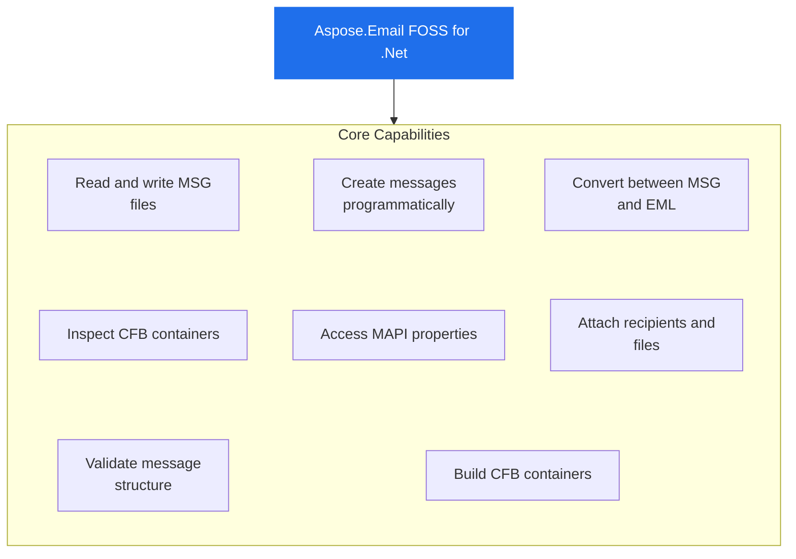

# Aspose.Email FOSS for .Net

[](https://www.nuget.org/packages/Aspose.Email.Foss/)  [](LICENSE) [](https://github.com/aspose-email-foss/Aspose.Email-FOSS-for-.Net/graphs/contributors)

[](https://products.aspose.org/email/net/)

Aspose.Email FOSS for .Net reads and writes CFB containers and MSG documents. It converts between EML and MSG formats through a built-in MIME implementation. It supports high-level message creation, editing, and property access, and provides low-level access to CFB structure.

Aspose.Email FOSS for .Net is a free, open source email library for .NET — a C# toolkit for
deterministic binary and message processing: reading, creating, and inspecting Outlook `.msg`
files, Compound File Binary (CFB) containers, and EML message data. It ships with no required
third-party package dependencies and needs no Microsoft Outlook installation, making it a
lightweight fit for services, desktop tools, and command-line utilities that work with mailbox
data directly.

## Navigation

- [At a Glance](#at-a-glance)
- [Key Capabilities](#key-capabilities)
- [Installation](#installation)
- [Dependencies](#dependencies)
- [Quick Start](#quick-start)
- [Additional Examples](#additional-examples)
- [API Reference](#api-reference)
- [Documentation & Resources](#documentation--resources)
- [Scope and Limitations](#scope-and-limitations)
- [Development and Testing](#development-and-testing)
- [License](#license)

## At a Glance



## Key Capabilities

- **Read and write MSG files.** It reads MSG files from streams or files using `MapiMessage.FromStream` and writes them back with Save, preserving MAPI structure and metadata.
- **Create messages programmatically.** It creates new messages with `MapiMessage.Create`, sets sender and recipient details, attaches files via streams, and saves the result as a complete MSG file.
- **Convert between MSG and EML.** It converts EML files to MSG using `MapiMessage.LoadFromEml` and back to EML using `SaveToEml`, handling MIME parsing and serialization natively without external dependencies.
- **Inspect CFB containers.** It opens CFB containers from files with `CfbReader.FromFile`, exposing sector size, directory entry count, and tree traversal via `IterTree` to inspect internal structure.
- **Access MAPI properties.** It reads and writes arbitrary MAPI properties on messages using `SetProperty` and `GetPropertyValue`, beyond the strongly-typed properties exposed directly by `MapiMessage`.
- **Attach recipients and files.** It adds recipients with `AddRecipient` and attaches files or embedded messages with `AddAttachment` and `AddEmbeddedMessageAttachment`, supporting both external and nested content.
- **Validate message structure.** It populates a read-only `ValidationIssues` list on loaded messages or MSG documents whenever strict parsing encounters structural anomalies.
- **Build CFB containers.** It builds CFB containers programmatically using `CfbDocument`, `CfbStorage`, and `CfbStream`, then serializes them to files or byte arrays with `CfbWriter.WriteFile` or `CfbWriter.ToBytes`.

- **Open and traverse CFB containers** from a file, stream, or byte array via `CfbReader.FromFile()`, `CfbReader.FromStream()`, or `new CfbReader(data)`, then walk the directory tree with `IterStorages()`, `IterStreams()`, `IterChildren()`, and `IterTree()`.
- **Create, edit, save, and reload complete, high-level mutable message objects** through `MapiMessage`: set `Subject`, `Body`, `HtmlBody`, `SenderName`, and `SenderEmailAddress`, then persist with `Save()` and reload with `FromFile()` or `FromStream()` — a free .NET API for building and processing email messages entirely in memory.

## Installation

Install the published package from NuGet (`Aspose.Email.Foss`, version 26.7.0):

```bash
dotnet add package Aspose.Email.Foss
```

## Dependencies

### Required Package Dependencies

No required third-party package dependencies; in `src/Aspose.Email.Foss/Aspose.Email.Foss.csproj`, no `PackageReference` a consumer would install is declared.

### Native and System Requirements

- Requires .NET `net8.0` (`TargetFramework` in `src/Aspose.Email.Foss/Aspose.Email.Foss.csproj`).

## Quick Start

This example reads a MSG file and prints its subject line using `Aspose.Email.Foss` version 26.7.0 for net8.0.

```csharp
using System.IO;
using Aspose.Email.Foss.Msg;

using var stream = File.OpenRead("sample.msg");
var message = MapiMessage.FromStream(stream);
Console.WriteLine(message.Subject);
```

## Additional Examples

The following examples demonstrate creating and saving MSG messages, converting EML to MSG, and inspecting CFB container structures.

### Convert an EML File to MSG and Back to EML

```csharp
using System.IO;
using Aspose.Email.Foss.Msg;

using var input = File.OpenRead("message.eml");
var message = MapiMessage.LoadFromEml(input);
using var msgOutput = File.Create("message.msg");
message.Save(msgOutput);
using var emlOutput = File.Create("roundtrip.eml");
message.SaveToEml(emlOutput);
```

<details>
<summary>View Additional Examples</summary>

### Create and Save an MSG Message with Sender, Recipient, and Attachment

```csharp
using System.IO;
using Aspose.Email.Foss.Msg;

var message = MapiMessage.Create("Hello", "Body");
message.SenderName = "Alice";
message.SenderEmailAddress = "alice@example.com";
message.AddRecipient("bob@example.com", "Bob");
using var attachmentStream = new MemoryStream("abc"u8.ToArray());
message.AddAttachment("note.txt", attachmentStream, "text/plain");
using var output = File.Create("hello.msg");
message.Save(output);
```

### Inspect the CFB Container Structure of an MSG File

```csharp
using Aspose.Email.Foss.Cfb;

using var cfb = CfbReader.FromFile("sample.msg");
Console.WriteLine($"Sector size: {cfb.SectorSize}");
Console.WriteLine($"Directory entries: {cfb.DirectoryEntryCount}");

foreach (var (depth, entry) in cfb.IterTree())
{
    Console.WriteLine(new string(' ', depth * 2) + entry.Name);
}
```

A few more real, runnable patterns beyond the Quick Start example above.

`CfbReader` gives direct access to a `.msg` file's underlying CFB geometry — useful when
diagnosing a damaged or non-standard file, independently of the higher-level MSG or MapiMessage
APIs.

</details>

## API Reference

Aspose.Email FOSS for .Net provides high-level message handling through `MapiMessage` and lower-level access via `CfbReader` and `MsgReader` for direct container and document inspection.

The public API has 29 types.

<details>
<summary>View the Complete Public API Surface</summary>

### Core API

| Class | Description |
| --- | --- |
| `CfbConstants` | CfbConstants class defines constants used in Compound File Binary structures, including ByteOrderLittleEndian for little-endian encoding, MAXREGSECT and MAXREGSID for maximum sector and stream identifiers, and MiniStreamCutoffSize for the maximum size of streams stored in the mini stream. |
| `CfbDocument` | CfbDocument class represents a Compound File Binary document and provides methods to load from a file, stream, or reader, exposing properties such as MajorVersion, MinorVersion, TransactionSignatureNumber, and Root. |
| `CfbException` | CfbException class is the exception type used for errors in Compound File Binary processing and provides a constructor for initialization. |
| `CfbNode` | CfbNode class holds metadata for a Compound File Binary node, including Clsid, CreationTime, ModifiedTime, Name, and StateBits. |
| `CfbReader` | CfbReader class reads Compound File Binary files and provides access to header, directory entries, FAT, DIFAT, MiniFAT, and mini stream data, with methods to find children, iterate tree structures, and retrieve stream data; its constructor throws ArgumentNullException conditionally, and GetEntry and GetStreamData throw CfbException conditionally. |
| `CfbStorage` | CfbStorage class represents a storage node in a Compound File Binary document and provides methods to add child storages and streams, exposing properties such as Children, Clsid, CreationTime, ModifiedTime, and Name. |
| `CfbStream` | CfbStream class represents a stream node in a Compound File Binary document and provides access to its data, Clsid, CreationTime, ModifiedTime, Name, and StateBits. |
| `CfbWriter` | CfbWriter class writes Compound File Binary documents and provides methods ToBytes and WriteFile. |
| `DirectoryEntry` | DirectoryEntry class provides methods to determine whether a directory entry is a root, storage, or stream. |
| `DirectoryEntryNameComparer` | DirectoryEntryNameComparer class provides a Compare method to compare directory entry names. |
| `Header` | Header class exposes read-only properties MiniSectorSize and SectorSize for the sector and mini sector sizes in a Compound File Binary file. |
| `MapiAttachment` | MapiAttachment class represents a MAPI attachment and provides properties for ContentId, Data, EmbeddedMessage, Filename, and methods to load from bytes or stream, as well as read-only properties IsEmbeddedMessage and IsStorageAttachment. |
| `MapiMessage` | MapiMessage class represents a MAPI message and provides methods to add attachments and recipients, exposing properties such as Attachments and Body, and constants AttachMethodByValue, AttachMethodEmbedded, and AttachMethodStorage. |
| `MapiProperty` | MapiProperty class represents a MAPI property and provides properties for Flags, PropertyId, PropertyTag, PropertyType, and Value, and a constructor for initialization. |
| `MapiPropertyCollection` | MapiPropertyCollection class provides methods to add, get, set, and remove MAPI properties, and to iterate over properties. |
| `MapiRecipient` | MapiRecipient class represents a MAPI recipient and provides properties for AddressType, DisplayName, EmailAddress, RecipientType, and a read-only property for Properties. |
| `MsgConstants` | MsgConstants class defines constants used in MSG files, including AttachmentStoragePrefix for attachment storage names, EmbeddedMessageStorageName for embedded message substorage, MaxAttachmentStorages and MaxRecipientStorages for limits, and property attribute constants. |
| `MsgDocument` | MsgDocument class represents an MSG file document and provides methods to load from a file or stream, exposing properties such as MajorVersion, MinorVersion, Root, and Strict, and a method ToCfbDocument. |
| `MsgException` | MsgException class is the exception type used for errors in MSG processing and provides a constructor for initialization. |
| `MsgReader` | MsgReader class reads MSG files and provides methods to load from a file or stream, a method to dispose resources, and a read-only property ValidationIssues. |
| `MsgStorage` | MsgStorage class represents an MSG storage object and provides methods to add storages and streams, find storages and streams, and exposes properties such as Clsid, CreationTime, and ModifiedTime; its constructor throws ArgumentNullException conditionally. |
| `MsgStream` | MsgStream class represents an MSG stream object and provides properties for Clsid, CreationTime, Data, ModifiedTime, Name, and StateBits; its constructor throws ArgumentNullException conditionally. |
| `MsgWriter` | MsgWriter class writes MSG files and provides methods ToBytes and WriteFile. |

#### Enumerations

| Enumeration | Description |
| --- | --- |
| `DirectoryColorFlag` | Stores the red-black tree color used by directory sibling links. |
| `DirectoryObjectType` | Classifies the directory entry payload as unallocated, storage, stream, or root storage. |
| `SectorMarker` | Special FAT marker values reserved for sector allocation metadata. |
| `CommonMessagePropertyId` | Common MAPI property identifiers used by the MSG reader and writer for core message semantics, body fields, transport headers, and attachments. |
| `MsgStorageRole` | MsgStorageRole enum lists the roles of MSG storage objects, including Attachment, EmbeddedMessage, Generic, Message, and Recipient. |
| `PropertyTypeCode` | MAPI property type codes that appear in property tags and stream names in MSG files. |

#### Detailed Member Reference

### Foss

The `Aspose.Email.Foss` package version 26.7.0 targets net8.0 and exposes `MapiMessage` for creating, editing, and converting messages, as well as `CfbReader` for inspecting the underlying CFB container structure.

`MapiMessage` is the primary high-level entry point for creating, editing, and converting
messages; `CfbReader`/`CfbWriter` and `MsgReader`/`MsgWriter`/`MsgDocument` provide direct,
lower-level access to the `Aspose.Email.Foss.Cfb` and `Aspose.Email.Foss.Msg` namespaces the
high-level API is built on. The public surface spans 29 classes and enumerations in a single
module, summarized below.

| Class | Description |
|---|---|
| `CfbConstants` | CfbConstants.ByteOrderLittleEndian identifies little-endian integer encoding in CFB files. |
| `CfbDocument` | CfbDocument can be instantiated directly, or created from existing data using CfbDocument.FromFile(path), FromStream(stream), or FromReader(reader). |
| `CfbException` | CfbException.CfbException creates an exception instance containing the provided error message. |
| `CfbNode` | CfbNode provides metadata for each entry in a CFB container, including Name, Clsid, CreationTime, and ModifiedTime. |
| `CfbReader` | CfbReader.FromFile(path) opens a CFB file and provides access to its header, FAT, MiniFAT, and directory entries via properties such as MajorVersion and SectorSize. |
| `CfbStorage` | CfbStorage.CfbStorage initializes a new storage node with the specified name. |
| `CfbStream` | CfbStream.CfbStream creates a new CfbStream with the specified name and optional byte array data. |
| `CfbWriter` | CfbWriter.WriteFile(document, path) serializes a CfbDocument to a file, while ToBytes(document) returns the binary representation as a byte array. |
| `DirectoryEntry` | DirectoryEntry methods IsStorage(), IsStream(), and IsRoot() let developers determine the type of a directory entry when traversing a CFB structure. |
| `DirectoryEntryNameComparer` | DirectoryEntryNameComparer.Compare compares two name strings and returns an int indicating sort order. |
| `Header` | Header.SectorSize represents the size of a regular sector in bytes. |
| `MapiAttachment` | MapiAttachment.FromBytes(filename, data, mimeType, contentId) creates an attachment object that can be added to a message; its properties Filename, MimeType, and Data expose the attachment metadata and content. |
| `MapiMessage` | MapiMessage.Create(subject, body, unicodeStrings) constructs a new mutable message with the given subject and body. |
| `MapiProperty` | MapiProperty.MapiProperty constructs a property with given id, type, value, and flags. |
| `MapiPropertyCollection` | MapiPropertyCollection.Set(property:MapiProperty) adds or updates the specified MapiProperty in the collection. |
| `MapiRecipient` | MapiRecipient.DisplayName gets or sets the recipient's display name. |
| `MsgConstants` | MsgConstants.PropertyStreamName provides the standard name of the top‑level property stream used in MSG files. |
| `MsgDocument` | MsgDocument.FromFile(path, strict) loads an MSG file into a MsgDocument object for inspection or modification. |
| `MsgException` | MsgException.MsgException creates a new exception with the given message. |
| `MsgReader` | MsgReader.FromFile(path, strict) creates a MsgReader that reads an Outlook MSG file from the specified file path. |
| `MsgStorage` | MsgStorage.AddStream(stream) adds a MsgStream to the storage, allowing custom binary data to be embedded in the MSG file. |
| `MsgStream` | MsgStream.MsgStream initializes a new stream with a name and optional data bytes. |
| `MsgWriter` | MsgWriter.WriteFile(document, path) writes a MsgDocument to the given file path in MSG format. |

- `CfbReader` (implements `IDisposable`)
  - `FromFile(path)`, `FromStream(stream)`, `CfbReader(data)`
  - `IterStorages()`, `IterStreams()`, `IterChildren(storageStreamId)`, `IterTree(startStreamId = 0)`, `FindChildByName(storageStreamId, name)`, `ResolvePath(names, startStreamId)`
  - `GetEntry(streamId)`, `GetStreamData(streamId)`
  - Properties: `Header`, `Difat`, `Fat`, `MiniFat`, `DirectoryEntries`, `RootEntry`, `MajorVersion`, `SectorSize`, `MiniSectorSize`, `DirectoryEntryCount`, `FileSize`

- `CfbWriter` (static)
  - `ToBytes(document)`, `WriteFile(document, path)`

- `CfbDocument` / `CfbStorage` / `CfbStream`
  - Build a document in memory with `CfbStorage.AddStorage()`/`AddStream()`, then hand the root `CfbDocument` to `CfbWriter`.

- `MsgReader` (implements `IDisposable`)
  - `FromFile(path, strict)`, `FromStream(stream, strict)`
  - `ValidationIssues: IReadOnlyList<string>`

- `MsgWriter` (static)
  - `ToBytes(document)`, `WriteFile(document, path)`

- `MsgDocument`
  - `FromFile(path, strict)`, `FromStream(stream, strict)`, `ToCfbDocument()`
  - `Root: MsgStorage`

- `MsgStorage`
  - `AddStream(stream)`, `AddStorage(storage)`, `FindStream(name)`, `FindStorage(name)`
  - Properties: `Role: MsgStorageRole`, `Streams: IList<MsgStream>`, `Storages: IList<MsgStorage>`

- `MapiMessage` (implements `IDisposable`)
  - `Create(subject, body, unicodeStrings)`, `FromFile(path, strict)`, `FromStream(stream, strict)`, `FromMsgDocument(document)`
  - `LoadFromEml(path)` / `LoadFromEml(stream)` / `LoadFromEml(data)`
  - `Save()`, `Save(path)`, `Save(stream)`
  - `SaveToEml()`, `SaveToEml(path)`, `SaveToEml(stream)`
  - `AddRecipient(emailAddress, displayName, recipientType)`, `AddAttachment(filename, data, mimeType, contentId)`, `AddAttachment(filename, stream, mimeType, contentId)`, `AddEmbeddedMessageAttachment(message, filename, mimeType)`
  - `SetProperty(propertyId, propertyType, value, flags)`, `GetPropertyValue(propertyId, propertyType, decode)`, `IterProperties()`, `IterPropertyKeys()`
  - Properties: `Subject`, `Body`, `HtmlBody`, `SenderName`, `SenderEmailAddress`, `MessageClass`, `InternetMessageId`, `MessageDeliveryTime`, `Recipients`, `Attachments`, `ValidationIssues`

- `MapiAttachment`
  - `FromBytes(filename, data, mimeType, contentId)`, `FromStream(filename, stream, mimeType, contentId)`, `OpenRead()`
  - Properties: `Filename`, `Data`, `MimeType`, `ContentId`, `IsEmbeddedMessage`, `EmbeddedMessage: MapiMessage?`

- `MapiPropertyCollection`
  - `Set(property)`, `Add(propertyId, propertyType, value, flags)`, `Get(propertyId, propertyType)`, `Remove(propertyId, propertyType)`, `IterProperties()`

</details>

## Documentation & Resources

- **[Getting started guide](https://docs.aspose.org/email/net/)** — The getting started guide covers installation, walkthroughs, and feature guides for this library.
- **[How-to guides & FAQ](https://kb.aspose.org/email/net/)** — The how-to guides and FAQ provide task-focused answers for common MSG, CFB, and EML questions.
- **[Full API reference](https://reference.aspose.org/email/net/)** — The full API reference offers the complete, browsable reference for all 29 public types. It covers all 29 public types; the [API Reference](#api-reference) section above covers the essentials.
- **[Public API summary](PUBLIC_API.md)** — The public API summary lists the repository's own stable-namespace and primary-type list.
- **[Changelog](CHANGELOG.md)** — The changelog documents the release history.
- Found a bug or have a feature request? [Open an issue](https://github.com/aspose-email-foss/Aspose.Email-FOSS-for-.Net/issues).

## Scope and Limitations

Aspose.Email FOSS for .Net reads and writes local email files in formats supported by the `Aspose.Email.Foss` package version 26.7.0 for .NET 8.0, including MSG, EML, MHTML, and others, without requiring a commercial license.

- The library does not connect to mail servers and provides no IMAP, SMTP, or POP3 support, and it does not parse or generate TNEF (`winmail.dat`) files.
- Calendar and appointment functionality is not available; calendar-specific MAPI properties can only be accessed generically via `SetProperty()` and `GetPropertyValue()`.
- The package requires .NET 8.0 or later and does not support classic .NET Framework (4.x).
- The package targets net8.0 and requires the .NET 8.0 SDK (or later) to build and the matching .NET 8.0 runtime (or later) to run.

These limitations don't apply to [full-featured Aspose.Email for .Net — Enterprise Edition](https://products.aspose.com/email/net/). It adds broader format and protocol coverage: direct IMAP/SMTP/POP3 mail-server connectivity, TNEF (winmail.dat) support, calendar and appointment APIs, and classic .NET Framework support alongside this edition's MSG, CFB, and EML processing.

## Development and Testing

Aspose.Email FOSS for .Net targets net8.0 and is built using the .NET CLI. The test suite in `tests/Aspose.Email.Foss.Tests/Aspose.Email.Foss.Tests.csproj` uses xUnit 2.5.3 with Microsoft.NET.Test.Sdk 17.8.0 and xunit.runner.visualstudio 2.5.3, and includes coverlet.collector 6.0.0 for code-coverage collection; these dependencies apply only to the test project and are not referenced by the main library. The test suite asserts CFB round-trips, MSG reading, and EML round-trip conversion through classes such as CfbRoundTripTests, MsgReaderTests, MapiMessageTests, MapiMessageEmlTests, and MetadataSmokeTests. Example programs in examples/ demonstrate usage and can be run directly with dotnet run.

The suite covers 5 test files under `tests/`.

The published NuGet package ID is `Aspose.Email.Foss` (confirmed against the library's own
`.csproj`, which is what NuGet actually built and published from).

Or add it directly to a project file.

The published `Aspose.Email.Foss` package builds
from `src/Aspose.Email.Foss/Aspose.Email.Foss.csproj`, which declares zero `<PackageReference>`
entries — CFB, MSG, and EML/MIME handling are all implemented natively within the library.

Clone the repository and run the xUnit test suite:

```bash
git clone https://github.com/aspose-email-foss/Aspose.Email-FOSS-for-.Net.git
cd Aspose.Email-FOSS-for-.Net
dotnet build src/Aspose.Email.Foss/Aspose.Email.Foss.csproj -c Release
dotnet test tests/Aspose.Email.Foss.Tests/Aspose.Email.Foss.Tests.csproj
```

The test project covers CFB round-trips, MSG reading, and EML round-trip conversion
(`CfbRoundTripTests`, `MsgReaderTests`, `MapiMessageTests`, `MapiMessageEmlTests`,
`MetadataSmokeTests`). Three runnable example programs — `create_msg_and_eml.cs`, `msg_reader.cs`,
and `msg_summary.cs` — live under [`examples/`](examples/), each with its own project file and
listed in [examples/README.md](examples/README.md); run one directly, for example:

```bash
dotnet run --project examples/create_msg_and_eml/create_msg_and_eml.csproj
```

## License

This project is licensed under the [MIT License](LICENSE). The MIT License permits use, copying, modification, distribution, sublicensing, and commercial use, provided its copyright and permission notice are retained. The software is provided without warranty.
