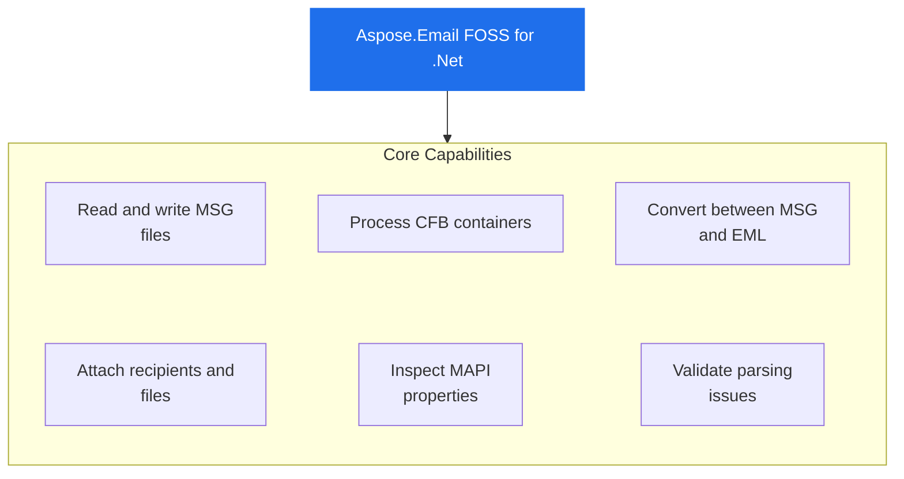

# Aspose.Email FOSS for .Net

[](https://www.nuget.org/packages/Aspose.Email.Foss/)  [](LICENSE) [](https://github.com/aspose-email-foss/Aspose.Email-FOSS-for-.Net/graphs/contributors)

[](https://products.aspose.org/email/net/)

Aspose.Email FOSS for .Net reads and writes MSG files using the MAPI message format. It converts EML messages to MSG format and writes them to streams or files. It also reads structured storage files and exposes their internal layout for inspection.

Aspose.Email FOSS for .Net is a free, open source email library for .NET — a C# toolkit for
deterministic binary and message processing: reading, creating, and inspecting Outlook `.msg`
files, Compound File Binary (CFB) containers, and EML message data. It ships with no required
third-party package dependencies and needs no Microsoft Outlook installation, making it a
lightweight fit for services, desktop tools, and command-line utilities that work with mailbox
data directly.

## Navigation

- [At a Glance](#at-a-glance)
- [Key Capabilities](#key-capabilities)
- [Installation](#installation)
- [Dependencies](#dependencies)
- [Quick Start](#quick-start)
- [Additional Examples](#additional-examples)
- [API Reference](#api-reference)
- [Documentation & Resources](#documentation--resources)
- [Scope and Limitations](#scope-and-limitations)
- [Development and Testing](#development-and-testing)
- [License](#license)

## At a Glance



## Key Capabilities

- **Read and write MSG files.** It reads and writes Outlook MSG files at the high-level `MapiMessage` layer, allowing programmatic creation, editing, and persistence of complete email messages in memory, including setting sender and recipient details and saving to a stream or file.
- **Process CFB containers.** It opens and traverses Compound File Binary containers from a file, stream, or byte array, and builds such containers programmatically using `CfbDocument`, `CfbStorage`, and `CfbStream`, then serializes them to bytes or a file.
- **Convert between MSG and EML.** It converts between MSG and EML formats natively, parsing standard RFC 5322 and MIME .eml files directly into `MapiMessage` objects and serializing `MapiMessage` back to MIME without requiring an external parser.
- **Attach recipients and files.** It attaches recipients and files to messages using `AddRecipient` and `AddAttachment`, including nested embedded messages via `AddEmbeddedMessageAttachment`, as demonstrated by creating a message, adding a recipient, attaching a file from a stream, and saving the result.
- **Inspect MAPI properties.** It sets and reads arbitrary MAPI properties on messages using `SetProperty` and `GetPropertyValue`, beyond the strongly typed properties exposed directly by `MapiMessage`.
- **Validate parsing issues.** It inspects parsing problems on loaded messages through the read-only `ValidationIssues` list, populated when strict parsing encounters structural anomalies.

- **Open and traverse CFB containers** from a file, stream, or byte array via `CfbReader.FromFile()`, `CfbReader.FromStream()`, or `new CfbReader(data)`, then walk the directory tree with `IterStorages()`, `IterStreams()`, `IterChildren()`, and `IterTree()`.
- **Build CFB containers programmatically** with `CfbDocument`, `CfbStorage`, and `CfbStream`, and serialize them with `CfbWriter.ToBytes()` or `CfbWriter.WriteFile()`.
- **Create, edit, save, and reload complete, high-level mutable message objects** through `MapiMessage`: set `Subject`, `Body`, `HtmlBody`, `SenderName`, and `SenderEmailAddress`, then persist with `Save()` and reload with `FromFile()` or `FromStream()` — a free .NET API for building and processing email messages entirely in memory.

## Installation

Install the published package from NuGet (`Aspose.Email.Foss`, version 26.7.0):

```bash
dotnet add package Aspose.Email.Foss
```

## Dependencies

### Required Package Dependencies

No required third-party package dependencies; in `src/Aspose.Email.Foss/Aspose.Email.Foss.csproj`, no `PackageReference` a consumer would install is declared.

### Native and System Requirements

- Requires .NET `net8.0` (`TargetFramework` in `src/Aspose.Email.Foss/Aspose.Email.Foss.csproj`).

## Quick Start

This example creates a new MSG file with a subject, body, sender, recipient, and attachment using `Aspose.Email.Foss` version 26.7.0 for net8.0.

```csharp
using System.IO;
using Aspose.Email.Foss.Msg;

var message = MapiMessage.Create("Hello", "Body");
message.SenderName = "Alice";
message.SenderEmailAddress = "alice@example.com";
message.AddRecipient("bob@example.com", "Bob");
using var attachmentStream = new MemoryStream("abc"u8.ToArray());
message.AddAttachment("note.txt", attachmentStream, "text/plain");
using var output = File.Create("hello.msg");
message.Save(output);
```

## Additional Examples

Read a subject from an MSG file:

```csharp
using System.IO;
using Aspose.Email.Foss.Msg;

using var stream = File.OpenRead("sample.msg");
var message = MapiMessage.FromStream(stream);
Console.WriteLine(message.Subject);
```

<details>
<summary>View Additional Examples</summary>

### Convert EML to MSG

```csharp
using System.IO;
using Aspose.Email.Foss.Msg;

using var input = File.OpenRead("message.eml");
var message = MapiMessage.LoadFromEml(input);
using var msgOutput = File.Create("message.msg");
message.Save(msgOutput);
using var emlOutput = File.Create("roundtrip.eml");
message.SaveToEml(emlOutput);
```

### Inspect a CFB Container's Structure

```csharp
using Aspose.Email.Foss.Cfb;

using var cfb = CfbReader.FromFile("sample.msg");
Console.WriteLine($"Sector size: {cfb.SectorSize}");
Console.WriteLine($"Directory entries: {cfb.DirectoryEntryCount}");

foreach (var (depth, entry) in cfb.IterTree())
{
    Console.WriteLine(new string(' ', depth * 2) + entry.Name);
}
```

</details>

## API Reference

Aspose.Email FOSS for .Net is the entry point for working with email formats in .NET, providing high-level APIs for message creation and conversion. It is built on lower-level CFB and MSG storage APIs that give direct access to the underlying file structures.

The public API has 29 types.

<details>
<summary>View the Complete Public API Surface</summary>

### Core API

| Class | Description |
| --- | --- |
| `CfbConstants` | CfbConstants class defines constants used in Compound File Binary structures, including ByteOrderLittleEndian for little-endian encoding, MAXREGSECT and MAXREGSID for maximum sector and stream identifiers, MiniStreamCutoffSize for the largest mini-stream size, NOSTREAM, RootEntryName, and RootStreamId. |
| `CfbDocument` | CfbDocument class represents a Compound File Binary document and provides constructors, factory methods FromFile, FromReader, and FromStream, and properties MajorVersion, MinorVersion, Root, and TransactionSignatureNumber. |
| `CfbException` | CfbException class is the exception type used for errors in Compound File Binary processing and exposes a constructor CfbException. |
| `CfbNode` | CfbNode class holds metadata for a Compound File Binary node and exposes properties Clsid, CreationTime, ModifiedTime, Name, and StateBits. |
| `CfbReader` | CfbReader class reads Compound File Binary files and exposes constructors CfbReader, factory methods FromFile and FromStream, read-only properties Difat, DirectoryEntries, DirectoryEntryCount, Fat, FileSize, MajorVersion, MiniFat, MiniSectorSize, MiniStream, SectorSize, and methods Dispose, FindChildByName, GetEntry, GetStreamData, IterChildren, IterStorages, IterStreams, IterTree, and ResolvePath; CfbReader.CfbReader throws ArgumentNullException conditionally, and GetEntry and GetStreamData throw CfbException conditionally. |
| `CfbStorage` | CfbStorage class represents a storage node in a Compound File Binary and exposes a constructor CfbStorage, methods AddStorage and AddStream, and properties Children, Clsid, CreationTime, ModifiedTime, and Name. |
| `CfbStream` | CfbStream class represents a stream node in a Compound File Binary and exposes a constructor CfbStream and properties Clsid, CreationTime, Data, ModifiedTime, Name, and StateBits. |
| `CfbWriter` | CfbWriter class writes Compound File Binary files and exposes methods ToBytes and WriteFile. |
| `DirectoryEntry` | DirectoryEntry class provides methods IsRoot, IsStorage, and IsStream to determine the type of a Compound File Binary directory entry. |
| `DirectoryEntryNameComparer` | DirectoryEntryNameComparer class provides a Compare method to compare directory entry names. |
| `Header` | Header class holds the header information of a Compound File Binary and exposes read-only properties MiniSectorSize and SectorSize. |
| `MapiAttachment` | MapiAttachment class represents a MAPI attachment and exposes properties ContentId, Data, EmbeddedMessage, Filename, IsEmbeddedMessage, and IsStorageAttachment, and factory methods FromBytes and FromStream. |
| `MapiMessage` | MapiMessage class represents a MAPI message and exposes methods AddAttachment, AddEmbeddedMessageAttachment, and AddRecipient, constants AttachMethodByValue, AttachMethodEmbedded, and AttachMethodStorage, and properties Attachments and Body. |
| `MapiProperty` | MapiProperty class represents a MAPI property and exposes a constructor MapiProperty, and properties Flags, PropertyId, PropertyTag, PropertyType, and Value. |
| `MapiPropertyCollection` | MapiPropertyCollection class manages a collection of MAPI properties and exposes methods Add, Get, IterProperties, Remove, and Set. |
| `MapiRecipient` | MapiRecipient class represents a MAPI recipient and exposes properties AddressType, DisplayName, EmailAddress, RecipientType, and a read-only property Properties. |
| `MsgConstants` | MsgConstants class defines constants used in MSG files, including AttachmentStoragePrefix, EmbeddedMessageStorageName, MaxAttachmentStorages, MaxRecipientStorages, NamedPropertyMappingStorageName, PROPATTR_MANDATORY, PROPATTR_READABLE, and PROPATTR_WRITABLE. |
| `MsgDocument` | MsgDocument class represents an MSG file as a Compound File Binary document and exposes a constructor MsgDocument, factory methods FromFile and FromStream, properties MajorVersion, MinorVersion, Root, and Strict, and method ToCfbDocument; MsgDocument.MsgDocument throws ArgumentNullException conditionally. |
| `MsgException` | MsgException class is the exception type used for errors in MSG processing and exposes a constructor MsgException. |
| `MsgReader` | MsgReader class reads MSG files and exposes factory methods FromFile and FromStream, method Dispose, and a read-only property ValidationIssues. |
| `MsgStorage` | MsgStorage class represents a storage node in an MSG file and exposes a constructor MsgStorage, methods AddStorage, AddStream, FindStorage, and FindStream, and properties Clsid, CreationTime, ModifiedTime; MsgStorage.MsgStorage throws ArgumentNullException conditionally. |
| `MsgStream` | MsgStream class represents a stream node in an MSG file and exposes a constructor MsgStream and properties Clsid, CreationTime, Data, ModifiedTime, Name, and StateBits; MsgStream.MsgStream throws ArgumentNullException conditionally. |
| `MsgWriter` | MsgWriter class writes MSG files and exposes methods ToBytes and WriteFile. |

#### Enumerations

| Enumeration | Description |
| --- | --- |
| `DirectoryColorFlag` | Stores the red-black tree color used by directory sibling links. |
| `DirectoryObjectType` | Classifies the directory entry payload as unallocated, storage, stream, or root storage. |
| `SectorMarker` | Special FAT marker values reserved for sector allocation metadata. |
| `CommonMessagePropertyId` | Common MAPI property identifiers used by the MSG reader and writer for core message semantics, body fields, transport headers, and attachments. |
| `MsgStorageRole` | MsgStorageRole enum lists the values Attachment, CustomAttachment, EmbeddedMessage, Generic, Message, NamedPropertyMapping, and Recipient to identify the role of a storage node in an MSG file. |
| `PropertyTypeCode` | MAPI property type codes that appear in property tags and stream names in MSG files. |

#### Detailed Member Reference

### Foss

The `MapiMessage` class serves as the primary high-level entry point for creating, editing, and converting messages, supporting operations such as adding recipients and attachments, and saving to MSG or EML formats.

`CfbReader` gives direct access to a `.msg` file's underlying CFB geometry — useful when
diagnosing a damaged or non-standard file, independently of the higher-level MSG or MapiMessage
APIs.

`MapiMessage` is the primary high-level entry point for creating, editing, and converting
messages; `CfbReader`/`CfbWriter` and `MsgReader`/`MsgWriter`/`MsgDocument` provide direct,
lower-level access to the `Aspose.Email.Foss.Cfb` and `Aspose.Email.Foss.Msg` namespaces the
high-level API is built on. The public surface spans 29 classes and enumerations in a single
module, summarized below.

| Class | Description |
|---|---|
| `CfbConstants` | CfbConstants.ByteOrderLittleEndian identifies little-endian integer encoding in CFB files. |
| `CfbDocument` | CfbDocument can be instantiated directly, or created from existing data using CfbDocument.FromFile(path), FromStream(stream), or FromReader(reader). |
| `CfbException` | CfbException.CfbException creates an exception instance containing the provided error message. |
| `CfbNode` | CfbNode provides metadata for each entry in a CFB container, including Name, Clsid, CreationTime, and ModifiedTime. |
| `CfbReader` | CfbReader.FromFile(path) opens a CFB file and provides access to its header, FAT, MiniFAT, and directory entries via properties such as MajorVersion and SectorSize. |
| `CfbStorage` | CfbStorage.CfbStorage initializes a new storage node with the specified name. |
| `CfbStream` | CfbStream.CfbStream creates a new CfbStream with the specified name and optional byte array data. |
| `CfbWriter` | CfbWriter.WriteFile(document, path) serializes a CfbDocument to a file, while ToBytes(document) returns the binary representation as a byte array. |
| `DirectoryEntry` | DirectoryEntry methods IsStorage(), IsStream(), and IsRoot() let developers determine the type of a directory entry when traversing a CFB structure. |
| `DirectoryEntryNameComparer` | DirectoryEntryNameComparer.Compare compares two name strings and returns an int indicating sort order. |
| `Header` | Header.SectorSize represents the size of a regular sector in bytes. |
| `MapiAttachment` | MapiAttachment.FromBytes(filename, data, mimeType, contentId) creates an attachment object that can be added to a message; its properties Filename, MimeType, and Data expose the attachment metadata and content. |
| `MapiMessage` | MapiMessage.Create(subject, body, unicodeStrings) constructs a new mutable message with the given subject and body. |
| `MapiProperty` | MapiProperty.MapiProperty constructs a property with given id, type, value, and flags. |
| `MapiPropertyCollection` | MapiPropertyCollection.Set(property:MapiProperty) adds or updates the specified MapiProperty in the collection. |
| `MapiRecipient` | MapiRecipient.DisplayName gets or sets the recipient's display name. |
| `MsgConstants` | MsgConstants.PropertyStreamName provides the standard name of the top‑level property stream used in MSG files. |
| `MsgDocument` | MsgDocument.FromFile(path, strict) loads an MSG file into a MsgDocument object for inspection or modification. |
| `MsgException` | MsgException.MsgException creates a new exception with the given message. |
| `MsgReader` | MsgReader.FromFile(path, strict) creates a MsgReader that reads an Outlook MSG file from the specified file path. |
| `MsgStorage` | MsgStorage.AddStream(stream) adds a MsgStream to the storage, allowing custom binary data to be embedded in the MSG file. |
| `MsgStream` | MsgStream.MsgStream initializes a new stream with a name and optional data bytes. |
| `MsgWriter` | MsgWriter.WriteFile(document, path) writes a MsgDocument to the given file path in MSG format. |

| Enumeration | Description |
|---|---|
| `MsgStorageRole` | MsgStorageRole.Generic represents a generic storage role not specific to other categories. |

- `CfbReader` (implements `IDisposable`)
  - `FromFile(path)`, `FromStream(stream)`, `CfbReader(data)`
  - `IterStorages()`, `IterStreams()`, `IterChildren(storageStreamId)`, `IterTree(startStreamId = 0)`, `FindChildByName(storageStreamId, name)`, `ResolvePath(names, startStreamId)`
  - `GetEntry(streamId)`, `GetStreamData(streamId)`
  - Properties: `Header`, `Difat`, `Fat`, `MiniFat`, `DirectoryEntries`, `RootEntry`, `MajorVersion`, `SectorSize`, `MiniSectorSize`, `DirectoryEntryCount`, `FileSize`

- `CfbWriter` (static)
  - `ToBytes(document)`, `WriteFile(document, path)`

- `CfbDocument` / `CfbStorage` / `CfbStream`
  - Build a document in memory with `CfbStorage.AddStorage()`/`AddStream()`, then hand the root `CfbDocument` to `CfbWriter`.

- `MsgReader` (implements `IDisposable`)
  - `FromFile(path, strict)`, `FromStream(stream, strict)`
  - `ValidationIssues: IReadOnlyList<string>`

- `MsgWriter` (static)
  - `ToBytes(document)`, `WriteFile(document, path)`

- `MsgDocument`
  - `FromFile(path, strict)`, `FromStream(stream, strict)`, `ToCfbDocument()`
  - `Root: MsgStorage`

- `MsgStorage`
  - `AddStream(stream)`, `AddStorage(storage)`, `FindStream(name)`, `FindStorage(name)`
  - Properties: `Role: MsgStorageRole`, `Streams: IList<MsgStream>`, `Storages: IList<MsgStorage>`

- `MapiMessage` (implements `IDisposable`)
  - `Create(subject, body, unicodeStrings)`, `FromFile(path, strict)`, `FromStream(stream, strict)`, `FromMsgDocument(document)`
  - `LoadFromEml(path)` / `LoadFromEml(stream)` / `LoadFromEml(data)`
  - `Save()`, `Save(path)`, `Save(stream)`
  - `SaveToEml()`, `SaveToEml(path)`, `SaveToEml(stream)`
  - `AddRecipient(emailAddress, displayName, recipientType)`, `AddAttachment(filename, data, mimeType, contentId)`, `AddAttachment(filename, stream, mimeType, contentId)`, `AddEmbeddedMessageAttachment(message, filename, mimeType)`
  - `SetProperty(propertyId, propertyType, value, flags)`, `GetPropertyValue(propertyId, propertyType, decode)`, `IterProperties()`, `IterPropertyKeys()`
  - Properties: `Subject`, `Body`, `HtmlBody`, `SenderName`, `SenderEmailAddress`, `MessageClass`, `InternetMessageId`, `MessageDeliveryTime`, `Recipients`, `Attachments`, `ValidationIssues`

- `MapiAttachment`
  - `FromBytes(filename, data, mimeType, contentId)`, `FromStream(filename, stream, mimeType, contentId)`, `OpenRead()`
  - Properties: `Filename`, `Data`, `MimeType`, `ContentId`, `IsEmbeddedMessage`, `EmbeddedMessage: MapiMessage?`

- `MapiPropertyCollection`
  - `Set(property)`, `Add(propertyId, propertyType, value, flags)`, `Get(propertyId, propertyType)`, `Remove(propertyId, propertyType)`, `IterProperties()`

</details>

## Documentation & Resources

- **[Getting started guide](https://docs.aspose.org/email/net/)** — installation, walkthroughs, and feature guides for this library.
- **[How-to guides & FAQ](https://kb.aspose.org/email/net/)** — task-focused answers for common MSG, CFB, and EML questions.
- **[Full API reference](https://reference.aspose.org/email/net/)** — the complete, browsable reference for all 29 public types (the [API reference](#api-reference) section above covers the essentials).
- **[Public API summary](PUBLIC_API.md)** — the repository's own stable-namespace and primary-type list.
- **[Changelog](CHANGELOG.md)** — release history.
- Found a bug or have a feature request? [Open an issue](https://github.com/aspose-email-foss/Aspose.Email-FOSS-for-.Net/issues).

## Scope and Limitations

- **No IMAP, SMTP, or POP3 support** — this library reads and writes local files only; it does not connect to mail servers.
- **No TNEF support** — Transport Neutral Encapsulation Format (`winmail.dat`) is not parsed or generated.
- **No calendar or appointment support** — calendar-specific MAPI properties can be accessed generically via `SetProperty()`/`GetPropertyValue()`, but there is no dedicated calendar API.
- **No .NET Framework support** — requires .NET 8.0 or later; classic .NET Framework (4.x) is not supported.

See [Aspose.Email for .Net — Enterprise Edition](https://products.aspose.com/email/net/). It adds broader format and protocol coverage: direct IMAP/SMTP/POP3 mail-server connectivity, TNEF (winmail.dat) support, calendar and appointment APIs, and classic .NET Framework support alongside this edition's MSG, CFB, and EML processing.

## Development and Testing

The suite covers 5 test files under `tests/`.

The published NuGet package ID is `Aspose.Email.Foss` (confirmed against the library's own `.csproj`, which is what NuGet actually built and published from):

```bash
dotnet add package Aspose.Email.Foss
```

```xml
<PackageReference Include="Aspose.Email.Foss" Version="26.7.0" />
```

The published `Aspose.Email.Foss` package builds from `src/Aspose.Email.Foss/Aspose.Email.Foss.csproj`, which declares zero `<PackageReference>` entries — CFB, MSG, and EML/MIME handling are all implemented natively within the library.

- Requires the .NET 8.0 SDK (or later) to build, and the matching .NET 8.0 runtime (or later) to run.

- `Microsoft.NET.Test.Sdk` 17.8.0, `xunit` 2.5.3, and `xunit.runner.visualstudio` 2.5.3 — the xUnit test host and adapter used only by the test project.
- `coverlet.collector` 6.0.0 — code-coverage collection for the test suite.

None of these are referenced by the main library project; they apply only to `tests/Aspose.Email.Foss.Tests/Aspose.Email.Foss.Tests.csproj` and are never shipped with the published package.

Clone the repository and run the xUnit test suite:

```bash
git clone https://github.com/aspose-email-foss/Aspose.Email-FOSS-for-.Net.git
cd Aspose.Email-FOSS-for-.Net
dotnet build src/Aspose.Email.Foss/Aspose.Email.Foss.csproj -c Release
dotnet test tests/Aspose.Email.Foss.Tests/Aspose.Email.Foss.Tests.csproj
```

The test project covers CFB round-trips, MSG reading, and EML round-trip conversion (`CfbRoundTripTests`, `MsgReaderTests`, `MapiMessageTests`, `MapiMessageEmlTests`, `MetadataSmokeTests`). Three runnable example programs — `create_msg_and_eml.cs`, `msg_reader.cs`, and `msg_summary.cs` — live under [`examples/`](examples/), each with its own project file and listed in [examples/README.md](examples/README.md); run one directly, for example:

```bash
dotnet run --project examples/create_msg_and_eml/create_msg_and_eml.csproj
```

## License

This project is licensed under the [MIT License](LICENSE). The MIT License permits use, copying, modification, distribution, sublicensing, and commercial use, provided its copyright and permission notice are retained. The software is provided without warranty.
