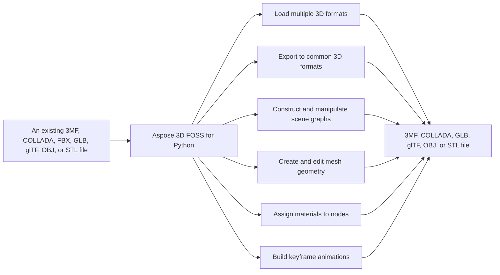

# Aspose.3D FOSS for Python

[](https://pypi.org/project/aspose-3d-foss/)  [](LICENSE) [](https://github.com/aspose-3d-foss/Aspose.3D-FOSS-for-Python/graphs/contributors)

[](https://products.aspose.org/3d/python/)

Aspose.3D FOSS for Python reads and writes 3D formats including `.3mf`, `.dae`, `.fbx`, `.glb`, `.gltf`, `.obj`, and `.stl`. It provides classes such as `Scene`, `Node`, `Mesh`, `Transform`, and utilities for scene construction, entity management, and rendering. The package supports shading with materials like `LambertMaterial` and `PbrMaterial`, and includes animation capabilities through `AnimationClip`, `AnimationNode`, `KeyFrame`, and `KeyframeSequence`.

## Navigation

- [At a Glance](#at-a-glance)
- [Key Capabilities](#key-capabilities)
- [Installation](#installation)
- [Dependencies](#dependencies)
- [Quick Start](#quick-start)
- [Additional Examples](#additional-examples)
- [API Reference](#api-reference)
- [Documentation & Resources](#documentation--resources)
- [Scope and Limitations](#scope-and-limitations)
- [Development and Testing](#development-and-testing)
- [License](#license)

## At a Glance



## Key Capabilities

- **Load multiple 3D formats.** It reads `.3mf`, `.dae`, `.fbx`, `.glb`, `.gltf`, `.obj`, and `.stl` files using `Scene.open()` with automatic format detection from the file extension or an explicit `FileFormat` argument.
- **Export to common 3D formats.** It exports scenes to `.3mf`, `.dae`, `.glb`, `.gltf`, `.obj`, and `.stl` formats using `Scene.save()` with format-specific `SaveOptions` subclasses for coordinate flipping, unit scaling, and compression settings.
- **Construct and manipulate scene graphs.** It constructs and manipulates scene graphs using `Node.create_child_node()`, `Node.add_entity()`, and `Node.child_nodes`, with each node maintaining an independent `Transform` that controls translation, rotation, and scaling.
- **Create and edit mesh geometry.** It creates and edits mesh geometry by adding control points and polygons directly through `Mesh.control_points` and `Mesh.create_polygon()`, or by converting parameterized primitives like `Box` and `Sphere` using their `to_mesh()` method.
- **Assign materials to nodes.** It assigns `LambertMaterial`, `PhongMaterial`, or `PbrMaterial` to nodes, supporting diffuse color, specular properties, and PBR albedo, metallic factor, and roughness factor settings.
- **Build keyframe animations.** It builds keyframe animations using `AnimationClip`, `AnimationNode`, and `KeyframeSequence` to define animation curves for node transforms and entity properties.

- Author and edit mesh data directly through `Mesh.control_points`, `Mesh.create_polygon()`, and
  `Mesh.polygons`, or convert an existing mesh with `PolygonModifier.triangulate()`.
- Triangulate arbitrary polygon data into triangle fans with `PolygonModifier.triangulate()`,
  a real ear-clipping triangulation implementation rather than a naive fan split.

## Installation

The package `aspose-3d-foss` could not be confirmed on PyPI (package registry: a distribution of this name exists, but ownership not confirmed: the registry's project URLs point at another repository).

To work from a source checkout instead, install the clone with pip:

```bash
git clone https://github.com/aspose-3d-foss/Aspose.3D-FOSS-for-Python.git
cd Aspose.3D-FOSS-for-Python
pip install .
```

Verify the install:

```bash
python -c "import aspose.threed"
```

The package supports Python 3.7, 3.8, 3.9, 3.10, 3.11, and 3.12 and declares `python_requires` as `>=3.7`.

## Dependencies

### Required Package Dependencies

No required third-party package dependencies; in `setup.py`, the `install_requires` list is empty.

### Native and System Requirements

- Requires Python 3.7 or later (`python_requires=">=3.7"` in `setup.py`).

### Development Dependencies

- `pytest>=7.0.0` (extra `dev`)

## Quick Start

This example creates a simple crate with a blue Lambert material and saves it as a GLTF file.

```python
from aspose.threed import Scene
from aspose.threed.entities import Box
from aspose.threed.shading import LambertMaterial
from aspose.threed.utilities import Vector3

scene = Scene()
box = Box(length=2.0, width=1.0, height=1.0)
material = LambertMaterial()
material.diffuse_color = Vector3(0.2, 0.6, 0.9)

scene.root_node.create_child_node("Crate", entity=box.to_mesh(), material=material)
scene.save("crate.gltf")
```

This example constructs a triangle mesh programmatically and exports it as a text-based STL file to an in-memory stream.

```python
import io
from aspose.threed import Scene, FileFormat
from aspose.threed.entities import Mesh
from aspose.threed.utilities import Vector4

scene = Scene()
mesh = Mesh("triangle")
mesh.control_points.add(Vector4(0.0, 0.0, 0.0, 1.0))
mesh.control_points.add(Vector4(1.0, 0.0, 0.0, 1.0))
mesh.control_points.add(Vector4(1.0, 1.0, 0.0, 1.0))
mesh.create_polygon(0, 1, 2)

node = scene.root_node.create_child_node("triangle_node")
node.entity = mesh

stream = io.StringIO()
# Use FileFormat.get_format_by_extension(...).create_save_options() rather than
# StlSaveOptions() directly: a default-constructed options object has no
# file_format set, and scene.save() cannot infer the format from a bare stream
# (only filename-based saves fall back to extension detection).
options = FileFormat.get_format_by_extension(".stl").create_save_options()
options.binary_mode = False
scene.save(stream, options)
print(stream.getvalue())
```

Verify the install:

```bash
python3 -c "from aspose.threed import Scene; print('Aspose.3D FOSS OK')"
```

## Additional Examples

The following examples demonstrate core workflows: creating primitives with PBR materials, building meshes from control points, traversing scene graphs, and exporting to multiple formats.

### Build a Triangle Mesh and Export It to Text-Based glTF

```python
import io
import json
from aspose.threed import Scene, FileFormat
from aspose.threed.entities import Mesh
from aspose.threed.utilities import Vector3, Vector4
from aspose.threed.formats.gltf import GltfSaveOptions
from aspose.threed.shading import PbrMaterial

scene = Scene()
mesh = Mesh("TestMesh")
mesh.control_points.add(Vector4(0.0, 0.0, 0.0, 1.0))
mesh.control_points.add(Vector4(1.0, 0.0, 0.0, 1.0))
mesh.control_points.add(Vector4(0.0, 1.0, 0.0, 1.0))
mesh.create_polygon(0, 1, 2)

albedo = Vector3(0.8, 0.2, 0.3)
material = PbrMaterial("RedMaterial", albedo)
material.metallic_factor = 0.5
material.roughness_factor = 0.7

node = scene.root_node.create_child_node("TestNode")
node.entity = mesh
node.material = material

stream = io.BytesIO()
# Pass the detected FileFormat into the constructor explicitly: unlike
# StlFormat, GltfFormat.create_save_options() does not set file_format on the
# options it returns, and a bare stream (no filename) gives scene.save()
# nothing else to detect the format from.
options = GltfSaveOptions(FileFormat.get_format_by_extension(".gltf"))
options.binary_mode = False
scene.save(stream, options)

stream.seek(0)
gltf_data = json.loads(stream.read().decode("utf-8"))
print(gltf_data["materials"][0]["pbrMetallicRoughness"])
```

<details>
<summary>View Additional Examples</summary>

### Create a Sphere with a PBR Material and Save It as STL

```python
from aspose.threed import Scene
from aspose.threed.entities import Sphere
from aspose.threed.shading import PbrMaterial
from aspose.threed.utilities import Vector3

scene = Scene()
sphere = Sphere()
material = PbrMaterial(albedo=Vector3(0.8, 0.1, 0.1))
material.metallic_factor = 0.9
material.roughness_factor = 0.2

scene.root_node.create_child_node("Ball", entity=sphere.to_mesh(), material=material)
scene.save("ball.stl")
```

### Open a glTF File and Walk Its Scene Graph Hierarchy

```python
from aspose.threed import Scene

scene = Scene()
scene.open("model.gltf")

def walk(node, depth=0):
    print("  " * depth + (node.name or "(unnamed)"))
    for child in node.child_nodes:
        walk(child, depth + 1)

walk(scene.root_node)
```

### Convert a `Box` Primitive to a Mesh and Count Its Control Points

```python
from aspose.threed.entities import Box

box = Box(10, 20, 30)
mesh = box.to_mesh()
print(f"Control points: {len(mesh.control_points)}")
```

### Build a Cube Mesh and Export It to Uncompressed 3MF

```python
import io
from aspose.threed import Scene
from aspose.threed.entities import Mesh
from aspose.threed.utilities import Vector4
from aspose.threed.formats import ThreeMfSaveOptions

scene = Scene()
mesh = Mesh("cube")
for point in [
    Vector4(0, 0, 0, 1), Vector4(1, 0, 0, 1), Vector4(1, 1, 0, 1), Vector4(0, 1, 0, 1),
    Vector4(0, 0, 1, 1), Vector4(1, 0, 1, 1), Vector4(1, 1, 1, 1), Vector4(0, 1, 1, 1),
]:
    mesh.control_points.add(point)

mesh.create_polygon(0, 1, 2)
mesh.create_polygon(0, 2, 3)
mesh.create_polygon(4, 7, 6)
mesh.create_polygon(4, 6, 5)
mesh.create_polygon(0, 4, 5)
mesh.create_polygon(0, 5, 1)
mesh.create_polygon(2, 6, 7)
mesh.create_polygon(2, 7, 3)
mesh.create_polygon(0, 3, 7)
mesh.create_polygon(0, 7, 4)
mesh.create_polygon(1, 5, 6)
mesh.create_polygon(1, 6, 2)

node = scene.root_node.create_child_node("cube")
node.entity = mesh

stream = io.BytesIO()
options = ThreeMfSaveOptions()
options.enable_compression = False
scene.save(stream, options)
```

Import an OBJ file and inspect its geometry:

```python
from aspose.threed import Scene
from aspose.threed.formats.obj import ObjLoadOptions

scene = Scene()
options = ObjLoadOptions()
options.enable_materials = True
scene.open("model.obj", options)

for node in scene.root_node.child_nodes:
    if node.entity is not None:
        mesh = node.entity
        print(f"{node.name}: {len(mesh.control_points)} vertices, {mesh.polygon_count} polygons")
```

More real, verified snippets are collected below, each demonstrating one operation without
obscuring the primary installation and quick-start path.

### Convert Between Formats

```python
from aspose.threed import Scene

scene = Scene()
scene.open("model.obj")
scene.save("model.glb")
```

### Triangulate an Imported Mesh

```python
from aspose.threed import Scene
from aspose.threed.entities import PolygonModifier

scene = Scene()
scene.open("model.obj")

for node in scene.root_node.child_nodes:
    if node.entity is not None:
        triangulated = PolygonModifier.triangulate(node.entity)
        if triangulated is not None:
            node.entity = triangulated
```

### Import a COLLADA File

```python
from aspose.threed import Scene
from aspose.threed.formats.collada.ColladaLoadOptions import ColladaLoadOptions

scene = Scene()
options = ColladaLoadOptions()
scene.open("model.dae", options)

print(f"Child nodes: {len(scene.root_node.child_nodes)}")
```

</details>

## API Reference

Aspose.3D FOSS for Python provides the `aspose.threed.Scene` class as the primary entry point for loading, manipulating, and saving 3D scenes. `Scene` instances contain a hierarchy of `Node` objects, each with a `Transform`, optional `Mesh`-derived entities, and materials. The `aspose.threed.Mesh` class represents polygonal geometry, `aspose.threed.shading` provides material definitions, and `aspose.threed.animation` supports animation clips and nodes.

The verified public surface has 337 types.

<details>
<summary>View the Complete Public API Surface</summary>

### Core API

| Class | Description |
| --- | --- |
| `A3DObject` | A3DObject is a class that inherits from INamedObject and provides members including find_property, get_property, name, properties, remove_property, and set_property. |
| `AnimationChannel` | AnimationChannel is a class that inherits from KeyframeSequence and provides members including component_type, default_value, and keyframe_sequence. |
| `AnimationClip` | AnimationClip is a class that inherits from SceneObject and provides members including animations, create_animation_node, description, name, properties, start, and stop. |
| `AnimationNode` | AnimationNode is a class that inherits from A3DObject and provides members including bind_points, create_bind_point, find_bind_point, get_bind_point, get_keyframe_sequence, name, properties, and sub_animations. |
| `ArrayListAdapter` | Adapter class that wraps List[T] and implements IArrayList[T]. |
| `AssetInfo` | AssetInfo is a class that inherits from A3DObject and provides members including ambient, application_name, application_vendor, application_version, author, axis_system, comment, and coordinate_system. |
| `Axis` | The coordinate axis. |
| `AxisSystem` | Not implemented. |
| `BindPoint` | BindPoint is a class that inherits from A3DObject and provides members including add_channel, bind_keyframe_sequence, channels_count, create_keyframe_sequence, get_channel, get_keyframe_sequence, name, and properties. |
| `BonePose` | BonePose is a class that inherits from A3DObject and provides members including is_local, matrix, and node. |
| `BoundingBox2D` | The axis-aligned bounding box for Vector2 |
| `BoundingBoxExtent` | The extent of the bounding box |
| `Box` | Box is a class that inherits from Primitive and provides members including height, height_segments, length, length_segments, to_mesh, width, and width_segments. |
| `Camera` | Camera is a class that inherits from Entity and provides members including aperture_mode, aspect, aspect_ratio, direction, excluded, far_plane, field_of_view, and field_of_view_x; the get_entity_renderer_key member is not implemented. |
| `Circle` | Circle is a class that inherits from Primitive and provides members including radius, segments, theta_length, theta_start, and to_mesh. |
| `ComposeOrder` | The order to compose transform matrix |
| `CoordinateSystem` | The left handed or right handed coordinate system. |
| `Curve` | Curve is a class that inherits from Entity and provides a member including color. |
| `CustomObject` | CustomObject is a class that inherits from A3DObject. |
| `Cylinder` | Cylinder is a class that inherits from Primitive and provides members including generate_fan_cylinder, height, height_segments, offset_bottom, offset_top, open_ended, radial_segments, radius_bottom. |
| `Dish` | Dish is a class that inherits from Primitive and provides members including get_bounding_box, height, height_segments, radius, to_mesh, and width_segments. |
| `Ellipse` | Ellipse is a class that inherits from Primitive and provides members including radius_x, radius_y, segments, theta_length, theta_start, and to_mesh. |
| `Entity` | Entity is a class that inherits from SceneObject and provides members including excluded, get_bounding_box, get_entity_renderer_key, parent_node, and parent_nodes; the get_bounding_box and get_entity_renderer_key members are not implemented. |
| `ExportException` | Exceptions when Aspose.3D failed to export the scene to file. |
| `Extrapolation` | Extrapolation is a class that provides members including repeat_count and type. |
| `FMatrix4` | Matrix 4x4 with all component in float type |
| `FileContentType` | File content type |
| `FileFormat` | FileFormat is a class that provides members including FBX7400ASCII, GLTF2, MICROSOFT_3MF_FORMAT, WAVEFRONT_OBJ, can_export, can_import, content_type, and create_load_options; the can_export, can_import, content_type, extension, and version getters always return fixed values. |
| `FileFormatType` | File format type |
| `Frustum` | Frustum is a class that inherits from Primitive and provides members including height, height_segments, radial_segments, radius_bottom, radius_top, theta_length, theta_start, and to_mesh. |
| `Geometry` | Geometry is a class that inherits from Entity and provides members including add_element, cast_shadows, control_points, create_element, create_element_uv, deformers, find_property, and get_bounding_box; the get_entity_renderer_key member is not implemented and remove_property always returns False. |
| `GlobalTransform` | GlobalTransform is a class that provides members including euler_angles, rotation, scale, transform_matrix, and translation. |
| `Group` | A Group represents the logical relationships of Node. |
| `INamedObject` | INamedObject is a class that provides a member including name; the name getter is not implemented. |
| `IOExtension` | Utilities to write matrix/vector to binary writer |
| `ImageRenderOptions` | ImageRenderOptions is a class that inherits from A3DObject and provides members including asset_directories, background_color, and enable_shadows. |
| `ImportException` | Exception when Aspose.3D failed to open the specified source. |
| `KeyFrame` | KeyFrame is a class that provides members including bias, continuity, flat, independent_tangent, interpolation, next_in_tangent, next_in_weight, and out_tangent. |
| `KeyframeSequence` | KeyframeSequence is a class that inherits from A3DObject and provides members including add, bind_point, key_frames, name, post_behavior, pre_behavior, properties, and reset. |
| `Light` | Light is a class that inherits from Camera. |
| `LinearExtrusion` | LinearExtrusion is a class that inherits from Entity and provides members including center, direction, height, shape, slices, to_mesh, twist, and twist_offset; the to_mesh member is not implemented. |
| `MathUtils` | A set of useful mathematical utilities. |
| `Mesh` | Mesh is a class that inherits from Geometry and provides members including control_points, create_polygon, difference, do_boolean, edges, get_bounding_box, get_entity_renderer_key, and get_polygon_size; the difference, do_boolean, get_entity_renderer_key, intersect, is_manifold, and optimize members are not implemented (some members not implemented). |
| `Node` | Node is a class that inherits from SceneObject and provides members including add_child_node, add_entity, asset_info, child_nodes, create_child_node, entities, entity, and evaluate_global_transform; the select_objects and select_single_object members are not implemented. |
| `ParseException` | Exception when Aspose.3D failed to parse the input. |
| `Plane` | Plane is a class that inherits from Primitive and provides members including length, length_segments, to_mesh, up, width, and width_segments. |
| `PolygonBuilder` | PolygonBuilder is a class that provides members including add_vertex, begin, and end; the add_vertex and end members raise InvalidOperationException conditionally. |
| `Pose` | Pose is a class that inherits from A3DObject and INamedObject and provides members including add_bone_pose, bone_poses, and pose_type. |
| `Primitive` | Primitive is a class that inherits from Geometry and provides members including cast_shadows, receive_shadows, and to_mesh; the to_mesh member is not implemented. |
| `Property` | Property is a class that provides members including get_bind_point, get_extra, get_keyframe_sequence, name, set_extra, value, and value_type. |
| `PropertyCollection` | PropertyCollection is a class that provides members including count, find_property, get, and remove_property. |
| `PropertyFlags` | Property's flags |
| `Rect` | A class to represent the rectangle |
| `RelativeRectangle` | Relative rectangle |
| `RotationOrder` | The order controls which rx ry rz are applied in the transformation matrix. |
| `Scene` | Scene is a class that inherits from SceneObject and provides members including animation_clips, asset_info, clear, create_animation_clip, current_animation_clip, from_file, get_animation_clip, and library; the open member raises RuntimeError conditionally and the render member is not implemented (some members not implemented). |
| `SceneObject` | SceneObject is a class that inherits from A3DObject and provides a member including scene. |
| `SemanticAttribute` | Allow user to use their own structure for static declaration of VertexDeclaration |
| `Sphere` | The Sphere class inherits from Primitive and provides properties height_segments, phi_length, phi_start, radius, theta_length, theta_start, width_segments, and a method to_mesh. |
| `Transform` | The Transform class inherits from A3DObject and provides properties euler_angles, geometric_rotation, geometric_scaling, geometric_translation, post_rotation, pre_rotation, rotation, and rotation_offset. |
| `TransformBuilder` | Not implemented. |
| `TrialException` | This is raised in Scene.Open/Scene.Save when no licenses are applied. |
| `Vertex` | Vertex reference, used to access the raw vertex in TriMesh. |
| `VertexDeclaration` | The declaration of a custom defined vertex's structure |
| `VertexField` | Vertex's field memory layout description. |
| `VertexFieldDataType` | Vertex field's data type |
| `VertexFieldSemantic` | The semantic of the vertex field |
| `Bone` | The Bone class inherits from A3DObject and provides properties bone_transform, link_mode, transform, weight_count, and methods get_weight, node, set_weight; the node getter raises RuntimeError. |
| `BoneLinkMode` | The BoneLinkMode class is defined. |
| `Deformer` | The Deformer class inherits from A3DObject and provides property owner; the owner getter raises RuntimeError. |
| `MorphTargetChannel` | The MorphTargetChannel class inherits from A3DObject and provides properties channel_weight, targets, weights, and methods get_weight, set_weight. |
| `MorphTargetDeformer` | The MorphTargetDeformer class inherits from Deformer and provides property channels. |
| `SkinDeformer` | The SkinDeformer class inherits from Deformer and provides property bones. |
| `ApertureMode` | Camera aperture modes. |
| `BooleanOperand` | This class encapsulates the transformed mesh as Boolean operation's operand. |
| `BooleanOperation` | The BooleanOperation class is defined. |
| `BooleanOperator` | Boolean operator allows you to apply Boolean operation on two IMeshConvertible instances. |
| `CompositeCurve` | A CompositeCurve is consisting of several curve segments. |
| `CurveDimension` | The CurveDimension class is defined. |
| `EndPoint` | The end point to trim the curve, can be a parameter value or a Cartesian point. |
| `HalfSpace` | HalfSpace represents a infinity space which is split by a plane, this can be used with BooleanOperator |
| `IIndexedVertexElement` | The IIndexedVertexElement class provides property indices; the indices getter raises NotImplementedError. |
| `IMeshConvertible` | Entities that implemented this interface can be converted to Mesh |
| `IOrientable` | Orientable entities shall implement this interface. |
| `LightType` | Light types. |
| `Line` | A polyline is a path defined by a set of points with control_points, and connected by segments. |
| `MappingMode` | The MappingMode class is defined. |
| `NurbsCurve` | The NurbsCurve class inherits from Curve and provides properties control_points, curve_type, degree, dimension, knot_vectors, multiplicity, and methods evaluate, evaluate_at; both evaluate and evaluate_at raise NotImplementedError (some members not implemented). |
| `NurbsDirection` | The NurbsDirection class provides properties count, degree, divisions, knot_vectors, multiplicity, order, type. |
| `NurbsSurface` | The NurbsSurface class inherits from Geometry and provides properties u, v, and method to_mesh; the to_mesh method raises NotImplementedError (some members not implemented). |
| `NurbsType` | The NurbsType class is defined. |
| `Patch` | The Patch class inherits from Geometry and provides properties u, v. |
| `PatchDirection` | The PatchDirection class provides properties closed, control_points, divisions, type. |
| `PatchDirectionType` | The PatchDirectionType class is defined. |
| `PointCloud` | The PointCloud class provides properties dimension, get_entity_renderer_key, and methods from_geometry, from_geometry_with_density; both from_geometry and from_geometry_with_density raise NotImplementedError (some members not implemented). |
| `InvalidOperationException` | The InvalidOperationException class inherits from Exception. |
| `PolygonModifier` | The PolygonModifier class provides method triangulate; the triangulate method raises TypeError conditionally. |
| `ProjectionType` | Camera's projection types. |
| `Pyramid` | Parameterized pyramid. |
| `RectangularTorus` | Parameterized rectangular torus entity. |
| `ReferenceMode` | The ReferenceMode class is defined. |
| `RevolvedAreaSolid` | RevolvedAreaSolid entity. |
| `RotationMode` | The frustum's rotation mode. |
| `Shape` | Base class for all shape entities. |
| `Skeleton` | The Skeleton is mainly used by CAD software to help designer to manipulate the transformation of skeletal structure, it's usually useless outside the CAD softwares. |
| `SkeletonType` | Skeleton type enum. |
| `SplitMeshPolicy` | Share vertex/control point data between sub-meshes or each sub-mesh has its own compacted data. |
| `SweptAreaSolid` | SweptAreaSolid entity. |
| `TextureMapping` | The TextureMapping class is defined. |
| `Torus` | Parameterized torus entity. |
| `TransformedCurve` | TransformedCurve entity. |
| `TriMesh` | TriMesh is a triangle mesh that stores triangles. |
| `TrimmedCurve` | TrimmedCurve entity. |
| `VertexElement` | The VertexElement class provides properties indices, mapping_mode, name, reference_mode, vertex_element_type, and methods clear, set_indices. |
| `VertexElementBinormal` | The VertexElementBinormal class inherits from VertexElementFVector. |
| `VertexElementDoublesTemplate` | A helper class for defining concrete implementations. |
| `VertexElementEdgeCrease` | Defines the edge crease values for specified components. |
| `VertexElementFVector` | The VertexElementFVector class inherits from VertexElement and provides properties data, indices, and methods clear, copy_to, set_data, set_indices; the set_data method raises TypeError conditionally. |
| `VertexElementHole` | Defines the hole information for specified components. |
| `VertexElementIntsTemplate` | A helper class for defining concrete implementations with int data. |
| `VertexElementMaterial` | Defines the material for specified components. |
| `VertexElementNormal` | The VertexElementNormal class inherits from VertexElementFVector. |
| `VertexElementPolygonGroup` | Defines the polygon group for specified components. |
| `VertexElementSmoothingGroup` | The VertexElementSmoothingGroup class inherits from VertexElementIntsTemplate. |
| `VertexElementSpecular` | Defines the specular color for specified components. |
| `VertexElementTangent` | The VertexElementTangent class inherits from VertexElementFVector. |
| `VertexElementTemplate` | A helper class for defining concrete implementations of vertex elements with typed data. |
| `VertexElementType` | The VertexElementType class is defined. |
| `VertexElementUV` | The VertexElementUV class inherits from VertexElementFVector and provides properties texture_mapping, and methods add_data; the add_data method raises TypeError conditionally. |
| `VertexElementUserData` | Defines the user data for specified components. |
| `VertexElementVector4` | Defines the vector4 data for specified components. |
| `VertexElementVertexColor` | The VertexElementVertexColor class inherits from VertexElementFVector. |
| `VertexElementVertexCrease` | Defines the vertex crease values for specified components. |
| `VertexElementVisibility` | Defines the visibility for specified components. |
| `VertexElementWeight` | Defines the weight for specified components. |
| `A3dwSaveOptions` | Save options for A3DW |
| `AmfSaveOptions` | Save options for AMF |
| `BasicLoadOptions` | Simple LoadOptions subclass for basic loading options. |
| `ColladaLoadOptions` | Load options for Collada |
| `ColladaSaveOptions` | Save options for collada |
| `ColladaTransformStyle` | The node's transformation style of node |
| `Discreet3dsLoadOptions` | Load options for Discreet 3DS |
| `Discreet3dsSaveOptions` | Save options for Discreet 3DS |
| `DracoCompressionLevel` | Compression level for draco file |
| `DracoFormat` | Google Draco format |
| `DracoSaveOptions` | Save options for Draco |
| `Exporter` | The Exporter class provides methods export, supports_format; both export and supports_format raise NotImplementedError. |
| `FbxLoadOptions` | Load options for FBX |
| `FbxSaveOptions` | Save options for FBX |
| `FormatDetector` | The FormatDetector class provides method detect; the detect method raises NotImplementedError. |
| `GltfEmbeddedImageFormat` | Embedded image format for GLTF |
| `formats.GltfLoadOptions` | Load options for glTF |
| `formats.GltfSaveOptions` | Save options for glTF |
| `Html5SaveOptions` | Save options for HTML5 |
| `IOConfig` | The IOConfig class provides properties encoding, file_format, file_name, file_system, lookup_paths. |
| `IOService` | The IOService class provides methods create_exporter, create_importer, detect_format, get_all_plugins, get_plugin_for_extension, get_plugin_for_format, register_detector, register_exporter; the create_exporter method raises RuntimeError conditionally, and the create_importer method raises RuntimeError conditionally. |
| `Importer` | The Importer class provides methods import_scene, supports_format; both import_scene and supports_format raise NotImplementedError. |
| `JtLoadOptions` | Load options for JT |
| `LoadOptions` | LoadOptions is a class that inherits from IOConfig. |
| `Microsoft3MFFormat` | Microsoft 3MF format |
| `Microsoft3MFSaveOptions` | Save options for Microsoft 3MF |
| `formats.ObjLoadOptions` | Load options for OBJ |
| `formats.ObjSaveOptions` | Save options for OBJ |
| `PdfFormat` | Adobe's Portable Document Format |
| `PdfLightingScheme` | Lighting scheme for PDF export |
| `PdfLoadOptions` | Load options for PDF |
| `PdfRenderMode` | Render mode for PDF export |
| `PdfSaveOptions` | Save options for PDF |
| `Plugin` | Plugin is an abstract class that defines methods create_load_options, create_save_options, get_exporter, get_file_format, get_format_detector, and get_importer. |
| `PlyFormat` | PLY format |
| `PlyLoadOptions` | Load options for PLY |
| `PlySaveOptions` | Save options for PLY |
| `RvmFormat` | RVM format |
| `RvmLoadOptions` | Load options for RVM |
| `RvmSaveOptions` | Save options for RVM |
| `SaveOptions` | SaveOptions is a class that inherits from IOConfig and defines the member export_textures. |
| `formats.StlLoadOptions` | Load options for STL |
| `formats.StlSaveOptions` | Save options for STL |
| `ThreeMfFormat` | ThreeMfFormat is a class that defines members can_export, can_import, content_type, create_load_options, create_save_options, extension, extensions, file_format_type, get_object_type, get_transform_for_build, is_buildable, set_buildable, set_object_type, and version; its can_export, can_import, content_type, extension, and version getters always return True, True, 'model/3mf', '3mf', and '1.4.0' respectively, and its set_object_type method raises ValueError (conditionally). |
| `ThreeMfLoadOptions` | ThreeMfLoadOptions is a class that inherits from LoadOptions and defines the member flip_coordinate_system. |
| `ThreeMfSaveOptions` | ThreeMfSaveOptions is a class that inherits from SaveOptions and defines members build_all, enable_compression, flip_coordinate_system, pretty_print, and unit; its unit setter raises ValueError (conditionally). |
| `U3dLoadOptions` | Load options for U3D |
| `U3dSaveOptions` | Save options for U3D |
| `UsdSaveOptions` | Save options for USD |
| `XLoadOptions` | Load options for X format |
| `ColladaExporter` | ColladaExporter is a class that inherits from Exporter and defines members export and supports_format; its export method raises TypeError (conditionally). |
| `ColladaFormat` | ColladaFormat is a class that inherits from FileFormat and defines members can_export, can_import, content_type, create_load_options, create_save_options, extension, extensions, and file_format_type; its can_export, can_import, content_type, extension, and version getters always return True, True, 'model/vnd.collada+XML', 'DAE', and '1.4.1' respectively. |
| `ColladaFormatDetector` | ColladaFormatDetector is a class that inherits from FormatDetector and defines the member detect. |
| `ColladaImporter` | ColladaImporter is a class that inherits from Importer and defines members import_scene and supports_format; its import_scene method raises TypeError (conditionally). |
| `ColladaPlugin` | ColladaPlugin is a class that inherits from Plugin and defines members create_load_options, create_save_options, get_exporter, get_file_format, get_format_detector, and get_importer. |
| `FbxExporter` | FbxExporter is a class that inherits from Exporter and defines members save and save_to_stream; both methods raise NotImplementedError (some members not implemented). |
| `FbxFormat` | FbxFormat is a class that inherits from FileFormat and defines members can_export, can_import, content_type, create_load_options, create_save_options, extension, extensions, and file_format_type; its can_export, can_import, content_type, extension, and version getters always return False, True, 'application/octet-stream', 'FBX', and '7400' respectively. |
| `FbxFormatDetector` | FbxFormatDetector is a class that inherits from FormatDetector and defines the member detect. |
| `FbxImporter` | FbxImporter is a class that inherits from Importer and defines members import_scene, open, open_from_stream, and supports_format. |
| `FbxPlugin` | FbxPlugin is a class that inherits from Plugin and defines members create_load_options, create_save_options, get_exporter, get_file_format, get_format_detector, and get_importer. |
| `BinaryTokenizer` | BinaryTokenizer is a class that defines the member tokenize; its tokenize method raises ValueError (conditionally). |
| `binary_tokenizer.Token` | Token is a class that defines members text, type, and value. |
| `binary_tokenizer.TokenType` | TokenType is a class that defines the member to_string. |
| `FbxElement` | FbxElement is a class that defines members add_token, compound, key, set_compound, and tokens. |
| `FbxParser` | FbxParser is a class that defines members parse_value and root_scope. |
| `FbxScope` | FbxScope is a class that defines members add_element, elements, get_elements, and get_first_element. |
| `FbxTokenizer` | FbxTokenizer is a class that defines the member tokenize; its tokenize method raises ValueError (conditionally). |
| `tokenizer.Token` | Token is a class that defines members column, line, text, and type. |
| `tokenizer.TokenType` | TokenType is a class that defines the member to_string. |
| `GltfExporter` | GltfExporter is a class that inherits from Exporter and defines members export and supports_format. |
| `GltfFormat` | GltfFormat is a class that defines members can_export, can_import, content_type, create_load_options, create_save_options, extension, extensions, and file_format_type; its can_export, can_import, content_type, extension, and version getters always return True, True, 'model/glTF+JSON', 'glTF', and '2.0' respectively. |
| `GltfFormatDetector` | GltfFormatDetector is a class that inherits from FormatDetector and defines the member detect. |
| `GltfImporter` | GltfImporter is a class that inherits from Importer and defines members import_scene and supports_format. |
| `gltf.GltfLoadOptions` | GltfLoadOptions is a class that inherits from LoadOptions and defines the member flip_tex_coord_v. |
| `GltfPlugin` | GltfPlugin is a class that inherits from Plugin and defines members create_load_options, create_save_options, get_exporter, get_file_format, get_format_detector, and get_importer. |
| `gltf.GltfSaveOptions` | GltfSaveOptions is a class that inherits from SaveOptions and defines members binary_mode, file_format, and flip_tex_coord_v. |
| `ObjExporter` | ObjExporter is a class that inherits from Exporter and defines members export and supports_format. |
| `ObjFormat` | ObjFormat is a class that inherits from FileFormat and defines members can_export, can_import, content_type, create_load_options, create_save_options, extension, extensions, and file_format_type; its can_export, can_import, content_type, extension, and version getters always return False, True, 'model/OBJ', 'OBJ', and '' respectively. |
| `ObjFormatDetector` | ObjFormatDetector is a class that inherits from FormatDetector and defines the member detect. |
| `ObjImporter` | ObjImporter is a class that inherits from Importer and defines members import_scene and supports_format; its import_scene method raises TypeError (conditionally). |
| `obj.ObjLoadOptions` | ObjLoadOptions is a class that inherits from LoadOptions and defines members enable_materials, flip_coordinate_system, normalize_normal, and scale. |
| `ObjPlugin` | ObjPlugin is a class that inherits from Plugin and defines members create_load_options, create_save_options, get_exporter, get_file_format, get_format_detector, and get_importer. |
| `obj.ObjSaveOptions` | ObjSaveOptions is a class that inherits from SaveOptions and defines members apply_unit_scale, axis_system, enable_materials, flip_coordinate_system, point_cloud, serialize_w, and verbose. |
| `StlExporter` | StlExporter is a class that inherits from Exporter and defines members export and supports_format. |
| `StlFormat` | StlFormat is a class that inherits from no explicit base and provides can_export, can_import, content_type, create_load_options, create_save_options, extension, extensions, and file_format_type members; its can_export getter always returns True, its can_import getter always returns True, its content_type getter always returns 'model/STL', its extension getter always returns 'STL', and its version getter always returns ''. |
| `StlFormatDetector` | StlFormatDetector is a class that inherits from FormatDetector and provides a detect member. |
| `StlImporter` | StlImporter is a class that inherits from Importer and provides import_scene and supports_format members; its import_scene raises TypeError (conditionally). |
| `stl.StlLoadOptions` | StlLoadOptions is a class that inherits from LoadOptions and provides flip_coordinate_system and scale members. |
| `StlPlugin` | StlPlugin is a class that inherits from Plugin and provides create_load_options, create_save_options, get_exporter, get_file_format, get_format_detector, and get_importer members. |
| `stl.StlSaveOptions` | StlSaveOptions is a class that inherits from SaveOptions and provides binary_mode, flip_coordinate_system, and scale members. |
| `ThreeMfExporter` | ThreeMfExporter is a class that inherits from Exporter and provides export and supports_format members. |
| `ThreeMfFormatDetector` | ThreeMfFormatDetector is a class that inherits from FormatDetector and provides a detect member. |
| `ThreeMfImporter` | ThreeMfImporter is a class that inherits from Importer and provides import_scene and supports_format members; its import_scene raises TypeError (conditionally) and ValueError (conditionally). |
| `ThreeMfPlugin` | ThreeMfPlugin is a class that inherits from Plugin and provides create_load_options, create_save_options, get_exporter, get_file_format, get_format_detector, and get_importer members. |
| `ArbitraryProfile` | This class allows you to construct a 2D profile directly from arbitrary curve. |
| `CShape` | IFC compatible C-shape profile that defined by parameters. |
| `CenterLineProfile` | IFC compatible center line profile. |
| `CircleShape` | IFC compatible circle profile. |
| `EllipseShape` | IFC compatible ellipse profile. |
| `FontFile` | Font file contains definitions for glyphs, this is used to create text profile. |
| `HShape` | IFC compatible H-shape profile. |
| `HollowCircleShape` | IFC compatible hollow circle profile. |
| `HollowRectangleShape` | IFC compatible hollow rectangular shape with both inner/outer rounding corners. |
| `LShape` | IFC compatible L-shape profile that defined by parameters. |
| `MirroredProfile` | IFC compatible mirror profile. |
| `ParameterizedProfile` | The base class of all parameterized profiles. |
| `Profile` | 2D Profile in xy plane. |
| `RectangleShape` | IFC compatible rectangle profile. |
| `TShape` | IFC compatible T-shape defined by parameters. |
| `Text` | Text profile, this profile describes contours using font and text. |
| `TrapeziumShape` | IFC compatible Trapezium shape defined by parameters. |
| `UShape` | IFC compatible U-shape defined by parameters. |
| `ZShape` | IFC compatible Z-shape profile that defined by parameters. |
| `BlendFactor` | Blend factor specify pixel arithmetic. |
| `CompareFunction` | Compare function for depth/stencil testing. |
| `CubeFace` | Cube face enumeration. |
| `CullFaceMode` | Cull face mode for face culling. |
| `DescriptorSetUpdater` | Descriptor set updater for shader resources. |
| `DrawOperation` | Draw operation type. |
| `DriverException` | Exception thrown when rendering driver fails. |
| `EntityRenderer` | Base class for rendering entities. |
| `EntityRendererFeatures` | Features supported by an entity renderer. |
| `EntityRendererKey` | The key of registered entity renderer. |
| `FrontFace` | Front face winding order. |
| `GLSLSource` | GLSL shader source. |
| `IBuffer` | Interface for vertex/index buffer. |
| `ICommandList` | Interface for command list. |
| `IDescriptorSet` | Interface for descriptor set. |
| `IIndexBuffer` | Interface for index buffer. |
| `IPipeline` | Interface for graphics pipeline. |
| `IRenderQueue` | Interface for render queue. |
| `IRenderTarget` | Interface for render target. |
| `IRenderTexture` | Interface for render texture. |
| `IRenderWindow` | Interface for render window. |
| `ITexture1D` | Interface for 1D texture. |
| `ITexture2D` | Interface for 2D texture. |
| `ITextureCodec` | Interface for texture codec. |
| `ITextureCubemap` | Interface for cubemap texture. |
| `ITextureDecoder` | Interface for texture decoder. |
| `ITextureEncoder` | Interface for texture encoder. |
| `ITextureUnit` | Interface for texture unit. |
| `IVertexBuffer` | Interface for vertex buffer. |
| `IndexDataType` | Data type for indices. |
| `InitializationException` | Exception thrown when rendering initialization fails. |
| `PixelFormat` | Pixel format for render targets. |
| `PixelMapMode` | Pixel mapping mode. |
| `PixelMapping` | Pixel mapping configuration. |
| `PolygonMode` | Polygon rendering mode. |
| `PostProcessing` | Post-processing effect. |
| `PresetShaders` | Predefined shaders. |
| `PushConstant` | Push constant for shaders. |
| `RenderFactory` | Not implemented. |
| `RenderParameters` | Parameters for rendering. |
| `RenderQueueGroupId` | Render queue group ID. |
| `RenderResource` | Base class for render resources. |
| `RenderStage` | Render stage in the pipeline. |
| `RenderState` | Render state configuration. |
| `Renderer` | Not implemented. |
| `RendererVariableManager` | Manages renderer variables. |
| `SPIRVSource` | SPIRV shader source. |
| `ShaderException` | Exception thrown when shader compilation/linking fails. |
| `ShaderProgram` | Shader program. |
| `ShaderSet` | Set of shaders for rendering. |
| `ShaderSource` | Shader source code. |
| `ShaderStage` | Shader stage. |
| `ShaderVariable` | Shader variable. |
| `StencilAction` | Stencil action. |
| `StencilState` | Stencil state configuration. |
| `TextureCodec` | Texture codec. |
| `TextureData` | Texture data. |
| `TextureType` | Texture type. |
| `Viewport` | Not implemented. |
| `WindowHandle` | Window handle for render window. |
| `AlphaSource` | Source of alpha channel for textures. |
| `LambertMaterial` | LambertMaterial is a class that inherits from Material and provides ambient_color, diffuse_color, emissive_color, transparency, and transparent_color members. |
| `Material` | Material is a class that inherits from A3DObject and provides get_texture and set_texture members; its get_texture raises NotImplementedError and its set_texture raises NotImplementedError. |
| `PbrMaterial` | PbrMaterial is a class that inherits from Material and provides albedo, albedo_texture, emissive_color, emissive_texture, from_material, metallic_factor, metallic_roughness, and normal_texture members. |
| `PbrSpecularMaterial` | Material for physically based rendering based on diffuse color/specular/glossiness. |
| `PhongMaterial` | PhongMaterial is a class that inherits from LambertMaterial and provides reflection_color, reflection_factor, shininess, specular_color, and specular_factor members. |
| `ShaderMaterial` | A shader material allows to describe the material by external rendering engine or shader language. |
| `ShaderTechnique` | A technique in shader material describes the concrete rendering details. |
| `Texture` | Not implemented. |
| `TextureBase` | Not implemented. |
| `TextureFilter` | Texture filter type. |
| `TextureSlot` | Texture slot name. |
| `WrapMode` | Wrap mode for texture coordinates. |
| `BoundingBox` | BoundingBox is a class that provides center, contains, extent, from_geometry, get_infinite, get_null, maximum, and merge members; its from_geometry raises NotImplementedError and its __init__ raises TypeError (conditionally). |
| `FVector2` | FVector2 is a class that provides dot, length, normalize, parse, x, and y members; its __init__ raises TypeError (conditionally) and its parse raises ValueError (conditionally). |
| `FVector3` | FVector3 is a class that provides normalize, one, unit_x, unit_y, unit_z, x, y, and z members; its __init__ raises TypeError (conditionally). |
| `FVector4` | FVector4 is a class that provides w, x, y, and z members; its __init__ raises TypeError (conditionally). |
| `FileSystem` | File system encapsulation. |
| `Matrix4` | Matrix4 is a class that provides concatenate, decompose, determinant, get_identity, inverse, m00, m01, and m02 members; its __init__ raises TypeError (conditionally) and ValueError (conditionally), its inverse raises ValueError (conditionally), and its rotate raises TypeError (conditionally). |
| `Quaternion` | Quaternion is a class that provides concat, conjugate, dot, euler_angles, from_angle_axis, from_euler_angle, from_rotation, and get_IDENTITY members; its get_bind_point raises NotImplementedError, its get_keyframe_sequence raises NotImplementedError, and its inverse raises ValueError (conditionally). |
| `Vector2` | Vector2 is a class that provides length, length2, parse, set, x, and y members; its parse raises ValueError (conditionally). |
| `Vector3` | Vector3 is a class that provides angle_between, compare_to, cos, cross, dot, length, length2, and normalize members; its __init__ raises TypeError (conditionally) and its parse raises ValueError (conditionally). |
| `Vector4` | Vector4 is a class that provides set, w, x, y, and z members; its __init__ raises TypeError (conditionally). |
| `Watermark` | Utility to encode/decode blind watermark to/from a mesh (some members not implemented). |

#### Enumerations

| Enumeration | Description |
| --- | --- |
| `ExtrapolationType` | ExtrapolationType is an enumeration. |
| `Interpolation` | Interpolation is an enumeration. |
| `PoseType` | PoseType is an enumeration. |
| `StepMode` | The StepMode class is an enumeration. |
| `WeightedMode` | The WeightedMode class is an enumeration. |

#### Detailed Member Reference

### Scene

The `Scene` class serves as the root container for 3D content, offering `Scene.open()` and `Scene.save()` methods to load and write files, and exposing `Scene.root_node` to access the top-level `Node` in the scene graph, where each `Node` holds a `Transform`, optional `Mesh`-derived `Entity`, and materials.

### Mesh

The `Mesh` class represents polygonal geometry with a `control_points` collection and polygon definitions, and utilities like `to_mesh` and `create_polygon` allow building geometry programmatically, as demonstrated by creating a triangle mesh and saving it to a stream using `FileFormat.get_format_by_extension` and save options.

### shading

The `aspose.threed.shading` module provides material classes such as `LambertMaterial` and `PbrMaterial`, which support properties like `diffuse_color`, `metallic_factor`, and `roughness_factor` to define surface appearance, and can be assigned to nodes when creating entities from `Mesh` instances.

### animation

The `aspose.threed.animation` module includes `AnimationClip` and `AnimationNode` classes to define and organize animation data, supporting keyframe-based transformations and scene animations.

| Class | Description |
|---|---|
| `A3DObject` | A3DObject.find_property returns the property object matching the given name if it exists. |
| `A3dwSaveOptions` | Save options for A3DW. |
| `AlphaSource` | Source of alpha channel for textures. |
| `AmfSaveOptions` | Save options for AMF. |
| `AnimationChannel` | AnimationChannel.component_type specifies the data type of the animated component. |
| `AnimationClip` | AnimationClip.create_animation_node creates a new AnimationNode for the given node name. |
| `AnimationNode` | AnimationNode.find_bind_point returns the BindPoint matching the given target object and name. |
| `ApertureMode` | Camera aperture modes. |
| `ArbitraryProfile` | This class allows you to construct a 2D profile directly from arbitrary curve. |
| `ArrayListAdapter` | Adapter class that wraps List[T] and implements IArrayList[T]. |
| `AssetInfo` | AssetInfo.title stores the title of the 3D asset. |
| `Axis` | The coordinate axis. |
| `AxisSystem` | Axis system is an combination of coordinate system, up vector and front vector. |
| `BasicLoadOptions` | Simple LoadOptions subclass for basic loading options. |
| `BinaryTokenizer` | BinaryTokenizer.tokenize() parses the binary data stream and advances the cursor accordingly. |
| `BindPoint` | BindPoint.add_channel adds a new animation channel with the specified name, value and type, returning True on success. |
| `BlendFactor` | Blend factor specify pixel arithmetic. |
| `Bone` | Bone objects expose weight management via get_weight and set_weight methods, enabling skinning calculations. |
| `BoneLinkMode` | Enum with 3 members: `NORMALIZE`, `ADDITIVE`, `TOTAL_ONE`, describing how a bone's skinning weight is combined with others on the same vertex. |
| `BonePose` | Records one bone's world and local transform matrices inside a `Pose`, added via `Pose.add_bone_pose()`. |
| `BooleanOperand` | This class encapsulates the transformed mesh as Boolean operation's operand. |
| `BooleanOperation` | BooleanOperation.ADD represents a union boolean operation that adds geometry. |
| `BooleanOperator` | Boolean operator allows you to apply Boolean operation on two IMeshConvertible instances. |
| `BoundingBox` | BoundingBox.merge() can combine multiple bounding boxes or geometry to expand the box to include all elements. |
| `BoundingBox2D` | The axis-aligned bounding box for Vector2. |
| `BoundingBoxExtent` | The extent of the bounding box. |
| `Box` | Box.to_mesh() converts the parameterized box primitive into a Mesh for further processing. |
| `CShape` | IFC compatible C-shape profile that defined by parameters. |
| `Camera` | Camera properties near_plane and far_plane define the depth range for the view frustum calculations. |
| `CenterLineProfile` | IFC compatible center line profile. |
| `Circle` | Circle.to_mesh() converts the parameterized circle primitive into a Mesh for further processing. |
| `CircleShape` | IFC compatible circle profile. |
| `ColladaExporter` | ColladaExporter.supports_format returns true if the exporter can handle the given file format. |
| `ColladaFormat` | ColladaFormat.create_load_options creates and returns a Collada load options object for importing. |
| `ColladaFormatDetector` | ColladaFormatDetector.detect determines the 3D file format of a stream, optionally using the file name. |
| `ColladaImporter` | ColladaImporter.supports_format returns True if the specified file format is supported by this importer. |
| `ColladaLoadOptions` | ColladaLoadOptions.flip_coordinate_system determines whether the Y and Z axes are swapped during import. |
| `ColladaPlugin` | ColladaPlugin supplies factory methods to obtain the ColladaFormat, its importer, exporter, and format detector for seamless integration. |
| `ColladaSaveOptions` | ColladaSaveOptions.flip_coordinate_system determines whether the Y and Z axes are swapped when saving. |
| `ColladaTransformStyle` | The node's transformation style of node. |
| `CompareFunction` | Compare function for depth/stencil testing. |
| `ComposeOrder` | The order to compose transform matrix. |
| `CompositeCurve` | A CompositeCurve is consisting of several curve segments. |
| `CoordinateSystem` | The left handed or right handed coordinate system. |
| `CubeFace` | Cube face enumeration. |
| `CullFaceMode` | Cull face mode for face culling. |
| `Curve` | Base class for curve entities, extended by `CompositeCurve`, `NurbsCurve`, `TrimmedCurve`, and `TransformedCurve`. |
| `CurveDimension` | Enum with 2 members, `TWO_DIMENSIONAL` and `THREE_DIMENSIONAL`, describing a curve's coordinate space. |
| `CustomObject` | Stores arbitrary user-defined data as a named `A3DObject`-derived scene object. |
| `Cylinder` | Cylinder.to_mesh() converts the cylinder primitive into a Mesh object for further processing. |
| `Deformer` | Base class for mesh deformers, extended by `SkinDeformer` and `MorphTargetDeformer`. |
| `DescriptorSetUpdater` | Descriptor set updater for shader resources. |
| `Discreet3dsLoadOptions` | Load options for Discreet 3DS. |
| `Discreet3dsSaveOptions` | Save options for Discreet 3DS. |
| `Dish` | Dish.to_mesh() creates a Mesh from a dish primitive, and its radius and height properties control its size. |
| `DracoCompressionLevel` | Compression level for draco file. |
| `DracoFormat` | Google Draco format. |
| `DracoSaveOptions` | Save options for Draco. |
| `DrawOperation` | Draw operation type. |
| `DriverException` | Exception thrown when rendering driver fails. |
| `Ellipse` | Ellipse.to_mesh() converts an ellipse primitive into a Mesh object that can be added to a scene. |
| `EllipseShape` | IFC compatible ellipse profile. |
| `EndPoint` | The end point to trim the curve, can be a parameter value or a Cartesian point. |
| `Entity` | Entity objects expose get_bounding_box() for spatial queries and a full set of property‑management methods (find_property, get_property, set_property, remove_property). |
| `EntityRenderer` | Base class for rendering entities. |
| `EntityRendererFeatures` | Features supported by an entity renderer. |
| `EntityRendererKey` | The key of registered entity renderer. |
| `ExportException` | Exceptions when Aspose.3D failed to export the scene to file. |
| `Exporter` | Exporter objects let you verify format support with supports_format() before calling export() to write a scene to a stream. |
| `Extrapolation` | Extrapolation.type represents the extrapolation mode applied to animation curves. |
| `FMatrix4` | Matrix 4x4 with all component in float type. |
| `FVector2` | FVector2.normalize returns a new FVector2 with the same direction and unit length. |
| `FVector3` | FVector3.zero returns a vector with all components set to 0. |
| `FVector4` | FVector4.x represents the X component of the 4‑dimensional vector. |
| `FbxElement` | FbxElement.add_token adds the given token to the element's token collection. |
| `FbxFormat` | FbxFormat.detect(stream, file_name) returns the detected file format, enabling dynamic handling of unknown input files. |
| `FbxFormatDetector` | FbxFormatDetector.detect determines the FBX format of the provided stream, optionally using the file name. |
| `FbxImporter` | FbxImporter.supports_format returns True if the given file format is supported for import. |
| `FbxLoadOptions` | FbxLoadOptions exposes properties such as keep_builtin_global_settings, compatible_mode, file_format, encoding, file_system, lookup_paths, and file_name to customize FBX import behavior. |
| `FbxParser` | FbxParser.parse_value parses the provided token and returns its evaluated value. |
| `FbxPlugin` | FbxPlugin.get_file_format returns the identifier or name of the FBX file format handled by the plugin. |
| `FbxSaveOptions` | FbxSaveOptions provides export_textures, embed_textures, export_legacy_material_properties, and other flags to control how FBX files are written. |
| `FbxScope` | FbxScope.add_element(element) adds a new element to the scope, and get_elements(key) retrieves all elements of the specified type. |
| `FbxTokenizer` | FbxTokenizer.tokenize() returns a list of internal lexical-token objects representing the elements of an FBX file. |
| `FileContentType` | File content type. |
| `FileFormat` | Class with 9 methods and 8 properties and 49 members. |
| `FileFormatType` | File format type. |
| `FileSystem` | File system encapsulation. |
| `FontFile` | Font file contains definitions for glyphs, this is used to create text profile. |
| `FormatDetector` | FormatDetector.detect detects the file format of the provided stream, using the optional file name, and returns a FileFormat. |
| `FrontFace` | Front face winding order. |
| `Frustum` | Frustum.to_mesh() generates a Mesh representation of a viewing frustum, useful for visual debugging of camera volumes. |
| `GLSLSource` | GLSL shader source. |
| `Geometry` | Geometry.create_element creates a VertexElement of the given type, mapping and reference modes. |
| `GlobalTransform` | The GlobalTransform class exposes translation, scale, euler_angles, rotation, and transform_matrix properties for direct manipulation of an entity’s world transform. |
| `GltfEmbeddedImageFormat` | Embedded image format for GLTF. |
| `GltfExporter` | GltfExporter can export a scene to the glTF format and first checks support with supports_format(file_format). |
| `GltfFormat` | GltfFormat.create_load_options creates a GLTF-specific load options object for importing scenes. |
| `GltfFormatDetector` | GltfFormatDetector.detect determines the FileFormat of the provided stream, optionally using the file name. |
| `GltfImporter` | GltfImporter.supports_format returns true when the specified file format can be imported. |
| `GltfLoadOptions` | GltfLoadOptions.flip_tex_coord_v indicates whether to invert the V component of texture coordinates during GLTF import. |
| `GltfPlugin` | GltfPlugin.get_file_format returns the GltfFormat object representing the GLTF file format. |
| `GltfSaveOptions` | GltfSaveOptions.file_format specifies the output file format for saving, using the FileFormat enum. |
| `Group` | A Group represents the logical relationships of Node. |
| `HShape` | IFC compatible H-shape profile. |
| `HalfSpace` | HalfSpace represents a infinity space which is split by a plane, this can be used with BooleanOperator. |
| `HollowCircleShape` | IFC compatible hollow circle profile. |
| `HollowRectangleShape` | IFC compatible hollow rectangular shape with both inner/outer rounding corners. |
| `Html5SaveOptions` | Save options for HTML5. |
| `ImageRenderOptions` | ImageRenderOptions lets you configure rendering parameters such as background_color, enable_shadows, and asset_directories before passing the options to a renderer. |
| `ImportException` | Exception when Aspose.3D failed to open the specified source. |
| `Importer` | Importer.supports_format(file_format) returns true when the specified FileFormat is supported for import. |
| `IndexDataType` | Data type for indices. |
| `InitializationException` | Exception thrown when rendering initialization fails. |
| `InvalidOperationException` | Class extending Exception. |
| `JtLoadOptions` | Load options for JT. |
| `KeyFrame` | KeyFrame.time represents the timestamp of the keyframe in seconds. |
| `KeyframeSequence` | KeyframeSequence lets developers create animation curves with per‑keyframe interpolation and tangent control. |
| `LShape` | IFC compatible L-shape profile that defined by parameters. |
| `LambertMaterial` | The LambertMaterial class provides a full material system, allowing you to set emissive, ambient, diffuse, and transparent colors, as well as assign textures to predefined slots such as MAP_DIFFUSE and MAP_NORMAL. |
| `Light` | The Light class lets you configure lighting parameters such as near_plane, far_plane, aspect, ortho_height, and up direction for scene illumination. |
| `LightType` | Light types. |
| `Line` | A polyline is a path defined by a set of points with control_points, and connected by segments. |
| `LinearExtrusion` | Extrudes a 2D `Profile` into a solid entity along a linear direction; its `to_mesh()` conversion raises `NotImplementedError` in this FOSS build. |
| `LoadOptions` | Base class for every format-specific load-options type, holding a shared `file_name` and `file_system`. |
| `MappingMode` | MappingMode.CONTROL_POINT represents mapping based on each mesh control point individually. |
| `Material` | Material class lets you manage texture maps and custom properties, supporting specular, diffuse, emissive, ambient, and normal maps. |
| `MathUtils` | A set of useful mathematical utilities. |
| `Matrix4` | Matrix4.get_identity() returns a new identity Matrix4 instance that can be used as a starting point for building transformation chains. |
| `Mesh` | Mesh.create_polygon creates a new polygon and returns its index. |
| `Microsoft3MFFormat` | Microsoft 3MF format. |
| `Microsoft3MFSaveOptions` | Save options for Microsoft 3MF. |
| `MirroredProfile` | IFC compatible mirror profile. |
| `MorphTargetChannel` | MorphTargetChannel.get_weight(target) returns the current weight for the specified morph target, and set_weight(target, weight) updates it. |
| `MorphTargetDeformer` | MorphTargetDeformer.get_weight/set_weight (via its channels) control per-target blend weights for shape-key style animation. |
| `Node` | Node.add_entity adds the given Entity to this node's entity collection. |
| `NurbsCurve` | Represents a NURBS curve via control points, knot vectors, and degree; its `evaluate()`/`evaluate_at()` sampling methods raise `NotImplementedError` in this FOSS build. |
| `NurbsDirection` | Describes the knot vector, order, degree, and NURBS type along one parametric direction (U or V) of a `NurbsSurface`. |
| `NurbsSurface` | Represents a NURBS surface via control points and per-direction `NurbsDirection` data; its `to_mesh()` conversion raises `NotImplementedError` in this FOSS build. |
| `NurbsType` | Enum with 3 members, `OPEN`, `CLOSED`, and `PERIODIC`, classifying a NURBS curve or surface direction. |
| `ObjExporter` | ObjExporter.export writes the given Scene to Wavefront OBJ, including per-node materials. |
| `ObjFormat` | ObjFormat.create_load_options creates and returns an ObjLoadOptions instance for importing OBJ files. |
| `ObjFormatDetector` | ObjFormatDetector.detect inspects a stream and reports whether its content is Wavefront OBJ. |
| `ObjImporter` | ObjImporter.import_scene loads OBJ data from a stream into a Scene using ObjLoadOptions. |
| `ObjLoadOptions` | ObjLoadOptions.flip_coordinate_system swaps the Y and Z axes when loading an OBJ file. |
| `ObjPlugin` | ObjPlugin.get_file_format returns the ObjFormat object representing the OBJ file format. |
| `ObjSaveOptions` | ObjSaveOptions.apply_unit_scale applies the scene's unit scaling when saving to OBJ. |
| `ParameterizedProfile` | The base class of all parameterized profiles. |
| `ParseException` | Exception when Aspose.3D failed to parse the input. |
| `Patch` | Patch objects allow creation of custom vertex elements via create_element and create_element_uv methods. |
| `PatchDirection` | Describes the knot vector, degree, and `PatchDirectionType` along one parametric direction of a `Patch`. |
| `PatchDirectionType` | Enum with 5 members: `BEZIER`, `QUADRATIC_BEZIER`, `CARDINAL_SPLINE`, `BASIS_SPLINE`, `LINEAR`. |
| `PbrMaterial` | PbrMaterial supplies a full physically based rendering workflow with albedo, metallic, roughness, occlusion, and emissive textures. |
| `PbrSpecularMaterial` | Material for physically based rendering based on diffuse color/specular/glossiness. |
| `PdfFormat` | Adobe's Portable Document Format. |
| `PdfLightingScheme` | Lighting scheme for PDF export. |
| `PdfLoadOptions` | Load options for PDF. |
| `PdfRenderMode` | Render mode for PDF export. |
| `PdfSaveOptions` | Save options for PDF. |
| `PhongMaterial` | PhongMaterial.specular_color defines the RGB color of the specular highlight. |
| `PixelFormat` | Pixel format for render targets. |
| `PixelMapMode` | Pixel mapping mode. |
| `PixelMapping` | Pixel mapping configuration. |
| `Plane` | The Plane class can be converted to a Mesh by calling its to_mesh() method, enabling further mesh processing. |
| `Plugin` | Plugin.get_exporter() returns an Exporter object that can be used to write supported 3D formats. |
| `PlyFormat` | PLY format. |
| `PlyLoadOptions` | Load options for PLY. |
| `PlySaveOptions` | Save options for PLY. |
| `PointCloud` | Stores unconnected 3D points as a scene entity; its `from_geometry()`/`from_geometry_with_density()` factory methods raise `NotImplementedError` in this FOSS build. |
| `PolygonBuilder` | The PolygonBuilder class lets you construct polygon vertex indices by calling begin(), add_vertex(index) for each vertex, and end() to finalize the polygon. |
| `PolygonMode` | Polygon rendering mode. |
| `PolygonModifier` | PolygonModifier.triangulate can return None, a Mesh object, or a list of triangle index arrays, giving developers flexibility in handling polygon data. |
| `Pose` | Pose.add_bone_pose(node, matrix, local_matrix) records a bone transformation for skeletal animation within a Pose object. |
| `PostProcessing` | Post-processing effect. |
| `PresetShaders` | Predefined shaders. |
| `Primitive` | Base class for parameterized shape entities (`Box`, `Sphere`, `Cylinder`, and similar); the base `to_mesh()` itself raises `NotImplementedError` and is overridden by each real subclass. |
| `Profile` | 2D Profile in xy plane. |
| `ProjectionType` | Camera's projection types. |
| `Property` | Property.get_extra returns the extra attribute identified by the given name. |
| `PropertyCollection` | PropertyCollection.find_property returns the property object matching the given name or None. |
| `PropertyFlags` | Property's flags. |
| `PushConstant` | Push constant for shaders. |
| `Pyramid` | Parameterized pyramid. |
| `Quaternion` | Quaternion.slerp(t, v1, v2) returns an interpolated quaternion for smooth rotation animations. |
| `Rect` | A class to represent the rectangle. |
| `RectangleShape` | IFC compatible rectangle profile. |
| `RectangularTorus` | Parameterized rectangular torus entity. |
| `ReferenceMode` | ReferenceMode.DIRECT represents a reference mode where vertex data is stored directly without indexing. |
| `RelativeRectangle` | Relative rectangle The formula between relative component to absolute value is: Scale * (Reference Width) + offset So if we want it to represent an absolute value, leave all scale fields zero, and use offset fields instead. |
| `RenderFactory` | RenderFactory creates all resources that represented in rendering pipeline. |
| `RenderParameters` | Parameters for rendering. |
| `RenderQueueGroupId` | Render queue group ID. |
| `RenderResource` | Base class for render resources. |
| `RenderStage` | Render stage in the pipeline. |
| `RenderState` | Render state configuration. |
| `Renderer` | The context about renderer. |
| `RendererVariableManager` | Manages renderer variables. |
| `RevolvedAreaSolid` | RevolvedAreaSolid entity. |
| `RotationMode` | The frustum's rotation mode. |
| `RotationOrder` | The order controls which rx ry rz are applied in the transformation matrix. |
| `RvmFormat` | RVM format. |
| `RvmLoadOptions` | Load options for RVM. |
| `RvmSaveOptions` | Save options for RVM. |
| `SPIRVSource` | SPIRV shader source. |
| `SaveOptions` | SaveOptions.export_textures determines if textures are included in the exported file. |
| `SceneObject` | SceneObject provides find_property, get_property, and set_property methods to manage custom metadata attached to any scene object. |
| `SemanticAttribute` | Allow user to use their own structure for static declaration of VertexDeclaration. |
| `ShaderException` | Exception thrown when shader compilation/linking fails. |
| `ShaderMaterial` | A shader material allows to describe the material by external rendering engine or shader language. |
| `ShaderProgram` | Shader program. |
| `ShaderSet` | Set of shaders for rendering. |
| `ShaderSource` | Shader source code. |
| `ShaderStage` | Shader stage. |
| `ShaderTechnique` | A technique in shader material describes the concrete rendering details. |
| `ShaderVariable` | Shader variable. |
| `Shape` | Base class for all shape entities. |
| `Skeleton` | The Skeleton is mainly used by CAD software to help designer to manipulate the transformation of skeletal structure, it's usually useless outside the CAD softwares. |
| `SkeletonType` | Skeleton type enum. |
| `SkinDeformer` | Binds a `Skeleton`'s bones to mesh vertices for skeletal-animation skinning. |
| `Sphere` | Sphere.to_mesh() converts the parameterized sphere primitive into a Mesh for further processing. |
| `SplitMeshPolicy` | Share vertex/control point data between sub-meshes or each sub-mesh has its own compacted data. |
| `StencilAction` | Stencil action. |
| `StencilState` | Stencil state configuration. |
| `StlExporter` | StlExporter.supports_format returns True if the given file format is supported for STL export. |
| `StlFormat` | StlFormat.create_load_options creates an STL-specific load options object. |
| `StlFormatDetector` | StlFormatDetector.detect returns the detected FileFormat for a stream (optional file name) or None. |
| `StlImporter` | StlImporter.supports_format returns true when the specified file format can be handled by this importer. |
| `StlLoadOptions` | Load options for STL import, including `flip_coordinate_system` and unit-scale settings. |
| `StlPlugin` | StlPlugin.get_file_format returns the StlFormat object representing the STL file format. |
| `StlSaveOptions` | StlSaveOptions.scale specifies a uniform scaling factor applied to all coordinates during STL export. |
| `SweptAreaSolid` | SweptAreaSolid entity. |
| `TShape` | IFC compatible T-shape defined by parameters. |
| `Text` | Text profile, this profile describes contours using font and text. |
| `Texture` | This class defines the texture from an external file. |
| `TextureBase` | Base class for all texture types. |
| `TextureCodec` | Texture codec. |
| `TextureData` | Texture data. |
| `TextureFilter` | Texture filter type. |
| `TextureMapping` | TextureMapping.AMBIENT represents the ambient texture mapping channel. |
| `TextureSlot` | Texture slot name. |
| `TextureType` | Texture type. |
| `ThreeMfExporter` | ThreeMfExporter.export writes the provided Scene to the given stream using optional export settings. |
| `ThreeMfFormat` | ThreeMfFormat.is_buildable(node) returns a boolean indicating whether a node can be used as a printable build object. |
| `ThreeMfFormatDetector` | ThreeMfFormatDetector.detect determines the 3MF file format from a stream and optional file name, returning a FileFormat. |
| `ThreeMfImporter` | ThreeMfImporter.import_scene(scene, stream, options) reads a 3MF file from a stream and populates the given Scene instance. |
| `ThreeMfLoadOptions` | ThreeMfLoadOptions.flip_coordinate_system swaps Y and Z coordinates when loading a 3MF file. |
| `ThreeMfPlugin` | ThreeMfPlugin.get_file_format returns the ThreeMfFormat object that identifies the 3MF file format. |
| `ThreeMfSaveOptions` | ThreeMfSaveOptions.enable_compression enables compression of the exported 3MF file. |
| `Token` | A single lexical token produced by the FBX tokenizers, exposing its `value`, `text`, and `type`. |
| `TokenType` | The FBX token kinds (`OPEN_BRACKET`, `CLOSE_BRACKET`, `DATA`, `COMMA`, `KEY`); `TokenType.to_string(t)` names a kind. |
| `Torus` | Parameterized torus entity. |
| `Transform` | Transform.set_translation sets the translation components (tx, ty, tz) and returns the Transform. |
| `TransformBuilder` | The TransformBuilder is used to build transform matrix by a chain of transformations. |
| `TransformedCurve` | TransformedCurve entity. |
| `TrapeziumShape` | IFC compatible Trapezium shape defined by parameters. |
| `TriMesh` | TriMesh is a triangle mesh that stores triangles. |
| `TrialException` | This is raised in Scene.Open/Scene.Save when no licenses are applied. |
| `TrimmedCurve` | TrimmedCurve entity. |
| `U3dLoadOptions` | Load options for U3D. |
| `U3dSaveOptions` | Save options for U3D. |
| `UShape` | IFC compatible U-shape defined by parameters. |
| `UsdSaveOptions` | Save options for USD. |
| `Vector2` | Vector2.set sets the vector's x and y components to the provided float values. |
| `Vector3` | Vector3 supports inner and cross products, normalization, angle calculation, and component-wise trigonometric functions. |
| `Vector4` | Vector4.set assigns new component values to the vector's x, y, z, and w fields. |
| `Vertex` | Vertex reference, used to access the raw vertex in TriMesh. |
| `VertexDeclaration` | The declaration of a custom defined vertex's structure. |
| `VertexElement` | VertexElement.set_indices sets the element's index list to the provided integer list. |
| `VertexElementBinormal` | Per-vertex binormal-vector element, storing tangent-space binormal data for each polygon vertex. |
| `VertexElementDoublesTemplate` | A helper class for defining concrete implementations. |
| `VertexElementEdgeCrease` | Defines the edge crease values for specified components. |
| `VertexElementFVector` | VertexElementFVector.set_data replaces the element's data list with the provided FVector4 collection. |
| `VertexElementHole` | Defines the hole information for specified components. |
| `VertexElementIntsTemplate` | A helper class for defining concrete implementations with int data. |
| `VertexElementMaterial` | Defines the material for specified components. |
| `VertexElementNormal` | Per-vertex normal-vector element, storing shading normals for each polygon vertex. |
| `VertexElementPolygonGroup` | Defines the polygon group for specified components. |
| `VertexElementSmoothingGroup` | Per-polygon smoothing-group element, used to control normal generation across adjacent faces. |
| `VertexElementSpecular` | Defines the specular color for specified components. |
| `VertexElementTangent` | VertexElementTangent.set_data(data) assigns tangent vectors to the specified vertices, while set_indices() can map them to polygon vertices when needed. |
| `VertexElementTemplate` | A helper class for defining concrete implementations of vertex elements with typed data. |
| `VertexElementType` | VertexElementType.BINORMAL represents the per-vertex binormal vector used for tangent space calculations. |
| `VertexElementUV` | VertexElementUV.texture_mapping gets or sets the texture mapping mode for the UV element. |
| `VertexElementUserData` | Defines the user data for specified components. |
| `VertexElementVector4` | Defines the vector4 data for specified components. |
| `VertexElementVertexColor` | Per-vertex color element, storing an RGBA color for each polygon vertex. |
| `VertexElementVertexCrease` | Defines the vertex crease values for specified components. |
| `VertexElementVisibility` | Defines the visibility for specified components. |
| `VertexElementWeight` | Defines the weight for specified components. |
| `VertexField` | Vertex's field memory layout description. |
| `VertexFieldDataType` | Vertex field's data type. |
| `VertexFieldSemantic` | The semantic of the vertex field. |
| `Viewport` | Viewport for rendering. |
| `WindowHandle` | Window handle for render window. |
| `WrapMode` | Wrap mode for texture coordinates. |
| `XLoadOptions` | Load options for X format. |
| `ZShape` | IFC compatible Z-shape profile that defined by parameters. |

| Class | Description |
|---|---|
| `ExtrapolationType` | ExtrapolationType.CONSTANT represents a constant extrapolation that holds the last keyframe value. |
| `Interpolation` | Interpolation.CONSTANT represents a constant interpolation where values do not change over time. |
| `PoseType` | Enum with 2 members, `BIND_POSE` and `SNAPSHOT`, identifying how a `Pose` was captured. |
| `StepMode` | StepMode.PREVIOUS_VALUE represents a step mode that selects the previous value in a sequence. |
| `WeightedMode` | WeightedMode enum values NONE, OUT_WEIGHT, NEXT_IN_WEIGHT, and BOTH let developers specify how vertex weights are applied during mesh processing. |

</details>

## Documentation & Resources

- **[Getting started guide](https://docs.aspose.org/3d/python/)** — The getting started guide introduces the core concepts and basic usage patterns for Aspose.3D FOSS for Python.
- **[How-to guides & FAQ](https://kb.aspose.org/3d/python/)** — The how-to guides and FAQ provide practical examples and answers to common questions about using Aspose.3D FOSS for Python.
- **[Scene/Node/Entity/Transform](docs/IMPLEMENTATION_SUMMARY.md)** — The implementation summary for `Scene`, `Node`, `Entity`, and `Transform` explains how these core classes represent 3D scenes and their hierarchy.
- **[OBJ importer](docs/OBJ_IMPORTER_IMPLEMENTATION.md)** — The OBJ importer implementation details describe how Aspose.3D FOSS for Python reads and parses OBJ files.
- **[STL import/export](docs/STL_IMPORT_IMPLEMENTATION.md)** — The STL import and export implementation details describe how Aspose.3D FOSS for Python handles reading and writing STL files.
- **[FBX parser](docs/FBX_IMPLEMENTATION_SUMMARY.md)** — The FBX parser implementation summary explains how Aspose.3D FOSS for Python parses FBX files and exposes their contents.
- **[PyPI packaging readiness](docs/PYPI_READINESS.md)** — The PyPI packaging readiness document confirms that Aspose.3D FOSS for Python meets the requirements for distribution on PyPI.
- Found a bug or have a feature request? [Open an issue](https://github.com/aspose-3d-foss/Aspose.3D-FOSS-for-Python/issues).

## Scope and Limitations

Aspose.3D FOSS for Python reads and writes OBJ, STL, glTF, and COLLADA files, and provides classes for mesh, curve, geometry, and shading operations, but several features are not implemented or only partially supported.

- No file format registers an importer or exporter for PDF, PLY, RVM, U3D, JT, AMF, HTML5, A3DW, USD, or Draco in this build — `PdfSaveOptions`, `PlyLoadOptions`, `DracoSaveOptions`, and similar option classes exist as public types, but `Scene.open()`/`Scene.save()` cannot detect or dispatch any of these extensions, and raise a `RuntimeError` if you try, and FBX support is experimental with import-only capability as `FbxExporter.save()`/`save_to_stream()` both raise `NotImplementedError`.
- `Scene.render()` and the entire `aspose.threed.render` module (`Renderer`, `RenderFactory`, `Viewport`, and related classes) raise `NotImplementedError` — this library does not render scenes to images.
- `Texture` and `TextureBase` raise `NotImplementedError` on construction, so an image-backed texture cannot be created; material color and factor properties (`diffuse_color`, albedo, `metallic_factor`, and similar) work independently of texture assignment.
- `Mesh.do_boolean()`, `union()`, `difference()`, and `intersect()` raise `NotImplementedError` — Boolean/CSG mesh operations are not implemented, even though `BooleanOperator` and `BooleanOperand` exist as configuration holders.
- `NurbsCurve.evaluate()`/`evaluate_at()` and `NurbsSurface.to_mesh()` raise `NotImplementedError` — NURBS curves and surfaces can be configured but not sampled or converted to a `Mesh`.
- COLLADA import works, but COLLADA export is not reachable through `Scene.save`(): `IOService`'s exporter lookup walks its registered exporters in order and reaches `FbxExporter` (whose `supports_format()` is unimplemented and raises unconditionally) before it ever reaches `ColladaExporter`, so the lookup itself fails before a real, working `ColladaExporter` is ever consulted — reproduced directly against this build.

- `Watermark.encode_watermark()`/`decode_watermark()` and every `TransformBuilder` method raise
  `NotImplementedError` — build node transforms through `Transform`'s own translation,
  rotation, and scaling properties instead of the fluent `TransformBuilder` chain.
- `PointCloud.from_geometry()`/`from_geometry_with_density()` raise `NotImplementedError`, and
  `AxisSystem` raises `NotImplementedError` on every method, including construction.

These limitations don't apply to [full-featured Aspose.3D for Python — Enterprise Edition](https://products.aspose.com/3d/python-net/). It adds broader proprietary-format support (PDF, PLY, USD, and more), rendering, and advanced mesh operations that this FOSS build leaves unimplemented.

## Development and Testing

Aspose.3D FOSS for Python requires Python 3.7 or later and supports versions 3.7 through 3.12. The test suite, located in the tests/ directory, uses the standard-library unittest framework and covers OBJ, STL, glTF, COLLADA, and 3MF import/export, polygon triangulation, and format-detection behavior. Contributors install the package in editable mode and run the full test suite or execute individual test files directly.

The suite covers 33 test files under `tests/`. Releases run through the [publish workflow](.github/workflows/publish.yml).

To build from a clone, run:

```bash
pip install build
python -m build
```

Install the published package from PyPI (`aspose-3d-foss`, version 26.1.0):

To work from the latest source checkout instead, install it in editable mode:

```bash
git clone https://github.com/aspose-3d-foss/Aspose.3D-FOSS-for-Python.git
cd Aspose.3D-FOSS-for-Python
python3 -m pip install -e .
```

- `pytest` `>=7.0.0` — test runner installed via the optional `dev` extra
  (`pip install -e ".[dev]"`); the bundled test suite itself is written against the
  standard-library `unittest` framework (see
  [Development and Testing](#development-and-testing)).

Install the repository and run the test suite:

```bash
python3 -m pip install -e .
python3 -m unittest discover tests/
```

Run a single test file:

```bash
python -m unittest tests.test_obj_importer
```

Build and test commands for autonomous
coding tools are documented in [AGENTS.md](AGENTS.md).

Releases are cut by bumping `version` in `setup.py`, tagging `v<version>`, and publishing a
GitHub Release; the [publish workflow](.github/workflows/publish.yml) then builds the
distribution, checks it, and uploads it to PyPI. The full procedure is in
[docs/releasing.md](docs/releasing.md).

## License

This project is licensed under the [MIT License](LICENSE). The MIT License permits use, copying, modification, distribution, sublicensing, and commercial use, provided its copyright and permission notice are retained. The software is provided without warranty.
