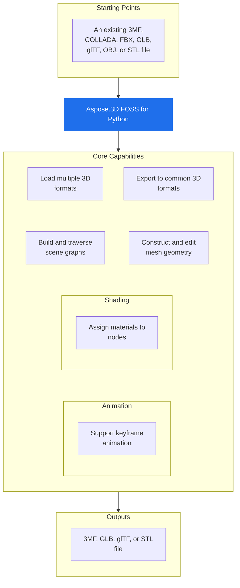

# Aspose.3D FOSS for Python

[](https://pypi.org/project/aspose-3d-foss/)  [](LICENSE) [](https://github.com/aspose-3d-foss/Aspose.3D-FOSS-for-Python/graphs/contributors)

[](https://products.aspose.org/3d/python/)

Aspose.3D FOSS for Python reads and writes 3D scenes in `.3mf`, `.fbx`, `.glb`, `.gltf`, `.obj`, and `.stl` formats. It constructs scenes using `Scene`, creates entities such as `Mesh` via `PolygonBuilder`, and manages transforms, materials, and animation clips through its public API.

## Navigation

- [At a Glance](#at-a-glance)
- [Key Capabilities](#key-capabilities)
- [Installation](#installation)
- [Dependencies](#dependencies)
- [Quick Start](#quick-start)
- [Additional Examples](#additional-examples)
- [API Reference](#api-reference)
- [Documentation & Resources](#documentation--resources)
- [Scope and Limitations](#scope-and-limitations)
- [Development and Testing](#development-and-testing)
- [License](#license)

## At a Glance



## Key Capabilities

- **Load multiple 3D formats.** It reads `.3mf`, `.dae`, `.fbx`, `.glb`, `.gltf`, `.obj`, and `.stl` files using `Scene.open()` with automatic format detection from the file extension or an explicit `FileFormat`.
- **Export to common 3D formats.** It exports scenes to `.3mf`, `.glb`, `.gltf`, and `.stl` formats using `Scene.save()` with format-specific `SaveOptions` subclasses for coordinate flipping, unit scaling, and compression settings.
- **Build and traverse scene graphs.** It builds and traverses scene graphs using `Node.create_child_node()`, `Node.add_entity()`, and `Node.child_nodes`, with each node carrying an independent `Transform` that stores translation, rotation, and scale.
- **Construct and edit mesh geometry.** It constructs and edits mesh geometry through `Mesh.control_points`, `Mesh.create_polygon()`, and `Mesh.polygons`, or by converting parameterized primitives like `Box` and `Sphere` using their `to_mesh()` method.
- **Assign materials to nodes.** It assigns `LambertMaterial`, `PhongMaterial`, or `PbrMaterial` to nodes, setting diffuse, specular, emissive, and PBR albedo/metallic/roughness color and factor properties directly.
- **Support keyframe animation.** It supports keyframe animation using `AnimationClip`, `AnimationNode`, and `KeyframeSequence`, and stores skeletal bind-pose data with `Pose`.

## Installation

Install the published package from PyPI (`aspose-3d-foss`, version 26.1.0):

```bash
pip install aspose-3d-foss
```

To work from a source checkout instead, install the clone with pip:

```bash
git clone https://github.com/aspose-3d-foss/Aspose.3D-FOSS-for-Python.git
cd Aspose.3D-FOSS-for-Python
pip install .
```

Verify the install:

```bash
python -c "import aspose.threed"
```

The package supports Python 3.7, 3.8, 3.9, 3.10, 3.11, and 3.12. Requires Python 3.7 or later.

## Dependencies

### Required Package Dependencies

No required third-party package dependencies; in `setup.py`, the `install_requires` list is empty.

### Native and System Requirements

- Requires Python 3.7 or later (`python_requires=">=3.7"` in `setup.py`).

### Development Dependencies

- `pytest>=7.0.0` (extra `dev`)

## Quick Start

This example creates a box with a blue Lambert material and saves it as a glTF file.

```python
from aspose.threed import Scene
from aspose.threed.entities import Box
from aspose.threed.shading import LambertMaterial
from aspose.threed.utilities import Vector3

scene = Scene()
box = Box(length=2.0, width=1.0, height=1.0)
material = LambertMaterial()
material.diffuse_color = Vector3(0.2, 0.6, 0.9)

scene.root_node.create_child_node("Crate", entity=box.to_mesh(), material=material)
scene.save("crate.gltf")
```

This example creates a sphere with a metallic PBR material and saves it as an STL file.

```python
from aspose.threed import Scene
from aspose.threed.entities import Sphere
from aspose.threed.shading import PbrMaterial
from aspose.threed.utilities import Vector3

scene = Scene()
sphere = Sphere()
material = PbrMaterial(albedo=Vector3(0.8, 0.1, 0.1))
material.metallic_factor = 0.9
material.roughness_factor = 0.2

scene.root_node.create_child_node("Ball", entity=sphere.to_mesh(), material=material)
scene.save("ball.stl")
```

## Additional Examples

The following examples demonstrate common workflows: creating and exporting meshes, inspecting scene graphs, and converting primitives.

### Create a Mesh with a PBR Material and Export to glTF

```python
import io
import json
from aspose.threed import Scene, FileFormat
from aspose.threed.entities import Mesh
from aspose.threed.utilities import Vector3, Vector4
from aspose.threed.formats.gltf import GltfSaveOptions
from aspose.threed.shading import PbrMaterial

scene = Scene()
mesh = Mesh("TestMesh")
mesh.control_points.add(Vector4(0.0, 0.0, 0.0, 1.0))
mesh.control_points.add(Vector4(1.0, 0.0, 0.0, 1.0))
mesh.control_points.add(Vector4(0.0, 1.0, 0.0, 1.0))
mesh.create_polygon(0, 1, 2)

albedo = Vector3(0.8, 0.2, 0.3)
material = PbrMaterial("RedMaterial", albedo)
material.metallic_factor = 0.5
material.roughness_factor = 0.7

node = scene.root_node.create_child_node("TestNode")
node.entity = mesh
node.material = material

stream = io.BytesIO()
# Pass the detected FileFormat into the constructor explicitly: unlike
# StlFormat, GltfFormat.create_save_options() does not set file_format on the
# options it returns, and a bare stream (no filename) gives scene.save()
# nothing else to detect the format from.
options = GltfSaveOptions(FileFormat.get_format_by_extension(".gltf"))
options.binary_mode = False
scene.save(stream, options)

stream.seek(0)
gltf_data = json.loads(stream.read().decode("utf-8"))
print(gltf_data["materials"][0]["pbrMetallicRoughness"])
```

<details>
<summary>View Additional Examples</summary>

### Open a glTF File and Walk Its Scene Graph

```python
from aspose.threed import Scene

scene = Scene()
scene.open("model.gltf")

def walk(node, depth=0):
    print("  " * depth + (node.name or "(unnamed)"))
    for child in node.child_nodes:
        walk(child, depth + 1)

walk(scene.root_node)
```

### Build a Triangle Mesh and Export to ASCII STL

```python
import io
from aspose.threed import Scene, FileFormat
from aspose.threed.entities import Mesh
from aspose.threed.utilities import Vector4

scene = Scene()
mesh = Mesh("triangle")
mesh.control_points.add(Vector4(0.0, 0.0, 0.0, 1.0))
mesh.control_points.add(Vector4(1.0, 0.0, 0.0, 1.0))
mesh.control_points.add(Vector4(1.0, 1.0, 0.0, 1.0))
mesh.create_polygon(0, 1, 2)

node = scene.root_node.create_child_node("triangle_node")
node.entity = mesh

stream = io.StringIO()
# Use FileFormat.get_format_by_extension(...).create_save_options() rather than
# StlSaveOptions() directly: a default-constructed options object has no
# file_format set, and scene.save() cannot infer the format from a bare stream
# (only filename-based saves fall back to extension detection).
options = FileFormat.get_format_by_extension(".stl").create_save_options()
options.binary_mode = False
scene.save(stream, options)
print(stream.getvalue())
```

### Convert a `Box` Primitive to a Mesh and Count Control Points

```python
from aspose.threed.entities import Box

box = Box(10, 20, 30)
mesh = box.to_mesh()
print(f"Control points: {len(mesh.control_points)}")
```

### Build a Cube Mesh and Export to Uncompressed 3MF

```python
import io
from aspose.threed import Scene
from aspose.threed.entities import Mesh
from aspose.threed.utilities import Vector4
from aspose.threed.formats import ThreeMfSaveOptions

scene = Scene()
mesh = Mesh("cube")
for point in [
    Vector4(0, 0, 0, 1), Vector4(1, 0, 0, 1), Vector4(1, 1, 0, 1), Vector4(0, 1, 0, 1),
    Vector4(0, 0, 1, 1), Vector4(1, 0, 1, 1), Vector4(1, 1, 1, 1), Vector4(0, 1, 1, 1),
]:
    mesh.control_points.add(point)

mesh.create_polygon(0, 1, 2)
mesh.create_polygon(0, 2, 3)
mesh.create_polygon(4, 7, 6)
mesh.create_polygon(4, 6, 5)
mesh.create_polygon(0, 4, 5)
mesh.create_polygon(0, 5, 1)
mesh.create_polygon(2, 6, 7)
mesh.create_polygon(2, 7, 3)
mesh.create_polygon(0, 3, 7)
mesh.create_polygon(0, 7, 4)
mesh.create_polygon(1, 5, 6)
mesh.create_polygon(1, 6, 2)

node = scene.root_node.create_child_node("cube")
node.entity = mesh

stream = io.BytesIO()
options = ThreeMfSaveOptions()
options.enable_compression = False
scene.save(stream, options)
```

Import an OBJ file and inspect its geometry:

```python
from aspose.threed import Scene
from aspose.threed.formats.obj import ObjLoadOptions

scene = Scene()
options = ObjLoadOptions()
options.enable_materials = True
scene.open("model.obj", options)

for node in scene.root_node.child_nodes:
    if node.entity is not None:
        mesh = node.entity
        print(f"{node.name}: {len(mesh.control_points)} vertices, {mesh.polygon_count} polygons")
```

More real, verified snippets are collected below, each demonstrating one operation without
obscuring the primary installation and quick-start path.

### Convert Between Formats

```python
from aspose.threed import Scene

scene = Scene()
scene.open("model.obj")
scene.save("model.glb")
```

### Triangulate an Imported Mesh

```python
from aspose.threed import Scene
from aspose.threed.entities import PolygonModifier

scene = Scene()
scene.open("model.obj")

for node in scene.root_node.child_nodes:
    if node.entity is not None:
        triangulated = PolygonModifier.triangulate(node.entity)
        if triangulated is not None:
            node.entity = triangulated
```

### Import a COLLADA File

```python
from aspose.threed import Scene
from aspose.threed.formats.collada.ColladaLoadOptions import ColladaLoadOptions

scene = Scene()
options = ColladaLoadOptions()
scene.open("model.dae", options)

print(f"Child nodes: {len(scene.root_node.child_nodes)}")
```

</details>

## API Reference

Aspose.3D FOSS for Python provides the `aspose.threed.Scene` class as the primary entry point for loading and saving 3D scenes built from `Node` objects, each of which can hold a `Transform`, an optional `Entity`, and one or more `Material` instances. The `aspose.threed.FileFormat` class supports detection and dispatch for multiple 3D file formats, and the `aspose.threed.Mesh` class provides polygonal geometry representation.

The public API has 337 types.

<details>
<summary>View the Complete Public API Surface</summary>

### Core API

| Class | Description |
| --- | --- |
| `A3DObject` | A3DObject class holds a name and a read-only collection of properties, and provides methods to find, get, set, and remove properties. |
| `AnimationChannel` | AnimationChannel class holds a keyframe sequence, a default value, and a component type. |
| `AnimationClip` | AnimationClip class holds a description, a name, a read-only collection of animations, a read-only collection of properties, and start and stop times. |
| `AnimationNode` | AnimationNode class holds a name, a read-only collection of bind points, a read-only collection of sub animations, and a read-only collection of properties, and provides methods to create, find, and get bind points and keyframe sequences. |
| `ArrayListAdapter` | Adapter class that wraps List[T] and implements IArrayList[T]. |
| `AssetInfo` | AssetInfo class holds properties such as ambient, application name, application vendor, application version, author, axis system, comment, and coordinate system. |
| `Axis` | The coordinate axis. |
| `AxisSystem` | Not implemented. |
| `BindPoint` | BindPoint class holds a name, a read-only collection of properties, and provides methods to add, bind, and get keyframe sequences and channels. |
| `BonePose` | BonePose class holds a node, a matrix, and an is local flag. |
| `BoundingBox2D` | The axis-aligned bounding box for Vector2 |
| `BoundingBoxExtent` | The extent of the bounding box |
| `Box` | Box class holds height, height segments, length, length segments, width, and width segments, and provides a to mesh method. |
| `Camera` | Camera class holds aspect, aspect ratio, direction, excluded, far plane, field of view, and field of view x properties, and its get entity renderer key method is not implemented. |
| `Circle` | Circle class holds radius, segments, theta length, theta start, and provides a to mesh method. |
| `ComposeOrder` | The order to compose transform matrix |
| `CoordinateSystem` | The left handed or right handed coordinate system. |
| `Curve` | Curve class holds a color property. |
| `CustomObject` | CustomObject class is a base class for custom objects. |
| `Cylinder` | Cylinder class holds generate fan cylinder, height, height segments, offset bottom, offset top, open ended, radial segments, and radius bottom properties. |
| `Dish` | Dish class holds height, height segments, radius, and width segments, provides a get bounding box method and a to mesh method. |
| `Ellipse` | Ellipse class holds radius x, radius y, segments, theta length, theta start, and provides a to mesh method. |
| `Entity` | Entity class holds an excluded flag, a parent node, and a read-only collection of parent nodes, and its get bounding box and get entity renderer key methods are not implemented. |
| `ExportException` | Declared; not thrown by library code. |
| `Extrapolation` | Extrapolation class holds a repeat count and a type. |
| `FMatrix4` | Matrix 4x4 with all component in float type |
| `FileContentType` | File content type |
| `FileFormat` | FileFormat class holds can export, can import, content type, extension, and version properties, and its getters always return default values. |
| `FileFormatType` | File format type |
| `Frustum` | Frustum class holds height, height segments, radial segments, radius bottom, radius top, theta length, theta start, and provides a to mesh method. |
| `Geometry` | Geometry class holds cast shadows, a read-only collection of control points, and a read-only collection of deformers, and its get entity renderer key method is not implemented and remove property always returns False. |
| `GlobalTransform` | GlobalTransform class holds euler angles, rotation, scale, transform matrix, and translation properties. |
| `Group` | A Group represents the logical relationships of Node. |
| `INamedObject` | INamedObject class holds a name property, and its name getter is not implemented. |
| `IOExtension` | Utilities to write matrix/vector to binary writer |
| `ImageRenderOptions` | ImageRenderOptions class holds asset directories, background color, and enable shadows properties. |
| `ImportException` | Declared; not thrown by library code. |
| `KeyFrame` | KeyFrame class holds bias, continuity, flat, independent tangent, interpolation, next in tangent, next in weight, and out tangent properties. |
| `KeyframeSequence` | KeyframeSequence class holds a bind point, a read-only collection of key frames, a name, a read-only collection of properties, and read-only post and pre behaviors, and provides methods to add and reset. |
| `Light` | Light class is a subclass of Camera. |
| `LinearExtrusion` | LinearExtrusion class holds center, direction, height, shape, slices, twist, and twist offset, and its to mesh method is not implemented. |
| `MathUtils` | A set of useful mathematical utilities. |
| `Mesh` | Mesh class holds a read-only collection of control points, a read-only collection of edges, and provides methods to create polygons, and its difference, do boolean, get entity renderer key, intersect, is manifold, and optimize methods are not implemented (some members not implemented). |
| `Node` | Node class holds an asset info, a read-only collection of child nodes, a read-only collection of entities, an entity, and provides methods to add child nodes, add entities, create child nodes, and evaluate global transform. |
| `ParseException` | Declared; not thrown by library code. |
| `Plane` | Plane class holds length, length segments, up, width, and width segments, and provides a to mesh method. |
| `PolygonBuilder` | PolygonBuilder class provides methods to begin, add vertex, and end, where add vertex and end raise InvalidOperationException conditionally. |
| `Pose` | Pose class holds a read-only collection of bone poses, a pose type, and provides a method to add bone poses. |
| `Primitive` | Primitive class holds cast shadows, receive shadows, and provides a to mesh method that is not implemented. |
| `Property` | Property class holds a name, a value, a value type, and provides methods to get and set extra data, and to get bind points and keyframe sequences. |
| `PropertyCollection` | PropertyCollection class holds a count and provides methods to find property, get, and remove property. |
| `PropertyFlags` | Property's flags |
| `Rect` | A class to represent the rectangle |
| `RelativeRectangle` | Relative rectangle |
| `RotationOrder` | The order controls which rx ry rz are applied in the transformation matrix. |
| `Scene` | Scene class holds animation clips, an asset info, a current animation clip, and a library, and provides methods to clear, create animation clips, get animation clips, and open files, where open raises RuntimeError conditionally and render is not implemented (some members not implemented). |
| `SceneObject` | SceneObject class holds a scene property. |
| `SemanticAttribute` | Allow user to use their own structure for static declaration of VertexDeclaration |
| `Sphere` | Sphere class constructs a sphere primitive with radius, phi_start, phi_length, theta_start, theta_length, width_segments, and height_segments properties, and provides a to_mesh method. |
| `Transform` | Transform class holds geometric_translation, geometric_rotation, geometric_scaling, translation, rotation, scaling, pre_rotation, post_rotation, and euler_angles properties. |
| `TransformBuilder` | Not implemented. |
| `TrialException` | Declared; not thrown by library code. |
| `Vertex` | Vertex reference, used to access the raw vertex in TriMesh. |
| `VertexDeclaration` | The declaration of a custom defined vertex's structure |
| `VertexField` | Vertex's field memory layout description. |
| `VertexFieldDataType` | Vertex field's data type |
| `VertexFieldSemantic` | The semantic of the vertex field |
| `Bone` | Bone class holds bone_transform, transform, link_mode, node, weight_count, get_weight, and set_weight members, and its node getter raises RuntimeError (conditionally). |
| `BoneLinkMode` | BoneLinkMode enum lists the ADDITIVE, NORMALIZE, and TOTAL_ONE bone link modes. |
| `Deformer` | Deformer class holds an owner read-only property, and its owner getter raises RuntimeError (conditionally). |
| `MorphTargetChannel` | MorphTargetChannel class holds channel_weight, targets, weights, get_weight, and set_weight members. |
| `MorphTargetDeformer` | MorphTargetDeformer class holds a channels read-only property. |
| `SkinDeformer` | SkinDeformer class holds a bones read-only property. |
| `ApertureMode` | Camera aperture modes. |
| `BooleanOperand` | This class encapsulates the transformed mesh as Boolean operation's operand. |
| `BooleanOperation` | BooleanOperation enum lists the ADD, SUB, and INTERSECT boolean operations. |
| `BooleanOperator` | Boolean operator allows you to apply Boolean operation on two IMeshConvertible instances. |
| `CompositeCurve` | A CompositeCurve is consisting of several curve segments. |
| `CurveDimension` | CurveDimension enum lists the TWO_DIMENSIONAL and THREE_DIMENSIONAL curve dimensions. |
| `EndPoint` | The end point to trim the curve, can be a parameter value or a Cartesian point. |
| `HalfSpace` | HalfSpace represents a infinity space which is split by a plane, this can be used with BooleanOperator |
| `IIndexedVertexElement` | IIndexedVertexElement class holds an indices read-only property, and its indices getter raises NotImplementedError. |
| `IMeshConvertible` | Entities that implemented this interface can be converted to Mesh |
| `IOrientable` | Orientable entities shall implement this interface. |
| `LightType` | Light types. |
| `Line` | A polyline is a path defined by a set of points with control_points, and connected by segments. |
| `MappingMode` | MappingMode enum lists the ALL_SAME, CONTROL_POINT, EDGE, POLYGON, and POLYGON_VERTEX mapping modes. |
| `NurbsCurve` | NurbsCurve class holds control_points, knot_vectors, multiplicity, curve_type, degree, dimension, evaluate, and evaluate_at members, and its evaluate and evaluate_at methods raise NotImplementedError (some members not implemented). |
| `NurbsDirection` | NurbsDirection class holds count, degree, divisions, order, type, knot_vectors, and multiplicity members. |
| `NurbsSurface` | NurbsSurface class holds u, v, and to_mesh members, and its to_mesh method raises NotImplementedError (some members not implemented). |
| `NurbsType` | NurbsType enum lists the OPEN, CLOSED, and PERIODIC nurbs types. |
| `Patch` | Patch class holds u and v read-only properties. |
| `PatchDirection` | PatchDirection class holds closed, control_points, divisions, and type members. |
| `PatchDirectionType` | PatchDirectionType enum lists the LINEAR, QUADRATIC_BEZIER, BEZIER, CARDINAL_SPLINE, and BASIS_SPLINE patch direction types. |
| `PointCloud` | PointCloud class holds dimension, from_geometry, from_geometry_with_density, and get_entity_renderer_key members, and its from_geometry and from_geometry_with_density methods raise NotImplementedError (some members not implemented). |
| `InvalidOperationException` | InvalidOperationException class is an exception raised by PolygonBuilder operations. |
| `PolygonModifier` | PolygonModifier class holds a triangulate method, and its triangulate method raises TypeError (conditionally). |
| `ProjectionType` | Camera's projection types. |
| `Pyramid` | Parameterized pyramid. |
| `RectangularTorus` | Parameterized rectangular torus entity. |
| `ReferenceMode` | ReferenceMode enum lists the DIRECT, INDEX, and INDEX_TO_DIRECT reference modes. |
| `RevolvedAreaSolid` | RevolvedAreaSolid entity. |
| `RotationMode` | The frustum's rotation mode. |
| `Shape` | Base class for all shape entities. |
| `Skeleton` | The Skeleton is mainly used by CAD software to help designer to manipulate the transformation of skeletal structure, it's usually useless outside the CAD softwares. |
| `SkeletonType` | Skeleton type enum. |
| `SplitMeshPolicy` | Share vertex/control point data between sub-meshes or each sub-mesh has its own compacted data. |
| `SweptAreaSolid` | SweptAreaSolid entity. |
| `TextureMapping` | TextureMapping enum lists the DIFFUSE, SPECULAR, AMBIENT, EMISSIVE, SHININESS, REFLECTION, NORMAL, BUMP, DISPLACEMENT, SHADOW, GLOW, and OPACITY texture mappings. |
| `Torus` | Parameterized torus entity. |
| `TransformedCurve` | TransformedCurve entity. |
| `TriMesh` | TriMesh is a triangle mesh that stores triangles. |
| `TrimmedCurve` | TrimmedCurve entity. |
| `VertexElement` | VertexElement class holds vertex_element_type, name, mapping_mode, reference_mode, indices, clear, set_indices, and set_indices members. |
| `VertexElementBinormal` | VertexElementBinormal class is a vertex element for binormal data. |
| `VertexElementDoublesTemplate` | A helper class for defining concrete implementations. |
| `VertexElementEdgeCrease` | Defines the edge crease values for specified components. |
| `VertexElementFVector` | VertexElementFVector class holds data, indices, clear, copy_to, set_data, and set_indices members, and its set_data method raises TypeError (conditionally). |
| `VertexElementHole` | Defines the hole information for specified components. |
| `VertexElementIntsTemplate` | A helper class for defining concrete implementations with int data. |
| `VertexElementMaterial` | Defines the material for specified components. |
| `VertexElementNormal` | VertexElementNormal class is a vertex element for normal data. |
| `VertexElementPolygonGroup` | Defines the polygon group for specified components. |
| `VertexElementSmoothingGroup` | VertexElementSmoothingGroup class is a vertex element for smoothing group data. |
| `VertexElementSpecular` | Defines the specular color for specified components. |
| `VertexElementTangent` | VertexElementTangent class is a vertex element for tangent data. |
| `VertexElementTemplate` | A helper class for defining concrete implementations of vertex elements with typed data. |
| `VertexElementType` | VertexElementType enum lists the UV, NORMAL, VERTEX_COLOR, TANGENT, BINORMAL, MATERIAL, HOLE, EDGE_CREASE, SMOOTHING_GROUP, SPECULAR, USER_DATA, and POLYGON_GROUP vertex element types. |
| `VertexElementUV` | VertexElementUV class holds add_data and texture_mapping members, and its add_data method raises TypeError (conditionally). |
| `VertexElementUserData` | Defines the user data for specified components. |
| `VertexElementVector4` | Defines the vector4 data for specified components. |
| `VertexElementVertexColor` | VertexElementVertexColor class is a vertex element for vertex color data. |
| `VertexElementVertexCrease` | Defines the vertex crease values for specified components. |
| `VertexElementVisibility` | Defines the visibility for specified components. |
| `VertexElementWeight` | Defines the weight for specified components. |
| `A3dwSaveOptions` | Save options for A3DW |
| `AmfSaveOptions` | Save options for AMF |
| `BasicLoadOptions` | Simple LoadOptions subclass for basic loading options. |
| `ColladaLoadOptions` | Load options for Collada |
| `ColladaSaveOptions` | Save options for collada |
| `ColladaTransformStyle` | The node's transformation style of node |
| `Discreet3dsLoadOptions` | Load options for Discreet 3DS |
| `Discreet3dsSaveOptions` | Save options for Discreet 3DS |
| `DracoCompressionLevel` | Compression level for draco file |
| `DracoFormat` | Google Draco format |
| `DracoSaveOptions` | Save options for Draco |
| `Exporter` | Exporter class holds export and supports_format members, and its export and supports_format methods raise NotImplementedError. |
| `FbxLoadOptions` | Load options for FBX |
| `FbxSaveOptions` | Save options for FBX |
| `FormatDetector` | FormatDetector class holds a detect method, and its detect method raises NotImplementedError. |
| `GltfEmbeddedImageFormat` | Embedded image format for GLTF |
| `formats.GltfLoadOptions` | Load options for glTF |
| `formats.GltfSaveOptions` | Save options for glTF |
| `Html5SaveOptions` | Save options for HTML5 |
| `IOConfig` | IOConfig class holds file_name, encoding, file_system, lookup_paths, and file_format members. |
| `IOService` | IOService class holds create_exporter, create_importer, detect_format, get_all_plugins, get_plugin_for_extension, get_plugin_for_format, register_detector, and register_exporter members, and its create_exporter and create_importer methods raise RuntimeError (conditionally). |
| `Importer` | Importer class holds import_scene and supports_format members, and its import_scene and supports_format methods raise NotImplementedError. |
| `JtLoadOptions` | Load options for JT |
| `LoadOptions` | LoadOptions class provides options for loading 3D scenes. |
| `Microsoft3MFFormat` | Microsoft 3MF format |
| `Microsoft3MFSaveOptions` | Save options for Microsoft 3MF |
| `formats.ObjLoadOptions` | Load options for OBJ |
| `formats.ObjSaveOptions` | Save options for OBJ |
| `PdfFormat` | Adobe's Portable Document Format |
| `PdfLightingScheme` | Lighting scheme for PDF export |
| `PdfLoadOptions` | Load options for PDF |
| `PdfRenderMode` | Render mode for PDF export |
| `PdfSaveOptions` | Save options for PDF |
| `Plugin` | Plugin class provides factory methods to create load options, save options, exporters, importers, file formats, and format detectors. |
| `PlyFormat` | PLY format |
| `PlyLoadOptions` | Load options for PLY |
| `PlySaveOptions` | Save options for PLY |
| `RvmFormat` | RVM format |
| `RvmLoadOptions` | Load options for RVM |
| `RvmSaveOptions` | Save options for RVM |
| `SaveOptions` | SaveOptions class provides options for saving 3D scenes and includes a property to control texture export. |
| `formats.StlLoadOptions` | Load options for STL |
| `formats.StlSaveOptions` | Save options for STL |
| `ThreeMfFormat` | ThreeMfFormat class represents the 3MF file format and provides read-only properties for its extension, content type, version, and format type, along with methods to create load and save options. |
| `ThreeMfLoadOptions` | ThreeMfLoadOptions class provides options for loading 3MF files and includes a property to flip the coordinate system. |
| `ThreeMfSaveOptions` | ThreeMfSaveOptions class provides options for saving 3MF files and includes properties to control compression, coordinate system, pretty printing, and unit, where setting unit raises ValueError conditionally. |
| `U3dLoadOptions` | Load options for U3D |
| `U3dSaveOptions` | Save options for U3D |
| `UsdSaveOptions` | Save options for USD |
| `XLoadOptions` | Load options for X format |
| `ColladaExporter` | Defined as `class ColladaExporter(Exporter)`. |
| `ColladaFormat` | ColladaFormat class represents the COLLADA file format and provides read-only properties for its extension, content type, version, and format type, along with methods to create load and save options. |
| `ColladaFormatDetector` | ColladaFormatDetector class provides a method to detect COLLADA format from input data. |
| `ColladaImporter` | ColladaImporter class provides methods to import COLLADA scenes and to check format support, where import_scene raises TypeError conditionally. |
| `ColladaPlugin` | Defined as `class ColladaPlugin(Plugin)`. |
| `FbxExporter` | FbxExporter class provides methods to save scenes to FBX format, where save and save_to_stream raise NotImplementedError (some members not implemented). |
| `FbxFormat` | FbxFormat class represents the FBX file format and provides read-only properties for its extension, content type, version, and format type, along with methods to create load and save options. |
| `FbxFormatDetector` | FbxFormatDetector class provides a method to detect FBX format from input data. |
| `FbxImporter` | FbxImporter class provides methods to import FBX scenes, open files or streams, and check format support. |
| `FbxPlugin` | FbxPlugin class provides factory methods to create load options, save options, exporters, importers, file formats, and format detectors for FBX. |
| `BinaryTokenizer` | BinaryTokenizer class provides a method to tokenize binary FBX data, where tokenize raises ValueError conditionally. |
| `binary_tokenizer.Token` | Token class represents a token from binary FBX data and provides read-only properties for its text, type, and value. |
| `binary_tokenizer.TokenType` | TokenType enum lists the binary FBX token types including OPEN_BRACKET, CLOSE_BRACKET, KEY, DATA, COMMA, and provides a to_string method. |
| `FbxElement` | FbxElement class represents an FBX parser element and provides methods to add tokens and manage its compound flag, along with read-only properties for its key and tokens. |
| `FbxParser` | FbxParser class provides a method to parse FBX values and a read-only property for its root scope. |
| `FbxScope` | FbxScope class represents an FBX parser scope and provides methods to add and retrieve elements, along with a read-only property for its elements. |
| `FbxTokenizer` | FbxTokenizer class provides a method to tokenize text FBX data, where tokenize raises ValueError conditionally. |
| `tokenizer.Token` | Token class represents a token from text FBX data and provides read-only properties for its text, type, line, and column. |
| `tokenizer.TokenType` | TokenType enum lists the text FBX token types including OPEN_BRACKET, CLOSE_BRACKET, KEY, DATA, COMMA, and provides a to_string method. |
| `GltfExporter` | GltfExporter class provides methods to export scenes to glTF format and to check format support. |
| `GltfFormat` | GltfFormat class represents the glTF file format and provides read-only properties for its extension, content type, version, and format type, along with methods to create load and save options. |
| `GltfFormatDetector` | GltfFormatDetector class provides a method to detect glTF format from input data. |
| `GltfImporter` | GltfImporter class provides methods to import glTF scenes and to check format support. |
| `gltf.GltfLoadOptions` | GltfLoadOptions class provides options for loading glTF files and includes a property to flip the V coordinate of texture coordinates. |
| `GltfPlugin` | GltfPlugin class provides factory methods to create load options, save options, exporters, importers, file formats, and format detectors for glTF. |
| `gltf.GltfSaveOptions` | GltfSaveOptions class provides options for saving glTF files and includes properties to control binary mode, flip the V coordinate of texture coordinates, and access the file format. |
| `ObjExporter` | ObjExporter class provides methods to export scenes to OBJ format and to check format support. |
| `ObjFormat` | ObjFormat class represents the OBJ file format and provides read-only properties for its extension, content type, version, and format type, along with methods to create load and save options. |
| `ObjFormatDetector` | ObjFormatDetector class provides a method to detect OBJ format from input data. |
| `ObjImporter` | ObjImporter class provides methods to import OBJ scenes and to check format support, where import_scene raises TypeError conditionally. |
| `obj.ObjLoadOptions` | ObjLoadOptions class provides options for loading OBJ files and includes properties to enable materials, flip the coordinate system, normalize normals, and scale. |
| `ObjPlugin` | ObjPlugin class provides factory methods to create load options, save options, exporters, importers, file formats, and format detectors for OBJ. |
| `obj.ObjSaveOptions` | ObjSaveOptions class provides options for saving OBJ files and includes properties to apply unit scale, set axis system, enable materials, flip coordinate system, enable point cloud mode, serialize W component, and enable verbose output. |
| `StlExporter` | StlExporter class provides methods to export scenes to STL format and to check format support. |
| `StlFormat` | StlFormat class represents the STL file format and provides properties for can_export, can_import, content_type, extension, and version. |
| `StlFormatDetector` | StlFormatDetector class detects STL file format by implementing the detect method. |
| `StlImporter` | StlImporter class imports STL scenes and supports format detection, with import_scene raising TypeError conditionally. |
| `stl.StlLoadOptions` | StlLoadOptions class provides load options for STL files with flip_coordinate_system and scale properties. |
| `StlPlugin` | StlPlugin class provides factory methods for STL format including create_load_options, create_save_options, get_exporter, get_file_format, get_format_detector, and get_importer. |
| `stl.StlSaveOptions` | StlSaveOptions class provides save options for STL files with binary_mode, flip_coordinate_system, and scale properties. |
| `ThreeMfExporter` | ThreeMfExporter class exports scenes to 3MF format and supports format detection via export and supports_format methods. |
| `ThreeMfFormatDetector` | ThreeMfFormatDetector class detects 3MF file format by implementing the detect method. |
| `ThreeMfImporter` | ThreeMfImporter class imports 3MF scenes and supports format detection, with import_scene raising TypeError and ValueError conditionally. |
| `ThreeMfPlugin` | ThreeMfPlugin class provides factory methods for 3MF format including create_load_options, create_save_options, get_exporter, get_file_format, get_format_detector, and get_importer. |
| `ArbitraryProfile` | This class allows you to construct a 2D profile directly from arbitrary curve. |
| `CShape` | IFC compatible C-shape profile that defined by parameters. |
| `CenterLineProfile` | IFC compatible center line profile. |
| `CircleShape` | IFC compatible circle profile. |
| `EllipseShape` | IFC compatible ellipse profile. |
| `FontFile` | Font file contains definitions for glyphs, this is used to create text profile. |
| `HShape` | IFC compatible H-shape profile. |
| `HollowCircleShape` | IFC compatible hollow circle profile. |
| `HollowRectangleShape` | IFC compatible hollow rectangular shape with both inner/outer rounding corners. |
| `LShape` | IFC compatible L-shape profile that defined by parameters. |
| `MirroredProfile` | IFC compatible mirror profile. |
| `ParameterizedProfile` | The base class of all parameterized profiles. |
| `Profile` | 2D Profile in xy plane. |
| `RectangleShape` | IFC compatible rectangle profile. |
| `TShape` | IFC compatible T-shape defined by parameters. |
| `Text` | Text profile, this profile describes contours using font and text. |
| `TrapeziumShape` | IFC compatible Trapezium shape defined by parameters. |
| `UShape` | IFC compatible U-shape defined by parameters. |
| `ZShape` | IFC compatible Z-shape profile that defined by parameters. |
| `BlendFactor` | Blend factor specify pixel arithmetic. |
| `CompareFunction` | Compare function for depth/stencil testing. |
| `CubeFace` | Cube face enumeration. |
| `CullFaceMode` | Cull face mode for face culling. |
| `DescriptorSetUpdater` | Descriptor set updater for shader resources. |
| `DrawOperation` | Draw operation type. |
| `DriverException` | Declared; not thrown by library code. |
| `EntityRenderer` | Base class for rendering entities. |
| `EntityRendererFeatures` | Features supported by an entity renderer. |
| `EntityRendererKey` | The key of registered entity renderer. |
| `FrontFace` | Front face winding order. |
| `GLSLSource` | GLSL shader source. |
| `IBuffer` | Interface for vertex/index buffer. |
| `ICommandList` | Interface for command list. |
| `IDescriptorSet` | Interface for descriptor set. |
| `IIndexBuffer` | Interface for index buffer. |
| `IPipeline` | Interface for graphics pipeline. |
| `IRenderQueue` | Interface for render queue. |
| `IRenderTarget` | Interface for render target. |
| `IRenderTexture` | Interface for render texture. |
| `IRenderWindow` | Interface for render window. |
| `ITexture1D` | Interface for 1D texture. |
| `ITexture2D` | Interface for 2D texture. |
| `ITextureCodec` | Interface for texture codec. |
| `ITextureCubemap` | Interface for cubemap texture. |
| `ITextureDecoder` | Interface for texture decoder. |
| `ITextureEncoder` | Interface for texture encoder. |
| `ITextureUnit` | Interface for texture unit. |
| `IVertexBuffer` | Interface for vertex buffer. |
| `IndexDataType` | Data type for indices. |
| `InitializationException` | Declared; not thrown by library code. |
| `PixelFormat` | Pixel format for render targets. |
| `PixelMapMode` | Pixel mapping mode. |
| `PixelMapping` | Pixel mapping configuration. |
| `PolygonMode` | Polygon rendering mode. |
| `PostProcessing` | Post-processing effect. |
| `PresetShaders` | Predefined shaders. |
| `PushConstant` | Push constant for shaders. |
| `RenderFactory` | Not implemented. |
| `RenderParameters` | Parameters for rendering. |
| `RenderQueueGroupId` | Render queue group ID. |
| `RenderResource` | Base class for render resources. |
| `RenderStage` | Render stage in the pipeline. |
| `RenderState` | Render state configuration. |
| `Renderer` | Not implemented. |
| `RendererVariableManager` | Manages renderer variables. |
| `SPIRVSource` | SPIRV shader source. |
| `ShaderException` | Declared; not thrown by library code. |
| `ShaderProgram` | Shader program. |
| `ShaderSet` | Set of shaders for rendering. |
| `ShaderSource` | Shader source code. |
| `ShaderStage` | Shader stage. |
| `ShaderVariable` | Shader variable. |
| `StencilAction` | Stencil action. |
| `StencilState` | Stencil state configuration. |
| `TextureCodec` | Texture codec. |
| `TextureData` | Texture data. |
| `TextureType` | Texture type. |
| `Viewport` | Not implemented. |
| `WindowHandle` | Window handle for render window. |
| `AlphaSource` | Source of alpha channel for textures. |
| `LambertMaterial` | LambertMaterial class provides material properties for ambient_color, diffuse_color, emissive_color, transparency, and transparent_color. |
| `Material` | Material class provides base material functionality with get_texture and set_texture methods that raise NotImplementedError. |
| `PbrMaterial` | PbrMaterial class provides physically based rendering material properties including albedo, albedo_texture, emissive_color, emissive_texture, metallic_factor, metallic_roughness, and normal_texture. |
| `PbrSpecularMaterial` | Material for physically based rendering based on diffuse color/specular/glossiness. |
| `PhongMaterial` | PhongMaterial class provides Phong shading material properties including reflection_color, reflection_factor, shininess, specular_color, and specular_factor. |
| `ShaderMaterial` | A shader material allows to describe the material by external rendering engine or shader language. |
| `ShaderTechnique` | A technique in shader material describes the concrete rendering details. |
| `Texture` | Not implemented. |
| `TextureBase` | Not implemented. |
| `TextureFilter` | Texture filter type. |
| `TextureSlot` | Texture slot name. |
| `WrapMode` | Wrap mode for texture coordinates. |
| `BoundingBox` | BoundingBox class provides bounding box utilities with center, extent, maximum properties and from_geometry, get_infinite, get_null, merge methods, where from_geometry raises NotImplementedError. |
| `FVector2` | FVector2 class provides two-dimensional floating-point vector functionality with x and y properties and dot, length, normalize, parse methods, where __init__ raises TypeError conditionally and parse raises ValueError conditionally. |
| `FVector3` | FVector3 class provides three-dimensional floating-point vector functionality with x, y, and z properties and normalize, one, unit_x, unit_y, unit_z methods, where __init__ raises TypeError conditionally. |
| `FVector4` | FVector4 class provides four-dimensional floating-point vector functionality with x, y, z, and w properties, where __init__ raises TypeError conditionally. |
| `FileSystem` | File system encapsulation. |
| `Matrix4` | Matrix4 class provides four-by-four matrix functionality with m00, m01, m02 properties and concatenate, decompose, determinant, get_identity, inverse members, where __init__ raises TypeError and ValueError conditionally, inverse raises ValueError conditionally, and rotate raises TypeError conditionally. |
| `Quaternion` | Quaternion class provides quaternion functionality with concat, conjugate, dot, euler_angles, from_angle_axis, from_euler_angle, from_rotation, get_IDENTITY methods and get_bind_point and get_keyframe_sequence methods that raise NotImplementedError, where inverse raises ValueError conditionally. |
| `Vector2` | Vector2 class provides two-dimensional vector functionality with x and y properties and length, length2, parse, set members, where parse raises ValueError conditionally. |
| `Vector3` | Vector3 class provides three-dimensional vector functionality with x, y, z properties and angle_between, compare_to, cos, cross, dot, length, length2, normalize members, where __init__ raises TypeError conditionally and parse raises ValueError conditionally. |
| `Vector4` | Vector4 class provides four-dimensional vector functionality with x, y, z, w properties and set method, where __init__ raises TypeError conditionally. |
| `Watermark` | Utility to encode/decode blind watermark to/from a mesh (some members not implemented). |

#### Enumerations

| Enumeration | Description |
| --- | --- |
| `ExtrapolationType` | ExtrapolationType enum lists the CONSTANT, CYCLE, CYCLE RELATIVE, GRADIENT, and OSCILLATE extrapolation types. |
| `Interpolation` | Interpolation enum lists the BEZIER, B SPLINE, CARDINAL SPLINE, CONSTANT, LINEAR, and TCB SPLINE interpolation types. |
| `PoseType` | PoseType enum lists the BIND POSE and SNAPSHOT pose types. |
| `StepMode` | StepMode enum lists the NEXT_VALUE and PREVIOUS_VALUE step modes. |
| `WeightedMode` | WeightedMode enum lists the NONE, OUT_WEIGHT, NEXT_IN_WEIGHT, and BOTH weighted modes. |

#### Detailed Member Reference

### Scene

Scene class holds animation clips, an asset info, a current animation clip, and a library, and provides methods to clear, create animation clips, get animation clips, and open files, where open raises RuntimeError conditionally and render is not implemented (some members not implemented).

### Mesh

The `Mesh` class exposes `control_points` and edges for geometry data, provides `Mesh.create_polygon()` for polygon construction, and supports spatial queries via `Mesh.get_bounding_box()`.

### shading

The `aspose.threed.shading` module provides classes for physically based rendering workflows, including material types that support diffuse, specular, metallic, and roughness properties.

| Class | Description |
|---|---|
| `A3DObject` | A3DObject.find_property returns the property object matching the given name if it exists. |
| `A3dwSaveOptions` | Save options for A3DW. |
| `AmfSaveOptions` | Save options for AMF. |
| `AnimationChannel` | AnimationChannel.component_type specifies the data type of the animated component. |
| `AnimationClip` | AnimationClip.create_animation_node creates a new AnimationNode for the given node name. |
| `AnimationNode` | AnimationNode.find_bind_point returns the BindPoint matching the given target object and name. |
| `AssetInfo` | AssetInfo.title stores the title of the 3D asset. |
| `AxisSystem` | Axis system is an combination of coordinate system, up vector and front vector. |
| `BinaryTokenizer` | BinaryTokenizer.tokenize() parses the binary data stream and advances the cursor accordingly. |
| `BindPoint` | BindPoint.add_channel adds a new animation channel with the specified name, value and type, returning True on success. |
| `Bone` | Bone objects expose weight management via get_weight and set_weight methods, enabling skinning calculations. |
| `BoneLinkMode` | Enum with 3 members: `NORMALIZE`, `ADDITIVE`, `TOTAL_ONE`, describing how a bone's skinning weight is combined with others on the same vertex. |
| `BooleanOperation` | BooleanOperation.ADD represents a union boolean operation that adds geometry. |
| `BoundingBox` | BoundingBox.merge() can combine multiple bounding boxes or geometry to expand the box to include all elements. |
| `BoundingBox2D` | The axis-aligned bounding box for Vector2. |
| `BoundingBoxExtent` | The extent of the bounding box. |
| `Box` | Box.to_mesh() converts the parameterized box primitive into a Mesh for further processing. |
| `Camera` | Camera properties near_plane and far_plane define the depth range for the view frustum calculations. |
| `Circle` | Circle.to_mesh() converts the parameterized circle primitive into a Mesh for further processing. |
| `ColladaExporter` | ColladaExporter.supports_format returns true if the exporter can handle the given file format. |
| `ColladaFormat` | ColladaFormat.create_load_options creates and returns a Collada load options object for importing. |
| `ColladaFormatDetector` | ColladaFormatDetector.detect determines the 3D file format of a stream, optionally using the file name. |
| `ColladaImporter` | ColladaImporter.supports_format returns True if the specified file format is supported by this importer. |
| `ColladaLoadOptions` | ColladaLoadOptions.flip_coordinate_system determines whether the Y and Z axes are swapped during import. |
| `ColladaPlugin` | ColladaPlugin supplies factory methods to obtain the ColladaFormat, its importer, exporter, and format detector for seamless integration. |
| `ColladaSaveOptions` | ColladaSaveOptions.flip_coordinate_system determines whether the Y and Z axes are swapped when saving. |
| `ColladaTransformStyle` | The node's transformation style of node. |
| `ComposeOrder` | The order to compose transform matrix. |
| `Curve` | Base class for curve entities, extended by `CompositeCurve`, `NurbsCurve`, `TrimmedCurve`, and `TransformedCurve`. |
| `CurveDimension` | Enum with 2 members, `TWO_DIMENSIONAL` and `THREE_DIMENSIONAL`, describing a curve's coordinate space. |
| `CustomObject` | Stores arbitrary user-defined data as a named `A3DObject`-derived scene object. |
| `Cylinder` | Cylinder.to_mesh() converts the cylinder primitive into a Mesh object for further processing. |
| `Deformer` | Base class for mesh deformers, extended by `SkinDeformer` and `MorphTargetDeformer`. |
| `Discreet3dsLoadOptions` | Load options for Discreet 3DS. |
| `Discreet3dsSaveOptions` | Save options for Discreet 3DS. |
| `Dish` | Dish.to_mesh() creates a Mesh from a dish primitive, and its radius and height properties control its size. |
| `DracoCompressionLevel` | Compression level for draco file. |
| `DracoFormat` | Google Draco format. |
| `DracoSaveOptions` | Save options for Draco. |
| `Ellipse` | Ellipse.to_mesh() converts an ellipse primitive into a Mesh object that can be added to a scene. |
| `Entity` | Entity objects expose get_bounding_box() for spatial queries and a full set of property‑management methods (find_property, get_property, set_property, remove_property). |
| `Exporter` | Exporter objects let you verify format support with supports_format() before calling export() to write a scene to a stream. |
| `Extrapolation` | Extrapolation.type represents the extrapolation mode applied to animation curves. |
| `FMatrix4` | Matrix 4x4 with all component in float type. |
| `FVector2` | FVector2.normalize returns a new FVector2 with the same direction and unit length. |
| `FVector3` | FVector3.zero returns a vector with all components set to 0. |
| `FVector4` | FVector4.x represents the X component of the 4‑dimensional vector. |
| `FbxElement` | FbxElement.add_token adds the given token to the element's token collection. |
| `FbxFormat` | FbxFormat.detect(stream, file_name) returns the detected file format, enabling dynamic handling of unknown input files. |
| `FbxFormatDetector` | FbxFormatDetector.detect determines the FBX format of the provided stream, optionally using the file name. |
| `FbxImporter` | FbxImporter.supports_format returns True if the given file format is supported for import. |
| `FbxLoadOptions` | FbxLoadOptions exposes properties such as keep_builtin_global_settings, compatible_mode, file_format, encoding, file_system, lookup_paths, and file_name to customize FBX import behavior. |
| `FbxParser` | FbxParser.parse_value parses the provided token and returns its evaluated value. |
| `FbxPlugin` | FbxPlugin.get_file_format returns the identifier or name of the FBX file format handled by the plugin. |
| `FbxSaveOptions` | FbxSaveOptions provides export_textures, embed_textures, export_legacy_material_properties, and other flags to control how FBX files are written. |
| `FbxScope` | FbxScope.add_element(element) adds a new element to the scope, and get_elements(key) retrieves all elements of the specified type. |
| `FbxTokenizer` | FbxTokenizer.tokenize() returns a list of internal lexical-token objects representing the elements of an FBX file. |
| `FileContentType` | File content type. |
| `FileFormat` | Class that declares methods including create_load_options, create_save_options, detect, FBX7400ASCII, get_format_by_extension and GLTF2 and properties including can_export, can_import, content_type, extension, extensions and file_format_type. |
| `FileFormatType` | File format type. |
| `FormatDetector` | FormatDetector.detect detects the file format of the provided stream, using the optional file name, and returns a FileFormat. |
| `Frustum` | Frustum.to_mesh() generates a Mesh representation of a viewing frustum, useful for visual debugging of camera volumes. |
| `Geometry` | Geometry.create_element creates a VertexElement of the given type, mapping and reference modes. |
| `GltfEmbeddedImageFormat` | Embedded image format for GLTF. |
| `GltfExporter` | GltfExporter can export a scene to the glTF format and first checks support with supports_format(file_format). |
| `GltfFormat` | GltfFormat.create_load_options creates a GLTF-specific load options object for importing scenes. |
| `GltfFormatDetector` | GltfFormatDetector.detect determines the FileFormat of the provided stream, optionally using the file name. |
| `GltfImporter` | GltfImporter.supports_format returns true when the specified file format can be imported. |
| `GltfLoadOptions` | GltfLoadOptions.flip_tex_coord_v indicates whether to invert the V component of texture coordinates during GLTF import. |
| `GltfPlugin` | GltfPlugin.get_file_format returns the GltfFormat object representing the GLTF file format. |
| `GltfSaveOptions` | GltfSaveOptions.file_format specifies the output file format for saving, using the FileFormat enum. |
| `HalfSpace` | HalfSpace represents a infinity space which is split by a plane, this can be used with BooleanOperator. |
| `Html5SaveOptions` | Save options for HTML5. |
| `Importer` | Importer.supports_format(file_format) returns true when the specified FileFormat is supported for import. |
| `InvalidOperationException` | Class extending Exception. |
| `JtLoadOptions` | Load options for JT. |
| `KeyFrame` | KeyFrame.time represents the timestamp of the keyframe in seconds. |
| `KeyframeSequence` | KeyframeSequence lets developers create animation curves with per‑keyframe interpolation and tangent control. |
| `LambertMaterial` | The LambertMaterial class provides a full material system, allowing you to set emissive, ambient, diffuse, and transparent colors, as well as assign textures to predefined slots such as MAP_DIFFUSE and MAP_NORMAL. |
| `Light` | The Light class lets you configure lighting parameters such as near_plane, far_plane, aspect, ortho_height, and up direction for scene illumination. |
| `LinearExtrusion` | Extrudes a 2D `Profile` into a solid entity along a linear direction; its `to_mesh()` conversion raises `NotImplementedError` in this FOSS build. |
| `LoadOptions` | Base class for every format-specific load-options type, holding a shared `file_name` and `file_system`. |
| `MappingMode` | MappingMode.CONTROL_POINT represents mapping based on each mesh control point individually. |
| `Matrix4` | Matrix4.get_identity() returns a new identity Matrix4 instance that can be used as a starting point for building transformation chains. |
| `Mesh` | Mesh.create_polygon creates a new polygon and returns its index. |
| `Microsoft3MFFormat` | Microsoft 3MF format. |
| `Microsoft3MFSaveOptions` | Save options for Microsoft 3MF. |
| `MorphTargetChannel` | MorphTargetChannel.get_weight(target) returns the current weight for the specified morph target, and set_weight(target, weight) updates it. |
| `MorphTargetDeformer` | MorphTargetDeformer.get_weight/set_weight (via its channels) control per-target blend weights for shape-key style animation. |
| `Node` | Node.add_entity adds the given Entity to this node's entity collection. |
| `NurbsCurve` | Represents a NURBS curve via control points, knot vectors, and degree; its `evaluate()`/`evaluate_at()` sampling methods raise `NotImplementedError` in this FOSS build. |
| `NurbsDirection` | Describes the knot vector, order, degree, and NURBS type along one parametric direction (U or V) of a `NurbsSurface`. |
| `NurbsSurface` | Represents a NURBS surface via control points and per-direction `NurbsDirection` data; its `to_mesh()` conversion raises `NotImplementedError` in this FOSS build. |
| `NurbsType` | Enum with 3 members, `OPEN`, `CLOSED`, and `PERIODIC`, classifying a NURBS curve or surface direction. |
| `ObjExporter` | ObjExporter.export writes the given Scene to Wavefront OBJ, including per-node materials. |
| `ObjFormat` | ObjFormat.create_load_options creates and returns an ObjLoadOptions instance for importing OBJ files. |
| `ObjFormatDetector` | ObjFormatDetector.detect inspects a stream and reports whether its content is Wavefront OBJ. |
| `ObjImporter` | ObjImporter.import_scene loads OBJ data from a stream into a Scene using ObjLoadOptions. |
| `ObjLoadOptions` | ObjLoadOptions.flip_coordinate_system swaps the Y and Z axes when loading an OBJ file. |
| `ObjPlugin` | ObjPlugin.get_file_format returns the ObjFormat object representing the OBJ file format. |
| `ObjSaveOptions` | ObjSaveOptions.apply_unit_scale applies the scene's unit scaling when saving to OBJ. |
| `Patch` | Patch objects allow creation of custom vertex elements via create_element and create_element_uv methods. |
| `PatchDirection` | Describes the knot vector, degree, and `PatchDirectionType` along one parametric direction of a `Patch`. |
| `PatchDirectionType` | Enum with 5 members: `BEZIER`, `QUADRATIC_BEZIER`, `CARDINAL_SPLINE`, `BASIS_SPLINE`, `LINEAR`. |
| `PbrMaterial` | PbrMaterial supplies a full physically based rendering workflow with albedo, metallic, roughness, occlusion, and emissive textures. |
| `PdfFormat` | Adobe's Portable Document Format. |
| `PdfLightingScheme` | Lighting scheme for PDF export. |
| `PdfLoadOptions` | Load options for PDF. |
| `PdfRenderMode` | Render mode for PDF export. |
| `PdfSaveOptions` | Save options for PDF. |
| `PhongMaterial` | PhongMaterial.specular_color defines the RGB color of the specular highlight. |
| `Plane` | The Plane class can be converted to a Mesh by calling its to_mesh() method, enabling further mesh processing. |
| `Plugin` | Plugin.get_exporter() returns an Exporter object that can be used to write supported 3D formats. |
| `PlyFormat` | PLY format. |
| `PlyLoadOptions` | Load options for PLY. |
| `PlySaveOptions` | Save options for PLY. |
| `PointCloud` | Stores unconnected 3D points as a scene entity; its `from_geometry()`/`from_geometry_with_density()` factory methods raise `NotImplementedError` in this FOSS build. |
| `PolygonBuilder` | The PolygonBuilder class lets you construct polygon vertex indices by calling begin(), add_vertex(index) for each vertex, and end() to finalize the polygon. |
| `PolygonModifier` | PolygonModifier.triangulate can return None, a Mesh object, or a list of triangle index arrays, giving developers flexibility in handling polygon data. |
| `Pose` | Pose.add_bone_pose(node, matrix, local_matrix) records a bone transformation for skeletal animation within a Pose object. |
| `Primitive` | Base class for parameterized shape entities (`Box`, `Sphere`, `Cylinder`, and similar); the base `to_mesh()` itself raises `NotImplementedError` and is overridden by each real subclass. |
| `Property` | Property.get_extra returns the extra attribute identified by the given name. |
| `PropertyCollection` | PropertyCollection.find_property returns the property object matching the given name or None. |
| `PropertyFlags` | Property's flags. |
| `Quaternion` | Quaternion.slerp(t, v1, v2) returns an interpolated quaternion for smooth rotation animations. |
| `Rect` | A class to represent the rectangle. |
| `ReferenceMode` | ReferenceMode.DIRECT represents a reference mode where vertex data is stored directly without indexing. |
| `RelativeRectangle` | Relative rectangle The formula between relative component to absolute value is: Scale * (Reference Width) + offset So if we want it to represent an absolute value, leave all scale fields zero, and use offset fields instead. |
| `RenderFactory` | RenderFactory creates all resources that represented in rendering pipeline. |
| `Renderer` | The context about renderer. |
| `RvmFormat` | RVM format. |
| `RvmLoadOptions` | Load options for RVM. |
| `RvmSaveOptions` | Save options for RVM. |
| `SaveOptions` | SaveOptions.export_textures determines if textures are included in the exported file. |
| `SceneObject` | SceneObject provides find_property, get_property, and set_property methods to manage custom metadata attached to any scene object. |
| `SemanticAttribute` | Allow user to use their own structure for static declaration of VertexDeclaration. |
| `SkinDeformer` | Binds a `Skeleton`'s bones to mesh vertices for skeletal-animation skinning. |
| `Sphere` | Sphere.to_mesh() converts the parameterized sphere primitive into a Mesh for further processing. |
| `StlExporter` | StlExporter.supports_format returns True if the given file format is supported for STL export. |
| `StlFormat` | StlFormat.create_load_options creates an STL-specific load options object. |
| `StlFormatDetector` | StlFormatDetector.detect returns the detected FileFormat for a stream (optional file name) or None. |
| `StlImporter` | StlImporter.supports_format returns true when the specified file format can be handled by this importer. |
| `StlLoadOptions` | Load options for STL import, including `flip_coordinate_system` and unit-scale settings. |
| `StlPlugin` | StlPlugin.get_file_format returns the StlFormat object representing the STL file format. |
| `StlSaveOptions` | StlSaveOptions.scale specifies a uniform scaling factor applied to all coordinates during STL export. |
| `Texture` | This class defines the texture from an external file. |
| `TextureBase` | Base class for all texture types. |
| `TextureMapping` | TextureMapping.AMBIENT represents the ambient texture mapping channel. |
| `ThreeMfExporter` | ThreeMfExporter.export writes the provided Scene to the given stream using optional export settings. |
| `ThreeMfFormat` | ThreeMfFormat.is_buildable(node) returns a boolean indicating whether a node can be used as a printable build object. |
| `ThreeMfFormatDetector` | ThreeMfFormatDetector.detect determines the 3MF file format from a stream and optional file name, returning a FileFormat. |
| `ThreeMfImporter` | ThreeMfImporter.import_scene(scene, stream, options) reads a 3MF file from a stream and populates the given Scene instance. |
| `ThreeMfLoadOptions` | ThreeMfLoadOptions.flip_coordinate_system swaps Y and Z coordinates when loading a 3MF file. |
| `ThreeMfPlugin` | ThreeMfPlugin.get_file_format returns the ThreeMfFormat object that identifies the 3MF file format. |
| `ThreeMfSaveOptions` | ThreeMfSaveOptions.enable_compression enables compression of the exported 3MF file. |
| `Token` | A single lexical token produced by the FBX tokenizers, exposing its `value`, `text`, and `type`. |
| `TokenType` | The FBX token kinds (`OPEN_BRACKET`, `CLOSE_BRACKET`, `DATA`, `COMMA`, `KEY`); `TokenType.to_string(t)` names a kind. |
| `Transform` | Transform.set_translation sets the translation components (tx, ty, tz) and returns the Transform. |
| `TransformBuilder` | The TransformBuilder is used to build transform matrix by a chain of transformations. |
| `U3dLoadOptions` | Load options for U3D. |
| `U3dSaveOptions` | Save options for U3D. |
| `UsdSaveOptions` | Save options for USD. |
| `Vector2` | Vector2.set sets the vector's x and y components to the provided float values. |
| `Vector3` | Vector3 supports inner and cross products, normalization, angle calculation, and component-wise trigonometric functions. |
| `Vector4` | Vector4.set assigns new component values to the vector's x, y, z, and w fields. |
| `VertexDeclaration` | The declaration of a custom defined vertex's structure. |
| `VertexElement` | VertexElement.set_indices sets the element's index list to the provided integer list. |
| `VertexElementBinormal` | Per-vertex binormal-vector element, storing tangent-space binormal data for each polygon vertex. |
| `VertexElementFVector` | VertexElementFVector.set_data replaces the element's data list with the provided FVector4 collection. |
| `VertexElementNormal` | Per-vertex normal-vector element, storing shading normals for each polygon vertex. |
| `VertexElementSmoothingGroup` | Per-polygon smoothing-group element, used to control normal generation across adjacent faces. |
| `VertexElementTangent` | VertexElementTangent.set_data(data) assigns tangent vectors to the specified vertices, while set_indices() can map them to polygon vertices when needed. |
| `VertexElementType` | VertexElementType.BINORMAL represents the per-vertex binormal vector used for tangent space calculations. |
| `VertexElementUV` | VertexElementUV.texture_mapping gets or sets the texture mapping mode for the UV element. |
| `VertexElementVertexColor` | Per-vertex color element, storing an RGBA color for each polygon vertex. |
| `VertexFieldDataType` | Vertex field's data type. |
| `VertexFieldSemantic` | The semantic of the vertex field. |
| `Viewport` | Viewport for rendering. |
| `XLoadOptions` | Load options for X format. |

| Class | Description |
|---|---|
| `ExtrapolationType` | ExtrapolationType.CONSTANT represents a constant extrapolation that holds the last keyframe value. |
| `Interpolation` | Interpolation.CONSTANT represents a constant interpolation where values do not change over time. |
| `PoseType` | Enum with 2 members, `BIND_POSE` and `SNAPSHOT`, identifying how a `Pose` was captured. |
| `StepMode` | StepMode.PREVIOUS_VALUE represents a step mode that selects the previous value in a sequence. |

</details>

## Documentation & Resources

- **[Getting started guide](https://docs.aspose.org/3d/python/)** — installation, walkthroughs, and feature guides for this library.
- **[How-to guides & FAQ](https://kb.aspose.org/3d/python/)** — task-focused answers for common 3D-processing questions.
- **[Full API reference](https://reference.aspose.org/3d/python/)** — the complete, browsable reference for all 337 public types (the [API reference](#api-reference) section above covers the essentials).
- **[Implementation progress notes](docs/foss-python-progress.md)** — current FOSS-edition porting status, in the repository.
- **[Release process](docs/releasing.md)** — how a version of `aspose-3d-foss` is tagged and published to PyPI, in the repository.
- **[Scene/Node/Entity/Transform](docs/IMPLEMENTATION_SUMMARY.md)** — In this repository.
- **[OBJ importer](docs/OBJ_IMPORTER_IMPLEMENTATION.md)** — In this repository.
- **[STL import/export](docs/STL_IMPORT_IMPLEMENTATION.md)** — In this repository.
- **[FBX parser](docs/FBX_IMPLEMENTATION_SUMMARY.md)** — In this repository.
- **[PyPI packaging readiness](docs/PYPI_READINESS.md)** — In this repository.
- Found a bug or have a feature request? [Open an issue](https://github.com/aspose-3d-foss/Aspose.3D-FOSS-for-Python/issues).

## Scope and Limitations

- Saving COLLADA files is not reachable through the format dispatcher.

See [Aspose.3D for Python — Enterprise Edition](https://products.aspose.com/3d/python-net/). It adds broader proprietary-format support (PDF, PLY, USD, and more), rendering, and advanced mesh operations that this FOSS build leaves unimplemented.

## Development and Testing

The suite covers 33 test files under `tests/`. Releases run through the [publish workflow](.github/workflows/publish.yml).

To build from a clone, run:

```bash
pip install build
python -m build
```

```bash
python3 -m pip install aspose-3d-foss
```

To work from the latest source checkout instead, install it in editable mode:

```bash
git clone https://github.com/aspose-3d-foss/Aspose.3D-FOSS-for-Python.git
cd Aspose.3D-FOSS-for-Python
python3 -m pip install -e .
```

```bash
python3 -c "from aspose.threed import Scene; print('Aspose.3D FOSS OK')"
```

- `pytest` `>=7.0.0` — test runner installed via the optional `dev` extra (`pip install -e ".[dev]"`); the bundled test suite itself is written against the standard-library `unittest` framework (see [Development and Testing](#development-and-testing)).

```bash
python3 -m pip install -e .
python3 -m unittest discover tests/
```

Run a single test file:

```bash
python -m unittest tests.test_obj_importer
```

The suite covers 33 real test files exercising OBJ, STL, glTF, COLLADA, and 3MF import/export, polygon triangulation, and format-detection behavior. Build and test commands for autonomous coding tools are documented in [AGENTS.md](AGENTS.md).

Releases are cut by bumping `version` in `setup.py`, tagging `v<version>`, and publishing a GitHub Release; the [publish workflow](.github/workflows/publish.yml) then builds the distribution, checks it, and uploads it to PyPI. The full procedure is in [docs/releasing.md](docs/releasing.md).

## License

This project is licensed under the [MIT License](LICENSE). The MIT License permits use, copying, modification, distribution, sublicensing, and commercial use, provided its copyright and permission notice are retained. The software is provided without warranty.
