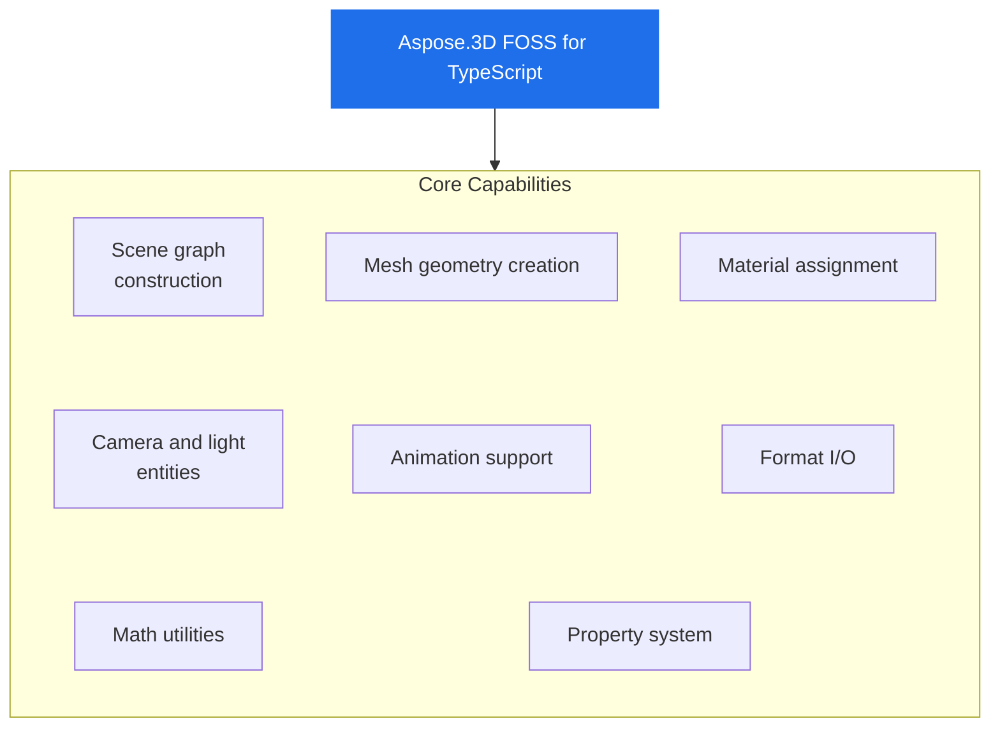

# Aspose.3D FOSS for TypeScript

[](#license) [](https://github.com/aspose-3d-foss/Aspose.3D-FOSS-for-TypeScript/graphs/contributors)

[](https://products.aspose.org/3d/typescript/)

Aspose.3D FOSS for TypeScript reads and writes 3D scenes using the `Scene` class, supporting formats such as OBJ, STL, GLTF, and U3D through its fromFile, openFromBuffer, save, and saveToBuffer methods. It constructs and manipulates scene graphs with `Node`, `Entity`, `Mesh`, `Material`, `Camera`, and `Light` objects, and supports materials like `LambertMaterial`, `PhongMaterial`, and `PbrMaterial` with texture access via getTexture and setTexture. It handles geometry with `VertexElementUV`, `VertexElementNormal`, and `VertexElementVertexColor`, and provides utilities for triangulation, bounding boxes, and coordinate transformations using `PolygonModifier.triangulate`, `BoundingBox`, `FVector3`, `FMatrix4`, and `MathUtils`. It supports animation with `AnimationClip`, `AnimationNode`, `AnimationChannel`, `KeyframeSequence`, and `KeyFrame`, and exposes property management through `A3DObject.findProperty`, getProperty, and setProperty.

## Navigation

- [At a Glance](#at-a-glance)
- [Key Capabilities](#key-capabilities)
- [Installation](#installation)
- [Dependencies](#dependencies)
- [Quick Start](#quick-start)
- [Additional Examples](#additional-examples)
- [API Reference](#api-reference)
- [Documentation & Resources](#documentation--resources)
- [Scope and Limitations](#scope-and-limitations)
- [Development and Testing](#development-and-testing)
- [License](#license)

## At a Glance



## Key Capabilities

- **Scene graph construction.** Build and traverse a hierarchical scene graph with `Scene` and `Node` — every node holds a `Transform`, an optional entity (`Mesh`, `Camera`, or `Light`), and child nodes accessible via childNodes.
- **Mesh geometry creation.** Construct mesh geometry with `Mesh.controlPoints` and createPolygon, and attach per-vertex attribute channels — normals (`VertexElementNormal`), UVs (`VertexElementUV`), and vertex color (`VertexElementVertexColor`) — through the `VertexElement` hierarchy.
- **Material assignment.** Assign shading materials through `Material` subclasses — `LambertMaterial` (diffuse-only), `PhongMaterial` (adds specular/shininess), and `PbrMaterial` (metallic/roughness, mapping directly to the glTF PBR model).
- **Camera and light entities.** Place `Camera` (projection type, field of view, clip distances) and `Light` (POINT, DIRECTIONAL, SPOT, AREA, VOLUME) entities as scene nodes.
- **Animation support.** Animate node properties with keyframes — `AnimationClip` groups `AnimationNode` tracks, each holding `AnimationChannel` of `KeyframeSequence` time/value samples with configurable `Interpolation`/`Extrapolation`.
- **Format I/O.** Read glTF (JSON and binary GLB) and Wavefront OBJ scenes, and write STL (ASCII and binary), FBX (ASCII), COLLADA (.dae, via xmldom), and glTF JSON scenes through `Scene.open()`/`Scene.openFromBuffer()` and `Scene.save()` — OBJ export and binary GLB export both carry real, current defects; see Scope and Limitations before relying on either.
- **Math utilities.** Perform 3D math operations using `FVector3`, `FMatrix4`, `Quaternion`, and `MathUtils`, and compute bounding volumes with `BoundingBox`.
- **Property system.** Inspect and modify object properties through `Property` and `PropertyCollection`, and access them via `A3DObject.findProperty`, `A3DObject.getProperty`, and `A3DObject.setProperty`.

## Installation

`@aspose/3d` is not yet published on npm; build it from a source checkout instead:

```bash
git clone https://github.com/aspose-3d-foss/Aspose.3D-FOSS-for-TypeScript.git
cd Aspose.3D-FOSS-for-TypeScript
npm install
npm run build
```

## Dependencies

### Required Package Dependencies

- `xmldom ^0.6.0`

### Development Dependencies

- `adm-zip ^0.5.16`
- `eslint ^8.57.1`
- `jest ^29.7.0`
- `ts-jest ^29.3.4`
- `@types/adm-zip ^0.5.7`
- `@types/jest ^29.5.12`
- `@types/node ^22.15.17`
- `typescript ^5.8.3`
- `@typescript-eslint/eslint-plugin ^8.33.0`
- `@typescript-eslint/parser ^8.33.0`

## Quick Start

```typescript
import { Scene } from './dist/aspose/threed';

const scene = new Scene();
scene.open('model.obj');
scene.save('model.gltf');
```

## Additional Examples

Additional worked examples cover per-node inspection and configuring format-specific options.

Enumerate a loaded scene's node hierarchy and mesh statistics:

```typescript
import { Scene } from './dist/aspose/threed';

const scene = new Scene();
scene.open('model.obj');

for (const node of scene.rootNode.childNodes) {
    if (node.entity) {
        console.log(`Mesh: ${node.name}`);
        console.log(`  Control points: ${node.entity.controlPoints.length}`);
    }
}
```

<details>
<summary>View Additional Examples</summary>

### Load OBJ With Custom Options and Export to Binary STL

Load OBJ with explicit options and export as binary STL:

```typescript
import { Scene } from './dist/aspose/threed';
import { ObjLoadOptions } from './dist/aspose/threed/formats/obj';
import { StlSaveOptions } from './dist/aspose/threed/formats/stl';

const scene = new Scene();
const loadOptions = new ObjLoadOptions();
loadOptions.enableMaterials = true;
loadOptions.normalizeNormal = true;
scene.open('model.obj', loadOptions);

const saveOptions = new StlSaveOptions();
saveOptions.binaryMode = true;
scene.save('model.stl', saveOptions);
```

### Triangulate Raw Control Points With PolygonModifier

Triangulate raw control points directly with the standalone `PolygonModifier` utility (distinct
from `Mesh.triangulate()`, which triangulates an existing mesh's own polygons in place):

```typescript
import { PolygonModifier } from './dist/aspose/threed/entities';
import { Vector4 } from './dist/aspose/threed/utilities';

const controlPoints = [
    new Vector4(0, 0, 0, 1),
    new Vector4(1, 0, 0, 1),
    new Vector4(0, 1, 0, 1),
    new Vector4(1, 1, 0, 1),
];
const quad = [0, 1, 3, 2];
const triangles = PolygonModifier.triangulate(controlPoints, [quad]);
```

</details>

## API Reference

The public API has 81 types.

<details>
<summary>View the Complete Public API Surface</summary>

### Core API

| Class | Description |
| --- | --- |
| `A3DObject` | Class that inherits from INamedObject and declares the methods findProperty, getProperty, removeProperty, setProperty and toString and the members name and properties. |
| `AnimationChannel` | Class that inherits from KeyframeSequence and declares the members componentType, defaultValue and keyframeSequence. |
| `AnimationClip` | Class that inherits from SceneObject and declares the method createAnimationNode and the members animations, description, name, properties, start and stop. |
| `AnimationNode` | Class that inherits from A3DObject and declares the methods createBindPoint, findBindPoint, getBindPoint and getKeyframeSequence and the members bindPoints, name, properties and subAnimations. |
| `ApertureMode` | Class that declares the members HORIZONTAL, HORZ_AND_VERT and VERTICAL. |
| `AssetInfo` | Class that inherits from A3DObject and declares a public no-argument constructor. |
| `BindPoint` | Class that inherits from A3DObject and declares the methods addChannel, bindKeyframeSequence, createKeyframeSequence, getChannel, getKeyframeSequence and resetChannels and the members channelsCount, name, properties, property and scene. |
| `BooleanOperation` | Class that declares the members ADD, INTERSECT and SUB. |
| `BoundingBox` | Class that declares methods including contains, infinite, merge, null, overlapsWith and scale and the members center, extent, maximum, minimum and size. |
| `BoundingBox2D` | Class that declares the methods getCenter, getSize, infinite, merge, null and overlapsWith and the members extent, maximum and minimum. |
| `BoundingBoxExtent` | Class that declares the methods finite, infinite and null and the members extentX, extentY and extentZ. |
| `Camera` | Class that inherits from Entity and declares methods including findProperty, getBoundingBox, getEntityRendererKey, getProperty, moveForward and removeProperty and members including apertureMode, aspect, aspectRatio, direction, excluded and farPlane. |
| `ComposeOrder` | Class that declares the method toString and the members APPEND, name and PREPEND. |
| `CustomObject` | Class that inherits from A3DObject and declares a public constructor. |
| `Entity` | Class that inherits from SceneObject and declares the methods getBoundingBox and getEntityRendererKey and the members excluded, parentNode and parentNodes. |
| `Extrapolation` | Class that declares the members repeatCount and type. |
| `FMatrix4` | Class that declares the methods concatenate, inverse and transpose and members including identity, m00, m01, m02, m03 and m10. |
| `FVector2` | Class that declares methods including add, div, dot, equals, length and mul and the members x and y. |
| `FVector3` | Class that declares methods including equals, getItem, normalize, one, setItem and toString and the members x, y and z. |
| `FVector4` | Class that declares the methods equals, getItem, setItem and toString and the members w, x, y and z. |
| `FileFormat` | Class that declares methods including canExport, canImport, contentType, createLoadOptions, createSaveOptions and extension. |
| `FileSystem` | Not implemented. |
| `Geometry` | Class that inherits from Entity and declares methods including addControlPoint, addElement, createElement, createElementUV, findProperty and getBoundingBox and the members castShadows, controlPoints, receiveShadows, vertexElements and visible. |
| `GlobalTransform` | Class that declares the method toString and the members eulerAngles, rotation, scale, transformMatrix and translation. |
| `IIndexedVertexElement` | Interface that declares the member indices. |
| `INamedObject` | Interface that declares the member name. |
| `IOExtension` | Public class. |
| `ImageRenderOptions` | Class that declares the members height and width. |
| `KeyFrame` | Class that declares members including bias, continuity, curve, flat, independentTangent and interpolation. |
| `KeyframeSequence` | Class that inherits from A3DObject and declares the methods add, reset and setBindPoint and the members bindPoint, keyFrames, name, postBehavior, preBehavior and properties. |
| `LambertMaterial` | Class that inherits from Material and declares members including ambientColor, diffuseColor, emissiveColor, MAP_AMBIENT, MAP_DIFFUSE and MAP_EMISSIVE. |
| `Light` | Class that inherits from Camera and declares the member lightType. |
| `LightType` | Class that declares the members AREA, DIRECTIONAL, POINT, SPOT and VOLUME. |
| `MappingMode` | Class that declares the members ALL_SAME, CONTROL_POINT, EDGE, POLYGON and POLYGON_VERTEX. |
| `Material` | Class that inherits from A3DObject and declares the methods getTexture and setTexture and the members MAP_AMBIENT, MAP_DIFFUSE, MAP_EMISSIVE, MAP_NORMAL and MAP_SPECULAR. |
| `MathUtils` | Class that declares methods including calcNormal, clamp, findIntersection, pointInsideTriangle, rayIntersect and toDegree. |
| `Matrix4` | Class that declares methods including concatenate, decompose, equals, getItem, identity and inverse and members including determinant, m00, m01, m02, m03 and m10. |
| `Mesh` | Class that inherits from Geometry and declares methods including createPolygon, difference, doBoolean, getBoundingBox, getEntityRendererKey and getPolygonSize and the members deformers, edges, polygonCount and polygons. |
| `Node` | Class that inherits from SceneObject and declares methods including addChildNode, addEntity, clearEntities, createChildNode, evaluateGlobalTransform and getBoundingBox and members including assetInfo, childNodes, entities, entity, excluded and globalTransform. |
| `ParseException` | Class that inherits from Error and declares a public constructor. |
| `PbrMaterial` | Class that inherits from Material and declares the method fromMaterial and members including albedo, albedoTexture, emissiveColor, emissiveTexture, metallicFactor and metallicRoughness. |
| `PhongMaterial` | Class that inherits from LambertMaterial and declares the members reflectionColor, reflectionFactor, shininess, specularColor and specularFactor. |
| `PolygonModifier` | Class that declares the method triangulate. |
| `ProjectionType` | Class that declares the members ORTHOGRAPHIC and PERSPECTIVE. |
| `Property` | Class that declares the methods getExtra, setExtra and toString and the members name, value and valueType. |
| `PropertyCollection` | Class that declares the methods findProperty, get, getItem, removeProperty and toString and the members count and length. |
| `Quaternion` | Class that declares methods including concat, conjugate, dot, equals, eulerAngles and fromAngleAxis and the members length, w, x, y and z. |
| `Rect` | Rect class represents a rectangle with left, top, right, bottom, width, and height properties and a contains method. |
| `ReferenceMode` | Class that declares the members DIRECT, INDEX and INDEX_TO_DIRECT. |
| `RelativeRectangle` | RelativeRectangle class represents a rectangle with offset and scale properties for relative positioning. |
| `RotationMode` | RotationMode enum lists the FIXED and ORBIT rotation modes. |
| `RotationOrder` | RotationOrder enum lists the XYZ, XZY, YXZ, YZX, ZXY, and ZYX rotation orders. |
| `Scene` | Class that inherits from SceneObject and declares methods including clear, createAnimationClip, fromFile, getAnimationClip, open and openFromBuffer and members including animationClips, assetInfo, currentAnimationClip, library, poses and rootNode. |
| `SceneObject` | Class that inherits from A3DObject and declares the member scene. |
| `SemanticAttribute` | Class that declares the members alias and semantic. |
| `SplitMeshPolicy` | SplitMeshPolicy enum lists the ADJUST and CLONE_DATA split mesh policies. |
| `TextureMapping` | Class that declares members including AMBIENT, BUMP, DIFFUSE, DISPLACEMENT, EMISSIVE and GLOW. |
| `Transform` | Class that inherits from A3DObject and declares methods including setEulerAngles, setGeometricRotation, setGeometricScaling, setGeometricTranslation, setPostRotation and setPreRotation and members including eulerAngles, geometricRotation, geometricScaling, geometricTranslation, postRotation and preRotation. |
| `TransformBuilder` | TransformBuilder class provides methods to build transforms using append, compose, prepend, and rearrange operations. |
| `Vector2` | Class that declares the methods equals, getItem, parse, set, setItem and toString and the members length, length2, x and y. |
| `Vector3` | Class that declares methods including angleBetween, compareTo, cos, cross, dot and equals and members including length, length2, one, unitX, unitY and unitZ. |
| `Vector4` | Class that declares the methods equals, getItem, set, setItem and toString and the members w, x, y and z. |
| `Vertex` | Class that declares methods including compare, compareTo, readDouble, readFloat, readFVector2 and readFVector3. |
| `VertexDeclaration` | Class that declares the methods addField, clear, compareTo, fromGeometry and getField and the members count, sealed and size. |
| `VertexElement` | Class that inherits from IIndexedVertexElement and declares the methods clear and setIndices and the members indices, mappingMode, name, referenceMode and vertexElementType. |
| `VertexElementFVector` | Class that inherits from VertexElement and declares the methods clear, copyTo, setData and setIndices and the members data and indices. |
| `VertexElementIntsTemplate` | Class that inherits from VertexElement and declares the methods clear, copyTo, setData and setIndices and the members data and indices. |
| `VertexElementNormal` | Class that inherits from VertexElementFVector and declares a public constructor. |
| `VertexElementSmoothingGroup` | Class that inherits from VertexElementIntsTemplate and declares a public constructor. |
| `VertexElementTangent` | Class that inherits from VertexElementFVector and declares a public constructor. |
| `VertexElementType` | Class that declares members including BINORMAL, EDGE_CREASE, HOLE, MATERIAL, NORMAL and POLYGON_GROUP. |
| `VertexElementUV` | Class that inherits from VertexElementFVector and declares the method addData and the members data, textureMapping and uvData. |
| `VertexElementVertexColor` | Class that inherits from VertexElementFVector and declares a public constructor. |
| `VertexField` | Class that declares the method compareTo and the members alias, dataType, index, offset, semantic and size. |
| `VertexFieldDataType` | Class that declares the method toString and members including BYTE_VECTOR4, DOUBLE, F_VECTOR2, F_VECTOR3, F_VECTOR4 and FLOAT. |
| `VertexFieldSemantic` | Class that declares the method toString and members including BINORMAL, EDGE_CREASE, MORPH_NORMAL, MORPH_POSITION, name and NORMAL. |
| `Watermark` | Not implemented. |

#### Enumerations

| Enumeration | Description |
| --- | --- |
| `ExtrapolationType` | ExtrapolationType enum lists the CONSTANT, CYCLE, CYCLE_RELATIVE, GRADIENT and OSCILLATE extrapolation types. |
| `Interpolation` | Interpolation enum lists the BEZIER, B_SPLINE, CARDINAL_SPLINE, CONSTANT, LINEAR and TCB_SPLINE interpolation types. |
| `StepMode` | StepMode enum lists the NEXT_VALUE and PREVIOUS_VALUE step modes. |
| `WeightedMode` | WeightedMode enum lists the BOTH, NEXT_IN_WEIGHT, NONE, and OUT_WEIGHT weighted mode values. |

#### Detailed Member Reference

### Node

The `Node` class represents an element in the scene graph, supporting child nodes via addChildNode and childNodes, attaching entities with addEntity and entities, and computing world-space transforms through globalTransform.

### Mesh

The `Mesh` class defines polygonal geometry using controlPoints and supports polygon creation via createPolygon, with triangulate converting all polygons to triangles for export.

### FileFormat

The `FileFormat` class identifies supported formats using getFormatByExtension and determines import or export capability via canImport and canExport.

### Quaternion

The `Quaternion` class represents rotations using slerp for interpolation, fromEulerAngle for construction from Euler angles, and toString for string representation.

### BoundingBox

The `BoundingBox` class defines an axis-aligned volume using minimum and maximum corners, with contains checking whether points lie inside.

### Property

The `Property` class stores typed name/value pairs with name, value, and valueType properties for metadata attached to scene objects.

### VertexElementUV

The `VertexElementUV` class stores 2D texture coordinates with uvData and mappingMode for mapping texture coordinates onto geometry.

### Material

The `Material` class manages surface appearance with getTexture and setTexture for texture assignment.

### Camera

The `Camera` class defines view parameters with fieldOfView and projectionType for perspective or orthographic projection.

### Light

The `Light` class specifies illumination with lightType and direction for directional, point, or spot lighting.

`Scene` is the primary entry point: `scene.open()`/`scene.openFromBuffer()` load a file or
buffer (format auto-detected), `scene.save()` writes output, and `scene.rootNode` exposes the
node hierarchy.

| Class | Description |
|---|---|
| `Scene` | The root container for a 3D scene. Call `open()`/`openFromBuffer()` to load a file, `static fromFile(fileName)` to load one in a single call, and `save(fileOrStream, formatOrOptions?, options?)` to write output. Exposes `rootNode` as the entry point to the node hierarchy, and `createAnimationClip(name)`/`getAnimationClip(name)` to manage scene-level animation clips. |
| `Node` | A named node in the scene tree. Holds a `Transform` and zero or more child nodes accessible via `childNodes`, plus `getChild(indexOrName)`, `merge(node)`, and `evaluateGlobalTransform(withGeometricTransform)` to compute the accumulated world-space `Matrix4`. The `entity` accessor gets/sets the first attached entity for convenience, but a node can carry several: `addEntity(entity)`, `removeEntity(entity)`, and `clearEntities()` manage the full collection (mesh, camera, light, or other `SceneObject`). |
| `Entity` | Base class for all objects that can be attached to a `Node` as its primary entity. Subclassed by `Mesh`, `Camera`, and `Light`. |
| `SceneObject` | Abstract base for named objects that belong to a scene. Provides the `name` property and scene-membership tracking shared by nodes, entities, and asset-level objects. |
| `A3DObject` | Root base class for Aspose.3D objects. Provides the property system (`getProperty`, `setProperty`) and the `name` field shared across the class hierarchy. |

| Class | Description |
|---|---|
| `Mesh` | Represents a polygon mesh. Contains a `controlPoints` array of `Vector4` vertices and polygon definitions created via `createPolygon()`. Call `triangulate()` to convert all polygons to triangles before export. Boolean operations (`union`/`difference`/`intersect`) and `optimize()`/`isManifold()` are not implemented in this FOSS build (see Scope and Limitations). |
| `Geometry` | Base class for all geometry types. Holds `controlPoints` and the `vertexElements` collection (normals, UVs, colors) attached to the geometry, managed via `addControlPoint`, `addElement`, `getElement`, `createElement`, `createElementUV`, and `getVertexElementOfUV`. |
| `VertexElement` | Base class for per-vertex attribute channels attached to a `Geometry`. Subclasses carry typed data arrays and `mappingMode`/`referenceMode` metadata. `setIndices()`/`clear()` are not implemented in this FOSS build. |
| `VertexElementNormal` | A `VertexElement` subclass that stores surface normals, internally as `FVector4[]`. Required by most renderers for correct lighting. |
| `VertexElementUV` | A `VertexElement` subclass that stores 2D texture coordinates. A single mesh may have multiple UV sets for different texture layers. |
| `VertexElementVertexColor` | A `VertexElement` subclass that stores per-vertex RGBA color values. |
| `VertexElementType` | Enumeration of the attribute channel types a `VertexElement` can represent (`NORMAL`, `UV`, `VERTEX_COLOR`, `TANGENT`, `BINORMAL`, and more). |
| `MappingMode` | Enumeration controlling how element data maps onto geometry: `CONTROL_POINT`, `POLYGON_VERTEX`, `POLYGON`, `EDGE`, or `ALL_SAME`. |
| `ReferenceMode` | Enumeration controlling how element indices reference data: `DIRECT` (one-to-one) or `INDEX_TO_DIRECT` (via an index array). |
| `TextureMapping` | Enumeration of texture channel semantics: `DIFFUSE`, `SPECULAR`, `NORMAL`, `EMISSIVE`, `BUMP`, and more. |

| Class | Description |
|---|---|
| `Transform` | Holds the local position (`translation`), rotation (`rotation` as `Quaternion`), and scale (`scaling`) of a `Node`, plus `eulerAngles` and `transformMatrix`. Setters cover both direct assignment (`setTranslation`, `setScale`, `setRotation`, `setEulerAngles`) and the pre/post-rotation and geometric variants (`setPreRotation`/`setPostRotation`, `setGeometricTranslation`/`Scaling`/`Rotation`). Changes here affect the node and all its children. |
| `GlobalTransform` | Read-only view of a node's world-space transform, computed by accumulating all ancestor `Transform` values. Access via `node.globalTransform`. |
| `BoundingBox` | An axis-aligned bounding box defined by a `minimum` and `maximum` `Vector3` corner, with `center`, `size`, and `extent` properties, `merge`, `contains`, `overlapsWith`, and static `null`/`infinite` factories. Two related utility types (not yet in `reference.aspose.org`'s own index) round out the family: `BoundingBox2D`, the 2D counterpart (`merge`, `overlapsWith`, `getCenter()`, `getSize()`, static `null`/`infinite`, but no `contains`), and `BoundingBoxExtent`, a plain `extentX`/`extentY`/`extentZ` value holder with static `null`/`finite`/`infinite` factories and no `merge`/`contains`/`overlapsWith` of its own. Nested `Node` bounding boxes are independent of ancestor transformations — recompute after applying transformations to keep bounding boxes accurate. |

| Class | Description |
|---|---|
| `Material` | Abstract base class for all material types. |
| `LambertMaterial` | Diffuse-only material with `ambientColor`, `diffuseColor`, `emissiveColor`, `transparentColor`, and `transparency` properties. Suitable for non-specular surfaces. |
| `PhongMaterial` | Extends `LambertMaterial` with specular color and shininess properties for Phong shading. |
| `PbrMaterial` | Physically-based rendering material (`constructor(name?, albedo?)`, `static fromMaterial(material)`) with `albedo`, `albedoTexture`, `normalTexture`, `metallicFactor`, `roughnessFactor`, `metallicRoughness`, `occlusionTexture`, `occlusionFactor`, `emissiveTexture`, `emissiveColor`, and `transparency` properties. Maps directly to the glTF 2.0 PBR material model. |

| Class | Description |
|---|---|
| `Vector3` | A three-component floating-point vector with `x`, `y`, `z` fields and common arithmetic methods (`dot`, `cross`, `normalize`, `minus`, `times`). |
| `Vector4` | A four-component floating-point vector with `x`, `y`, `z`, `w` fields. Used as the type of entries in `Mesh.controlPoints`. |
| `Vector2` | A two-component double-precision vector with `x` and `y` fields. Used for UV texture coordinates. |
| `FVector3` | A compact three-component single-precision float vector used in vertex element data arrays for normals and tangents. |
| `Matrix4` | A 4x4 transformation matrix (`Matrix4()` / `Matrix4(matrix)`), with `identity()`, `transpose`, `concatenate`, `inverse`, `decompose`, `setTRS`, `translate`, `scale`, `rotate`, `rotateFromEuler`, and `toArray`. |
| `Quaternion` | A unit quaternion for representing rotations without gimbal lock (`Quaternion(w, x, y, z)`). Provides `normalize`, `conjugate`, `inverse`, `dot`, `concat`, `slerp()` for smooth interpolation, `eulerAngles`, `fromEulerAngle`, `fromAngleAxis`, `fromRotation`, and `toMatrix`. |

| Class | Description |
|---|---|
| `AnimationClip` | A named, time-bounded collection of `AnimationNode` tracks. The primary container for keyframe animation data loaded from FBX or COLLADA files. |
| `AnimationNode` | A named animation track that targets a specific property path on a scene object. Contains one or more `AnimationChannel` objects, accessible via `subAnimations` and `bindPoints`, with `findBindPoint`, `getBindPoint`, `createBindPoint`, and `getKeyframeSequence` to navigate them. |
| `AnimationChannel` | A single animated property channel within an `AnimationNode`. Holds a `KeyframeSequence` of time/value pairs. |
| `KeyFrame` | A single time/value sample in a `KeyframeSequence`. Carries the time stamp (in seconds), the value, and tangent information for interpolation. |
| `KeyframeSequence` | An ordered list of `KeyFrame` samples for one property channel, along with the `Interpolation` and `Extrapolation` settings that govern playback. |
| `Interpolation` | Enumeration of keyframe interpolation modes. Known members include `LINEAR` and `CONSTANT`. |
| `Extrapolation` | Defines behavior outside the keyframe range (before the first key and after the last key). Controlled by `ExtrapolationType`. |
| `StepMode` | Enumeration controlling how stepped (constant) interpolation is applied at boundaries: `PREVIOUS_VALUE`, `NEXT_VALUE`. |
| `WeightedMode` | Enumeration for Bezier tangent weight handling in keyframe animation: `NONE`, `OUT_WEIGHT`, `NEXT_IN_WEIGHT`, `BOTH`. |
| `ExtrapolationType` | Enumeration of out-of-range behaviors: `CONSTANT`, `GRADIENT`, `CYCLE`, `CYCLE_RELATIVE`, and `OSCILLATE`. |

| Class | Description |
|---|---|
| `FileFormat` | Base descriptor for a 3D file format. Each supported format provides a concrete singleton via `getInstance()`. |
| `Importer` | Base class for format-specific import implementations. Not instantiated directly; invoked internally by `scene.open()`. |
| `Exporter` | Base class for format-specific export implementations. Not instantiated directly; invoked internally by `scene.save()`. |
| `LoadOptions` | Base class for format-specific load option objects. Pass a subclass instance to `scene.open()`/`scene.openFromBuffer()`. |
| `SaveOptions` | Base class for format-specific save option objects. Pass a subclass instance to `scene.save()`. |
| `IOService` | Internal service interface that abstracts file-system and buffer I/O for importers and exporters. |

| Class | Description |
|---|---|
| `ObjImporter` | Reads Wavefront OBJ files (`v`/`vt`/`vn`/`f`/`o`/`g`/`s` keywords) and populates a `Scene`. Recognizes `usemtl` but does not currently assign the referenced material — see Scope and Limitations. |
| `ObjExporter` | Writes Wavefront OBJ files, but only for geometry attached directly to `scene.rootNode` itself — see Scope and Limitations for the real traversal defect affecting the standard `createChildNode()` scene-construction pattern. Material data, when present, is embedded inline with no `mtllib`/`usemtl` linkage and no companion `.mtl` file. |
| `ObjLoadOptions` | Load options for OBJ files: `enableMaterials` (default `true`, currently has no effect — see Scope and Limitations), `flipCoordinateSystem`, `normalizeNormal` (default `true`), `scale`. |
| `ObjSaveOptions` | Save options for OBJ export. |
| `ObjFormat` | Format descriptor singleton for OBJ.

| Class | Description |
|---|---|
| `Property` | A typed name/value pair that can be attached to any `A3DObject`. Supports scalar and vector value types. |
| `PropertyCollection` | An ordered, iterable container of `Property` objects (`count`, `length`), with `findProperty`, `get`, and `removeProperty`. Accessible on any `A3DObject` via the `properties` accessor. |
| `CustomObject` | A free-form property bag that extends `A3DObject`. Used to store arbitrary metadata that does not map to a standard class. |

| Class | Description |
|---|---|
| `AssetInfo` | Carries scene-level metadata loaded from the source file: author, application name, creation date, unit scale, and coordinate axis information. |
| `ImageRenderOptions` | Options controlling how textures and images are resolved and encoded when saving to formats that embed image data (e.g. GLB with `binaryMode: true`). |

</details>

## Documentation & Resources

- **[Getting started guide](https://docs.aspose.org/3d/typescript/)** — installation, walkthroughs, and feature guides for this library.
- **[How-to articles and FAQ](https://kb.aspose.org/3d/typescript/)** — task-focused how-tos and answers to common questions.
- **[Full API reference](https://reference.aspose.org/3d/typescript/)** — complete, generated reference documentation for every public type. It covers all 81 public types; the [API Reference](#api-reference) section above covers the essentials.
- Found a bug or have a feature request? [Open an issue](https://github.com/aspose-3d-foss/Aspose.3D-FOSS-for-TypeScript/issues).

## Scope and Limitations

- Rendering is not implemented in this FOSS build — `Scene.render()` throws an error.
- A real npm packaging defect affects 3MF import/export in this FOSS build — a normal package install does not pull in a dependency the 3MF code path needs at runtime, so using it throws immediately.
- `Mesh`'s Boolean operations (`union`, `difference`, `intersect`), `optimize()`, and `isManifold()` all throw `Error('... is not implemented')` in this FOSS build — mesh manipulation and modification beyond basic construction and triangulation is not currently functional. `Mesh`'s height-map constructor path is also not implemented.
- `VertexElement.setIndices()`/`clear()` throw `Error('... is not implemented')` in this FOSS build.
- `Node.selectSingleObject()`/`selectObjects()` throw `Error('... is not implemented')`.
- Text watermarking is not currently functional in this FOSS build (the identical defect independently confirmed on the sibling `3d/net` platform).
- The `FileSystem` virtualization abstraction (`readFile`, `writeFile`, `createZipFileSystem`, `createLocalFileSystem`, `createDummyFileSystem`) is entirely unimplemented in this FOSS build — every method throws. This does not affect ordinary `scene.open()`/`scene.save()` usage, which reads/writes directly through Node's own `fs` module rather than this abstraction.
- A real npm packaging defect affects this package's declared entry point — the real build does not produce the file `package.json` points consumers at, so a published install of this package as currently configured would fail to resolve on import; this README's own examples import from the real, present build output path instead of the package name.
- OBJ import does not currently assign per-face materials from the source file, regardless of the relevant load option's value — confirmed by direct testing against a real fixture.
- OBJ export only writes geometry attached at the very top of the scene graph — geometry attached via the standard child-node construction pattern used throughout this README and the product's own test suite is silently omitted from the output. When export does produce output, any material data present is not written in a form other tools can read back as a companion material file. Confirmed by direct testing.
- Binary GLB export currently fails for any non-empty mesh; the JSON/ASCII form (the default) is unaffected. Binary GLB import is unaffected either way — reading a real, externally-produced binary file into a scene works correctly. Confirmed by direct testing.
- Re-importing a scene this library exported to glTF can come back with extra, duplicate top-level nodes not present in the original — confirmed by direct testing. Importing files produced by other tools is unaffected.

<details>
<summary>View Other Unimplemented Members</summary>

- `ParseException` is declared but unused by the library's own code.

</details>

See [Aspose.3D — Enterprise Edition](https://products.aspose.com/3d/). It adds rendering, additional exchange formats, and full production feature completeness.

## Development and Testing

The suite covers 32 test files under `tests/`.

`npm run build` compiles `src/` to `dist/` with `tsc`. The package targets TypeScript 5.0+; `package.json` declares no minimum Node.js version, and development is verified on Node.js 18/20/22.

- `xmldom` `^0.6.0` — parses and serializes XML for `ColladaImporter`/`ColladaExporter` and the internal XML content inside 3MF archives (`ThreeMfImporter`).

- `typescript` `^5.8.3` — compiler.
- `jest` `^29.7.0`, `ts-jest` `^29.3.4` — test runner.
- `eslint` `^8.57.1`, `@typescript-eslint/eslint-plugin` `^8.33.0`, `@typescript-eslint/parser` `^8.33.0` — linting.
- `adm-zip` `^0.5.16`, `@types/adm-zip` `^0.5.7` — 3MF archive handling used in tests (see Scope and Limitations for a real packaging gap affecting a published install's use of this package).
- `@types/jest` `^29.5.12`, `@types/node` `^22.15.17` — TypeScript type declarations.

Clone the repository and run the test suite:

```bash
git clone https://github.com/aspose-3d-foss/Aspose.3D-FOSS-for-TypeScript.git
cd Aspose.3D-FOSS-for-TypeScript
npm install
npm run build
npm test
```

Type-check and lint the source without emitting output:

```bash
npm run typecheck
npm run lint
```

See [AGENTS.md](AGENTS.md) in the repository root for implementation status and development guidelines.

## License

This project is licensed under the MIT License, as declared in `package.json`; no license file is present in the repository. The MIT License permits use, copying, modification, distribution, sublicensing, and commercial use, provided its copyright and permission notice are retained. The software is provided without warranty.
