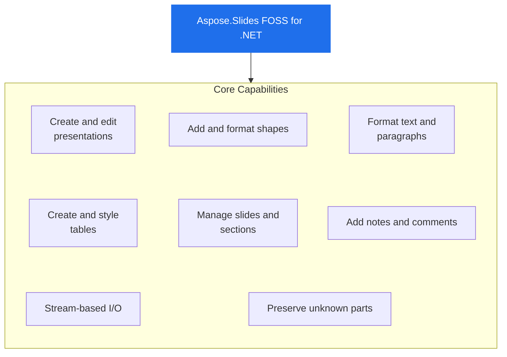

# Aspose.Slides FOSS for .NET

[](https://www.nuget.org/packages/Aspose.Slides.FOSS/)  [](https://github.com/aspose-slides-foss/Aspose.Slides-FOSS-for-.NET/actions/workflows/ci.yml) [](LICENSE) [](https://dotnet.microsoft.com/)

[](https://products.aspose.org/slides/net/)

Aspose.Slides FOSS for .NET reads and writes presentations in the PPTX format. It creates new presentations, opens existing ones from a path or a stream, and saves presentations to a path or a stream. It supports adding and manipulating slides, sections, shapes including autoShapes, tables, and text with full formatting, as well as fill, line, effect, 3-D, notes, comments, and document properties.

- **Presentations** — create, open a path or a stream, save to a path or a stream, save a subset of
  slides, `IDisposable` throughout.
- **Slides** — add empty, insert, remove (the slide part is removed from the package, not just from
  the list), clone, hide (`<p:sld show="0">`), enumerate; masters and layouts are enumerable and a
  master can be cloned.
- **Sections** — add, append, remove, remove with slides, reorder with slides.
- **Shapes** — AutoShapes for 187 of the 189 `ShapeType` values: each of the 187 was written into its
  own file and each produced its own distinct `<a:prstGeom prst="…">`. The two exceptions are
  `ShapeType.NotDefined` and `ShapeType.Custom`, which have no preset to write; `AddAutoShape`
  accepts them without complaint and the shape comes out as `prst="rect"`. Also picture frames,
  tables, connectors bound to shapes by connection site, `Reorder` for z-order, and adjust values on
  geometry shapes.
- **Text** — text frames, paragraphs, portions; character formatting (bold, italic, underline,
  strikethrough, size, spacing, caps, latin/east-asian/complex-script/symbol fonts), paragraph
  formatting (alignment, indent, margins, spacing, symbol and numbered bullets), text-frame
  formatting (margins, wrap, anchor, autofit, columns, rotation, vertical text).
- **Fill** — solid, gradient (stops, direction, shape, angle, tile flip), pattern, picture (with
  crop, stretch, tile and fill mode), no-fill; the same fill model applies to shapes, lines, text
  portions and table cells.
- **Lines** — width, dash style and custom dash pattern, cap, join, miter limit, compound style,
  alignment, and arrowheads at both ends with style, width and length.
- **Effects** — outer shadow, inner shadow, glow, soft edge, reflection, blur, preset shadow, fill
  overlay.
- **3-D** — bevel top and bottom, extrusion height and colour, contour width and colour, material
  preset, a camera with a preset, field of view, zoom and rotation, and a light rig with a preset,
  direction and rotation.
- **Tables** — rows, columns, cells, cell merge (splitting optional), cell fill, the six cell
  borders, cell margins and anchoring, and a table style preset written as `<a:tableStyleId>`.
- **Pictures** — embed from a byte array or a stream, deduplicated by content.
- **Notes** — a notes slide per slide, written with the notes master it requires, plus footer text,
  footer visibility and slide-number visibility on the notes slide.
- **Comments** — authors, comments with position and timestamp, on the classic comment list.
- **Document properties** — core, extended and custom; `docProps/core.xml`, `docProps/app.xml` and
  `docProps/custom.xml` are all written.
- **Unknown parts** — parts the library does not model are carried through a load and a save
  unchanged.

MIT — see [LICENSE](https://github.com/aspose-slides-foss/Aspose.Slides-FOSS-for-.NET/blob/main/LICENSE).
Copyright (c) 2026 Aspose Pty Ltd.

## Navigation

- [At a Glance](#at-a-glance)
- [Key Capabilities](#key-capabilities)
- [Installation](#installation)
- [Dependencies](#dependencies)
- [Quick Start](#quick-start)
- [Additional Examples](#additional-examples)
- [API Reference](#api-reference)
- [Documentation & Resources](#documentation--resources)
- [Scope and Limitations](#scope-and-limitations)
- [Development and Testing](#development-and-testing)
- [License](#license)

## At a Glance



## Key Capabilities

- **Create and edit presentations.** It creates new presentations from scratch, adds slides, inserts shapes with text, and saves the result as a .pptx file, or opens an existing presentation to read and modify its content.
- **Add and format shapes.** It adds auto shapes such as rectangles, sets their fill color and effects like outer shadow, blur radius, and distance, then saves the formatted shapes to a presentation file.
- **Format text and paragraphs.** It formats text by setting font height, bold style, Latin font, and fill color on portions, and aligns paragraphs within text frames attached to shapes.
- **Create and style tables.** It creates tables with specified column widths and row heights, populates cells with text, and merges cells horizontally to build structured layouts.
- **Manage slides and sections.** It adds empty slides based on layout slides and organizes slides into named sections such as Introduction and Detail.
- **Add notes and comments.** It adds notes slides with text content and attaches comments to slides with a specified author, position, and timestamp.
- **Stream-based I/O.** It saves presentations to a memory stream and reloads them from the same stream without writing to disk.
- **Preserve unknown parts.** It preserves unknown or unmodified parts of a presentation when reading and writing files, ensuring round-trip fidelity.

An MIT-licensed .NET library that creates, reads and edits PowerPoint `.pptx` presentations by
building the Office Open XML package itself — no PowerPoint installation, no COM interop, no native
dependency and no NuGet dependencies at all.

## Installation

Install the published package from NuGet (`Aspose.Slides.FOSS`, version 26.9.0):

```bash
dotnet add package Aspose.Slides.FOSS
```

## Dependencies

### Required Package Dependencies

No required third-party package dependencies; in `src/Aspose.Slides.Foss/Aspose.Slides.Foss.csproj`, no `PackageReference` a consumer would install is declared.

### Native and System Requirements

- Requires .NET `net8.0;net10.0` (`TargetFrameworks` in `src/Aspose.Slides.Foss/Aspose.Slides.Foss.csproj`).

## Quick Start

This example creates a new presentation, adds a rectangle shape with text to the first slide, saves it as a PPTX file, reopens the file, and prints the slide count, shape count, and text content to the console.

```csharp
using Aspose.Slides.Foss;
using Aspose.Slides.Foss.Export;

using (var presentation = new Presentation())
{
    ISlide slide = presentation.Slides[0];
    IAutoShape shape = slide.Shapes!.AddAutoShape(ShapeType.Rectangle, 50, 50, 400, 100);
    shape.AddTextFrame("Hello from Aspose.Slides FOSS");

    presentation.Save("hello.pptx", SaveFormat.Pptx);
}

using var reopened = new Presentation("hello.pptx");
var reread = (IAutoShape)reopened.Slides[0].Shapes![0];

Console.WriteLine($"slides: {reopened.Slides.Count}");
Console.WriteLine($"shapes: {reopened.Slides[0].Shapes!.Count}");
Console.WriteLine($"text:   {reread.TextFrame?.Text}");
```

Output:

```
slides: 1
shapes: 1
text:   Hello from Aspose.Slides FOSS
```

## Additional Examples

The following examples show how to create and modify presentations using Aspose.Slides FOSS for .NET.

### Add a Rectangle Shape with Formatted Text

```csharp
using Aspose.Slides.Foss.Drawing;
using Aspose.Slides.Foss.Export;
using Aspose.Slides.Foss;
using var presentation = new Presentation();
IAutoShape shape = presentation.Slides[0].Shapes!.AddAutoShape(
    ShapeType.Rectangle, 50, 50, 400, 150);
ITextFrame textFrame = shape.AddTextFrame("Formatted text")!;

IParagraph paragraph = textFrame.Paragraphs[0];
paragraph.ParagraphFormat.Alignment = TextAlignment.Center;

IBasePortionFormat format = paragraph.Portions[0].PortionFormat!;
format.FontHeight = 24;
format.FontBold = NullableBool.True;
format.LatinFont = new FontData("Verdana");
format.FillFormat!.FillType = FillType.Solid;
format.FillFormat.SolidFillColor.Color = Color.FromArgb(255, 0, 70, 127);

presentation.Save("text.pptx", SaveFormat.Pptx);
```

<details>
<summary>View Additional Examples</summary>

### Insert a Table and Merge Its Header Cells

```csharp
using Aspose.Slides.Foss.Export;
using Aspose.Slides.Foss;
using var presentation = new Presentation();
ITable table = presentation.Slides[0].Shapes!.AddTable(
    50, 50, [150.0, 150.0], [40.0, 40.0]);

table.Rows[0][0].TextFrame!.Text = "Region";
table.Rows[0][1].TextFrame!.Text = "Revenue";
table.Rows[1][0].TextFrame!.Text = "EMEA";
table.Rows[1][1].TextFrame!.Text = "1,240";

table.MergeCells(table.Rows[0][0], table.Rows[0][1], allowSplitting: false);

presentation.Save("table.pptx", SaveFormat.Pptx);
```

### Apply an Outer Shadow Effect to a Shape

```csharp
using Aspose.Slides.Foss.Drawing;
using Aspose.Slides.Foss.Export;
using Aspose.Slides.Foss;
using var presentation = new Presentation();
IAutoShape shape = presentation.Slides[0].Shapes!.AddAutoShape(
    ShapeType.Rectangle, 50, 50, 300, 120);

shape.FillFormat.FillType = FillType.Solid;
shape.FillFormat.SolidFillColor.Color = Color.FromArgb(255, 30, 120, 200);

IEffectFormat effects = shape.EffectFormat;
effects.EnableOuterShadowEffect();
effects.OuterShadowEffect!.BlurRadius = 10;
effects.OuterShadowEffect.Distance = 5;

presentation.Save("effects.pptx", SaveFormat.Pptx);
```

### Notes and Comments

```csharp
using Aspose.Slides.Foss.Drawing;
using Aspose.Slides.Foss.Export;
using Aspose.Slides.Foss;
using var presentation = new Presentation();
ISlide slide = presentation.Slides[0];

INotesSlide notes = slide.NotesSlideManager.AddNotesSlide();
notes.NotesTextFrame.Text = "Open with the revenue figures.";

ICommentAuthor author = presentation.CommentAuthors.AddAuthor("Jane Smith", "JS");
author.Comments.AddComment("Check these numbers.", slide, new PointF(2.0f, 2.0f), DateTime.UtcNow);

presentation.Save("notes-comments.pptx", SaveFormat.Pptx);
```

### Sections

```csharp
using Aspose.Slides.Foss.Export;
using Aspose.Slides.Foss;
using var presentation = new Presentation();
presentation.Slides.AddEmptySlide(presentation.LayoutSlides[0]);
presentation.Slides.AddEmptySlide(presentation.LayoutSlides[0]);

presentation.Sections.AddSection("Introduction", presentation.Slides[0]);
presentation.Sections.AddSection("Detail", presentation.Slides[1]);

presentation.Save("sections.pptx", SaveFormat.Pptx);
```

### Streams

```csharp
using Aspose.Slides.Foss.Export;
using Aspose.Slides.Foss;
using var presentation = new Presentation();
presentation.Slides[0].Shapes!.AddAutoShape(ShapeType.Rectangle, 10, 10, 100, 50);

using var buffer = new MemoryStream();
presentation.Save(buffer, SaveFormat.Pptx);

buffer.Position = 0;
using var reopened = new Presentation(buffer);
```

Four `<a:tc>` cells, two of them carrying a merge attribute.

```csharp
using var presentation = new Presentation();

// from a byte array
IPPImage image = presentation.Images.AddImage(File.ReadAllBytes("photo.png"));
presentation.Slides[0].Shapes!.AddPictureFrame(
    ShapeType.Rectangle, 50, 50, 200, 200, image);

// or from a stream
using FileStream stream = File.OpenRead("photo.png");
IPPImage streamed = presentation.Images.AddImage(stream);

presentation.Save("picture.pptx", SaveFormat.Pptx);
```

The diagram is an overview, not a contract. Each box is expanded, with the XML it produces, under
What it can do; the boundaries are under
What it cannot do.

Use whatever version the artefact you downloaded is called; a CI build carries the version in
`Directory.Build.props` at that commit, which may be ahead of the last release.

`IBaseSlide.Shapes` is declared `IShapeCollection?` and returns `null` for a slide that is not backed
by a package part; a few other members are annotated the same way. The samples here use the
null-forgiving operator so that they compile without warnings in a project with
`<Nullable>enable</Nullable>`, which is the default for new .NET projects. Every sample on this page
was compiled with nullable enabled and produced zero warnings.

In `ppt/slides/slide1.xml`: `<a:rPr b="1" sz="2400">`, `<a:latin typeface="Verdana"/>`,
`<a:pPr algn="ctr">`.

All eight effects were enabled one at a time, each into its own file, and each produced its element
inside `<a:effectLst>`: `a:outerShdw`, `a:innerShdw`, `a:glow`, `a:softEdge`, `a:reflection`,
`a:blur`, `a:prstShdw`, `a:fillOverlay`.

A `Section` has no public constructor: it is
created through `Sections.AddSection` or `Sections.AppendEmptySection`, which bind it to the
presentation whose slides it divides.

Everything in this list was exercised through the public API and then confirmed by reading the XML
inside the file that came out.

</details>

## API Reference

Aspose.Slides FOSS for .NET exposes the Aspose.Slides FOSS for .NET class as its primary entry point for working with presentations, and `Aspose.Slides.Foss.Export.SaveFormat` as the enumeration that defines supported output formats.

The public API has 264 types.

<details>
<summary>View the Complete Public API Surface</summary>

### Core API

| Class | Description |
| --- | --- |
| `AdjustValue` | Represents a geometry shape adjustment value backed by an XML guide definition element. |
| `AdjustValueCollection` | Represents a collection of shape's adjustment values. |
| `AutoShape` | Represents an AutoShape — a preset or custom geometric shape that may contain text. |
| `BaseHandoutNotesSlideHeaderFooterManager` | Represents the base class for handout and notes slide header/footer managers. |
| `BasePortionFormat` | Common text-run formatting properties backed by an OOXML &lt;a:rPr&gt; element. |
| `BaseShapeLock` | Represents the base class for locks that determine which operations are disabled on a shape. |
| `BaseSlide` | Base class for Slide, LayoutSlide, and MasterSlide providing common slide functionality. |
| `BulletFormat` | Manages paragraph bullet formatting backed by OOXML bullet elements. |
| `Camera` | Represents 3D camera properties for a shape. |
| `Cell` | Represents a single cell within a table in a PowerPoint presentation. |
| `CellCollection` | Represents a read-only collection of table cells associated with a parent slide and slide part. |
| `CellFormat` | Represents the formatting properties of a table cell, providing access to fill formatting and six border line formats (left, top, right, bottom, diagonal-down, diagonal-up). |
| `ColorFormat` | Represents a color format used in presentation elements. |
| `Column` | Represents a table column as a collection of cells (one per row). |
| `ColumnCollection` | Represents a collection of columns in a table. |
| `ColumnFormat` | Represents the formatting properties of a table column. |
| `Comment` | Represents a comment on a slide. |
| `CommentAuthor` | Represents an author of comments in a presentation. |
| `CommentAuthorCollection` | Represents a collection of comment authors backed by a CommentAuthorsPart. |
| `CommentCollection` | Represents a collection of comments authored by a single author across all slides in a presentation. |
| `Connector` | Represents a connector shape that can link two shapes via connection sites. |
| `ConnectorLock` | Determines which operations are disabled on the parent connector shape. |
| `CustomData` | Represents custom data associated with a shape. |
| `DocumentProperties` | Represents the metadata properties of a presentation, wrapping OPC core, app, and custom property parts with lazy initialization. |
| `Color` | An immutable ARGB color. |
| `PointF` | Represents a 2D point with float coordinates. |
| `Size` | Represents a 2D size with integer dimensions. |
| `SizeF` | Represents a 2D size with float dimensions. |
| `EffectFormat` | Represents effect formatting properties backed by an effectLst element. |
| `Blur` | Represents a blur effect that is applied to the entire shape, including its fill. |
| `FillOverlay` | Represents a Fill Overlay effect. |
| `Glow` | Represents a glow effect, in which a color blurred outline is added outside the edges of the object. |
| `IBlur` | Represents a blur effect that is applied to the entire shape, including its fill. |
| `IFillOverlay` | Represents a Fill Overlay effect. |
| `IGlow` | Represents a glow effect, in which a color blurred outline is added outside the edges of the object. |
| `IImageTransformOperation` | Represents an image transform operation effect. |
| `IInnerShadow` | Represents an inner shadow effect. |
| `IOuterShadow` | Represents an Outer Shadow effect. |
| `IPresetShadow` | Represents a Preset Shadow effect. |
| `IReflection` | Represents a reflection effect. |
| `ISoftEdge` | Represents a Soft Edge effect. |
| `ImageTransformOperation` | Represents an image transform operation effect. |
| `InnerShadow` | Represents an inner shadow effect. |
| `OuterShadow` | Represents an outer shadow effect. |
| `PresetShadow` | Represents a preset shadow effect. |
| `Reflection` | Represents a reflection effect. |
| `SoftEdge` | Represents a soft edge effect. |
| `ISaveOptions` | Represents options that control how a presentation is saved. |
| `SaveOptions` | Represents options that control how a presentation is saved. |
| `FillFormat` | Represents fill formatting options. |
| `FontData` | Represents a font definition with a typeface name. |
| `GeometryShape` | Represents the base class for shapes that have geometric properties. |
| `GlobalLayoutSlideCollection` | Aggregates all layout slides across all master slides in a presentation. |
| `GradientFormat` | Represents a gradient format. |
| `GradientStop` | Represents a single gradient stop within a gradient fill. |
| `GradientStopCollection` | Manages a collection of &lt;a:gs&gt; child elements within an &lt;a:gsLst&gt; XML element. |
| `GraphicalObject` | Abstract base class for graphical objects on a slide. |
| `GraphicalObjectLock` | Represents a lock that determines which operations are disabled on a graphical object. |
| `GroupShape` | Represents a group shape that contains a collection of shapes. |
| `HeadingPair` | Represents a 'Heading pair' property of the document. |
| `IAdjustValue` | Represents a single adjustment value for a geometry shape. |
| `IAdjustValueCollection` | Represents a collection of shape adjustment values. |
| `IAutoShape` | Represents an AutoShape. |
| `IBaseHandoutNotesSlideHeaderFooterManager` | Represents a base interface for handout and notes slide header and footer management. |
| `IBaseHeaderFooterManager` | Represents a base interface for header and footer management. |
| `IBasePortionFormat` | Defines common text run formatting properties. |
| `IBaseSlide` | Represents a base slide. |
| `IBaseSlideHeaderFooterManager` | Represents a base interface for slide-level header and footer management. |
| `IBulkTextFormattable` | Represents an object that can apply text formatting in bulk to all contained text. |
| `IBulletFormat` | Represents paragraph bullet formatting properties. |
| `ICamera` | Represents the 3-D camera properties for a shape. |
| `ICell` | Represents a single cell in a table. |
| `ICellCollection` | Represents a collection of table cells. |
| `ICellFormat` | Represents the formatting of a table cell. |
| `IColorFormat` | Represents a color format used in presentation elements. |
| `IColumn` | Represents a single column in a table. |
| `IColumnCollection` | Represents a collection of table columns. |
| `IColumnFormat` | Represents the formatting properties of a table column. |
| `IComment` | Represents a comment on a slide. |
| `ICommentAuthor` | Represents an author of comments. |
| `ICommentAuthorCollection` | Represents a collection of comment authors. |
| `ICommentCollection` | Represents a collection of comments. |
| `IConnector` | Represents a connector shape that links two shapes. |
| `IConnectorLock` | Determines which operations are disabled on the parent connector shape. |
| `ICustomData` | Represents custom data associated with a shape. |
| `IDocumentProperties` | Represents the metadata properties of a presentation document. |
| `IEffectFormat` | Represents visual effect formatting properties for a shape. |
| `IEffectParamSource` | Represents a source of effect parameters. |
| `IFillFormat` | Represents fill formatting properties for a shape or text. |
| `IFillParamSource` | Auxiliary interface for fill parameter source. |
| `IFontData` | Represents a font definition. |
| `IGeometryShape` | Represents a shape with geometric properties. |
| `IGlobalLayoutSlideCollection` | Represents a collection of all layout slides in presentation. |
| `IGradientFormat` | Represents gradient fill formatting properties. |
| `IGradientStop` | Represents a single stop in a gradient fill. |
| `IGradientStopCollection` | Represents a collection of gradient stops. |
| `IGraphicalObject` | Represents a graphical object on a slide. |
| `IGraphicalObjectLock` | Determines which operations are disabled on the parent graphical object. |
| `IGroupShape` | Represents a group shape that contains other shapes. |
| `IHeadingPair` | Represents a heading pair entry describing a content grouping in a presentation. |
| `IHyperlinkContainer` | Represents an object that can contain hyperlinks. |
| `IImage` | Represents a raster or vector image. |
| `IImageCollection` | Represents a collection of IPPImage objects. |
| `ILayoutSlide` | Represents a layout slide. |
| `ILayoutSlideCollection` | Represents a base class for collection of layout slides. |
| `ILightRig` | Represents a light rig. |
| `ILineFillFormat` | Represents properties for lines filling. |
| `ILineFormat` | Represents format of a line. |
| `ILineParamSource` | Marker interface for objects that can serve as a source of line parameters. |
| `ILoadOptions` | Represents options that can be used to control how a presentation is loaded. |
| `IMasterLayoutSlideCollection` | Represents a collection of layout slides belonging to a master slide. |
| `IMasterSlide` | Represents a master slide in a presentation. |
| `IMasterSlideCollection` | Represents a collection of master slides. |
| `INotesSize` | Represents the size of a notes slide. |
| `INotesSlide` | Represents a notes slide in a presentation. |
| `INotesSlideHeaderFooterManager` | Represents a manager for notes slide header and footer placeholders. |
| `INotesSlideManager` | Manages notes slide operations for a slide. |
| `IPPImage` | Represents a presentation-embedded image stored in an OPC package part. |
| `IParagraph` | Represents a paragraph of text. |
| `IParagraphCollection` | Represents a collection of paragraphs. |
| `IParagraphFormat` | Contains the paragraph formatting properties. |
| `IPatternFormat` | Represents a pattern fill format. |
| `IPictureFillFormat` | Represents a picture fill style. |
| `IPictureFrame` | Represents a picture frame shape. |
| `IPictureFrameLock` | Determines which editing operations are disabled on a picture frame. |
| `IPlaceholder` | Represents a placeholder on a slide. |
| `IPortion` | Represents a portion (run) of text inside a paragraph. |
| `IPortionCollection` | Represents a collection of portions. |
| `IPortionFormat` | Defines the formatting properties for a text portion, combining base portion formatting with hyperlink container capabilities. |
| `IPresentation` | Represents a presentation document. |
| `IPresentationComponent` | Represents any component that belongs to a presentation. |
| `IRow` | Represents a row in a table. |
| `IRowCollection` | Represents a collection of table rows. |
| `IRowFormat` | Represents the formatting properties for a table row. |
| `ISection` | Represents a section of slides in a presentation. |
| `ISectionCollection` | Represents a collection of sections in a presentation. |
| `IShape` | Represents a shape on a slide. |
| `IShapeBevel` | Represents the bevel (relief) properties of a shape's face. |
| `IShapeCollection` | Represents an ordered, mutable collection of IShape objects belonging to a slide or group shape. |
| `IShapeFrame` | Represents the geometric frame properties of a shape. |
| `IShapeStyle` | Represents a shape's style reference. |
| `ISlide` | Represents a slide in a presentation. |
| `ISlideCollection` | Represents a collection of slides in a presentation. |
| `ISlideComponent` | Represents any component that belongs to a slide. |
| `ISlidesPicture` | Represents a picture reference within a slide. |
| `ITable` | Represents a table on a slide. |
| `ITableFormat` | Represents format of a table. |
| `ITextFrame` | Represents the text frame of a shape or cell. |
| `ITextFrameFormat` | Contains the TextFrame's formatting properties. |
| `IThreeDFormat` | Represents 3-D properties. |
| `IThreeDParamSource` | Marker interface for objects that provide 3D formatting parameters. |
| `Image` | Concrete image wrapper holding raw bytes and metadata. |
| `ImageCollection` | Concrete collection managing presentation images within an OPC package. |
| `Images` | Provides static factory methods for creating Image instances. |
| `BaseCollection` | Internal base class for all collection types. |
| `ContentTypesManager` | Manages the [Content_Types].xml file in an OPC package. |
| `OpcPackage` | Manages an Open Packaging Conventions (OPC) package. |
| `RelConstants` | Constants for OPC relationship namespaces and common relationship types. |
| `Relationship` | Represents a single relationship in a .rels file. |
| `RelationshipsManager` | Manages relationships (.rels) files in an OPC package. |
| `AppPropertiesPart` | Parses and serializes docProps/app.xml (extended properties) in an OPC package. |
| `HeadingPairData` | Internal representation of a heading pair entry in docProps/app.xml. |
| `AuthorData` | Raw data for a comment author parsed from XML. |
| `CommentAuthorsPart` | Manages the comment authors XML part (PPT/commentAuthors.xml). |
| `CommentData` | Raw data for a comment parsed from XML. |
| `CommentsPart` | Manages a slide comments XML part (PPT/comments/slideN.xml). |
| `DateTimeHelpers` | Helpers for converting between OOXML datetime strings and DateTime. |
| `CorePropertiesPart` | Parses and serializes docProps/core.xml (Dublin Core metadata). |
| `CustomPropertiesPart` | Parses and serializes docProps/custom.xml. |
| `LayoutSlidePart` | Manages a layout slide XML part (PPT/slideLayouts/slideLayoutN.xml). |
| `MasterSlidePart` | Manages a master slide XML part (PPT/slideMasters/slideMasterN.xml). |
| `NotesSlidePart` | Manages a notes slide XML part (PPT/notesSlides/notesSlideN.xml). |
| `MasterReference` | Reference to a master slide in the presentation, holding its unique ID and relationship ID. |
| `PresentationPart` | Manages the PPT/presentation.xml part of an OPC package. |
| `SlideReference` | Reference to a slide in the presentation, holding its unique ID and relationship ID. |
| `Template` | PPTX template loading. |
| `LayoutSlide` | Represents a layout slide in a presentation. |
| `LayoutSlideCollection` | Base class for collections of layout slides. |
| `LightRig` | Represents a light rig. |
| `LineFillFormat` | Represents properties for lines filling. |
| `LineFormat` | Represents line formatting properties. |
| `LoadOptions` | Represents options that can be used to control how a presentation is loaded. |
| `MasterLayoutSlideCollection` | Represents a collections of all layout slides of defined master slide. |
| `MasterSlide` | Represents a master slide in a presentation. |
| `MasterSlideCollection` | Represents a collection of master slides in a presentation. |
| `NotesSize` | Represents the size of a notes slide. |
| `NotesSlide` | Represents a notes slide in a presentation. |
| `NotesSlideHeaderFooterManager` | Manages visibility and text content of header, footer, date-time, and slide number placeholders on a notes slide. |
| `NotesSlideManager` | Manages notes slide operations for a slide. |
| `PPImage` | Concrete presentation-embedded image backed by an OPC package part. |
| `PVIObject` | Concrete base class providing property-value-inheritance infrastructure. |
| `Paragraph` | Represents a paragraph of text. |
| `ParagraphCollection` | Represents a collection of paragraphs. |
| `ParagraphFormat` | Represents the formatting properties for a paragraph. |
| `PatternFormat` | Represents a pattern fill format. |
| `Picture` | Concrete picture reference backed by an a:blip XML element in a slide's XML. |
| `PictureFillFormat` | Represents a picture fill style. |
| `PictureFrame` | Represents a picture frame shape. |
| `PictureFrameLock` | Determines which operations are disabled on the parent picture frame. |
| `Placeholder` | Represents a placeholder on a slide. |
| `Portion` | Represents a portion (run) of text inside a text paragraph. |
| `PortionCollection` | Represents a mutable collection of portions belonging to a slide component. |
| `PortionFormat` | This class contains the text portion formatting properties. |
| `Presentation` | Represents a Microsoft PowerPoint presentation document. |
| `Row` | Represents a table row as a collection of cells. |
| `RowCollection` | Represents a collection of rows in a table. |
| `RowFormat` | Represents the formatting properties of a table row. |
| `Section` | Represents a section of slides in a presentation. |
| `SectionCollection` | Represents a collection of sections in a presentation. |
| `Shape` | Base class for all shapes on a slide. |
| `ShapeBevel` | Represents the bevel (relief) properties of a shape's face. |
| `ShapeCollection` | Represents an ordered, mutable collection of IShape objects belonging to a slide or group shape. |
| `ShapeFrame` | Represents the geometric frame properties of a shape. |
| `ShapeStyle` | Represents a shape's style reference. |
| `Slide` | Represents a slide in a presentation. |
| `SlideCollection` | Represents a collection of slides in a presentation. |
| `Table` | Represents a table shape on a slide. |
| `TableFormat` | Represents format of a table. |
| `TextFrame` | Represents the text body of a shape. |
| `TextFrameFormat` | Contains the TextFrame's formatting properties. |
| `IThemeable` | Represents objects that can be themed. |
| `ThreeDFormat` | Represents 3-D formatting properties for a shape. |

#### Enumerations

| Enumeration | Description |
| --- | --- |
| `BevelPresetType` | Represents BevelPresetType enumeration. |
| `BulletType` | Represents BulletType enumeration. |
| `CameraPresetType` | Represents CameraPresetType enumeration. |
| `ColorType` | Represents ColorType enumeration. |
| `SaveFormat` | Defines constants representing all supported file formats for saving a presentation. |
| `FillBlendMode` | Represents FillBlendMode enumeration. |
| `FillType` | Represents FillType enumeration. |
| `FontAlignment` | Represents FontAlignment enumeration. |
| `GradientDirection` | Represents GradientDirection enumeration. |
| `GradientShape` | Represents GradientShape enumeration. |
| `LightRigPresetType` | Represents LightRigPresetType enumeration. |
| `LightingDirection` | Represents LightingDirection enumeration. |
| `LineAlignment` | Represents LineAlignment enumeration. |
| `LineArrowheadLength` | Represents LineArrowheadLength enumeration. |
| `LineArrowheadStyle` | Represents LineArrowheadStyle enumeration. |
| `LineArrowheadWidth` | Represents LineArrowheadWidth enumeration. |
| `LineCapStyle` | Represents LineCapStyle enumeration. |
| `LineDashStyle` | Represents LineDashStyle enumeration. |
| `LineJoinStyle` | Represents LineJoinStyle enumeration. |
| `LineStyle` | Represents LineStyle enumeration. |
| `MaterialPresetType` | Represents MaterialPresetType enumeration. |
| `NullableBool` | Represents NullableBool enumeration. |
| `NumberedBulletStyle` | Represents NumberedBulletStyle enumeration. |
| `PatternStyle` | Represents PatternStyle enumeration. |
| `PictureFillMode` | Represents PictureFillMode enumeration. |
| `PresetColor` | Represents PresetColor enumeration. |
| `PresetShadowType` | Represents PresetShadowType enumeration. |
| `RectangleAlignment` | Represents RectangleAlignment enumeration. |
| `SchemeColor` | Represents SchemeColor enumeration. |
| `ShapeType` | Represents preset geometry of geometry shapes. |
| `SlideLayoutType` | Represents SlideLayoutType enumeration. |
| `SourceFormat` | Represents SourceFormat enumeration. |
| `TableStylePreset` | Represents TableStylePreset enumeration. |
| `TextAlignment` | Represents TextAlignment enumeration. |
| `TextAnchorType` | Represents TextAnchorType enumeration. |
| `TextAutofitType` | Represents TextAutofitType enumeration. |
| `TextCapType` | Represents TextCapType enumeration. |
| `TextShapeType` | Represents TextShapeType enumeration. |
| `TextStrikethroughType` | Represents TextStrikethroughType enumeration. |
| `TextUnderlineType` | Represents TextUnderlineType enumeration. |
| `TextVerticalType` | Represents TextVerticalType enumeration. |
| `TileFlip` | Represents TileFlip enumeration. |

#### Detailed Member Reference

### Foss

The Aspose.Slides FOSS for .NET class provides core presentation functionality, including loading and saving presentations in PPTX, PPT, PPSX, and other formats supported by the `SaveFormat` enumeration, while mirroring the naming of the commercial Aspose.Slides for .NET product so its documentation serves as a reference for shared type meanings.

| | |
|---|---|
| Charts | `IShapeCollection.AddChart` does not exist |
| SmartArt, OLE objects, video, audio | no `AddSmartArt` / `AddOleObjectFrame` / `AddVideoFrame` / `AddAudioFrame` |
| Mathematical text | not modelled — no `a:m` / `oMath` element is read or written |
| Group shapes | no `AddGroupShape`. `IGroupShape` is declared but nothing implements it, and the public `GroupShape` class adds nothing to `Shape` — so no shape can hold child shapes |
| Animations and slide transitions | no `ISlide.Timeline`, no `ISlide.SlideShowTransition` |
| Hyperlinks | no `HyperlinkClick` on a shape or on a text portion. `IHyperlinkContainer` is declared and many shape types implement it, but it has no members at all — implementing it gives you nothing |
| Slide backgrounds | no `ISlide.Background` |
| Themes | no `IPresentation.MasterTheme` |
| Slide size | no `IPresentation.SlideSize` — a new deck is 4:3 and cannot be changed |
| Adding or cloning a layout | `ILayoutSlideCollection` declares an indexer, `GetByType` and two collection views — nothing that adds or clones. A new deck has exactly one layout and its `LayoutType` is `Custom`, so `GetByType` answers only for `Custom` and returns `null` for every other value. A Title or Title-and-Content layout can only come from a deck you opened |
| Threaded comments | replies are held in memory; no `ppt/threadedComments/` part is written |
| Encryption and protection | no `IPresentation.Protect` |
| Rendering and conversion | no PDF, HTML, SVG, image or text export of any kind |
| VBA macros, digital signatures | not modelled |
| Reordering slides | `IShapeCollection.Reorder` exists for shapes; `ISlideCollection` has no equivalent |

| Written | Refused |
|---|---|
| `Pptx`, `Ppsx`, `Potx` | `Ppt`, `Pdf`, `Xps`, `Tiff`, `Odp`, `Pptm`, `Ppsm`, `Potm`, `Html`, `Swf`, `Otp`, `Pps`, `Pot`, `Fodp`, `Gif`, `Html5`, `Md`, `Xml` |

This library mirrors the naming of the commercial **Aspose.Slides for .NET** product, so that
product's documentation is usually the fastest way to understand what a shared type name means.
It describes a much larger API: check the tables above before relying on anything you read there.

</details>

## Documentation & Resources

- **[Aspose.Slides FOSS for Java](https://github.com/aspose-slides-foss/Aspose.Slides-FOSS-for-Java)** — On github.com.
- **[Aspose.Slides FOSS for C++](https://github.com/aspose-slides-foss/Aspose.Slides-FOSS-for-Cpp)** — On github.com.
- **[Aspose.Slides FOSS for Python](https://github.com/aspose-slides-foss/Aspose.Slides-FOSS-for-Python)** — On github.com.
- **[Aspose.Slides for .NET — product page](https://products.aspose.com/slides/net/)** — The product page.
- **[Documentation](https://docs.aspose.com/slides/net/)** — Installation, walkthroughs, and feature guides for this library.
- **[API reference](https://reference.aspose.com/slides/net/)** — The complete, browsable reference for the public API. It covers all 264 public types; the [API Reference](#api-reference) section above covers the essentials.
- **[Knowledge base](https://kb.aspose.com/slides/net/)** — Task-focused how-to articles and answers to common questions.
- **[Free support forum](https://forum.aspose.com/c/slides/11)** — On forum.aspose.com.
- Found a bug or have a feature request? [Open an issue](https://github.com/aspose-slides-foss/Aspose.Slides-FOSS-for-.NET/issues).

## Scope and Limitations

This section is the point of this file. Nothing below is a "coming soon"; it is what the API does not contain today.

`SaveFormat` declares **21** values. `Save` writes **three** of them and raises `NotSupportedException` for the other **eighteen** — it never writes a package under a name that claims to be a format it did not produce.

The three that are written are three genuinely different packages, each with its own main-part content type:

```
Pptx  -> application/vnd.openxmlformats-officedocument.presentationml.presentation.main+xml
Ppsx  -> application/vnd.openxmlformats-officedocument.presentationml.slideshow.main+xml
Potx  -> application/vnd.openxmlformats-officedocument.presentationml.template.main+xml
```

The refusal says what to do instead:

```
Save format 'Pdf' is not supported: it is not an Office Open XML presentation package and this
library does not render or convert. Supported formats: Pptx, Ppsx, Potx.

Save format 'Pptm' is not supported: a macro-enabled package requires a VBA project part, which
this library does not write. Supported formats: Pptx, Ppsx, Potx.
```

Give the file the extension that matches the format you asked for — `.pptx`, `.ppsx`, `.potx`. Office keys off the name as well as the content type, and a file whose two disagree may be refused.

Opening a deck and saving it again preserves every part, and preserves the great majority of them byte for byte. It does not rewrite nothing at all. Measured on this repository's own 46-part PowerPoint-authored fixture (`tests/test_data/PowerPointDeck.pptx`, `<Application>Microsoft Office PowerPoint</Application>`):

| | |
|---|---|
| Parts in / out | 46 / 46 |
| Parts dropped | 0 |
| Parts added | 0 |
| Parts byte-identical afterwards | 42 of 46 |
| Parts rewritten | `[Content_Types].xml`, `docProps/app.xml`, `docProps/core.xml`, `ppt/presentation.xml` |
| Slide text runs | identical, in order |

`docProps/core.xml` is rewritten because saving stamps a modification time; `docProps/app.xml` is regenerated from the presentation; the other two are rebuilt from the package model. Parts this library has no model for — `presProps`, `viewProps`, `tableStyles`, thumbnails, extra themes, unused layouts — are among the 42 that come back unchanged. That is a specific, measured claim about one real deck, and it is deliberately narrower than "full fidelity".

A deck written by this library contains no `lang=` attribute anywhere and no `<a:rPr>` on a portion that was never formatted. PowerPoint will apply the authoring machine's default language rather than a language the file states.

There are four editions of this library and they are **not** interchangeable. Three of them — .NET, Java and C++ — are the same design in three languages; Python is a larger and different one. The table below was measured on 2026-08-16 by running each edition and reading the XML in the file it produced.

| | .NET | Java | C++ | Python |
|---|---|---|---|---|
| Create, open, round-trip, save | yes | yes | yes | yes |
| Text, tables, connectors, fills, all 8 effects, 3-D | yes | yes | yes | yes |
| Notes and classic comments | yes | yes | yes | yes |
| Threaded comment part | no | yes | no | yes |
| Save to a stream | yes | yes | **no** | yes |
| Add a picture from a stream | yes | yes | **no** | yes |
| Sections | **yes** | no | no | no |
| Charts | no | no | no | **yes** |
| Animations | no | no | no | **yes** |
| Slide transitions | no | no | no | **yes** |
| Themes | no | no | no | **yes** |
| Slide backgrounds | no | no | no | **yes** |
| Group shapes | no | no | no | **yes** |
| Hyperlinks | no | no | no | **yes** |
| Markdown export | no | no | no | **yes** |
| Formats `Save` writes | 3 | 3 | 6 | 7 |
| Default slide size of a new deck | 4:3 | 4:3 | 4:3 | **16:9** |
| Layouts in a new deck | 1 | 1 | 1 | **11** |

The short version: **if you need charts, animations, transitions, themes, backgrounds, group shapes or hyperlinks, none of them exist in this edition — use the Python one.** If you need sections, this is the only edition that has them. Code written against the Python examples does not port to the other three, and a new deck is not even the same shape.

**When you want the commercial product instead of this one:** if you need to render or convert — PDF, images, HTML, thumbnails — or need charts, SmartArt, animations, OLE objects or macro-enabled files, or need a supported product with a licence, none of that is here and none of it is planned in this repository. This library is the right choice when you are reading and writing `.pptx` and want an MIT-licensed dependency with no other dependencies at all.

Bugs and feature requests for **this** library belong in [this repository's issue tracker](https://github.com/aspose-slides-foss/Aspose.Slides-FOSS-for-.NET/issues), not in the commercial product's forum.

Do not report a vulnerability in a public issue. See [SECURITY.md](https://github.com/aspose-slides-foss/Aspose.Slides-FOSS-for-.NET/blob/main/SECURITY.md) for the reporting route.

See [Aspose.Slides for .NET — Enterprise Edition](https://products.aspose.com/slides/net/). The commercial product adds features not implemented in this package, such as advanced animation editing, slide master customization, and support for additional output formats.

## Development and Testing

The suite covers 121 test files under `tests/`. The [ci workflow](.github/workflows/ci.yml) runs on Ubuntu, Windows and macOS. Releases run through the [nuget-release workflow](.github/workflows/nuget-release.yml). Project documentation lives under `docs/`.

To run the tests from a clone, run:

```bash
dotnet test Aspose.Slides.Foss.sln
```

| | |
|---|---|
| Target frameworks | `net8.0` and `net10.0` |
| Package dependencies | none — the library declares no `PackageReference` |
| Native dependencies | none — no `DllImport`, no `LibraryImport`, no `unsafe` code |
| Platforms | the CI workflow builds and runs every test on `ubuntu-latest`, `windows-latest` and `macos-latest` |

Both are built, tested and shipped in the package; CI runs the whole suite on each. .NET 8 and .NET 10 are the two long-term releases still in support.

Note the casing: the package id is `Aspose.Slides.FOSS`, while the assembly and the namespaces are `Aspose.Slides.Foss`.

Two other routes work as well — building from source, and the package every CI run produces.

```bash
git clone https://github.com/aspose-slides-foss/Aspose.Slides-FOSS-for-.NET.git
cd Aspose.Slides-FOSS-for-.NET
dotnet build src/Aspose.Slides.Foss/Aspose.Slides.Foss.csproj --configuration Release
```

Then reference the project from your own:

```xml
<ItemGroup>
  <ProjectReference Include="../Aspose.Slides-FOSS-for-.NET/src/Aspose.Slides.Foss/Aspose.Slides.Foss.csproj" />
</ItemGroup>
```

Every push, on any branch, whose tests pass produces a `.nupkg` and a symbol `.snupkg` as workflow artefacts. Download them from the [Actions](https://github.com/aspose-slides-foss/Aspose.Slides-FOSS-for-.NET/actions) tab — GitHub hands you a `.zip`, so extract it first; NuGet reads a folder of `.nupkg` files, not a zip of them — put the extracted files in a folder, and point NuGet at that folder:

```xml
<!-- nuget.config next to your solution -->
<configuration>
  <packageSources>
    <add key="local" value="./local-packages" />
  </packageSources>
</configuration>
```

```bash
dotnet add package Aspose.Slides.FOSS --version 26.9.0
```

Pull requests are welcome. Read [CONTRIBUTING.md](https://github.com/aspose-slides-foss/Aspose.Slides-FOSS-for-.NET/blob/main/CONTRIBUTING.md) first — it explains the build, the three test suites, and the one rule that is specific to this project: **a writer fix ships with a test that asserts on the produced `.pptx` package, not on what the library reads back.**

By participating you agree to the [Code of Conduct](https://github.com/aspose-slides-foss/Aspose.Slides-FOSS-for-.NET/blob/main/CODE_OF_CONDUCT.md). Changes are recorded in [CHANGELOG.md](https://github.com/aspose-slides-foss/Aspose.Slides-FOSS-for-.NET/blob/main/CHANGELOG.md).

## License

This project is licensed under the [MIT License](LICENSE). The MIT License permits use, copying, modification, distribution, sublicensing, and commercial use, provided its copyright and permission notice are retained. The software is provided without warranty.
