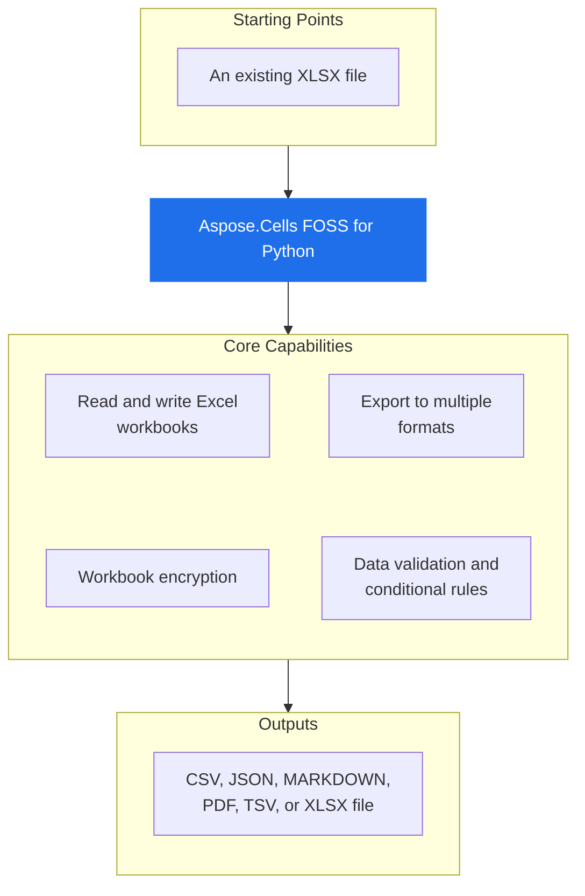

# Aspose.Cells FOSS for Python

[](https://pypi.org/project/aspose-cells-foss/)  [](License/LICENSE.txt) [](https://github.com/aspose-cells-foss/Aspose.Cells-FOSS-for-Python/graphs/contributors) [](https://pypi.org/project/aspose-cells-foss/)

[](https://products.aspose.org/cells/python/)

Aspose.Cells FOSS for Python reads and writes Excel `.xlsx` workbooks, converts them to `.csv`, `.tsv`, `.json`, `.markdown`, `.md`, `.pdf`, and `.xlsm` formats, and supports encryption and decryption of `.xlsx` files. It reads `.xlsx` workbooks and loads `.csv` data using `load_csv_workbook` and `CSVLoadOptions`. It provides classes such as `Workbook`, `Worksheet`, `Cells`, `Cell`, `Style`, and `DataValidation` to create, modify, and style workbooks, apply data validation rules, and manage charts, pictures, shapes, tables, and sparklines.

Aspose.Cells FOSS for Python is a free, open-source, pure-Python library for creating, reading,
modifying, and exporting Excel `.xlsx` workbooks without requiring Microsoft Excel.

## Navigation

- [At a Glance](#at-a-glance)
- [Key Capabilities](#key-capabilities)
- [Installation](#installation)
- [Dependencies](#dependencies)
- [Quick Start](#quick-start)
- [Additional Examples](#additional-examples)
- [API Reference](#api-reference)
- [Scope and Limitations](#scope-and-limitations)
- [Development and Testing](#development-and-testing)
- [Third-Party Notices](#third-party-notices)
- [License](#license)

## At a Glance



## Key Capabilities

- **Read and write Excel workbooks.** It reads and writes Excel workbooks in `.xlsx` format, allowing users to create new workbooks, access worksheets via the `Workbook.worksheets` collection, and read or write cell values using A1-style references through the `Cells` and `Cell` objects.
- **Cell formatting and styling.** It applies fonts, fills, borders, alignment, and number formats to cells using the `Style`, `Font`, and related objects, enabling bold text, custom colors, and size adjustments that persist when saving workbooks.
- **Data validation and conditional rules.** It adds data validation rules to cell ranges using `DataValidation` objects with `DataValidationType`, `DataValidationAlertStyle`, `DataValidationOperator`, and formula1 settings to enforce list, numeric, or text constraints.
- **Export to multiple formats.** It exports workbooks to `.csv`, `.tsv`, `.json`, `.markdown`, `.md`, and `.pdf` formats using `Workbook.save()` with format inferred from extension or `PdfSaveOptions` for PDF.
- **Workbook encryption.** It encrypts and decrypts `.xlsx` workbooks using password-based protection via `Workbook.save()` with a password argument or `Workbook` constructor with a password argument; `encrypt_xlsx` and `decrypt_xlsx` are convenience functions.
- **Chart and shape support.** It creates and manages charts, pictures, shapes, tables, and sparklines through dedicated collections such as `ChartCollection`, `ShapeCollection`, `TableCollection`, and `SparklineGroupCollection` on each worksheet.
- **Formula and calculation preservation.** It preserves formulas during load and save operations; the project is not a full Excel calculation engine.
- **Import CSV data.** It imports data from comma-separated and tab-separated files using `load_csv_workbook` with `CSVLoadOptions` to configure delimiters and load content into a new workbook.

## Installation

Install the published package from PyPI (`aspose-cells-foss`, version 26.10.0):

```bash
pip install aspose-cells-foss
```

To work from a source checkout instead, install the clone with pip:

```bash
git clone https://github.com/aspose-cells-foss/Aspose.Cells-FOSS-for-Python.git
cd Aspose.Cells-FOSS-for-Python
pip install .
```

Verify the install:

```bash
python -c "import aspose.cells_foss"
```

Requires Python 3.10 or later.

## Dependencies

### Required Package Dependencies

- `olefile>=0.46`
- `pycryptodome>=3.15.0`

### Native and System Requirements

- Requires Python 3.10 or later.

### Development Dependencies

- `pytest>=7.0.0` (extra `dev`)
- `pytest-cov>=4.0.0` (extra `dev`)

## Quick Start

Create a new workbook, populate cells with headers and data, and save it as an Excel file named `report.xlsx`.

```python
from aspose.cells_foss import Workbook

workbook = Workbook()
worksheet = workbook.worksheets[0]

worksheet.cells["A1"].value = "Product"
worksheet.cells["B1"].value = "Revenue"
worksheet.cells["A2"].value = "Widget"
worksheet.cells["B2"].value = 1250.50

workbook.save("report.xlsx")
```

Open an existing Excel file named `report.xlsx` and print the value stored in cell B2.

```python
from aspose.cells_foss import Workbook

workbook = Workbook("report.xlsx")
worksheet = workbook.worksheets[0]

print(worksheet.cells["B2"].value)
```

Install the package from PyPI.

## Additional Examples

Create data validation lists and protect workbooks with passwords.

### Save a Workbook with Password Protection and Load It Back

```python
from aspose.cells_foss import Workbook

workbook = Workbook()
workbook.worksheets[0].cells["A1"].value = "Confidential"
workbook.save("protected.xlsx", password="example-password")

loaded = Workbook("protected.xlsx", password="example-password")
print(loaded.worksheets[0].cells["A1"].value)
```

<details>
<summary>View Additional Examples</summary>

### Add a Data Validation List to Cells A1 Through A10

```python
from aspose.cells_foss import DataValidationType, Workbook

workbook = Workbook()
worksheet = workbook.worksheets[0]

validation = worksheet.data_validations.add("A1:A10")
validation.type = DataValidationType.LIST
validation.formula1 = '"Yes,No"'

workbook.save("validation.xlsx")
```

### Export a Workbook

The output format is inferred from the file extension:

```python
from aspose.cells_foss import Workbook

workbook = Workbook("report.xlsx")
workbook.save("report.csv")
workbook.save("report.json")
workbook.save("report.md")
workbook.save("report.pdf")  # Requires skia-python
```

CSV import is available through `Workbook.load_csv()` or `load_csv_workbook()`.

- Browse the executable [examples](examples) for feature-specific workflows.
- See the package's public exports in
  [`aspose/cells_foss/__init__.py`](aspose/cells_foss/__init__.py).
- Read the current release notes.
- Review development conventions in [AGENTS.md](AGENTS.md).
- Found a bug or have a feature request? [Open an issue](https://github.com/aspose-cells-foss/Aspose.Cells-FOSS-for-Python/issues).

</details>

## API Reference

Aspose.Cells FOSS for Python provides the `Workbook` class as the primary entry point for creating, loading, and manipulating spreadsheet files, with `Worksheet`, `Cells`, and `Cell` classes representing the hierarchical structure of a workbook.

The public API has 160 types.

<details>
<summary>View the Complete Public API Surface</summary>

### Core API

| Class | Description |
| --- | --- |
| `AgileEncryptionParameters` | Parameters for Agile Encryption (ECMA-376 Part 2, Section 4). |
| `CSVHandler` | Handles CSV import and export operations for workbooks. |
| `CSVLoadOptions` | Options for loading CSV files. |
| `CSVSaveOptions` | Options for saving CSV files. |
| `Cell` | Represents a single cell in a worksheet. |
| `Cells` | Represents a collection of cells in a worksheet. |
| `Chart` | Represents a chart in a worksheet. |
| `ChartAxis` | Represents a chart axis (category, value, or series). |
| `ChartCollection` | Collection of charts in a worksheet. |
| `ChartErrorBars` | Represents error bars attached to a chart series. |
| `ChartSeries` | Represents a single chart series. |
| `ChartView3D` | Represents chart-level 3D view settings. |
| `DataValidation` | Represents data validation settings for a range of cells. |
| `DataValidationCollection` | Represents a collection of DataValidation objects for a worksheet. |
| `DisplayValueOptions` | Options controlling display-text formatting. |
| `Font` | Represents font settings for a cell or range of cells. |
| `FontStrategy` | Resolves effective font families and fallback chains for text measurement. |
| `HorizontalPageBreakCollection` | Collection of manual horizontal page breaks (row breaks). |
| `JsonHandler` | Handles JSON export operations for workbooks. |
| `JsonSaveOptions` | Options for saving JSON files. |
| `MarkdownHandler` | Handles Markdown export operations for workbooks. |
| `MarkdownSaveOptions` | Options for saving Markdown files. |
| `MsoFillFormat` | Fill format properties for a shape. |
| `MsoLineFormat` | Border/outline format properties for a shape. |
| `NSeries` | Collection of series for a chart. |
| `NumberFormat` | Represents number format settings for a cell or range of cells. |
| `PdfCellLayout` | PdfCellLayout class holds the layout settings for a cell in a PDF document. |
| `PdfDataBarLayout` | PdfDataBarLayout class holds the layout settings for a data bar in a PDF document. |
| `PdfExporter` | Connects workbook models to prepared pages and a PDF renderer. |
| `PdfIconSetLayout` | PdfIconSetLayout class holds the layout settings for an icon set in a PDF document. |
| `PdfLayoutEngine` | Materializes all worksheet pages before the renderer starts drawing. |
| `PdfPageLayout` | PdfPageLayout class holds the layout settings for a page in a PDF document. |
| `PdfSaveOptions` | Controls worksheet selection and basic PDF rendering behavior. |
| `PdfTextRunLayout` | PdfTextRunLayout class holds the layout settings for a text run in a PDF document. |
| `Picture` | Represents a worksheet picture anchored to cells. |
| `PictureCollection` | Collection of pictures in a worksheet. |
| `RenderBounds` | A 1-based, inclusive rectangular range in worksheet coordinates. |
| `RichTextRun` | One formatted text run from an OOXML shared string. |
| `RowHeightCalculator` | Computes effective row heights without mutating the worksheet. |
| `Shape` | Represents a drawing shape (rectangle, oval, text box, arrow, etc.) on |
| `ShapeCollection` | Collection of Shape objects on a worksheet. |
| `ShapeFont` | Font properties for text inside a shape. |
| `SkiaPdfRenderer` | Draws materialized page layouts without owning layout or pagination. |
| `Sparkline` | One sparkline: a data source range paired with the cell where it appears. |
| `SparklineGroup` | A group of sparklines that share the same visual style. |
| `SparklineGroupCollection` | Collection of SparklineGroup objects (ws.sparkline_groups). |
| `StandardEncryptionParameters` | Parameters for Standard Encryption (ECMA-376 Part 2, Section 3). |
| `Style` | Represents formatting settings for a cell or range of cells. |
| `StyleResolver` | Resolves the effective visual style for worksheet cells. |
| `Table` | Represents an Excel structured table (ECMA-376 §18.5). |
| `TableCollection` | Collection of Table objects belonging to a worksheet (ws.tables). |
| `TableColumn` | Settings for a single table column. |
| `TableStyleInfo` | Visual style settings for an Excel table. |
| `TextMeasurer` | Backend-neutral text measurement service used by layout and rendering. |
| `ValueFormatter` | Formats cells or raw values into display text. |
| `VerticalPageBreakCollection` | Collection of manual vertical page breaks (column breaks). |
| `Workbook` | Represents an Excel workbook. |
| `Worksheet` | Represents a single worksheet in an Excel workbook. |
| `WorksheetBoundsResolver` | Resolve live worksheet bounds without relying on cached XLSX dimensions. |
| `AutoFilter` | Represents auto filters in a worksheet. |
| `FilterColumn` | Represents a filter column in an auto filter. |
| `CellValueHandler` | Handles cell value import and export operations according to ECMA-376 specification. |
| `CFBReader` | Reads encrypted XLSX from CFB format. |
| `cfb_handler.CFBWriter` | Writes encrypted XLSX to CFB format. |
| `cfb_writer.CFBWriter` | Writes CFB (Compound File Binary) files according to MS-CFB specification. |
| `MinimalCFBWriter` | Minimal CFB file writer for encrypted Office documents. |
| `CommentXMLReader` | Handles reading comment data from XML format. |
| `CommentXMLWriter` | Handles writing comment data to XML format. |
| `ConditionalFormat` | Represents a single conditional formatting rule applied to a cell range. |
| `ConditionalFormatCollection` | Represents a collection of conditional formats for a worksheet. |
| `CoreProperties` | Represents core document properties stored in docProps/core.xml. |
| `DocumentProperties` | Container for all document-level properties. |
| `ExtendedProperties` | Represents extended/application properties stored in docProps/app.xml. |
| `EncryptionVerifier` | Encryption verifier generation and validation. |
| `PackageEncryption` | Package data encryption and decryption. |
| `PasswordDerivation` | Password derivation helpers for Agile encryption. |
| `EncryptionParameters` | Base class for encryption parameters. |
| `FormulaEvaluator` | Basic formula evaluator for XLSX cells without cached values. |
| `Hyperlink` | Represents a hyperlink in a worksheet. |
| `Hyperlinks` | Collection of hyperlinks in a worksheet. |
| `PdfChartLayout` | PdfChartLayout class holds the layout settings for a chart in a PDF document. |
| `PdfChartSeriesLayout` | PdfChartSeriesLayout class holds the layout settings for a chart series in a PDF document. |
| `PdfPictureLayout` | PdfPictureLayout class holds the layout settings for a picture in a PDF document. |
| `PdfShapeLayout` | PdfShapeLayout class holds the layout settings for a shape in a PDF document. |
| `PdfSparklineLayout` | PdfSparklineLayout class holds the layout settings for a sparkline in a PDF document. |
| `PdfRenderer3DAreaMixin` | PdfRenderer3DAreaMixin class provides rendering capabilities for 3D area charts in a PDF document. |
| `PdfRenderer3DBarMixin` | PdfRenderer3DBarMixin class provides rendering capabilities for 3D bar charts in a PDF document. |
| `PdfRenderer3DLineColumnMixin` | PdfRenderer3DLineColumnMixin class provides rendering capabilities for 3D line and column charts in a PDF document. |
| `PdfRendererDrawingMixin` | PdfRendererDrawingMixin class provides rendering capabilities for drawing elements in a PDF document. |
| `PdfRendererPieBarMixin` | PdfRendererPieBarMixin class provides rendering capabilities for pie and bar charts in a PDF document. |
| `PdfRendererSpecialChartsMixin` | PdfRendererSpecialChartsMixin class provides rendering capabilities for special charts in a PDF document. |
| `PdfRendererStockSurfaceMixin` | PdfRendererStockSurfaceMixin class provides rendering capabilities for stock and surface charts in a PDF document. |
| `SharedStringTable` | Manages the Shared String Table for XLSX files according to ECMA-376 specification. |
| `Alignment` | Represents alignment settings for a cell or range of cells. |
| `Border` | Represents border settings for a single side of a cell or range of cells. |
| `Borders` | Represents border settings for all sides of a cell or range of cells. |
| `Fill` | Represents fill settings for a cell or range of cells. |
| `Protection` | Represents protection settings for a cell or range of cells. |
| `CalculationProperties` | Represents calculation properties for the workbook. |
| `DefinedName` | Represents a defined name in the workbook. |
| `DefinedNameCollection` | Collection of defined names in the workbook. |
| `FileVersion` | Represents file version information for the workbook. |
| `WorkbookPr` | Represents workbook properties (workbookPr element). |
| `WorkbookProperties` | Container for all workbook-level properties. |
| `WorkbookProtection` | Represents workbook protection settings. |
| `WorkbookView` | Represents a workbook view configuration. |
| `SheetProtectionDictWrapper` | Dictionary-like wrapper around SheetProtection for backward compatibility. |
| `HeaderFooter` | Represents header and footer settings. |
| `PageMargins` | Represents page margins. |
| `PageSetup` | Represents page setup settings. |
| `Pane` | Represents pane (freeze/split) settings. |
| `PrintOptions` | Represents print options. |
| `Selection` | Represents cell selection in a sheet view. |
| `SheetFormatProperties` | Represents sheet format properties. |
| `SheetProtection` | Represents sheet protection settings. |
| `SheetView` | Represents a sheet view configuration. |
| `WorksheetProperties` | Container for all worksheet-level properties. |
| `XLSXDecryptor` | Handles decryption of XLSX files. |
| `XLSXEncryptor` | Handles encryption of XLSX files. |
| `AutoFilterXMLLoader` | Handles loading autofilter data from XML format for .xlsx files. |
| `AutoFilterXMLWriter` | Handles writing autofilter data to XML format for .xlsx files. |
| `ChartXmlLoader` | Loads worksheet chart settings from drawing/chart XML parts. |
| `ChartXmlSaver` | Handles writing chart-related XLSX parts: |
| `ConditionalFormatXMLLoader` | Handles loading conditional formatting data from XML format for .xlsx files. |
| `ConditionalFormatXMLWriter` | Handles writing conditional formatting data to XML format for .xlsx files. |
| `DataValidationXmlLoader` | Loads DataValidation objects from ECMA-376 SpreadsheetML XML format. |
| `DataValidationXmlSaver` | Saves DataValidation objects to ECMA-376 SpreadsheetML XML format. |
| `HyperlinkRelationshipWriter` | Writes hyperlink relationships to _rels files. |
| `HyperlinkXMLLoader` | Loads hyperlinks from worksheet XML and relationship files. |
| `HyperlinkXMLSaver` | Saves hyperlinks to worksheet XML and relationship files. |
| `XMLLoader` | Handles loading of Excel workbook XML files. |
| `PictureXmlLoader` | Loads pictures from worksheet drawing parts. |
| `PictureXmlSaver` | Handles writing picture-related drawing/media XML payloads. |
| `WorkbookPropertiesXMLLoader` | Handles loading workbook properties from XML format for .xlsx files. |
| `WorksheetPropertiesXMLLoader` | Handles loading worksheet properties from XML format for .xlsx files. |
| `WorkbookPropertiesXMLWriter` | Handles writing workbook properties to XML format for .xlsx files. |
| `WorksheetPropertiesXMLWriter` | Handles writing worksheet properties to XML format for .xlsx files. |
| `XMLSaver` | Handles saving workbook data to XML format for .xlsx files. |
| `ShapeXmlLoader` | Loads xdr:sp shape elements from a drawing XML part. |
| `ShapeXmlSaver` | Generates drawing XML and relationship XML for worksheet shapes. |
| `SparklineXmlLoader` | Loads sparkline group data from the <extLst> in a worksheet XML root. |
| `SparklineXmlSaver` | Serialises SparklineGroupCollection to <extLst> XML. |
| `TableXmlLoader` | Loads table definitions from an XLSX ZIP archive into a worksheet. |
| `TableXmlSaver` | Serialises Table objects to ECMA-376 table XML. |

#### Enumerations

| Enumeration | Description |
| --- | --- |
| `ChartType` | Supported chart types. |
| `CipherAlgorithm` | Cipher algorithm enumeration. |
| `DataValidationAlertStyle` | Specifies the style of the error alert displayed when invalid data is entered. |
| `DataValidationImeMode` | Specifies the Input Method Editor (IME) mode for CJK language input. |
| `DataValidationOperator` | Specifies the comparison operator for data validation. |
| `DataValidationType` | Specifies the type of data validation. |
| `FillType` | Shape fill type (ECMA-376 a:spPr fill child elements). |
| `HashAlgorithm` | Hash algorithm enumeration. |
| `MsoDrawingType` | Shape preset geometry types (maps to ECMA-376 a:prstGeom prst attributes). |
| `MsoLineDashStyle` | Shape border/line dash style (ECMA-376 a:prstDash val attribute). |
| `SaveFormat` | Specifies the format for saving a workbook. |
| `SparklineEmptyCells` | SparklineEmptyCells enum lists the CONNECTED, GAP and ZERO values for handling empty cells in sparklines. |
| `SparklineType` | SparklineType enum lists the COLUMN, LINE and WIN_LOSS values for sparkline types. |
| `TextAlignmentType` | Horizontal text alignment inside a shape (ECMA-376 a:pPr algn attribute). |
| `TextAnchorType` | Vertical text anchor inside a shape (ECMA-376 a:bodyPr anchor attribute). |
| `EncryptionType` | Encryption type enumeration. |

#### Detailed Member Reference

### Workbook

The `Workbook` class supports loading existing files, creating new worksheets, copying worksheets, accessing individual worksheets by index or name, and saving in multiple formats including XLSX, CSV, TSV, JSON, Markdown, and PDF.

- `add_worksheet`: Adds a new worksheet to the workbook.
- `copy_worksheet`: Copy a worksheet and append the copy to the workbook. Returns the new worksheet.
- `create_worksheet`: Create and add a new worksheet. Alias for add_worksheet().
- `document_properties`: Gets document properties of the workbook.
- `file_path`: Gets the file path of the workbook.
- `font_strategy`: Shared font resolution strategy used by layout and rendering.
- `get_active_worksheet`: Return the currently active worksheet.
- `get_worksheet`: Gets a worksheet by index or name.
- `get_worksheet_by_index`: Return the worksheet at the given 0-based index, or None if out of range.
- `get_worksheet_by_name`: Return the worksheet with the given name, or None if not found.
- `is_protected`: Return True if the workbook has structure or window protection enabled.
- `load_csv`: Loads data from a CSV file into the workbook.
- `properties`: Gets workbook properties.
- `protect`: Protect the workbook structure/windows with an optional password.
- `protection`: Return a dict with the current workbook protection settings.
- `remove_worksheet`: Removes a worksheet from the workbook.
- `save`: Saves the workbook to a file.
- `save_as_csv`: Saves the workbook to a CSV file.
- `save_as_json`: Saves the workbook to a JSON file.
- `save_as_markdown`: Saves the workbook to a Markdown file.
- `save_as_pdf`: Save visible worksheets to PDF using prepared page layouts.
- `set_active_worksheet`: Set the active worksheet by index, name, or Worksheet object.
- `set_font_fallbacks`: Sets workbook-wide fallback font families in priority order.
- `text_measurer`: Shared text measurement service used by layout and rendering.
- `unprotect`: Remove workbook structure/window protection.
- `worksheets`: Gets collection of worksheets in the workbook.

### SaveFormat

The `SaveFormat` enum provides values for saving workbooks in formats including XLSX, CSV, TSV, JSON, Markdown, PDF, and AUTO.

- `from_extension`: Determines the save format from file extension.

### DataValidationType

The `DataValidationType` enum specifies validation types for cell data including WHOLE_NUMBER, DECIMAL, LIST, DATE, TIME, TEXT_LENGTH, CUSTOM, and NONE.

### ChartType

The `ChartType` enum defines chart types including AREA, BAR, LINE, PIE, SCATTER, and COMBO.

### CipherAlgorithm

The `CipherAlgorithm` enum lists supported encryption algorithms including AES_128, AES_192, and AES_256.

- `block_size`: Get block size in bytes (AES uses 16-byte blocks).
- `key_bytes`: Get key size in bytes.

### HashAlgorithm

The `HashAlgorithm` enum specifies hash algorithms including SHA1, SHA256, SHA384, and SHA512.

### encryption_params

The `encryption_params` class supports encryption types including AGILE and STANDARD.

### Style

The `Style` class and its associated `Font` and `FontStrategy` classes provide formatting capabilities for cells and ranges.

- `copy`: Creates a deep copy of this Style object.
- `set_border`: Sets complete border properties for a specific side.
- `set_border_color`: Sets the border color for a specific side.
- `set_border_style`: Sets the border line style for a specific side.
- `set_border_weight`: Sets the border line weight for a specific side.
- `set_builtin_number_format`: Sets the number format using a built-in format ID.
- `set_diagonal_border`: Sets diagonal border properties.
- `set_fill_color`: Sets the cell fill color using a solid fill pattern.
- `set_fill_pattern`: Sets the cell fill pattern and colors.
- `set_formula_hidden`: Sets whether the cell's formula is hidden when the worksheet is protected.
- `set_horizontal_alignment`: Sets the horizontal alignment of cell content.
- `set_indent`: Sets the indent level for cell content.
- `set_locked`: Sets whether the cell is locked when the worksheet is protected.
- `set_no_fill`: Removes the cell fill (transparent background).
- `set_number_format`: Sets the number format code for the cell.
- `set_reading_order`: Sets the reading order for cell content.
- `set_shrink_to_fit`: Sets whether text shrinks to fit the cell width.
- `set_text_rotation`: Sets the text rotation angle.
- `set_text_wrap`: Sets whether text wraps within the cell.
- `set_vertical_alignment`: Sets the vertical alignment of cell content.

### FillType

The `FillType` enum defines fill types including AUTOMATIC, SOLID, GRADIENT, PATTERN, and NONE.

### TextAlignmentType

The `TextAlignmentType` enum specifies text alignment options including LEFT, CENTER, RIGHT, JUSTIFY, and DISTRIBUTED.

### SparklineType

The `SparklineType` enum defines sparkline types including LINE, COLUMN, and WIN_LOSS.

### MsoFillFormat

The `MsoFillFormat` class provides access to Microsoft Office fill formatting properties including fill type and color.

</details>

## Scope and Limitations

- Formula expressions and cached results are preserved, but this project is not a full Excel calculation engine.
- Native workbook loading and saving targets the Open XML `.xlsx` format. Other spreadsheet formats such as `.xls`, `.ods`, and `.xlsb` are not supported.
- Some advanced Excel features are preserved as source package parts rather than exposed as editable Python objects.
- PDF output depends on locally available fonts and the optional `skia-python` renderer.

## Development and Testing

PDF export uses `skia-python`, which is not currently installed by the core package. Install the renderer separately:

```bash
pip install "skia-python>=144.0.post2,<145"
```

Install the development dependencies and collect or run the examples:

```bash
pip install -e ".[dev]"
python -m pytest examples -v
```

Generated workbooks are written below `examples/outputfiles/` and are not intended for source control.

## Third-Party Notices

See [Third-party notices](License/ThirdPartyNotices.txt).

## License

This project is licensed under the [MIT License](License/LICENSE.txt). The MIT License permits use, copying, modification, distribution, sublicensing, and commercial use, provided its copyright and permission notice are retained. The software is provided without warranty.
