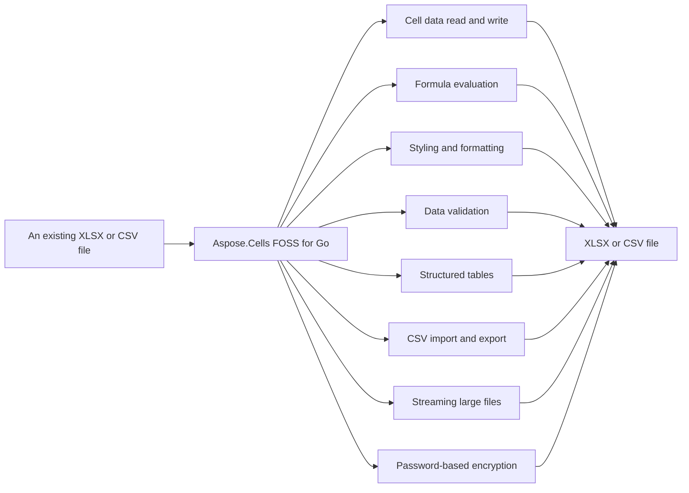

# Aspose.Cells FOSS for Go

[](https://pkg.go.dev/github.com/aspose-cells-foss/Aspose.Cells-FOSS-for-Go/v26)  [](LICENSE) [](https://github.com/aspose-cells-foss/Aspose.Cells-FOSS-for-Go/graphs/contributors)

[](https://products.aspose.org/cells/go/)

Aspose.Cells FOSS for Go reads and writes `.xlsx` and `.csv` files. It converts data between these formats using `Workbook.ImportFromCSV`, `Workbook.ExportToCSV`, and `Worksheet.ToCSV`. It processes large spreadsheets efficiently with `StreamingReader.ProcessRows` and its variants. It calculates formulas with `CalculateFormula` and supports password protection via `Workbook.SetPassword`, `Workbook.VerifyPassword`, and `Workbook.CheckPassword`.

## Navigation

- [At a Glance](#at-a-glance)
- [Key Capabilities](#key-capabilities)
- [Installation](#installation)
- [Dependencies](#dependencies)
- [Quick Start](#quick-start)
- [Additional Examples](#additional-examples)
- [API Reference](#api-reference)
- [Documentation & Resources](#documentation--resources)
- [Scope and Limitations](#scope-and-limitations)
- [Development and Testing](#development-and-testing)
- [License](#license)

## At a Glance



## Key Capabilities

- **Cell data read and write.** `Cell` data read and write is performed using `Cells.Get` and `Cells.Set` with A1-style references, supporting string, float64, int, and bool values, and `Cell.Value`, `Cell.AsString`, `Cell.AsFloat64`, and `Cell.AsInt` provide typed access to cell contents.
- **Formula evaluation.** Formula evaluation uses `Cell.SetFormula` to assign formulas, `Cell.GetFormula` to retrieve them, and `CalculateFormula` to compute results for supported functions including SUM, AVERAGE, MAX, and MIN over single cells or A1-style ranges.
- **Styling and formatting.** Styling and formatting combine `Font`, `Fill`, `Alignment`, and `Border` properties into a `Style` applied to cells via `Cell.SetStyle`, with automatic deduplication of identical styles during save.
- **Data validation.** Data validation restricts cell ranges to dropdown lists or numeric ranges using `DataValidation` rules attached to a `Worksheet` via `Worksheet.AddDataValidation`, with support for custom error messages, titles, and error styles.
- **Structured tables.** Structured tables are created using `Worksheet.AddTable` with `NewTable`, supporting header rows and built-in table styles via the `Table` object.
- **CSV import and export.** CSV import and export moves data to and from `.csv` files using `Workbook.ImportFromCSV` and `Workbook.ExportToCSV` with a caller-supplied delimiter, and `Worksheet.ToCSV` exports a single worksheet.
- **Streaming large files.** Streaming large files uses `NewStreamingReader` to process rows one at a time via `StreamingReader.ProcessRows`, `StreamingReader.ProcessRowsWithFilter`, `StreamingReader.ProcessRowsWithRange`, or `StreamingReader.ProcessRowsWithColumns`, keeping memory proportional to one row's width.
- **Password-based encryption.** Password-based encryption uses `Workbook.SetPassword` to apply ECMA-376 Agile Encryption (SHA-512 key derivation, AES-256-CBC) during save, with `Workbook.VerifyPassword` and `Workbook.CheckPassword` for password validation.

## Installation

Install the published package from pkg.go.dev (`github.com/aspose-cells-foss/Aspose.Cells-FOSS-for-Go/v26`, version v26.7.1):

```bash
go get github.com/aspose-cells-foss/Aspose.Cells-FOSS-for-Go/v26
```

Verify the install:

```bash
go list github.com/aspose-cells-foss/Aspose.Cells-FOSS-for-Go/v26/aspose/cells_foss
```

## Dependencies

### Required Package Dependencies

No required third-party package dependencies; in `go.mod`, no `require` directive a consumer would install is declared.

### Native and System Requirements

- Requires Go `1.24.5` (`go` in `go.mod`).

## Quick Start

Create a new Excel file, write values to cells A1 and B1, and save it as `hello.xlsx` by importing the Aspose.Cells FOSS for Go package and using its `NewWorkbook`, Worksheets, `Cells.Set`, and Save methods.

```go
package main

import cells_foss "github.com/aspose-cells-foss/Aspose.Cells-FOSS-for-Go/v26/aspose/cells_foss"

func main() {
	// Create.
	wb := cells_foss.NewWorkbook()
	ws := wb.Worksheets[0]

	// Write.
	ws.Cells().Set("A1", "Hello, World!")
	ws.Cells().Set("B1", 42)

	// Save.
	wb.Save("hello.xlsx")
}
```

`Load` an existing Excel file, read the value in cell A1, update it, and save the changes to a new file by importing the Aspose.Cells FOSS for Go package and using its `LoadWorkbook`, Worksheets, `Cells.Get`, `Cells.Set`, and Save methods.

```go
wb, _ := cells_foss.LoadWorkbook("input.xlsx")
ws := wb.Worksheets[0]

cell, _ := ws.Cells().Get("A1")
fmt.Println("Current value:", cell.Value)

ws.Cells().Set("A1", "Updated value")
wb.Save("output.xlsx")
```

Run `go run main.go` to produce `hello.xlsx`.

## Additional Examples

The following examples demonstrate core workflows: creating formulas, applying data validation, streaming large files, styling cells, building structured tables, and importing CSV data.

### Create Formulas and Evaluate Them with the Calculation Engine

```go
func main() {
	wb := cells_foss.NewWorkbook()
	ws := wb.Worksheets[0]

	// ---- Populate sales data ----
	data := []float64{1200, 850, 1400, 960, 1780}
	headers := []string{"Month", "Sales"}

	ws.Cells().Set("A1", headers[0])
	ws.Cells().Set("B1", headers[1])

	months := []string{"Jan", "Feb", "Mar", "Apr", "May"}
	for i, m := range months {
		row := i + 2
		ws.Cells().Set(fmt.Sprintf("A%d", row), m)
		ws.Cells().Set(fmt.Sprintf("B%d", row), data[i])
	}

	// ---- Add formula cells ----
	lastDataRow := len(data) + 1
	totalRef := fmt.Sprintf("B2:B%d", lastDataRow)

	// SUM formula.
	ws.Cells().Set("B7", nil)
	sumCell, _ := ws.Cells().Get("B7")
	sumCell.SetFormula(fmt.Sprintf("SUM(%s)", totalRef))

	// AVERAGE formula.
	ws.Cells().Set("B8", nil)
	avgCell, _ := ws.Cells().Get("B8")
	avgCell.SetFormula(fmt.Sprintf("AVERAGE(%s)", totalRef))

	// Labels.
	ws.Cells().Set("A7", "TOTAL")
	ws.Cells().Set("A8", "AVERAGE")

	// ---- Evaluate formulas with the engine ----
	for _, row := range []int{7, 8} {
		cell, _ := ws.Cells().Get(fmt.Sprintf("B%d", row))
		formula := cell.GetFormula()
		result, err := cells_foss.CalculateFormula(formula, ws)
		if err != nil {
			fmt.Printf("  %s = ERROR: %v\n", formula, err)
		} else {
			fmt.Printf("  %s = %v\n", formula, result)
		}
	}

	wb.Save("outputfiles/formula.xlsx")
}
```

<details>
<summary>View Additional Examples</summary>

### Apply List-Type Data Validation to a Cell Range

```go
func main() {
	wb := cells_foss.NewWorkbook()
	ws := wb.Worksheets[0]

	ws.Cells().Set("A1", "Fruit")
	ws.Cells().Set("A2", "Apple")
	ws.Cells().Set("A3", "Banana")

	// Create a list-type data validation.
	dv := &cells_foss.DataValidation{
		Type:             cells_foss.DataValidationTypeList,
		Formula1:         `"Apple,Banana,Cherry,Dragonfruit"`,
		AllowBlank:       true,
		ShowErrorMessage: true,
		ErrorTitle:       "Invalid Fruit",
		ErrorMessage:     "Please pick a fruit from the list.",
		ErrorStyle:       cells_foss.ErrorStyleStop,
	}

	if err := ws.AddDataValidation("A2:A10", dv); err != nil {
		fmt.Printf("Error: %v\n", err)
		return
	}

	wb.Save("outputfiles/data_validation.xlsx")
}
```

### Stream Rows from a Large Excel File Efficiently

```go
func main() {
	sr := cells_foss.NewStreamingReader("outputfiles/streaming_data.xlsx")
	rowCount := 0
	var totalScore float64

	err := sr.ProcessRows("Sheet1", func(rowIdx int, cells map[string]string) error {
		rowCount++
		if score, ok := cells["C"+fmt.Sprint(rowIdx)]; ok {
			var s float64
			fmt.Sscanf(score, "%f", &s)
			totalScore += s
		}
		return nil
	})
	if err != nil {
		fmt.Fprintf(os.Stderr, "Error streaming: %v\n", err)
		os.Exit(1)
	}
	fmt.Printf("Streamed %d rows, total score %.0f\n", rowCount, totalScore)
}
```

### Apply Custom Font and Fill Styles to Cells

```go
func main() {
	wb := cells_foss.NewWorkbook()
	ws := wb.Worksheets[0]

	boldStyle := cells_foss.NewStyle()
	boldStyle.Font.Bold = true
	boldStyle.Font.Size = 12

	highlightStyle := cells_foss.NewStyle()
	highlightStyle.Font.Color = "FFFFFFFF"
	highlightStyle.Font.Bold = true
	highlightStyle.Fill = &cells_foss.Fill{
		Type:  cells_foss.FillTypeSolid,
		Color: "FF4472C4",
	}

	headers := []string{"Item", "Category", "Price", "In Stock"}
	for i, h := range headers {
		ref := string(rune('A'+i)) + "1"
		ws.Cells().Set(ref, h)
		cell, _ := ws.Cells().Get(ref)
		cell.SetStyle(boldStyle)
	}

	wb.Save("outputfiles/style.xlsx")
}
```

### Create a Structured Table with a Built-In Style

```go
func main() {
	wb := cells_foss.NewWorkbook()
	ws := wb.Worksheets[0]

	headers := []string{"Product", "Q1", "Q2", "Q3", "Q4", "Total"}
	for i, h := range headers {
		ref := string(rune('A'+i)) + "1"
		ws.Cells().Set(ref, h)
	}

	// ... populate data rows (see examples/table/main.go) ...

	tbl := ws.AddTable("A1:F6")
	tbl.HasHeaderRow = true
	tbl.StyleName = "TableStyleMedium6"

	wb.Save("outputfiles/table.xlsx")
}
```

### Import Data from a CSV File into a New Worksheet

```go
func main() {
	csvPath := "outputfiles/employees.csv"

	wb := cells_foss.NewWorkbook()
	if err := wb.ImportFromCSV(csvPath, "Employees", ','); err != nil {
		fmt.Fprintf(os.Stderr, "Error importing CSV: %v\n", err)
		os.Exit(1)
	}

	ws := wb.Worksheets[1] // second sheet; index 0 is the default "Sheet1"
	fmt.Printf("Imported sheet: %q\n", ws.Name)

	wb.Save("outputfiles/csv_imported.xlsx")
}
```

The module supports Go 1.24.5 or later and has zero third-party dependencies — encryption and
everything else builds on the Go standard library alone. Because the package name (`cells_foss`)
differs from the module path's final segment (`v26`), import it with an explicit alias:

> **Not verified:** this example is carried over unchanged from the project's existing README. It could not be compiled or run here.

```go
import cells_foss "github.com/aspose-cells-foss/Aspose.Cells-FOSS-for-Go/v26/aspose/cells_foss"
```

Runnable programs for every capability live under `examples/` in the repository. The formula
engine example is shown directly below; the rest are collapsed for space.

</details>

## API Reference

The library's public surface is centered on `Workbook` and `Worksheet` — created with `NewWorkbook`/`LoadWorkbook` and exposing a *`Cells` collection through `Worksheet.Cells` — with supporting types (`Style`, `DataValidation`, `Table`, `Picture`, `StreamingReader`) for styling, validation, structured ranges, images, and low-memory row access.

The verified public surface has 28 types.

<details>
<summary>View the Complete Public API Surface</summary>

### Core API

| Class | Description |
| --- | --- |
| `Alignment` | Alignment controls how cell content is positioned within the cell bounds. |
| `Border` | Border defines which sides of a cell have a visible rule and the colour of those rules. |
| `Cell` | Cell represents a single cell in a worksheet grid. |
| `CellNotFoundError` | CellNotFoundError is returned when attempting to access a cell that does not exist in the worksheet. |
| `Cells` | Cells is a collection of Cell values indexed by A1-style string references. |
| `Chart` | Chart represents a chart embedded in a worksheet. |
| `ChartAnchor` | ChartAnchor specifies the position of a chart on the worksheet. |
| `ChartSeries` | ChartSeries represents a single data series in a chart. |
| `ChartType` | ChartType enumerates the supported chart types. |
| `ConditionalFormatting` | ConditionalFormatting represents a set of conditional formatting rules applied to a range of cells on a worksheet. |
| `ConditionalFormattingRule` | ConditionalFormattingRule represents a single conditional formatting rule. |
| `DataValidation` | DataValidation represents a single data-validation rule applied to a range of cells on a worksheet. |
| `Fill` | Fill describes the background appearance of a cell. |
| `Font` | Font describes the typographic properties applied to cell text. |
| `FormulaError` | FormulaError is returned when a formula cannot be parsed or evaluated. |
| `InvalidRefError` | InvalidRefError is returned when a cell reference string is malformed or cannot be parsed. |
| `Picture` | Picture represents an image embedded in a worksheet. |
| `PivotDataField` | PivotDataField represents a value field in a pivot table with aggregation. |
| `PivotTable` | PivotTable represents a pivot table on a worksheet. |
| `RowCallback` | RowCallback is invoked by StreamingReader.ProcessRows once for every row in the worksheet. |
| `SheetNotFoundError` | SheetNotFoundError is returned when attempting to access a worksheet by name that does not exist in the workbook. |
| `StreamOptions` | StreamOptions configures filtering for streaming row processing. |
| `StreamingReader` | StreamingReader reads an .xlsx workbook row by row without loading the entire sheet XML into memory. |
| `Style` | Style groups font, fill, alignment, and border settings into a named formatting record. |
| `Table` | Table represents a structured range of data (a "table" in Excel terminology) with optional header row and built-in auto-filter. |
| `VBAProject` | VBAProject holds the binary data of a VBA project. |
| `Workbook` | Workbook is the top-level object representing an Excel workbook. |
| `Worksheet` | Worksheet represents a single sheet within a workbook. |

#### Detailed Member Reference

### Cells

The `Cells` collection provides access to individual cells through `Cells.Get`, `Cells.Set`, `Cells.All`, and `Cells.Remove` methods.

- `All`: All returns the underlying map of all cells keyed by A1 reference.
- `Get`: Get returns the Cell at the given A1 reference.
- `Remove`: Remove deletes the cell at the given A1 reference.
- `Set`: Set stores a value at the given A1 reference.

### Cell

A `Cell` represents a single cell with value, formula, and style properties accessible through `Cell.Value`, `Cell.AsString`, `Cell.AsFloat64`, `Cell.AsInt`, `Cell.Formula`, `Cell.GetFormula`, `Cell.SetFormula`, `Cell.StyleID`, `Cell.GetStyle`, and `Cell.SetStyle`.

- `AsFloat64`: AsFloat64 returns the cell value as float64.
- `AsInt`: AsInt returns the cell value as int.
- `AsString`: AsString returns the cell value as a string.
- `GetFormula`: GetFormula returns the formula expression stored in this cell, or an empty string when the cell contains no formula.
- `GetStyle`: GetStyle returns the Style currently applied to this cell, or nil when the cell has no parent Workbook or the StyleID cannot be resolved.
- `SetFormula`: SetFormula stores a formula expression in this cell and marks the owning Workbook as modified.
- `SetStyle`: SetStyle assigns the given Style to this cell.

### Style

`Style` encapsulates formatting attributes including `Font`, `Fill`, `Alignment`, and `Border` through `Style.Font`, `Style.Fill`, `Style.Alignment`, and `Style.Border`.

### Font

`Font` defines text appearance with properties `Font.Name`, `Font.Size`, `Font.Bold`, `Font.Italic`, and `Font.Color`.

### Fill

`Fill` specifies cell background formatting with `Fill.Type` and `Fill.Color` properties.

### Alignment

`Alignment` controls text positioning with `Alignment.Horizontal`, `Alignment.Vertical`, and `Alignment.WrapText` properties.

### Border

`Border` defines cell border formatting through `Border.Top`, `Border.Bottom`, `Border.Left`, `Border.Right`, and `Border.Color` properties.

### DataValidation

`DataValidation` applies input constraints with `DataValidation.Type`, `DataValidation.Ref`, `DataValidation.Formula1`, `DataValidation.Formula2`, `DataValidation.AllowBlank`, `DataValidation.ShowErrorMessage`, `DataValidation.ErrorTitle`, `DataValidation.ErrorMessage`, and `DataValidation.ErrorStyle` properties.

### Table

`Table` represents a structured range with `Table.Name`, `Table.Range`, `Table.HasHeaderRow`, and `Table.StyleName` properties.

### StreamingReader

`StreamingReader` enables low-memory row processing through `StreamingReader.ProcessRows`, `StreamingReader.ProcessRowsWithFilter`, `StreamingReader.ProcessRowsWithRange`, and `StreamingReader.ProcessRowsWithColumns` methods.

- `ProcessRows`: ProcessRows opens the workbook, resolves the named sheet to its XML part, loads the shared-strings table (if present), and then streams through the sheet data one row at a time, calling callback for each row.
- `ProcessRowsWithColumns`: ProcessRowsWithColumns streams through all rows but only returns cells from the specified columns.
- `ProcessRowsWithFilter`: ProcessRowsWithFilter opens the workbook and streams through the named sheet, applying the filters specified in opts.
- `ProcessRowsWithRange`: ProcessRowsWithRange streams through rows in the specified range [startRow, endRow].

### Workbook

`Workbook` manages spreadsheets with `NewWorkbook` and `LoadWorkbook` constructors, `Workbook.Worksheets` for accessing worksheets, `Workbook.Save` for saving files, `Workbook.ImportFromCSV` and `Workbook.ExportToCSV` for CSV operations, and `Workbook.SetPassword`, `Workbook.VerifyPassword`, and `Workbook.CheckPassword` for password handling.

- `CheckPassword`: CheckPassword returns true if the workbook is password-protected and the provided password matches.
- `ClearVBAProject`: ClearVBAProject removes the VBA project from the workbook.
- `ExportToCSV`: ExportToCSV writes the worksheet at sheetIndex to a CSV file using the given delimiter.
- `GetVBAProject`: GetVBAProject returns the VBA project data attached to the workbook, or nil if no VBA project is present.
- `HasVBAProject`: HasVBAProject reports whether the workbook has an attached VBA project.
- `ImportFromCSV`: ImportFromCSV reads a CSV file and imports its contents into a new worksheet with the given name.
- `Save`: Save writes the workbook to the given file path in .xlsx format.
- `SetPassword`: SetPassword configures an open password for the workbook.
- `SetVBAProject`: SetVBAProject attaches a VBA project to the workbook.
- `VerifyPassword`: VerifyPassword reports whether pw matches the password that was used to encrypt this workbook (as set by SetPassword, or read from an encrypted file).

### Worksheet

`Worksheet` represents a spreadsheet tab with `Worksheet.Cells` for cell access, `Worksheet.Name` and `Worksheet.Index` for identification, `Worksheet.AddTable`, `Worksheet.AddDataValidation`, `Worksheet.AddPicture`, `Worksheet.AddChart`, `Worksheet.AddPivotTable`, and `Worksheet.AddConditionalFormatting` for adding elements, and `Worksheet.FromCSV` and `Worksheet.ToCSV` for CSV operations.

- `AddChart`: AddChart adds a chart to the worksheet.
- `AddConditionalFormatting`: AddConditionalFormatting adds a conditional formatting rule set to the worksheet.
- `AddDataValidation`: AddDataValidation appends a data-validation rule to the worksheet.
- `AddPicture`: AddPicture attaches pic to the worksheet, assigns it a unique name, and marks the workbook as modified.
- `AddPivotTable`: AddPivotTable adds a pivot table to the worksheet.
- `AddTable`: AddTable creates a new Table covering the given range, assigns it a unique auto-generated name ("Table1", "Table2", …), appends it to the worksheet, and returns it for further configuration.
- `Cells`: Cells returns the Cells collection for this worksheet, enabling cell-level read and write operations via A1-style references.
- `FromCSV`: FromCSV populates the worksheet with data from a 2D string slice.
- `GetTable`: GetTable returns the Table with the given name, or nil when no match is found.
- `RemoveChart`: RemoveChart removes the chart at the specified index.
- `RemoveConditionalFormatting`: RemoveConditionalFormatting removes the first conditional formatting rule set whose Ref exactly matches the given ref string.
- `RemoveDataValidation`: RemoveDataValidation removes the first data-validation rule whose Ref exactly matches the given ref string.
- `RemovePivotTable`: RemovePivotTable removes the pivot table with the given name.
- `ToCSV`: ToCSV converts the worksheet's cells into a 2D string slice suitable for writing with encoding/CSV.

For the complete API reference and usage guide, see **[docs/usage.md](docs/usage.md)**.

</details>

## Documentation & Resources

- **[Getting started guide](https://docs.aspose.org/cells/go/)** — The getting started guide covers loading, editing, styling, and saving spreadsheets in Go.
- **[How-to guides & FAQ](https://kb.aspose.org/cells/go/)** — The how-to guides and FAQ provide Go knowledge base articles, troubleshooting guides, and step-by-step instructions for Aspose.Cells FOSS for Go.
- **[AGENTS.md](AGENTS.md)** — `AGENTS.md` outlines the repository's contribution guide for AI-assisted development, including source-of-truth conventions and areas requiring review before changes.
- Found a bug or have a feature request? [Open an issue](https://github.com/aspose-cells-foss/Aspose.Cells-FOSS-for-Go/issues).

- **[Full API reference](https://reference.aspose.org/cells/go/)** — the complete, browsable
  reference for all 14 public types (the [API reference](#api-reference) section above covers the
  essentials).

For a complete usage walkthrough beyond this README, see the repository's own
[docs/usage.md](docs/usage.md).

## Scope and Limitations

Aspose.Cells FOSS for Go reads and writes Excel files in XLSX format, supports A1-style cell references, and provides formula calculation for SUM, AVERAGE, MAX, and MIN, as well as CSV import and XML access for round-trip fidelity.

- `Cell` references are A1-style strings only; tuple or array indices are not supported, and `Cells.Get` and `Cells.Set` operate exclusively with this reference style.
- `CalculateFormula` supports only SUM, AVERAGE, MAX, and MIN; any other formula returns an error rather than being evaluated.
- CSV import via `Workbook.ImportFromCSV` stores every field as a Go string and does not infer numeric or boolean types the way `Cells.Set` does when called directly with typed values.
- Generated XML follows ECMA-376's own element ordering; this preserves round-trip compatibility but isn't independently configurable.
- On save, unmodified content is reused verbatim from the original XML byte-for-byte, and only content touched since load is regenerated — round-trip fidelity depends on this split, not a full re-serialization of every part.
- No third-party dependencies — Go standard library only, and the software is provided without warranty under the MIT License.

These limitations don't apply to [full-featured Aspose.Cells for Go — Enterprise Edition](https://products.aspose.com/cells/go-cpp/). It adds the complete Excel formula function library, additional file-format coverage, and commercial support.

## Development and Testing

Aspose.Cells FOSS for Go requires Go version 1.24.5 and uses the standard Go toolchain for building and testing. The library source code resides in the aspose/`cells_foss` directory, with integration tests in tests/, runnable examples in examples/, and a verification tool in verify/. The examples directory contains a separate `go.mod` file.

The suite covers 22 test files under `tests/`.

To build from a clone, run:

```bash
go build ./...
```

```bash
go get github.com/aspose-cells-foss/Aspose.Cells-FOSS-for-Go/v26/aspose/cells_foss
```

```
├── aspose/cells_foss/        # Library source code
│   ├── workbook.go           #   Workbook entry point
│   ├── worksheet.go          #   Worksheet model
│   ├── cell.go / cells.go    #   Cell model and collection
│   ├── style.go              #   Styles (font, fill, alignment, border)
│   ├── formula_engine.go     #   Formula calculation engine
│   ├── datavalidation.go     #   Data validation
│   ├── table.go              #   Tables
│   ├── picture.go            #   Picture embedding
│   ├── csv_handler.go        #   CSV import/export
│   ├── streaming_reader.go   #   Streaming row reader
│   ├── crypto.go             #   Encryption (SHA-512 + AES-256-CBC)
│   ├── xmlloader.go          #   XML loading
│   ├── xmlsaver.go           #   XML saving
│   ├── xml_feature_loader.go #   Style/table/picture loading
│   ├── xml_feature_saver.go  #   Style/table/picture/validation saving
│   └── xml_sharedstrings_loader.go  # Shared strings
├── tests/                    # Integration tests (public API)
├── examples/                 # Runnable example programs
│   ├── basic/                #   Create and save
│   ├── load_modify_save/     #   Load → modify → save
│   ├── style/                #   Style application
│   ├── formula/              #   Formulas and calculation
│   ├── table/                #   Structured tables
│   ├── data_validation/      #   Data validation
│   ├── picture/              #   Picture embedding
│   ├── csv_export/           #   CSV export
│   ├── csv_import/           #   CSV import
│   ├── streaming/            #   Streaming large data
│   └── go.mod                #   Separate module for examples (see Development and Testing)
├── docs/                     # Documentation
│   └── usage.md              #   Detailed usage guide
├── verify/                   # Verification tool
│   └── check_open_xlsx.go    #   .xlsx structure validator
├── doc.go                    # Package-level documentation
├── AGENTS.md                 # AI-assisted development guide
├── go.mod
├── go.sum
└── README.md
```

```bash
go test ./...
```

Run only the integration tests (the public API surface):

```bash
go test ./tests/ -v
```

Run every bundled example program:

```bash
cd examples
for d in */; do go run ./$d; done
```

## License

This project is licensed under the [MIT License](LICENSE). The MIT License permits use, copying, modification, distribution, sublicensing, and commercial use, provided its copyright and permission notice are retained. The software is provided without warranty.
