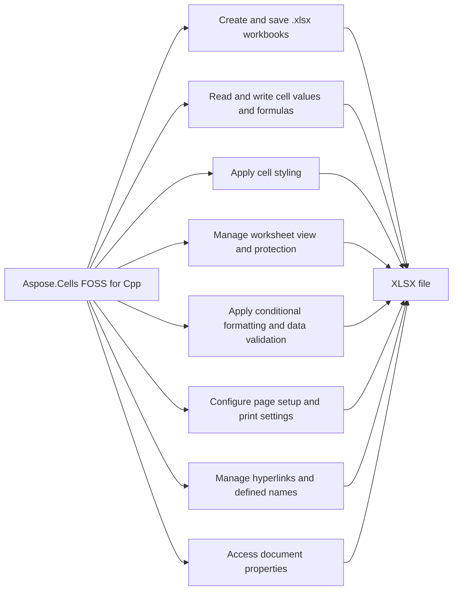

# Aspose.Cells FOSS for Cpp

 [](License/LICENSE.txt) [](https://github.com/aspose-cells-foss/Aspose.Cells-FOSS-for-Cpp/graphs/contributors)

[](https://products.aspose.org/cells/cpp/)

Aspose.Cells FOSS for Cpp reads and writes Excel files in the `.xlsx` format. It provides classes such as `Workbook`, `Worksheet`, and `Cell` to create, modify, and save spreadsheet content. The product supports setting cell values, formulas, and styles, including font, color, fill pattern, and borders. It raises `WorkbookSaveException` when saving fails and `InvalidFileFormatException` when loading an unsupported file format.

## Navigation

- [At a Glance](#at-a-glance)
- [Key Capabilities](#key-capabilities)
- [Installation](#installation)
- [Dependencies](#dependencies)
- [Quick Start](#quick-start)
- [Additional Examples](#additional-examples)
- [API Reference](#api-reference)
- [Documentation & Resources](#documentation--resources)
- [Scope and Limitations](#scope-and-limitations)
- [Development and Testing](#development-and-testing)
- [License](#license)

## At a Glance



## Key Capabilities

- **Create and save .xlsx workbooks.** It creates blank workbooks via the `Workbook` constructor and loads existing files from paths or in-memory streams, then saves them as `.xlsx` files using `Workbook.Save`.
- **Read and write cell values and formulas.** It writes cell values of strings, integers, doubles, bools, and `DateTime` using `Cell.PutValue`, retrieves them as a variant-typed `CellValue` via `Cell.GetValue`, and sets or reads formulas with `Cell.SetFormula` and `Cell.GetFormula`.
- **Apply cell styling.** It applies cell styling by retrieving a `Style` with `Cell.GetStyle`, modifying its `Font` (bold, color), `FillPattern`, foreground and background `Color`, and `Borders`, then saving the style back with `Cell.SetStyle`.
- **Manage worksheet view and protection.** It controls worksheet view settings such as `VisibilityType` (visible, hidden, very hidden), zoom, gridlines, headers, and right-to-left layout, and applies `WorksheetProtection` to restrict editing.
- **Apply conditional formatting and data validation.** It applies conditional formatting through `ConditionalFormattingCollection` and `FormatCondition` to style cells based on their values, and manages data validation rules via `ValidationCollection` and `Validation` to constrain user input.
- **Configure page setup and print settings.** It configures page setup and print settings using `PageSetup` to set `PaperSizeType`, `PageOrientationType`, margins, scaling, print area, print titles, headers, footers, and page breaks.
- **Manage hyperlinks and defined names.** It attaches hyperlinks to cell ranges using `HyperlinkCollection` and `Hyperlink` for external, internal, or mailto links, and manages workbook- or sheet-scoped named ranges through `DefinedNameCollection` and `DefinedName` with optional comment strings.
- **Access document properties.** It reads core and extended document metadata through `WorkbookProperties`, `DocumentProperties` exposed by `Workbook.GetProperties` and `Workbook.GetDocumentProperties`.

- **Create or load `.xlsx` workbooks**: construct a blank `Workbook`, or load an existing file
  from a path or an in-memory `std::vector<std::uint8_t>` stream via one of `Workbook`'s
  constructors, then save back out to either form with `Workbook.Save()`.
- **Read and write cell values and formulas**: `Cell.PutValue()` accepts strings, integers,
  doubles, bools, and `DateTime`; `Cell.GetValue()` returns a variant-typed `CellValue`, and
  `Cell.SetFormula()`/`Cell.GetFormula()` handle Excel formula text with or without a leading `=`.
- **Apply cell styles**: `Cell.GetStyle()`/`Cell.SetStyle()` return and apply a `Style`, which
  bundles `Font` (bold, color), fill (`FillPattern`, foreground/background `Color`), `Borders`,
  alignment, and text wrap into one cloneable value.
- **Merge cell ranges and apply number formats**: `Cells.Merge()` creates merged regions tracked
  as `MergeRegion`s, and `Style.SetNumberFormat()`/`NumberFormat` apply and parse Excel
  display-format patterns, rendered through `DisplayTextFormatter` with locale-directive support.
- **Control worksheet view and protection settings**: per-sheet `VisibilityType` (visible, hidden,
  very hidden), zoom, gridline and header visibility, right-to-left (RTL) layout, and
  `WorksheetProtection` are all exposed directly on `Worksheet`.
- **Apply conditional formatting and data validation**: `Worksheet.GetConditionalFormattings()`
  manages rule-driven cell formatting through `FormatCondition`, and
  `Worksheet.GetValidations()` manages input constraints through `Validation`, both scoped to
  one or more `CellArea` ranges.
- **Manage hyperlinks and defined names**: `Worksheet.GetHyperlinks()` attaches external, internal,
  or `mailto:` links to a cell range via `Hyperlink`, and `Workbook.GetDefinedNames()` manages
  workbook- or sheet-scoped named ranges through `DefinedNameCollection`, each of which can carry
  its own descriptive comment string.
- **Configure page setup and print settings**: `Worksheet.GetPageSetup()` returns a `PageSetup` for
  paper size, orientation, margins, scaling, print area/titles, headers/footers, and page breaks.
- **Read and write document properties**: `Workbook.GetProperties()` and
  `Workbook.GetDocumentProperties()` expose core and extended metadata through
  `WorkbookProperties`/`DocumentProperties`.

## Installation

The library is published on NuGet as `Aspose.Cells.Cpp.FOSS`.

## Dependencies

### Required Package Dependencies

No required third-party package dependencies; in `Aspose.Cells.Foss.Cpp/CMakeLists.txt`, no dependency is on the library target's public link interface, so a consumer links nothing beyond the library itself.

### Native and System Requirements

- Requires C++ `17` (`CMAKE_CXX_STANDARD` in `Aspose.Cells.Foss.Cpp/CMakeLists.txt`).
- Requires CMake 3.16 or later (`cmake_minimum_required` in `Aspose.Cells.Foss.Cpp/CMakeLists.txt`).

## Quick Start

This example creates a new workbook, writes product data and a SUM formula to a worksheet named Products, applies a styled header, and saves the file as `products.xlsx`.

```cpp
#include "aspose/cells_foss/Workbook.h"
#include "aspose/cells_foss/WorksheetCollection.h"
#include "aspose/cells_foss/Worksheet.h"
#include "aspose/cells_foss/Cell.h"
#include "aspose/cells_foss/Style.h"
#include "aspose/cells_foss/Color.h"
#include "aspose/cells_foss/Font.h"

using namespace Aspose::Cells_FOSS;

int main() {
    Workbook workbook;
    Worksheet& sheet = workbook.GetWorksheets()[0];

    sheet.SetName("Products");
    sheet.GetCells()["A1"].PutValue("Product");
    sheet.GetCells()["B1"].PutValue("Price");
    sheet.GetCells()["A2"].PutValue("Apple");
    sheet.GetCells()["B2"].PutValue(2.99);
    sheet.GetCells()["A3"].PutValue("Orange");
    sheet.GetCells()["B3"].PutValue(1.99);
    sheet.GetCells()["B4"].SetFormula("=SUM(B2:B3)");

    Style headerStyle = sheet.GetCells()["A1"].GetStyle();
    Font font;
    font.SetBold(true);
    font.SetColor(Color::FromArgb(255, 255, 255, 255));
    headerStyle.SetFont(font);
    headerStyle.SetPattern(FillPattern::Solid);
    headerStyle.SetForegroundColor(Color::FromArgb(255, 34, 120, 212));
    sheet.GetCells()["A1"].SetStyle(headerStyle);
    sheet.GetCells()["B1"].SetStyle(headerStyle);

    workbook.Save("products.xlsx");
    return 0;
}
```

## Additional Examples

### Highlight Cells With Conditional Formatting

> **Not verified:** this example is carried over unchanged from the project's existing README. It could not be compiled or run here.

```cpp
auto& formattings = sheet.GetConditionalFormattings();
auto collection = formattings[formattings.Add()];
collection.AddArea(CellArea::CreateCellArea("A1", "A3"));

auto condition = collection[collection.AddCondition(
    FormatConditionType::CellValue, OperatorType::Between, "=1", "=9")];
condition.SetPriority(1);

Style style = condition.GetStyle();
style.SetPattern(FillPattern::Solid);
style.SetForegroundColor(Color::FromArgb(255, 255, 0, 0));
condition.SetStyle(style);
```

<details>
<summary>View Additional Examples</summary>

### Constrain Input With Data Validation

> **Not verified:** this example is carried over unchanged from the project's existing README. It could not be compiled or run here.

```cpp
auto& validations = sheet.GetValidations();
auto rule = validations[validations.Add(CellArea::CreateCellArea("A1", "B2"))];

rule.SetType(ValidationType::WholeNumber);
rule.SetOperator(OperatorType::Between);
rule.SetFormula1("=1");
rule.SetFormula2("=10");
rule.SetShowError(true);
rule.SetErrorTitle("Whole Number");
rule.SetErrorMessage("Enter 1-10");
```

### Add a Hyperlink

> **Not verified:** this example is carried over unchanged from the project's existing README. It could not be compiled or run here.

```cpp
sheet.GetCells()["A1"].PutValue("Docs");
auto& hyperlinks = sheet.GetHyperlinks();
auto link = hyperlinks[hyperlinks.Add("A1", 1, 1, "https://docs.aspose.org/cells/cpp/")];
link.SetTextToDisplay("Docs");
link.SetScreenTip("Getting started guide");
```

### Configure Page Setup for Printing

> **Not verified:** this example is carried over unchanged from the project's existing README. It could not be compiled or run here.

```cpp
PageSetup& pageSetup = sheet.GetPageSetup();
pageSetup.SetOrientation(PageOrientationType::Landscape);
pageSetup.SetPaperSize(PaperSizeType::PaperA4);
pageSetup.SetFitToPagesWide(1);
pageSetup.SetPrintArea("$A$1:$D$20");
pageSetup.SetPrintTitleRows("$1:$2");
pageSetup.SetCenterFooter("Page &P of &N");
```

### Define a Named Range

> **Not verified:** this example is carried over unchanged from the project's existing README. It could not be compiled or run here.

```cpp
int index = workbook.GetDefinedNames().Add("PriceRange", "=Products!$B$2:$B$3");
DefinedName priceRange = workbook.GetDefinedNames()[index];
priceRange.SetComment("Cell range used by the SUM formula in B4.");
```

</details>

## API Reference

The library's public types live in the Aspose::Cells_FOSS namespace, with `Aspose.Cells_FOSS.Workbook` as the root entry point and `Aspose.Cells_FOSS.Worksheet`, `Aspose.Cells_FOSS.Cells`, and `Aspose.Cells_FOSS.Cell` forming the primary object graph beneath it for accessing and manipulating cell data.

The verified public surface has 195 types.

<details>
<summary>View the Complete Public API Surface</summary>

### Core API

| Class | Description |
| --- | --- |
| `AutoFilter` | Aspose.Cells_FOSS.AutoFilter represents an auto filter applied to a range of cells in a worksheet. |
| `AutoFilterColorFilter` | Aspose.Cells_FOSS.AutoFilterColorFilter represents a color filter used in an auto filter. |
| `AutoFilterCustomFilter` | Aspose.Cells_FOSS.AutoFilterCustomFilter represents a custom filter condition in an auto filter. |
| `AutoFilterCustomFilterCollection` | Aspose.Cells_FOSS.AutoFilterCustomFilterCollection is a collection of custom filter conditions for an auto filter. |
| `AutoFilterCustomFilterCollection.Iterator` | Aspose.Cells_FOSS.AutoFilterCustomFilterCollection.Iterator provides iteration over the custom filter conditions in the collection. |
| `AutoFilterDynamicFilter` | Aspose.Cells_FOSS.AutoFilterDynamicFilter represents a dynamic filter used in an auto filter. |
| `AutoFilterSortCondition` | Aspose.Cells_FOSS.AutoFilterSortCondition represents a sort condition used in an auto filter. |
| `AutoFilterSortConditionCollection` | Aspose.Cells_FOSS.AutoFilterSortConditionCollection is a collection of sort conditions for an auto filter. |
| `AutoFilterSortConditionCollection.Iterator` | Aspose.Cells_FOSS.AutoFilterSortConditionCollection.Iterator provides iteration over the sort conditions in the collection. |
| `AutoFilterSortState` | Aspose.Cells_FOSS.AutoFilterSortState represents the sort state of an auto filter. |
| `AutoFilterSupport` | Aspose.Cells_FOSS.AutoFilterSupport provides support for auto filter operations. |
| `AutoFilterTop10` | Aspose.Cells_FOSS.AutoFilterTop10 represents a top 10 filter used in an auto filter. |
| `Border` | Aspose.Cells_FOSS.Border represents a border of a cell. |
| `Borders` | Aspose.Cells_FOSS.Borders represents all borders of a cell. |
| `CalculationProperties` | Aspose.Cells_FOSS.CalculationProperties specifies calculation options for a workbook. |
| `Cell` | Aspose.Cells_FOSS.Cell represents a cell in a worksheet. |
| `CellArea` | Aspose.Cells_FOSS.CellArea represents a rectangular area of cells. |
| `CellFormatValue` | Aspose.Cells_FOSS.CellFormatValue represents the formatted value of a cell. |
| `CellValue` | Aspose.Cells_FOSS.CellValue represents the value stored in a cell. |
| `Cells` | Aspose.Cells_FOSS.Cells represents the collection of cells in a worksheet. |
| `CellsException` | Aspose.Cells_FOSS.CellsException is raised when an error occurs during cell operations. |
| `Color` | Aspose.Cells_FOSS.Color represents a color used in formatting. |
| `Column` | Aspose.Cells_FOSS.Column represents a column in a worksheet. |
| `ColumnCollection` | Aspose.Cells_FOSS.ColumnCollection is a collection of columns in a worksheet. |
| `ConditionalFormattingCollection` | Aspose.Cells_FOSS.ConditionalFormattingCollection is a collection of conditional formatting rules in a worksheet. |
| `AlignmentValue` | Aspose.Cells_FOSS.Core.AlignmentValue specifies the alignment of text in a cell. |
| `AutoFilterColorFilterModel` | Aspose.Cells_FOSS.Core.AutoFilterColorFilterModel provides the model for a color filter in an auto filter. |
| `AutoFilterCustomFilterModel` | Aspose.Cells_FOSS.Core.AutoFilterCustomFilterModel provides the model for a custom filter in an auto filter. |
| `AutoFilterDynamicFilterModel` | Aspose.Cells_FOSS.Core.AutoFilterDynamicFilterModel provides the model for a dynamic filter in an auto filter. |
| `AutoFilterModel` | Aspose.Cells_FOSS.Core.AutoFilterModel provides the model for an auto filter. |
| `AutoFilterSortConditionModel` | Aspose.Cells_FOSS.Core.AutoFilterSortConditionModel provides the model for a sort condition in an auto filter. |
| `AutoFilterSortStateModel` | Aspose.Cells_FOSS.Core.AutoFilterSortStateModel provides the model for the sort state of an auto filter. |
| `AutoFilterTop10Model` | Aspose.Cells_FOSS.Core.AutoFilterTop10Model provides the model for a top 10 filter in an auto filter. |
| `BorderSideValue` | Aspose.Cells_FOSS.Core.BorderSideValue specifies a side of a cell border. |
| `BordersValue` | Aspose.Cells_FOSS.Core.BordersValue represents all borders of a cell. |
| `CalculationPropertiesModel` | Aspose.Cells_FOSS.Core.CalculationPropertiesModel provides the model for workbook calculation options. |
| `CellAddress` | Aspose.Cells_FOSS.Core.CellAddress represents the address of a cell. |
| `CellRecord` | Aspose.Cells_FOSS.Core.CellRecord represents a cell record containing its value, formula, style, and metadata. |
| `ColorValue` | Aspose.Cells_FOSS.Core.ColorValue represents a color using its red, green, blue, and alpha components. |
| `ColumnRangeModel` | Aspose.Cells_FOSS.Core.ColumnRangeModel defines a range of columns with properties such as width, hidden state, and style. |
| `ConditionalFormattingModel` | Aspose.Cells_FOSS.Core.ConditionalFormattingModel holds conditional formatting rules and their applied areas for a worksheet. |
| `CoreDocumentPropertiesModel` | Aspose.Cells_FOSS.Core.CoreDocumentPropertiesModel stores core document properties such as title, author, and creation date. |
| `DateSerialConverter` | Aspose.Cells_FOSS.Core.DateSerialConverter provides methods to convert between date serial numbers and date values. |
| `DefinedNameModel` | Aspose.Cells_FOSS.Core.DefinedNameModel represents a defined name in a workbook with its formula and scope. |
| `DiagnosticBag` | Aspose.Cells_FOSS.Core.DiagnosticBag collects diagnostic entries generated during workbook processing. |
| `DiagnosticEntry` | Aspose.Cells_FOSS.Core.DiagnosticEntry describes a single diagnostic issue with its severity and message. |
| `DocumentPropertiesModel` | Aspose.Cells_FOSS.Core.DocumentPropertiesModel extends core document properties with additional built-in properties. |
| `ExtendedDocumentPropertiesModel` | Aspose.Cells_FOSS.Core.ExtendedDocumentPropertiesModel stores custom document properties defined by the user. |
| `FilterColumnModel` | Aspose.Cells_FOSS.Core.FilterColumnModel defines a filter column in an AutoFilter range. |
| `FontValue` | Aspose.Cells_FOSS.Core.FontValue represents font attributes such as name, size, and color. |
| `FormatConditionModel` | Aspose.Cells_FOSS.Core.FormatConditionModel defines a single conditional formatting rule. |
| `HeaderFooterModel` | Aspose.Cells_FOSS.Core.HeaderFooterModel specifies the header and footer content for a worksheet. |
| `HyperlinkModel` | Aspose.Cells_FOSS.Core.HyperlinkModel represents a hyperlink attached to a cell with its address and display text. |
| `MergeRegion` | Aspose.Cells_FOSS.Core.MergeRegion defines a merged cell area in a worksheet. |
| `NumberFormatValue` | Aspose.Cells_FOSS.Core.NumberFormatValue specifies the number format string applied to a cell. |
| `PageMarginsModel` | Aspose.Cells_FOSS.Core.PageMarginsModel defines the page margins for printing a worksheet. |
| `PageSetupModel` | Aspose.Cells_FOSS.Core.PageSetupModel holds page setup options such as orientation, paper size, and print area. |
| `PrintOptionsModel` | Aspose.Cells_FOSS.Core.PrintOptionsModel specifies options for printing a worksheet. |
| `ProtectionValue` | Aspose.Cells_FOSS.Core.ProtectionValue specifies the protection settings for a worksheet or workbook. |
| `RowModel` | Aspose.Cells_FOSS.Core.RowModel represents a row in a worksheet with properties such as height and hidden state. |
| `SharedStringRepository` | Aspose.Cells_FOSS.Core.SharedStringRepository manages shared string items used in a workbook. |
| `StyleRepository` | Aspose.Cells_FOSS.Core.StyleRepository stores and manages cell styles used in a workbook. |
| `StyleValue` | Aspose.Cells_FOSS.Core.StyleValue encapsulates all formatting attributes for a cell. |
| `ValidationModel` | Aspose.Cells_FOSS.Core.ValidationModel defines data validation rules for a cell range. |
| `WorkbookModel` | Aspose.Cells_FOSS.Core.WorkbookModel represents a workbook containing worksheets and shared resources. |
| `WorkbookPropertiesModel` | Aspose.Cells_FOSS.Core.WorkbookPropertiesModel stores workbook-level properties such as calculation settings. |
| `WorkbookProtectionModel` | Aspose.Cells_FOSS.Core.WorkbookProtectionModel specifies protection settings for a workbook. |
| `WorkbookSettingsModel` | Aspose.Cells_FOSS.Core.WorkbookSettingsModel holds workbook-wide settings such as default font and precision options. |
| `WorkbookViewModel` | Aspose.Cells_FOSS.Core.WorkbookViewModel specifies the view settings for a workbook such as window state and zoom. |
| `WorksheetModel` | Represents a worksheet in a workbook and provides access to its cells, columns, rows, protection, view, and other properties. |
| `WorksheetProtectionModel` | Encapsulates the protection settings for a worksheet, including password hash, algorithm name, and various permission flags. |
| `WorksheetViewModel` | Encapsulates the view settings for a worksheet, such as gridlines, headers, and pane configuration. |
| `CoreDocumentProperties` | Encapsulates the core document properties of a workbook, such as title, author, subject, and keywords. |
| `DateTime` | Represents a date and time value used within the spreadsheet engine. |
| `DefinedName` | Represents a defined name in a workbook, which can refer to a cell range, formula, or constant value. |
| `DefinedNameCollection` | Represents a collection of defined names in a workbook. |
| `DefinedNameUtility` | Provides utility methods for working with defined names in a workbook. |
| `DisplayFormatSectionInfo` | Provides information about a section of a display format string used for cell formatting. |
| `DisplayTextDateFormatSupport` | Supports date formatting for display text generation in cells. |
| `DisplayTextFormatter` | Formats cell values into their display text representation according to cell formatting rules. |
| `DisplayTextFormatterSupport` | Provides support for formatting cell values into display text. |
| `DisplayTextLocaleSupport` | Provides locale-specific support for display text formatting. |
| `DocumentProperties` | Encapsulates both core and extended document properties of a workbook. |
| `ExtendedDocumentProperties` | Encapsulates the extended document properties of a workbook, such as company, manager, and custom fields. |
| `FillValue` | Represents the value used for fill patterns in cell styling. |
| `FilterColumn` | Represents a filtered column in an AutoFilter range. |
| `FilterColumnCollection` | Represents a collection of filtered columns in an AutoFilter range. |
| `FilterColumnCollection.Iterator` | Provides an iterator over the filtered columns in a FilterColumnCollection. |
| `FilterValueCollection` | Represents a collection of filter values used in AutoFilter criteria. |
| `Font` | Encapsulates font settings used in cell styling. |
| `FormatCondition` | Represents a conditional formatting rule applied to a range of cells. |
| `FormatConditionCollection` | Represents a collection of conditional formatting rules for a worksheet. |
| `FormulaException` | Represents an exception thrown when a formula parsing or evaluation error occurs. |
| `Hyperlink` | Represents a hyperlink in a worksheet. |
| `HyperlinkCollection` | Represents a collection of hyperlinks in a worksheet. |
| `IWarningCallback` | Defines a callback interface for receiving warnings during file loading or processing. |
| `ValidationMessage` | Represents a validation message generated during workbook validation. |
| `WorkbookValidator` | Validates a workbook against defined rules and generates validation messages. |
| `InvalidFileFormatException` | Represents an exception thrown when a file format is not valid or supported. |
| `LoadDiagnostics` | Encapsulates diagnostic information about issues encountered during workbook loading. |
| `LoadIssue` | Represents a single issue encountered during workbook loading. |
| `LoadOptions` | Encapsulates options for loading a workbook from a file or stream. |
| `NumberFormat` | NumberFormat represents a number format code used to format cell values in a spreadsheet. |
| `CaseInsensitiveEqual` | CaseInsensitiveEqual provides a case-insensitive equality comparison for string keys in packaging operations. |
| `CaseInsensitiveHash` | CaseInsensitiveHash computes a hash value for string keys in a case-insensitive manner for packaging operations. |
| `IPackageReader` | IPackageReader defines an interface for reading package parts and relationships from a storage container. |
| `IPackageWriter` | IPackageWriter defines an interface for writing package parts and relationships to a storage container. |
| `MissingPartException` | MissingPartException is raised when a required part is missing from a package during loading. |
| `PackageLoadContext` | PackageLoadContext provides context information used during the loading of a package model. |
| `PackageModel` | PackageModel represents the logical structure of a package, including its parts and relationships. |
| `PackagePartDescriptor` | PackagePartDescriptor describes a single part within a package, including its URI, content type, and category. |
| `PackageStructureException` | PackageStructureException is raised when a package's internal structure is invalid or unsupported. |
| `PackagingConventions` | PackagingConventions defines constants and rules that govern how packages are structured and interpreted. |
| `RelationshipDescriptor` | RelationshipDescriptor describes a relationship between two parts in a package, including its type and target. |
| `RelationshipResolutionException` | RelationshipResolutionException is raised when a relationship in a package cannot be resolved. |
| `PageSetup` | PageSetup controls page layout settings such as margins, orientation, paper size, and print area for a worksheet. |
| `Row` | Row represents a single row in a worksheet and provides access to its cells and formatting. |
| `RowCollection` | RowCollection is a container that holds all the rows in a worksheet and allows indexed access to them. |
| `SaveOptions` | SaveOptions provides settings that control how a workbook is saved to a specific format. |
| `Style` | Style defines the visual appearance of a cell, including font, border, fill, and alignment settings. |
| `StyleException` | StyleException is raised when an operation involving style settings cannot be completed. |
| `StyleValueSanitizer` | StyleValueSanitizer ensures that style property values conform to supported limits and constraints. |
| `StylesheetLoadContext` | StylesheetLoadContext provides context information used during the loading of a stylesheet. |
| `StylesheetSaveContext` | StylesheetSaveContext provides context information used during the saving of a stylesheet. |
| `UnsupportedFeatureException` | UnsupportedFeatureException is raised when an operation attempts to use a feature that is not supported. |
| `Validation` | Validation defines data validation rules applied to a range of cells in a worksheet. |
| `ValidationCollection` | ValidationCollection holds all the validation rules defined for a worksheet. |
| `WarningInfo` | WarningInfo contains details about a non-fatal issue encountered during workbook processing. |
| `Workbook` | Workbook represents an entire spreadsheet file and provides access to its worksheets and properties. |
| `WorkbookLoadException` | WorkbookLoadException is raised when a workbook cannot be loaded due to file corruption or unsupported content. |
| `WorkbookProperties` | WorkbookProperties holds metadata settings for a workbook, such as calculation options and default style. |
| `WorkbookPropertySupport` | WorkbookPropertySupport indicates whether a specific workbook property is supported by the current environment. |
| `WorkbookProtection` | WorkbookProtection controls password-based protection options for a workbook structure and windows. |
| `WorkbookSaveException` | Represents an exception thrown when a workbook save operation fails. |
| `WorkbookSettings` | Provides settings for a workbook, including culture and date system configuration. |
| `WorkbookView` | Represents the view settings of a workbook, such as window position, size, and visibility options. |
| `Worksheet` | Represents a worksheet in a workbook, providing access to cells, formatting, protection, and other worksheet-level features. |
| `WorksheetCollection` | Represents a collection of worksheets within a workbook. |
| `WorksheetDefinedNamesState` | Represents the state of defined names for a worksheet. |
| `WorksheetProtection` | Represents protection settings for a worksheet. |
| `XNamespace` | Represents an XML namespace used within the workbook. |
| `XlsxDocumentProperties` | Represents document properties for an XLSX workbook. |
| `XlsxWorkbookArchiveHelpers` | Provides helper methods for working with XLSX workbook archives. |
| `XlsxWorkbookAutoFilter` | Represents auto filter settings for an XLSX workbook. |
| `XlsxWorkbookConditionalFormatting` | Represents conditional formatting settings for an XLSX workbook. |
| `XlsxWorkbookDefinedNames` | Represents defined names for an XLSX workbook. |
| `XlsxWorkbookHyperlinks` | Represents hyperlinks for an XLSX workbook. |
| `XlsxWorkbookPageSetup` | Represents page setup settings for an XLSX workbook. |
| `XlsxWorkbookProperties` | Represents workbook properties for an XLSX file. |
| `XlsxWorkbookSerializer` | Provides serialization support for XLSX workbooks. |
| `XlsxWorkbookSerializerCommon` | Provides common serialization functionality for XLSX workbooks. |
| `XlsxWorkbookStyles` | Represents styles for an XLSX workbook. |
| `XlsxWorkbookStylesValueHelpers` | Provides helper methods for working with style values in XLSX workbooks. |
| `XlsxWorkbookStylesXml` | Represents the XML structure of styles for an XLSX workbook. |
| `XlsxWorkbookValidations` | Represents data validation settings for an XLSX workbook. |
| `XlsxWorkbookWorksheetProtection` | Represents worksheet protection settings for an XLSX workbook. |
| `XlsxWorkbookWorksheetViews` | Represents worksheet view settings for an XLSX workbook. |
| `SharedStringTableXmlMapper` | Maps shared string table XML content for XLSX workbooks. |
| `StylesheetXmlMapper` | Maps stylesheet XML content for XLSX workbooks. |
| `WorkbookXmlMapper` | Maps workbook XML content for XLSX files. |
| `WorksheetXmlMapper` | Maps worksheet XML content for XLSX files. |
| `XmlParsingException` | Represents an exception thrown during XML parsing. |
| `XmlAttribute` | Represents an XML attribute. |
| `XmlDocument` | Represents an XML document. |
| `XmlElement` | Represents an XML element. |
| `XmlNodeData` | Represents the base data for an XML node. |
| `ZipArchive` | Represents a ZIP archive used for XLSX file storage. |
| `ZipArchiveEntry` | Represents an entry within a ZIP archive. |

#### Enumerations

| Enumeration | Description |
| --- | --- |
| `BorderStyleType` | Aspose.Cells_FOSS.BorderStyleType specifies the style of a cell border. |
| `CellValueType` | Aspose.Cells_FOSS.CellValueType specifies the type of value stored in a cell. |
| `BorderStyle` | Aspose.Cells_FOSS.Core.BorderStyle specifies the style of a cell border. |
| `CellValueKind` | Aspose.Cells_FOSS.Core.CellValueKind specifies the type of value stored in a cell. |
| `DateSystem` | Aspose.Cells_FOSS.Core.DateSystem specifies the date system used for date calculations in a workbook. |
| `Core.DiagnosticSeverity` | Aspose.Cells_FOSS.Core.DiagnosticSeverity indicates the severity level of a diagnostic entry. |
| `FillPatternKind` | Aspose.Cells_FOSS.Core.FillPatternKind specifies the fill pattern used in a cell style. |
| `HorizontalAlignment` | Aspose.Cells_FOSS.Core.HorizontalAlignment specifies the horizontal alignment of text in a cell. |
| `PageOrientation` | Aspose.Cells_FOSS.Core.PageOrientation specifies the page orientation for printing a worksheet. |
| `SheetVisibility` | Aspose.Cells_FOSS.Core.SheetVisibility specifies the visibility state of a worksheet. |
| `VerticalAlignment` | Aspose.Cells_FOSS.Core.VerticalAlignment specifies the vertical alignment of text in a cell. |
| `Cells_FOSS.DiagnosticSeverity` | Specifies the severity level of a diagnostic issue encountered during file loading or processing. |
| `FillPattern` | Specifies the fill pattern used in cell styling. |
| `FilterOperatorType` | Specifies the operator type used in AutoFilter criteria. |
| `FormatConditionType` | Specifies the type of a conditional formatting rule. |
| `HorizontalAlignmentType` | Specifies the horizontal alignment of text in a cell. |
| `ValidationMessageSeverity` | Specifies the severity level of a validation message. |
| `LoadFormat` | Specifies the format of a file being loaded. |
| `OperatorType` | OperatorType specifies the comparison operator used in conditional formatting and validation rules. |
| `PageOrientationType` | PageOrientationType specifies the orientation of a page when printing or exporting a worksheet. |
| `PaperSizeType` | PaperSizeType specifies the standard paper size used for printing or exporting a worksheet. |
| `SaveFormat` | SaveFormat specifies the file format to use when saving a workbook to disk. |
| `TargetModeType` | TargetModeType specifies whether a relationship points to an internal part or an external resource. |
| `ValidationAlertType` | ValidationAlertType specifies the style of alert dialog shown when a user enters invalid data. |
| `ValidationType` | ValidationType specifies the kind of data validation applied to a cell range. |
| `VerticalAlignmentType` | VerticalAlignmentType specifies the vertical alignment of text within a cell. |
| `VisibilityType` | VisibilityType specifies whether a worksheet is visible, hidden, or very hidden. |

#### Detailed Member Reference

### Workbook

The `Aspose.Cells_FOSS.Workbook` class represents a spreadsheet file and provides methods to load, save, and manage workbook-level settings such as workbook properties, workbook settings, and workbook view options.

### Worksheet

The `Aspose.Cells_FOSS.Worksheet` class represents a single worksheet within a workbook and provides access to its cells, hyperlinks, validations, conditional formatting, page setup, and protection settings.

### Cell

The `Aspose.Cells_FOSS.Cell` class represents an individual cell in a worksheet and provides methods to set and get cell values, formulas, and styles, as well as properties for its row and column position.

### Style

The `Aspose.Cells_FOSS.Style` class defines the formatting attributes for a cell, including font, borders, fill pattern, foreground and background colors, number format, alignment, and text wrapping.

### ConditionalFormattingCollection

The `Aspose.Cells_FOSS.ConditionalFormattingCollection` class manages a collection of conditional formatting rules applied to a worksheet, where each rule contains one or more `Aspose.Cells_FOSS.FormatCondition` objects.

### ValidationCollection

The `Aspose.Cells_FOSS.ValidationCollection` class holds data validation rules applied to specific cell ranges in a worksheet, with each rule defined by an `Aspose.Cells_FOSS.Validation` object.

### HyperlinkCollection

The `Aspose.Cells_FOSS.HyperlinkCollection` class manages hyperlinks associated with cells in a worksheet, where each hyperlink is represented by an `Aspose.Cells_FOSS.Hyperlink` object.

### DefinedNameCollection

The `Aspose.Cells_FOSS.DefinedNameCollection` class contains named ranges and formulas defined at workbook or worksheet level, with each name represented by an `Aspose.Cells_FOSS.DefinedName` object.

### PageSetup

The `Aspose.Cells_FOSS.PageSetup` class controls page layout settings for printing a worksheet, including orientation, paper size, margins, fit-to-page options, print area, and header/footer content.

### WorkbookProperties

The `Aspose.Cells_FOSS.WorkbookProperties` class exposes properties that define workbook-level metadata and behavior, such as backup file path, calculation settings, code name, theme version, and view options.

### AutoFilter

The `Aspose.Cells_FOSS.AutoFilter` class provides support for applying and managing `AutoFilter` settings on a worksheet, enabling users to filter data rows based on specified criteria.

### XlsxWorkbookSerializer

The `Aspose.Cells_FOSS.XlsxWorkbookSerializer` class supports serialization of workbook data to the XLSX format using helper utilities provided by `Aspose.Cells_FOSS.XlsxWorkbookArchiveHelpers`.

The library's public types live in the `Aspose::Cells_FOSS` namespace, with `Workbook` as the
root entry point and `Worksheet`/`Cells`/`Cell` forming the primary object graph beneath it. The
full public surface — 197 public types — is listed below, grouped exactly as
`reference.aspose.org` organizes them.

- `Workbook`
  - `Workbook()`, `Workbook(fileName)`, `Workbook(fileName, LoadOptions)`, `Workbook(stream, LoadOptions)`
  - `Save(fileName)`, `Save(fileName, SaveFormat)`, `Save(fileName, SaveOptions)`, `Save(stream, SaveFormat)`, `Save(stream, SaveOptions)`
  - Properties: `Worksheets: WorksheetCollection`, `Settings: WorkbookSettings`, `Properties: WorkbookProperties`, `DocumentProperties: DocumentProperties`, `DefinedNames: DefinedNameCollection`, `LoadDiagnostics: LoadDiagnostics`
- `Worksheet`
  - `Protect()`, `Unprotect()`
  - Properties: `Name: string`, `VisibilityType: VisibilityType`, `TabColor: Color`, `ShowGridlines/ShowRowColumnHeaders/ShowZeros/RightToLeft: bool`, `Zoom: int`, `Cells: Cells`, `Hyperlinks: HyperlinkCollection`, `Validations: ValidationCollection`, `ConditionalFormattings: ConditionalFormattingCollection`, `PageSetup: PageSetup`, `Protection: WorksheetProtection`, `AutoFilter: AutoFilter`
- `Cells`
  - `operator[](cellName)`, `operator()(row, column)`, `Merge(firstRow, firstColumn, totalRows, totalColumns)`
  - Properties: `Rows: RowCollection`, `Columns: ColumnCollection`, `MergedCells: vector<CellArea>`
- `Cell`
  - `PutValue(value)` (string/int/double/bool/`DateTime` overloads), `GetValue()`, `SetValue(CellValue)`, `GetStringValue()`, `GetDisplayStringValue()`, `SetFormula(text)`, `GetFormula()`, `GetStyle()`, `SetStyle(Style)`
  - Properties: `Row: int`, `Column: int`, `Type: CellValueType`
- `Style`
  - `GetFont()`/`SetFont(Font)`, `GetBorders()`/`SetBorders(Borders)`, `GetPattern()`/`SetPattern(FillPattern)`, `GetForegroundColor()`/`SetForegroundColor(Color)`, `GetBackgroundColor()`/`SetBackgroundColor(Color)`, `GetNumberFormat()`/`SetNumberFormat(text)`, `GetHorizontalAlignment()`/`SetHorizontalAlignment(...)`, `GetWrapText()`/`SetWrapText(bool)`
- `ConditionalFormattingCollection`
  - `Add()`, `RemoveAt(index)`, `RemoveArea(startRow, startColumn, totalRows, totalColumns)`, `operator[](index) -> FormatConditionCollection`
  - Properties: `Count: int`
- `FormatConditionCollection`
  - `operator[](index) -> FormatCondition`, `AddArea(CellArea)`, `AddCondition(FormatConditionType, OperatorType, formula1, formula2)`, `RemoveArea(CellArea)`, `RemoveCondition(index)`
  - Properties: `Count: int`, `RangeCount: int`
- `FormatCondition`
  - Properties: `Priority: int`, `StopIfTrue: bool`, `Style: Style`, `Formula1: string`, `Formula2: string`, `Type: FormatConditionType`, `Operator: OperatorType`
- `ValidationCollection`
  - `Add(CellArea)`, `operator[](index) -> Validation`, `RemoveACell(row, column)`, `RemoveArea(CellArea)`, `GetValidationInCell(row, column)`
  - Properties: `Count: int`
- `Validation`
  - `AddArea(CellArea)`
  - Properties: `Type: ValidationType`, `Operator: OperatorType`, `Formula1: string`, `Formula2: string`, `ShowError: bool`, `ErrorTitle: string`, `ErrorMessage: string`
- `HyperlinkCollection`
  - `Add(cellName, totalRows, totalColumns, address)`, `RemoveAt(index)`
  - Properties: `Count: int`
- `Hyperlink`
  - Properties: `Area: string`, `Address: string`, `TextToDisplay: string`, `ScreenTip: string`
- `DefinedNameCollection`
  - `Add(name, formula)`, `Add(name, formula, localSheetIndex)`, `RemoveAt(index)`
  - Properties: `Count: int`
- `DefinedName`
  - Properties: `Comment: string`
- `PageSetup`
  - `SetOrientation(PageOrientationType)`, `SetPaperSize(PaperSizeType)`, `SetFitToPagesWide/Tall(int)`, `SetPrintArea(range)`, `SetPrintTitleRows/Columns(range)`, `SetLeftHeader/CenterFooter(text)`, `AddHorizontalPageBreak(row)`, `AddVerticalPageBreak(column)`
  - Properties: `LeftMargin/RightMargin: double`, `Scale: optional<int>`, `PrintGridlines/CenterHorizontally: bool`
- Exceptions
  - `CellsException` — base error type for invalid indices, ranges, and arguments
  - `WorkbookLoadException` / `WorkbookSaveException` — load/save-specific failures
  - `InvalidFileFormatException` — the loaded bytes are not a readable OOXML package
  - `UnsupportedFeatureException` — a requested operation (e.g. non-XLSX save) is not implemented
  - `FormulaException` / `StyleException` — invalid formula text or style value

</details>

## Documentation & Resources

- **[Getting started guide](https://docs.aspose.org/cells/cpp/)** — The getting started guide covers installation, walkthroughs, and feature guides for this library.
- **[How-to guides & FAQ](https://kb.aspose.org/cells/cpp/)** — The how-to guides and FAQ provide task-focused answers for common spreadsheet questions.
- **[Full API reference](https://reference.aspose.org/cells/cpp/)** — The full API reference offers the complete, browsable reference for all public types. It covers all 195 verified public types; the [API Reference](#api-reference) section above covers the essentials.
- **[Contributor guide](AGENTS.md)** — The contributor guide describes architecture, technology assumptions, and conventions for contributors.
- Found a bug or have a feature request? [Open an issue](https://github.com/aspose-cells-foss/Aspose.Cells-FOSS-for-Cpp/issues).

## Scope and Limitations

Aspose.Cells FOSS for Cpp reads and writes Excel spreadsheets in the XLSX format using the `Aspose.Cells.Cpp.FOSS` library, supporting C++17 with CMake 3.16 or later.

- Only XLSX (OOXML) is supported for load and save; `LoadFormat` and `SaveFormat` each declare a single Xlsx member, saving to any other format throws `UnsupportedFeatureException`, and there is no .xls, .xlsb, .ods, or .csv read/write support.
- Legacy `SpreadsheetML` (the pre-OOXML Excel 2003 XML dialect) is not implemented; the mapper classes for it exist in source but their read/write methods unconditionally throw `UnsupportedFeatureException`.
- `Cell`-level comments/notes are not modeled as a distinct object; the only Comment field in the public API belongs to `DefinedName` — a description string on a named range, not an Excel cell note or threaded comment.
- Some advanced conditional-formatting rule types are recognized on load but not preserved; an unsupported rule type is dropped with a `WarningInfo` diagnostic rather than failing the load outright.
- `AutoFilter` date-group filters using certain patterns are rejected as unsupported during load rather than approximated.
- This library implements a focused subset of Excel spreadsheet features to keep this edition free.

These limitations don't apply to [full-featured Aspose.Cells for Cpp — Enterprise Edition](https://products.aspose.com/cells/cpp/). It adds broader spreadsheet format coverage — legacy XLS/XLSB, CSV, ODS, PDF rendering, and full-fidelity conditional-formatting and `AutoFilter` round-tripping — beyond this package.

## Development and Testing

Aspose.Cells FOSS for Cpp requires CMake 3.16 or later and targets C++17 on MSVC, GCC, and Clang. The test suite in `Aspose.Cells.Foss.Cpp.Tests/` uses GoogleTest v1.14.0, downloading it automatically via FetchContent unless -DASPOSE_CELLS_FOSS_TESTS_USE_SYSTEM_GTEST=ON is passed. The samples/ directory provides a standalone executable built against the same library.

The suite covers 8 test files under `Aspose.Cells.Foss.Cpp.Tests/`.

```bash
nuget install Aspose.Cells.Cpp.FOSS
```

In an MSBuild-based Visual Studio project:

```xml
<PackageReference Include="Aspose.Cells.Cpp.FOSS" Version="26.4.1" />
```

Or in a CMake project on Windows, point at the package's own bundled config, which defines an
`Aspose.Cells.Cpp.FOSS` imported target:

```cmake
set(aspose.cells.cpp.foss_DIR "path/to/packages/Aspose.Cells.Cpp.FOSS.26.4.1/build/native/Aspose.Cells.Cpp.FOSS")
find_package(aspose.cells.cpp.foss CONFIG REQUIRED)
target_link_libraries(your_target PRIVATE Aspose.Cells.Cpp.FOSS)
```

On Linux, macOS, or with a non-MSVC toolchain, build from source instead — the library itself is
a plain, dependency-free CMake target and targets C++17 on MSVC, GCC, and Clang alike:

```cmake
add_subdirectory(Aspose.Cells.Foss.Cpp)
target_link_libraries(your_target PRIVATE aspose_cells_foss)
```

Clone the repository and run the GTest-based test suite from the dedicated test project:

```bash
git clone https://github.com/aspose-cells-foss/Aspose.Cells-FOSS-for-Cpp.git
cd Aspose.Cells-FOSS-for-Cpp/Aspose.Cells.Foss.Cpp.Tests
cmake -S . -B build
cmake --build build
ctest --test-dir build --output-on-failure
```

```bash
cd samples
mkdir build && cd build
cmake ..
cmake --build .
```

## License

This project is licensed under the [MIT License](License/LICENSE.txt). The MIT License permits use, copying, modification, distribution, sublicensing, and commercial use, provided its copyright and permission notice are retained. The software is provided without warranty.
