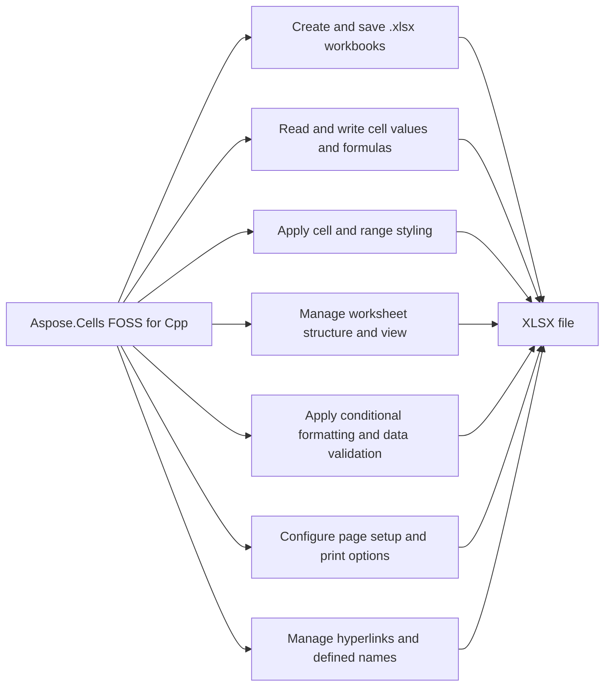

# Aspose.Cells FOSS for Cpp

[](https://www.nuget.org/packages/Aspose.Cells.Cpp.FOSS/)  [](License/LICENSE.txt) [](https://github.com/aspose-cells-foss/Aspose.Cells-FOSS-for-Cpp/graphs/contributors) [](https://github.com/aspose-cells-foss/Aspose.Cells-FOSS-for-Cpp/issues)

[](https://products.aspose.org/cells/cpp/)

Aspose.Cells FOSS for Cpp reads and writes Excel files in the `.xlsx` format. It provides classes such as `Workbook`, `Worksheet`, and `Cell` to create, modify, and save spreadsheets programmatically. The product supports styling with `Style`, `Font`, `Color`, `FillPattern`, and `Borders`, and includes features like formula calculation, validation, hyperlinks, and page setup. It is implemented in C++ using C++17 and requires CMake 3.16 or later.

## Navigation

- [At a Glance](#at-a-glance)
- [Key Capabilities](#key-capabilities)
- [Installation](#installation)
- [Dependencies](#dependencies)
- [Quick Start](#quick-start)
- [Additional Examples](#additional-examples)
- [API Reference](#api-reference)
- [Documentation & Resources](#documentation--resources)
- [Scope and Limitations](#scope-and-limitations)
- [Development and Testing](#development-and-testing)
- [License](#license)

## At a Glance



## Key Capabilities

- **Create and save .xlsx workbooks.** It creates blank workbooks and loads existing `.xlsx` files from paths or in-memory streams, then saves them back to `.xlsx` format, raising `WorkbookSaveException` on save failures.
- **Read and write cell values and formulas.** It writes values of multiple types—including strings, integers, doubles, and booleans—via `Cell.PutValue`, retrieves them as a variant-typed `CellValue`, and sets or reads formulas with `Cell.SetFormula` and `Cell.GetFormula`, throwing `FormulaException` for invalid formulas.
- **Apply cell and range styling.** It applies styling to cells through `Style`, which bundles `Font` (bold, color), `FillPattern`, foreground and background `Color`, `Borders`, and alignment into a single cloneable object retrieved and set via `Cell.GetStyle` and `Cell.SetStyle`.
- **Manage worksheet structure and view.** It controls worksheet visibility via `VisibilityType`, manages gridlines and headers, and applies protection settings through `WorksheetProtection`, all exposed directly on `Worksheet`.
- **Apply conditional formatting and data validation.** It applies rule-driven formatting to cell ranges using `ConditionalFormattingCollection` and `FormatCondition`, and enforces input constraints via `ValidationCollection` and `Validation` scoped to one or more `CellArea` ranges.
- **Configure page setup and print options.** It configures print settings through `PageSetup`, supporting `PaperSizeType`, `PageOrientationType`, margins, scaling, print area, print titles, headers, footers, and page breaks.
- **Manage hyperlinks and defined names.** It attaches hyperlinks to cell ranges via `HyperlinkCollection` and `Hyperlink`, supporting external, internal, and mailto links, and manages workbook- or sheet-scoped named ranges through `DefinedNameCollection` and `DefinedName` with optional comment strings.

- **Create or load `.xlsx` workbooks**: construct a blank `Workbook`, or load an existing file
  from a path or an in-memory `std::vector<std::uint8_t>` stream via one of `Workbook`'s
  constructors, then save back out to either form with `Workbook.Save()`.
- **Read and write cell values and formulas**: `Cell.PutValue()` accepts strings, integers,
  doubles, bools, and `DateTime`; `Cell.GetValue()` returns a variant-typed `CellValue`, and
  `Cell.SetFormula()`/`Cell.GetFormula()` handle Excel formula text with or without a leading `=`.
- **Merge cell ranges and apply number formats**: `Cells.Merge()` creates merged regions tracked
  as `MergeRegion`s, and `Style.SetNumberFormat()`/`NumberFormat` apply and parse Excel
  display-format patterns, rendered through `DisplayTextFormatter` with locale-directive support.
- **Apply conditional formatting and data validation**: `Worksheet.GetConditionalFormattings()`
  manages rule-driven cell formatting through `FormatCondition`, and
  `Worksheet.GetValidations()` manages input constraints through `Validation`, both scoped to
  one or more `CellArea` ranges.
- **Manage hyperlinks and defined names**: `Worksheet.GetHyperlinks()` attaches external, internal,
  or `mailto:` links to a cell range via `Hyperlink`, and `Workbook.GetDefinedNames()` manages
  workbook- or sheet-scoped named ranges through `DefinedNameCollection`, each of which can carry
  its own descriptive comment string.
- **Configure page setup and print settings**: `Worksheet.GetPageSetup()` returns a `PageSetup` for
  paper size, orientation, margins, scaling, print area/titles, headers/footers, and page breaks.
- **Read and write document properties**: `Workbook.GetProperties()` and
  `Workbook.GetDocumentProperties()` expose core and extended metadata through
  `WorkbookProperties`/`DocumentProperties`.

## Installation

The library is published on NuGet as `Aspose.Cells.Cpp.FOSS`.

## Dependencies

### Required Package Dependencies

No required third-party package dependencies; in `Aspose.Cells.Foss.Cpp/CMakeLists.txt`, no dependency is on the library target's public link interface, so a consumer links nothing beyond the library itself.

### Native and System Requirements

- Requires C++ `17` (`CMAKE_CXX_STANDARD` in `Aspose.Cells.Foss.Cpp/CMakeLists.txt`).
- Requires CMake 3.16 or later (`cmake_minimum_required` in `Aspose.Cells.Foss.Cpp/CMakeLists.txt`).

## Quick Start

This example creates a new workbook, populates a worksheet named Products with product names and prices, adds a SUM formula for the total, applies a styled header, and saves the file as `products.xlsx`.

```cpp
#include "aspose/cells_foss/Workbook.h"
#include "aspose/cells_foss/WorksheetCollection.h"
#include "aspose/cells_foss/Worksheet.h"
#include "aspose/cells_foss/Cell.h"
#include "aspose/cells_foss/Style.h"
#include "aspose/cells_foss/Color.h"
#include "aspose/cells_foss/Font.h"

using namespace Aspose::Cells_FOSS;

int main() {
    Workbook workbook;
    Worksheet& sheet = workbook.GetWorksheets()[0];

    sheet.SetName("Products");
    sheet.GetCells()["A1"].PutValue("Product");
    sheet.GetCells()["B1"].PutValue("Price");
    sheet.GetCells()["A2"].PutValue("Apple");
    sheet.GetCells()["B2"].PutValue(2.99);
    sheet.GetCells()["A3"].PutValue("Orange");
    sheet.GetCells()["B3"].PutValue(1.99);
    sheet.GetCells()["B4"].SetFormula("=SUM(B2:B3)");

    Style headerStyle = sheet.GetCells()["A1"].GetStyle();
    Font font;
    font.SetBold(true);
    font.SetColor(Color::FromArgb(255, 255, 255, 255));
    headerStyle.SetFont(font);
    headerStyle.SetPattern(FillPattern::Solid);
    headerStyle.SetForegroundColor(Color::FromArgb(255, 34, 120, 212));
    sheet.GetCells()["A1"].SetStyle(headerStyle);
    sheet.GetCells()["B1"].SetStyle(headerStyle);

    workbook.Save("products.xlsx");
    return 0;
}
```

More real, grounded snippets are collected below.

## Additional Examples

```cpp
auto& formattings = sheet.GetConditionalFormattings();
auto collection = formattings[formattings.Add()];
collection.AddArea(CellArea::CreateCellArea("A1", "A3"));

auto condition = collection[collection.AddCondition(
    FormatConditionType::CellValue, OperatorType::Between, "=1", "=9")];
condition.SetPriority(1);

Style style = condition.GetStyle();
style.SetPattern(FillPattern::Solid);
style.SetForegroundColor(Color::FromArgb(255, 255, 0, 0));
condition.SetStyle(style);
```

<details>
<summary>View Additional Examples</summary>

```cpp
auto& validations = sheet.GetValidations();
auto rule = validations[validations.Add(CellArea::CreateCellArea("A1", "B2"))];

rule.SetType(ValidationType::WholeNumber);
rule.SetOperator(OperatorType::Between);
rule.SetFormula1("=1");
rule.SetFormula2("=10");
rule.SetShowError(true);
rule.SetErrorTitle("Whole Number");
rule.SetErrorMessage("Enter 1-10");
```

```cpp
sheet.GetCells()["A1"].PutValue("Docs");
auto& hyperlinks = sheet.GetHyperlinks();
auto link = hyperlinks[hyperlinks.Add("A1", 1, 1, "https://docs.aspose.org/cells/cpp/")];
link.SetTextToDisplay("Docs");
link.SetScreenTip("Getting started guide");
```

```cpp
PageSetup& pageSetup = sheet.GetPageSetup();
pageSetup.SetOrientation(PageOrientationType::Landscape);
pageSetup.SetPaperSize(PaperSizeType::PaperA4);
pageSetup.SetFitToPagesWide(1);
pageSetup.SetPrintArea("$A$1:$D$20");
pageSetup.SetPrintTitleRows("$1:$2");
pageSetup.SetCenterFooter("Page &P of &N");
```

```cpp
int index = workbook.GetDefinedNames().Add("PriceRange", "=Products!$B$2:$B$3");
DefinedName priceRange = workbook.GetDefinedNames()[index];
priceRange.SetComment("Cell range used by the SUM formula in B4.");
```

</details>

## API Reference

Aspose.Cells FOSS for Cpp provides the `Workbook` class as the primary entry point for reading and writing Excel files, with `Worksheet`, `Cells`, and `Cell` forming the core object graph beneath it.

The verified public surface has 195 types.

<details>
<summary>View the Complete Public API Surface</summary>

### Core API

| Class | Description |
| --- | --- |
| `AutoFilter` | Represents auto filter. |
| `AutoFilterColorFilter` | Represents auto filter color filter. |
| `AutoFilterCustomFilter` | Represents auto filter custom filter. |
| `AutoFilterCustomFilterCollection` | Represents a collection of auto filter custom filter objects. |
| `AutoFilterCustomFilterCollection.Iterator` | Iterator for AutoFilterCustomFilterCollection. |
| `AutoFilterDynamicFilter` | Represents auto filter dynamic filter. |
| `AutoFilterSortCondition` | Represents auto filter sort condition. |
| `AutoFilterSortConditionCollection` | Represents a collection of auto filter sort condition objects. |
| `AutoFilterSortConditionCollection.Iterator` | Iterator for AutoFilterSortConditionCollection. |
| `AutoFilterSortState` | Represents auto filter sort state. |
| `AutoFilterSupport` | Internal helper methods for auto-filter operations. |
| `AutoFilterTop10` | Represents auto filter top10. |
| `Border` | Represents border. |
| `Borders` | Represents borders. |
| `CalculationProperties` | Represents calculation properties. |
| `Cell` | Represents a single worksheet cell and exposes value, formula, and style operations. |
| `CellArea` | Represents cell area. |
| `CellFormatValue` | Represents cell format value. |
| `CellValue` | Aspose.Cells_FOSS.CellValue represents a cell value that can store data of various types and provides methods to access its content as a boolean, date and time, double-precision floating-point number, integer, or string. |
| `Cells` | Provides access to worksheet cells, rows, columns, and merged ranges. |
| `CellsException` | Represents an error that occurs during cells. |
| `Color` | Represents color. |
| `Column` | Represents column. |
| `ColumnCollection` | Represents a collection of column objects. |
| `ConditionalFormattingCollection` | Represents a collection of conditional formatting objects. |
| `AlignmentValue` | Represents alignment value. |
| `AutoFilterColorFilterModel` | Represents auto filter color filter model. |
| `AutoFilterCustomFilterModel` | Represents auto filter custom filter model. |
| `AutoFilterDynamicFilterModel` | Represents auto filter dynamic filter model. |
| `AutoFilterModel` | Represents auto filter model. |
| `AutoFilterSortConditionModel` | Represents auto filter sort condition model. |
| `AutoFilterSortStateModel` | Represents auto filter sort state model. |
| `AutoFilterTop10Model` | Represents auto filter top10 model. |
| `BorderSideValue` | Represents border side value. |
| `BordersValue` | Represents borders value. |
| `CalculationPropertiesModel` | Represents calculation properties model. |
| `CellAddress` | Represents cell address. |
| `CellRecord` | Represents cell record. |
| `ColorValue` | Represents color value. |
| `ColumnRangeModel` | Represents column range model. |
| `ConditionalFormattingModel` | Represents conditional formatting model. |
| `CoreDocumentPropertiesModel` | Represents core document properties model. |
| `DateSerialConverter` | Provides date serial converter operations. |
| `DefinedNameModel` | Represents defined name model. |
| `DiagnosticBag` | Represents diagnostic bag. |
| `DiagnosticEntry` | Represents diagnostic entry. |
| `DocumentPropertiesModel` | Represents document properties model. |
| `ExtendedDocumentPropertiesModel` | Represents extended document properties model. |
| `FilterColumnModel` | Represents filter column model. |
| `FontValue` | Represents font value. |
| `FormatConditionModel` | Represents format condition model. |
| `HeaderFooterModel` | Represents header footer model. |
| `HyperlinkModel` | Represents hyperlink model. |
| `MergeRegion` | Represents merge region. |
| `NumberFormatValue` | Represents number format value. |
| `PageMarginsModel` | Represents page margins model. |
| `PageSetupModel` | Represents page setup model. |
| `PrintOptionsModel` | Represents print options model. |
| `ProtectionValue` | Represents protection value. |
| `RowModel` | Represents row model. |
| `SharedStringRepository` | Represents shared string repository. |
| `StyleRepository` | Represents style repository. |
| `StyleValue` | Represents style value. |
| `ValidationModel` | Represents validation model. |
| `WorkbookModel` | Represents workbook model. |
| `WorkbookPropertiesModel` | Represents workbook properties model. |
| `WorkbookProtectionModel` | Represents workbook protection model. |
| `WorkbookSettingsModel` | Represents workbook settings model. |
| `WorkbookViewModel` | Represents workbook view model. |
| `WorksheetModel` | Represents worksheet model. |
| `WorksheetProtectionModel` | Represents worksheet protection model. |
| `WorksheetViewModel` | Represents worksheet view model. |
| `CoreDocumentProperties` | Represents core document properties. |
| `DateTime` | Aspose.Cells_FOSS.DateTime represents a date and time value and provides methods to retrieve its components such as year, month, day, hour, minute, second, and ticks. |
| `DefinedName` | Represents defined name. |
| `DefinedNameCollection` | Represents a collection of defined name objects. |
| `DefinedNameUtility` | Provides normalization and validation helpers for defined names. |
| `DisplayFormatSectionInfo` | Represents display format section info. |
| `DisplayTextDateFormatSupport` | Internal helper methods for formatting date/time display text. |
| `DisplayTextFormatter` | Internal static helper for formatting display text of cell values. |
| `DisplayTextFormatterSupport` | Internal helper methods for display-text formatting of numeric, text, and date/time values. |
| `DisplayTextLocaleSupport` | Internal helper for parsing and applying locale directives. |
| `DocumentProperties` | Represents document properties. |
| `ExtendedDocumentProperties` | Represents extended document properties. |
| `FillValue` | Represents fill value. |
| `FilterColumn` | Represents filter column. |
| `FilterColumnCollection` | Represents a collection of filter column objects. |
| `FilterColumnCollection.Iterator` | Iterator for FilterColumnCollection. |
| `FilterValueCollection` | Represents a collection of filter value objects. |
| `Font` | Represents font. |
| `FormatCondition` | Represents format condition. |
| `FormatConditionCollection` | Represents a collection of format condition objects. |
| `FormulaException` | Represents an error that occurs during formula. |
| `Hyperlink` | Represents hyperlink. |
| `HyperlinkCollection` | Encapsulates the hyperlinks defined for a worksheet. |
| `IWarningCallback` | Defines a callback that receives load warnings. |
| `ValidationMessage` | Represents validation message. |
| `WorkbookValidator` | Represents workbook validator. |
| `InvalidFileFormatException` | Represents an error that occurs during invalid file format. |
| `LoadDiagnostics` | Represents load diagnostics. |
| `LoadIssue` | Represents load issue. |
| `LoadOptions` | Specifies how a workbook should be loaded. |
| `NumberFormat` | Provides number format operations. |
| `CaseInsensitiveEqual` | Aspose.Cells_FOSS.Packaging.CaseInsensitiveEqual is a function object that performs case-insensitive equality comparison of two strings. |
| `CaseInsensitiveHash` | Aspose.Cells_FOSS.Packaging.CaseInsensitiveHash is a function object that computes a hash value for a string in a case-insensitive manner. |
| `IPackageReader` | Defines a reader for package models. |
| `IPackageWriter` | Defines a writer for package models. |
| `MissingPartException` | Represents an error that occurs during missing part. |
| `PackageLoadContext` | Represents package load context. |
| `PackageModel` | Represents package model. |
| `PackagePartDescriptor` | Represents package part descriptor. |
| `PackageStructureException` | Represents an error that occurs during package structure. |
| `PackagingConventions` | Provides packaging conventions operations. |
| `RelationshipDescriptor` | Represents relationship descriptor. |
| `RelationshipResolutionException` | Represents an error that occurs during relationship resolution. |
| `PageSetup` | Represents worksheet print and page-layout settings. |
| `Row` | Represents row. |
| `RowCollection` | Represents a collection of row objects. |
| `SaveOptions` | Specifies how a workbook should be saved. |
| `Style` | Represents a mutable cell style facade that can be applied to one or more cells. |
| `StyleException` | Represents an error that occurs during style. |
| `StyleValueSanitizer` | Provides normalization helpers for style integer values. |
| `StylesheetLoadContext` | Internal context used during stylesheet loading to accumulate cell formats, differential formats, date style indexes, and the default cell style. |
| `StylesheetSaveContext` | Internal context used during stylesheet saving to hold the built stylesheet document together with style index maps and format counts. |
| `UnsupportedFeatureException` | Represents an error that occurs during unsupported feature. |
| `Validation` | Represents validation. |
| `ValidationCollection` | Represents a collection of validation objects. |
| `WarningInfo` | Represents warning info. |
| `Workbook` | Represents the root spreadsheet object used to create, load, modify, and save an XLSX workbook. |
| `WorkbookLoadException` | Represents an error that occurs during workbook load. |
| `WorkbookProperties` | Represents workbook properties. |
| `WorkbookPropertySupport` | Internal helpers that normalize workbook-level property strings to their canonical XML attribute values, throwing CellsException on unsupported input. |
| `WorkbookProtection` | Represents workbook protection. |
| `WorkbookSaveException` | Represents an error that occurs during workbook save. |
| `WorkbookSettings` | Represents workbook-level settings that affect date handling and display formatting. |
| `WorkbookView` | Represents workbook view. |
| `Worksheet` | Encapsulates a single worksheet and its supported v0.1 worksheet features. |
| `WorksheetCollection` | Encapsulates the workbook's worksheets and active-sheet state. |
| `WorksheetDefinedNamesState` | Stores the defined names state for a worksheet (print area, title rows, title columns). |
| `WorksheetProtection` | Represents worksheet protection. |
| `XNamespace` | Represents an XML namespace, used to construct qualified element names. |
| `XlsxDocumentProperties` | Provides static methods for building and loading XLSX document properties (core and extended) from/to a ZIP archive. |
| `XlsxWorkbookArchiveHelpers` | Internal helper methods for reading XLSX workbook parts from a ZIP archive. |
| `XlsxWorkbookAutoFilter` | Provides static methods for building and loading auto-filter XML elements. |
| `XlsxWorkbookConditionalFormatting` | Provides static methods for building and loading conditional formatting XML elements. |
| `XlsxWorkbookDefinedNames` | Provides static methods for building and loading workbook-level defined names. |
| `XlsxWorkbookHyperlinks` | Provides static methods for building and loading worksheet hyperlink data. |
| `XlsxWorkbookPageSetup` | Provides static methods for building and loading page-setup XML elements. |
| `XlsxWorkbookProperties` | Provides static methods for building and loading workbook-level metadata. |
| `XlsxWorkbookSerializer` | Serializes and deserializes workbook models in XLSX format. |
| `XlsxWorkbookSerializerCommon` | Constants and helpers shared across the XLSX workbook serializer. |
| `XlsxWorkbookStyles` | Provides static methods for building and loading workbook stylesheets. |
| `XlsxWorkbookStylesValueHelpers` | Provides helper methods for workbook style value conversions and comparisons. |
| `XlsxWorkbookStylesXml` | Provides XML read/write methods for the workbook styles part. |
| `XlsxWorkbookValidations` | Provides static methods for building and loading worksheet data validation elements in the XLSX workbook serializer. |
| `XlsxWorkbookWorksheetProtection` | Provides static methods for building and loading worksheet-protection XML elements. |
| `XlsxWorkbookWorksheetViews` | Provides static methods for building and loading worksheet view settings (sheet properties, sheet views) in the XLSX workbook serializer. |
| `SharedStringTableXmlMapper` | Not implemented. |
| `StylesheetXmlMapper` | Not implemented. |
| `WorkbookXmlMapper` | Not implemented. |
| `WorksheetXmlMapper` | Not implemented. |
| `XmlParsingException` | Represents an error that occurs during XML parsing. |
| `XmlAttribute` | Lightweight handle to an XML attribute. |
| `XmlDocument` | Represents a parsed XML document. |
| `XmlElement` | Lightweight handle to an XML element. |
| `XmlNodeData` | Internal node representation shared between XML types. |
| `ZipArchive` | In-memory representation of a ZIP archive. |
| `ZipArchiveEntry` | Represents an entry in a ZipArchive. |

#### Enumerations

| Enumeration | Description |
| --- | --- |
| `BorderStyleType` | Specifies border style type. |
| `CellValueType` | Specifies cell value type. |
| `BorderStyle` | Specifies border style. |
| `CellValueKind` | Specifies cell value kind. |
| `DateSystem` | Specifies date system. |
| `Core.DiagnosticSeverity` | Specifies diagnostic severity. |
| `FillPatternKind` | Specifies fill pattern kind. |
| `HorizontalAlignment` | Specifies horizontal alignment. |
| `PageOrientation` | Specifies page orientation. |
| `SheetVisibility` | Specifies sheet visibility. |
| `VerticalAlignment` | Specifies vertical alignment. |
| `Cells_FOSS.DiagnosticSeverity` | Specifies diagnostic severity. |
| `FillPattern` | Specifies fill pattern. |
| `FilterOperatorType` | Specifies filter operator type. |
| `FormatConditionType` | Specifies format condition type. |
| `HorizontalAlignmentType` | Specifies horizontal alignment type. |
| `ValidationMessageSeverity` | Specifies validation message severity. |
| `LoadFormat` | Specifies load format. |
| `OperatorType` | Specifies operator type. |
| `PageOrientationType` | Specifies page orientation type. |
| `PaperSizeType` | Specifies paper size type. |
| `SaveFormat` | Specifies save format. |
| `TargetModeType` | Specifies target mode type. |
| `ValidationAlertType` | Specifies validation alert type. |
| `ValidationType` | Specifies validation type. |
| `VerticalAlignmentType` | Specifies vertical alignment type. |
| `VisibilityType` | Specifies visibility type. |

#### Detailed Member Reference

### Workbook

The `Workbook` class supports loading from file paths or in-memory streams using `LoadOptions`, saving to various formats via `SaveOptions`, and exposes workbook-level settings, properties, and document metadata through its properties.

- `Dispose`: Releases resources associated with the workbook instance.
- `EnsureUniqueDefinedName`: Ensures no other defined name in the workbook shares the given name and scope.
- `EnsureUniqueSheetName`: Ensures no other worksheet in the workbook shares the given name.
- `EnsureValidDefinedNameScope`: Validates that the local sheet index is absent (global scope) or within the valid worksheet range.
- `GetDefinedNames`: Gets the workbook-defined names collection.
- `GetDefinedNamesModel`: Gets the underlying defined names model vector.
- `GetDocumentProperties`: Gets the document properties facade for core and extended metadata.
- `GetLoadDiagnostics`: Gets diagnostics collected while loading the current workbook.
- `GetModel`: Gets the underlying workbook model.
- `GetProperties`: Gets workbook metadata and view settings exposed by the supported public API.
- `GetSettings`: Gets workbook-level settings such as the date system and display culture.
- `GetWorksheets`: Gets the worksheets in workbook order.
- `Save`: Saves the workbook to an XLSX file using default save options.

### Worksheet

The `Worksheet` class provides access to cell data through its `Cells` collection, supports visibility control via `VisibilityType`, and includes protection, hyperlink, validation, conditional formatting, page setup, and auto filter capabilities.

- `GetAutoFilter`: Gets auto-filter settings for the worksheet.
- `GetCells`: Gets the cell grid facade for the worksheet.
- `GetConditionalFormattings`: Gets the worksheet conditional formatting collection.
- `GetHyperlinks`: Gets the worksheet hyperlink collection.
- `GetModel`: Gets the underlying worksheet model.
- `GetName`: Gets or sets the worksheet name.
- `GetPageSetup`: Gets page setup settings for the worksheet.
- `GetProtection`: Gets worksheet protection settings.
- `GetRightToLeft`: Gets or sets whether the worksheet view is right-to-left.
- `GetShowGridlines`: Gets or sets whether gridlines are shown in the worksheet view.
- `GetShowRowColumnHeaders`: Gets or sets whether row and column headers are shown in the worksheet view.
- `GetShowZeros`: Gets or sets whether zero values are shown in the worksheet view.
- `GetTabColor`: Gets or sets the worksheet tab color.
- `GetValidations`: Gets the worksheet data validation collection.
- `GetVisibilityType`: Gets or sets the worksheet visibility state.
- `GetWorkbook`: Gets the parent workbook.
- `GetZoom`: Gets or sets the worksheet zoom percentage.
- `Protect`: Marks the worksheet as protected using the current protection settings.
- `Unprotect`: Clears worksheet protection and resets supported protection flags.

### Cells

The `Cells` class provides indexed access to individual `Cell` objects, supports merging via `CellArea`, and exposes collections of rows and columns for structured manipulation.

- `GetColumns`: Gets column-level settings for the worksheet.
- `GetMergedCells`: Gets the current merged-cell regions in worksheet order.
- `GetRows`: Gets row-level settings for the worksheet.
- `Merge`: Merges a rectangular cell region using zero-based coordinates.

### Style

The `Style` class allows control over font, borders, fill pattern, foreground and background colors, number format, and horizontal alignment for cell appearance.

- `Borders`: Gets the border settings.
- `Clone`: Creates a copy of the current style.
- `Color`: Gets the fill foreground color.
- `FillPattern`: Gets the fill pattern.
- `Font`: Gets the font settings.
- `FromCore`: Creates a Style from a Core StyleValue.
- `GetBackgroundColor`: Gets the fill background color.
- `GetBorders`: Gets the border settings.
- `GetCustom`: Gets the custom number format code.
- `GetFont`: Gets the font settings.
- `GetForegroundColor`: Gets the fill foreground color.
- `GetHorizontalAlignment`: Gets the horizontal alignment.
- `GetIndentLevel`: Gets the indentation level.
- `GetIsHidden`: Gets whether the cell formula is hidden when worksheet protection is enabled.
- `GetIsLocked`: Gets whether the cell is locked when worksheet protection is enabled.
- `GetNumber`: Gets the numeric format identifier.
- `GetNumberFormat`: Gets the resolved number format string.
- `GetPattern`: Gets the fill pattern.
- `GetReadingOrder`: Gets the reading order.
- `GetRelativeIndent`: Gets the relative indent.
- `GetShrinkToFit`: Gets whether the cell content shrinks to fit.
- `GetTextRotation`: Gets the text rotation.
- `GetVerticalAlignment`: Gets the vertical alignment.
- `GetWrapText`: Gets whether text wraps within the cell.
- `HorizontalAlignmentType`: Gets the horizontal alignment.
- `SetBackgroundColor`: Sets the fill background color.
- `SetBorders`: Sets the border settings.
- `SetCustom`: Sets the custom number format code.
- `SetFont`: Sets the font settings.
- `SetForegroundColor`: Sets the fill foreground color.
- `SetHorizontalAlignment`: Sets the horizontal alignment.
- `SetIndentLevel`: Sets the indentation level.
- `SetIsHidden`: Sets whether the cell formula is hidden when worksheet protection is enabled.
- `SetIsLocked`: Sets whether the cell is locked when worksheet protection is enabled.
- `SetNumber`: Sets the numeric format identifier.
- `SetNumberFormat`: Sets the number format.
- `SetPattern`: Sets the fill pattern.
- `SetReadingOrder`: Sets the reading order.
- `SetRelativeIndent`: Sets the relative indent.
- `SetShrinkToFit`: Sets whether the cell content shrinks to fit.
- `SetTextRotation`: Sets the text rotation.
- `SetVerticalAlignment`: Sets the vertical alignment.
- `SetWrapText`: Sets whether text wraps within the cell.
- `ToCore`: Converts this style to a Core StyleValue.
- `VerticalAlignmentType`: Gets the vertical alignment.

### ConditionalFormattingCollection

The `ConditionalFormattingCollection` class manages format conditions applied to cell ranges, supporting addition, removal, and access to individual `FormatCondition` objects with type and operator settings.

- `Add`: Adds the specified item.
- `GetCount`: Gets the number of items.
- `GetNextPriority`: Gets the next priority for the specified collections.
- `RemoveArea`: Removes the specified item.
- `RemoveAt`: Removes the specified item.

### ValidationCollection

The `ValidationCollection` class provides methods to add and remove data validation rules for cell areas, with individual `Validation` objects supporting type, operator, formula constraints, and error message configuration.

- `Add`: Adds the specified item.
- `AddAreaToValidation`: Adds the specified area to the validation.
- `AreasOverlap`: Determines whether the specified areas overlap.
- `CompareAreas`: Compares two areas for sorting.
- `GetCount`: Gets the number of items.
- `GetValidationInCell`: Gets the validation in cell.
- `RemoveACell`: Removes the specified item.
- `RemoveArea`: Removes the specified item.
- `RemoveAreaFromValidation`: Removes the specified area from the validation.
- `SortAreas`: Sorts the specified areas.

### PageSetup

The `PageSetup` class controls print layout options including paper size via `PaperSizeType`, orientation via `PageOrientationType`, fit-to-page settings, print area, and header/footer content.

- `AddHorizontalPageBreak`: Adds a horizontal page break at the specified zero-based row index.
- `AddVerticalPageBreak`: Adds a vertical page break at the specified zero-based column index.
- `ClearHorizontalPageBreaks`: Removes all horizontal page breaks.
- `ClearVerticalPageBreaks`: Removes all vertical page breaks.
- `GetBottomMargin`: Gets or sets the bottom margin in centimeters.
- `GetBottomMarginInch`: Gets or sets the bottom margin in inches.
- `GetCenterFooter`: Gets or sets the center footer text.
- `GetCenterHeader`: Gets or sets the center header text.
- `GetCenterHorizontally`: Gets or sets whether content is centered horizontally on the page.
- `GetCenterVertically`: Gets or sets whether content is centered vertically on the page.
- `GetFirstPageNumber`: Gets or sets the first printed page number.
- `GetFitToPagesTall`: Gets or sets the number of pages tall to fit when printing.
- `GetFitToPagesWide`: Gets or sets the number of pages wide to fit when printing.
- `GetFooterMargin`: Gets or sets the footer margin in centimeters.
- `GetFooterMarginInch`: Gets or sets the footer margin in inches.
- `GetHeaderMargin`: Gets or sets the header margin in centimeters.
- `GetHeaderMarginInch`: Gets or sets the header margin in inches.
- `GetHorizontalPageBreaks`: Gets the horizontal page breaks as sorted zero-based row indexes.
- `GetLeftFooter`: Gets or sets the left footer text.
- `GetLeftHeader`: Gets or sets the left header text.
- `GetLeftMargin`: Gets or sets the left margin in centimeters.
- `GetLeftMarginInch`: Gets or sets the left margin in inches.
- `GetOrientation`: Gets or sets the page orientation.
- `GetPaperSize`: Gets or sets the paper size.
- `GetPrintArea`: Gets or sets the print area reference.
- `GetPrintGridlines`: Gets or sets whether gridlines are printed.
- `GetPrintHeadings`: Gets or sets whether row and column headings are printed.
- `GetPrintTitleColumns`: Gets or sets the repeating title columns reference.
- `GetPrintTitleRows`: Gets or sets the repeating title rows reference.
- `GetRightFooter`: Gets or sets the right footer text.
- `GetRightHeader`: Gets or sets the right header text.
- `GetRightMargin`: Gets or sets the right margin in centimeters.
- `GetRightMarginInch`: Gets or sets the right margin in inches.
- `GetScale`: Gets or sets the print scaling percentage.
- `GetTopMargin`: Gets or sets the top margin in centimeters.
- `GetTopMarginInch`: Gets or sets the top margin in inches.
- `GetVerticalPageBreaks`: Gets the vertical page breaks as sorted zero-based column indexes.

### HyperlinkCollection

The `HyperlinkCollection` class manages hyperlinks associated with cell ranges, allowing addition with address and display text, and removal by index.

- `Add`: Adds a hyperlink anchored at a cell or rectangular range specified by zero-based coordinates.
- `GetCount`: Gets the number of hyperlinks in the worksheet.
- `RemoveAt`: Removes the hyperlink at the specified zero-based index.

### DefinedNameCollection

The `DefinedNameCollection` class provides methods to add and remove named ranges with optional sheet scope, and each `DefinedName` includes a comment property for documentation.

- `Add`: Adds the specified item.
- `GetCount`: Gets the number of items.
- `GetEnumerator`: Returns a snapshot of all defined names in the collection.
- `RemoveAt`: Removes the specified item.

### WorkbookProperties

The `WorkbookProperties` class exposes and controls workbook-level metadata such as code name, backup file path, calculation settings, view options, and protection state.

- `GetBackupFile`: Gets or sets a value indicating whether backup file.
- `GetCalculation`: Gets the calculation.
- `GetCodeName`: Gets or sets the code name.
- `GetDefaultThemeVersion`: Gets or sets the default theme version.
- `GetFilterPrivacy`: Gets or sets a value indicating whether filter privacy.
- `GetHidePivotFieldList`: Gets or sets a value indicating whether hide pivot field list.
- `GetProtection`: Gets the protection.
- `GetSaveExternalLinkValues`: Gets or sets a value indicating whether save external link values.
- `GetShowBorderUnselectedTables`: Gets or sets a value indicating whether show border unselected tables.
- `GetShowInkAnnotation`: Gets or sets a value indicating whether show ink annotation.
- `GetShowObjects`: Gets or sets the show objects.
- `GetUpdateLinks`: Gets or sets the update links.
- `GetView`: Gets the view.

### AutoFilter

The `AutoFilter` class supports filtering operations including color, custom, dynamic, and top 10 filters, with `AutoFilterSupport` indicating whether filtering is enabled.

- `Clear`: Clears the current state.
- `GetFilterColumns`: Gets the filter columns.
- `GetRange`: Gets or sets the range.
- `GetSortState`: Gets the sort state.

### XlsxWorkbookSerializer

The `XlsxWorkbookSerializer` class provides functionality to serialize workbook content to XLSX format, with supporting classes for styles, XML handling, and archive operations.

- `Load`: Loads the current state.
- `Save`: Saves the current state.

`Workbook` also has a constructor that loads from an in-memory
`std::vector<std::uint8_t>` stream instead of a file path, for scenarios that read the source
bytes from somewhere other than the filesystem.

The library's public types live in the `Aspose::Cells_FOSS` namespace, with `Workbook` as the
root entry point and `Worksheet`/`Cells`/`Cell` forming the primary object graph beneath it. The
full public surface — 195 public types — is listed below, grouped exactly as
`reference.aspose.org` organizes them.

| Class | Description |
|---|---|
| `AlignmentValue` | Represents alignment value. |
| `AutoFilter` | Represents auto filter. |
| `AutoFilterColorFilter` | Represents auto filter color filter. |
| `AutoFilterColorFilterModel` | Represents auto filter color filter model. |
| `AutoFilterCustomFilter` | Represents auto filter custom filter. |
| `AutoFilterCustomFilterCollection` | Represents a collection of auto filter custom filter objects. |
| `AutoFilterCustomFilterModel` | Represents auto filter custom filter model. |
| `AutoFilterDynamicFilter` | Represents auto filter dynamic filter. |
| `AutoFilterDynamicFilterModel` | Represents auto filter dynamic filter model. |
| `AutoFilterModel` | Represents auto filter model. |
| `AutoFilterSortCondition` | Represents auto filter sort condition. |
| `AutoFilterSortConditionCollection` | Represents a collection of auto filter sort condition objects. |
| `AutoFilterSortConditionModel` | Represents auto filter sort condition model. |
| `AutoFilterSortState` | Represents auto filter sort state. |
| `AutoFilterSortStateModel` | Represents auto filter sort state model. |
| `AutoFilterSupport` | Internal helper methods for auto-filter operations. |
| `AutoFilterTop10` | Represents auto filter top10. |
| `AutoFilterTop10Model` | Represents auto filter top10 model. |
| `Border` | Represents border. |
| `BorderSideValue` | Represents border side value. |
| `Borders` | Represents borders. |
| `BordersValue` | Represents borders value. |
| `CalculationProperties` | Represents calculation properties. |
| `CalculationPropertiesModel` | Represents calculation properties model. |
| `Cell` | Represents a single worksheet cell and exposes value, formula, and style operations. |
| `CellAddress` | Represents cell address. |
| `CellArea` | Represents cell area. |
| `CellFormatValue` | Represents cell format value. |
| `CellRecord` | Represents cell record. |
| `CellValue` | Variant-typed scalar cell value wrapper over `monostate`/`int`/`double`/`bool`/`std::string`/`DateTime`. |
| `Cells` | Provides access to worksheet cells, rows, columns, and merged ranges. |
| `CellsException` | Represents an error that occurs during cells. |
| `Column` | Represents column. |
| `ColumnCollection` | Represents a collection of column objects. |
| `ColumnRangeModel` | Represents column range model. |
| `ConditionalFormattingCollection` | Represents a collection of conditional formatting objects. |
| `ConditionalFormattingModel` | Represents conditional formatting model. |
| `CoreDocumentProperties` | Represents core document properties. |
| `CoreDocumentPropertiesModel` | Represents core document properties model. |
| `DateSerialConverter` | Provides date serial converter operations. |
| `DateTime` | DateTime provides component accessors such as GetYear(), GetMonth(), GetDay(), GetHour(), GetMinute(), and GetSecond() to retrieve individual parts of a date‑time value. |
| `DefinedName` | Represents defined name. |
| `DefinedNameCollection` | Represents a collection of defined name objects. |
| `DefinedNameModel` | Represents defined name model. |
| `DefinedNameUtility` | Provides normalization and validation helpers for defined names. |
| `DiagnosticBag` | Represents diagnostic bag. |
| `DiagnosticEntry` | Represents diagnostic entry. |
| `DisplayFormatSectionInfo` | Represents display format section info. |
| `DisplayTextDateFormatSupport` | Internal helper methods for formatting date/time display text. |
| `DisplayTextFormatter` | Internal static helper for formatting display text of cell values. |
| `DisplayTextFormatterSupport` | Internal helper methods for display-text formatting of numeric, text, and date/time values. |
| `DisplayTextLocaleSupport` | Internal helper for parsing and applying locale directives (e.g. `[$-0409]`, `[$-F800]`) embedded in Excel format strings. |
| `DocumentProperties` | Represents document properties. |
| `DocumentPropertiesModel` | Represents document properties model. |
| `ExtendedDocumentProperties` | Represents extended document properties. |
| `ExtendedDocumentPropertiesModel` | Represents extended document properties model. |
| `FillValue` | Represents fill value. |
| `FilterColumn` | Represents filter column. |
| `FilterColumnCollection` | Represents a collection of filter column objects. |
| `FilterColumnModel` | Represents filter column model. |
| `FilterValueCollection` | Represents a collection of filter value objects. |
| `Font` | Represents font. |
| `FontValue` | Represents font value. |
| `FormatCondition` | Represents format condition. |
| `FormatConditionCollection` | Represents a collection of format condition objects. |
| `FormatConditionModel` | Represents format condition model. |
| `FormulaException` | Represents an error that occurs during formula. |
| `HeaderFooterModel` | Represents header footer model. |
| `Hyperlink` | Represents hyperlink. |
| `HyperlinkCollection` | Encapsulates the hyperlinks defined for a worksheet. |
| `HyperlinkModel` | Represents hyperlink model. |
| `InvalidFileFormatException` | Represents an error that occurs during invalid file format. |
| `LoadDiagnostics` | Represents load diagnostics. |
| `LoadIssue` | Represents load issue. |
| `LoadOptions` | Specifies how a workbook should be loaded. |
| `MergeRegion` | Represents merge region. |
| `MissingPartException` | Represents an error that occurs during missing part. |
| `NumberFormat` | Provides number format operations. |
| `NumberFormatValue` | Represents number format value. |
| `PackageLoadContext` | Represents package load context. |
| `PackageModel` | Represents package model. |
| `PackagePartDescriptor` | Represents package part descriptor. |
| `PackageStructureException` | Represents an error that occurs during package structure. |
| `PackagingConventions` | Provides packaging conventions operations. |
| `PageMarginsModel` | Represents page margins model. |
| `PageSetup` | Represents worksheet print and page-layout settings. |
| `PageSetupModel` | Represents page setup model. |
| `PrintOptionsModel` | Represents print options model. |
| `ProtectionValue` | Represents protection value. |
| `RelationshipDescriptor` | Represents relationship descriptor. |
| `RelationshipResolutionException` | Represents an error that occurs during relationship resolution. |
| `Row` | Represents row. |
| `RowCollection` | Represents a collection of row objects. |
| `RowModel` | Represents row model. |
| `SaveOptions` | Specifies how a workbook should be saved. |
| `SharedStringRepository` | Represents shared string repository. |
| `SharedStringTableXmlMapper` | Represents shared string table xml mapper. |
| `Style` | Represents a mutable cell style facade that can be applied to one or more cells. |
| `StyleException` | Represents an error that occurs during style. |
| `StyleRepository` | Represents style repository. |
| `StyleValue` | Represents style value. |
| `StyleValueSanitizer` | Provides normalization helpers for style integer values. |
| `StylesheetLoadContext` | Internal context used during stylesheet loading to accumulate cell formats, differential formats, date style indexes, and the default cell style. |
| `StylesheetSaveContext` | Internal context used during stylesheet saving to hold the built stylesheet document together with style index maps and format counts. |
| `StylesheetXmlMapper` | Represents stylesheet xml mapper. |
| `UnsupportedFeatureException` | Represents an error that occurs during unsupported feature. |
| `Validation` | Represents validation. |
| `ValidationCollection` | Represents a collection of validation objects. |
| `ValidationMessage` | Represents validation message. |
| `ValidationModel` | Represents validation model. |
| `WarningInfo` | Represents warning info. |
| `Workbook` | Represents the root spreadsheet object used to create, load, modify, and save an XLSX workbook. |
| `WorkbookLoadException` | Represents an error that occurs during workbook load. |
| `WorkbookModel` | Represents workbook model. |
| `WorkbookProperties` | Represents workbook properties. |
| `WorkbookPropertiesModel` | Represents workbook properties model. |
| `WorkbookPropertySupport` | Internal helpers that normalize workbook-level property strings to their canonical XML attribute values, throwing CellsException on unsupported input. |
| `WorkbookProtection` | Represents workbook protection. |
| `WorkbookProtectionModel` | Represents workbook protection model. |
| `WorkbookSaveException` | Represents an error that occurs during workbook save. |
| `WorkbookSettings` | Represents workbook-level settings that affect date handling and display formatting. |
| `WorkbookSettingsModel` | Represents workbook settings model. |
| `WorkbookValidator` | Represents workbook validator. |
| `WorkbookView` | Represents workbook view. |
| `WorkbookViewModel` | Represents workbook view model. |
| `WorkbookXmlMapper` | Represents workbook xml mapper. |
| `Worksheet` | Encapsulates a single worksheet and its supported v0.1 worksheet features. |
| `WorksheetCollection` | Encapsulates the workbook's worksheets and active-sheet state. |
| `WorksheetDefinedNamesState` | Stores the defined names state for a worksheet (print area, title rows, title columns). |
| `WorksheetModel` | Represents worksheet model. |
| `WorksheetProtection` | Represents worksheet protection. |
| `WorksheetProtectionModel` | Represents worksheet protection model. |
| `WorksheetViewModel` | Represents worksheet view model. |
| `WorksheetXmlMapper` | Represents worksheet xml mapper. |
| `XNamespace` | Represents an XML namespace, used to construct qualified element names. |
| `XlsxDocumentProperties` | Provides static methods for building and loading XLSX document properties (core and extended) from/to a ZIP archive. |
| `XlsxWorkbookArchiveHelpers` | Internal helper methods for reading XLSX workbook parts from a ZIP archive. |
| `XlsxWorkbookAutoFilter` | Provides static methods for building and loading auto-filter XML elements. |
| `XlsxWorkbookConditionalFormatting` | Provides static methods for building and loading conditional formatting XML elements. |
| `XlsxWorkbookDefinedNames` | Provides static methods for building and loading workbook-level defined names. |
| `XlsxWorkbookHyperlinks` | Provides static methods for building and loading worksheet hyperlink data. |
| `XlsxWorkbookPageSetup` | Provides static methods for building and loading page-setup XML elements. |
| `XlsxWorkbookProperties` | Provides static methods for building and loading workbook-level metadata. |
| `XlsxWorkbookSerializer` | Serializes and deserializes workbook models in XLSX format. |
| `XlsxWorkbookSerializerCommon` | Constants and helpers shared across the XLSX workbook serializer. |
| `XlsxWorkbookStyles` | Provides static methods for building and loading workbook stylesheets. |
| `XlsxWorkbookStylesValueHelpers` | Provides helper methods for workbook style value conversions and comparisons. |
| `XlsxWorkbookStylesXml` | Provides XML read/write methods for the workbook styles part. |
| `XlsxWorkbookValidations` | Provides static methods for building and loading worksheet data validation elements in the XLSX workbook serializer. |
| `XlsxWorkbookWorksheetProtection` | Provides static methods for building and loading worksheet-protection XML elements. |
| `XlsxWorkbookWorksheetViews` | Provides static methods for building and loading worksheet view settings (sheet properties, sheet views) in the XLSX workbook serializer. |
| `XmlAttribute` | Lightweight handle to an XML attribute. |
| `XmlDocument` | Represents a parsed XML document. |
| `XmlElement` | Lightweight handle to an XML element. |
| `XmlParsingException` | Represents an error that occurs during xml parsing. |
| `ZipArchive` | In-memory representation of a ZIP archive, used to read and write the `.xlsx` package's parts. |
| `ZipArchiveEntry` | Represents an entry in a ZipArchive. |

- `Workbook`
  - `Workbook()`, `Workbook(fileName)`, `Workbook(fileName, LoadOptions)`, `Workbook(stream, LoadOptions)`
  - `Save(fileName)`, `Save(fileName, SaveFormat)`, `Save(fileName, SaveOptions)`, `Save(stream, SaveFormat)`, `Save(stream, SaveOptions)`
  - Properties: `Worksheets: WorksheetCollection`, `Settings: WorkbookSettings`, `Properties: WorkbookProperties`, `DocumentProperties: DocumentProperties`, `DefinedNames: DefinedNameCollection`, `LoadDiagnostics: LoadDiagnostics`
- `Worksheet`
  - `Protect()`, `Unprotect()`
  - Properties: `Name: string`, `VisibilityType: VisibilityType`, `TabColor: Color`, `ShowGridlines/ShowRowColumnHeaders/ShowZeros/RightToLeft: bool`, `Zoom: int`, `Cells: Cells`, `Hyperlinks: HyperlinkCollection`, `Validations: ValidationCollection`, `ConditionalFormattings: ConditionalFormattingCollection`, `PageSetup: PageSetup`, `Protection: WorksheetProtection`, `AutoFilter: AutoFilter`
- `Cells`
  - `operator[](cellName)`, `operator()(row, column)`, `Merge(firstRow, firstColumn, totalRows, totalColumns)`
  - Properties: `Rows: RowCollection`, `Columns: ColumnCollection`, `MergedCells: vector<CellArea>`
- `Cell`
  - `PutValue(value)` (string/int/double/bool/`DateTime` overloads), `GetValue()`, `SetValue(CellValue)`, `GetStringValue()`, `GetDisplayStringValue()`, `SetFormula(text)`, `GetFormula()`, `GetStyle()`, `SetStyle(Style)`
  - Properties: `Row: int`, `Column: int`, `Type: CellValueType`
- `Style`
  - `GetFont()`/`SetFont(Font)`, `GetBorders()`/`SetBorders(Borders)`, `GetPattern()`/`SetPattern(FillPattern)`, `GetForegroundColor()`/`SetForegroundColor(Color)`, `GetBackgroundColor()`/`SetBackgroundColor(Color)`, `GetNumberFormat()`/`SetNumberFormat(text)`, `GetHorizontalAlignment()`/`SetHorizontalAlignment(...)`, `GetWrapText()`/`SetWrapText(bool)`
- `ConditionalFormattingCollection`
  - `Add()`, `RemoveAt(index)`, `RemoveArea(startRow, startColumn, totalRows, totalColumns)`, `operator[](index) -> FormatConditionCollection`
  - Properties: `Count: int`
- `FormatConditionCollection`
  - `operator[](index) -> FormatCondition`, `AddArea(CellArea)`, `AddCondition(FormatConditionType, OperatorType, formula1, formula2)`, `RemoveArea(CellArea)`, `RemoveCondition(index)`
  - Properties: `Count: int`, `RangeCount: int`
- `FormatCondition`
  - Properties: `Priority: int`, `StopIfTrue: bool`, `Style: Style`, `Formula1: string`, `Formula2: string`, `Type: FormatConditionType`, `Operator: OperatorType`
- `ValidationCollection`
  - `Add(CellArea)`, `operator[](index) -> Validation`, `RemoveACell(row, column)`, `RemoveArea(CellArea)`, `GetValidationInCell(row, column)`
  - Properties: `Count: int`
- `Validation`
  - `AddArea(CellArea)`
  - Properties: `Type: ValidationType`, `Operator: OperatorType`, `Formula1: string`, `Formula2: string`, `ShowError: bool`, `ErrorTitle: string`, `ErrorMessage: string`
- `HyperlinkCollection`
  - `Add(cellName, totalRows, totalColumns, address)`, `RemoveAt(index)`
  - Properties: `Count: int`
- `Hyperlink`
  - Properties: `Area: string`, `Address: string`, `TextToDisplay: string`, `ScreenTip: string`
- `DefinedNameCollection`
  - `Add(name, formula)`, `Add(name, formula, localSheetIndex)`, `RemoveAt(index)`
  - Properties: `Count: int`
- `DefinedName`
  - Properties: `Comment: string`
- `PageSetup`
  - `SetOrientation(PageOrientationType)`, `SetPaperSize(PaperSizeType)`, `SetFitToPagesWide/Tall(int)`, `SetPrintArea(range)`, `SetPrintTitleRows/Columns(range)`, `SetLeftHeader/CenterFooter(text)`, `AddHorizontalPageBreak(row)`, `AddVerticalPageBreak(column)`
  - Properties: `LeftMargin/RightMargin: double`, `Scale: optional<int>`, `PrintGridlines/CenterHorizontally: bool`
- Exceptions
  - `CellsException` — base error type for invalid indices, ranges, and arguments
  - `WorkbookLoadException` / `WorkbookSaveException` — load/save-specific failures
  - `InvalidFileFormatException` — the loaded bytes are not a readable OOXML package
  - `UnsupportedFeatureException` — a requested operation (e.g. non-XLSX save) is not implemented
  - `FormulaException` / `StyleException` — invalid formula text or style value

</details>

## Documentation & Resources

- **[Getting started guide](https://docs.aspose.org/cells/cpp/)** — The getting started guide covers how to set up and use Aspose.Cells FOSS for Cpp to read, write, and manipulate Excel files.
- **[Contributor guide](AGENTS.md)** — The contributor guide explains how to set up the development environment and contribute changes to Aspose.Cells FOSS for Cpp.
- Found a bug or have a feature request? [Open an issue](https://github.com/aspose-cells-foss/Aspose.Cells-FOSS-for-Cpp/issues).

## Scope and Limitations

Aspose.Cells FOSS for Cpp reads and writes Excel workbooks in the `.xlsx` format using the C++ programming language.

- Only `.xlsx` (OOXML) is supported for load and save. `LoadFormat` and `SaveFormat` each declare a single Xlsx member, and saving to any other format throws `UnsupportedFeatureException`. There is no .xls, .xlsb, .ods, or .csv read/write support. Legacy `SpreadsheetML` is not implemented. `Cell`-level comments/notes are not modeled as a distinct object. Some advanced conditional-formatting rule types are recognized on load but not preserved. `AutoFilter` date-group filters using certain patterns are rejected as unsupported during load.
- Legacy `SpreadsheetML` (the pre-OOXML Excel 2003 XML dialect) is not implemented.
- `Cell`-level comments/notes are not modeled as a distinct object.
- Some advanced conditional-formatting rule types are recognized on load but not preserved.
- `AutoFilter` date-group filters using certain patterns are rejected as unsupported during load rather than approximated.

- **[Getting started guide](https://docs.aspose.org/cells/cpp/)** — installation, walkthroughs, and feature guides for this library.
- **[How-to guides & FAQ](https://kb.aspose.org/cells/cpp/)** — task-focused answers for common spreadsheet questions.
- **[Full API reference](https://reference.aspose.org/cells/cpp/)** — the complete, browsable reference for all public types (the [API reference](#api-reference) section above covers the essentials).
- **[Contributor guide](AGENTS.md)** — architecture, technology assumptions, and conventions for contributors.
- Found a bug or have a feature request? [Open an issue](https://github.com/aspose-cells-foss/Aspose.Cells-FOSS-for-Cpp/issues) on GitHub.

These limitations don't apply to [full-featured Aspose.Cells for Cpp — Enterprise Edition](https://products.aspose.com/cells/cpp/). It adds broader spreadsheet format coverage — legacy XLS/XLSB, CSV, ODS, PDF rendering, and full-fidelity conditional-formatting and `AutoFilter` round-tripping.

## Development and Testing

Aspose.Cells FOSS for Cpp requires CMake 3.16 or later and targets C++17 across MSVC, GCC, and Clang. The test suite resides in `Aspose.Cells.Foss.Cpp.Tests/` and uses GoogleTest v1.14.0, which is downloaded automatically via FetchContent unless -DASPOSE_CELLS_FOSS_TESTS_USE_SYSTEM_GTEST=ON is passed. The samples/ directory provides a standalone executable example built with CMake, and the library itself is dependency-free.

The suite covers 8 test files under `Aspose.Cells.Foss.Cpp.Tests/`.

```bash
nuget install Aspose.Cells.Cpp.FOSS
```

In an MSBuild-based Visual Studio project:

```xml
<PackageReference Include="Aspose.Cells.Cpp.FOSS" Version="26.4.1" />
```

Or in a CMake project on Windows, point at the package's own bundled config, which defines an
`Aspose.Cells.Cpp.FOSS` imported target:

```cmake
set(aspose.cells.cpp.foss_DIR "path/to/packages/Aspose.Cells.Cpp.FOSS.26.4.1/build/native/Aspose.Cells.Cpp.FOSS")
find_package(aspose.cells.cpp.foss CONFIG REQUIRED)
target_link_libraries(your_target PRIVATE Aspose.Cells.Cpp.FOSS)
```

On Linux, macOS, or with a non-MSVC toolchain, build from source instead — the library itself is
a plain, dependency-free CMake target and targets C++17 on MSVC, GCC, and Clang alike:

```cmake
add_subdirectory(Aspose.Cells.Foss.Cpp)
target_link_libraries(your_target PRIVATE aspose_cells_foss)
```

This links the `aspose_cells_foss` library from `Aspose.Cells.Foss.Cpp` as a CMake subdirectory
and uses `FetchContent` to download GoogleTest v1.14.0 during configure; pass
`-DASPOSE_CELLS_FOSS_TESTS_USE_SYSTEM_GTEST=ON` to use an installed GTest package instead. See
[`Aspose.Cells.Foss.Cpp.Tests/README.md`](Aspose.Cells.Foss.Cpp.Tests/README.md) for that option.

The `samples/` directory builds a standalone executable against the same library:

```bash
cd samples
mkdir build && cd build
cmake ..
cmake --build .
```

## License

This project is licensed under the [MIT License](License/LICENSE.txt). The MIT License permits use, copying, modification, distribution, sublicensing, and commercial use, provided its copyright and permission notice are retained. The software is provided without warranty.
