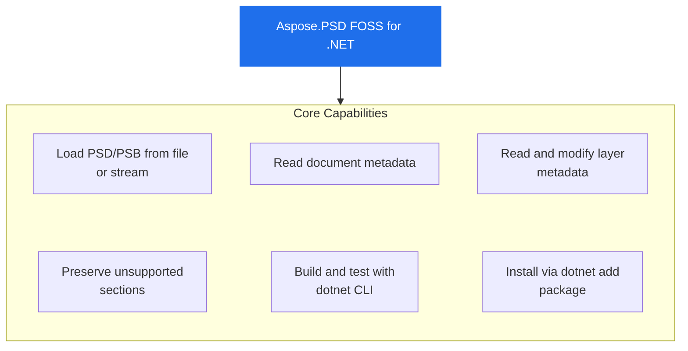

# Aspose.PSD FOSS for .NET

[](https://www.nuget.org/packages/Aspose.PSD.FOSS/)  [](LICENSE.txt)

[](https://products.aspose.org/psd/net/)

Aspose.PSD FOSS for .NET reads and writes PSD files using the `Aspose.PSD.Image` class. It supports the netstandard2.1 and net10.0 target frameworks and exposes core types including `Aspose.PSD.FileFormats`, `Aspose.PSD.StreamContainer`, `Aspose.PSD.Rectangle`, `Aspose.PSD.Size`, `Aspose.PSD.RectangleF`, and `Aspose.PSD.Point`. The product provides methods such as `Image.Load`, `Image.Save`, `Image.Dispose`, and properties like `Image.Width`, `Image.Height`, and `Image.Bounds`.

## Navigation

- [At a Glance](#at-a-glance)
- [Key Capabilities](#key-capabilities)
- [Installation](#installation)
- [Dependencies](#dependencies)
- [Quick Start](#quick-start)
- [API Reference](#api-reference)
- [Scope and Limitations](#scope-and-limitations)
- [Development and Testing](#development-and-testing)
- [License](#license)

## At a Glance



## Key Capabilities

- **Load PSD/PSB from file or stream.** It loads PSD and PSB files from file paths or streams using the `Aspose.PSD.Image.Load` method and accepts `Aspose.PSD.StreamContainer` for stream-based input.
- **Read document metadata.** It reads document metadata including dimensions via `Image.Width` and `Image.Height`, color mode, compression, bounds via `Image.Bounds`, and layer count from the file header.
- **Read and modify layer metadata.** It enumerates layers via `Aspose.PSD.FileFormats`, reads layer metadata such as Name, Bounds, Width, Height, Top, Left, Bottom, Right, `IsVisible`, Opacity, Clipping, and `BlendModeKey`, and modifies supported properties including geometry using `Aspose.PSD.RectangleF` and `Aspose.PSD.Point`.
- **Preserve unsupported sections.** It preserves unsupported sections as raw bytes by maintaining `Aspose.PSD.StreamContainer` content during save operations where direct parsing is not implemented.
- **Build and test with dotnet CLI.** It builds and tests using the dotnet CLI with standard commands against the solution and test project.
- **Install via dotnet add package.** It installs via dotnet add package `Aspose.PSD.FOSS` targeting netstandard2.1 and net10.0.

Use Aspose.PSD FOSS for .NET when you need to:

- make small safe edits to layer metadata;
- save the file back without rendering pixels.

- Read additional document metadata: `Size`, `Bounds`, `Compression`, `ImageResources`, `IsFlatten`
- Inspect supported official-style resource, channel, mask, and blending-range surfaces
- Save without rendering

## Installation

Install the published package from NuGet (`Aspose.PSD.FOSS`, version 26.10.0):

```bash
dotnet add package Aspose.PSD.FOSS
```

## Dependencies

### Required Package Dependencies

No required third-party package dependencies; in `src/Aspose.PSD.FOSS/Aspose.PSD.FOSS.csproj`, no `PackageReference` a consumer would install is declared.

### Native and System Requirements

- Requires .NET `netstandard2.1;net10.0` (`TargetFrameworks` in `src/Aspose.PSD.FOSS/Aspose.PSD.FOSS.csproj`).

## Quick Start

```csharp
using Aspose.PSD;
using Aspose.PSD.FileFormats.Core.Blending;
using Aspose.PSD.FileFormats.Psd;
using Aspose.PSD.FileFormats.Psd.Layers;

using var image = (PsdImage)Image.Load("input.psd");

Console.WriteLine(image.Width);
Console.WriteLine(image.Height);
Console.WriteLine(image.ChannelsCount);
Console.WriteLine(image.BitsPerChannel);
Console.WriteLine(image.ColorMode);
Console.WriteLine(image.Version);
Console.WriteLine(image.Compression);
Console.WriteLine(image.Layers.Length);
Console.WriteLine(image.ImageResources.Length);

foreach (Layer layer in image.Layers)
{
    Console.WriteLine(layer.Name);
    Console.WriteLine(layer.Bounds);
    Console.WriteLine(layer.BlendModeKey);
    Console.WriteLine(layer.IsVisible);
    Console.WriteLine(layer.Opacity);
}

image.Layers[0].Name = "Updated layer";
image.Layers[0].IsVisible = false;
image.Layers[0].Left = 10;
image.Layers[0].Top = 20;
image.Layers[0].Right = 110;
image.Layers[0].Bottom = 120;
image.Layers[0].Opacity = 128;
image.Layers[0].BlendModeKey = BlendMode.Multiply;
image.Save("output.psd");
```

## API Reference

Aspose.PSD FOSS for .NET provides the Aspose.PSD class as the main entry point, which exposes core image operations through the `Aspose.PSD.Image` class. The `Aspose.PSD.Image` class serves as the base for working with image data, while supporting formats and utilities are provided by `Aspose.PSD.FileFormats`, `Aspose.PSD.ImageLoader`, and supporting types.

The public API has 26 types.

<details>
<summary>View the Complete Public API Surface</summary>

### Core API

| Class | Description |
| --- | --- |
| `BuildVersionInfo` | Contains the current build version information. |
| `BlendRange` | Represents a PSD layer blend range. |
| `ChannelInformation` | Represents PSD layer channel information. |
| `GlobalLayerMaskInfo` | Represents global layer mask information. |
| `Layer` | Represents a single PSD layer with basic metadata used by the FOSS library. |
| `LayerBlendingRangesData` | Represents PSD layer blending ranges data. |
| `LayerMaskData` | Defines the base class for PSD layer mask data. |
| `LayerMaskDataShort` | Defines layer mask data for layers that have only a raster or vector mask. |
| `LayerResource` | Represents a PSD layer resource. |
| `PsdImage` | Represents a PSD image that can be loaded, inspected, and saved without rendering. |
| `PsdLoadException` | Exception that is thrown when an error occurs while loading a PSD file. |
| `PsdSaveException` | Exception that is thrown when an error occurs while saving a PSD file. |
| `ResourceBlock` | Represents a PSD image resource block. |
| `Image` | Provides the Aspose.PSD-compatible base image entry point for loading PSD/PSB documents. |
| `ImageLoader` | Provides the Load functionality for Images. |
| `Point` | Represents an ordered pair of integer x- and y-coordinates that defines a point in a two-dimensional plane. |
| `Rectangle` | Stores a set of four integers that represent the location and size of a rectangle. |
| `RectangleF` | Stores a set of four floating-point numbers that represent the location and size of a rectangle. |
| `Size` | Represents an ordered pair of integer width and height values that defines a size. |
| `StreamContainer` | Represents a stream container used by resource save APIs. |

#### Enumerations

| Enumeration | Description |
| --- | --- |
| `BlendMode` | Defines the blend modes used for layers in PSD files. |
| `ColorModes` | Defines the color modes supported by PSD files. |
| `CompressionMethod` | Defines the compression methods used for image data in PSD files. |
| `LayerMaskFlags` | Defines PSD layer mask flags. |
| `PsdVersion` | Represents the supported PSD container versions. |
| `ResourceBlockState` | Represents resource block state. |

#### Detailed Member Reference

### PSD

The Aspose.PSD class is the root namespace for the Aspose.PSD FOSS for .NET library and provides access to core image handling capabilities.

### Image

The `Aspose.PSD.Image` class provides core image operations including loading from streams, saving to files, and accessing image dimensions through Width and Height properties, as well as managing resources with the Bounds and Dispose members.

- `Bounds`: Gets the image bounds.
- `Dispose`: Releases resources used by the image.
- `Height`: Gets the image height in pixels.
- `Load`: Loads a new image from the specified file path.
- `Save`: Saves the image data to the specified file path.
- `Width`: Gets the image width in pixels.

### FileFormats

The `Aspose.PSD.FileFormats` namespace contains types that represent various file formats supported by Aspose.PSD FOSS for .NET, including format-specific image implementations.

### ImageLoader

The `Aspose.PSD.ImageLoader` class provides the Load method for loading images from streams.

- `Load`: Loads a new image from the specified file path.

### Point

The `Aspose.PSD.Point` structure represents a location in a two-dimensional coordinate system with X and Y integer properties, and includes methods such as Equals, `GetHashCode`, and `ToString`.

- `Empty`: Represents a Point with coordinates left uninitialized.
- `Equals`: Determines whether the specified point is equal to this point.
- `GetHashCode`: Returns a hash code for this point.
- `IsEmpty`: Gets a value indicating whether this Point has coordinates left uninitialized.
- `Point`: Initializes a new instance of the Point structure with the specified coordinates.
- `ToString`: Returns a compact coordinate representation.
- `X`: Gets or sets the x-coordinate of this Point.
- `Y`: Gets or sets the y-coordinate of this Point.

### Rectangle

The `Aspose.PSD.Rectangle` structure defines a rectangle with integer coordinates and provides properties such as Width, Height, Left, Top, Right, Bottom, and methods including Contains, Intersect, Union, and Normalize.

- `Bottom`: Gets or sets the y-coordinate of the bottom edge of this Rectangle.
- `Ceiling`: Converts a RectangleF structure to a Rectangle structure by rounding up the coordinates and size.
- `Contains`: Determines whether the specified point is contained within this Rectangle.
- `Empty`: Represents a Rectangle structure with its properties left uninitialized.
- `Equals`: Determines whether the specified rectangle is equal to this rectangle.
- `FromLeftTopRightBottom`: Creates a rectangle from edge coordinates.
- `FromPoints`: Creates a rectangle that spans the specified points.
- `GetHashCode`: Returns a hash code for this rectangle.
- `Height`: Gets or sets the height of this Rectangle.
- `Inflate`: Creates and returns an inflated copy of the specified rectangle.
- `Intersect`: Returns a rectangle that represents the intersection of two rectangles.
- `IntersectsWith`: Determines whether this rectangle intersects with the specified rectangle.
- `IsEmpty`: Gets a value indicating whether this Rectangle has no location or size.
- `Left`: Gets or sets the x-coordinate of the left edge of this Rectangle.
- `Location`: Gets or sets the coordinates of the upper-left corner of this Rectangle.
- `Normalize`: Normalizes this rectangle so that width and height are non-negative.
- `Offset`: Moves this rectangle by the specified point.
- `Rectangle`: Initializes a new instance of the Rectangle structure with the specified location and size.
- `Right`: Gets or sets the x-coordinate of the right edge of this Rectangle.
- `Round`: Converts a RectangleF structure to a Rectangle structure by rounding the coordinates and size.
- `Size`: Gets or sets the size of this Rectangle.
- `ToString`: Returns a string representation of this rectangle.
- `Top`: Gets or sets the y-coordinate of the top edge of this Rectangle.
- `Truncate`: Converts a RectangleF structure to a Rectangle structure by truncating the coordinates and size.
- `Union`: Returns a rectangle that contains the union of two rectangles.
- `Width`: Gets or sets the width of this Rectangle.
- `X`: Gets or sets the x-coordinate of the upper-left corner of this Rectangle.
- `Y`: Gets or sets the y-coordinate of the upper-left corner of this Rectangle.

### RectangleF

The `Aspose.PSD.RectangleF` structure defines a rectangle with floating-point coordinates and provides properties such as Width, Height, Left, Top, Right, Bottom, and methods including Equals and `GetHashCode`.

- `Bottom`: Gets the y-coordinate of the bottom edge of this RectangleF.
- `Empty`: Represents a RectangleF structure with its properties left uninitialized.
- `Equals`: Determines whether the specified rectangle is equal to this rectangle.
- `GetHashCode`: Returns a hash code for this rectangle.
- `Height`: Gets or sets the height of this RectangleF.
- `IsEmpty`: Gets a value indicating whether this RectangleF has no location or size.
- `Left`: Gets the x-coordinate of the left edge of this RectangleF.
- `RectangleF`: Initializes a new instance of the RectangleF structure with the specified coordinates.
- `Right`: Gets the x-coordinate of the right edge of this RectangleF.
- `ToString`: Returns a compact coordinate representation.
- `Top`: Gets the y-coordinate of the top edge of this RectangleF.
- `Width`: Gets or sets the width of this RectangleF.
- `X`: Gets or sets the x-coordinate of the upper-left corner of this RectangleF.
- `Y`: Gets or sets the y-coordinate of the upper-left corner of this RectangleF.

### Size

The `Aspose.PSD.Size` structure represents the dimensions of a rectangle with Width and Height integer properties, and includes methods such as Equals, `GetHashCode`, and `ToString`.

- `Empty`: Represents a Size with width and height left uninitialized.
- `Equals`: Determines whether the specified size is equal to this size.
- `GetHashCode`: Returns a hash code for this size.
- `Height`: Gets or sets the height component of this Size.
- `IsEmpty`: Gets a value indicating whether this Size has width and height left uninitialized.
- `Size`: Initializes a new instance of the Size structure with the specified dimensions.
- `ToString`: Returns a compact size representation.
- `Width`: Gets or sets the width component of this Size.

### StreamContainer

The `Aspose.PSD.StreamContainer` class provides a base abstraction for stream-based data access used during image loading and saving operations.

- `Stream`: Gets the wrapped stream.

### BuildVersionInfo

The `Aspose.PSD.BuildVersionInfo` class provides version information about the Aspose.PSD FOSS for .NET library build.

- `AssemblyVersion`: The assembly version.
- `FileVersion`: The file version.
- `Product`: The product title.
- `ProductMajor`: The major product version.
- `ProductMinor`: The minor product version.
- `ReleaseDate`: The product release date.

</details>

## Scope and Limitations

This library is for metadata-safe PSD/PSB inspection and limited structural editing. It is not a rendering engine, a raster editor, or an open-source replacement for the full commercial Aspose.PSD product.

- render PSD/PSB content;
- edit pixels or export raster images;
- interpret the full Photoshop feature set semantically;
- replace the commercial Aspose.PSD API surface one-to-one.

- The library parses only a small supported subset of the PSD/PSB format.
- Known structures are exposed through a compact public API.
- Image resources are exposed through lightweight unknown-only summaries rather than ID-specific semantic reconstruction.
- Unsupported sections are preserved as raw bytes where possible.
- When you mutate supported metadata, the library rewrites only the affected supported structures and keeps the rest of the file in raw-preserved form.

Markdown documentation is available in the repository:

- `documentation/README.md`
- `documentation/getting-started.md`
- `documentation/developer-guide/basic-psd-operations.md`
- `documentation/limitations.md`

- Rendering
- Pixel editing
- Export to PNG, JPEG, or other raster formats
- Full image resource editing
- Semantic recognition of specific image resource kinds
- Full tagged block editing
- Text, vector, effects, smart filters, and adjustment rendering

These limitations don't apply to [full-featured Aspose.PSD for .NET — Enterprise Edition](https://products.aspose.com/psd/net/). Choose the commercial Aspose.PSD product if you need broad Photoshop feature support such as rendering, raster editing, export pipelines, richer resource/tag handling, or wider PSD/PSB compatibility.

## Development and Testing

The suite covers 11 test files under `src/Aspose.PSD.FOSS.Test/`.

To build and run the tests from a clone, run:

```bash
dotnet build Aspose.PSD-FOSS-for-.NET.sln
dotnet test Aspose.PSD-FOSS-for-.NET.sln
```

- .NET 10.0 SDK or later

```bash
dotnet pack src/Aspose.PSD.FOSS/Aspose.PSD.FOSS.csproj -c Release
```

The package will be created under `src/Aspose.PSD.FOSS/bin/Release/`.

Runnable sample projects are available in the repository `samples/` folder:

- `Aspose.PSD.FOSS.Samples.Basic`
- `Aspose.PSD.FOSS.Samples.Layers`
- `Aspose.PSD.FOSS.Samples.StructuralEditing`
- `Aspose.PSD.FOSS.Samples.Streams`
- `Aspose.PSD.NuGet.Samples.Basic`
- `Aspose.PSD.NuGet.Samples.Layers`
- `Aspose.PSD.NuGet.Samples.StructuralEditing`
- `Aspose.PSD.NuGet.Samples.Streams`

The `Aspose.PSD.FOSS.Samples.*` projects reference this FOSS library. The `Aspose.PSD.NuGet.Samples.*` projects run the same workflows against the official `Aspose.PSD` NuGet package.

Keep only the project files different so the same application source can be compiled and exercised against both libraries for the supported migration scenarios.

This parity requirement applies to sample source and covered workflows, not to byte-for-byte identical runtime output. The commercial `Aspose.PSD` package may report different values or save different bytes for the same input document even when both sample projects successfully run the same scenario.

Sample/workflow matrix:

| FOSS sample | NuGet sample | Main workflow | What it demonstrates |
|---|---|---|---|
| `Aspose.PSD.FOSS.Samples.Basic` | `Aspose.PSD.NuGet.Samples.Basic` | Document inspection | Aspose.PSD-compatible document metadata and supported resource/layer counts |
| `Aspose.PSD.FOSS.Samples.Layers` | `Aspose.PSD.NuGet.Samples.Layers` | Layer inspection | Layer metadata, derived geometry, blend mode key, channel information, mask data, and blending ranges |
| `Aspose.PSD.FOSS.Samples.StructuralEditing` | `Aspose.PSD.NuGet.Samples.StructuralEditing` | Supported metadata editing | Renaming layers, changing visibility, opacity, clipping, blend mode key, and geometry, then saving without rendering |
| `Aspose.PSD.FOSS.Samples.Streams` | `Aspose.PSD.NuGet.Samples.Streams` | Stream-based round trip | Loading from a stream, saving to a stream, and working with in-memory PSD/PSB data |

Example commands:

```bash
dotnet run --project samples/Aspose.PSD.FOSS.Samples.Basic
dotnet run --project samples/Aspose.PSD.FOSS.Samples.Layers
dotnet run --project samples/Aspose.PSD.FOSS.Samples.StructuralEditing
dotnet run --project samples/Aspose.PSD.FOSS.Samples.Streams
dotnet run --project samples/Aspose.PSD.NuGet.Samples.Basic
dotnet run --project samples/Aspose.PSD.NuGet.Samples.Layers
dotnet run --project samples/Aspose.PSD.NuGet.Samples.StructuralEditing
dotnet run --project samples/Aspose.PSD.NuGet.Samples.Streams
```

If you do not pass an input file, the samples try to use the repository PSD test fixture.

If you do not pass an output file to the stream or structural-editing samples, they save into the repository `tmp/` folder by default.

## License

This project is licensed under the [MIT License](LICENSE.txt). The MIT License permits use, copying, modification, distribution, sublicensing, and commercial use, provided its copyright and permission notice are retained. The software is provided without warranty.
