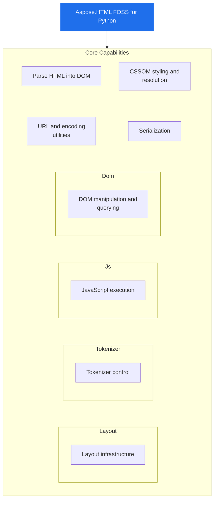

# Aspose.HTML FOSS for Python

 [](LICENSE) [](https://github.com/aspose-html-foss/Aspose.HTML-FOSS-for-Python/graphs/contributors)

[](https://products.aspose.org/html/python/)

It reads HTML input and constructs a DOM tree using `aspose_html.HTMLDocument.parse`, `aspose_html.HTMLDocument.parse_fragment`, and `aspose_html.HTMLDocument.load`. It applies `CSS` styles via `aspose_html.cssom.CSSStyleSheet` and computes styles using `aspose_html.dom.Element.get_computed_style`. It matches selectors with `aspose_html.css.select` and `aspose_html.css.element_matches`, and serializes the DOM using `aspose_html.serialise` and `aspose_html.serialiser.outer_html`. It parses URLs and manipulates query parameters using `aspose_html.url.URL` and `aspose_html.url.URLSearchParams`, and detects encoding from byte streams using `aspose_html.encoding.detect_encoding`. It evaluates JavaScript against the DOM using `aspose_html.js.JSContext` and `aspose_html.js.ModuleRegistry`.

Aspose.HTML FOSS for Python is a free, open-source, MIT-licensed Python toolkit for parsing HTML into a standards-based DOM tree, applying CSS, and serializing markup back out. It provides WHATWG-style `HTMLDocument`/`Document`/`Element` APIs, CSS selector matching and CSSOM-based computed-style resolution, WHATWG `URL`/`URLSearchParams` handling, and byte-stream encoding detection, with an optional QuickJS-backed JavaScript execution bridge for running scripts against the parsed DOM.

## Navigation

- [At a Glance](#at-a-glance)
- [Key Capabilities](#key-capabilities)
- [Installation](#installation)
- [Dependencies](#dependencies)
- [Quick Start](#quick-start)
- [Additional Examples](#additional-examples)
- [API Reference](#api-reference)
- [Documentation & Resources](#documentation--resources)
- [Scope and Limitations](#scope-and-limitations)
- [Development and Testing](#development-and-testing)
- [License](#license)

## At a Glance



## Key Capabilities

- **Parse HTML into DOM.** It parses HTML strings, bytes, fragments, and files into a DOM document with `aspose_html.HTMLDocument.parse`, `aspose_html.HTMLDocument.parse_fragment`, and `aspose_html.HTMLDocument.load`; the lower-level `aspose_html.tokenizer.Tokenizer` and `aspose_html.tree.TreeBuilder` classes implement the WHATWG tokenization and tree-construction algorithms directly, for callers who need that level of control.
- **DOM manipulation and querying.** It builds, inspects, and mutates DOM trees by creating and updating nodes programmatically with `aspose_html.dom.Document.create_element` and `append_child`, reading and writing element attributes, classes, datasets, inline styles, and text content, and querying documents by ID, tag name, class name, and selector-oriented helpers such as `get_element_by_id`, `get_elements_by_tag_name`, `TreeWalker`, `NodeIterator`, and `Range`.
- **CSSOM styling and resolution.** It matches `CSS` selectors and stylesheets against elements and resolves the cascade—specificity, inline-vs-author rules, !important, and inheritance—with `aspose_html.dom.Element.get_computed_style`; the CSSOM surface (`aspose_html.cssom.CSSStyleSheet`, `aspose_html.cssom.CSSStyleRule`, `aspose_html.cssom.CSSMediaRule`, and related rule types) models stylesheets structurally.
- **URL and encoding utilities.** It validates and manipulates URLs with `aspose_html.url.URL`, reads and edits query strings with `aspose_html.url.URLSearchParams`, and detects byte-stream character encodings (BOM and content sniffing) with `aspose_html.encoding.detect_encoding`.
- **JavaScript execution.** It executes JavaScript against a parsed DOM through `aspose_html.js.JSContext`, an optional QuickJS-backed bridge exposing DOM access to script code; requires the js extra.
- **Serialization.** It serializes complete documents, fragments, and individual elements back to an HTML string with the `aspose_html.serialise` function or `aspose_html.XMLSerializer`.
- **Tokenizer control.** It exposes low-level tokenization control through `aspose_html.tokenizer.StartTagToken`, `aspose_html.tokenizer.CommentToken`, and `aspose_html.tokenizer.DoctypeToken`, enabling callers to inspect or emit specific token types during parsing.
- **Layout infrastructure.** It builds and manipulates layout trees with `aspose_html.layout.BoxNode`, `aspose_html.layout.BoxRoot`, and `aspose_html.layout.PageFragment`, and provides the `aspose_html.layout.build_box_tree` and `aspose_html.layout.paginate_fragments` functions to construct and paginate box structures for rendering.

- Work with a broad set of specialized HTML element classes — `HTMLFormElement`, `HTMLInputElement`, `HTMLSelectElement`, `HTMLTableElement`, `HTMLMediaElement`, and dozens more — each exposing the element-specific properties defined by its HTML interface.

## Installation

`aspose-html-foss` is not yet published on PyPI, and no build or install command succeeds; work from the source checkout instead:

```bash
git clone https://github.com/aspose-html-foss/Aspose.HTML-FOSS-for-Python.git
cd Aspose.HTML-FOSS-for-Python
export PYTHONPATH="src:.:$PYTHONPATH"
```

Verify the install:

```bash
python -c "import aspose_html.tokenizer"
```

Requires Python 3.10 or later.

## Dependencies

### Required Package Dependencies

- `skia-python>=87.0,<145`

### Optional Dependencies

- `quickjs>=1.19,<2` (extra `js`)

### Native and System Requirements

- Requires Python 3.10 or later.

### Development Dependencies

- `pytest>=8` (extra `test`)

## Quick Start

The first example parses an HTML string into a DOM, locates an element by its identifier, creates a new paragraph, sets its text content, appends it to the container, and serializes the updated subtree.

```python
from aspose_html import HTMLDocument, serialise

document = HTMLDocument.parse("<main id='content'><h1>Hello</h1></main>")
content = document.get_element_by_id("content")

paragraph = document.create_element("p")
paragraph.text_content = "Updated through the DOM API."
content.append_child(paragraph)

print(serialise(content))
```

The second example constructs a document with a styled element, attaches a `CSS` style sheet, and retrieves the computed style property value for the element.

```python
from aspose_html.dom import Document
from aspose_html.cssom import CSSStyleSheet

document = Document()
element = document.create_element("div")
element.set_attribute("class", "foo")
element.set_attribute("id", "bar")
document.append_child(element)

sheet = CSSStyleSheet()
sheet.replace_sync(".foo { color: red } #bar { color: blue }")
document.attach_style_sheet(sheet)

style = element.get_computed_style()
print(style.get_property_value("color"))  # "blue"
```

## Additional Examples

The following workflows demonstrate `URL` parameter manipulation, HTML parsing and querying, encoding detection, JavaScript evaluation, and tokenization.

### Create a DOM Element and Evaluate JavaScript Expressions

```python
from aspose_html.dom import Document
from aspose_html.js import JSContext

document = Document()
element = document.create_element("div")
document.append_child(element)

with JSContext(document) as ctx:
    result = ctx.evaluate("1 + 1")
    print(result)  # 2
```

<details>
<summary>View Additional Examples</summary>

### Modify `URL` Search Parameters and Print the Updated `URL`

```python
from aspose_html import URL

url = URL("https://example.com/articles?category=html")
url.search_params.set("page", "2")

print(str(url))
```

### Parse HTML and Extract Text Content from an Element

```python
from aspose_html import HTMLDocument

document = HTMLDocument.parse("<article><h1>News</h1><p>Hello</p></article>")
heading = document.get_elements_by_tag_name("h1").item(0)

print(heading.text_content)
```

### Detect Encoding and Confidence from Byte Input

```python
from aspose_html.encoding.detection import detect_encoding

result = detect_encoding(b"\xef\xbb\xbf<p>x</p>")
print(result.encoding)
print(result.confidence)
print(result.text)
```

### Tokenize an HTML String and Inspect Tag Names

```python
from aspose_html.tokenizer import Tokenizer, TokenizerState

tokenizer = Tokenizer("<p>Hello</p>")
tokens = list(tokenizer.tokenize())
print(tokens[0].tag_name)  # "p"
```

Runnable scripts are available in the [`examples`](examples/) directory.

</details>

## API Reference

The primary entry point is `aspose_html.HTMLDocument`, which parses HTML into a `aspose_html.dom.Document` tree built from `aspose_html.dom.Element` and the specialized `HTMLElement` subclasses. The DOM tree can be queried and mutated directly, styled through the `CSS`/CSSOM surface, serialized back to markup, and optionally scripted through `aspose_html.js.JSContext`.

The public API has 303 types.

<details>
<summary>View the Complete Public API Surface</summary>

The primary entry point is `HTMLDocument`, which parses HTML into a `Document` tree built from `Node`/`Element` and the specialized `HTMLElement` subclasses. The DOM tree can be queried and mutated directly, styled through the CSS/CSSOM surface, serialized back to markup, and optionally scripted through `JSContext`. The library exposes 303 public types in total, listed below by module, with curated highlights following.

### Core API

| Class | Description |
| --- | --- |
| `aspose_html.DOMParser` | DOMParser class provides a parse method that parses a string into a DOM document and raises NotSupportedError (conditionally). |
| `HTMLDocument` | Top-level entry point for parsing HTML into a Document tree. |
| `aspose_html.URL` | URL class represents a uniform resource locator. |
| `aspose_html.URLParseError` | URLParseError class represents an error that occurs when parsing a URL. |
| `aspose_html.URLSearchParams` | URLSearchParams class provides methods to work with the query string of a URL. |
| `aspose_html.XMLSerializer` | XMLSerializer class provides a method to serialize a DOM tree into an XML string. |
| `CSS` | Namespace class for CSS static utilities (CSS Conditional Rules §6). |
| `CSSCounterStyleRule` | CSSCounterStyleRule class represents a @counter-style rule in a CSS style sheet. |
| `CSSFontFaceRule` | CSSFontFaceRule class represents a @font-face rule in a CSS style sheet. |
| `CSSImportRule` | CSSImportRule class represents a @import rule in a CSS style sheet. |
| `CSSKeyframeRule` | CSSKeyframeRule class represents a single @keyframe rule in a CSS style sheet. |
| `CSSKeyframesRule` | CSSKeyframesRule class represents a @keyframes rule in a CSS style sheet. |
| `CSSLayerBlockRule` | CSSLayerBlockRule class represents a @layer block rule in a CSS style sheet and raises IndexSizeError and SyntaxError (conditionally) when delete_rule and insert_rule are called. |
| `CSSLayerStatementRule` | CSSLayerStatementRule class represents a @layer statement rule in a CSS style sheet. |
| `CSSMediaRule` | CSSMediaRule class represents a @media rule in a CSS style sheet and raises IndexSizeError and SyntaxError (conditionally) when delete_rule and insert_rule are called. |
| `CSSNamespaceRule` | CSSNamespaceRule class represents a @namespace rule in a CSS style sheet. |
| `CSSPageRule` | CSSPageRule class represents a @page rule in a CSS style sheet. |
| `CSSPropertyRule` | CSSPropertyRule class represents a @property rule in a CSS style sheet and its type getter always returns 16. |
| `CSSRule` | CSSRule class represents a CSS rule and its css_text and type getters raise NotImplementedError (some members not implemented). |
| `CSSRuleList` | CSSRuleList class represents an ordered list of CSS rules. |
| `CSSStyleRule` | CSSStyleRule class represents a style rule in a CSS style sheet. |
| `CSSStyleSheet` | CSSStyleSheet class represents a CSS style sheet and raises IndexSizeError (conditionally) when delete_rule and insert_rule are called. |
| `CSSSupportsRule` | CSSSupportsRule class represents a @supports rule in a CSS style sheet and raises IndexSizeError and SyntaxError (conditionally) when delete_rule and insert_rule are called. |
| `AbortController` | AbortController class provides a way to abort one or more Web requests. |
| `AbortSignal` | AbortSignal class represents a signal object that allows you to communicate with a request. |
| `AbstractRange` | AbstractRange class represents a range of nodes within a document. |
| `Attr` | Attr class represents an attribute on an HTML element and its specified getter always returns True. |
| `BarProp` | BarProp class represents a browser interface element. |
| `BroadcastChannel` | BroadcastChannel class provides a way to broadcast messages to other browsing contexts. |
| `CDATASection` | CDATASection class represents a CDATA section in an XML document and its node_name getter always returns '#cdata-section'. |
| `CSSStyleDeclaration` | CSSStyleDeclaration class represents a collection of CSS properties. |
| `CharacterData` | CharacterData class represents a node that contains character data and raises IndexSizeError (conditionally) when delete_data, insert_data, replace_data, and substring_data are called. |
| `Comment` | Comment class represents an HTML comment and its node_name getter always returns '#comment'. |
| `ComputedStyleDeclaration` | ComputedStyleDeclaration class represents the computed style of an element. |
| `Console` | Public class. |
| `Crypto` | Public class. |
| `CustomElementRegistry` | Public class. |
| `CustomEvent` | CustomEvent class represents a custom event. |
| `DOMConfiguration` | Public class. |
| `DOMException` | Declares the field message. |
| `DOMImplementation` | Public class. |
| `dom.DOMParser` | DOMParser class provides a parse method that parses a string into a DOM document and raises NotSupportedError (conditionally). |
| `DOMRect` | DOMRect class represents a rectangle with x, y, width, and height properties. |
| `DOMRectList` | DOMRectList class represents a list of DOMRect objects. |
| `DOMStringMap` | DOMStringMap class represents a set of key-value string pairs. |
| `DOMTokenList` | Public class. |
| `DataCloneError` | DataCloneError class represents an error when data cannot be cloned. |
| `Document` | Public class. |
| `DocumentFragment` | DocumentFragment class represents a lightweight container for nodes and its node_name getter always returns '#document-fragment'. |
| `DocumentPosition` | DocumentPosition enum lists the DOCUMENT_POSITION_CONTAINED_BY, DOCUMENT_POSITION_CONTAINS, DOCUMENT_POSITION_DISCONNECTED, DOCUMENT_POSITION_FOLLOWING, DOCUMENT_POSITION_IMPLEMENTATION_SPECIFIC, and DOCUMENT_POSITION_PRECEDING constants. |
| `DocumentType` | DocumentType class represents a document type declaration. |
| `Element` | Public class. |
| `ErrorEvent` | ErrorEvent class represents an error event. |
| `Event` | Event enum lists the AT_TARGET, BUBBLING_PHASE, CAPTURING_PHASE, and NONE constants. |
| `EventTarget` | Public class. |
| `FocusEvent` | FocusEvent class represents a focus event. |
| `FormData` | Public class. |
| `dom.HTMLAddressElement` | HTMLAddressElement class represents an address element. |
| `dom.HTMLAnchorElement` | HTMLAnchorElement class represents an anchor element. |
| `dom.HTMLAreaElement` | HTMLAreaElement class represents an area element. |
| `dom.HTMLArticleElement` | HTMLArticleElement class represents an article element. |
| `dom.HTMLAsideElement` | HTMLAsideElement class represents an aside element. |
| `dom.HTMLAudioElement` | HTMLAudioElement class represents an audio element. |
| `dom.HTMLBRElement` | HTMLBRElement class represents a line break element. |
| `dom.HTMLBaseElement` | HTMLBaseElement class represents a base element. |
| `dom.HTMLBodyElement` | HTMLBodyElement class represents a body element. |
| `dom.HTMLButtonElement` | HTMLButtonElement class represents a button element and its will_validate getter always returns False. |
| `dom.HTMLCanvasElement` | HTMLCanvasElement class represents a canvas element and its to_data_url method always returns 'data:,'; transfer_control_to_offscreen raises NotSupportedError. |
| `HTMLCollection` | HTMLCollection class represents a collection of HTML elements. |
| `dom.HTMLDListElement` | HTMLDListElement class represents a description list element. |
| `dom.HTMLDataElement` | HTMLDataElement class represents a data element. |
| `dom.HTMLDataListElement` | HTMLDataListElement class represents a datalist element. |
| `dom.HTMLDetailsElement` | HTMLDetailsElement class represents a details element. |
| `dom.HTMLDialogElement` | HTMLDialogElement class represents a dialog element. |
| `dom.HTMLDivElement` | HTMLDivElement class represents a division element. |
| `HTMLElement` | HTMLElement class represents an HTML element and its access_key_label getter always returns '', toggle_popover always returns False; content_editable setter raises _SyntaxError and outer_text setter raises NoModificationAllowedError. |
| `dom.HTMLEmbedElement` | HTMLEmbedElement class represents an embed element. |
| `dom.HTMLFieldSetElement` | HTMLFieldSetElement class represents a fieldset element and its type getter always returns 'fieldset'. |
| `dom.HTMLFigCaptionElement` | HTMLFigCaptionElement class represents a figure caption element. |
| `dom.HTMLFigureElement` | HTMLFigureElement class represents a figure element. |
| `dom.HTMLFooterElement` | HTMLFooterElement class represents a footer element. |
| `dom.HTMLFormElement` | HTMLFormElement class represents a form element; request_submit, reset, and submit raise NotSupportedError. |
| `dom.HTMLHRElement` | HTMLHRElement class represents the HTML hr element. |
| `dom.HTMLHeadElement` | HTMLHeadElement class represents the HTML head element. |
| `dom.HTMLHeaderElement` | HTMLHeaderElement class represents the HTML header element. |
| `dom.HTMLHeadingElement` | HTMLHeadingElement class represents the HTML heading element. |
| `dom.HTMLHtmlElement` | HTMLHtmlElement class represents the HTML HTML element. |
| `dom.HTMLIFrameElement` | HTMLIFrameElement class represents the HTML iframe element. |
| `dom.HTMLImageElement` | HTMLImageElement class represents the HTML image element; its decode method is not implemented, its complete, natural_height, natural_width, x, and y getters always return False, 0, 0, 0, and 0 respectively. |
| `dom.HTMLInputElement` | HTMLInputElement class represents the HTML input element; its selection_direction, selection_end, and selection_start getters always return 'none', 0, and 0, its set_range_text and show_picker methods raise NotSupportedError, and its value_as_number setter raises InvalidStateError. |
| `dom.HTMLLIElement` | HTMLLIElement class represents the HTML li element. |
| `dom.HTMLLabelElement` | HTMLLabelElement class represents the HTML label element. |
| `dom.HTMLLegendElement` | HTMLLegendElement class represents the HTML legend element. |
| `dom.HTMLLinkElement` | HTMLLinkElement class represents the HTML link element. |
| `dom.HTMLMainElement` | HTMLMainElement class represents the HTML main element. |
| `dom.HTMLMapElement` | HTMLMapElement class represents the HTML map element. |
| `dom.HTMLMarkElement` | HTMLMarkElement class represents the HTML mark element. |
| `dom.HTMLMediaElement` | HTMLMediaElement class represents the HTML media element; its can_play_type, current_src, current_time, ended, network_state, and paused getters always return '', '', 0.0, False, 0, and True respectively. |
| `dom.HTMLMenuElement` | HTMLMenuElement class represents the HTML menu element. |
| `dom.HTMLMetaElement` | HTMLMetaElement class represents the HTML meta element. |
| `dom.HTMLMeterElement` | HTMLMeterElement class represents the HTML meter element. |
| `dom.HTMLModElement` | HTMLModElement class represents the HTML mod element. |
| `dom.HTMLNavElement` | HTMLNavElement class represents the HTML nav element. |
| `dom.HTMLNoScriptElement` | HTMLNoScriptElement class represents the HTML noscript element. |
| `dom.HTMLOListElement` | HTMLOListElement class represents the HTML ol element. |
| `dom.HTMLObjectElement` | HTMLObjectElement class represents the HTML object element; its will_validate getter always returns False. |
| `dom.HTMLOptGroupElement` | HTMLOptGroupElement class represents the HTML optgroup element. |
| `dom.HTMLOptionElement` | HTMLOptionElement class represents the HTML option element. |
| `HTMLOptionsCollection` | HTMLOptionsCollection class represents a collection of HTML option elements. |
| `dom.HTMLOutputElement` | HTMLOutputElement class represents the HTML output element; its type and will_validate getters always return 'output' and False respectively. |
| `dom.HTMLParagraphElement` | HTMLParagraphElement class represents the HTML p element. |
| `dom.HTMLParamElement` | HTMLParamElement class represents the HTML param element. |
| `dom.HTMLPictureElement` | HTMLPictureElement class represents the HTML picture element. |
| `dom.HTMLPreElement` | HTMLPreElement class represents the HTML pre element. |
| `dom.HTMLProgressElement` | HTMLProgressElement class represents the HTML progress element. |
| `dom.HTMLQuoteElement` | HTMLQuoteElement class represents the HTML quote element. |
| `dom.HTMLRubyElement` | HTMLRubyElement class represents the HTML ruby element. |
| `dom.HTMLScriptElement` | HTMLScriptElement class represents the HTML script element. |
| `dom.HTMLSectionElement` | HTMLSectionElement class represents the HTML section element. |
| `dom.HTMLSelectElement` | HTMLSelectElement class represents the HTML select element; its add method raises HierarchyRequestError. |
| `dom.HTMLSmallElement` | HTMLSmallElement class represents the HTML small element. |
| `dom.HTMLSourceElement` | HTMLSourceElement class represents the HTML source element. |
| `dom.HTMLSpanElement` | HTMLSpanElement class represents an HTML span element. |
| `dom.HTMLStyleElement` | HTMLStyleElement class represents an HTML style element. |
| `dom.HTMLSummaryElement` | HTMLSummaryElement class represents an HTML summary element. |
| `dom.HTMLTableCaptionElement` | HTMLTableCaptionElement class represents an HTML table caption element. |
| `dom.HTMLTableCellElement` | HTMLTableCellElement class represents an HTML table cell element. |
| `dom.HTMLTableColElement` | HTMLTableColElement class represents an HTML table column element. |
| `dom.HTMLTableElement` | HTMLTableElement class represents an HTML table element and its insert_row and delete_row methods raise IndexSizeError (conditionally). |
| `dom.HTMLTableRowElement` | HTMLTableRowElement class represents an HTML table row element and its insert_cell and delete_cell methods raise IndexSizeError (conditionally). |
| `dom.HTMLTableSectionElement` | HTMLTableSectionElement class represents an HTML table section element and its insert_row and delete_row methods raise IndexSizeError (conditionally). |
| `dom.HTMLTemplateElement` | HTMLTemplateElement class represents an HTML template element. |
| `dom.HTMLTextAreaElement` | HTMLTextAreaElement class represents an HTML text area element and its set_range_text method raises NotSupportedError (conditionally); its selection_direction, selection_end, selection_start, and type getters always return 'none', 0, 0, and 'textarea' respectively. |
| `dom.HTMLTimeElement` | HTMLTimeElement class represents an HTML time element. |
| `dom.HTMLTitleElement` | HTMLTitleElement class represents an HTML title element and its text setter raises NotSupportedError (conditionally). |
| `dom.HTMLTrackElement` | HTMLTrackElement class represents an HTML track element and its ready_state getter always returns 0. |
| `dom.HTMLUListElement` | HTMLUListElement class represents an HTML unordered list element. |
| `dom.HTMLUnknownElement` | HTMLUnknownElement class represents an HTML unknown element. |
| `dom.HTMLVideoElement` | HTMLVideoElement class represents an HTML video element and its request_picture_in_picture method raises NotSupportedError (conditionally); its video_height, video_width, webkit_decoded_frame_count, and webkit_dropped_frame_count getters always return 0. |
| `dom.HTMLWBRElement` | HTMLWBRElement class represents an HTML wbr element. |
| `HashChangeEvent` | HashChangeEvent class represents a hashchange event. |
| `HierarchyRequestError` | HierarchyRequestError class represents a hierarchy request error. |
| `History` | History class represents the browser history. |
| `InUseAttributeError` | InUseAttributeError class represents an in use attribute error. |
| `IndexSizeError` | IndexSizeError class represents an index size error. |
| `InputEvent` | InputEvent class represents an input event. |
| `IntersectionObserver` | IntersectionObserver class represents an intersection observer. |
| `IntersectionObserverEntry` | IntersectionObserverEntry class represents an intersection observer entry. |
| `InvalidCharacterError` | InvalidCharacterError class represents an invalid character error. |
| `InvalidStateError` | InvalidStateError class represents an invalid state error. |
| `KeyboardEvent` | KeyboardEvent class represents a keyboard event. |
| `Location` | Location class represents the document location. |
| `MediaQueryList` | MediaQueryList class represents a media query list. |
| `MessageChannel` | MessageChannel class represents a message channel. |
| `MessagePort` | MessagePort class represents a message port. |
| `MouseEvent` | MouseEvent class represents a mouse event and its offset_x, offset_y, page_x, and page_y getters always return 0. |
| `MutationObserver` | MutationObserver class represents a mutation observer and its observe method raises InvalidStateError (conditionally). |
| `MutationRecord` | MutationRecord class represents a mutation record. |
| `NamedNodeMap` | NamedNodeMap class represents a named node map and its remove_named_item method raises NotFoundError (conditionally). |
| `Navigator` | Navigator class represents the browser navigator. |
| `NoModificationAllowedError` | NoModificationAllowedError class represents a no modification allowed error. |
| `Node` | Node class represents a node and its insert_before, remove_child, and replace_child methods raise NotFoundError (conditionally). |
| `NodeFilter` | NodeFilter class provides constants for node filtering in tree traversals. |
| `NodeIterator` | NodeIterator class enables iteration over a subset of nodes in a document tree. |
| `NodeList` | NodeList class represents an ordered collection of nodes. |
| `NodeType` | NodeType class defines constants representing the type of a node. |
| `NotFoundError` | NotFoundError class represents an error when a requested object cannot be found. |
| `NotSupportedError` | NotSupportedError class represents an error when an operation is not supported. |
| `ParseError` | ParseError class represents an error that occurs during parsing. |
| `Performance` | Performance class provides access to performance-related information. |
| `PerformanceEntry` | PerformanceEntry class is the base class for performance entries. |
| `PerformanceTiming` | PerformanceTiming class provides timing information about the page load process. |
| `PopStateEvent` | PopStateEvent class represents a popstate event. |
| `ProcessingInstruction` | ProcessingInstruction class represents a processing instruction in the document. |
| `Range` | Range class represents a fragment of a document that can contain nodes and parts of text nodes. |
| `ResizeObserver` | ResizeObserver class observes changes to the size of elements. |
| `ResizeObserverEntry` | ResizeObserverEntry class represents the size of an observed element. |
| `Screen` | Screen class provides information about the user's screen. |
| `SecurityError` | SecurityError class represents a security-related error. |
| `Selection` | Selection class represents the text selected by the user or the current caret position. |
| `StaticRange` | StaticRange class represents a static range that does not update when the DOM changes. |
| `Storage` | Storage class provides access to a storage object for a particular domain. |
| `StyleSheetList` | StyleSheetList class represents a list of stylesheets. |
| `SubtleCrypto` | SubtleCrypto class provides cryptographic operations. |
| `SyntaxError` | SyntaxError class represents a syntax error. |
| `Text` | Text class represents a text node in the document. |
| `TreeWalker` | TreeWalker class provides methods to navigate a document tree. |
| `UIEvent` | UIEvent class represents a user interface event. |
| `ValidityState` | ValidityState class represents the validity state of an element. |
| `VisualViewport` | VisualViewport class represents the visual viewport of a document. |
| `Window` | Window class represents a browser window and provides access to the document and other browser features. |
| `WrongDocumentError` | WrongDocumentError class represents an error when a node is used in a different document than the one that created it. |
| `dom.XMLSerializer` | XMLSerializer class serializes a DOM tree into XML. |
| `html.HTMLAddressElement` | HTMLAddressElement class represents an address element in the document. |
| `html.HTMLAnchorElement` | HTMLAnchorElement class represents an anchor element in the document. |
| `html.HTMLAreaElement` | HTMLAreaElement class represents an area element in the document. |
| `html.HTMLArticleElement` | HTMLArticleElement class represents an article element in the document. |
| `html.HTMLAsideElement` | HTMLAsideElement class represents an aside element in the document. |
| `html.HTMLAudioElement` | HTMLAudioElement class represents an audio element in the document. |
| `html.HTMLBRElement` | HTMLBRElement class represents a line break element in the document. |
| `html.HTMLBaseElement` | HTMLBaseElement class represents a base element in the document. |
| `html.HTMLBodyElement` | HTMLBodyElement class represents the body element in the document. |
| `html.HTMLButtonElement` | HTMLButtonElement class represents a button element and its will_validate getter always returns False. |
| `html.HTMLCanvasElement` | HTMLCanvasElement class represents a canvas element and its to_data_url method always returns 'data:,' while its transfer_control_to_offscreen method raises NotSupportedError. |
| `html.HTMLDListElement` | HTMLDListElement class represents a description list element. |
| `html.HTMLDataElement` | HTMLDataElement class represents a data element. |
| `html.HTMLDataListElement` | HTMLDataListElement class represents a data list element. |
| `html.HTMLDetailsElement` | HTMLDetailsElement class represents a details element. |
| `html.HTMLDialogElement` | HTMLDialogElement class represents a dialog element. |
| `html.HTMLDivElement` | HTMLDivElement class represents a division or section element. |
| `html.HTMLEmbedElement` | HTMLEmbedElement class represents an embedded object element. |
| `html.HTMLFieldSetElement` | HTMLFieldSetElement class represents a field set element and its type getter always returns 'fieldset'. |
| `html.HTMLFigCaptionElement` | HTMLFigCaptionElement class represents a figure caption element. |
| `html.HTMLFigureElement` | HTMLFigureElement class represents a figure element. |
| `html.HTMLFooterElement` | HTMLFooterElement class represents a footer element. |
| `html.HTMLFormElement` | HTMLFormElement class represents a form element and its request_submit, reset, and submit methods raise NotSupportedError. |
| `html.HTMLHRElement` | HTMLHRElement class represents a horizontal rule element. |
| `html.HTMLHeadElement` | HTMLHeadElement class represents a head element. |
| `html.HTMLHeaderElement` | HTMLHeaderElement class represents a header element. |
| `html.HTMLHeadingElement` | HTMLHeadingElement class represents a heading element. |
| `html.HTMLHtmlElement` | HTMLHtmlElement class represents an HTML element. |
| `html.HTMLIFrameElement` | HTMLIFrameElement class represents an inline frame element. |
| `html.HTMLImageElement` | HTMLImageElement class represents an image element, its complete getter always returns False, its natural_height and natural_width getters always return 0, its x and y getters always return 0, and its decode method raises NotImplementedError. |
| `html.HTMLInputElement` | HTMLInputElement class represents an input element, its selection_direction getter always returns 'none', its selection_end and selection_start getters always return 0, its set_range_text and show_picker methods raise NotSupportedError, and its value_as_number setter raises InvalidStateError. |
| `html.HTMLLIElement` | HTMLLIElement class represents a list item element. |
| `html.HTMLLabelElement` | HTMLLabelElement class represents a label element. |
| `html.HTMLLegendElement` | HTMLLegendElement class represents a legend element. |
| `html.HTMLLinkElement` | HTMLLinkElement class represents a link element. |
| `html.HTMLMainElement` | HTMLMainElement class represents a main element. |
| `html.HTMLMapElement` | HTMLMapElement class represents a map element. |
| `html.HTMLMarkElement` | HTMLMarkElement class represents a mark element. |
| `html.HTMLMediaElement` | HTMLMediaElement class represents a media element, its can_play_type method always returns '', its current_src getter always returns '', its current_time getter always returns 0.0, its ended getter always returns False, its network_state getter always returns 0, and its paused getter always returns True. |
| `html.HTMLMenuElement` | HTMLMenuElement class represents a menu element. |
| `html.HTMLMetaElement` | HTMLMetaElement class represents a meta element. |
| `html.HTMLMeterElement` | HTMLMeterElement class represents a meter element. |
| `html.HTMLModElement` | HTMLModElement class represents a modification element. |
| `html.HTMLNavElement` | HTMLNavElement class represents a navigation element. |
| `html.HTMLNoScriptElement` | HTMLNoScriptElement class represents a noscript element. |
| `html.HTMLOListElement` | HTMLOListElement class represents an ordered list element. |
| `html.HTMLObjectElement` | HTMLObjectElement class represents an object element and its will_validate getter always returns False. |
| `html.HTMLOptGroupElement` | HTMLOptGroupElement class represents an option group element. |
| `html.HTMLOptionElement` | HTMLOptionElement class represents an option element. |
| `html.HTMLOutputElement` | HTMLOutputElement class represents an HTML output element; its type getter always returns 'output' and its will_validate getter always returns False. |
| `html.HTMLParagraphElement` | HTMLParagraphElement class represents an HTML paragraph element. |
| `html.HTMLParamElement` | HTMLParamElement class represents an HTML param element. |
| `html.HTMLPictureElement` | HTMLPictureElement class represents an HTML picture element. |
| `html.HTMLPreElement` | HTMLPreElement class represents an HTML pre element. |
| `html.HTMLProgressElement` | HTMLProgressElement class represents an HTML progress element. |
| `html.HTMLQuoteElement` | HTMLQuoteElement class represents an HTML quote element. |
| `html.HTMLRubyElement` | HTMLRubyElement class represents an HTML ruby element. |
| `html.HTMLScriptElement` | HTMLScriptElement class represents an HTML script element. |
| `html.HTMLSectionElement` | HTMLSectionElement class represents an HTML section element. |
| `html.HTMLSelectElement` | HTMLSelectElement class represents an HTML select element; its add method raises HierarchyRequestError (conditionally). |
| `html.HTMLSmallElement` | HTMLSmallElement class represents an HTML small element. |
| `html.HTMLSourceElement` | HTMLSourceElement class represents an HTML source element. |
| `html.HTMLSpanElement` | HTMLSpanElement class represents an HTML span element. |
| `html.HTMLStyleElement` | HTMLStyleElement class represents an HTML style element. |
| `html.HTMLSummaryElement` | HTMLSummaryElement class represents an HTML summary element. |
| `html.HTMLTableCaptionElement` | HTMLTableCaptionElement class represents an HTML table caption element. |
| `html.HTMLTableCellElement` | HTMLTableCellElement class represents an HTML table cell element. |
| `html.HTMLTableColElement` | HTMLTableColElement class represents an HTML table column element. |
| `html.HTMLTableElement` | HTMLTableElement class represents an HTML table element; its delete_row and insert_row methods raise IndexSizeError (conditionally). |
| `html.HTMLTableRowElement` | HTMLTableRowElement class represents an HTML table row element; its delete_cell and insert_cell methods raise IndexSizeError (conditionally). |
| `html.HTMLTableSectionElement` | HTMLTableSectionElement class represents an HTML table section element; its delete_row and insert_row methods raise IndexSizeError (conditionally). |
| `html.HTMLTemplateElement` | HTMLTemplateElement class represents an HTML template element. |
| `html.HTMLTextAreaElement` | HTMLTextAreaElement class represents an HTML text area element; its selection_direction getter always returns 'none', its selection_end and selection_start getters always return 0, its type getter always returns 'textarea', and its set_range_text method raises NotSupportedError (conditionally). |
| `html.HTMLTimeElement` | HTMLTimeElement class represents an HTML time element. |
| `html.HTMLTitleElement` | HTMLTitleElement class represents an HTML title element; its text setter raises NotSupportedError (conditionally). |
| `html.HTMLTrackElement` | HTMLTrackElement class represents an HTML track element; its ready_state getter always returns 0. |
| `html.HTMLUListElement` | HTMLUListElement class represents an HTML unordered list element. |
| `html.HTMLUnknownElement` | HTMLUnknownElement class represents an HTML unknown element. |
| `html.HTMLVideoElement` | HTMLVideoElement class represents an HTML video element; its video_height, video_width, webkit_decoded_frame_count, and webkit_dropped_frame_count getters always return 0, and its request_picture_in_picture method raises NotSupportedError (conditionally). |
| `html.HTMLWBRElement` | HTMLWBRElement class represents an HTML wbr element. |
| `EncodingDetectionResult` | Result of encoding detection and decoding for an HTML byte stream. |
| `UnsupportedEncodingError` | UnsupportedEncodingError class represents an error raised when an unsupported encoding is encountered. |
| `JSContext` | JSContext class provides JavaScript execution context; its evaluate and eval_module methods raise JSEvaluationError (conditionally) and its import_stub method raises NotImplementedError. |
| `JSEvaluationError` | JSEvaluationError class represents an error raised during JavaScript evaluation. |
| `ModuleNotFoundError` | ModuleNotFoundError class represents an error raised when a JavaScript module is not found. |
| `ModuleRegistry` | ModuleRegistry class represents a registry for JavaScript modules. |
| `BlockFragment` | BlockFragment class represents a block-level fragment in the layout. |
| `BoxNode` | BoxNode class represents a box node in the layout. |
| `BoxRoot` | BoxRoot class represents the root box node in the layout. |
| `ComputedStyle` | ComputedStyle class represents computed CSS style properties for a layout node. |
| `Display` | Display class represents a CSS display type value. |
| `EdgeSizes` | EdgeSizes class holds the top, right, bottom, and left edge sizes. |
| `FragmentRoot` | FragmentRoot class serves as the root of a fragment tree. |
| `InlineTextFragment` | InlineTextFragment class represents a fragment of inline text. |
| `LineFragment` | LineFragment class represents a line of text in the layout. |
| `PageFragment` | PageFragment class represents a page in the layout. |
| `PageMarginBoxes` | PageMarginBoxes class holds the margin boxes for a page. |
| `ShapedRun` | ShapedRun class represents a run of shaped text. |
| `CharacterToken` | CharacterToken class represents a character token in the tokenizer. |
| `CommentToken` | CommentToken class represents a comment token in the tokenizer. |
| `DoctypeToken` | DoctypeToken class represents a doctype token in the tokenizer. |
| `EndTagToken` | EndTagToken class represents an end tag token in the tokenizer. |
| `EofToken` | EofToken class represents the end-of-file token in the tokenizer. |
| `StartTagToken` | StartTagToken class represents a start tag token in the tokenizer. |
| `Tokenizer` | Tokenizer class performs tokenization of HTML input. |
| `TreeBuilder` | TreeBuilder class builds the DOM tree from tokens. |
| `url.URL` | URL class represents a URL and provides methods to parse and manipulate it. |
| `url.URLParseError` | URLParseError class represents an error that occurs during URL parsing. |
| `url.URLSearchParams` | URLSearchParams class provides methods to work with the query string of a URL. |

#### Enumerations

| Enumeration | Description |
| --- | --- |
| `TokenizerState` | TokenizerState enum lists the tokenizer states including AFTER_ATTRIBUTE_NAME, AFTER_ATTRIBUTE_VALUE_QUOTED, AFTER_DOCTYPE_NAME, AFTER_DOCTYPE_PUBLIC_IDENTIFIER, AFTER_DOCTYPE_PUBLIC_KEYWORD, AFTER_DOCTYPE_SYSTEM_IDENTIFIER, AFTER_DOCTYPE_SYSTEM_KEYWORD, AMBIGUOUS_AMPERSAND, ATTRIBUTE_NAME, ATTRIBUTE_VALUE_DOUBLE_QUOTED, ATTRIBUTE_VALUE_SINGLE_QUOTED, and ATTRIBUTE_VALUE_UNQUOTED. |

#### Detailed Member Reference

### HTMLDocument

The `aspose_html.HTMLDocument` class provides parse, `parse_fragment`, and load methods to construct a DOM tree from HTML strings or files.

- `load`: Load an HTML document from a file path and return a Document tree.
- `parse`: Parse HTML and return a Document tree.
- `parse_fragment`: Parse an HTML fragment and return a DocumentFragment.

### Document

The `aspose_html.dom.Document` class serves as the root of a DOM tree and provides methods such as `create_element`, `append_child`, `get_element_by_id`, and `get_elements_by_tag_name` to build and query the tree.

### CSSStyleSheet

The `aspose_html.cssom.CSSStyleSheet` class represents a `CSS` stylesheet and works with `aspose_html.cssom.CSSStyleRule` and `aspose_html.dom.ComputedStyleDeclaration` to manage styles and computed values.

### url.URL

The `aspose_html.url.URL` class parses and represents URLs with properties such as href, protocol, host, and pathname, and exposes `aspose_html.url.URLSearchParams` via `search_params` for query-string handling.

### detect_encoding

The `aspose_html.encoding.detect_encoding` function performs WHATWG-sequence BOM/meta-charset/UTF-8-default sniffing and returns an `aspose_html.encoding.EncodingDetectionResult`.

### JSContext

The `aspose_html.js.JSContext` class provides a QuickJS-backed execution context pre-wired to a `Document` and supports evaluate and module registration via `aspose_html.js.ModuleRegistry`.

### serialise

The `aspose_html.serialise` module provides `outer_html` to serialize DOM nodes back to markup strings.

### Tokenizer

The `aspose_html.tokenizer.Tokenizer` implements the WHATWG HTML tokeniser and emits tokens such as `aspose_html.tokenizer.StartTagToken`.

### build_box_tree

The `aspose_html.layout.build_box_tree` function constructs a box tree from a DOM tree, producing `aspose_html.layout.BoxNode` instances.

### TreeBuilder

The `aspose_html.tree.TreeBuilder` class drives the WHATWG tree construction algorithm and is used by `aspose_html.tree.parse_html` to produce a `Document`.

| Class | Description |
|---|---|
| `CSSCounterStyleRule` | A `@counter-style` rule (CSS Counter Styles Level 3 §3, CSSOM §5.4 type 11). |
| `CSSFontFaceRule` | A `@font-face` rule holding font descriptor declarations (CSS Fonts §4.4). |
| `CSSImportRule` | An `@import` statement rule (CSSOM §6.7). |
| `CSSKeyframeRule` | A single keyframe descriptor within a `@keyframes` rule (CSSOM Animations §7). |
| `CSSKeyframesRule` | A `@keyframes` rule containing animation keyframe descriptors (CSSOM Animations §7). |
| `CSSLayerBlockRule` | A CSS `@layer` block rule assigning child rules to a named cascade layer. |
| `CSSLayerStatementRule` | A CSS `@layer` statement rule declaring cascade layer order. |
| `CSSMediaRule` | Media rule scaffold for nested style rules. |
| `CSSNamespaceRule` | A `@namespace` rule (CSSOM §6.6, type 10). |
| `CSSPageRule` | CSS `@page` rule (CSSOM §6.4). |
| `CSSPropertyRule` | CSS `@property` rule stub (CSS Properties and Values API §3). |
| `CSSRule` | Base class for CSSOM rules. |
| `CSSRuleList` | Ordered, live CSS rule collection. |
| `CSSStyleRule` | Style rule (`selector { declarations }`). |
| `CSSStyleSheet` | Minimal CSSOM stylesheet object (CSSOM §6.4). |
| `CSSSupportsRule` | A `@supports` rule with a condition and nested style rules (CSS Conditional Rules §2). |

| Class | Description |
|---|---|
| `AbortController` | Controls cancellation of operations via an `AbortSignal`. |
| `AbortSignal` | Represents the signal half of an AbortController pair. |
| `AbstractRange` | Read-only boundary-point contract shared by range-family APIs. |
| `Attr` | An attribute attached to an Element. |
| `BarProp` | Represents a browser toolbar object (WHATWG HTML §7.7.3). |
| `BroadcastChannel` | Deterministic same-runtime BroadcastChannel fan-out delivery. |
| `CDATASection` | A CDATA section node (extends Text per WHATWG DOM Standard). |
| `CSSStyleDeclaration` | A live view of an element's inline style attribute. |
| `CharacterData` | Abstract base for Text, Comment, CDATASection, and ProcessingInstruction. |
| `Comment` | An HTML comment node. |
| `ComputedStyleDeclaration` | Read-only resolved style declarations for an element. |
| `Console` | Headless console stub exposing `log`, `info`, `warn`, `error`, and `debug` methods (WHATWG Console Standard). |
| `Crypto` | Minimal stub for the Crypto interface (W3C Web Crypto API §10.1). |
| `CustomElementRegistry` | Registers and resolves custom element constructors via `define()`, `get()`, and `when_defined()`. |
| `CustomEvent` | An Event carrying an arbitrary detail payload. |
| `DOMConfiguration` | Baseline DOMConfiguration compatibility surface. |
| `DOMException` | Base for all DOM exceptions. |
| `DOMImplementation` | Legacy DOMImplementation compatibility surface. |
| `DOMParser` | Parse markup strings into DOM documents. |
| `DOMRect` | An axis-aligned bounding rectangle (CSSOM View §7.1). |
| `DOMRectList` | An immutable sequence of `DOMRect` objects (CSSOM View §7.2). |
| `DOMStringMap` | A live dict-like view of an element's `data-*` custom attributes. |
| `DOMTokenList` | A live, mutable set of space-separated tokens backed by an element attribute. |
| `DataCloneError` | Raised when a value cannot be serialized by the structured clone algorithm. |
| `Document` | The root of a DOM tree. |
| `DocumentFragment` | A lightweight container for a sub-tree. |
| `DocumentPosition` | Named constants for the bitmask returned by `Node.compare_document_position`. |
| `DocumentType` | A document type declaration node (`<!DOCTYPE html>`). |
| `Element` | An HTML or XML element node. |
| `ErrorEvent` | Script error event (WHATWG HTML §8.1.3.6). |
| `Event` | A DOM event object per WHATWG DOM §2.2. |
| `EventTarget` | Base class for objects that can receive DOM events. |
| `FocusEvent` | Focus transition event (WHATWG UI Events §5.4). |
| `FormData` | Snapshot collection of form control name/value pairs. |
| `HTMLAddressElement` | HTML `<address>` element. |
| `HTMLAnchorElement` | HTML `<a>` anchor element. |
| `HTMLAreaElement` | HTML `<area>` image-map hyperlink area. |
| `HTMLArticleElement` | HTML `<article>` element. |
| `HTMLAsideElement` | HTML `<aside>` element. |
| `HTMLAudioElement` | HTML `<audio>` element. |
| `HTMLBRElement` | HTML `<br>` line-break element (structural subclass). |
| `HTMLBaseElement` | HTML `<base>` element. |
| `HTMLBodyElement` | HTML `<body>` element (structural subclass). |
| `HTMLButtonElement` | HTML `<button>` element. |
| `HTMLCanvasElement` | HTML `<canvas>` element. |
| `HTMLCollection` | A live, ordered collection of Element-type children only. |
| `HTMLDListElement` | HTML `<dl>` definition list element. |
| `HTMLDataElement` | HTML `<data>` element. |
| `HTMLDataListElement` | HTML `<datalist>` element providing autocomplete suggestions. |
| `HTMLDetailsElement` | HTML `<details>` disclosure widget element. |
| `HTMLDialogElement` | HTML `<dialog>` modal/non-modal dialog element. |
| `HTMLDivElement` | HTML `<div>` block container element. |
| `HTMLElement` | Base class for all HTML-namespace element types. |
| `HTMLEmbedElement` | HTML `<embed>` element. |
| `HTMLFieldSetElement` | HTML `<fieldset>` element for grouping form controls. |
| `HTMLFigCaptionElement` | HTML `<figcaption>` element. |
| `HTMLFigureElement` | HTML `<figure>` element. |
| `HTMLFooterElement` | HTML `<footer>` element. |
| `HTMLFormElement` | HTML `<form>` element. |
| `HTMLHRElement` | HTML `<hr>` thematic-break element (structural subclass). |
| `HTMLHeadElement` | HTML `<head>` element (structural subclass). |
| `HTMLHeaderElement` | HTML `<header>` element. |
| `HTMLHeadingElement` | HTML heading element — covers `<h1>` through `<h6>`. |
| `HTMLHtmlElement` | HTML `<html>` document element (structural subclass). |
| `HTMLIFrameElement` | HTML `<iframe>` element. |
| `HTMLImageElement` | HTML `` image element. |
| `HTMLInputElement` | HTML `<input>` form control element. |
| `HTMLLIElement` | HTML `<li>` list item element. |
| `HTMLLabelElement` | HTML `<label>` element. |
| `HTMLLegendElement` | HTML `<legend>` element (WHATWG §4.10.4). |
| `HTMLLinkElement` | HTML `<link>` element. |
| `HTMLMainElement` | HTML `<main>` element. |
| `HTMLMapElement` | HTML `<map>` element. |
| `HTMLMarkElement` | HTML `<mark>` element. |
| `HTMLMediaElement` | Base class for HTML media elements (`<audio>` / `<video>`). |
| `HTMLMenuElement` | Represents an HTML `<menu>` element. |
| `HTMLMetaElement` | HTML `<meta>` element. |
| `HTMLMeterElement` | HTML `<meter>` element for displaying a scalar value in a range. |
| `HTMLModElement` | HTML `<ins>`/`<del>` modification element. |
| `HTMLNavElement` | HTML `<nav>` element. |
| `HTMLNoScriptElement` | HTML `<noscript>` element. |
| `HTMLOListElement` | HTML `<ol>` ordered list element. |
| `HTMLObjectElement` | HTML `<object>` element. |
| `HTMLOptGroupElement` | HTML `<optgroup>` element for grouping options in a select list. |
| `HTMLOptionElement` | HTML `<option>` element representing a choice in a select list. |
| `HTMLOptionsCollection` | Live collection of `<option>` elements for a `<select>`. |
| `HTMLOutputElement` | HTML `<output>` element for displaying calculation results. |
| `HTMLParagraphElement` | HTML `<p>` paragraph element. |
| `HTMLParamElement` | HTML `<param>` element. |
| `HTMLPictureElement` | HTML `<picture>` element (structural subclass). |
| `HTMLPreElement` | HTML `<pre>` preformatted text element (structural subclass). |
| `HTMLProgressElement` | HTML `<progress>` element showing task completion. |
| `HTMLQuoteElement` | HTML `<blockquote>`/`<q>` quote element. |
| `HTMLRubyElement` | HTML `<ruby>`/`<rt>`/`<rp>` element. |
| `HTMLScriptElement` | HTML `<script>` element. |
| `HTMLSectionElement` | HTML `<section>` element. |
| `HTMLSelectElement` | HTML `<select>` element. |
| `HTMLSmallElement` | HTML `<small>` element. |
| `HTMLSourceElement` | HTML `<source>` element. |
| `HTMLSpanElement` | HTML `<span>` inline container element. |
| `HTMLStyleElement` | HTML `<style>` element. |
| `HTMLSummaryElement` | Represents an HTML `<summary>` element. |
| `HTMLTableCaptionElement` | HTML `<caption>` element. |
| `HTMLTableCellElement` | HTML `<td>` or `<th>` element. |
| `HTMLTableColElement` | HTML `<col>` or `<colgroup>` element. |
| `HTMLTableElement` | HTML `<table>` element. |
| `HTMLTableRowElement` | HTML `<tr>` element. |
| `HTMLTableSectionElement` | HTML `<thead>`, `<tbody>`, or `<tfoot>` element. |
| `HTMLTemplateElement` | HTML `<template>` element holding inert content. |
| `HTMLTextAreaElement` | HTML `<textarea>` multi-line text input element. |
| `HTMLTimeElement` | HTML `<time>` element. |
| `HTMLTitleElement` | HTML `<title>` element. |
| `HTMLTrackElement` | HTML `<track>` element. |
| `HTMLUListElement` | HTML `<ul>` unordered list element. |
| `HTMLUnknownElement` | Represents an element with an unrecognized tag name; constructible directly, though the parser's tag-registry dispatch does not produce it automatically. |
| `HTMLVideoElement` | HTML `<video>` element. |
| `HTMLWBRElement` | HTML `<wbr>` element. |
| `HashChangeEvent` | Same-document fragment navigation event. |
| `HierarchyRequestError` | Raised when the tree hierarchy is violated. |
| `History` | In-memory session history for a Window. |
| `InUseAttributeError` | Raised when an Attr is already in use by another element. |
| `IndexSizeError` | Raised when an index or size is out of range. |
| `InputEvent` | Text-input event (WHATWG Input Events Level 2 / WHATWG UI Events §5.6). |
| `IntersectionObserver` | Headless IntersectionObserver API-shape stub. |
| `IntersectionObserverEntry` | Headless IntersectionObserver entry stub. |
| `InvalidCharacterError` | Raised when an invalid character is used. |
| `InvalidStateError` | Raised when an operation is performed in an invalid state. |
| `KeyboardEvent` | Keyboard event (WHATWG UI Events §5.3). |
| `Location` | Browsing-context location object exposing URL components (`href`, `protocol`, `host`, `pathname`) plus `assign()`/`replace()`/`reload()` navigation stubs. |
| `MediaQueryList` | MediaQueryList returned by `Window.match_media`. |
| `MessageChannel` | Pair of linked `MessagePort` endpoints. |
| `MessagePort` | Deterministic same-runtime MessagePort queue baseline. |
| `MouseEvent` | Mouse or pointer event (WHATWG UI Events §5.2). |
| `MutationObserver` | Observe DOM mutations on a target node. |
| `MutationRecord` | One DOM mutation notification record. |
| `NamedNodeMap` | An ordered map of Attr objects keyed by attribute name. |
| `Navigator` | Browser-environment stub exposing user-agent, platform, and feature-detection properties (`user_agent`, `platform`, `languages`, `hardware_concurrency`). |
| `NoModificationAllowedError` | Raised when a node cannot be modified in its current context. |
| `Node` | Abstract base class for all WHATWG DOM nodes. |
| `NodeFilter` | Constants for TreeWalker and NodeIterator filtering. |
| `NodeIterator` | Flat, stateful iteration over DOM nodes matching a filter. |
| `NodeList` | A live, ordered collection of Node objects. |
| `NodeType` | Integer constants for the `node_type` property of DOM nodes. |
| `NotFoundError` | Raised when a node is not found in the expected location. |
| `NotSupportedError` | Raised when an operation is not supported. |
| `ParseError` | A parse error recorded during tree construction. |
| `Performance` | Minimal stub for the Performance interface. |
| `PerformanceEntry` | A single performance timeline entry. |
| `PerformanceTiming` | Legacy Navigation Timing Level 1 interface stub. |
| `PopStateEvent` | History traversal event carrying the active entry state. |
| `ProcessingInstruction` | A processing instruction node (e.g. `<?xml version="1.0"?>`); `node_name` returns the target and `node_value`/`data` return the PI data. |
| `Range` | A contiguous portion of a document tree (WHATWG DOM §5). |
| `ResizeObserver` | Headless ResizeObserver API-shape stub. |
| `ResizeObserverEntry` | Headless ResizeObserver entry stub. |
| `Screen` | Browser screen geometry — all values are stubs (server-side context). |
| `SecurityError` | Raised when an operation is blocked for security reasons. |
| `Selection` | Document-scoped selection with single-range semantics. |
| `StaticRange` | Immutable boundary-point range initialized from an init object. |
| `Storage` | Key-value store implementing the WHATWG HTML §12 Storage interface. |
| `StyleSheetList` | Live ordered stylesheet collection. |
| `SubtleCrypto` | Stub for the SubtleCrypto interface (W3C Web Crypto API §10). |
| `SyntaxError` | Raised when a string does not match the expected pattern or grammar. |
| `Text` | A text node. |
| `TreeWalker` | Cursor-style DOM traversal bounded to a root subtree. |
| `UIEvent` | Base class for user-interface events (WHATWG UI Events §5.1). |
| `ValidityState` | Constraint-validation flags for a form control. |
| `VisualViewport` | CSSOM View §9 VisualViewport — all values are headless stubs. |
| `Window` | Per-document window object with EventTarget behavior. |
| `WrongDocumentError` | Raised when a node belongs to a different document. |
| `XMLSerializer` | Serialise DOM nodes to strings. |

| Class | Description |
|---|---|
| `UnsupportedEncodingError` | Raised when the detected encoding has no Python codec. |

| Class | Description |
|---|---|
| `CharacterToken` | A character token carrying one or more Unicode characters. |
| `CommentToken` | A comment token, e.g. `<!-- text -->`. |
| `DoctypeToken` | A DOCTYPE token emitted by the WHATWG tokeniser. |
| `EndTagToken` | An end tag token, e.g. `</div>`. |
| `EofToken` | An end-of-file token. |
| `StartTagToken` | A start tag token, e.g. `<div class="x">`. |
| `Tokenizer` | WHATWG HTML tokeniser (§13.2.5). |

| Class | Description |
|---|---|
| `ActiveFormattingList` | The list of active formatting elements as defined in §13.2.4.3. |
| `StackOfOpenElements` | The stack of open elements as defined in §13.2.4.2. |
| `TemplateInsertionModeStack` | The template insertion mode stack per §13.2.4.1. |
| `TreeBuilder` | Drives the WHATWG tree construction algorithm. |

| Class | Description |
|---|---|
| `InsertionMode` | The 23 WHATWG insertion modes (§13.2.6). |

- `HTMLDocument` — `parse(html, *, encoding=None, base_url=None)`, `parse_fragment(html, context_element=None, *, encoding=None)`, `load(path)`.
- `parse_html(html, *, base_url=None) -> Document` / `TreeBuilder.run()` / `Tokenizer(text).tokenize()` — the lower-level parsing pipeline `HTMLDocument.parse()` is built on.

- `Document` — the root of a DOM tree; `create_element(tag_name)`, `create_text_node(data)`, `append_child(node)`, `get_element_by_id(id)`, `get_elements_by_tag_name(name)`, `attach_style_sheet(sheet)`.

- `Element` — `get_attribute`/`set_attribute`/`remove_attribute`, `class_list` (`DOMTokenList`), `dataset` (`DOMStringMap`), `text_content`, `get_computed_style()`, `style` (`CSSStyleDeclaration`).

- `Node` — abstract base for all tree members; `NodeList`, `HTMLCollection` — live node collections; `Attr`, `NamedNodeMap` — attribute nodes and their map.

- `TreeWalker`, `NodeIterator`, `Range`, `StaticRange`, `Selection` — bounded traversal and range/selection APIs.

- `Event`, `CustomEvent`, `MouseEvent`, `KeyboardEvent`, `FocusEvent`, `InputEvent`, `EventTarget`, `MutationObserver` — the DOM event and mutation-observation surface.

- `CSSStyleSheet`, `CSSStyleRule`, `CSSMediaRule`, `CSSFontFaceRule`, `CSSKeyframesRule`, and the other `CSSRule` subclasses — structural CSSOM stylesheet/rule objects.
- `CSSStyleDeclaration`, `ComputedStyleDeclaration` — live inline styles and read-only resolved (cascade-computed) styles.

- `URL` — `parse(input, base)`, `can_parse(input, base)`; `href`, `protocol`, `host`, `pathname`, `search`, `search_params` (`URLSearchParams`).
- `URLSearchParams` — ordered query-string pairs with duplicate-key support.
- `detect_encoding(data, *, override_encoding=None) -> EncodingDetectionResult` — WHATWG-sequence BOM/meta-charset/UTF-8-default sniffing; `get_canonical_name(label)` normalizes an encoding label.

- `JSContext(document)` — a QuickJS-backed execution context pre-wired to a `Document`; `evaluate(js_source)`, `register_module(specifier, source)`, `eval_module(source)`. Requires the `js` extra.
- `ModuleRegistry`, `ModuleLoadPolicy` — maps module specifiers to ES module source and controls how `JSContext` resolves them.

</details>

## Documentation & Resources

- **[Getting started guide](https://docs.aspose.org/html/python/)** — installation, walkthroughs, and feature guides for this library.
- **[How-to guides & FAQ](https://kb.aspose.org/html/python/)** — task-focused answers for common HTML/DOM/CSS-processing questions.
- **[Full API reference](https://reference.aspose.org/html/python/)** — the complete, browsable reference for all 303 public types.
- **[Public API surface](PUBLIC_API.md)** — the stable top-level entry points this library's compatibility guarantees cover.
- **[Contributing guide](CONTRIBUTING.md)** — development setup, test commands, and contribution guidelines.
- **[Security policy](SECURITY.md)** — how to report a vulnerability.
- **[Changelog](CHANGELOG.md)** — notable changes to this package by version.
- Found a bug or have a feature request? [Open an issue](https://github.com/aspose-html-foss/Aspose.HTML-FOSS-for-Python/issues).

- **[Runnable examples](examples/)** — real, scenario-focused scripts beyond Quick Start.

## Scope and Limitations

- CSS selector matching supports the core CSS Selectors Level 3 grammar, but several dynamic and legacy pseudo-classes are out of scope and raise `NotImplementedError` in the matcher and parser (`_matches_pseudo_class`, `_pseudo_not`), and single-colon legacy pseudo-element forms are not parsed.
- `CSSRule.type` and `CSSRule.css_text` (the CSSOM base-rule stubs) are not implemented; concrete rule subclasses such as `CSSStyleRule` and `CSSMediaRule` expose their own real properties instead.
- The library builds internal layout structures (`BoxNode`, `FragmentRoot`, and related classes, using `skia-python` for text-run metrics) but does not yet expose a public API for rendering documents to an image or PDF.
- JavaScript execution (`JSContext`) requires the optional `quickjs` extra and exposes a read-only DOM proxy to script code; its dynamic `import()` bridge is not implemented, though static module registration via `ModuleRegistry` works.

See [Aspose.HTML for Python — Enterprise Edition](https://products.aspose.com/html/python-net/).

## Development and Testing

The suite covers 178 test files under `tests/`. Example programs live under `examples/`.

Install from a source checkout by putting the source tree on `PYTHONPATH` directly — the same mechanism the repository's own test suite already relies on (`pyproject.toml`'s `[tool.pytest.ini_options]` sets `pythonpath = ["src"]`):

```bash
git clone https://github.com/aspose-html-foss/Aspose.HTML-FOSS-for-Python.git
cd Aspose.HTML-FOSS-for-Python
pip install "skia-python>=87.0,<145"
```

Then add `src/` to `PYTHONPATH` (Linux/macOS: `export PYTHONPATH="$PWD/src:$PYTHONPATH"`; Windows: `set PYTHONPATH=%cd%\src;%PYTHONPATH%`).

The distribution is named `aspose-html-foss`; the import package is `aspose_html`. The package requires Python 3.10 or later; `skia-python` (used internally for text-layout metrics) is its one real runtime dependency. JavaScript execution is optional — install `quickjs` directly to use it:

```bash
pip install "quickjs>=1.19,<2"
```

- `skia-python` >=87.0,<145 — used internally for text-layout metrics.

- `quickjs` >=1.19,<2 — enables the `JSContext` JavaScript execution bridge; gated behind the `js` extra, and the package builds and runs without it.

- `pytest` >=8 — runs the test suite.

The package needs no separate install step for testing — it uses the same source-checkout setup as [Installation](#installation) above, with `pytest` already configured to run directly against the local checkout. Install the test and runtime dependencies, then run the suite:

```bash
pip install "skia-python>=87.0,<145" "pytest>=8"
python -m pytest
```

Install `quickjs` to also exercise the JavaScript-bridge tests and doctests:

```bash
pip install "quickjs>=1.19,<2"
```

Without `quickjs` installed, `src/aspose_html/js/` is skipped automatically from doctest collection and the tests under `tests/test_js/` skip via `pytest.importorskip("quickjs")`; the Skia rendering-backend smoke test (`tests/test_render/test_skia_smoke.py`) is skipped the same way when `skia-python` is unavailable.

Test coverage is organized by module: `test_html/`, `test_dom/`, `tokenizer/`, `test_tree/`, `test_css/`, `test_cssom/`, `test_layout/`, `test_url/`, `encoding/`, `test_js/`, `test_serialiser/`, `test_render/`, and `test_file_io.py`.

## License

This project is licensed under the [MIT License](LICENSE). The MIT License permits use, copying, modification, distribution, sublicensing, and commercial use, provided its copyright and permission notice are retained. The software is provided without warranty.
