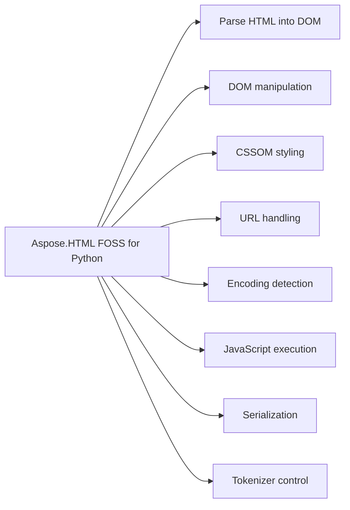

# Aspose.HTML FOSS for Python

 [](LICENSE) [](https://github.com/aspose-html-foss/Aspose.HTML-FOSS-for-Python/graphs/contributors)

[](https://products.aspose.org/html/python/)

Aspose.HTML FOSS for Python reads and writes HTML documents, parses HTML fragments, and loads HTML from strings. It converts HTML into a DOM tree, supports CSSOM styling with computed styles, and serializes elements back to HTML or XML. It tokenizes HTML input into tokens such as start tags, end tags, character data, comments, and doctypes, and provides `URL` parsing and encoding detection utilities.

## Navigation

- [At a Glance](#at-a-glance)
- [Key Capabilities](#key-capabilities)
- [Installation](#installation)
- [Dependencies](#dependencies)
- [Quick Start](#quick-start)
- [Additional Examples](#additional-examples)
- [API Reference](#api-reference)
- [Documentation & Resources](#documentation--resources)
- [Scope and Limitations](#scope-and-limitations)
- [Development and Testing](#development-and-testing)
- [License](#license)

## At a Glance



## Key Capabilities

- **Parse HTML into DOM.** It parses HTML strings, bytes, fragments, and files into a DOM document using `aspose_html.HTMLDocument.parse`, `aspose_html.HTMLDocument.parse_fragment`, and `aspose_html.HTMLDocument.load`; the lower-level `aspose_html.tokenizer.Tokenizer` and `aspose_html.tree.TreeBuilder` classes implement the WHATWG tokenization and tree-construction algorithms directly for callers who need that level of control.
- **DOM manipulation.** It builds, inspects, and mutates DOM trees by creating and updating nodes programmatically with `aspose_html.dom.Document.create_element` and `append_child`, reads and writes element attributes, classes, datasets, inline styles, and text content, and queries documents by ID, tag name, class name, and selector-oriented helpers such as `get_element_by_id`, `get_elements_by_tag_name`, `TreeWalker`, `NodeIterator`, and `Range`.
- **CSSOM styling.** It matches `CSS` selectors and stylesheets against elements and resolves the cascade including specificity, inline-vs-author rules, !important, and inheritance using `Element.get_computed_style`; the CSSOM surface models stylesheets structurally with `CSSStyleSheet`, `CSSStyleRule`, `CSSMediaRule`, and related rule types.
- **URL handling.** It validates and manipulates URLs with `aspose_html.url.URL`, reads and edits query strings with `aspose_html.url.URLSearchParams`, and detects byte-stream character encodings using `aspose_html.encoding.detect_encoding`.
- **Encoding detection.** It detects byte-stream character encodings including BOM and content sniffing with `aspose_html.encoding.detect_encoding`, returning results via `aspose_html.encoding.EncodingDetectionResult` and raising `aspose_html.encoding.UnsupportedEncodingError` for unsupported encodings.
- **JavaScript execution.** It executes JavaScript against a parsed DOM through `aspose_html.js.JSContext`, an optional QuickJS-backed bridge exposing read-only DOM proxies to script code; requires the js extra.
- **Serialization.** It serializes complete documents, fragments, and individual elements back to an HTML string with the `aspose_html.serialise` function or `aspose_html.XMLSerializer`, and provides `aspose_html.serialiser.inner_html` and `aspose_html.serialiser.outer_html` for granular output control.
- **Tokenizer control.** It exposes the tokenizer's token stream through `aspose_html.tokenizer.Tokenizer.tokenize`, producing token types including `aspose_html.tokenizer.StartTagToken`, `aspose_html.tokenizer.EndTagToken`, `aspose_html.tokenizer.CharacterToken`, `aspose_html.tokenizer.CommentToken`, and `aspose_html.tokenizer.DoctypeToken` for callers who need fine-grained parsing control.

## Installation

`aspose-html-foss` is not yet published on PyPI, and no build or install command succeeds; work from the source checkout instead:

```bash
git clone https://github.com/aspose-html-foss/Aspose.HTML-FOSS-for-Python.git
cd Aspose.HTML-FOSS-for-Python
export PYTHONPATH="src:.:$PYTHONPATH"
```

Verify the install:

```bash
python -c "import aspose_html.tokenizer"
```

The package declares `python_requires` as `>=3.10`.

## Dependencies

### Required Package Dependencies

- `skia-python>=87.0,<145`

### Optional Dependencies

- `quickjs>=1.19,<2` (extra `js`)

### Native and System Requirements

- Requires Python 3.10 or later (`python_requires=">=3.10"` in `pyproject.toml`).

### Development Dependencies

- `pytest>=8` (extra `test`)

## Quick Start

The first example parses an HTML string into a DOM, locates an element by its identifier, creates a new paragraph, sets its text content, appends it to the parent, and serializes the updated subtree.

```python
from aspose_html import HTMLDocument, serialise

document = HTMLDocument.parse("<main id='content'><h1>Hello</h1></main>")
content = document.get_element_by_id("content")

paragraph = document.create_element("p")
paragraph.text_content = "Updated through the DOM API."
content.append_child(paragraph)

print(serialise(content))
```

The second example constructs a document with a styled element, attaches an inline `CSS` style sheet, and retrieves the computed style property value for the element.

```python
from aspose_html.dom import Document
from aspose_html.cssom import CSSStyleSheet

document = Document()
element = document.create_element("div")
element.set_attribute("class", "foo")
element.set_attribute("id", "bar")
document.append_child(element)

sheet = CSSStyleSheet()
sheet.replace_sync(".foo { color: red } #bar { color: blue }")
document.attach_style_sheet(sheet)

style = element.get_computed_style()
print(style.get_property_value("color"))  # "blue"
```

## Additional Examples

The following examples demonstrate working with URLs, querying elements, detecting encoding, executing JavaScript, and tokenizing HTML.

### Execute JavaScript Expressions Against a DOM Document

```python
from aspose_html.dom import Document
from aspose_html.js import JSContext

document = Document()
element = document.create_element("div")
document.append_child(element)

with JSContext(document) as ctx:
    result = ctx.evaluate("1 + 1")
    print(result)  # 2
```

<details>
<summary>View Additional Examples</summary>

### Modify `URL` Search Parameters and Print the Updated `URL`

```python
from aspose_html import URL

url = URL("https://example.com/articles?category=html")
url.search_params.set("page", "2")

print(str(url))
```

### Parse HTML and Retrieve Text Content of an Element by Tag Name

```python
from aspose_html import HTMLDocument

document = HTMLDocument.parse("<article><h1>News</h1><p>Hello</p></article>")
heading = document.get_elements_by_tag_name("h1").item(0)

print(heading.text_content)
```

### Detect Character Encoding and Confidence from Raw Byte Input

```python
from aspose_html.encoding.detection import detect_encoding

result = detect_encoding(b"\xef\xbb\xbf<p>x</p>")
print(result.encoding)
print(result.confidence)
print(result.text)
```

### Tokenize an HTML String and Inspect the First Token's Tag Name

```python
from aspose_html.tokenizer import Tokenizer, TokenizerState

tokenizer = Tokenizer("<p>Hello</p>")
tokens = list(tokenizer.tokenize())
print(tokens[0].tag_name)  # "p"
```

Runnable scripts are available in the [`examples`](examples/) directory.

</details>

## API Reference

Aspose.HTML FOSS for Python provides the `aspose_html.HTMLDocument` class as its primary entry point for parsing HTML into a `Document` tree. The `Document` tree is built from `aspose_html.dom.Document`, `aspose_html.dom.Element`, and `aspose_html.dom.Text` nodes, and can be styled through the CSSOM surface, serialized back to markup, and optionally scripted through `aspose_html.js.JSContext`.

The verified public surface has 303 types.

<details>
<summary>View the Complete Public API Surface</summary>

### Core API

| Class | Description |
| --- | --- |
| `aspose_html.DOMParser` | The aspose_html.DOMParser class parses HTML and XML source strings into a DOM document. |
| `HTMLDocument` | Top-level entry point for parsing HTML into a Document tree. |
| `aspose_html.URL` | The aspose_html.URL class represents a URL and provides methods to parse and manipulate its components. |
| `aspose_html.URLParseError` | The aspose_html.URLParseError class represents an error that occurs when parsing a URL fails. |
| `aspose_html.URLSearchParams` | The aspose_html.URLSearchParams class provides methods to work with the query string of a URL. |
| `aspose_html.XMLSerializer` | The aspose_html.XMLSerializer class serializes a DOM node into an XML string. |
| `CSS` | Namespace class for CSS static utilities (CSS Conditional Rules §6). |
| `CSSCounterStyleRule` | The aspose_html.cssom.CSSCounterStyleRule class represents a @counter-style rule in a CSS style sheet. |
| `CSSFontFaceRule` | The aspose_html.cssom.CSSFontFaceRule class represents a @font-face rule in a CSS style sheet. |
| `CSSImportRule` | The aspose_html.cssom.CSSImportRule class represents a @import rule in a CSS style sheet. |
| `CSSKeyframeRule` | The aspose_html.cssom.CSSKeyframeRule class represents a single keyframe rule in a CSS animation. |
| `CSSKeyframesRule` | The aspose_html.cssom.CSSKeyframesRule class represents a @keyframes rule in a CSS style sheet. |
| `CSSLayerBlockRule` | The aspose_html.cssom.CSSLayerBlockRule class represents a @layer block rule in a CSS style sheet. |
| `CSSLayerStatementRule` | The aspose_html.cssom.CSSLayerStatementRule class represents a @layer statement rule in a CSS style sheet. |
| `CSSMediaRule` | The aspose_html.cssom.CSSMediaRule class represents a @media rule in a CSS style sheet. |
| `CSSNamespaceRule` | The aspose_html.cssom.CSSNamespaceRule class represents a @namespace rule in a CSS style sheet. |
| `CSSPageRule` | The aspose_html.cssom.CSSPageRule class represents a @page rule in a CSS style sheet. |
| `CSSPropertyRule` | The aspose_html.cssom.CSSPropertyRule class represents a @property rule in a CSS style sheet. |
| `CSSRule` | The aspose_html.cssom.CSSRule class is the base interface for all CSS rules. |
| `CSSRuleList` | The aspose_html.cssom.CSSRuleList class represents an ordered collection of CSSRule objects. |
| `CSSStyleRule` | The aspose_html.cssom.CSSStyleRule class represents a CSS style rule consisting of a selector and a declaration block. |
| `CSSStyleSheet` | The aspose_html.cssom.CSSStyleSheet class represents a CSS style sheet. |
| `CSSSupportsRule` | The aspose_html.cssom.CSSSupportsRule class represents a @supports rule in a CSS style sheet. |
| `AbortController` | The aspose_html.dom.AbortController class allows aborting one or more asynchronous operations. |
| `AbortSignal` | The aspose_html.dom.AbortSignal class represents the state of an abort operation. |
| `AbstractRange` | The aspose_html.dom.AbstractRange class is the base interface for DOM ranges. |
| `Attr` | The aspose_html.dom.Attr class represents an attribute on an HTML element. |
| `BarProp` | The aspose_html.dom.BarProp class represents the visibility state of a browser interface element. |
| `BroadcastChannel` | The aspose_html.dom.BroadcastChannel class enables communication between different browsing contexts. |
| `CDATASection` | The aspose_html.dom.CDATASection class represents a CDATA section in an XML document. |
| `CSSStyleDeclaration` | The aspose_html.dom.CSSStyleDeclaration class represents a collection of CSS style properties. |
| `CharacterData` | The aspose_html.dom.CharacterData class is the base interface for nodes that contain character data. |
| `Comment` | The aspose_html.dom.Comment class represents a comment in an HTML or XML document. |
| `ComputedStyleDeclaration` | The aspose_html.dom.ComputedStyleDeclaration class represents the computed CSS styles for an element. |
| `Console` | The aspose_html.dom.Console class provides methods for logging messages to the console. |
| `Crypto` | The aspose_html.dom.Crypto class provides cryptographic functionality. |
| `CustomElementRegistry` | The aspose_html.dom.CustomElementRegistry class lets you register custom elements. |
| `CustomEvent` | The aspose_html.dom.CustomEvent class represents a custom event. |
| `DOMConfiguration` | The aspose_html.dom.DOMConfiguration class represents a configuration for DOM operations. |
| `DOMException` | The aspose_html.dom.DOMException class represents an error that occurs during DOM operations. |
| `DOMImplementation` | The aspose_html.dom.DOMImplementation class provides methods for creating DOM objects. |
| `dom.DOMParser` | The aspose_html.dom.DOMParser class parses HTML and XML source strings into a DOM document. |
| `DOMRect` | The DOMRect class represents a rectangle defined by its top-left corner coordinates, width, and height. |
| `DOMRectList` | The DOMRectList class represents a list of DOMRect objects. |
| `DOMStringMap` | The DOMStringMap class provides a dictionary of name-value string pairs for custom data attributes. |
| `DOMTokenList` | The DOMTokenList class represents a set of space-separated tokens, typically used for HTML class attributes. |
| `DataCloneError` | The DataCloneError class represents an error thrown when an object cannot be cloned. |
| `Document` | The Document class represents the entire HTML or XML document and serves as the entry point to the document's content. |
| `DocumentFragment` | The DocumentFragment class represents a minimal document object that has no parent and is used to group nodes. |
| `DocumentPosition` | The DocumentPosition class represents the position of a node relative to another node in the document tree. |
| `DocumentType` | The DocumentType class represents a document type declaration in an HTML or XML document. |
| `Element` | The Element class represents a single node in the document tree that has an associated tag name and attributes. |
| `ErrorEvent` | The ErrorEvent class represents an error that occurred during the execution of a script or loading of a resource. |
| `Event` | The Event class represents an event that occurs in the document, such as a user action or a system-generated occurrence. |
| `EventTarget` | The EventTarget class is a base class that provides methods for registering and removing event listeners. |
| `FocusEvent` | The FocusEvent class represents events that occur when an element gains or loses focus. |
| `FormData` | The FormData class provides a way to construct a set of key-value pairs representing form fields and their values. |
| `dom.HTMLAddressElement` | The HTMLAddressElement class represents an HTML element that provides contact information for a document or article. |
| `dom.HTMLAnchorElement` | The HTMLAnchorElement class represents an HTML element that creates hyperlinks to other resources. |
| `dom.HTMLAreaElement` | The HTMLAreaElement class represents an HTML element that defines a hot-spot region on an image map. |
| `dom.HTMLArticleElement` | The HTMLArticleElement class represents an HTML element that specifies independent, self-contained content. |
| `dom.HTMLAsideElement` | The HTMLAsideElement class represents an HTML element that defines content aside from the main content, such as a sidebar. |
| `dom.HTMLAudioElement` | The HTMLAudioElement class represents an HTML element used to embed sound content in a document. |
| `dom.HTMLBRElement` | The HTMLBRElement class represents an HTML element that produces a line break in text. |
| `dom.HTMLBaseElement` | The HTMLBaseElement class represents an HTML element that specifies the base URL for all relative URLs in a document. |
| `dom.HTMLBodyElement` | The HTMLBodyElement class represents an HTML element that contains the content of a document. |
| `dom.HTMLButtonElement` | The HTMLButtonElement class represents an HTML element that can be clicked to submit a form or run a script. |
| `dom.HTMLCanvasElement` | The HTMLCanvasElement class represents an HTML element used to draw graphics via scripting, typically JavaScript. |
| `HTMLCollection` | The HTMLCollection class represents a collection of HTML elements, typically returned by methods such as getElementsByTagName. |
| `dom.HTMLDListElement` | The HTMLDListElement class represents an HTML element that defines a description list. |
| `dom.HTMLDataElement` | The HTMLDataElement class represents an HTML element that links a given content with a machine-readable translation. |
| `dom.HTMLDataListElement` | The HTMLDataListElement class represents an HTML element that contains a set of predefined options for an input element. |
| `dom.HTMLDetailsElement` | The HTMLDetailsElement class represents an HTML element that displays additional information or controls that the user can show or hide. |
| `dom.HTMLDialogElement` | The HTMLDialogElement class represents an HTML element that represents a dialog box or other interactive component. |
| `dom.HTMLDivElement` | The HTMLDivElement class represents an HTML element that is used to group block-level elements for styling or scripting. |
| `HTMLElement` | The HTMLElement class represents the base class for all HTML elements, providing common properties and methods. |
| `dom.HTMLEmbedElement` | The HTMLEmbedElement class represents an HTML element used to embed external content, such as plug-in content. |
| `dom.HTMLFieldSetElement` | The HTMLFieldSetElement class represents an HTML element that groups related form elements within a form. |
| `dom.HTMLFigCaptionElement` | The HTMLFigCaptionElement class represents an HTML element that provides a caption for a figure element. |
| `dom.HTMLFigureElement` | The HTMLFigureElement class represents an HTML element that self-contains content, such as an illustration or code snippet. |
| `dom.HTMLFooterElement` | The HTMLFooterElement class represents an HTML element that defines a footer for a document or section. |
| `dom.HTMLFormElement` | The HTMLFormElement class represents an HTML element that contains controls for submitting information to a web server. |
| `dom.HTMLHRElement` | The HTMLHRElement represents an HTML hr element, which defines a thematic break or horizontal rule in a document. |
| `dom.HTMLHeadElement` | The HTMLHeadElement represents an HTML head element, which contains machine-readable document metadata such as title and links to stylesheets. |
| `dom.HTMLHeaderElement` | The HTMLHeaderElement represents an HTML header element, which typically contains introductory or navigational content for a page or section. |
| `dom.HTMLHeadingElement` | The HTMLHeadingElement represents an HTML heading element, such as h1 through h6, used to define section headings in a document. |
| `dom.HTMLHtmlElement` | The HTMLHtmlElement represents an HTML HTML element, which is the root element of an HTML document. |
| `dom.HTMLIFrameElement` | The HTMLIFrameElement represents an HTML iframe element, which embeds another HTML document within the current document. |
| `dom.HTMLImageElement` | The HTMLImageElement represents an HTML img element, which embeds an image into the document. |
| `dom.HTMLInputElement` | The HTMLInputElement represents an HTML input element, which creates interactive controls for web-based forms. |
| `dom.HTMLLIElement` | The HTMLLIElement represents an HTML li element, which defines a list item in an ordered or unordered list. |
| `dom.HTMLLabelElement` | The HTMLLabelElement represents an HTML label element, which defines a caption for a form control. |
| `dom.HTMLLegendElement` | The HTMLLegendElement represents an HTML legend element, which provides a caption for a fieldset element. |
| `dom.HTMLLinkElement` | The HTMLLinkElement represents an HTML link element, which specifies relationships between the current document and an external resource. |
| `dom.HTMLMainElement` | The HTMLMainElement represents an HTML main element, which specifies the main content of a document. |
| `dom.HTMLMapElement` | The HTMLMapElement represents an HTML map element, which defines a client-side image map with clickable areas. |
| `dom.HTMLMarkElement` | The HTMLMarkElement represents an HTML mark element, which highlights text for reference or notation purposes. |
| `dom.HTMLMediaElement` | The HTMLMediaElement represents an HTML media element, such as audio or video, used to embed multimedia content. |
| `dom.HTMLMenuElement` | The HTMLMenuElement represents an HTML menu element, which defines a list of commands or menu items. |
| `dom.HTMLMetaElement` | The HTMLMetaElement represents an HTML meta element, which provides metadata about the HTML document. |
| `dom.HTMLMeterElement` | The HTMLMeterElement represents an HTML meter element, which displays a scalar measurement within a known range. |
| `dom.HTMLModElement` | The HTMLModElement represents an HTML mod element, such as ins or del, used to indicate added or deleted text. |
| `dom.HTMLNavElement` | The HTMLNavElement represents an HTML nav element, which defines a section of navigation links. |
| `dom.HTMLNoScriptElement` | The HTMLNoScriptElement represents an HTML noscript element, which provides alternative content for users who have disabled scripts. |
| `dom.HTMLOListElement` | The HTMLOListElement represents an HTML ol element, which defines an ordered list of items. |
| `dom.HTMLObjectElement` | The HTMLObjectElement represents an HTML object element, which embeds an external resource such as an image, nested browsing context, or plugin. |
| `dom.HTMLOptGroupElement` | The HTMLOptGroupElement represents an HTML optgroup element, which groups related options within a select element. |
| `dom.HTMLOptionElement` | The HTMLOptionElement represents an HTML option element, which defines an item in a select element. |
| `HTMLOptionsCollection` | The HTMLOptionsCollection represents a collection of option elements, typically used to manage items in a select element. |
| `dom.HTMLOutputElement` | The HTMLOutputElement represents an HTML output element, which represents the result of a calculation or user action. |
| `dom.HTMLParagraphElement` | The HTMLParagraphElement represents an HTML p element, which defines a paragraph of text. |
| `dom.HTMLParamElement` | The HTMLParamElement represents an HTML param element, which defines parameters for an object element. |
| `dom.HTMLPictureElement` | The HTMLPictureElement represents an HTML picture element, which provides multiple image sources for responsive images. |
| `dom.HTMLPreElement` | The HTMLPreElement represents an HTML pre element, which displays text in a fixed-width font while preserving whitespace. |
| `dom.HTMLProgressElement` | The HTMLProgressElement represents an HTML progress element, which displays the completion progress of a task. |
| `dom.HTMLQuoteElement` | The HTMLQuoteElement represents an HTML quote element, such as q or blockquote, used to denote quoted text. |
| `dom.HTMLRubyElement` | The HTMLRubyElement represents an HTML ruby element, which defines ruby annotations for East Asian typography. |
| `dom.HTMLScriptElement` | The HTMLScriptElement represents an HTML script element, which is used to embed or reference executable code. |
| `dom.HTMLSectionElement` | The HTMLSectionElement represents an HTML section element, which defines a thematic grouping of content. |
| `dom.HTMLSelectElement` | The HTMLSelectElement represents an HTML select element, which creates a drop-down list for user selection. |
| `dom.HTMLSmallElement` | The HTMLSmallElement represents an HTML small element, which represents side comments or small print. |
| `dom.HTMLSourceElement` | The HTMLSourceElement represents an HTML source element, which specifies multiple media resources for media elements like audio or video. |
| `dom.HTMLSpanElement` | The aspose_html.dom.HTMLSpanElement class represents an HTML span element. |
| `dom.HTMLStyleElement` | The aspose_html.dom.HTMLStyleElement class represents an HTML style element. |
| `dom.HTMLSummaryElement` | The aspose_html.dom.HTMLSummaryElement class represents an HTML summary element. |
| `dom.HTMLTableCaptionElement` | The aspose_html.dom.HTMLTableCaptionElement class represents an HTML table caption element. |
| `dom.HTMLTableCellElement` | The aspose_html.dom.HTMLTableCellElement class represents an HTML table cell element. |
| `dom.HTMLTableColElement` | The aspose_html.dom.HTMLTableColElement class represents an HTML table column element. |
| `dom.HTMLTableElement` | The aspose_html.dom.HTMLTableElement class represents an HTML table element. |
| `dom.HTMLTableRowElement` | The aspose_html.dom.HTMLTableRowElement class represents an HTML table row element. |
| `dom.HTMLTableSectionElement` | The aspose_html.dom.HTMLTableSectionElement class represents an HTML table section element. |
| `dom.HTMLTemplateElement` | The aspose_html.dom.HTMLTemplateElement class represents an HTML template element. |
| `dom.HTMLTextAreaElement` | The aspose_html.dom.HTMLTextAreaElement class represents an HTML text area element. |
| `dom.HTMLTimeElement` | The aspose_html.dom.HTMLTimeElement class represents an HTML time element. |
| `dom.HTMLTitleElement` | The aspose_html.dom.HTMLTitleElement class represents an HTML title element. |
| `dom.HTMLTrackElement` | The aspose_html.dom.HTMLTrackElement class represents an HTML track element. |
| `dom.HTMLUListElement` | The aspose_html.dom.HTMLUListElement class represents an HTML unordered list element. |
| `dom.HTMLUnknownElement` | The aspose_html.dom.HTMLUnknownElement class represents an HTML unknown element. |
| `dom.HTMLVideoElement` | The aspose_html.dom.HTMLVideoElement class represents an HTML video element. |
| `dom.HTMLWBRElement` | The aspose_html.dom.HTMLWBRElement class represents an HTML word break element. |
| `HashChangeEvent` | The aspose_html.dom.HashChangeEvent class represents a hash change event. |
| `HierarchyRequestError` | The aspose_html.dom.HierarchyRequestError class represents a hierarchy request error. |
| `History` | The aspose_html.dom.History class represents the session history of the browser. |
| `InUseAttributeError` | The aspose_html.dom.InUseAttributeError class represents an in use attribute error. |
| `IndexSizeError` | The aspose_html.dom.IndexSizeError class represents an index size error. |
| `InputEvent` | The aspose_html.dom.InputEvent class represents an input event. |
| `IntersectionObserver` | The aspose_html.dom.IntersectionObserver class represents an intersection observer. |
| `IntersectionObserverEntry` | The aspose_html.dom.IntersectionObserverEntry class represents an intersection observer entry. |
| `InvalidCharacterError` | The aspose_html.dom.InvalidCharacterError class represents an invalid character error. |
| `InvalidStateError` | The aspose_html.dom.InvalidStateError class represents an invalid state error. |
| `KeyboardEvent` | The aspose_html.dom.KeyboardEvent class represents a keyboard event. |
| `Location` | The aspose_html.dom.Location class represents the location of a document. |
| `MediaQueryList` | The aspose_html.dom.MediaQueryList class represents a media query list. |
| `MessageChannel` | The aspose_html.dom.MessageChannel class represents a message channel. |
| `MessagePort` | The aspose_html.dom.MessagePort class represents a message port. |
| `MouseEvent` | The aspose_html.dom.MouseEvent class represents a mouse event. |
| `MutationObserver` | The aspose_html.dom.MutationObserver class represents a mutation observer. |
| `MutationRecord` | The aspose_html.dom.MutationRecord class represents a mutation record. |
| `NamedNodeMap` | The aspose_html.dom.NamedNodeMap class represents a named node map. |
| `Navigator` | The aspose_html.dom.Navigator class represents the navigator object. |
| `NoModificationAllowedError` | The aspose_html.dom.NoModificationAllowedError class represents a no modification allowed error. |
| `Node` | The aspose_html.dom.Node class represents a node in the DOM tree. |
| `NodeFilter` | NodeFilter defines a filter for accepting or rejecting nodes during tree traversal. |
| `NodeIterator` | NodeIterator provides a way to iterate over a list of nodes in document order. |
| `NodeList` | NodeList represents an ordered collection of nodes, typically returned by DOM queries. |
| `NodeType` | NodeType enumerates the different kinds of nodes that can appear in a document tree. |
| `NotFoundError` | NotFoundError is raised when an operation cannot be completed because a referenced node is not found. |
| `NotSupportedError` | NotSupportedError is raised when a requested operation or feature is not supported. |
| `ParseError` | ParseError is raised when an error occurs during the parsing of a document. |
| `Performance` | Performance provides access to performance-related information for the current document. |
| `PerformanceEntry` | PerformanceEntry is the base class for performance entries that record timing and memory data. |
| `PerformanceTiming` | PerformanceTiming provides high-resolution timing information about the navigation and resource loading of the document. |
| `PopStateEvent` | PopStateEvent is fired when the active history entry changes due to navigation actions. |
| `ProcessingInstruction` | ProcessingInstruction represents a processing instruction in the document. |
| `Range` | Range represents a fragment of a document that can contain nodes and parts of text nodes. |
| `ResizeObserver` | ResizeObserver observes changes to the dimensions of an element or the viewport. |
| `ResizeObserverEntry` | ResizeObserverEntry reports the size of an observed element after a resize. |
| `Screen` | Screen provides information about the user's screen. |
| `SecurityError` | SecurityError is raised when a security restriction prevents an operation from completing. |
| `Selection` | Selection represents the range of text selected by the user or the current caret position. |
| `StaticRange` | StaticRange represents a static range of nodes in the document. |
| `Storage` | Storage provides access to a set of key-value pairs for persistent data storage. |
| `StyleSheetList` | StyleSheetList is a collection of style sheets associated with a document. |
| `SubtleCrypto` | SubtleCrypto provides cryptographic operations such as encryption, decryption, signing, and verification. |
| `SyntaxError` | SyntaxError is raised when a syntax error occurs during parsing or evaluation. |
| `Text` | Text represents the textual content of an element or attribute in the document. |
| `TreeWalker` | TreeWalker provides a way to traverse a tree of nodes using a filter. |
| `UIEvent` | UIEvent represents events that pertain to user interface interactions. |
| `ValidityState` | ValidityState provides information about the validity of a form control's value. |
| `VisualViewport` | VisualViewport represents the visual viewport of a browser window. |
| `Window` | Window represents a browser window and provides access to the document and other browser features. |
| `WrongDocumentError` | WrongDocumentError is raised when a node is used in a document other than the one it belongs to. |
| `dom.XMLSerializer` | XMLSerializer converts a DOM tree into an XML string. |
| `html.HTMLAddressElement` | HTMLAddressElement represents an HTML address element and provides access to its properties and methods. |
| `html.HTMLAnchorElement` | HTMLAnchorElement represents an HTML anchor element and provides access to its properties and methods. |
| `html.HTMLAreaElement` | HTMLAreaElement represents an HTML area element and provides access to its properties and methods. |
| `html.HTMLArticleElement` | HTMLArticleElement represents an HTML article element and provides access to its properties and methods. |
| `html.HTMLAsideElement` | HTMLAsideElement represents an HTML aside element and provides access to its properties and methods. |
| `html.HTMLAudioElement` | HTMLAudioElement represents an HTML audio element and provides access to its properties and methods. |
| `html.HTMLBRElement` | HTMLBRElement represents an HTML br element and provides access to its properties and methods. |
| `html.HTMLBaseElement` | HTMLBaseElement represents an HTML base element and provides access to its properties and methods. |
| `html.HTMLBodyElement` | HTMLBodyElement represents an HTML body element and provides access to its properties and methods. |
| `html.HTMLButtonElement` | The HTMLButtonElement class represents an HTML button element in the document object model. |
| `html.HTMLCanvasElement` | The HTMLCanvasElement class represents an HTML canvas element used for rendering graphics via scripting. |
| `html.HTMLDListElement` | The HTMLDListElement class represents an HTML description list element containing description terms and descriptions. |
| `html.HTMLDataElement` | The HTMLDataElement class represents an HTML data element that provides a machine-readable translation of a given content. |
| `html.HTMLDataListElement` | The HTMLDataListElement class represents an HTML datalist element that contains a set of option elements representing predefined choices for an input element. |
| `html.HTMLDetailsElement` | The HTMLDetailsElement class represents an HTML details element that contains additional visible information that the user can toggle open or closed. |
| `html.HTMLDialogElement` | The HTMLDialogElement class represents an HTML dialog element that represents a dialog box or other interactive component. |
| `html.HTMLDivElement` | The HTMLDivElement class represents an HTML division element used to group other elements and apply styling or layout. |
| `html.HTMLEmbedElement` | The HTMLEmbedElement class represents an HTML embed element used to embed external content such as plug-in applications. |
| `html.HTMLFieldSetElement` | The HTMLFieldSetElement class represents an HTML fieldset element that groups related form controls within a form. |
| `html.HTMLFigCaptionElement` | The HTMLFigCaptionElement class represents an HTML figure caption element that provides a caption for a figure element. |
| `html.HTMLFigureElement` | The HTMLFigureElement class represents an HTML figure element that contains self-contained content such as illustrations or code snippets. |
| `html.HTMLFooterElement` | The HTMLFooterElement class represents an HTML footer element that typically contains information about its section such as author, copyright, or links. |
| `html.HTMLFormElement` | The HTMLFormElement class represents an HTML form element used to collect user input and submit it to a server. |
| `html.HTMLHRElement` | The HTMLHRElement class represents an HTML horizontal rule element used to create a thematic break between paragraph-level elements. |
| `html.HTMLHeadElement` | The HTMLHeadElement class represents an HTML head element that contains machine-readable information about the document such as title and metadata. |
| `html.HTMLHeaderElement` | The HTMLHeaderElement class represents an HTML header element that typically contains introductory content or navigational aids for its section. |
| `html.HTMLHeadingElement` | The HTMLHeadingElement class represents an HTML heading element such as h1 through h6 used to define section headings. |
| `html.HTMLHtmlElement` | The HTMLHtmlElement class represents the root HTML element of a document. |
| `html.HTMLIFrameElement` | The HTMLIFrameElement class represents an HTML inline frame element used to embed another document within the current document. |
| `html.HTMLImageElement` | The HTMLImageElement class represents an HTML image element used to embed an image in the document. |
| `html.HTMLInputElement` | The HTMLInputElement class represents an HTML input element used to create interactive controls for web-based forms. |
| `html.HTMLLIElement` | The HTMLLIElement class represents an HTML list item element used within ordered or unordered lists. |
| `html.HTMLLabelElement` | The HTMLLabelElement class represents an HTML label element that defines a caption for an input element in a form. |
| `html.HTMLLegendElement` | The HTMLLegendElement class represents an HTML legend element that provides a caption for a fieldset element. |
| `html.HTMLLinkElement` | The HTMLLinkElement class represents an HTML link element used to link external resources such as style sheets to the document. |
| `html.HTMLMainElement` | The HTMLMainElement class represents an HTML main element that contains the dominant content of the document. |
| `html.HTMLMapElement` | The HTMLMapElement class represents an HTML map element used with area elements to define an image map. |
| `html.HTMLMarkElement` | The HTMLMarkElement class represents an HTML mark element used to highlight text for reference or notation purposes. |
| `html.HTMLMediaElement` | The HTMLMediaElement class represents an HTML media element used to embed audio or video content. |
| `html.HTMLMenuElement` | The HTMLMenuElement class represents an HTML menu element used to define a list of commands or menu items. |
| `html.HTMLMetaElement` | The HTMLMetaElement class represents an HTML meta element that provides metadata about the document such as character encoding or viewport settings. |
| `html.HTMLMeterElement` | The HTMLMeterElement class represents an HTML meter element used to display a scalar measurement within a known range. |
| `html.HTMLModElement` | The HTMLModElement class represents an HTML modification element such as ins or del used to indicate added or deleted text. |
| `html.HTMLNavElement` | The HTMLNavElement class represents an HTML navigation element that contains navigation links to other pages or parts of the current page. |
| `html.HTMLNoScriptElement` | The HTMLNoScriptElement class represents an HTML noscript element that provides alternative content for users who have disabled scripts in their browser. |
| `html.HTMLOListElement` | The HTMLOListElement class represents an HTML ordered list element that contains a list of items marked with numbers or letters. |
| `html.HTMLObjectElement` | The HTMLObjectElement class represents an HTML object element used to embed external resources such as images, nested browsing contexts, or plug-in applications. |
| `html.HTMLOptGroupElement` | The HTMLOptGroupElement class represents an HTML option group element that groups related options within a select element. |
| `html.HTMLOptionElement` | The HTMLOptionElement class represents an HTML option element that defines an item within a select element or datalist element. |
| `html.HTMLOutputElement` | The HTMLOutputElement represents an HTML output element in the document object model. |
| `html.HTMLParagraphElement` | The HTMLParagraphElement represents an HTML paragraph element in the document object model. |
| `html.HTMLParamElement` | The HTMLParamElement represents an HTML param element in the document object model. |
| `html.HTMLPictureElement` | The HTMLPictureElement represents an HTML picture element in the document object model. |
| `html.HTMLPreElement` | The HTMLPreElement represents an HTML pre element in the document object model. |
| `html.HTMLProgressElement` | The HTMLProgressElement represents an HTML progress element in the document object model. |
| `html.HTMLQuoteElement` | The HTMLQuoteElement represents an HTML quote element in the document object model. |
| `html.HTMLRubyElement` | The HTMLRubyElement represents an HTML ruby element in the document object model. |
| `html.HTMLScriptElement` | The HTMLScriptElement represents an HTML script element in the document object model. |
| `html.HTMLSectionElement` | The HTMLSectionElement represents an HTML section element in the document object model. |
| `html.HTMLSelectElement` | The HTMLSelectElement represents an HTML select element in the document object model. |
| `html.HTMLSmallElement` | The HTMLSmallElement represents an HTML small element in the document object model. |
| `html.HTMLSourceElement` | The HTMLSourceElement represents an HTML source element in the document object model. |
| `html.HTMLSpanElement` | The HTMLSpanElement represents an HTML span element in the document object model. |
| `html.HTMLStyleElement` | The HTMLStyleElement represents an HTML style element in the document object model. |
| `html.HTMLSummaryElement` | The HTMLSummaryElement represents an HTML summary element in the document object model. |
| `html.HTMLTableCaptionElement` | The HTMLTableCaptionElement represents an HTML table caption element in the document object model. |
| `html.HTMLTableCellElement` | The HTMLTableCellElement represents an HTML table cell element in the document object model. |
| `html.HTMLTableColElement` | The HTMLTableColElement represents an HTML table column element in the document object model. |
| `html.HTMLTableElement` | The HTMLTableElement represents an HTML table element in the document object model. |
| `html.HTMLTableRowElement` | The HTMLTableRowElement represents an HTML table row element in the document object model. |
| `html.HTMLTableSectionElement` | The HTMLTableSectionElement represents an HTML table section element in the document object model. |
| `html.HTMLTemplateElement` | The HTMLTemplateElement represents an HTML template element in the document object model. |
| `html.HTMLTextAreaElement` | The HTMLTextAreaElement represents an HTML text area element in the document object model. |
| `html.HTMLTimeElement` | The HTMLTimeElement represents an HTML time element in the document object model. |
| `html.HTMLTitleElement` | The HTMLTitleElement represents an HTML title element in the document object model. |
| `html.HTMLTrackElement` | The HTMLTrackElement represents an HTML track element in the document object model. |
| `html.HTMLUListElement` | The HTMLUListElement represents an HTML unordered list element in the document object model. |
| `html.HTMLUnknownElement` | The HTMLUnknownElement represents an HTML unknown element in the document object model. |
| `html.HTMLVideoElement` | The HTMLVideoElement represents an HTML video element in the document object model. |
| `html.HTMLWBRElement` | The HTMLWBRElement represents an HTML word break element in the document object model. |
| `EncodingDetectionResult` | Result of encoding detection and decoding for an HTML byte stream. |
| `UnsupportedEncodingError` | The UnsupportedEncodingError is raised when an encoding is not supported. |
| `JSContext` | The JSContext provides a JavaScript execution environment. |
| `JSEvaluationError` | The JSEvaluationError is raised when a JavaScript evaluation fails. |
| `ModuleNotFoundError` | The ModuleNotFoundError is raised when a JavaScript module is not found. |
| `ModuleRegistry` | The ModuleRegistry manages JavaScript modules. |
| `BlockFragment` | The BlockFragment represents a block-level fragment in the layout engine. |
| `BoxNode` | The BoxNode represents a box node in the layout engine. |
| `BoxRoot` | The BoxRoot represents the root box node in the layout engine. |
| `ComputedStyle` | The ComputedStyle represents the computed style properties for a layout box. |
| `Display` | The aspose_html.layout.Display class represents a display type value used in CSS layout calculations. |
| `EdgeSizes` | The aspose_html.layout.EdgeSizes class represents the four edges of a box: top, right, bottom, and left. |
| `FragmentRoot` | The aspose_html.layout.FragmentRoot class serves as the root node in a layout fragment tree. |
| `InlineTextFragment` | The aspose_html.layout.InlineTextFragment class represents a fragment of inline text in the layout process. |
| `LineFragment` | The aspose_html.layout.LineFragment class represents a single line of text in the layout output. |
| `PageFragment` | The aspose_html.layout.PageFragment class represents a page box in the layout structure. |
| `PageMarginBoxes` | The aspose_html.layout.PageMarginBoxes class holds margin box content associated with a page fragment. |
| `ShapedRun` | The aspose_html.layout.ShapedRun class represents a sequence of characters with the same shaping and layout properties. |
| `CharacterToken` | The aspose_html.tokenizer.CharacterToken class represents a character token produced by the HTML tokenizer. |
| `CommentToken` | The aspose_html.tokenizer.CommentToken class represents an HTML comment token produced by the tokenizer. |
| `DoctypeToken` | The aspose_html.tokenizer.DoctypeToken class represents a document type declaration token produced by the tokenizer. |
| `EndTagToken` | The aspose_html.tokenizer.EndTagToken class represents an end tag token produced by the HTML tokenizer. |
| `EofToken` | The aspose_html.tokenizer.EofToken class represents the end-of-file token produced by the tokenizer. |
| `StartTagToken` | The aspose_html.tokenizer.StartTagToken class represents a start tag token produced by the HTML tokenizer. |
| `Tokenizer` | The aspose_html.tokenizer.Tokenizer class performs lexical analysis of HTML input and produces tokens. |
| `TreeBuilder` | The aspose_html.tree.TreeBuilder class constructs the DOM tree from tokens produced by the tokenizer. |
| `url.URL` | The aspose_html.url.URL class represents a uniform resource locator and provides methods to parse and manipulate its components. |
| `url.URLParseError` | The aspose_html.url.URLParseError class represents an error that occurs during URL parsing. |
| `url.URLSearchParams` | The aspose_html.url.URLSearchParams class provides methods to work with the query string of a URL. |

#### Enumerations

| Enumeration | Description |
| --- | --- |
| `TokenizerState` | The aspose_html.tokenizer.TokenizerState class defines the current state of the HTML tokenizer. |

#### Detailed Member Reference

### HTMLDocument

The `aspose_html.HTMLDocument` class provides the parse, `parse_fragment`, and load methods to construct a `Document` tree from HTML source, a fragment, or a file path respectively.

- `load`: Load an HTML document from a file path and return a Document tree.
- `parse`: Parse HTML and return a Document tree.
- `parse_fragment`: Parse an HTML fragment and return a DocumentFragment.

### Document

The `aspose_html.dom.Document` class serves as the root of a DOM tree and provides methods such as `create_element`, `append_child`, `get_element_by_id`, and `get_elements_by_tag_name` to build and query the tree.

### CSSStyleSheet

The `aspose_html.cssom.CSSStyleSheet` class represents a `CSS` stylesheet and contains `aspose_html.cssom.CSSStyleRule` objects, while `aspose_html.dom.ComputedStyleDeclaration` provides read-only resolved styles for elements.

### url.URL

The `aspose_html.url.URL` class parses and represents URLs with properties such as href, protocol, host, pathname, and search, and exposes a `aspose_html.url.URLSearchParams` object via `search_params` for query-string manipulation.

### detect_encoding

The `aspose_html.encoding.detect_encoding` function performs WHATWG-compliant encoding detection on byte sequences using BOM, meta-charset, and UTF-8 default rules, returning an `aspose_html.encoding.EncodingDetectionResult` object.

### JSContext

The `aspose_html.js.JSContext` class provides a QuickJS-backed execution context pre-wired to a `Document`, supporting JavaScript evaluation; it requires the js extra and depends on quickjs>=1.19,<2.

### serialise

The `aspose_html.serialise` function and `aspose_html.XMLSerializer` class serialize a `Document` or subtree back to HTML or XML markup.

### Tokenizer

The `aspose_html.tokenizer.Tokenizer` class exposes the lower-level HTML parsing pipeline, producing tokens such as `aspose_html.tokenizer.StartTagToken` during tokenization.

- `HTMLDocument` — `parse(html, *, encoding=None, base_url=None)`, `parse_fragment(html, context_element=None, *, encoding=None)`, `load(path)`.
- `parse_html(html, *, base_url=None) -> Document` / `TreeBuilder.run()` / `Tokenizer(text).tokenize()` — the lower-level parsing pipeline `HTMLDocument.parse()` is built on.

- `Document` — the root of a DOM tree; `create_element(tag_name)`, `create_text_node(data)`, `append_child(node)`, `get_element_by_id(id)`, `get_elements_by_tag_name(name)`, `attach_style_sheet(sheet)`.

- `Element` — `get_attribute`/`set_attribute`/`remove_attribute`, `class_list` (`DOMTokenList`), `dataset` (`DOMStringMap`), `text_content`, `get_computed_style()`, `style` (`CSSStyleDeclaration`).

- `css.parse` — parse selector and declaration text; selector AST classes (`ClassSelector`, `TypeSelector`, `AttributeSelector`, `PseudoClassSelector`, `ComplexSelector`, `CompoundSelector`, and others) model the parsed grammar.
- `CSSStyleSheet`, `CSSStyleRule`, `CSSMediaRule`, `CSSFontFaceRule`, `CSSKeyframesRule`, and the other `CSSRule` subclasses — structural CSSOM stylesheet/rule objects.
- `CSSStyleDeclaration`, `ComputedStyleDeclaration` — live inline styles and read-only resolved (cascade-computed) styles.

</details>

## Documentation & Resources

- **[Getting started guide](https://docs.aspose.org/html/python/)** — The Getting started guide covers installation, walkthroughs, and feature guides for this library.
- **[How-to guides & FAQ](https://kb.aspose.org/html/python/)** — The How-to guides & FAQ provide task-focused answers for common HTML, DOM, and `CSS`-processing questions.
- **[Full API reference](https://reference.aspose.org/html/python/)** — The Full API reference offers the complete, browsable reference for all 243 public types. It covers all 303 verified public types; the [API Reference](#api-reference) section above covers the essentials.
- **[Public API surface](PUBLIC_API.md)** — The Public API surface documents the stable top-level entry points covered by this library's compatibility guarantees.
- **[examples](examples/)** — The examples directory contains real, scenario-focused scripts beyond the Quick Start.
- **[Contributing guide](CONTRIBUTING.md)** — The Contributing guide describes development setup, test commands, and contribution guidelines.
- **[Security policy](SECURITY.md)** — The Security policy explains how to report a vulnerability.
- **[Changelog](CHANGELOG.md)** — The Changelog lists notable changes to this package by version.
- Found a bug or have a feature request? [Open an issue](https://github.com/aspose-html-foss/Aspose.HTML-FOSS-for-Python/issues).

## Scope and Limitations

Aspose.HTML FOSS for Python reads and writes HTML documents, supports `CSS` selector matching, CSSOM parsing, DOM manipulation, and layout structure building, and provides `JavaScript` execution via an optional QuickJS dependency.

- `CSS` selector matching supports the core `CSS` Selectors Level 3 grammar, but several dynamic and legacy pseudo-classes are out of scope and raise `NotImplementedError` in the matcher and parser, and single-colon legacy pseudo-element forms are not parsed.
- `CSSRule.type` and `CSSRule.css_text` are not implemented; concrete rule subclasses such as `CSSStyleRule` and `CSSMediaRule` expose their own real properties instead.
- Form constraint validation (validity-state computation) and `HTMLImageElement.decode()` are present on the API surface but not yet implemented.
- The library builds internal layout structures (`BoxNode`, `FragmentRoot`, and related classes, using skia-python for text-run metrics) but does not yet expose a public API for rendering documents to an image or PDF.
- `JavaScript` execution (`JSContext`) requires the optional quickjs extra and exposes a read-only DOM proxy to script code; its dynamic `import()` bridge is not implemented, though static module registration via `ModuleRegistry` works.
- The library does not implement rendering to image or PDF formats.

These limitations don't apply to [full-featured Aspose.HTML for Python — Enterprise Edition](https://products.aspose.com/html/python-net/). It adds full `CSS` selector and pseudo-class coverage, constraint validation, image and PDF rendering, and unrestricted JavaScript execution.

## Development and Testing

Aspose.HTML FOSS for Python requires Python 3.10 or later and uses skia-python for text-layout metrics as its only runtime dependency. The test suite resides in tests/ and uses pytest to run assertions against the local source checkout; JavaScript-bridge tests and doctests in src/`aspose_html`/js/ require quickjs to run, otherwise they are skipped automatically. To build and test, clone the repository, install the required dependencies, and run pytest directly from the checkout root.

The suite covers 178 test files under `tests/`.

```bash
git clone https://github.com/aspose-html-foss/Aspose.HTML-FOSS-for-Python.git
cd Aspose.HTML-FOSS-for-Python
pip install "skia-python>=87.0,<145"
```

Then add `src/` to `PYTHONPATH` (Linux/macOS: `export PYTHONPATH="$PWD/src:$PYTHONPATH"`;
Windows: `set PYTHONPATH=%cd%\src;%PYTHONPATH%`).

The distribution is named `aspose-html-foss`; the import package is `aspose_html`. The package
requires Python 3.10 or later; `skia-python` (used internally for text-layout metrics) is its one
real runtime dependency. JavaScript execution is optional — install `quickjs` directly to use it:

```bash
pip install "quickjs>=1.19,<2"
```

The package needs no separate install step for testing — it uses the same source-checkout setup
as [Installation](#installation) above, with `pytest` already configured to run directly against
the local checkout. Install the test and runtime dependencies, then run the suite:

```bash
pip install "skia-python>=87.0,<145" "pytest>=8"
python -m pytest
```

Install `quickjs` to also exercise the JavaScript-bridge tests and doctests:

```bash
pip install "quickjs>=1.19,<2"
```

Without `quickjs` installed, `src/aspose_html/js/` is skipped automatically from doctest
collection and the tests under `tests/test_js/` skip via `pytest.importorskip("quickjs")`; the
Skia rendering-backend smoke test (`tests/test_render/test_skia_smoke.py`) is skipped the same way
when `skia-python` is unavailable.

## License

This project is licensed under the [MIT License](LICENSE). The MIT License permits use, copying, modification, distribution, sublicensing, and commercial use, provided its copyright and permission notice are retained. The software is provided without warranty.
