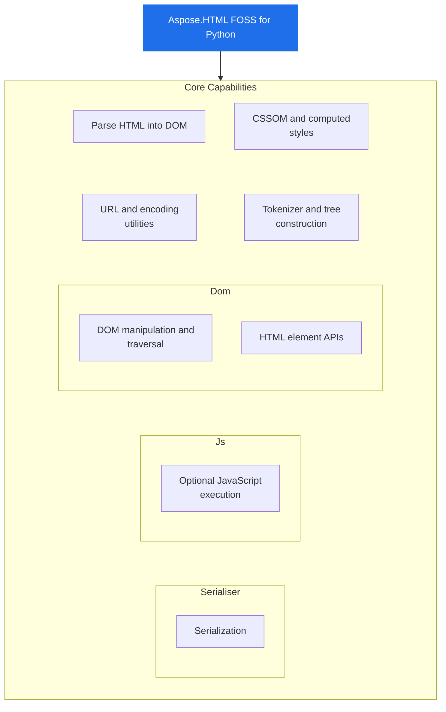

# Aspose.HTML FOSS for Python

 [](LICENSE) [](https://github.com/aspose-html-foss/Aspose.HTML-FOSS-for-Python/graphs/contributors)

[](https://products.aspose.org/html/python/)

Aspose.HTML FOSS for Python reads and writes HTML documents through a DOM API, parses HTML source text into a document tree, and supports `CSS` styling and computed style inspection. It provides `URL` parsing and manipulation, encoding detection, and JavaScript evaluation via an optional QuickJS bridge. The product exposes low-level parsing and tokenization tools alongside high-level document construction and serialization capabilities.

## Navigation

- [At a Glance](#at-a-glance)
- [Key Capabilities](#key-capabilities)
- [Installation](#installation)
- [Dependencies](#dependencies)
- [Quick Start](#quick-start)
- [Additional Examples](#additional-examples)
- [API Reference](#api-reference)
- [Documentation & Resources](#documentation--resources)
- [Scope and Limitations](#scope-and-limitations)
- [Development and Testing](#development-and-testing)
- [License](#license)

## At a Glance



## Key Capabilities

- **Parse HTML into DOM.** Parse HTML strings, bytes, fragments, and files into a DOM document with `aspose_html.HTMLDocument.parse()`, `aspose_html.HTMLDocument.parse_fragment()`, and `aspose_html.HTMLDocument.load()`.
- **DOM manipulation and traversal.** Build, inspect, and mutate DOM trees — create and update nodes programmatically with `aspose_html.dom.Document.create_element()` and `append_child()`; read and write element attributes, classes, datasets, inline styles, and text content; and query documents by ID, tag name, class name, and selector-oriented helpers such as `get_element_by_id()`, `get_elements_by_tag_name()`, `aspose_html.dom.TreeWalker`, `aspose_html.dom.NodeList`, and `aspose_html.dom.Range`.
- **CSSOM and computed styles.** Match `CSS` selectors and stylesheets against elements and resolve the cascade — specificity, inline-vs-author rules, !important, and inheritance — with `Element.get_computed_style()`; the CSSOM surface (`aspose_html.cssom.CSSStyleSheet`, `aspose_html.cssom.CSSStyleRule`, `aspose_html.cssom.CSSMediaRule`, and related rule types) models stylesheets structurally.
- **URL and encoding utilities.** Validate and manipulate URLs with `aspose_html.url.URL`, read and edit query strings with `aspose_html.url.URLSearchParams`, and detect byte-stream character encodings (BOM and content sniffing) with `aspose_html.encoding.detect_encoding()`.
- **Optional JavaScript execution.** Execute JavaScript against a parsed DOM through `aspose_html.js.JSContext`, an optional QuickJS-backed bridge exposing DOM APIs to script code; requires the js extra.
- **Tokenizer and tree construction.** The lower-level `aspose_html.tokenizer.Tokenizer` and `aspose_html.tree.TreeBuilder` classes implement the WHATWG tokenization and tree-construction algorithms directly, for callers who need that level of control.
- **HTML element APIs.** Work with a broad set of specialized HTML element classes — `aspose_html.dom.HTMLFormElement`, `aspose_html.dom.HTMLInputElement`, `aspose_html.dom.HTMLTableElement`, and dozens more — each exposing the element-specific properties defined by its HTML interface.
- **Serialization.** Serialize complete documents, fragments, and individual elements back to an HTML string with the `aspose_html.serialise()` function or `aspose_html.XMLSerializer`.

## Installation

`aspose-html-foss` is not yet published on PyPI, and no build or install command succeeds; work from the source checkout instead:

```bash
git clone https://github.com/aspose-html-foss/Aspose.HTML-FOSS-for-Python.git
cd Aspose.HTML-FOSS-for-Python
export PYTHONPATH="src:.:$PYTHONPATH"
```

Verify the install:

```bash
python -c "import aspose_html.tokenizer"
```

Requires Python 3.10 or later.

## Dependencies

### Required Package Dependencies

- `skia-python>=87.0,<145`

### Optional Dependencies

- `quickjs>=1.19,<2` (extra `js`)

### Native and System Requirements

- Requires Python 3.10 or later.

### Development Dependencies

- `pytest>=8` (extra `test`)

## Quick Start

The first example parses an HTML string into a DOM, locates an element by its identifier, creates a new paragraph, sets its text content, appends it to the container, and serializes the updated subtree.

```python
from aspose_html import HTMLDocument, serialise

document = HTMLDocument.parse("<main id='content'><h1>Hello</h1></main>")
content = document.get_element_by_id("content")

paragraph = document.create_element("p")
paragraph.text_content = "Updated through the DOM API."
content.append_child(paragraph)

print(serialise(content))
```

The second example constructs a DOM, adds a styled element, creates a `CSS` style sheet, attaches it to the document, and retrieves the computed style property value for the element.

```python
from aspose_html.dom import Document
from aspose_html.cssom import CSSStyleSheet

document = Document()
element = document.create_element("div")
element.set_attribute("class", "foo")
element.set_attribute("id", "bar")
document.append_child(element)

sheet = CSSStyleSheet()
sheet.replace_sync(".foo { color: red } #bar { color: blue }")
document.attach_style_sheet(sheet)

style = element.get_computed_style()
print(style.get_property_value("color"))  # "blue"
```

## Additional Examples

The following examples demonstrate working with URLs, querying elements, detecting encoding, executing JavaScript, and tokenizing HTML.

### Execute JavaScript Against The DOM

```python
from aspose_html.dom import Document
from aspose_html.js import JSContext

document = Document()
element = document.create_element("div")
document.append_child(element)

with JSContext(document) as ctx:
    result = ctx.evaluate("1 + 1")
    print(result)  # 2
```

<details>
<summary>View Additional Examples</summary>

### Work With URLs and Search Parameters

```python
from aspose_html import URL

url = URL("https://example.com/articles?category=html")
url.search_params.set("page", "2")

print(str(url))
```

### Query Elements By Tag Name

```python
from aspose_html import HTMLDocument

document = HTMLDocument.parse("<article><h1>News</h1><p>Hello</p></article>")
heading = document.get_elements_by_tag_name("h1").item(0)

print(heading.text_content)
```

### Detect Character Encoding From Bytes

```python
from aspose_html.encoding.detection import detect_encoding

result = detect_encoding(b"\xef\xbb\xbf<p>x</p>")
print(result.encoding)
print(result.confidence)
print(result.text)
```

### Tokenize HTML Source and Inspect Tokens

```python
from aspose_html.tokenizer import Tokenizer, TokenizerState

tokenizer = Tokenizer("<p>Hello</p>")
tokens = list(tokenizer.tokenize())
print(tokens[0].tag_name)  # "p"
```

Runnable scripts are available in the [`examples`](examples/) directory.

</details>

## API Reference

Aspose.HTML FOSS for Python provides the `aspose_html.HTMLDocument` class as the primary entry point for parsing and loading HTML content, offering parse, `parse_fragment`, and load methods. It also exposes lower-level DOM, CSSOM, encoding, `URL`, tokenizer, and serialization APIs for fine-grained control over HTML documents.

The public API has 303 types.

<details>
<summary>View the Complete Public API Surface</summary>

### Core API

| Class | Description |
| --- | --- |
| `aspose_html.DOMParser` | DOMParser class parses markup strings into DOM documents, currently supporting only text/HTML parsing. |
| `HTMLDocument` | Top-level entry point for parsing HTML into a Document tree. |
| `aspose_html.URL` | URL class represents a URL. |
| `aspose_html.URLParseError` | URLParseError is raised when a string cannot be parsed as a URL. |
| `aspose_html.URLSearchParams` | URLSearchParams holds ordered query-string pairs with duplicate-key support. |
| `aspose_html.XMLSerializer` | XMLSerializer serialises DOM nodes to strings. |
| `CSS` | Namespace class for CSS static utilities (CSS Conditional Rules §6). |
| `CSSCounterStyleRule` | CSSCounterStyleRule is a @counter-style rule holding the counter style name and its descriptor declarations. |
| `CSSFontFaceRule` | CSSFontFaceRule is a @font-face rule holding font descriptor declarations. |
| `CSSImportRule` | CSSImportRule is an @import statement rule. |
| `CSSKeyframeRule` | CSSKeyframeRule is a single keyframe descriptor within a @keyframes rule. |
| `CSSKeyframesRule` | CSSKeyframesRule is a @keyframes rule containing animation keyframe descriptors. |
| `CSSLayerBlockRule` | CSSLayerBlockRule is a CSS @layer block rule assigning child rules to a named cascade layer. |
| `CSSLayerStatementRule` | CSSLayerStatementRule is a CSS @layer statement rule declaring cascade layer order. |
| `CSSMediaRule` | CSSMediaRule is a media rule scaffold for nested style rules. |
| `CSSNamespaceRule` | CSSNamespaceRule is a @namespace rule recording a namespace URI and optional prefix for use in namespace-qualified selectors. |
| `CSSPageRule` | CSSPageRule is a CSS @page rule representing a @page at-rule that specifies styles for printed pages. |
| `CSSPropertyRule` | CSSPropertyRule is a CSS @property rule stub representing a @property at-rule declaring a custom CSS property with a type syntax, inheritance behaviour, and initial value. |
| `CSSRule` | CSSRule is a base class for CSSOM rules; its css_text and type getters raise NotImplementedError (some members not implemented). |
| `CSSRuleList` | CSSRuleList is an ordered, live CSS rule collection. |
| `CSSStyleRule` | CSSStyleRule is a style rule (selector { declarations }). |
| `CSSStyleSheet` | CSSStyleSheet is a minimal CSSOM stylesheet object. |
| `CSSSupportsRule` | CSSSupportsRule is a @supports rule with a condition and nested style rules. |
| `AbortController` | AbortController controls cancellation of operations via an AbortSignal. |
| `AbortSignal` | AbortSignal represents the signal half of an AbortController pair. |
| `AbstractRange` | AbstractRange is a read-only boundary-point contract shared by range-family APIs. |
| `Attr` | Attr is an attribute attached to an Element; its specified getter always returns True. |
| `BarProp` | BarProp is a bar property. |
| `BroadcastChannel` | BroadcastChannel is a broadcast channel. |
| `CDATASection` | CDATASection is a CDATA section node; its node_name getter always returns '#cdata-section'. |
| `CSSStyleDeclaration` | CSSStyleDeclaration is a live view of an element's inline style attribute. |
| `CharacterData` | CharacterData is an abstract base for Text, Comment, CDATASection, and ProcessingInstruction providing the data property and character-data manipulation methods. |
| `Comment` | Comment is an HTML comment node; its node_name getter always returns '#comment'. |
| `ComputedStyleDeclaration` | ComputedStyleDeclaration is a read-only resolved style declarations for an element. |
| `Console` | Console is a console. |
| `Crypto` | Crypto is a crypto. |
| `CustomElementRegistry` | CustomElementRegistry is a custom element registry; its define method raises NotSupportedError or TypeError (conditionally). |
| `CustomEvent` | CustomEvent is an Event carrying an arbitrary detail payload. |
| `DOMConfiguration` | DOMConfiguration is a baseline DOMConfiguration compatibility surface; its get_parameter and set_parameter methods raise NotSupportedError (conditionally). |
| `DOMException` | DOMException is a base for all DOM exceptions. |
| `DOMImplementation` | DOMImplementation is a legacy DOMImplementation compatibility surface providing deterministic, side-effect free feature-probe behavior; its create_document method raises WrongDocumentError (conditionally). |
| `dom.DOMParser` | DOMParser parses markup strings into DOM documents, currently supporting only text/HTML parsing; its parse_from_string method raises NotSupportedError (conditionally). |
| `DOMRect` | DOMRect class represents an axis-aligned bounding rectangle with mutable attributes x, y, width, and height, and computed properties top, right, bottom, and left that handle negative dimensions. |
| `DOMRectList` | DOMRectList class is an immutable sequence of DOMRect objects supporting iteration, index access, and item() returning None for out-of-range indices. |
| `DOMStringMap` | DOMStringMap class provides a live dict-like view of an element's data-* custom attributes, reading from and writing to the owning element's attribute map directly on every operation. |
| `DOMTokenList` | DOMTokenList class is a live, mutable set of space-separated tokens backed by an element attribute implementing the WHATWG DOMTokenList interface for the class attribute, and its supports method raises TypeError. |
| `DataCloneError` | DataCloneError class represents an error for objects that cannot be cloned. |
| `Document` | Document class is the root of a DOM tree, with Document() creating an empty, standards-mode document, and its adopt_node, adopted_style_sheets setter, close, cookie setter, create_attribute, and create_cdata_section methods raise NotSupportedError or TypeError or InvalidCharacterError conditionally. |
| `DocumentFragment` | DocumentFragment class is a lightweight container for a sub-tree whose children are transferred to a new parent when passed to append_child, and its node_name getter always returns '#document-fragment'. |
| `DocumentPosition` | Public class. |
| `DocumentType` | DocumentType class represents a document type declaration node, and its name attribute holds the doctype name. |
| `Element` | Element class represents an HTML or XML element node created via Document.create_element, and its attach_shadow, insert_adjacent_element, insert_adjacent_html, and insert_adjacent_text methods raise NotSupportedError, NoModificationAllowedError, or _SyntaxError conditionally. |
| `ErrorEvent` | ErrorEvent class represents a script error event with parameters type, bubbles, cancelable, message, filename, lineno, colno, and error. |
| `Event` | Event class represents a DOM event object with parameters type, bubbles, and cancelable, and constants AT_TARGET, BUBBLING_PHASE, CAPTURING_PHASE, and NONE. |
| `EventTarget` | EventTarget class is the base class for objects that can receive DOM events, and its add_event_listener and dispatch_event methods raise TypeError or ValueError conditionally. |
| `FocusEvent` | FocusEvent class represents a focus transition event with parameters type, bubbles, cancelable, and detail. |
| `FormData` | FormData class is a snapshot collection of form control name/value pairs. |
| `dom.HTMLAddressElement` | HTMLAddressElement class represents an HTML address element. |
| `dom.HTMLAnchorElement` | HTMLAnchorElement class represents an HTML anchor element reflecting the href and target IDL attributes. |
| `dom.HTMLAreaElement` | HTMLAreaElement class represents an HTML area element whose href resolves against document base URL. |
| `dom.HTMLArticleElement` | HTMLArticleElement class represents an HTML article element. |
| `dom.HTMLAsideElement` | HTMLAsideElement class represents an HTML aside element. |
| `dom.HTMLAudioElement` | HTMLAudioElement class represents an HTML audio element. |
| `dom.HTMLBRElement` | HTMLBRElement class represents an HTML br element. |
| `dom.HTMLBaseElement` | HTMLBaseElement class represents an HTML base element reflecting the href and target IDL attributes. |
| `dom.HTMLBodyElement` | HTMLBodyElement class represents an HTML body element. |
| `dom.HTMLButtonElement` | HTMLButtonElement class represents an HTML button element reflecting the type, value, and disabled IDL attributes, and its will_validate getter always returns False. |
| `dom.HTMLCanvasElement` | HTMLCanvasElement class represents an HTML canvas element, and its to_data_url method always returns 'data:,' and its transfer_control_to_offscreen method raises NotSupportedError conditionally. |
| `HTMLCollection` | HTMLCollection class is a live, ordered collection of Element-type children only, supporting iteration and integer index access. |
| `dom.HTMLDListElement` | HTMLDListElement class represents an HTML dl element. |
| `dom.HTMLDataElement` | HTMLDataElement class represents an HTML data element. |
| `dom.HTMLDataListElement` | HTMLDataListElement class represents an HTML datalist element providing autocomplete suggestions and implementing the options IDL attribute returning a live collection of option child elements. |
| `dom.HTMLDetailsElement` | HTMLDetailsElement class represents an HTML details element reflecting the open IDL attribute. |
| `dom.HTMLDialogElement` | HTMLDialogElement class represents an HTML dialog element reflecting the open IDL attribute. |
| `dom.HTMLDivElement` | HTMLDivElement class represents an HTML div element with no IDL-reflected attributes beyond those inherited from HTMLElement. |
| `HTMLElement` | HTMLElement class is the base class for all HTML-namespace element types, and its content_editable setter raises _SyntaxError and its outer_text setter raises NoModificationAllowedError conditionally, while its access_key_label getter always returns '' and its toggle_popover method always returns False. |
| `dom.HTMLEmbedElement` | HTMLEmbedElement class represents an HTML embed element reflecting the src and type string properties and the width and height integer properties. |
| `dom.HTMLFieldSetElement` | HTMLFieldSetElement class represents an HTML fieldset element for grouping form controls reflecting the name and disabled IDL attributes, and its type getter always returns 'fieldset'. |
| `dom.HTMLFigCaptionElement` | HTMLFigCaptionElement class represents an HTML figcaption element. |
| `dom.HTMLFigureElement` | HTMLFigureElement class represents an HTML figure element. |
| `dom.HTMLFooterElement` | HTMLFooterElement class represents an HTML footer element. |
| `dom.HTMLFormElement` | HTMLFormElement class represents an HTML form element reflecting the action, method, name, enctype, encoding, novalidate, target, and autocomplete IDL attributes, and its request_submit, reset, and submit methods raise NotSupportedError conditionally. |
| `dom.HTMLHRElement` | HTMLHRElement class represents the HTML thematic-break element. |
| `dom.HTMLHeadElement` | HTMLHeadElement class represents the HTML head element. |
| `dom.HTMLHeaderElement` | HTMLHeaderElement class represents the HTML header element. |
| `dom.HTMLHeadingElement` | HTMLHeadingElement class represents HTML heading elements. |
| `dom.HTMLHtmlElement` | HTMLHtmlElement class represents the HTML document element. |
| `dom.HTMLIFrameElement` | HTMLIFrameElement class represents the HTML iframe element and reflects src, name, allow, sandbox, width, and height properties. |
| `dom.HTMLImageElement` | HTMLImageElement class represents the HTML image element and reflects src, alt, width, height, srcset, sizes, loading, decoding, and loading attributes; the decode method is not implemented, and complete, natural_height, natural_width, x, and y getters always return False, 0, 0, 0, and 0 respectively. |
| `dom.HTMLInputElement` | HTMLInputElement class represents the HTML input form control element and reflects type, value, name, checked, and disabled attributes; the set_range_text and show_picker methods raise NotSupportedError, the value_as_number setter raises InvalidStateError, and selection_direction, selection_end, and selection_start getters always return 'none', 0, and 0 respectively. |
| `dom.HTMLLIElement` | HTMLLIElement class represents the HTML list item element. |
| `dom.HTMLLabelElement` | HTMLLabelElement class represents the HTML label element and reflects the for attribute. |
| `dom.HTMLLegendElement` | HTMLLegendElement class represents the HTML legend element and reflects the form IDL attribute, which returns the owner form of the nearest ancestor fieldset, or None. |
| `dom.HTMLLinkElement` | HTMLLinkElement class represents the HTML link element and reflects href, rel, and type attributes. |
| `dom.HTMLMainElement` | HTMLMainElement class represents the HTML main element. |
| `dom.HTMLMapElement` | HTMLMapElement class represents the HTML map element. |
| `dom.HTMLMarkElement` | HTMLMarkElement class represents the HTML mark element. |
| `dom.HTMLMediaElement` | HTMLMediaElement class is the base class for HTML media elements and reflects can_play_type, current_src, current_time, ended, network_state, and paused properties. |
| `dom.HTMLMenuElement` | HTMLMenuElement class represents the HTML menu element. |
| `dom.HTMLMetaElement` | Public class. |
| `dom.HTMLMeterElement` | HTMLMeterElement class represents the HTML meter element for displaying a scalar value in a range and reflects value, min, max, low, high, and optimum attributes. |
| `dom.HTMLModElement` | Public class. |
| `dom.HTMLNavElement` | HTMLNavElement class represents the HTML nav element. |
| `dom.HTMLNoScriptElement` | HTMLNoScriptElement class represents the HTML noscript element. |
| `dom.HTMLOListElement` | HTMLOListElement class represents the HTML ordered list element. |
| `dom.HTMLObjectElement` | HTMLObjectElement class represents the HTML object element and reflects data, type, name, width, height, and will_validate properties. |
| `dom.HTMLOptGroupElement` | HTMLOptGroupElement class represents the HTML optgroup element for grouping options in a select list and reflects label and disabled attributes. |
| `dom.HTMLOptionElement` | Public class. |
| `HTMLOptionsCollection` | HTMLOptionsCollection class represents a live collection of option elements for a select element. |
| `dom.HTMLOutputElement` | Public class. |
| `dom.HTMLParagraphElement` | HTMLParagraphElement class represents the HTML paragraph element. |
| `dom.HTMLParamElement` | HTMLParamElement class represents the HTML param element. |
| `dom.HTMLPictureElement` | HTMLPictureElement class represents the HTML picture element. |
| `dom.HTMLPreElement` | HTMLPreElement class represents the HTML preformatted text element. |
| `dom.HTMLProgressElement` | HTMLProgressElement class represents the HTML progress element showing task completion and reflects value and max attributes. |
| `dom.HTMLQuoteElement` | HTMLQuoteElement class represents the HTML quote element. |
| `dom.HTMLRubyElement` | HTMLRubyElement class represents the HTML ruby element. |
| `dom.HTMLScriptElement` | HTMLScriptElement class represents the HTML script element and reflects src, type, async_, and defer attributes. |
| `dom.HTMLSectionElement` | HTMLSectionElement class represents the HTML section element. |
| `dom.HTMLSelectElement` | HTMLSelectElement class represents the HTML select element and reflects value, name, multiple, and disabled attributes; the add method raises HierarchyRequestError. |
| `dom.HTMLSmallElement` | HTMLSmallElement class represents the HTML small element. |
| `dom.HTMLSourceElement` | HTMLSourceElement class represents the HTML source element. |
| `dom.HTMLSpanElement` | HTMLSpanElement class represents an HTML span inline container element with no IDL-reflected attributes beyond those inherited from HTMLElement. |
| `dom.HTMLStyleElement` | HTMLStyleElement class represents an HTML style element and reflects the media and type IDL attributes. |
| `dom.HTMLSummaryElement` | HTMLSummaryElement class represents an HTML summary element, a disclosure summary for a details widget, with no IDL-reflected attributes beyond those inherited from HTMLElement. |
| `dom.HTMLTableCaptionElement` | HTMLTableCaptionElement class represents an HTML caption element. |
| `dom.HTMLTableCellElement` | HTMLTableCellElement class represents an HTML table cell element. |
| `dom.HTMLTableColElement` | HTMLTableColElement class represents an HTML table column element. |
| `dom.HTMLTableElement` | HTMLTableElement class represents an HTML table element and provides live collection properties for navigating table structure; its delete_row and insert_row methods raise IndexSizeError when the index is out of range. |
| `dom.HTMLTableRowElement` | HTMLTableRowElement class represents an HTML table row element; its delete_cell and insert_cell methods raise IndexSizeError when the index is out of range. |
| `dom.HTMLTableSectionElement` | HTMLTableSectionElement class represents an HTML table section element; its delete_row and insert_row methods raise IndexSizeError when the index is out of range. |
| `dom.HTMLTemplateElement` | HTMLTemplateElement class represents an HTML template element holding inert content, with its content property returning a DocumentFragment that holds the template's child nodes. |
| `dom.HTMLTextAreaElement` | HTMLTextAreaElement class represents an HTML textarea multi-line text input element reflecting several IDL attributes, with its selection_direction, selection_end, and selection_start getters always returning 'none', 0, and 0 respectively, its type getter always returning 'textarea', and its set_range_text method raising NotSupportedError (conditionally). |
| `dom.HTMLTimeElement` | HTMLTimeElement class represents an HTML time element and reflects the HTML datetime attribute. |
| `dom.HTMLTitleElement` | HTMLTitleElement class represents an HTML title element whose text property reads and writes the element's first Text child node directly, and its text setter raises NotSupportedError (conditionally). |
| `dom.HTMLTrackElement` | HTMLTrackElement class represents an HTML track element and its ready_state getter always returns 0. |
| `dom.HTMLUListElement` | HTMLUListElement class represents an HTML unordered list element. |
| `dom.HTMLUnknownElement` | HTMLUnknownElement class is an HTML unknown element interface (export-only, not registry-dispatched). |
| `dom.HTMLVideoElement` | HTMLVideoElement class represents an HTML video element, with its video_height, video_width, webkit_decoded_frame_count, and webkit_dropped_frame_count getters always returning 0, and its request_picture_in_picture method raising NotSupportedError (conditionally). |
| `dom.HTMLWBRElement` | HTMLWBRElement class represents an HTML wbr element. |
| `HashChangeEvent` | HashChangeEvent class represents a same-document fragment navigation event. |
| `HierarchyRequestError` | HierarchyRequestError class is raised when the tree hierarchy is violated. |
| `History` | History class provides in-memory session history for a Window. |
| `InUseAttributeError` | InUseAttributeError class is raised when an Attr is already in use by another element. |
| `IndexSizeError` | IndexSizeError class is raised when an index or size is out of range. |
| `InputEvent` | InputEvent class represents a text-input event. |
| `IntersectionObserver` | IntersectionObserver class is provided for observing DOM intersections. |
| `IntersectionObserverEntry` | IntersectionObserverEntry class is provided for intersection observation notifications. |
| `InvalidCharacterError` | InvalidCharacterError class is raised when an invalid character is used. |
| `InvalidStateError` | InvalidStateError class is raised when an operation is performed in an invalid state. |
| `KeyboardEvent` | KeyboardEvent class represents a keyboard event. |
| `Location` | Location class provides the location of the current document. |
| `MediaQueryList` | MediaQueryList class provides a list of media queries. |
| `MessageChannel` | MessageChannel class provides a channel for messaging between browsing contexts. |
| `MessagePort` | MessagePort class provides a port for messaging through a MessageChannel. |
| `MouseEvent` | MouseEvent class represents a mouse or pointer event, with its offset_x, offset_y, page_x, and page_y getters always returning 0. |
| `MutationObserver` | MutationObserver class observes DOM mutations on a target node; its observe method raises InvalidStateError (conditionally). |
| `MutationRecord` | MutationRecord class represents one DOM mutation notification record. |
| `NamedNodeMap` | NamedNodeMap class is an ordered map of Attr objects keyed by attribute name; its remove_named_item method raises NotFoundError (conditionally). |
| `Navigator` | Navigator class provides information about the user agent. |
| `NoModificationAllowedError` | NoModificationAllowedError class is raised when a node cannot be modified in its current context. |
| `Node` | Node class is an abstract base class for all WHATWG DOM nodes; its insert_before, remove_child, and replace_child methods raise NotFoundError (conditionally). |
| `NodeFilter` | NodeFilter class provides constants for TreeWalker and NodeIterator filtering, including bitmask constants for node type selection and filter return values. |
| `NodeIterator` | Public class. |
| `NodeList` | NodeList class represents a live, ordered collection of Node objects, wrapping a reference to the underlying _children list of a node with immediate mutation visibility. |
| `NodeType` | Public class. |
| `NotFoundError` | NotFoundError class is raised when a node is not found in the expected location, with code 8. |
| `NotSupportedError` | NotSupportedError class is raised when an operation is not supported, with code 9. |
| `ParseError` | ParseError class records a parse error during tree construction, with code, line, column, and message attributes. |
| `Performance` | Performance class provides performance measurement capabilities. |
| `PerformanceEntry` | PerformanceEntry class represents an individual performance entry. |
| `PerformanceTiming` | PerformanceTiming class provides timing information for performance measurement. |
| `PopStateEvent` | PopStateEvent class represents a history traversal event carrying the active entry state, with type 'popstate' and state attributes. |
| `ProcessingInstruction` | Public class. |
| `Range` | Range class represents a contiguous portion of a document tree, defined by two boundary points, with compare_boundary_points, compare_point, is_point_in_range, select_node, and set_end_after members raising specific errors conditionally. |
| `ResizeObserver` | ResizeObserver class provides resize observation capabilities. |
| `ResizeObserverEntry` | ResizeObserverEntry class represents a resize observer entry. |
| `Screen` | Screen class represents the screen object. |
| `SecurityError` | SecurityError class is raised when an operation is blocked for security reasons. |
| `Selection` | Selection class represents document-scoped selection with single-range semantics, with add_range, collapse, collapse_to_end, collapse_to_start, and get_range_at members raising specific errors conditionally. |
| `StaticRange` | StaticRange class represents an immutable boundary-point range initialized from an init object, with endpoints that do not auto-update on DOM mutations and cannot be changed after construction, and __init__ raising TypeError and WrongDocumentError conditionally. |
| `Storage` | Storage class provides storage capabilities. |
| `StyleSheetList` | StyleSheetList class represents a live ordered stylesheet collection. |
| `SubtleCrypto` | SubtleCrypto class provides cryptographic capabilities. |
| `SyntaxError` | Public class. |
| `Text` | Text class represents a text node, with node_name getter always returning '#text' and split_text raising IndexSizeError conditionally. |
| `TreeWalker` | Public class. |
| `UIEvent` | UIEvent class is the base class for user-interface events, with type, bubbles, and cancelable parameters. |
| `ValidityState` | Public class. |
| `VisualViewport` | VisualViewport class represents the visual viewport. |
| `Window` | Window class represents the per-document window object with EventTarget behavior, with confirm always returning False, crossorigin_isolated getter always returning False, device_pixel_ratio getter always returning 1.0, find always returning False, atob raising InvalidCharacterError conditionally, and btoa raising InvalidCharacterError conditionally. |
| `WrongDocumentError` | WrongDocumentError class is raised when a node belongs to a different document, with code 4. |
| `dom.XMLSerializer` | XMLSerializer class serializes DOM nodes to strings. |
| `html.HTMLAddressElement` | HTMLAddressElement class represents the HTML address element. |
| `html.HTMLAnchorElement` | HTMLAnchorElement class represents the HTML anchor element, reflecting the href and target IDL attributes. |
| `html.HTMLAreaElement` | HTMLAreaElement class represents the HTML area image-map hyperlink area, with href resolving against document base URL. |
| `html.HTMLArticleElement` | HTMLArticleElement class represents the HTML article element. |
| `html.HTMLAsideElement` | HTMLAsideElement class represents the HTML aside element. |
| `html.HTMLAudioElement` | HTMLAudioElement class represents the HTML audio element, with paused attribute accessible. |
| `html.HTMLBRElement` | HTMLBRElement class represents the HTML br line-break element. |
| `html.HTMLBaseElement` | HTMLBaseElement class represents the HTML base element, reflecting the href and target IDL attributes. |
| `html.HTMLBodyElement` | HTMLBodyElement class represents the HTML body element. |
| `html.HTMLButtonElement` | HTMLButtonElement class represents the button element and reflects the type, value, and disabled IDL attributes. |
| `html.HTMLCanvasElement` | HTMLCanvasElement class represents the canvas element and its to_data_url method always returns 'data:,' while transfer_control_to_offscreen raises NotSupportedError. |
| `html.HTMLDListElement` | HTMLDListElement class represents the definition list element. |
| `html.HTMLDataElement` | HTMLDataElement class represents the data element. |
| `html.HTMLDataListElement` | HTMLDataListElement class represents the datalist element providing autocomplete suggestions and implements the options IDL attribute returning a live collection of option child elements. |
| `html.HTMLDetailsElement` | HTMLDetailsElement class represents the details disclosure widget element and reflects the open IDL attribute. |
| `html.HTMLDialogElement` | HTMLDialogElement class represents the dialog modal non modal dialog element and reflects the open IDL attribute. |
| `html.HTMLDivElement` | HTMLDivElement class represents the div block container element with no IDL reflected attributes beyond those inherited from HTMLElement. |
| `html.HTMLEmbedElement` | HTMLEmbedElement class represents the embed element and reflects the src and type string properties as well as width and height integer properties. |
| `html.HTMLFieldSetElement` | HTMLFieldSetElement class represents the fieldset element for grouping form controls, reflects the name and disabled IDL attributes, and its type getter always returns 'fieldset'. |
| `html.HTMLFigCaptionElement` | HTMLFigCaptionElement class represents the figcaption element. |
| `html.HTMLFigureElement` | HTMLFigureElement class represents the figure element. |
| `html.HTMLFooterElement` | HTMLFooterElement class represents the footer element. |
| `html.HTMLFormElement` | HTMLFormElement class represents the form element, reflects multiple IDL attributes including action, method, name, enctype, encoding, novalidate, target, and autocomplete, and its request_submit, reset, and submit methods raise NotSupportedError. |
| `html.HTMLHRElement` | HTMLHRElement class represents the hr thematic break element. |
| `html.HTMLHeadElement` | HTMLHeadElement class represents the head element. |
| `html.HTMLHeaderElement` | HTMLHeaderElement class represents the header element. |
| `html.HTMLHeadingElement` | HTMLHeadingElement class represents HTML heading elements h1 through h6 and preserves the actual tag name on the element. |
| `html.HTMLHtmlElement` | HTMLHtmlElement class represents the HTML document element. |
| `html.HTMLIFrameElement` | HTMLIFrameElement class represents the iframe element and reflects the src, name, allow, sandbox string properties as well as width and height integer properties. |
| `html.HTMLImageElement` | HTMLImageElement class represents the image element, reflects multiple IDL attributes, its complete, natural_height, natural_width, x, and y getters always return False or 0, and its decode method raises NotImplementedError. |
| `html.HTMLInputElement` | HTMLInputElement class represents the input form control element, reflects the type, value, name, checked, and disabled IDL attributes, its selection_direction, selection_end, and selection_start getters always return 'none' or 0, its set_range_text and show_picker methods raise NotSupportedError, and its value_as_number setter raises InvalidStateError. |
| `html.HTMLLIElement` | HTMLLIElement class represents the li list item element. |
| `html.HTMLLabelElement` | HTMLLabelElement class represents the label element and reflects the for attribute. |
| `html.HTMLLegendElement` | HTMLLegendElement class represents the legend element and reflects the form IDL attribute which returns the owner form of the nearest ancestor fieldset or None. |
| `html.HTMLLinkElement` | HTMLLinkElement class represents the link element and reflects the href, rel, and type IDL attributes. |
| `html.HTMLMainElement` | HTMLMainElement class represents the main element. |
| `html.HTMLMapElement` | HTMLMapElement class represents the map element. |
| `html.HTMLMarkElement` | HTMLMarkElement class represents the mark element. |
| `html.HTMLMediaElement` | HTMLMediaElement class is the base class for HTML media elements and its can_play_type, current_src, current_time, ended, network_state, and paused members always return empty string, 0.0, False, or 0. |
| `html.HTMLMenuElement` | HTMLMenuElement class represents the menu element and carries no IDL reflected attributes beyond those inherited from HTMLElement. |
| `html.HTMLMetaElement` | Public class. |
| `html.HTMLMeterElement` | HTMLMeterElement class represents the meter element for displaying a scalar value in a range and reflects the value, min, max, low, high, and optimum IDL attributes. |
| `html.HTMLModElement` | Public class. |
| `html.HTMLNavElement` | HTMLNavElement class represents the nav element. |
| `html.HTMLNoScriptElement` | HTMLNoScriptElement class represents the noscript element. |
| `html.HTMLOListElement` | HTMLOListElement class represents the ol ordered list element. |
| `html.HTMLObjectElement` | HTMLObjectElement class represents the object element, reflects the data, type, and name string properties as well as width and height integer properties, and its will_validate getter always returns False. |
| `html.HTMLOptGroupElement` | HTMLOptGroupElement class represents the optgroup element for grouping options in a select list and reflects the label and disabled IDL attributes. |
| `html.HTMLOptionElement` | Public class. |
| `html.HTMLOutputElement` | Public class. |
| `html.HTMLParagraphElement` | HTMLParagraphElement class represents the HTML paragraph element and exists for correct isinstance dispatch. |
| `html.HTMLParamElement` | HTMLParamElement class represents the HTML param element. |
| `html.HTMLPictureElement` | HTMLPictureElement class represents the HTML picture element as a structural subclass. |
| `html.HTMLPreElement` | HTMLPreElement class represents the HTML preformatted text element as a structural subclass and is also used for legacy tags in registry dispatch. |
| `html.HTMLProgressElement` | HTMLProgressElement class represents the HTML progress element showing task completion and reflects IDL attributes: value and max. |
| `html.HTMLQuoteElement` | HTMLQuoteElement class represents the HTML quote element. |
| `html.HTMLRubyElement` | HTMLRubyElement class represents the HTML ruby element. |
| `html.HTMLScriptElement` | HTMLScriptElement class represents the HTML script element and reflects src, type, async_, and defer IDL attributes. |
| `html.HTMLSectionElement` | HTMLSectionElement class represents the HTML section element. |
| `html.HTMLSelectElement` | HTMLSelectElement class represents the HTML select element, reflects value, name, multiple, and disabled IDL attributes, and its add method raises HierarchyRequestError conditionally. |
| `html.HTMLSmallElement` | HTMLSmallElement class represents the HTML small element. |
| `html.HTMLSourceElement` | HTMLSourceElement class represents the HTML source element. |
| `html.HTMLSpanElement` | HTMLSpanElement class represents the HTML span inline container element and exists for correct isinstance dispatch. |
| `html.HTMLStyleElement` | HTMLStyleElement class represents the HTML style element and reflects media and type IDL attributes. |
| `html.HTMLSummaryElement` | HTMLSummaryElement class represents an HTML summary element, a disclosure summary for a details widget, and carries no IDL-reflected attributes beyond those inherited from HTMLElement. |
| `html.HTMLTableCaptionElement` | HTMLTableCaptionElement class represents the HTML table caption element. |
| `html.HTMLTableCellElement` | HTMLTableCellElement class represents the HTML table cell element. |
| `html.HTMLTableColElement` | HTMLTableColElement class represents the HTML table column element. |
| `html.HTMLTableElement` | HTMLTableElement class represents the HTML table element, provides live collection properties for navigating table structure, and its delete_row and insert_row methods raise IndexSizeError conditionally. |
| `html.HTMLTableRowElement` | HTMLTableRowElement class represents the HTML table row element and its delete_cell and insert_cell methods raise IndexSizeError conditionally. |
| `html.HTMLTableSectionElement` | HTMLTableSectionElement class represents the HTML table section element and its delete_row and insert_row methods raise IndexSizeError conditionally. |
| `html.HTMLTemplateElement` | HTMLTemplateElement class represents the HTML template element holding inert content and its content property returns the DocumentFragment that holds the template's child nodes. |
| `html.HTMLTextAreaElement` | Public class. |
| `html.HTMLTimeElement` | Public class. |
| `html.HTMLTitleElement` | HTMLTitleElement class represents the HTML title element, its text property reads and writes the element's first Text child node directly, and its text setter raises NotSupportedError conditionally. |
| `html.HTMLTrackElement` | HTMLTrackElement class represents the HTML track element and its ready_state getter always returns 0. |
| `html.HTMLUListElement` | HTMLUListElement class represents the HTML unordered list element. |
| `html.HTMLUnknownElement` | HTMLUnknownElement class represents the HTML unknown element interface and is export-only, not registry-dispatched. |
| `html.HTMLVideoElement` | HTMLVideoElement class represents the HTML video element, its video_height, video_width, webkit_decoded_frame_count, and webkit_dropped_frame_count getters always return 0, and its request_picture_in_picture method raises NotSupportedError conditionally. |
| `html.HTMLWBRElement` | HTMLWBRElement class represents the HTML wbr element. |
| `EncodingDetectionResult` | Result of encoding detection and decoding for an HTML byte stream. |
| `UnsupportedEncodingError` | Public class. |
| `JSContext` | JSContext class is a JavaScript execution context backed by QuickJS, pre-wired to a DOM, its evaluate and eval_module methods raise JSEvaluationError conditionally, and its import_stub method is not implemented and raises NotImplementedError. |
| `JSEvaluationError` | JSEvaluationError class is raised when a JavaScript expression throws an exception and wraps JSException so that callers do not need to import quickjs to handle JS errors. |
| `ModuleNotFoundError` | Declares the field specifier. |
| `ModuleRegistry` | ModuleRegistry class maps module specifiers to ES module source strings and holds an explicit mapping from module specifier strings to their ES module source code. |
| `BlockFragment` | BlockFragment class represents geometry fragment for a block-level box. |
| `BoxNode` | BoxNode class represents a single box-tree node produced by build_box_tree and carries the orthogonal display triple per CSS Display L3 section 2. |
| `BoxRoot` | BoxRoot class represents the root wrapper returned by build_box_tree. |
| `ComputedStyle` | ComputedStyle class represents an immutable layout-facing snapshot of an element's resolved style and wraps the ComputedStyleDeclaration produced by the cascade engine plus the Document style epoch at which it was produced. |
| `Display` | Display class holds the outer and inner display roles per CSS Display L3 §2.1, representing the outer display role as block, inline, or run-in and the inner formatt... |
| `EdgeSizes` | EdgeSizes class holds logical edge sizes in CSS px units. |
| `FragmentRoot` | FragmentRoot class serves as the root wrapper for block-layout fragment output. |
| `InlineTextFragment` | InlineTextFragment class represents a positioned inline text fragment for a single shaped run. |
| `LineFragment` | LineFragment class represents a single inline formatting context line box. |
| `PageFragment` | PageFragment class represents a single paginated fragmentainer (page box) with ordered content. |
| `PageMarginBoxes` | PageMarginBoxes class serves as a placeholder page-margin-box container for later paint stages. |
| `ShapedRun` | ShapedRun class holds shaped text-run payload with deterministic metrics. |
| `CharacterToken` | CharacterToken class carries one or more Unicode characters, with the tokenizer buffering consecutive characters and emitting them as a single CharacterToken for efficiency. |
| `CommentToken` | CommentToken class represents a comment token with data holding the comment content excluding the delimiters, and line and column indicating the source position. |
| `DoctypeToken` | DoctypeToken class represents a DOCTYPE token emitted by the WHATWG tokeniser, with name, public_id, and system_id attributes. |
| `EndTagToken` | EndTagToken class represents an end tag token with tag_name, line, and column attributes. |
| `EofToken` | EofToken class represents an end-of-file token, always the last token in a stream, with line and column attributes indicating the EOF position. |
| `StartTagToken` | StartTagToken class represents a start tag token with tag_name, self_closing, and attributes attributes. |
| `Tokenizer` | Tokenizer class is the WHATWG HTML tokeniser that converts a Unicode string produced by encoding detection into a stream of typed tokens consumed by the tree constructor. |
| `TreeBuilder` | TreeBuilder class drives the WHATWG tree construction algorithm, consuming tokens from a Tokenizer and building a Document tree. |
| `url.URL` | URL class represents a URL. |
| `url.URLParseError` | URLParseError class is raised when a string cannot be parsed as a URL. |
| `url.URLSearchParams` | URLSearchParams class holds ordered query-string pairs with duplicate-key support. |

#### Enumerations

| Enumeration | Description |
| --- | --- |
| `TokenizerState` | TokenizerState class lists all tokeniser states defined in WHATWG HTML Living Standard §13.2.5, with each value being the integer identifier used internally. |

#### Detailed Member Reference

### HTMLDocument

The `aspose_html.HTMLDocument` class provides parse, `parse_fragment`, and load methods to construct HTML documents from strings or files, forming the main interface for loading and parsing HTML content.

- `load`: Load an HTML document from a file path and return a Document tree.
- `parse`: Parse HTML and return a Document tree.
- `parse_fragment`: Parse an HTML fragment and return a DocumentFragment.

### Document

The `aspose_html.dom.Document` class serves as the root of a DOM tree and provides methods such as `create_element`, `append_child`, `get_element_by_id`, and `get_elements_by_tag_name` for building and querying the document structure.

### CSSStyleSheet

The `aspose_html.cssom.CSSStyleSheet` class represents a `CSS` stylesheet and works with `aspose_html.cssom.CSSStyleRule` and `aspose_html.dom.ComputedStyleDeclaration` to manage styles and computed style information.

### url.URL

The `aspose_html.url.URL` class parses and represents URLs with properties such as href, protocol, host, and pathname, and includes `aspose_html.url.URLSearchParams` for handling query strings.

### detect_encoding

The `aspose_html.encoding.detect_encoding` function performs WHATWG-compliant encoding detection on byte sequences, returning an `aspose_html.encoding.EncodingDetectionResult` with the detected encoding and confidence.

### JSContext

The `aspose_html.js.JSContext` class provides a QuickJS-backed execution context pre-wired to a `Document`, supporting JavaScript evaluation and module registration via `aspose_html.js.ModuleRegistry`.

### Tokenizer

The `aspose_html.tokenizer.Tokenizer` class implements the HTML tokenization algorithm, producing `aspose_html.tokenizer.StartTagToken` and `aspose_html.tokenizer.CharacterToken` instances for low-level parsing.

### serialise

The `aspose_html.serialise` function and `aspose_html.serialiser.outer_html` utility serialize DOM nodes to HTML strings, while `aspose_html.XMLSerializer` supports XML serialization.

| Class | Description |
|---|---|
| `CSSCounterStyleRule` | A `@counter-style` rule (CSS Counter Styles Level 3 §3, CSSOM §5.4 type 11). |
| `CSSFontFaceRule` | A `@font-face` rule holding font descriptor declarations (CSS Fonts §4.4). |
| `CSSImportRule` | An `@import` statement rule (CSSOM §6.7). |
| `CSSKeyframeRule` | A single keyframe descriptor within a `@keyframes` rule (CSSOM Animations §7). |
| `CSSKeyframesRule` | A `@keyframes` rule containing animation keyframe descriptors (CSSOM Animations §7). |
| `CSSLayerBlockRule` | A CSS `@layer` block rule assigning child rules to a named cascade layer. |
| `CSSLayerStatementRule` | A CSS `@layer` statement rule declaring cascade layer order. |
| `CSSMediaRule` | Media rule scaffold for nested style rules. |
| `CSSNamespaceRule` | A `@namespace` rule (CSSOM §6.6, type 10). |
| `CSSPageRule` | CSS `@page` rule (CSSOM §6.4). |
| `CSSPropertyRule` | CSS `@property` rule stub (CSS Properties and Values API §3). |
| `CSSRule` | Base class for CSSOM rules. |
| `CSSRuleList` | Ordered, live CSS rule collection. |
| `CSSStyleRule` | Style rule (`selector { declarations }`). |
| `CSSStyleSheet` | Minimal CSSOM stylesheet object (CSSOM §6.4). |
| `CSSSupportsRule` | A `@supports` rule with a condition and nested style rules (CSS Conditional Rules §2). |

| Class | Description |
|---|---|
| `AbortController` | Controls cancellation of operations via an `AbortSignal`. |
| `AbortSignal` | Represents the signal half of an AbortController pair. |
| `AbstractRange` | Read-only boundary-point contract shared by range-family APIs. |
| `Attr` | An attribute attached to an Element. |
| `BarProp` | Represents a browser toolbar object (WHATWG HTML §7.7.3). |
| `BroadcastChannel` | Deterministic same-runtime BroadcastChannel fan-out delivery. |
| `CDATASection` | A CDATA section node (extends Text per WHATWG DOM Standard). |
| `CSSStyleDeclaration` | A live view of an element's inline style attribute. |
| `CharacterData` | Abstract base for Text, Comment, CDATASection, and ProcessingInstruction. |
| `Comment` | An HTML comment node. |
| `ComputedStyleDeclaration` | Read-only resolved style declarations for an element. |
| `Console` | Headless console stub exposing `log`, `info`, `warn`, `error`, and `debug` methods (WHATWG Console Standard). |
| `Crypto` | Minimal stub for the Crypto interface (W3C Web Crypto API §10.1). |
| `CustomElementRegistry` | Registers and resolves custom element constructors via `define()`, `get()`, and `when_defined()`. |
| `CustomEvent` | An Event carrying an arbitrary detail payload. |
| `DOMConfiguration` | Baseline DOMConfiguration compatibility surface. |
| `DOMException` | Base for all DOM exceptions. |
| `DOMImplementation` | Legacy DOMImplementation compatibility surface. |
| `DOMParser` | Parse markup strings into DOM documents. |
| `DOMRect` | An axis-aligned bounding rectangle (CSSOM View §7.1). |
| `DOMRectList` | An immutable sequence of `DOMRect` objects (CSSOM View §7.2). |
| `DOMStringMap` | A live dict-like view of an element's `data-*` custom attributes. |
| `DOMTokenList` | A live, mutable set of space-separated tokens backed by an element attribute. |
| `DataCloneError` | Raised when a value cannot be serialized by the structured clone algorithm. |
| `Document` | The root of a DOM tree. |
| `DocumentFragment` | A lightweight container for a sub-tree. |
| `DocumentPosition` | Named constants for the bitmask returned by `Node.compare_document_position`. |
| `DocumentType` | A document type declaration node (`<!DOCTYPE html>`). |
| `Element` | An HTML or XML element node. |
| `ErrorEvent` | Script error event (WHATWG HTML §8.1.3.6). |
| `Event` | A DOM event object per WHATWG DOM §2.2. |
| `EventTarget` | Base class for objects that can receive DOM events. |
| `FocusEvent` | Focus transition event (WHATWG UI Events §5.4). |
| `FormData` | Snapshot collection of form control name/value pairs. |
| `HTMLAddressElement` | HTML `<address>` element. |
| `HTMLAnchorElement` | HTML `<a>` anchor element. |
| `HTMLAreaElement` | HTML `<area>` image-map hyperlink area. |
| `HTMLArticleElement` | HTML `<article>` element. |
| `HTMLAsideElement` | HTML `<aside>` element. |
| `HTMLAudioElement` | HTML `<audio>` element. |
| `HTMLBRElement` | HTML `<br>` line-break element (structural subclass). |
| `HTMLBaseElement` | HTML `<base>` element. |
| `HTMLBodyElement` | HTML `<body>` element (structural subclass). |
| `HTMLButtonElement` | HTML `<button>` element. |
| `HTMLCanvasElement` | HTML `<canvas>` element. |
| `HTMLCollection` | A live, ordered collection of Element-type children only. |
| `HTMLDListElement` | HTML `<dl>` definition list element. |
| `HTMLDataElement` | HTML `<data>` element. |
| `HTMLDataListElement` | HTML `<datalist>` element providing autocomplete suggestions. |
| `HTMLDetailsElement` | HTML `<details>` disclosure widget element. |
| `HTMLDialogElement` | HTML `<dialog>` modal/non-modal dialog element. |
| `HTMLDivElement` | HTML `<div>` block container element. |
| `HTMLElement` | Base class for all HTML-namespace element types. |
| `HTMLEmbedElement` | HTML `<embed>` element. |
| `HTMLFieldSetElement` | HTML `<fieldset>` element for grouping form controls. |
| `HTMLFigCaptionElement` | HTML `<figcaption>` element. |
| `HTMLFigureElement` | HTML `<figure>` element. |
| `HTMLFooterElement` | HTML `<footer>` element. |
| `HTMLFormElement` | HTML `<form>` element. |
| `HTMLHRElement` | HTML `<hr>` thematic-break element (structural subclass). |
| `HTMLHeadElement` | HTML `<head>` element (structural subclass). |
| `HTMLHeaderElement` | HTML `<header>` element. |
| `HTMLHeadingElement` | HTML heading element — covers `<h1>` through `<h6>`. |
| `HTMLHtmlElement` | HTML `<html>` document element (structural subclass). |
| `HTMLIFrameElement` | HTML `<iframe>` element. |
| `HTMLImageElement` | HTML `` image element. |
| `HTMLInputElement` | HTML `<input>` form control element. |
| `HTMLLIElement` | HTML `<li>` list item element. |
| `HTMLLabelElement` | HTML `<label>` element. |
| `HTMLLegendElement` | HTML `<legend>` element (WHATWG §4.10.4). |
| `HTMLLinkElement` | HTML `<link>` element. |
| `HTMLMainElement` | HTML `<main>` element. |
| `HTMLMapElement` | HTML `<map>` element. |
| `HTMLMarkElement` | HTML `<mark>` element. |
| `HTMLMediaElement` | Base class for HTML media elements (`<audio>` / `<video>`). |
| `HTMLMenuElement` | Represents an HTML `<menu>` element. |
| `HTMLMetaElement` | HTML `<meta>` element. |
| `HTMLMeterElement` | HTML `<meter>` element for displaying a scalar value in a range. |
| `HTMLModElement` | HTML `<ins>`/`<del>` modification element. |
| `HTMLNavElement` | HTML `<nav>` element. |
| `HTMLNoScriptElement` | HTML `<noscript>` element. |
| `HTMLOListElement` | HTML `<ol>` ordered list element. |
| `HTMLObjectElement` | HTML `<object>` element. |
| `HTMLOptGroupElement` | HTML `<optgroup>` element for grouping options in a select list. |
| `HTMLOptionElement` | HTML `<option>` element representing a choice in a select list. |
| `HTMLOptionsCollection` | Live collection of `<option>` elements for a `<select>`. |
| `HTMLOutputElement` | HTML `<output>` element for displaying calculation results. |
| `HTMLParagraphElement` | HTML `<p>` paragraph element. |
| `HTMLParamElement` | HTML `<param>` element. |
| `HTMLPictureElement` | HTML `<picture>` element (structural subclass). |
| `HTMLPreElement` | HTML `<pre>` preformatted text element (structural subclass). |
| `HTMLProgressElement` | HTML `<progress>` element showing task completion. |
| `HTMLQuoteElement` | HTML `<blockquote>`/`<q>` quote element. |
| `HTMLRubyElement` | HTML `<ruby>`/`<rt>`/`<rp>` element. |
| `HTMLScriptElement` | HTML `<script>` element. |
| `HTMLSectionElement` | HTML `<section>` element. |
| `HTMLSelectElement` | HTML `<select>` element. |
| `HTMLSmallElement` | HTML `<small>` element. |
| `HTMLSourceElement` | HTML `<source>` element. |
| `HTMLSpanElement` | HTML `<span>` inline container element. |
| `HTMLStyleElement` | HTML `<style>` element. |
| `HTMLSummaryElement` | Represents an HTML `<summary>` element. |
| `HTMLTableCaptionElement` | HTML `<caption>` element. |
| `HTMLTableCellElement` | HTML `<td>` or `<th>` element. |
| `HTMLTableColElement` | HTML `<col>` or `<colgroup>` element. |
| `HTMLTableElement` | HTML `<table>` element. |
| `HTMLTableRowElement` | HTML `<tr>` element. |
| `HTMLTableSectionElement` | HTML `<thead>`, `<tbody>`, or `<tfoot>` element. |
| `HTMLTemplateElement` | HTML `<template>` element holding inert content. |
| `HTMLTextAreaElement` | HTML `<textarea>` multi-line text input element. |
| `HTMLTimeElement` | HTML `<time>` element. |
| `HTMLTitleElement` | HTML `<title>` element. |
| `HTMLTrackElement` | HTML `<track>` element. |
| `HTMLUListElement` | HTML `<ul>` unordered list element. |
| `HTMLUnknownElement` | Represents an element with an unrecognized tag name; constructible directly, though the parser's tag-registry dispatch does not produce it automatically. |
| `HTMLVideoElement` | HTML `<video>` element. |
| `HTMLWBRElement` | HTML `<wbr>` element. |
| `HashChangeEvent` | Same-document fragment navigation event. |
| `HierarchyRequestError` | Raised when the tree hierarchy is violated. |
| `History` | In-memory session history for a Window. |
| `InUseAttributeError` | Raised when an Attr is already in use by another element. |
| `IndexSizeError` | Raised when an index or size is out of range. |
| `InputEvent` | Text-input event (WHATWG Input Events Level 2 / WHATWG UI Events §5.6). |
| `IntersectionObserver` | Headless IntersectionObserver API-shape stub. |
| `IntersectionObserverEntry` | Headless IntersectionObserver entry stub. |
| `InvalidCharacterError` | Raised when an invalid character is used. |
| `InvalidStateError` | Raised when an operation is performed in an invalid state. |
| `KeyboardEvent` | Keyboard event (WHATWG UI Events §5.3). |
| `Location` | Browsing-context location object exposing URL components (`href`, `protocol`, `host`, `pathname`) plus `assign()`/`replace()`/`reload()` navigation stubs. |
| `MediaQueryList` | MediaQueryList returned by `Window.match_media`. |
| `MessageChannel` | Pair of linked `MessagePort` endpoints. |
| `MessagePort` | Deterministic same-runtime MessagePort queue baseline. |
| `MouseEvent` | Mouse or pointer event (WHATWG UI Events §5.2). |
| `MutationObserver` | Observe DOM mutations on a target node. |
| `MutationRecord` | One DOM mutation notification record. |
| `NamedNodeMap` | An ordered map of Attr objects keyed by attribute name. |
| `Navigator` | Browser-environment stub exposing user-agent, platform, and feature-detection properties (`user_agent`, `platform`, `languages`, `hardware_concurrency`). |
| `NoModificationAllowedError` | Raised when a node cannot be modified in its current context. |
| `Node` | Abstract base class for all WHATWG DOM nodes. |
| `NodeFilter` | Constants for TreeWalker and NodeIterator filtering. |
| `NodeIterator` | Flat, stateful iteration over DOM nodes matching a filter. |
| `NodeList` | A live, ordered collection of Node objects. |
| `NodeType` | Integer constants for the `node_type` property of DOM nodes. |
| `NotFoundError` | Raised when a node is not found in the expected location. |
| `NotSupportedError` | Raised when an operation is not supported. |
| `ParseError` | A parse error recorded during tree construction. |
| `Performance` | Minimal stub for the Performance interface. |
| `PerformanceEntry` | A single performance timeline entry. |
| `PerformanceTiming` | Legacy Navigation Timing Level 1 interface stub. |
| `PopStateEvent` | History traversal event carrying the active entry state. |
| `ProcessingInstruction` | A processing instruction node (e.g. `<?xml version="1.0"?>`); `node_name` returns the target and `node_value`/`data` return the PI data. |
| `Range` | A contiguous portion of a document tree (WHATWG DOM §5). |
| `ResizeObserver` | Headless ResizeObserver API-shape stub. |
| `ResizeObserverEntry` | Headless ResizeObserver entry stub. |
| `Screen` | Browser screen geometry — all values are stubs (server-side context). |
| `SecurityError` | Raised when an operation is blocked for security reasons. |
| `Selection` | Document-scoped selection with single-range semantics. |
| `StaticRange` | Immutable boundary-point range initialized from an init object. |
| `Storage` | Key-value store implementing the WHATWG HTML §12 Storage interface. |
| `StyleSheetList` | Live ordered stylesheet collection. |
| `SubtleCrypto` | Stub for the SubtleCrypto interface (W3C Web Crypto API §10). |
| `SyntaxError` | Raised when a string does not match the expected pattern or grammar. |
| `Text` | A text node. |
| `TreeWalker` | Cursor-style DOM traversal bounded to a root subtree. |
| `UIEvent` | Base class for user-interface events (WHATWG UI Events §5.1). |
| `ValidityState` | Constraint-validation flags for a form control. |
| `VisualViewport` | CSSOM View §9 VisualViewport — all values are headless stubs. |
| `Window` | Per-document window object with EventTarget behavior. |
| `WrongDocumentError` | Raised when a node belongs to a different document. |
| `XMLSerializer` | Serialise DOM nodes to strings. |

| Class | Description |
|---|---|
| `CharacterToken` | A character token carrying one or more Unicode characters. |
| `CommentToken` | A comment token, e.g. `<!-- text -->`. |
| `DoctypeToken` | A DOCTYPE token emitted by the WHATWG tokeniser. |
| `EndTagToken` | An end tag token, e.g. `</div>`. |
| `EofToken` | An end-of-file token. |
| `StartTagToken` | A start tag token, e.g. `<div class="x">`. |
| `Tokenizer` | WHATWG HTML tokeniser (§13.2.5). |

| Class | Description |
|---|---|
| `ActiveFormattingList` | The list of active formatting elements as defined in §13.2.4.3. |
| `StackOfOpenElements` | The stack of open elements as defined in §13.2.4.2. |
| `TemplateInsertionModeStack` | The template insertion mode stack per §13.2.4.1. |
| `TreeBuilder` | Drives the WHATWG tree construction algorithm. |

| Class | Description |
|---|---|
| `InsertionMode` | The 23 WHATWG insertion modes (§13.2.6). |

- `HTMLDocument` — `parse(html, *, encoding=None, base_url=None)`, `parse_fragment(html, context_element=None, *, encoding=None)`, `load(path)`.
- `parse_html(html, *, base_url=None) -> Document` / `TreeBuilder.run()` / `Tokenizer(text).tokenize()` — the lower-level parsing pipeline `HTMLDocument.parse()` is built on.

- `Document` — the root of a DOM tree; `create_element(tag_name)`, `create_text_node(data)`, `append_child(node)`, `get_element_by_id(id)`, `get_elements_by_tag_name(name)`, `attach_style_sheet(sheet)`.

- `Element` — `get_attribute`/`set_attribute`/`remove_attribute`, `class_list` (`DOMTokenList`), `dataset` (`DOMStringMap`), `text_content`, `get_computed_style()`, `style` (`CSSStyleDeclaration`).

- `Node` — abstract base for all tree members; `NodeList`, `HTMLCollection` — live node collections; `Attr`, `NamedNodeMap` — attribute nodes and their map.

- `TreeWalker`, `NodeIterator`, `Range`, `StaticRange`, `Selection` — bounded traversal and range/selection APIs.

- `Event`, `CustomEvent`, `MouseEvent`, `KeyboardEvent`, `FocusEvent`, `InputEvent`, `EventTarget`, `MutationObserver` — the DOM event and mutation-observation surface.

- `CSSStyleSheet`, `CSSStyleRule`, `CSSMediaRule`, `CSSFontFaceRule`, `CSSKeyframesRule`, and the other `CSSRule` subclasses — structural CSSOM stylesheet/rule objects.
- `CSSStyleDeclaration`, `ComputedStyleDeclaration` — live inline styles and read-only resolved (cascade-computed) styles.

- `URL` — `parse(input, base)`, `can_parse(input, base)`; `href`, `protocol`, `host`, `pathname`, `search`, `search_params` (`URLSearchParams`).
- `URLSearchParams` — ordered query-string pairs with duplicate-key support.
- `detect_encoding(data, *, override_encoding=None) -> EncodingDetectionResult` — WHATWG-sequence BOM/meta-charset/UTF-8-default sniffing; `get_canonical_name(label)` normalizes an encoding label.

- `JSContext(document)` — a QuickJS-backed execution context pre-wired to a `Document`; `evaluate(js_source)`, `register_module(specifier, source)`, `eval_module(source)`. Requires the `js` extra.
- `ModuleRegistry`, `ModuleLoadPolicy` — maps module specifiers to ES module source and controls how `JSContext` resolves them.

</details>

## Documentation & Resources

- **[Getting started guide](https://docs.aspose.org/html/python/)** — installation, walkthroughs, and feature guides for this library.
- **[How-to guides & FAQ](https://kb.aspose.org/html/python/)** — task-focused answers for common HTML/DOM/CSS-processing questions.
- **[Full API reference](https://reference.aspose.org/html/python/)** — the complete, browsable reference for all 303 public types.
- **[Public API surface](PUBLIC_API.md)** — the stable top-level entry points this library's compatibility guarantees cover.
- **[examples](examples/)** — real, scenario-focused scripts beyond Quick Start.
- **[Contributing guide](CONTRIBUTING.md)** — development setup, test commands, and contribution guidelines.
- **[Security policy](SECURITY.md)** — how to report a vulnerability.
- **[Changelog](CHANGELOG.md)** — notable changes to this package by version.
- Found a bug or have a feature request? [Open an issue](https://github.com/aspose-html-foss/Aspose.HTML-FOSS-for-Python/issues).

## Scope and Limitations

- CSS selector matching supports the core CSS Selectors Level 3 grammar, but several dynamic and legacy pseudo-classes are out of scope and raise `NotImplementedError` in the matcher and parser (`_matches_pseudo_class`, `_pseudo_not`), and single-colon legacy pseudo-element forms are not parsed.
- `CSSRule.type` and `CSSRule.css_text` (the CSSOM base-rule stubs) are not implemented; concrete rule subclasses such as `CSSStyleRule` and `CSSMediaRule` expose their own real properties instead.
- The library builds internal layout structures (`BoxNode`, `FragmentRoot`, and related classes, using `skia-python` for text-run metrics) but does not yet expose a public API for rendering documents to an image or PDF.
- JavaScript execution (`JSContext`) requires the optional `quickjs` extra and exposes a read-only DOM proxy to script code; its dynamic `import()` bridge is not implemented, though static module registration via `ModuleRegistry` works.

See [Aspose.HTML for Python — Enterprise Edition](https://products.aspose.com/html/python-net/).

## Development and Testing

The suite covers 178 test files under `tests/`. Example programs live under `examples/`.

Install from a source checkout by putting the source tree on `PYTHONPATH` directly — the same mechanism the repository's own test suite already relies on (`pyproject.toml`'s `[tool.pytest.ini_options]` sets `pythonpath = ["src"]`):

```bash
git clone https://github.com/aspose-html-foss/Aspose.HTML-FOSS-for-Python.git
cd Aspose.HTML-FOSS-for-Python
pip install "skia-python>=87.0,<145"
```

Then add `src/` to `PYTHONPATH` (Linux/macOS: `export PYTHONPATH="$PWD/src:$PYTHONPATH"`; Windows: `set PYTHONPATH=%cd%\src;%PYTHONPATH%`).

The distribution is named `aspose-html-foss`; the import package is `aspose_html`. The package requires Python 3.10 or later; `skia-python` (used internally for text-layout metrics) is its one real runtime dependency. JavaScript execution is optional — install `quickjs` directly to use it:

```bash
pip install "quickjs>=1.19,<2"
```

- `quickjs` >=1.19,<2 — enables the `JSContext` JavaScript execution bridge; gated behind the `js` extra, and the package builds and runs without it.

- `pytest` >=8 — runs the test suite.

The package needs no separate install step for testing — it uses the same source-checkout setup as [Installation](#installation) above, with `pytest` already configured to run directly against the local checkout. Install the test and runtime dependencies, then run the suite:

```bash
pip install "skia-python>=87.0,<145" "pytest>=8"
python -m pytest
```

Install `quickjs` to also exercise the JavaScript-bridge tests and doctests:

```bash
pip install "quickjs>=1.19,<2"
```

Without `quickjs` installed, `src/aspose_html/js/` is skipped automatically from doctest collection and the tests under `tests/test_js/` skip via `pytest.importorskip("quickjs")`; the Skia rendering-backend smoke test (`tests/test_render/test_skia_smoke.py`) is skipped the same way when `skia-python` is unavailable.

Test coverage is organized by module: `test_html/`, `test_dom/`, `tokenizer/`, `test_tree/`, `test_css/`, `test_cssom/`, `test_layout/`, `test_url/`, `encoding/`, `test_js/`, `test_serialiser/`, `test_render/`, and `test_file_io.py`.

## License

This project is licensed under the [MIT License](LICENSE). The MIT License permits use, copying, modification, distribution, sublicensing, and commercial use, provided its copyright and permission notice are retained. The software is provided without warranty.
