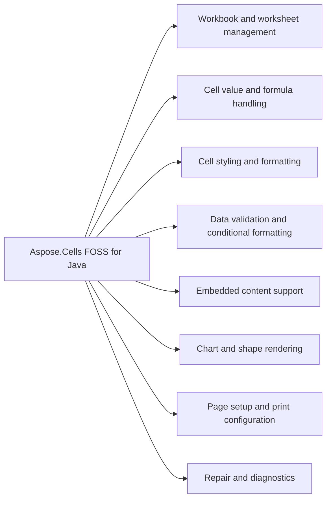

# Aspose.Cells FOSS for Java

 [](License/LICENSE.txt) [](https://github.com/aspose-cells-foss/Aspose.Cells-FOSS-for-Java/graphs/contributors)

[](https://products.aspose.org/cells/java/)

It reads and writes Excel workbooks in XLSX format, manages cell values and styling, and supports data validation, conditional formatting, embedded content, and repair diagnostics.

## Navigation

- [At a Glance](#at-a-glance)
- [Key Capabilities](#key-capabilities)
- [Installation](#installation)
- [Dependencies](#dependencies)
- [Quick Start](#quick-start)
- [Additional Examples](#additional-examples)
- [API Reference](#api-reference)
- [Documentation & Resources](#documentation--resources)
- [Scope and Limitations](#scope-and-limitations)
- [Development and Testing](#development-and-testing)
- [License](#license)

## At a Glance



## Key Capabilities

- **Workbook and worksheet management.** Create, load, and save Excel workbooks through the `Workbook` class, manage individual worksheets via the `WorksheetCollection` including adding, removing, renaming, and setting visibility, and access cell data through the `Cells` collection for string, numeric, boolean, date/time, and formula values.
- **Cell value and formula handling.** Read and write cell values including string, numeric, boolean, date/time, and formula content using the `Cell` class, and apply custom number formats and font styling to cells through the `Style` class.
- **Cell styling and formatting.** Apply comprehensive cell styling including font properties, borders, fills, alignment, and custom number formats via the `Style` class, and adjust row heights and column widths explicitly using the `Row` and `Column` classes.
- **Data validation and conditional formatting.** Enforce data entry rules using `Validation` with types such as whole number and operators like between, and apply conditional formatting to ranges using `FormatCondition` with cell value conditions and custom styling.
- **Embedded content support.** Embed pictures from bytes, streams, or file paths with two-cell anchor positioning, supporting JPEG, PNG, GIF, and BMP formats, and preserve embedded charts and Excel tables (ListObjects) loaded from existing workbooks.
- **Chart and shape rendering.** Create 18 of the 25 `ChartType` values programmatically via `ChartCollection.add()`, while the remaining 7 ChartEx types (Waterfall, Treemap, Sunburst, Histogram, Box and Whisker, Funnel, and Map) are preserved verbatim when loaded but cannot be created through the API.
- **Page setup and print configuration.** Configure page setup and print layout using `PageSetup`, freeze rows and/or columns by coordinate or cell name, and apply worksheet or workbook protection with separate passwords for structure, windows, and revisions.
- **Repair and diagnostics.** Repair corrupted workbooks by enabling strict mode toggles and package/XML repair in `LoadOptions`, and inspect load diagnostics via `Workbook.getLoadDiagnostics()` to retrieve detailed repair messages and preservation notes.

## Installation

Install the published package from Maven Central (`org.aspose:aspose-cells-foss`, version 26.7.0):

```bash
mvn dependency:get -Dartifact=org.aspose:aspose-cells-foss:26.7.0
```

Or declare it in Maven:

```xml
<dependency>
  <groupId>org.aspose</groupId>
  <artifactId>aspose-cells-foss</artifactId>
  <version>26.7.0</version>
</dependency>
```

Or declare it in Gradle:

```groovy
implementation 'org.aspose:aspose-cells-foss:26.7.0'
```

## Dependencies

### Required Package Dependencies

No required third-party package dependencies; in `pom.xml`, every `<dependency>` the POM declares is `test`, `provided` or optional.

### Native and System Requirements

- Requires Java `17` (`maven.compiler.target` in `pom.xml`).

### Development Dependencies

- `org.apache.poi:poi-ooxml 5.3.0`
- `org.junit.jupiter:junit-jupiter 5.10.2`

## Quick Start

The first example creates a new workbook, writes a formatted revenue value to a cell, adjusts row height and column width, and saves the file as `report.xlsx`.

```java
import java.io.*;
import java.util.*;
import org.aspose.cells_foss.*;
import org.aspose.cells_foss.Cell;
import org.aspose.cells_foss.Style;
import org.aspose.cells_foss.Workbook;
import org.aspose.cells_foss.Worksheet;

public class Main {
    public static void main(String[] args) {
        try (Workbook workbook = new Workbook()) {
            Worksheet sheet = workbook.getWorksheets().get(0);
            sheet.setName("Report");

            sheet.getCells().get("A1").putValue("Revenue");
            sheet.getCells().get("B1").putValue(12500.75);

            Cell total = sheet.getCells().get("B1");
            Style style = total.getStyle();
            style.getFont().setBold(true);
            style.setCustom("#,##0.00");
            total.setStyle(style);

            sheet.getCells().getRows().get(0).setHeight(22.0);
            sheet.getCells().getColumns().get(1).setWidth(14.5);

            workbook.save("report.xlsx");
        }
    }
}
```

The second example loads a potentially corrupted workbook with repair options enabled, prints any repair issues found, updates the document author, and saves the repaired workbook as `output.xlsx`.

```java
import java.io.*;
import java.util.*;
import org.aspose.cells_foss.*;
import org.aspose.cells_foss.LoadIssue;
import org.aspose.cells_foss.LoadOptions;
import org.aspose.cells_foss.Workbook;

public class LoadWorkbook {
    public static void main(String[] args) {
        LoadOptions options = new LoadOptions();
        options.setStrictMode(false);
        options.setTryRepairPackage(true);
        options.setTryRepairXml(true);

        try (Workbook workbook = new Workbook("input.xlsx", options)) {
            if (workbook.getLoadDiagnostics().hasRepairs()) {
                for (LoadIssue issue : workbook.getLoadDiagnostics().getIssues()) {
                    System.out.println(issue.getMessage());
                }
            }

            workbook.getDocumentProperties().setAuthor("cells-foss");
            workbook.save("output.xlsx");
        }
    }
}
```

## Additional Examples

Create data validation rules and apply conditional formatting to highlight cells within a specified range.

### Add Validation and Conditional Formatting to a Worksheet Range

```java
import java.io.*;
import java.util.*;
import org.aspose.cells_foss.*;
import org.aspose.cells_foss.CellArea;
import org.aspose.cells_foss.FormatCondition;
import org.aspose.cells_foss.FormatConditionCollection;
import org.aspose.cells_foss.FormatConditionType;
import org.aspose.cells_foss.OperatorType;
import org.aspose.cells_foss.Style;
import org.aspose.cells_foss.Validation;
import org.aspose.cells_foss.ValidationType;
import org.aspose.cells_foss.Workbook;
import org.aspose.cells_foss.Worksheet;

public class RulesExample {
    public static void main(String[] args) {
        try (Workbook workbook = new Workbook()) {
            Worksheet sheet = workbook.getWorksheets().get(0);

            int validationIndex = sheet.getValidations().add(new CellArea(1, 0, 10, 1));
            Validation validation = sheet.getValidations().get(validationIndex);
            validation.setType(ValidationType.WHOLE_NUMBER);
            validation.setOperator(OperatorType.BETWEEN);
            validation.setFormula1("1");
            validation.setFormula2("100");

            int cfIndex = sheet.getConditionalFormattings().add();
            FormatConditionCollection conditions = sheet.getConditionalFormattings().get(cfIndex);
            conditions.addArea(CellArea.createCellArea("B2", "B11"));
            int conditionIndex = conditions.addCondition(
                    FormatConditionType.CELL_VALUE,
                    OperatorType.BETWEEN,
                    "1",
                    "100");

            FormatCondition condition = conditions.get(conditionIndex);
            Style style = condition.getStyle();
            style.getFont().setBold(true);
            condition.setStyle(style);

            workbook.save("rules.xlsx");
        }
    }
}
```

## API Reference

The public entry point is `org.aspose.cells_foss`, and the classes below cover the full supported public API surface — 183 public types organized into one module.

The verified public surface has 183 types.

<details>
<summary>View the Complete Public API Surface</summary>

### Core API

| Class | Description |
| --- | --- |
| `AutoFilter` | Represents an auto-filter in a worksheet. |
| `AutoFilterColorFilter` | Represents the AutoFilterColorFilter component. |
| `AutoFilterCriteria` | Represents auto-filter criteria for filtering data in a worksheet. |
| `AutoFilterCustomFilter` | Represents the AutoFilterCustomFilter component. |
| `AutoFilterCustomFilterCollection` | Represents the AutoFilterCustomFilterCollection component. |
| `AutoFilterDynamicFilter` | Represents the AutoFilterDynamicFilter component. |
| `AutoFilterSortCondition` | Represents the AutoFilterSortCondition component. |
| `AutoFilterSortConditionCollection` | Represents the AutoFilterSortConditionCollection component. |
| `AutoFilterSortState` | Represents the AutoFilterSortState component. |
| `AutoFilterSupport` | Provides utility methods for auto-filter support. |
| `AutoFilterTop10` | Represents the AutoFilterTop10 component. |
| `Border` | Represents a border with line style and color. |
| `Borders` | Represents the border properties for a cell or range in an Excel worksheet. |
| `CalculationProperties` | Represents workbook calculation settings. |
| `Cell` | Represents a cell in a worksheet. |
| `CellArea` | Represents a cell area with row and column bounds. |
| `CellFormatValue` | Inner class representing cell format value. |
| `Cells` | Represents a collection of cells in a worksheet. |
| `CellsException` | Represents an exception thrown by the Aspose.Cells library. |
| `Chart` | Represents an embedded chart in a worksheet (read-only; charts are round-tripped verbatim). |
| `ChartCollection` | Collection of embedded charts on a worksheet. |
| `Color` | Represents an ARGB color value. |
| `Column` | Represents a column in a worksheet. |
| `ColumnCollection` | Represents a collection of columns in a worksheet. |
| `Comment` | Represents a cell comment (note). |
| `CommentCollection` | Collection of cell comments on a worksheet. |
| `ConditionalFormattingCollection` | A collection of conditional formatting objects. |
| `DefinedName` | Represents a defined name in the workbook. |
| `DefinedNameCollection` | Represents a collection of defined names in a workbook. |
| `DisplayFormatSectionInfo` | Holds metadata about a single section of a number format code string. |
| `DisplayTextFormatterSupport` | Internal utility class for selecting and formatting display text sections. |
| `DocumentProperties` | Represents the document properties of a workbook (docProps/core.xml and docProps/app.xml). |
| `FillValue` | Inner class representing fill value. |
| `FilterColumn` | Represents the FilterColumn component. |
| `FilterColumnCollection` | Represents the FilterColumnCollection component. |
| `FilterValueCollection` | Represents the FilterValueCollection component. |
| `Font` | Represents a font with its properties. |
| `FormatCondition` | Represents a conditional formatting rule. |
| `FormatConditionCollection` | Represents a collection of format conditions in Excel. |
| `FormulaException` | Represents an exception that occurs during formula processing. |
| `Hyperlink` | Represents a hyperlink in a worksheet. |
| `HyperlinkCollection` | Represents a collection of hyperlinks in a worksheet. |
| `IWarningCallback` | Provides a callback mechanism for reporting warnings during workbook operations. |
| `InvalidFileFormatException` | Represents an exception thrown when an invalid file format is encountered. |
| `ListColumn` | Represents a column within an Excel table (ListObject). |
| `ListColumnCollection` | Ordered collection of columns in an Excel table. |
| `ListObject` | Represents an Excel table (structured reference / ListObject). |
| `ListObjectCollection` | Collection of Excel tables (ListObjects) on a worksheet. |
| `LoadDiagnostics` | Represents diagnostics information during workbook loading. |
| `LoadIssue` | Represents an issue that occurred during workbook loading. |
| `LoadOptions` | Represents options for loading a workbook. |
| `NumberFormat` | Provides built-in number format functionality. |
| `PageSetup` | Represents page setup options for a worksheet. |
| `Picture` | Represents an embedded image in a worksheet. |
| `PictureCollection` | Collection of embedded pictures on a worksheet. |
| `Row` | Represents a row in a worksheet. |
| `RowCollection` | Represents a collection of rows in a worksheet. |
| `SaveOptions` | Represents save options for workbook saving. |
| `Shape` | Represents a drawing object (auto shape) anchored to a worksheet. |
| `ShapeCollection` | Collection of drawing objects (shapes) on a worksheet. |
| `Style` | Represents the full style of a cell: font, borders, alignment, fill, number format, and protection. |
| `StyleException` | Represents an exception that occurs during style processing. |
| `StyleValueSanitizer` | Sanitizes style values to ensure they fall within valid ranges. |
| `UnsupportedFeatureException` | Thrown when an unsupported feature is encountered. |
| `Validation` | Represents a data validation rule applied to one or more cell areas. |
| `ValidationCollection` | Represents the collection of data validation rules for a worksheet. |
| `WarningInfo` | Represents information about a warning that occurred during workbook operations. |
| `Workbook` | Represents an Excel workbook. |
| `WorkbookLoadException` | Represents an exception that occurs when loading a workbook. |
| `WorkbookProperties` | Represents the properties of a workbook (workbookPr attributes). |
| `WorkbookProtection` | Represents workbook-level protection settings (structure, windows, revision). |
| `WorkbookSaveException` | Represents an exception that occurs when saving a workbook. |
| `WorkbookSettings` | Represents workbook settings for an Excel file. |
| `WorkbookView` | Represents the view / window settings stored in bookViews. |
| `Worksheet` | Represents a worksheet in a workbook. |
| `WorksheetCollection` | Represents a collection of worksheets in a workbook. |
| `WorksheetProtection` | Represents protection settings for a worksheet. |
| `XlsxDocumentProperties` | Helper class for handling XLSX document properties (core and extended). |
| `XlsxWorkbookSerializer` | Serializer for XLSX workbook files 鈥?thin coordinator that delegates to helper classes. |
| `XlsxWorkbookStylesValueHelpers` | Provides helper methods for parsing and formatting workbook style values. |
| `XlsxWorkbookStylesXml` | Provides methods for reading and writing XLSX workbook styles XML. |
| `AlignmentValue` | Represents alignment settings for a cell style. |
| `AutoFilterColorFilterModel` | Represents the AutoFilterColorFilterModel component. |
| `AutoFilterCustomFilterModel` | Represents the AutoFilterCustomFilterModel component. |
| `AutoFilterDynamicFilterModel` | Represents the AutoFilterDynamicFilterModel component. |
| `AutoFilterModel` | Represents a model for auto-filter configuration in Excel. |
| `AutoFilterSortConditionModel` | Represents the AutoFilterSortConditionModel component. |
| `AutoFilterSortStateModel` | Represents the AutoFilterSortStateModel component. |
| `AutoFilterTop10Model` | Represents the AutoFilterTop10Model component. |
| `BorderSideValue` | Represents a border side value with style and color. |
| `BordersValue` | Represents the border values for a cell style, including left, right, top, bottom, and diagonal borders, as well as diagonal direction flags. |
| `CalculationPropertiesModel` | Represents the CalculationPropertiesModel component. |
| `CellAddress` | Represents a cell address with row and column indices. |
| `CellRecord` | Represents a cell record in the Excel file. |
| `ChartModel` | Internal model for an embedded chart. |
| `ColorValue` | Represents a color value with alpha, red, green, and blue components. |
| `ColumnRangeModel` | Represents a range of columns with formatting properties. |
| `CommentModel` | Internal model for a cell comment (note). |
| `ConditionalFormattingModel` | Represents the conditional formatting model for a worksheet. |
| `CoreDocumentPropertiesModel` | Represents the CoreDocumentPropertiesModel component. |
| `DateSerialConverter` | Converts between LocalDateTime values and Excel serial date numbers. |
| `DefinedNameModel` | Represents a defined name model in the Excel file. |
| `DiagnosticBag` | Represents a bag of diagnostic entries. |
| `DiagnosticEntry` | Represents a diagnostic entry with details about a problem or warning. |
| `DocumentPropertiesModel` | Represents the document properties model for an Excel file. |
| `ExtendedDocumentPropertiesModel` | Represents the ExtendedDocumentPropertiesModel component. |
| `FilterColumnModel` | Represents the FilterColumnModel component. |
| `FontValue` | Represents a font value with its properties. |
| `FormatConditionModel` | Represents a format condition model used in Excel conditional formatting. |
| `HeaderFooterModel` | Represents the header and footer model for a worksheet. |
| `HyperlinkModel` | Represents a hyperlink model with its properties. |
| `ListColumnModel` | Internal model for a table (ListObject) column. |
| `ListObjectModel` | Internal model for a table (ListObject / structured reference). |
| `MergeRegion` | Represents a merge region in an Excel worksheet. |
| `NumberFormatValue` | Represents a number format value with its number format index and custom format string. |
| `PageMarginsModel` | Represents page margins for a worksheet in an Excel file. |
| `PageSetupModel` | Represents page setup model for an Excel worksheet. |
| `PictureModel` | Internal model for an embedded picture/image. |
| `PrintOptionsModel` | Represents print options for a worksheet. |
| `ProtectionValue` | Represents protection settings for a cell or range. |
| `RowModel` | Represents a row model in the Excel file. |
| `ShapeModel` | Internal model for a drawing object (auto shape) anchored to a worksheet. |
| `SharedStringRepository` | A repository that manages shared strings for Excel files. |
| `StyleRepository` | Represents a repository for style values. |
| `StyleValue` | Represents a style value with various formatting properties. |
| `ValidationModel` | Represents a data validation model in the Excel file. |
| `WorkbookModel` | Represents the top-level model of a workbook. |
| `WorkbookPropertiesModel` | Represents the workbook properties model. |
| `WorkbookProtectionModel` | Represents the WorkbookProtectionModel component. |
| `WorkbookSettingsModel` | Represents workbook settings model. |
| `WorkbookViewModel` | Represents the WorkbookViewModel component. |
| `WorksheetModel` | Represents the model of a worksheet in the Excel file. |
| `WorksheetProtectionModel` | Represents the protection model for a worksheet in an Excel file. |
| `WorksheetViewModel` | Represents a view model for a worksheet with display settings. |
| `IPackageReader` | Provides a reader interface for reading package models from streams. |
| `IPackageWriter` | Provides a contract for writing package models to a stream. |
| `MissingPartException` | Thrown when a required part is missing from the package structure. |
| `PackageLoadContext` | Represents the context for loading a package. |
| `PackageModel` | Represents the model of a package (e.g., XLSX file structure) with parts, relationships, and unsupported parts. |
| `PackagePartDescriptor` | Represents a descriptor for a package part in the XLSX package. |
| `PackageStructureException` | Thrown when the package structure of the Excel file is invalid. |
| `PackagingConventions` | Defines constants for Open XML package part paths and relationship types. |
| `RelationshipDescriptor` | Represents a relationship descriptor in the XLSX package. |
| `RelationshipResolutionException` | Exception thrown when a relationship cannot be resolved in the package structure. |
| `ValidationMessage` | Represents a validation message with code, severity, and message text. |
| `WorkbookValidator` | A validator for workbook models that produces validation messages. |
| `SharedStringTableXmlMapper` | Maps shared string tables to/from XML. |
| `StylesheetXmlMapper` | Maps style information to and from XML. |
| `WorkbookXmlMapper` | Maps workbook data to/from SpreadsheetML XML format. |
| `WorksheetXmlMapper` | Maps worksheet XML data. |
| `XmlParsingException` | Represents an exception that occurs during XML parsing. |

#### Enumerations

| Enumeration | Description |
| --- | --- |
| `AutoShapeType` | Specifies the type of an auto shape (preset DrawingML geometry). |
| `BorderStyleType` | Represents the style of a border. |
| `CellValueType` | Represents the type of a cell value. |
| `ChartType` | Identifies the type of an embedded chart. |
| `cells_foss.DiagnosticSeverity` | Represents the severity level of a diagnostic message. |
| `FillPattern` | Represents the fill pattern used in cell styling. |
| `FormatConditionType` | Represents the type of a format condition. |
| `HorizontalAlignmentType` | Represents the type of horizontal alignment for cell content. |
| `ImageType` | Identifies the format of an embedded image. |
| `LoadFormat` | Specifies the format of the workbook to be loaded. |
| `OperatorType` | Represents the operator type used in conditional formatting and filtering. |
| `PageOrientationType` | Represents the page orientation type for a worksheet. |
| `PaperSizeType` | Represents the paper size type for a worksheet. |
| `SaveFormat` | Specifies the format in which a workbook will be saved. |
| `TableStyleType` | Identifies a built-in Excel table style. |
| `TargetModeType` | Represents the target mode type for cell references. |
| `TotalsCalculation` | Aggregation function applied to a table's totals row. |
| `ValidationAlertType` | Represents the alert type for data validation. |
| `ValidationType` | Represents the type of cell validation. |
| `VerticalAlignmentType` | Represents vertical alignment options for cell content. |
| `VisibilityType` | Represents the visibility type of a worksheet. |
| `BorderStyle` | Represents the style of a border line in a cell. |
| `CellValueKind` | Represents the kind of a cell value. |
| `DateSystem` | Represents the date system used in Excel. |
| `core.DiagnosticSeverity` | Represents the severity of a diagnostic entry. |
| `FillPatternKind` | Represents the pattern used to fill a cell. |
| `FilterOperatorType` | Enumerates the supported FilterOperatorType values. |
| `HorizontalAlignment` | Represents horizontal alignment options for cell content in Excel. |
| `PageOrientation` | Represents the page orientation for a worksheet. |
| `SheetVisibility` | Represents the visibility state of a worksheet in an Excel workbook. |
| `VerticalAlignment` | Represents vertical alignment options for cell content. |
| `ValidationMessageSeverity` | Represents the severity level of a validation message. |

#### Detailed Member Reference

### cells_foss

The `org.aspose.cells_foss` package serves as the primary namespace for the library's public API surface, containing 183 public types organized into one module.

</details>

## Documentation & Resources

- **[Documentation & Resources](#documentation--resources)** — The documentation and resources section points to the official guides, knowledge base, and repository conventions for Aspose.Cells FOSS for Java.
- **[Getting started guide](https://docs.aspose.org/cells/java/)** — The getting started guide provides Java documentation for Aspose.Cells FOSS for Java covering workbook creation, cell operations, styling, and data validation.
- **[How-to guides & FAQ](https://kb.aspose.org/cells/java/)** — The how-to guides and FAQ offer Java knowledge base articles, step-by-step instructions, and troubleshooting guidance for Aspose.Cells FOSS for Java.
- **[Contributor guide](Agents.md)** — The contributor guide outlines repository conventions to follow when changing supported behavior in Aspose.Cells FOSS for Java.
- **[Publishing guide](PUBLISHING.md)** — The publishing guide describes how releases are built and published to Maven Central for Aspose.Cells FOSS for Java.
- Found a bug or have a feature request? [Open an issue](https://github.com/aspose-cells-foss/Aspose.Cells-FOSS-for-Java/issues).

- **[Full API reference](https://reference.aspose.org/cells/java/)** — the complete, browsable reference for all 183 public types (the [API reference](#api-reference) section above covers the essentials).

## Scope and Limitations

Aspose.Cells FOSS for Java reads and writes Excel workbooks in the .xlsx format, providing a Java API for workbook, worksheet, cell, style, and collection management, as well as load and save operations.

- Saving is currently limited to .xlsx, and the library is not a full spreadsheet calculation engine, so formulas are stored and round-tripped without evaluation.
- `ChartEx` types (Waterfall, Treemap, Sunburst, Histogram, Box and Whisker, Funnel, and Map) cannot be created programmatically; charts of these types loaded from an existing workbook are preserved verbatim across load and save.
- A handful of public XML-mapper classes are unimplemented skeleton code carried over from an early scaffold, and some APIs exist mainly to preserve OOXML metadata and package fidelity rather than to provide full Excel feature parity.

The public API lives under `src/main/java/org/aspose/cells_foss/`, with integration tests,
unit tests, and generated Javadoc alongside it at the repository root:

```
├── src/main/java/org/aspose/cells_foss/  # Public API: Workbook, Worksheet, Cell, Style, collections, enums, load/save options
│   ├── core/                             #   Internal workbook, worksheet, style, validation, metadata, and packaging models
│   ├── packaging/                        #   OOXML package and relationship abstractions
│   ├── xml/                              #   XML mappers and parsing helpers
│   └── validation/                       #   Workbook validation messages and validation helpers
├── src/test/java/org/aspose/cells_foss/  # Scenario-driven integration tests for workbook behavior and XLSX round-tripping
│   └── unit/                             #   Fast, focused unit tests for individual API classes without XLSX I/O
└── docs/apidocs/                         # Generated HTML Javadoc for the public API (run `mvn javadoc:javadoc` to regenerate)
```

These limitations don't apply to [full-featured Aspose.Cells for Java — Enterprise Edition](https://products.aspose.com/cells/java/). It adds additional spreadsheet save formats beyond .xlsx, a full formula calculation engine, ChartEx chart type creation, and dedicated enterprise support.

## Development and Testing

Aspose.Cells FOSS for Java targets Java 17 and uses Maven as the build tool. The test suite resides in src/test/ and asserts the library's behavior for the cells family of functionality. No required third-party package dependencies exist at runtime; Apache POI is used only in test scope. The project builds from `pom.xml` without external dependencies outside test scope.

The suite covers 23 test files under `src/test/`. Releases run through the [maven-central-release workflow](.github/workflows/maven-central-release.yml).

The library targets Java 17 and depends on Apache POI only in `test` scope, never at runtime.

Requires JDK 17+ and Maven as the build tool. Run the test suite:

```bash
mvn test
```

Other common commands:

```bash
mvn compile
mvn clean package
mvn javadoc:javadoc   # generates docs/apidocs/index.html
```

Releases publish to Maven Central via
[`maven-central-release.yml`](.github/workflows/maven-central-release.yml) — see
[`PUBLISHING.md`](PUBLISHING.md) for the full release process.

## License

This project is licensed under the [MIT License](License/LICENSE.txt). The MIT License permits use, copying, modification, distribution, sublicensing, and commercial use, provided its copyright and permission notice are retained. The software is provided without warranty.
