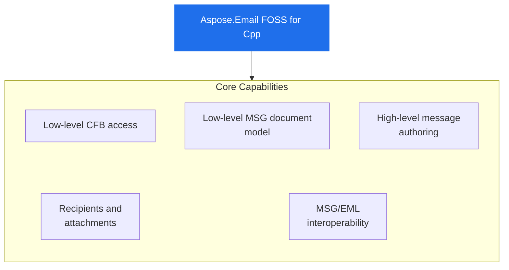

# Aspose.Email FOSS for Cpp

 [](LICENSE) [](CMakeLists.txt)

[](https://products.aspose.org/email/cpp/)

Aspose.Email FOSS for Cpp reads and writes MSG and EML email formats. It converts email messages between MSG and EML representations. It constructs new email messages and saves them in MSG or EML format.

## Navigation

- [At a Glance](#at-a-glance)
- [Key Capabilities](#key-capabilities)
- [Installation](#installation)
- [Dependencies](#dependencies)
- [Quick Start](#quick-start)
- [Additional Examples](#additional-examples)
- [API Reference](#api-reference)
- [Documentation & Resources](#documentation--resources)
- [Scope and Limitations](#scope-and-limitations)
- [Development and Testing](#development-and-testing)
- [License](#license)

## At a Glance



## Key Capabilities

- **Low-level CFB access.** It reads, builds, and writes generic Compound File Binary containers directly through `cfb_reader`, `cfb_storage`/`cfb_stream`, and `cfb_writer`, working with file paths, in-memory streams, or raw byte buffers.
- **Low-level MSG document model.** It parses and reconstructs the raw MSG directory/stream structure with `msg_reader`, `msg_document`, and `msg_writer`, including an optional strict-validation mode surfaced through `validation_issues()`.
- **High-level message authoring.** It creates, edits, saves, and reloads Outlook-style messages through `mapi_message`, setting the subject, plain-text and HTML bodies, and sender identity, or reaching arbitrary MAPI properties via `set_property()`/`get_property_value()` with `common_message_property_id` and `property_type_code`.
- **Recipients and attachments.** It adds To/Cc/Bcc recipients with `add_recipient()`, attaches regular files from byte buffers or streams with `add_attachment()`, and nests a full `mapi_message` as an embedded-message attachment with `add_embedded_message_attachment()`.
- **MSG/EML interoperability.** It saves an in-memory `mapi_message` to .eml and loads .eml back into a `mapi_message`, both through the library's own MIME engine, with no external MIME dependency.

- **Low-level CFB access** — read, build, and write generic Compound File Binary containers
  directly through `cfb_reader`, `cfb_storage`/`cfb_stream`, and `cfb_writer`, working with file
  paths, in-memory streams, or raw byte buffers.
- **Low-level MSG document model** — parse and reconstruct the raw MSG directory/stream structure
  with `msg_reader`, `msg_document`, and `msg_writer`, including an optional strict-validation mode
  surfaced through `validation_issues()`.
- **High-level message authoring** — create, edit, save, and reload Outlook-style messages through
  `mapi_message`, setting the subject, plain-text and HTML bodies, and sender identity, or reaching
  arbitrary MAPI properties via `set_property()`/`get_property_value()` with
  `common_message_property_id` and `property_type_code`.
- **Recipients and attachments** — add To/Cc/Bcc recipients with `add_recipient()`, attach regular
  files from byte buffers or streams with `add_attachment()`, and nest a full `mapi_message` as an
  embedded-message attachment with `add_embedded_message_attachment()`.
- **MSG/EML interoperability** — save an in-memory `mapi_message` to `.eml` and load `.eml` back
  into a `mapi_message`, both through the library's own MIME engine, with no external MIME
  dependency.

## Installation

No install command for `AsposeEmailFoss` is available.

## Dependencies

### Required Package Dependencies

No required third-party package dependencies; in `CMakeLists.txt`, no dependency is on the library target's public link interface, so a consumer links nothing beyond the library itself.

### Native and System Requirements

- Requires C++ `17` (`CMAKE_CXX_STANDARD` in `CMakeLists.txt`).
- Requires CMake 3.26 or later (`cmake_minimum_required` in `CMakeLists.txt`).

## Quick Start

Read a subject from an MSG file opened as a binary stream:

```cpp
#include <fstream>
#include <iostream>

#include "aspose/email/foss/msg/mapi_message.hpp"

int main()
{
    std::ifstream input("sample.msg", std::ios::binary);
    auto message = aspose::email::foss::msg::mapi_message::from_stream(input);
    std::cout << message.subject() << '\n';
}
```

## Additional Examples

Create a message and save it as both MSG and EML:

```cpp
#include <fstream>

#include "aspose/email/foss/msg/mapi_message.hpp"

int main()
{
    auto message = aspose::email::foss::msg::mapi_message::create("Hello", "Body");
    message.set_sender_name("Alice");
    message.set_sender_email_address("alice@example.com");
    message.add_recipient("bob@example.com", "Bob");
    message.add_attachment("note.txt", std::vector<std::uint8_t>{'a', 'b', 'c'}, "text/plain");

    std::ofstream msg_output("hello.msg", std::ios::binary);
    message.save(msg_output);

    std::ofstream eml_output("hello.eml", std::ios::binary);
    message.save_to_eml(eml_output);
}
```

## API Reference

Aspose.Email FOSS for Cpp exposes the `mapi_message` class as the primary high-level entry point for creating, editing, and reloading Outlook MSG messages, while lower-level classes such as `msg_reader`, `msg_document`, `msg_writer`, `cfb_reader`, `cfb_document`, and `cfb_writer` provide direct access to the underlying MSG and CFB container structures.

The public API has 26 types.

<details>
<summary>View the Complete Public API Surface</summary>

### Core API

| Class | Description |
| --- | --- |
| `cfb_document` | cfb_document class provides methods to load a Compound File Binary document from a buffer, bytes, file, reader, or stream, and exposes its major_version, minor_version, and root. |
| `cfb_exception` | cfb_exception class represents an exception type for errors in the CFB processing module. |
| `cfb_node` | cfb_node class represents a node in a CFB structure and provides access to its name, clsid, creation_time, modified_time, and indicates whether it is a storage or stream. |
| `cfb_reader` | cfb_reader class reads a Compound File Binary document and provides access to its header, directory_entries, fat, difat, mini_fat, and methods to find and retrieve stream data. |
| `cfb_storage` | cfb_storage class represents a storage node in a CFB document and provides methods to add child storages and streams, and to access its children. |
| `cfb_stream` | cfb_stream class represents a stream node in a CFB document and provides methods to get and set its data. |
| `cfb_writer` | cfb_writer class writes a Compound File Binary document and provides methods to write to bytes, file, or stream. |
| `directory_entry` | directory_entry class represents an entry in the CFB directory and provides fields for child_id, clsid, color_flag, creation_time, directory_entry_name_length, and methods to indicate if it is a root, storage, or stream. |
| `header` | header class represents the header of a Compound File Binary document and provides fields for byte_order, difat, first_difat_sector_location, first_directory_sector_location, first_mini_fat_sector_location, header_clsid, header_signature, and major_version. |
| `mapi_attachment` | mapi_attachment class represents a MAPI attachment and provides fields for content_id, data, embedded_message, filename, and methods to load from bytes or stream, determine if it is an embedded message, and load its data. |
| `mapi_message` | mapi_message class represents a MAPI message and provides methods to add attachments and recipients, and access its body and attachments. |
| `mapi_property` | mapi_property class represents a MAPI property and provides methods to access and set its flags, property_id, property_tag, property_type, and value. |
| `mapi_property_collection` | mapi_property_collection class represents a collection of MAPI properties and provides methods to add, get, set, remove, and access items. |
| `mapi_recipient` | mapi_recipient class represents a MAPI recipient and provides fields for address_type, display_name, email_address, properties, and recipient_type. |
| `msg_document` | msg_document class represents a MSG document and provides methods to load from file, reader, or stream, and exposes its major_version, minor_version, root, strict flag, and conversion to cfb_document. |
| `msg_exception` | msg_exception class represents an exception type for errors in the MSG processing module. |
| `msg_reader` | msg_reader class reads a MSG document from file or stream and provides access to its cfb document, strict flag, and validation_issues. |
| `msg_storage` | msg_storage class represents a storage node in a MSG document and provides fields for clsid, creation_time, modified_time, name, and methods to add storages and streams, and find child storages or streams. |
| `msg_stream` | msg_stream class represents a stream node in a MSG document and provides fields for clsid, creation_time, data, modified_time, name, and state_bits. |
| `msg_writer` | msg_writer class writes a MSG document and provides methods to write to bytes, file, or stream. |

#### Enumerations

| Enumeration | Description |
| --- | --- |
| `directory_color_flag` | directory_color_flag enum lists the black and red color flags used in directory entries. |
| `directory_object_type` | directory_object_type enum lists the root_storage_object, storage_object, stream_object, and unknown_or_unallocated object types used in directory entries. |
| `sector_marker` | sector_marker enum lists the difsect, endofchain, fatsect, and freesect markers used in the sector allocation tables. |
| `common_message_property_id` | common_message_property_id enum lists property identifiers such as attach_content_id, attach_data_binary, attach_filename, attach_long_filename, attach_method, attach_mime_tag, body, body_html, display_bcc, display_cc, display_name, and display_to. |
| `msg_storage_role` | msg_storage_role enum lists the attachment, custom_attachment, embedded_message, generic, message, named_property_mapping, and recipient roles for MSG storages. |
| `property_type_code` | property_type_code enum lists property type codes such as ptyp_binary, ptyp_boolean, ptyp_currency, ptyp_error_code, ptyp_floating32, ptyp_floating64, ptyp_floating_time, ptyp_guid, ptyp_integer16, ptyp_integer32, ptyp_integer64, and ptyp_multiple_binary. |

#### Detailed Member Reference

### aspose

The aspose namespace serves as the top-level namespace for the Aspose.Email FOSS for Cpp library, under which the `aspose.email` and Aspose.Email FOSS for Cpp sub-namespaces organize the email processing and open-source functionality respectively.

### email

The `aspose.email` namespace contains core email-related types including the high-level `mapi_message` class and supporting structures for message authoring, as well as low-level MSG and CFB access classes such as `msg_reader`, `msg_document`, `msg_writer`, `cfb_reader`, `cfb_document`, and `cfb_writer`.

### foss

The `aspose.email.foss` namespace provides the complete set of open-source MSG and CFB processing classes including `mapi_message`, `mapi_attachment`, `mapi_recipient`, `mapi_property`, `mapi_property_collection`, `msg_reader`, `msg_document`, `msg_writer`, `msg_storage`, `msg_stream`, `cfb_reader`, `cfb_document`, `cfb_writer`, `cfb_storage`, `cfb_stream`, and supporting enumerations and structs.

`mapi_message` is the primary high-level entry point for creating, editing, and reloading
messages; the lower-level `msg_reader`/`msg_document`/`msg_writer` and
`cfb_reader`/`cfb_document`/`cfb_writer` classes expose the underlying MSG and CFB container
structure directly for callers that need it.

| Class | Description |
|---|---|
| `cfb_document` | Mutable Compound File Binary (CFB) document — holds the root `cfb_storage` tree and header fields (major/minor version, transaction signature number); built via `from_reader`/`from_file`/`from_stream`/`from_bytes`/`from_buffer`. |
| `cfb_exception` | Exception type thrown for malformed or unsupported Compound File Binary (CFB) content (a `std::runtime_error` subclass). |
| `cfb_node` | Abstract base class for CFB tree nodes (`cfb_storage` or `cfb_stream`) — carries name, CLSID, state bits, and creation/modified timestamps common to both. |
| `cfb_reader` | Reusable reader for parsed Compound File Binary (CFB) containers — exposes the header, FAT/mini-FAT/DIFAT chains, and directory entries, and resolves storage/stream data by ID or path. |
| `cfb_storage` | Mutable CFB storage node — a directory-like container of child nodes (nested storages and streams), built with `add_storage`/`add_stream`. |
| `cfb_stream` | Mutable CFB stream node holding a raw byte payload (`data()`). |
| `cfb_writer` | Static serializer that writes a `cfb_document` to bytes, a file, or an output stream (`to_bytes`/`write_file`/`write_stream`). |
| `mapi_attachment` | Mutable MAPI attachment — filename, raw `data`, MIME type, content ID, an optional embedded `mapi_message`, and its own MAPI properties; built via `from_bytes`/`from_stream`. |
| `mapi_message` | Mutable high-level MSG object — creates, loads (`from_file`/`from_stream`/`load_from_eml`), edits, and saves Outlook `.msg` messages, with subject/body, recipients, attachments, and MAPI properties. |
| `mapi_property` | A single MAPI property — numeric `property_id`, `property_type`, `value`, and `flags`, combined into a `property_tag`. |
| `mapi_property_collection` | Ordered collection of `mapi_property` entries, keyed by (property ID, property type), with `set`/`add`/`get`/`remove` lookup. |
| `mapi_recipient` | Mutable MAPI recipient — display name, email address, recipient type, address type, and its own `mapi_property_collection`. |
| `msg_document` | Mutable MSG document model — wraps a `msg_storage` root, and converts to a `cfb_document` for CFB serialization via `to_cfb_document`. |
| `msg_exception` | Exception type thrown for malformed or unsupported MSG structures (a `std::runtime_error` subclass). |
| `msg_reader` | Reader for the MSG-specific container layout, built on top of a `cfb_reader` — validates the top-level MSG structure and records `validation_issues`. |
| `msg_storage` | Mutable MSG storage node — name, role (`msg_storage_role`), CLSID/timestamps, and child `msg_stream`/`msg_storage` collections, with `add_stream`/`add_storage`/`find_stream`/`find_storage`. |
| `msg_stream` | Mutable MSG stream node holding a name, raw byte payload, CLSID, and state/timestamp metadata. |
| `msg_writer` | Static serializer that writes a `msg_document` to bytes, a file, or an output stream (`to_bytes`/`write_file`/`write_stream`). |

| Struct | Description |
|---|---|
| `directory_entry` | One CFB directory record — name, object type, sibling/child links, CLSID, timestamps, and stream location/size; `is_storage()`/`is_stream()`/`is_root()` classify it. |
| `header` | The 512-byte CFB file header — signature, CLSID, version, sector-shift fields, and FAT/mini-FAT/DIFAT layout counters. |

| Enumeration | Description |
|---|---|
| `common_message_property_id` | Common MAPI property identifiers used by the MSG reader/writer for core message semantics (`message_class`, `subject`, `body`, `sender_email_address`, `attach_filename`, and more). |
| `directory_color_flag` | Red-black tree color used by a CFB directory entry's sibling links (`red`, `black`). |
| `directory_object_type` | Classifies a CFB directory entry's payload — `unknown_or_unallocated`, `storage_object`, `stream_object`, or `root_storage_object`. |
| `msg_storage_role` | Classifies an MSG storage node's role — `generic`, `message`, `recipient`, `attachment`, `embedded_message`, `named_property_mapping`, or `custom_attachment`. |
| `property_type_code` | MAPI property type codes used in MSG property tags (`ptyp_string`, `ptyp_binary`, `ptyp_integer32`, `ptyp_time`, and more, including their `ptyp_multiple_*` array variants). |
| `sector_marker` | Special FAT marker values reserved for sector allocation metadata (`difsect`, `fatsect`, `endofchain`, `freesect`). |

- `msg_reader`
  - `from_file(path, strict) -> msg_reader` / `from_stream(stream, strict) -> msg_reader`
  - `cfb() -> cfb::cfb_reader`, `validation_issues() -> std::vector<std::string>`

- `msg_document`
  - `from_reader(reader) -> msg_document`, `from_file(path, strict) -> msg_document`,
    `from_stream(stream, strict) -> msg_document`
  - `root() -> msg_storage`, `to_cfb_document() -> cfb::cfb_document`

- `msg_writer`
  - `to_bytes(document) -> std::vector<std::uint8_t>`, `write_file(document, path) -> void`,
    `write_stream(document, stream) -> void`

- `msg_storage`
  - `add_stream(stream) -> msg_stream`, `add_storage(storage) -> msg_storage`,
    `find_stream(stream_name) -> msg_stream`, `find_storage(storage_name) -> msg_storage`
  - properties: `streams: std::vector<msg_stream>`, `storages: std::vector<msg_storage>`,
    `role: msg_storage_role`

- `cfb_reader`
  - `from_file(path)` / `from_stream(stream)` / `from_bytes(data)` /
    `from_buffer(data, size) -> cfb_reader`
  - `header() -> header`, `directory_entries() -> std::vector<directory_entry>`,
    `root_entry() -> directory_entry`
  - `get_entry(stream_id) -> directory_entry`,
    `get_stream_data(stream_id) -> std::vector<std::uint8_t>`
  - `storage_ids()`/`stream_ids() -> std::vector<std::uint32_t>`,
    `child_ids(storage_stream_id) -> std::vector<std::uint32_t>`
  - `find_child_by_name(storage_stream_id, name) -> std::optional<std::uint32_t>`,
    `resolve_path(names, start_stream_id) -> std::optional<std::uint32_t>`

- `cfb_document`
  - `root() -> cfb_storage`
  - `from_reader(reader)` / `from_file(path)` / `from_stream(stream)` / `from_bytes(data)` /
    `from_buffer(data, size) -> cfb_document`

- `cfb_writer`
  - `to_bytes(document) -> std::vector<std::uint8_t>`, `write_file(document, path) -> void`,
    `write_stream(document, stream) -> void`

- `cfb_storage` / `cfb_stream`
  - `cfb_storage::add_storage(storage) -> cfb_storage`, `cfb_storage::add_stream(stream) -> cfb_stream`
  - `cfb_stream::data() -> std::vector<std::uint8_t>` / `cfb_stream::set_data(value) -> void`

- `mapi_attachment`
  - `from_bytes(filename, data, mime_type, content_id) -> mapi_attachment` /
    `from_stream(filename, stream, mime_type, content_id) -> mapi_attachment`
  - `is_embedded_message() -> bool`
  - properties: `filename`, `data`, `mime_type`, `content_id`,
    `embedded_message: std::shared_ptr<mapi_message>`

- `mapi_recipient`
  - properties: `display_name`, `email_address`, `recipient_type`, `address_type`

- `mapi_property`
  - `property_id() -> std::uint16_t`, `property_type() -> std::uint16_t`
  - `value() -> std::any` / `set_value(value) -> void`, `property_tag() -> std::uint32_t`

</details>

## Documentation & Resources

- **[Getting started guide](https://docs.aspose.org/email/cpp/)** — installation, walkthroughs, and feature guides for this library.
- **[How-to guides & FAQ](https://kb.aspose.org/email/cpp/)** — task-focused answers for common MSG/EML/CFB processing questions.
- **[Full API reference](https://reference.aspose.org/email/cpp/)** — the complete, browsable reference for all 26 public types (the [API reference](#api-reference) section above covers the essentials).
- **[Public API surface](PUBLIC_API.md)** — the stable public namespaces and headers this library commits to.
- **[Changelog](CHANGELOG.md)** — release history.
- Found a bug or have a feature request? [Open an issue](https://github.com/aspose-email-foss/Aspose.Email-FOSS-for-Cpp/issues).

## Scope and Limitations

For a full command-line workflow, see [`examples/create_msg_and_eml.cpp`](examples/create_msg_and_eml.cpp), [`examples/msg_reader.cpp`](examples/msg_reader.cpp), and [`examples/msg_summary.cpp`](examples/msg_summary.cpp) under Additional Examples below.

Runnable CLI examples live in the [`examples/`](examples/) directory — turn on `ASPOSE_EMAIL_FOSS_BUILD_EXAMPLES` to build them (see [Development and Testing](#development-and-testing)); [`examples/README.md`](examples/README.md) maps each one to the specific API calls it exercises.

`read_option()` (command-line argument parsing) and `to_underlying()` (enum-to-underlying-type cast) are small helpers defined earlier in the same file, [`examples/create_msg_and_eml.cpp`](examples/create_msg_and_eml.cpp) — this excerpt is its `main()`.

`build_dump()` is a formatting helper defined earlier in the same file, [`examples/msg_reader.cpp`](examples/msg_reader.cpp), that walks the `msg_reader`/`msg_document` pair and renders their CFB directory/stream structure as text.

[`examples/msg_summary.cpp`](examples/msg_summary.cpp) is a third example worth knowing about: it opens a `.msg` file through `mapi_message` and prints a high-level summary — subject, sender, recipients, attachments, and a body preview — including looking up an arbitrary MAPI property by ID and type when `--property-id`/`--property-type` are passed on the command line. Its `main()` is longer than is useful to reproduce here; see the file directly.

- No SMTP, IMAP, POP3, or other network mail-protocol support — this library reads and writes MSG, CFB, and EML containers and messages already on disk, in memory, or in a stream; it is not a mail client or transport library.
- No PST (Outlook Personal Folders) archive support — only single MSG-format messages and generic CFB containers are supported, not multi-message PST stores.
- Only a curated subset of MAPI properties (subject, plain-text and HTML body, message class, sender name/address/address type, and Internet Message-ID) has a dedicated named accessor on `mapi_message`; every other property must be read and written through the generic `get_property_value()`/`set_property()` pair with `common_message_property_id` and `property_type_code`.

See [Aspose.Email for Cpp — Enterprise Edition](https://products.aspose.com/email/cpp/). It adds mail-protocol connectivity, PST archive support, and broader MAPI property and format coverage across the full commercial product line.

## Development and Testing

The suite covers 3 test files under `tests/`.

Build it from source with CMake and either add it as a subdirectory of your own build, or install it and consume it with `find_package(AsposeEmailFoss)`.

```cmake
add_subdirectory(Aspose.Email-FOSS-for-Cpp)
target_link_libraries(your_app PRIVATE AsposeEmailFoss::AsposeEmailFoss)
```

```powershell
cmake --preset default
cmake --build --preset default
ctest --preset default
```

This uses the repo's own `CMakePresets.json` "default" configuration (Ninja generator, `RelWithDebInfo`, tests on, examples off). The library target is `AsposeEmailFoss` (alias `AsposeEmailFoss::AsposeEmailFoss`); no third-party dependency is fetched to build or test it.

```powershell
cmake --install out\build\default --prefix out\install\default
```

This installs the headers plus a CMake package config (`AsposeEmailFossConfig.cmake`) under the given prefix, so a downstream project can consume the library with `find_package(AsposeEmailFoss)` instead of vendoring the source tree.

- CMake 3.26 or later — the version floor set by the project's own `cmake_minimum_required`.
- Ninja — the generator configured by the repository's own `default` CMake preset (`CMakePresets.json`); any CMake-supported generator works if you configure the project directly instead of through that preset.

```powershell
cmake --preset default
cmake --build --preset default
ctest --preset default
```

Three test executables are registered with CTest, each written directly against the standard library with no external test framework fetched: `aspose_email_foss_cfb_tests` (CFB layer), `aspose_email_foss_msg_tests` (MSG/`mapi_message` layer), and `aspose_email_foss_public_tests` (checks generated constant/enum values — the version string and CFB/MSG well-known constants — against expectations); see `tests/CMakeLists.txt`.

Runnable example programs have their own build instructions and a per-file task index in [`examples/README.md`](examples/README.md); turn them on with `-DASPOSE_EMAIL_FOSS_BUILD_EXAMPLES=ON -DASPOSE_EMAIL_FOSS_BUILD_TESTS=OFF` (they are off by default in the `default` preset).

## License

This project is licensed under the [MIT License](LICENSE). The MIT License permits use, copying, modification, distribution, sublicensing, and commercial use, provided its copyright and permission notice are retained. The software is provided without warranty.
