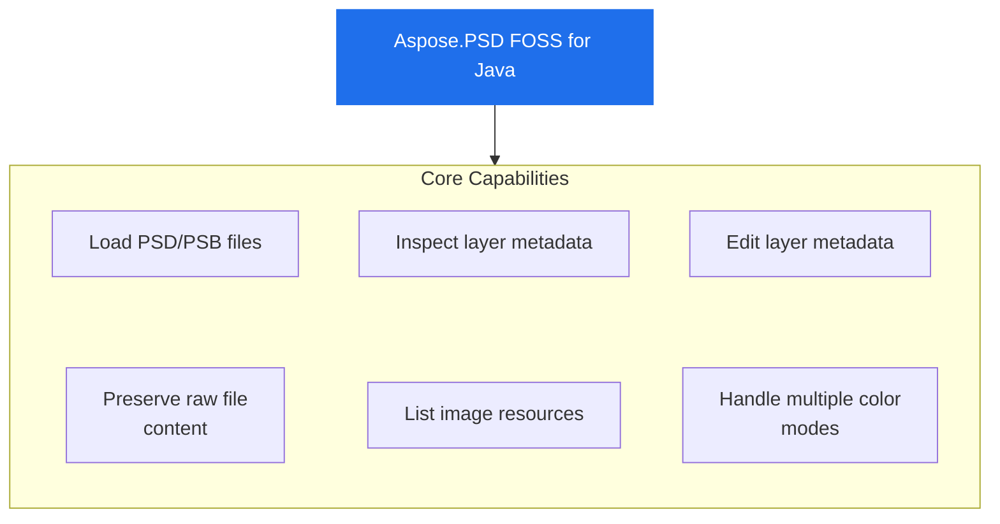

# Aspose.PSD FOSS for Java

[](https://central.sonatype.com/artifact/org.aspose/aspose-psd-foss)  [](LICENSE) [](https://github.com/aspose-psd-foss/Aspose.PSD-FOSS-for-Java/graphs/contributors)

[](https://products.aspose.org/psd/java/)

It loads PSD and PSB files, reads header and layer metadata, modifies layer properties such as name, visibility, and opacity, and saves the modified files back to disk.

Aspose.PSD FOSS for Java is a free, open-source Java library — a FOSS implementation of an API for
working with PSD and PSB files: loading documents, reading their header and layer metadata,
changing a small set of layer properties, and saving the files again without rendering a pixel.
It is an open-source PSD reader and layer-metadata editor for Java, not a rendering engine, a
raster editor, or a replacement for the full commercial Aspose.PSD product.

## Navigation

- [At a Glance](#at-a-glance)
- [Key Capabilities](#key-capabilities)
- [Installation](#installation)
- [Dependencies](#dependencies)
- [Quick Start](#quick-start)
- [API Reference](#api-reference)
- [Documentation & Resources](#documentation--resources)
- [Scope and Limitations](#scope-and-limitations)
- [Development and Testing](#development-and-testing)
- [License](#license)

## At a Glance



## Key Capabilities

- **Load PSD/PSB files.** It loads RGB PSD and PSB documents from a file path with `PsdImage.load`(String) or from a stream with `PsdImage.load`(InputStream), reads header properties such as width, height, bits per channel, color mode, compression, and channel count, and supports RGB, CMYK and indexed-color PSD files without requiring Photoshop.
- **Inspect layer metadata.** It inspects layer metadata by exposing each layer through `PsdImage.getLayers`, reporting the layer name, visibility, opacity, clipping, blend mode key, and position coordinates.
- **Edit layer metadata.** It edits layer metadata by allowing name, visibility, and opacity changes via setName, setVisible, and setOpacity, and writes position, clipping, and blend-mode properties while preserving the layer's pixel data.
- **Preserve raw file content.** It preserves raw file content by saving documents with a raw-preserving strategy such that documents saved without changes are identical to the file that was loaded, and unedited sections are copied through unchanged.
- **List image resources.** It lists image resources through getImageResources, exposing each resource's id, name, and size, while preserving their payloads on save without exposing their internal data.
- **Handle multiple color modes.** It handles multiple color modes by supporting RGB, CMYK and indexed-color PSD files during load and save operations.

- Loads a PSD document, or an RGB PSB large-format document, from a file path with
  `PsdImage.load(String)` or from a stream with `PsdImage.load(InputStream)`, and reads the header
  properties `getWidth()`, `getHeight()`, `getBitsPerChannel()`, `getColorMode()`,
  `getCompression()` and `getChannelsCount()`. RGB, CMYK and indexed-color PSD files load, and no
  Photoshop installation is needed.
- Reads every layer through `PsdImage.getLayers()`. Each `Layer` reports its `getName()`,
  `isVisible()`, `getOpacity()`, `getClipping()`, `getBlendModeKey()` and its position —
  `getLeft()`, `getTop()`, `getRight()` and `getBottom()` — together with read-only channel, mask
  and blending-range information.

## Installation

Install the published package from Maven Central (`org.aspose:aspose-psd-foss`, version 26.11.0):

```bash
mvn dependency:get -Dartifact=org.aspose:aspose-psd-foss:26.11.0
```

Or declare it in Maven:

```xml
<dependency>
  <groupId>org.aspose</groupId>
  <artifactId>aspose-psd-foss</artifactId>
  <version>26.11.0</version>
</dependency>
```

Or declare it in Gradle:

```groovy
implementation 'org.aspose:aspose-psd-foss:26.11.0'
```

## Dependencies

### Required Package Dependencies

No required third-party package dependencies; in `pom.xml`, every `<dependency>` the POM declares is `test`, `provided` or optional.

### Native and System Requirements

- Requires Java `11` (`maven.compiler.release` in `pom.xml`).

### Development Dependencies

- `org.junit.jupiter:junit-jupiter 5.10.2`

## Quick Start

```java
import org.aspose.psd.PsdImage;
import org.aspose.psd.layers.Layer;

public class QuickStart {
    public static void main(String[] args) throws Exception {
        try (PsdImage psd = PsdImage.load("test/resources/layer-variants.psd")) {
            System.out.println(psd.getWidth() + " x " + psd.getHeight());
            System.out.println("Color mode: " + psd.getColorMode());

            Layer[] layers = psd.getLayers();
            System.out.println("Layers: " + layers.length);
            for (Layer layer : layers) {
                String name = layer.getName().isEmpty() ? "(unnamed)" : layer.getName();
                System.out.println(name
                        + " visible=" + layer.isVisible()
                        + " opacity=" + (layer.getOpacity() & 0xFF));
            }

            // Modify a layer property: rename it, hide it, and set its opacity to about 50%
            if (layers.length > 0) {
                Layer first = layers[0];
                first.setName("Renamed layer");
                first.setVisible(false);
                first.setOpacity((byte) 128);
            }

            psd.save("output.psd");
        }
    }
}
```

## API Reference

The `PsdImage` class serves as the library's entry point for loading and saving PSD files, and it returns `Layer` instances through its getLayers method. `Layer` provides access to editable per-layer metadata such as name, visibility, and opacity.

The public API has 60 types.

<details>
<summary>View the Complete Public API Surface</summary>

### Core API

| Class | Description |
| --- | --- |
| `BigEndianReader` | Reads big-endian data from a stream. |
| `BigEndianWriter` | Writes big-endian data to a stream. |
| `Image` | Provides the Aspose.PSD-compatible base image entry point for loading PSD/PSB documents. |
| `ImageLoader` | Provides the Load functionality for Images |
| `LayerAndMaskSectionReader` | Reads PSD/PSB Layer and Mask Information sections. |
| `LayerAndMaskSectionWriter` | Writes PSD/PSB Layer and Mask Information sections. |
| `Point` | Represents an ordered pair of integer x- and y-coordinates that defines a point in a two-dimensional plane. |
| `PsdImage` | Represents a PSD image that can be loaded, inspected, and saved without rendering. |
| `PsdSectionReader` | Provides bounded reads for PSD/PSB sections that are stored in memory by this implementation. |
| `Rectangle` | Stores a set of four integers that represent the location and size of a rectangle. |
| `RectangleF` | Stores a set of four floating-point numbers that represent the location and size of a rectangle. |
| `ResourceBlock` | Represents a PSD image resource block. |
| `Size` | Represents an ordered pair of integer width and height values that defines a size. |
| `StreamContainer` | Represents a stream container used by resource save APIs. |
| `PsdLoadException` | Exception that is thrown when an error occurs while loading a PSD file. |
| `PsdSaveException` | Exception that is thrown when an error occurs while saving a PSD file. |
| `BlendRange` | Represents a PSD layer blend range. |
| `ChannelInformation` | Class that declares the methods getChannelId, getCompressionMethod, getLength, setChannelId and setCompressionMethod and the properties channelId, compressionMethod and length. |
| `GlobalLayerMaskInfo` | Represents global layer mask information. |
| `Layer` | Represents a single PSD layer with basic metadata used by the FOSS library. |
| `LayerBlendModeMapper` | Class that declares the methods getBlendModeKey and parseBlendModeKey and the field NORMAL_BLEND_MODE_KEY. |
| `LayerBlendingRangesData` | Represents PSD layer blending ranges data. |
| `LayerBlendingRangesInfo` | Provides a read-only summary of the parsed layer blending ranges subsection. |
| `LayerChannelInfo` | Stores one channel metadata entry from a layer record. |
| `LayerMaskData` | Defines the base class for PSD layer mask data. |
| `LayerMaskDataShort` | Defines layer mask data for layers that have only a raster or vector mask. |
| `LayerMaskInfo` | Provides a read-only summary of the parsed layer mask subsection. |
| `LayerRawData` | Holds raw layer data parsed from a PSD file. |
| `LayerRecordReader` | Class that declares the method load. |
| `LayerRecordWriter` | Writes PSD/PSB layer records from the in-memory Layer model. |
| `LayerResource` | Represents a PSD layer resource. |
| `PsdLayerChannelInfo` | Provides a read-only summary of one parsed layer channel record. |
| `RawLayerMaskSection` | Class that declares the methods empty, getRawBytes, getRawData and load and the properties rawBytes and rawData and the field EMPTY. |
| `PsdImageLoader` | Class that declares the method load. |
| `ImageResourceIds` | Provides common PSD image resource identifiers used by tests and fixtures. |
| `IndexedColorPalette` | Class that declares the methods getEntries, parse and toPublicInfo and the property entries and the field EXPECTED_RAW_LENGTH. |
| `IndexedColorPaletteInfo` | Provides a read-only view over an indexed-color PSD palette. |
| `PreservedResourceBlock` | Adapts a raw-preserved image resource to the official ResourceBlock surface (some members not implemented). |
| `PsdResourceInfo` | Provides a read-only summary of one parsed PSD image resource block. |
| `UnknownResource` | Represents a parsed PSD image resource block without any ID-specific semantics. |
| `ColorData` | Represents the Color Mode Data section of a PSD file. |
| `ImageData` | Stores the PSD Image Data section as a compression header plus raw payload bytes. |
| `ImageDataStructure` | Describes the validated structural layout of the PSD Image Data payload. |
| `ImageResourcesSection` | Class that declares the methods getRawData, getResources, hasResources, load and save and the properties rawData and resources and the field EMPTY. |
| `LayerAndMaskSection` | Represents the PSD/PSB Layer and Mask Information section and its raw-preserved save state. |
| `PsdColorDataInfo` | Provides a read-only view over the Color Mode Data section. |
| `PsdHeader` | Contains the header information of a Photoshop document. |
| `PsdImageDataInfo` | Provides a read-only summary of the PSD merged image data structure. |
| `PsdImageDocumentState` | Stores parsed PSD/PSB document sections used by PsdImage. |
| `PsdImageWriter` | Class that declares the method save. |

#### Enumerations

| Enumeration | Description |
| --- | --- |
| `ColorModes` | Defines the color modes supported by PSD files. |
| `CompressionMethod` | Defines the compression methods used for image data in PSD files. |
| `PsdVersion` | Represents the supported PSD container versions. |
| `ResourceBlockState` | Represents resource block state. |
| `BlendMode` | Defines the blend modes used for layers in PSD files. |
| `LayerMaskFlags` | Enumerates Disabled, InvertedWhenBlending, None, RelativeToLayer, UserMaskFromRenderingOtherData and UserOrVectorMasksHaveParameters. |
| `PsdResourceKind` | Identifies the semantic classification exposed for an image resource block. |
| `ImageDataKind` | Identifies the structural shape of the PSD Image Data payload. |
| `PsdColorDataKind` | Describes how the Color Mode Data payload was interpreted for the loaded document. |
| `SeekOrigin` | Enumerates BEGIN, CURRENT and END. |

#### Detailed Member Reference

### org

Public module.

`getOpacity()` returns a signed `byte`, so read it with `& 0xFF` to get the 0–255 value. A
document with no layers returns an empty array from `getLayers()`, which the `layers.length > 0`
check handles.

`PsdImage` is the library's entry point and `Layer` carries the editable per-layer metadata it
returns from `getLayers()`; `ResourceBlock` and `PsdLoadException` cover image resources and load
errors. The public surface spans 60 classes and enumerations across 7 modules, summarized below.

| Class | Description |
|---|---|
| `ChannelInformation` | Describes one layer channel: its channel id and data length; the compression value it reports for a loaded channel is always `Raw`. |
| `LayerBlendModeMapper` | Converts between the BlendMode enum and the four-character blend mode key stored in a PSD file. |
| `LayerRecordReader` | Reads one layer record from a PSD or PSB file. |
| `LayerRecordWriter` | Writes PSD/PSB layer records from the in-memory layer model. |
| `RawLayerMaskSection` | Keeps the raw bytes of a layer mask section. |
| `LayerMaskFlags` | Flags of a layer mask. |

</details>

## Documentation & Resources

- **[Getting Started Guide](https://docs.aspose.org/psd/java/getting-started/)** — an overview of loading, inspection and saving in Java, with developer guides for layers, image resources and errors.
- **[Knowledge Base](https://kb.aspose.org/psd/java/)** — FAQs, troubleshooting and how-to articles.
- **[GitHub Repository](https://github.com/aspose-psd-foss/Aspose.PSD-FOSS-for-Java)** — On github.com.
- **[PUBLISHING.md](PUBLISHING.md)** — how releases of this library are built and published.
- Found a bug or have a feature request? [Open an issue](https://github.com/aspose-psd-foss/Aspose.PSD-FOSS-for-Java/issues).

- **[API Reference](https://reference.aspose.org/psd/java/)** — detailed reference for all 50 public classes and methods (the [API reference](#api-reference) section above covers the essentials).

## Scope and Limitations

| Class | Description |
|---|---|
| `ImageResourceIds` | Provides common PSD image resource identifiers used by tests and fixtures. |
| `IndexedColorPalette` | The palette of an indexed-color document, parsed from the color mode data. |
| `IndexedColorPaletteInfo` | Provides a read-only view over an indexed-color PSD palette. |
| `PreservedResourceBlock` | Adapts a raw-preserved image resource to the official ResourceBlock surface. |
| `PsdResourceInfo` | Provides a read-only summary of one parsed PSD image resource block. |
| `UnknownResource` | Represents a parsed PSD image resource block without any ID-specific semantics. |
| `PsdResourceKind` | Identifies the semantic classification exposed for an image resource block. |

- **Seven setters are present for API shape only and always throw `UnsupportedOperationException`:** `PsdImage.setActiveLayer`, `PsdImage.setImageResources`, `PsdImage.setGlobalLayerResources`, `PsdImage.setHasTransparencyData`, `Layer.setChannelInformation`, `Layer.setLayerMaskData` and `Layer.setLayerBlendingRangesData`. Mask and blending-range data are therefore read-only.
- **Adding, removing or reordering layers through `setLayers` is not a supported edit.** Passing the same array back is accepted, but it counts as a layer edit, so the writer then rewrites every layer record instead of copying the loaded bytes; a shorter or reordered array is saved with the original channel data and can leave the file inconsistent.
- **Layer names are saved as ASCII text of at most 255 characters.** A non-ASCII character is saved as `?`, a longer name makes `save` fail with a `RuntimeException` caused by `PsdSaveException`, and a PSD file's separate Unicode name block is left unchanged, so other tools may still show the old name after a rename. Do not edit documents whose layer names contain non-ASCII characters.
- **`getVersion()` always returns `6` (`setVersion` accepts only `6`), and `PsdImage` does not report whether a file is a PSD or a PSB.** `setColorMode` rewrites the header's color mode on save without converting any pixel data. `getActiveLayer()` returns the first layer, or `null` when there are no layers, not the active layer stored in the file.
- **Image resources are read-only.** `getImageResources()` returns new `PreservedResourceBlock` objects on every call, and their `save(OutputStream)` always throws `UnsupportedOperationException`.
- **Supported formats, color modes and compression.** Adobe Photoshop `.psd` (up to 30000 px) and `.psb` (up to 300000 px) containers load; indexed palette, RGB and CMYK payloads are parsed; and image data stored as RAW, RLE or ZIP (with or without prediction) is recognised and preserved as raw bytes — it is never decoded. The library provides structural access and metadata; rasterization of pixel data is not included.
- **Load enforces PSD/PSB header limits.** The channel count must be 1–56, the bit depth 1, 8, 16 or 32, and the width and height at most 30000 pixels (PSD) or 300000 pixels (PSB); anything else throws `PsdLoadException`. `load(InputStream)` copies the whole stream into memory, does not close it, and declares the checked `PsdLoadException`, while `load(String)` wraps it in a `RuntimeException`.

<details>
<summary>View Other Unimplemented Members</summary>

</details>

See [Aspose.PSD for Java — Enterprise Edition](https://products.aspose.com/psd/java/).

## Development and Testing

The suite covers 10 test files under `test/`. Releases run through the [maven-central-release workflow](.github/workflows/maven-central-release.yml).

To build and run the tests from a clone, run:

```bash
mvn package
mvn test
```

Or build it from a clone of the repository:

```bash
git clone https://github.com/aspose-psd-foss/Aspose.PSD-FOSS-for-Java.git
cd Aspose.PSD-FOSS-for-Java
mvn clean verify -Dgpg.skip=true
```

The build runs the test suite and writes the library jars to `target/`. The `-Dgpg.skip=true` flag is required for a local build: the pom signs the jars at the `verify` phase with the Aspose release key, which only the release workflow holds, and without the flag the build stops with `No secret key`. Building needs a JDK 11 or later and Maven — see [Dependencies](#dependencies) for the full breakdown.

The `pom.xml` declares no compile-scope or runtime-scope dependency: PSD and PSB parsing and writing are implemented inside the library.

- Java 11 or later — the project compiles with `maven.compiler.release` set to `11`.
- The `java.desktop` module, which provides `java.awt.Color`. The indexed-color palette classes use it, so it is needed to load indexed-color documents.

- `org.junit.jupiter:junit-jupiter` 5.10.2 — the JUnit 5 test framework, used only by the test sources under `test/java`.

It is declared in test scope and is never shipped with the library jar.

This example demonstrates loading, basic inspection, a simple modification, and saving. The library preserves all unmodified sections as raw bytes, and in its own tests a document saved without changes is written back byte-for-byte on the bundled fixtures.

Run the test suite from the repository root:

```bash
mvn clean verify -Dgpg.skip=true
```

The tests are JUnit 5 tests under `test/java` and use the sample documents in `test/resources/`; they cover header parsing, color data, layer handling, image-resource parsing, and byte-exact round-trip saves. To build the Javadoc, run:

```bash
mvn javadoc:javadoc
```

To contribute, fork the repository, create a feature branch, commit your changes, push the branch, and open a pull request against `main`.

## License

This project is licensed under the [MIT License](LICENSE). The MIT License permits use, copying, modification, distribution, sublicensing, and commercial use, provided its copyright and permission notice are retained. The software is provided without warranty.
