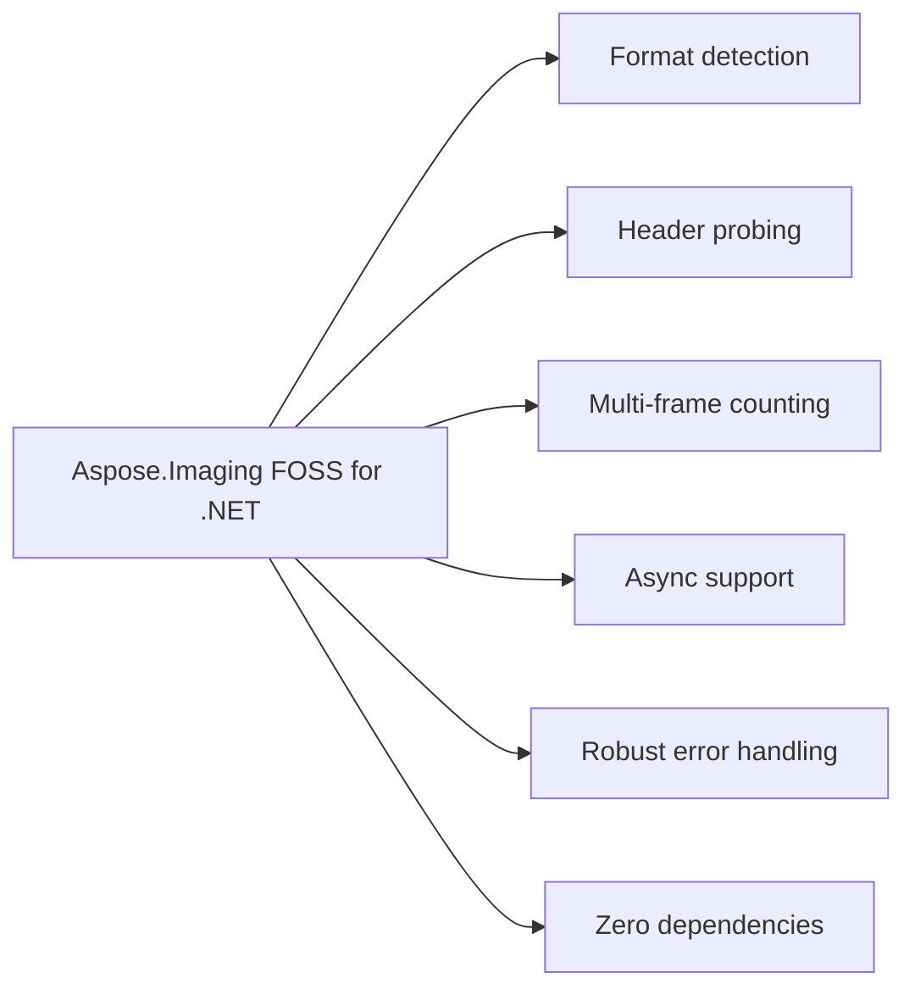

# Aspose.Imaging FOSS for .NET

 [](https://github.com/aspose-imaging-foss/Aspose.Imaging-FOSS-for-.NET/actions/workflows/ci.yml) [](LICENSE) [](https://github.com/aspose-imaging-foss/Aspose.Imaging-FOSS-for-.NET/graphs/contributors)

[](https://products.aspose.org/imaging/net/)

Aspose.Imaging FOSS for .NET reads image files and inspects their properties using the `ImageProbe.ProbeFile` method. It supports formats such as GIF, as demonstrated by extracting format and frame count information. The library targets netstandard2.0 and net8.0 runtimes and has no external dependencies. It is part of the Aspose.Imaging imaging family for the .NET ecosystem.

## Navigation

- [At a Glance](#at-a-glance)
- [Key Capabilities](#key-capabilities)
- [Installation](#installation)
- [Dependencies](#dependencies)
- [Quick Start](#quick-start)
- [Additional Examples](#additional-examples)
- [API Reference](#api-reference)
- [Documentation & Resources](#documentation--resources)
- [Scope and Limitations](#scope-and-limitations)
- [Development and Testing](#development-and-testing)
- [License](#license)

## At a Glance



## Key Capabilities

- **Format detection.** Detects 14 image formats by reading only the file's signature bytes and returning an `ImageFormat` value without pulling in a full imaging stack.
- **Header probing.** Reads a format's real header fields directly into an `ImageInfo` for PNG, JPEG, GIF, BMP, WEBP, ICO, TIFF, PSD, EMF, WMF, DICOM, DJVU, AVIF, and HEIC/HEIF, providing width, height, bit depth, and frame count.
- **Multi-frame counting.** Counts real multi-frame and multi-page content by walking actual container structures: GIF image-descriptor blocks, ICO directory entries, TIFF IFD chains, and bundled multi-page DJVU page components.
- **Async support.** Provides both synchronous and async entry points for the same operation, including `ProbeFile`/`ProbeFileAsync` and Probe/`ProbeAsync`, enabling non-blocking execution on ASP.NET request threads.
- **Robust error handling.** Never throws on a signature match it cannot fully parse: malformed or truncated input returns an `ImageInfo` with only Format set, allowing unattended pipelines over untrusted input.
- **Zero dependencies.** Runs without any external runtime or library beyond the target framework.

- DICOM parsing covers Implicit VR Little Endian and Explicit VR Little/Big Endian transfer
  syntaxes — including the common compressed ones, whose non-pixel elements are encoded
  Explicit VR Little Endian — and reads `Rows`/`Columns`/`BitsAllocated` directly from the data
  set, stopping rather than guessing if it reaches a sequence or encapsulated pixel data
  element with an undefined length first.

Most .NET image libraries make you fully decode an image just to answer "is this a JPEG, and
how big is it?". `ImageSharp.Image.Identify` covers common raster formats well, but nothing
else in the .NET FOSS ecosystem does the same for PSD, EMF/WMF, or DICOM — this library covers
that full range in one place.

## Installation

`Aspose.Imaging.Foss` is not yet published on NuGet; build it from a source checkout instead:

```bash
git clone https://github.com/aspose-imaging-foss/Aspose.Imaging-FOSS-for-.NET.git
cd Aspose.Imaging-FOSS-for-.NET
dotnet build
```

## Dependencies

### Required Package Dependencies

No required third-party package dependencies; in `src/Aspose.Imaging.Foss/Aspose.Imaging.Foss.csproj`, no `PackageReference` a consumer would install is declared.

### Native and System Requirements

- Requires .NET `netstandard2.0;net8.0` (`TargetFrameworks` in `src/Aspose.Imaging.Foss/Aspose.Imaging.Foss.csproj`).

## Quick Start

This example uses `ImageProbe.ProbeFile` to inspect an animated GIF and report its format and frame count.

```csharp
using Aspose.Imaging.Foss;

var info = ImageProbe.ProbeFile("animation.gif");
Console.WriteLine($"{info.Format}: {info.FrameCount} frame(s)");
```

`Probe` never throws on malformed or truncated input — if a file matches a format's signature
but its header can't be fully parsed, you get back an `ImageInfo` with just the `Format` set
rather than an exception.

## Additional Examples

> **Not verified:** this example is carried over unchanged from the project's existing README. It could not be compiled or run here.

```csharp
using Aspose.Imaging.Foss;

// From a file path
var info = ImageProbe.ProbeFile("photo.jpg");
Console.WriteLine($"{info.Format}: {info.Width}x{info.Height}, {info.BitDepth}-bit");

// From a stream (seekable or not) or a byte array
var format = ImageProbe.DetectFormat(bytes);
var info2 = ImageProbe.Probe(stream);
```

<details>
<summary>View Additional Examples</summary>

### Probe a File Asynchronously

> **Not verified:** this example is carried over unchanged from the project's existing README. It could not be compiled or run here.

```csharp
using Aspose.Imaging.Foss;

var info = await ImageProbe.ProbeFileAsync("upload.png", cancellationToken);
Console.WriteLine($"{info.Format}: {info.Width}x{info.Height}");
```

> **Not verified:** this example is carried over unchanged from the project's existing README. It could not be compiled or run here.

```csharp
using Aspose.Imaging.Foss;

using var networkStream = GetUploadStream(); // CanSeek == false
var format = ImageProbe.DetectFormat(networkStream);
```

</details>

## API Reference

Aspose.Imaging FOSS for .NET exposes Aspose.Imaging FOSS for .NET as its single entry point, providing image format detection and header inspection capabilities. It supports netstandard2.0 and net8.0.

The verified public surface has 3 types.

<details>
<summary>View the Complete Public API Surface</summary>

### Core API

| Class | Description |
| --- | --- |
| `ImageInfo` | Aspose.Imaging.Foss.ImageInfo provides metadata about an image including its format, dimensions, bit depth, and frame count. |
| `ImageProbe` | Aspose.Imaging.Foss.ImageProbe detects image formats and retrieves image metadata from files, streams, or byte arrays. |

#### Enumerations

| Enumeration | Description |
| --- | --- |
| `ImageFormat` | Aspose.Imaging.Foss.ImageFormat represents a supported image file format. |

#### Detailed Member Reference

### Foss

Aspose.Imaging FOSS for .NET provides static methods including `DetectFormat`, Probe, `ProbeFile`, `ProbeAsync`, and `ProbeFileAsync` to inspect image headers and return `ImageFormat` and `ImageInfo` values.

`ImageProbe` is the library's single entry point; it returns an `ImageFormat` value and an
`ImageInfo` record for every supported format.

- `ImageFormat` — enum of the 14 detectable formats, plus `Unknown` for anything unmatched.
- `ImageInfo` — immutable result of a probe: `Format`, and the nullable `Width`, `Height`,
  `BitDepth`, and `FrameCount` the format's header actually carried.
- `ImageProbe` — static entry point: `DetectFormat`, `Probe`, `ProbeFile`, `ProbeAsync`, and
  `ProbeFileAsync`.

- `ImageProbe.DetectFormat(Stream stream) -> ImageFormat` / `DetectFormat(byte[] data) -> ImageFormat`
  — signature-only match, no dimension parsing.
- `ImageProbe.Probe(Stream stream) -> ImageInfo` / `Probe(byte[] data) -> ImageInfo` / `Probe(FileInfo file) -> ImageInfo`
  — full header parse for whichever format's signature matches.
- `ImageProbe.ProbeFile(string path) -> ImageInfo` — opens the file and calls `Probe`.
- `ImageProbe.ProbeAsync(Stream stream, CancellationToken cancellationToken = default) -> Task<ImageInfo>` /
  `ProbeFileAsync(string path, CancellationToken cancellationToken = default) -> Task<ImageInfo>`
  — async counterparts of `Probe`/`ProbeFile`.
- `ImageInfo(ImageFormat format, int? width = null, int? height = null, int? bitDepth = null, int? frameCount = null)`
  — the only public constructor; every field besides `Format` is nullable because not every
  format's header carries all four.

</details>

## Documentation & Resources

- **[Getting started guide](https://docs.aspose.org/imaging/net/)** — The getting started guide walks through installation and a first probe step by step.
- **[How-to guides & FAQ](https://kb.aspose.org/imaging/net/)** — The how-to guides and FAQ provide task-focused answers for common format-detection questions.
- **[Full API reference](https://reference.aspose.org/imaging/net/)** — The full API reference offers the complete browsable reference for `ImageFormat`, `ImageInfo`, and `ImageProbe`. It covers all 3 verified public types; the [API Reference](#api-reference) section above covers the essentials.
- Found a bug or have a feature request? [Open an issue](https://github.com/aspose-imaging-foss/Aspose.Imaging-FOSS-for-.NET/issues).

## Scope and Limitations

Aspose.Imaging FOSS for .NET reads image headers and reports format identification and metadata via the `ImageProbe` class; it does not decode pixel data, render images, edit content, or convert between formats.

- Detection and metadata only: `ImageProbe` identifies a format and reads its header fields but never decodes pixel data, so there is no rendering, editing, or format-conversion capability anywhere in the library.
- Frame count reflects only what the container itself records: it is a real, computed count for GIF, ICO, TIFF, and bundled multi-page DJVU (DJVM); every other supported format reports a fixed 1 for a successfully parsed header, since none of their headers carry a genuine frame or page count.
- Non-placeable WMF is detected but not dimensioned: the classic (non-placeable) WMF header carries no bounding rectangle, so Probe returns a format-only `ImageInfo` for it; only the placeable WMF header yields Width/Height.
- DICOM parsing stops at the first undefined-length element: a sequence or encapsulated pixel-data element with an undefined length ends the walk rather than being parsed.
- CDR support is planned but not yet implemented: no `CdrFormatHandler` exists in the current source tree.

Frame count is marked ✅ only where the container format genuinely records more than one
frame or page (GIF, ICO, TIFF, and multi-page DJVU); every other format's `FrameCount` comes
back as a fixed `1` on a successful parse, which this table does not count as a real frame
count.

These limitations don't apply to [full-featured Aspose.Imaging for .NET — Enterprise Edition](https://products.aspose.com/imaging/net/). It adds full decoding, editing, rendering, and conversion across a much broader format range.

## Development and Testing

Aspose.Imaging FOSS for .NET targets netstandard2.0 and net8.0 and is built using the .NET CLI. The test project, located under tests/`Aspose.Imaging.Foss.Tests`, targets net9.0 and uses xUnit for testing, with Microsoft.NET.Test.Sdk, xunit, and xunit.runner.visualstudio as development-only dependencies, along with coverlet.collector for code-coverage collection. These test dependencies apply only to the test project and are never shipped with the library. The repository includes a CI matrix configured for ubuntu-latest and windows-latest, and contributors can add new image formats by implementing IFormatHandler and registering it in `ImageProbe`.

The suite covers 3 test files under `tests/`. The [ci workflow](.github/workflows/ci.yml) runs on Ubuntu and Windows. Releases run through the [release workflow](.github/workflows/release.yml).

```bash
git clone https://github.com/aspose-imaging-foss/Aspose.Imaging-FOSS-for-.NET.git
cd Aspose.Imaging-FOSS-for-.NET
dotnet build src/Aspose.Imaging.Foss/Aspose.Imaging.Foss.csproj -c Release
```

Reference the built assembly from another project, or add the project directly:

```xml
<ProjectReference Include="..\Aspose.Imaging-FOSS-for-.NET\src\Aspose.Imaging.Foss\Aspose.Imaging.Foss.csproj" />
```

The library multi-targets `netstandard2.0` and `net8.0` — see
[Dependencies](#dependencies) below for the full required, native, and development-only
breakdown.

Run the test suite from the repository root:

```bash
dotnet test tests/Aspose.Imaging.Foss.Tests/Aspose.Imaging.Foss.Tests.csproj
```

The test project targets `net9.0` and references the library via a plain `ProjectReference` —
no packaged dependency is required to build or test the library itself. A tagged
`v<major>.<minor>.<patch>` push runs [`.github/workflows/release.yml`](.github/workflows/release.yml),
which builds and publishes the package.

Adding a new format means implementing `IFormatHandler` (signature match + header parse) under
`src/Aspose.Imaging.Foss/Formats` and registering it in `ImageProbe`. Pull requests for new
formats or wider tag/chunk coverage on existing ones are welcome.

## License

This project is licensed under the [MIT License](LICENSE). The MIT License permits use, copying, modification, distribution, sublicensing, and commercial use, provided its copyright and permission notice are retained. The software is provided without warranty.
