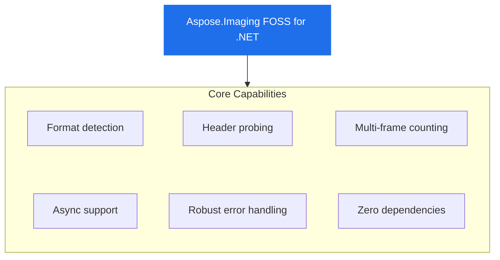

# Aspose.Imaging FOSS for .NET

 [](https://github.com/aspose-imaging-foss/Aspose.Imaging-FOSS-for-.NET/actions/workflows/ci.yml) [](LICENSE) [](https://github.com/aspose-imaging-foss/Aspose.Imaging-FOSS-for-.NET/graphs/contributors)

[](https://products.aspose.org/imaging/net/)

Aspose.Imaging FOSS for .NET reads image headers to detect formats and extract metadata for 14 raster, vector, and specialized formats including PSD, EMF, WMF, and DICOM. It targets netstandard2.0 and net8.0 with no external dependencies.

Most .NET image libraries make you fully decode an image just to answer "is this a JPEG, and
how big is it?". `ImageSharp.Image.Identify` covers common raster formats well, but nothing
else in the .NET FOSS ecosystem does the same for PSD, EMF/WMF, or DICOM — this library covers
that full range in one place.

## Navigation

- [At a Glance](#at-a-glance)
- [Key Capabilities](#key-capabilities)
- [Installation](#installation)
- [Dependencies](#dependencies)
- [Quick Start](#quick-start)
- [Additional Examples](#additional-examples)
- [API Reference](#api-reference)
- [Documentation & Resources](#documentation--resources)
- [Scope and Limitations](#scope-and-limitations)
- [Development and Testing](#development-and-testing)
- [License](#license)

## At a Glance



## Key Capabilities

- **Format detection.** Detects 14 image formats by reading only the file's signature bytes and returning an `ImageFormat` value, so identifying a file never requires pulling in a full imaging stack.
- **Header probing.** Reads a format's real header fields directly into an `ImageInfo` — width, height, bit depth, and frame count — for PNG, JPEG, GIF, BMP, WEBP, ICO, TIFF, PSD, EMF, WMF, DICOM, DJVU, AVIF, and HEIC/HEIF, as a free open source .NET image manipulation API with no decode step.
- **Multi-frame counting.** Counts real multi-frame and multi-page content where the container format actually carries it: GIF walks its image-descriptor blocks, ICO its directory entries, TIFF its IFD chain, and a bundled multi-page DJVU (DJVM) its FORM:DJVU page components.
- **Async support.** Provides both synchronous and async entry points for the same operation — `ProbeFile()`/`ProbeFileAsync()` and `Probe()`/`ProbeAsync()` — so a probe can run on an ASP.NET request thread without blocking it.
- **Robust error handling.** Never throws on a signature match it cannot fully parse — malformed or truncated input comes back as an `ImageInfo` with only Format set, never an exception, so a probing pipeline can run unattended over untrusted input.
- **Zero dependencies.** Has no external dependencies, making it a lightweight alternative for .NET applications targeting netstandard2.0 or net8.0.

| Format | Detect | Width / Height | Bit depth | Frame count |
|--------|:------:|:---------------:|:---------:|:-----------:|
| PNG    | ✅ | ✅ | ✅ | — |
| JPEG   | ✅ | ✅ | ✅ | — |
| GIF    | ✅ | ✅ | — | ✅ |
| BMP    | ✅ | ✅ | ✅ | — |
| WEBP (lossy / lossless / extended) | ✅ | ✅ | — | — |
| ICO    | ✅ | ✅ | ✅ | ✅ |
| TIFF   | ✅ | ✅ | ✅ | ✅ |
| PSD    | ✅ | ✅ | ✅ | — |
| EMF    | ✅ | ✅ (from bounds) | — | — |
| WMF (placeable) | ✅ | ✅ (assumes 96 DPI) | — | — |
| DICOM  | ✅ | ✅ (Rows/Columns) | ✅ (BitsAllocated) | — |
| DJVU (single-page / multi-page DJVM) | ✅ | ✅ | — | ✅ |
| AVIF (still / animated) | ✅ | ✅ | — | — |
| HEIC / HEIF | ✅ | ✅ | — | — |

## Installation

`Aspose.Imaging.Foss` is not yet published on NuGet; build it from a source checkout instead:

```bash
git clone https://github.com/aspose-imaging-foss/Aspose.Imaging-FOSS-for-.NET.git
cd Aspose.Imaging-FOSS-for-.NET
dotnet build
```

## Dependencies

### Required Package Dependencies

No required third-party package dependencies; in `src/Aspose.Imaging.Foss/Aspose.Imaging.Foss.csproj`, no `PackageReference` a consumer would install is declared.

### Native and System Requirements

- Requires .NET `netstandard2.0;net8.0` (`TargetFrameworks` in `src/Aspose.Imaging.Foss/Aspose.Imaging.Foss.csproj`).

## Quick Start

This example uses Aspose.Imaging FOSS for .NET to inspect an image file and report its format and frame count.

```csharp
using Aspose.Imaging.Foss;

var info = ImageProbe.ProbeFile("animation.gif");
Console.WriteLine($"{info.Format}: {info.FrameCount} frame(s)");
```

## Additional Examples

```csharp
using Aspose.Imaging.Foss;

// From a file path
var info = ImageProbe.ProbeFile("photo.jpg");
Console.WriteLine($"{info.Format}: {info.Width}x{info.Height}, {info.BitDepth}-bit");

// From a stream (seekable or not) or a byte array
var format = ImageProbe.DetectFormat(bytes);
var info2 = ImageProbe.Probe(stream);
```

<details>
<summary>View Additional Examples</summary>

```csharp
using Aspose.Imaging.Foss;

var info = await ImageProbe.ProbeFileAsync("upload.png", cancellationToken);
Console.WriteLine($"{info.Format}: {info.Width}x{info.Height}");
```

```csharp
using Aspose.Imaging.Foss;

using var networkStream = GetUploadStream(); // CanSeek == false
var format = ImageProbe.DetectFormat(networkStream);
```

</details>

## API Reference

Aspose.Imaging FOSS for .NET exposes Aspose.Imaging FOSS for .NET as its public API surface, targeting netstandard2.0 and net8.0. The library's single entry point is `ImageProbe`, which provides format detection and header inspection capabilities.

The public API has 3 types.

<details>
<summary>View the Complete Public API Surface</summary>

### Core API

| Class | Description |
| --- | --- |
| `ImageInfo` | ImageInfo class holds read-only properties for an image's format, width, height, bit depth, and frame count, and provides a constructor to initialize them. |
| `ImageProbe` | ImageProbe class provides methods to detect and probe image formats from files or streams, including DetectFormat, Probe, ProbeAsync, ProbeFile, and ProbeFileAsync. |

#### Enumerations

| Enumeration | Description |
| --- | --- |
| `ImageFormat` | ImageFormat class lists the supported image formats including Avif, Bmp, Dicom, Emf, Gif, Heic, Ico, Jpeg, Png, Psd, and Tiff. |

#### Detailed Member Reference

### Foss

Aspose.Imaging FOSS for .NET provides format detection and header inspection through `ImageProbe`, which includes `DetectFormat`, Probe, `ProbeFile`, `ProbeAsync`, and `ProbeFileAsync` methods, returning `ImageFormat` and `ImageInfo` values that describe the detected image format and its header-extracted properties.

`ImageProbe` is the library's single entry point; it returns an `ImageFormat` value and an
`ImageInfo` record for every supported format.

- `ImageFormat` — enum of the 14 detectable formats, plus `Unknown` for anything unmatched.
- `ImageInfo` — immutable result of a probe: `Format`, and the nullable `Width`, `Height`,
  `BitDepth`, and `FrameCount` the format's header actually carried.
- `ImageProbe` — static entry point: `DetectFormat`, `Probe`, `ProbeFile`, `ProbeAsync`, and
  `ProbeFileAsync`.

- `ImageProbe.DetectFormat(Stream stream) -> ImageFormat` / `DetectFormat(byte[] data) -> ImageFormat`
  — signature-only match, no dimension parsing.
- `ImageProbe.Probe(Stream stream) -> ImageInfo` / `Probe(byte[] data) -> ImageInfo` / `Probe(FileInfo file) -> ImageInfo`
  — full header parse for whichever format's signature matches.
- `ImageProbe.ProbeFile(string path) -> ImageInfo` — opens the file and calls `Probe`.
- `ImageProbe.ProbeAsync(Stream stream, CancellationToken cancellationToken = default) -> Task<ImageInfo>` /
  `ProbeFileAsync(string path, CancellationToken cancellationToken = default) -> Task<ImageInfo>`
  — async counterparts of `Probe`/`ProbeFile`.
- `ImageInfo(ImageFormat format, int? width = null, int? height = null, int? bitDepth = null, int? frameCount = null)`
  — the only public constructor; every field besides `Format` is nullable because not every
  format's header carries all four.

</details>

## Documentation & Resources

- **[Getting started guide](https://docs.aspose.org/imaging/net/)** — The getting started guide walks through installation and a first probe step by step.
- **[How-to guides & FAQ](https://kb.aspose.org/imaging/net/)** — The how-to guides and FAQ provide task-focused answers for common format-detection questions.
- **[Full API reference](https://reference.aspose.org/imaging/net/)** — The full API reference offers the complete browsable reference for `ImageFormat`, `ImageInfo`, and `ImageProbe`. It covers all 3 public types; the [API Reference](#api-reference) section above covers the essentials.
- Found a bug or have a feature request? [Open an issue](https://github.com/aspose-imaging-foss/Aspose.Imaging-FOSS-for-.NET/issues).

## Scope and Limitations

Aspose.Imaging FOSS for .NET reads image headers to detect formats and extract metadata via the `Aspose.Imaging.Foss` namespace; it targets netstandard2.0 and net8.0.

- Detection and metadata only: `ImageProbe` identifies a format and reads its header fields; it never decodes pixel data, so there is no rendering, editing, or format-conversion capability anywhere in the library.
- Frame count reflects only what the container itself records: it is a real, computed count for GIF, ICO, TIFF, and bundled multi-page DJVU (DJVM); every other supported format reports a fixed 1 for a successfully parsed header, since none of their headers carry a genuine frame or page count.
- Non-placeable WMF is detected but not dimensioned: the classic (non-placeable) WMF header carries no bounding rectangle, so Probe returns a format-only `ImageInfo` for it; only the placeable WMF header yields Width/Height.
- DICOM parsing stops at the first undefined-length element: a sequence or encapsulated pixel-data element with an undefined length ends the walk rather than being parsed.
- CDR support is planned but not yet implemented: no `CdrFormatHandler` exists in the current source tree.

`Probe` never throws on malformed or truncated input — if a file matches a format's signature
but its header can't be fully parsed, you get back an `ImageInfo` with just the `Format` set
rather than an exception.

These limitations don't apply to [full-featured Aspose.Imaging for .NET — Enterprise Edition](https://products.aspose.com/imaging/net/). It adds full decoding, editing, rendering, and conversion across a much broader format range.

## Development and Testing

Aspose.Imaging FOSS for .NET targets netstandard2.0 and net8.0 and is built using the .NET CLI. The test project, located under tests/`Aspose.Imaging.Foss.Tests`, targets net9.0 and uses the xUnit test framework with test host and adapter packages, along with a code-coverage collection package. These test packages apply only to the test project and are not referenced by the main library. The repository includes a pull request workflow that validates new formats by implementing IFormatHandler and registering them in `ImageProbe`.

The suite covers 3 test files under `tests/`. The [ci workflow](.github/workflows/ci.yml) runs on Ubuntu and Windows. Releases run through the [release workflow](.github/workflows/release.yml).

```bash
git clone https://github.com/aspose-imaging-foss/Aspose.Imaging-FOSS-for-.NET.git
cd Aspose.Imaging-FOSS-for-.NET
dotnet build src/Aspose.Imaging.Foss/Aspose.Imaging.Foss.csproj -c Release
```

Reference the built assembly from another project, or add the project directly:

```xml
<ProjectReference Include="..\Aspose.Imaging-FOSS-for-.NET\src\Aspose.Imaging.Foss\Aspose.Imaging.Foss.csproj" />
```

The library builds from
`src/Aspose.Imaging.Foss/Aspose.Imaging.Foss.csproj`, which declares zero `<PackageReference>`
entries — every format's header parsing is implemented natively within the library.

- `Microsoft.NET.Test.Sdk` 17.12.0, `xunit` 2.9.2, and `xunit.runner.visualstudio` 2.8.2 — the
  xUnit test host and adapter used only by the test project.
- `coverlet.collector` 6.0.2 — code-coverage collection for the test suite.

None of these are referenced by the main library project; they apply only to
`tests/Aspose.Imaging.Foss.Tests/Aspose.Imaging.Foss.Tests.csproj` and are never shipped with
the library.

Run the test suite from the repository root:

```bash
dotnet test tests/Aspose.Imaging.Foss.Tests/Aspose.Imaging.Foss.Tests.csproj
```

The test project targets `net9.0` and references the library via a plain `ProjectReference` —
no packaged dependency is required to build or test the library itself. A tagged
`v<major>.<minor>.<patch>` push runs [`.github/workflows/release.yml`](.github/workflows/release.yml),
which builds and publishes the package.

Adding a new format means implementing `IFormatHandler` (signature match + header parse) under
`src/Aspose.Imaging.Foss/Formats` and registering it in `ImageProbe`. Pull requests for new
formats or wider tag/chunk coverage on existing ones are welcome.

## License

This project is licensed under the [MIT License](LICENSE). The MIT License permits use, copying, modification, distribution, sublicensing, and commercial use, provided its copyright and permission notice are retained. The software is provided without warranty.
