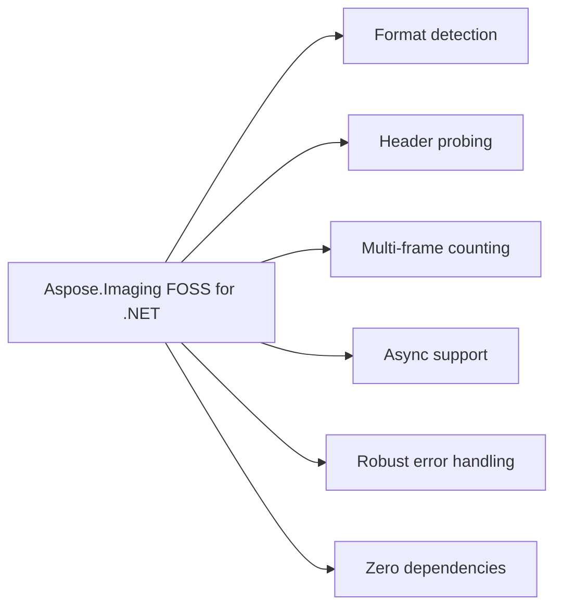

# Aspose.Imaging FOSS for .NET

 [](https://github.com/aspose-imaging-foss/Aspose.Imaging-FOSS-for-.NET/actions/workflows/ci.yml) [](LICENSE) [](https://github.com/aspose-imaging-foss/Aspose.Imaging-FOSS-for-.NET/graphs/contributors)

[](https://products.aspose.org/imaging/net/)

Aspose.Imaging FOSS for .NET reads image headers to detect formats and extract metadata for 14 image formats without requiring full decoding. It supports netstandard2.0 and net8.0 and has no external dependencies.

Most .NET image libraries make you fully decode an image just to answer "is this a JPEG, and
how big is it?". `ImageSharp.Image.Identify` covers common raster formats well, but nothing
else in the .NET FOSS ecosystem does the same for PSD, EMF/WMF, or DICOM — this library covers
that full range in one place.

The library multi-targets `netstandard2.0` and `net8.0` — see
[Dependencies](#dependencies) below for the full required, native, and development-only
breakdown.

## Navigation

- [At a Glance](#at-a-glance)
- [Key Capabilities](#key-capabilities)
- [Installation](#installation)
- [Dependencies](#dependencies)
- [Quick Start](#quick-start)
- [Additional Examples](#additional-examples)
- [API Reference](#api-reference)
- [Documentation & Resources](#documentation--resources)
- [Scope and Limitations](#scope-and-limitations)
- [Development and Testing](#development-and-testing)
- [License](#license)

## At a Glance



## Key Capabilities

- **Format detection.** Format detection identifies 14 image formats by reading only the file's signature bytes and returns an `ImageFormat` value without loading a full imaging stack.
- **Header probing.** Header probing reads a format's real header fields directly into an `ImageInfo` object, providing width, height, bit depth, and frame count for PNG, JPEG, GIF, BMP, WEBP, ICO, TIFF, PSD, EMF, WMF, DICOM, DJVU, AVIF, and HEIC/HEIF.
- **Multi-frame counting.** Multi-frame counting accurately counts real multi-frame and multi-page content by walking GIF image-descriptor blocks, ICO directory entries, TIFF IFD chains, and bundled multi-page DJVU FORM:DJVU page components.
- **Async support.** Async support provides both synchronous and async entry points for the same operation, including `ProbeFile`/`ProbeFileAsync` and Probe/`ProbeAsync`, enabling non-blocking probing on ASP.NET request threads.
- **Robust error handling.** Robust error handling ensures `Probe()` never throws on a signature match it cannot fully parse, returning an `ImageInfo` with only Format set for malformed or truncated input instead of raising an exception.
- **Zero dependencies.** The package has no external runtime dependencies.

| Format | Detect | Width / Height | Bit depth | Frame count |
|--------|:------:|:---------------:|:---------:|:-----------:|
| PNG    | ✅ | ✅ | ✅ | — |
| JPEG   | ✅ | ✅ | ✅ | — |
| GIF    | ✅ | ✅ | — | ✅ |
| BMP    | ✅ | ✅ | ✅ | — |
| WEBP (lossy / lossless / extended) | ✅ | ✅ | — | — |
| ICO    | ✅ | ✅ | ✅ | ✅ |
| TIFF   | ✅ | ✅ | ✅ | ✅ |
| PSD    | ✅ | ✅ | ✅ | — |
| EMF    | ✅ | ✅ (from bounds) | — | — |
| WMF (placeable) | ✅ | ✅ (assumes 96 DPI) | — | — |
| DICOM  | ✅ | ✅ (Rows/Columns) | ✅ (BitsAllocated) | — |
| DJVU (single-page / multi-page DJVM) | ✅ | ✅ | — | ✅ |
| AVIF (still / animated) | ✅ | ✅ | — | — |
| HEIC / HEIF | ✅ | ✅ | — | — |

## Installation

`Aspose.Imaging.Foss` is not yet published on NuGet; build it from a source checkout instead:

```bash
git clone https://github.com/aspose-imaging-foss/Aspose.Imaging-FOSS-for-.NET.git
cd Aspose.Imaging-FOSS-for-.NET
dotnet build
```

## Dependencies

### Required Package Dependencies

No required third-party package dependencies; in `src/Aspose.Imaging.Foss/Aspose.Imaging.Foss.csproj`, no `PackageReference` a consumer would install is declared.

### Native and System Requirements

- Requires .NET `netstandard2.0;net8.0` (`TargetFrameworks` in `src/Aspose.Imaging.Foss/Aspose.Imaging.Foss.csproj`).

## Quick Start

This example uses Aspose.Imaging FOSS for .NET to inspect an image file and report its format and frame count.

```csharp
using Aspose.Imaging.Foss;

var info = ImageProbe.ProbeFile("animation.gif");
Console.WriteLine($"{info.Format}: {info.FrameCount} frame(s)");
```

## Additional Examples

```csharp
using Aspose.Imaging.Foss;

// From a file path
var info = ImageProbe.ProbeFile("photo.jpg");
Console.WriteLine($"{info.Format}: {info.Width}x{info.Height}, {info.BitDepth}-bit");

// From a stream (seekable or not) or a byte array
var format = ImageProbe.DetectFormat(bytes);
var info2 = ImageProbe.Probe(stream);
```

<details>
<summary>View Additional Examples</summary>

```csharp
using Aspose.Imaging.Foss;

var info = await ImageProbe.ProbeFileAsync("upload.png", cancellationToken);
Console.WriteLine($"{info.Format}: {info.Width}x{info.Height}");
```

```csharp
using Aspose.Imaging.Foss;

using var networkStream = GetUploadStream(); // CanSeek == false
var format = ImageProbe.DetectFormat(networkStream);
```

</details>

## API Reference

Aspose.Imaging FOSS for .NET exposes Aspose.Imaging FOSS for .NET as its root namespace, with `ImageProbe` as the single entry point for format detection and image header inspection. `ImageProbe` returns `ImageFormat` and `ImageInfo` values that describe the detected format and its header-captured dimensions.

The verified public surface has 3 types.

<details>
<summary>View the Complete Public API Surface</summary>

### Core API

| Class | Description |
| --- | --- |
| `ImageInfo` | Aspose.Imaging.Foss.ImageInfo provides metadata about an image including its format, dimensions, bit depth, and frame count. |
| `ImageProbe` | Aspose.Imaging.Foss.ImageProbe detects image formats and extracts image metadata from files, streams, or byte arrays. |

#### Enumerations

| Enumeration | Description |
| --- | --- |
| `ImageFormat` | Aspose.Imaging.Foss.ImageFormat represents an image file format identifier. |

#### Detailed Member Reference

### Foss

`ImageProbe` provides static methods `DetectFormat`, Probe, `ProbeFile`, `ProbeAsync`, and `ProbeFileAsync` to inspect image data from streams, byte arrays, or file paths, returning an `ImageFormat` enum and an immutable `ImageInfo` record containing Format, Width, Height, `BitDepth`, and `FrameCount` where the format's header supplies them.

`FrameCount` is only populated with a real count for formats whose container actually records
one — an animated GIF's image-descriptor blocks, or the page components of a bundled
multi-page DJVU (DJVM) document:

`ImageProbe` is the library's single entry point; it returns an `ImageFormat` value and an
`ImageInfo` record for every supported format.

- `ImageFormat` — enum of the 14 detectable formats, plus `Unknown` for anything unmatched.
- `ImageInfo` — immutable result of a probe: `Format`, and the nullable `Width`, `Height`,
  `BitDepth`, and `FrameCount` the format's header actually carried.
- `ImageProbe` — static entry point: `DetectFormat`, `Probe`, `ProbeFile`, `ProbeAsync`, and
  `ProbeFileAsync`.

- `ImageProbe.DetectFormat(Stream stream) -> ImageFormat` / `DetectFormat(byte[] data) -> ImageFormat`
  — signature-only match, no dimension parsing.
- `ImageProbe.Probe(Stream stream) -> ImageInfo` / `Probe(byte[] data) -> ImageInfo` / `Probe(FileInfo file) -> ImageInfo`
  — full header parse for whichever format's signature matches.
- `ImageProbe.ProbeFile(string path) -> ImageInfo` — opens the file and calls `Probe`.
- `ImageProbe.ProbeAsync(Stream stream, CancellationToken cancellationToken = default) -> Task<ImageInfo>` /
  `ProbeFileAsync(string path, CancellationToken cancellationToken = default) -> Task<ImageInfo>`
  — async counterparts of `Probe`/`ProbeFile`.
- `ImageInfo(ImageFormat format, int? width = null, int? height = null, int? bitDepth = null, int? frameCount = null)`
  — the only public constructor; every field besides `Format` is nullable because not every
  format's header carries all four.

</details>

## Documentation & Resources

- **[Getting started guide](https://docs.aspose.org/imaging/net/)** — The getting started guide walks through installation and a first probe step by step.
- **[How-to guides & FAQ](https://kb.aspose.org/imaging/net/)** — The how-to guides and FAQ provide task-focused answers for common format-detection questions.
- **[Full API reference](https://reference.aspose.org/imaging/net/)** — The full API reference offers the complete browsable reference for `ImageFormat`, `ImageInfo`, and `ImageProbe`. It covers all 3 verified public types; the [API Reference](#api-reference) section above covers the essentials.
- Found a bug or have a feature request? [Open an issue](https://github.com/aspose-imaging-foss/Aspose.Imaging-FOSS-for-.NET/issues).

## Scope and Limitations

Aspose.Imaging FOSS for .NET reads image headers to detect formats and extract metadata using the `Aspose.Imaging.Foss` namespace; it supports netstandard2.0 and net8.0 targets and operates on files, streams, or byte arrays without rendering, editing, or converting pixel data.

- The library provides detection and metadata extraction only: `ImageProbe` identifies formats and reads header fields but never decodes pixel data, so there is no rendering, editing, or format-conversion capability anywhere in the library.
- Frame count reflects only what the container itself records: it is a real, computed count for GIF, ICO, TIFF, and bundled multi-page DJVU, while every other supported format reports a fixed `FrameCount` of 1 for a successfully parsed header. Indirect (multi-file) DJVM documents and truncated bundled ones report `FrameCount` as null, not 1.
- Non-placeable WMF is detected but not dimensioned because its header carries no bounding rectangle, so Probe returns a format-only `ImageInfo` for it; only placeable WMF yields Width and Height assuming a conventional 96 DPI target.
- DICOM parsing covers Implicit VR Little Endian and Explicit VR Little/Big Endian transfer syntaxes, including common compressed ones, and stops at the first undefined-length element, since Rows, Columns, and `BitsAllocated` always precede such elements in a conformant file.
- CDR support is planned but not yet implemented, as no `CdrFormatHandler` exists in the current source tree.

Frame count is marked ✅ only where the container format genuinely records more than one
frame or page (GIF, ICO, TIFF, and multi-page DJVU); every other format's `FrameCount` comes
back as a fixed `1` on a successful parse, which this table does not count as a real frame
count.

`Probe` never throws on malformed or truncated input — if a file matches a format's signature
but its header can't be fully parsed, you get back an `ImageInfo` with just the `Format` set
rather than an exception.

These limitations don't apply to [full-featured Aspose.Imaging for .NET — Enterprise Edition](https://products.aspose.com/imaging/net/). It adds full decoding, editing, rendering, and conversion across a much broader format range.

## Development and Testing

Aspose.Imaging FOSS for .NET targets netstandard2.0 and net8.0 and builds from the solution file using the .NET CLI. The main library project has no external package dependencies, while the test project in tests/`Aspose.Imaging.Foss.Tests` uses xUnit and related tooling for test execution and code coverage. Contributors must implement IFormatHandler for new formats and register them in `ImageProbe`, and the test suite runs against the solution using dotnet test.

The suite covers 3 test files under `tests/`. The [ci workflow](.github/workflows/ci.yml) runs on Ubuntu and Windows. Releases run through the [release workflow](.github/workflows/release.yml).

```bash
git clone https://github.com/aspose-imaging-foss/Aspose.Imaging-FOSS-for-.NET.git
cd Aspose.Imaging-FOSS-for-.NET
dotnet build src/Aspose.Imaging.Foss/Aspose.Imaging.Foss.csproj -c Release
```

```xml
<ProjectReference Include="..\Aspose.Imaging-FOSS-for-.NET\src\Aspose.Imaging.Foss\Aspose.Imaging.Foss.csproj" />
```

The library builds from
`src/Aspose.Imaging.Foss/Aspose.Imaging.Foss.csproj`, which declares zero `<PackageReference>`
entries — every format's header parsing is implemented natively within the library.

- `Microsoft.NET.Test.Sdk` 17.12.0, `xunit` 2.9.2, and `xunit.runner.visualstudio` 2.8.2 — the
  xUnit test host and adapter used only by the test project.
- `coverlet.collector` 6.0.2 — code-coverage collection for the test suite.

None of these are referenced by the main library project; they apply only to
`tests/Aspose.Imaging.Foss.Tests/Aspose.Imaging.Foss.Tests.csproj` and are never shipped with
the library.

```bash
dotnet test tests/Aspose.Imaging.Foss.Tests/Aspose.Imaging.Foss.Tests.csproj
```

The test project targets `net9.0` and references the library via a plain `ProjectReference` —
no packaged dependency is required to build or test the library itself. A tagged
`v<major>.<minor>.<patch>` push runs [`.github/workflows/release.yml`](.github/workflows/release.yml),
which builds and publishes the package.

Adding a new format means implementing `IFormatHandler` (signature match + header parse) under
`src/Aspose.Imaging.Foss/Formats` and registering it in `ImageProbe`. Pull requests for new
formats or wider tag/chunk coverage on existing ones are welcome.

## License

This project is licensed under the [MIT License](LICENSE). The MIT License permits use, copying, modification, distribution, sublicensing, and commercial use, provided its copyright and permission notice are retained. The software is provided without warranty.
