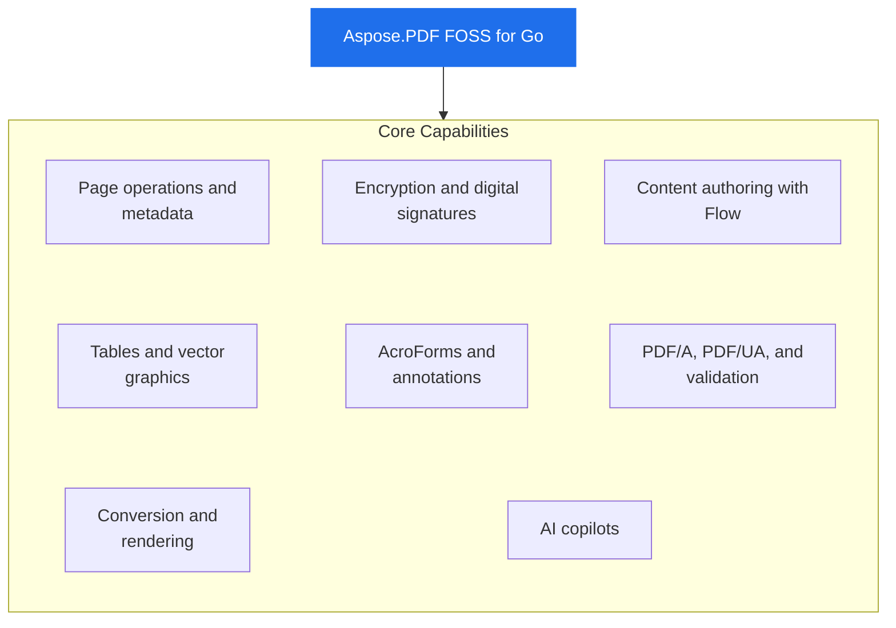

# Aspose.PDF FOSS for Go

[](https://pkg.go.dev/github.com/aspose-pdf-foss/aspose-pdf-foss-for-go)  [](https://github.com/aspose-pdf-foss/aspose-pdf-foss-for-go/actions/workflows/test.yml) [](LICENSE) [](https://go.dev/dl/)

[](https://products.aspose.org/pdf/go/)

Aspose.PDF FOSS for Go reads and writes PDF documents, converts them to PDF/A and PDF/UA formats, and supports document manipulation operations such as splitting, appending, rotating, and reordering pages. It writes PDF content using flow-based and low-level drawing APIs, including text, tables, lists, shapes, and annotations, and can export to HTML, `SVG`, Markdown, and EPUB. It validates PDF/A and PDF/UA compliance, applies encryption and digital signatures with LTV support, and inspects existing signatures. It also provides AI-powered capabilities for image description, OCR, and document summarization through copilot interfaces.

The API shape mirrors Aspose.PDF for .NET where natural, so concepts transfer directly for
developers coming from that library, and spec references throughout follow ISO 32000-1 (PDF 1.7)
and ISO 32000-2 (PDF 2.0). This project is not to be confused with `aspose-pdf-go-cpp` (a CGo
wrapper around a native library) — it is 100% Go source, `go get` and cross-compile anywhere.

## Navigation

- [At a Glance](#at-a-glance)
- [Key Capabilities](#key-capabilities)
- [Installation](#installation)
- [Dependencies](#dependencies)
- [Quick Start](#quick-start)
- [Additional Examples](#additional-examples)
- [API Reference](#api-reference)
- [Documentation & Resources](#documentation--resources)
- [Scope and Limitations](#scope-and-limitations)
- [Development and Testing](#development-and-testing)
- [Third-Party Notices](#third-party-notices)
- [License](#license)

## At a Glance



## Key Capabilities

- **Page operations and metadata.** It splits a document into per-page documents with `Document.Split`, appends another document's pages in place with `Document.Append`, rotates pages with `Document.Rotate`, rearranges pages by an explicit 1-based index slice with `Document.Reorder`, sets document metadata through `Document.SetInfo`, and writes XMP metadata packets with `Document.SetXMP`.
- **Encryption and digital signatures.** It encrypts documents with AES-128 or AES-256 using user and owner passwords and granular permissions, signs documents with PKCS#7-detached signatures supporting PAdES, DocMDP, and RFC 3161 timestamps, verifies signatures with `Document.VerifySignatures`, and embeds revocation evidence as LTV with `SignOptions.LTV`.
- **Content authoring with Flow.** It writes paragraphs, headings, tables, and lists with `Flow.AddParagraph`, `Flow.AddTable`, and `Flow.AddList`, renders them to paginated content, and produces a tagged PDF for PDF/UA accessibility when `FlowOptions.Tagged` is enabled.
- **Tables and vector graphics.** It draws vector content on pages with `Page.DrawLine`, `Page.DrawRectangle`, `Page.DrawCircle`, and `Page.DrawPath`, builds multi-page tables with repeating headers and cell merging, and creates repeating-motif tiling patterns with `Document.CreateTilingPattern`.
- **AcroForms and annotations.** It adds text fields and barcode fields to forms with `Form.AddTextField` and `Form.AddBarcodeField`, reads and manipulates annotations on a page with `Page.Annotations`, and irreversibly removes content from marked regions with `RedactAnnotation`.
- **PDF/A, PDF/UA, and validation.** It converts documents toward archival conformance with `Document.ConvertToPDFA` and `Document.ConvertToPDFUA`, validates documents against PDF/A and PDF/UA standards with `Document.ValidatePDFA` and `Document.ValidatePDFUA`, and embeds fonts and writes required metadata identifiers during conversion.
- **Conversion and rendering.** It renders pages to raster images with `Document.RenderImage`, exports documents as HTML, `SVG`, Markdown, and EPUB with `Document.SaveHTML`, `Document.SaveSVG`, `Document.SaveMarkdown`, and `Document.SaveEpub`, and supports reflowable and native vector modes for each format.
- **AI copilots.** It summarizes documents with `ai.SummaryCopilot`, performs OCR and writes recognized text as an invisible, selectable layer with `ai.NewLLMOCREngine`, answers questions with conversation history via `ai.ChatCopilot`, and generates /Alt text for tagged figures with `ai.NewImageDescriptionCopilot`.

- **Page-level operations and metadata** — `Document.Split()` breaks a document into per-page
  documents; `Extract` builds a new document from selected `PageRange`s without touching the
  source; `Append` combines multiple PDFs into one by merging another document's pages in place;
  `Rotate`/`SetRotation` turn pages, and `Reorder` rearranges them by an explicit 1-based index
  slice (repeats and omissions both allowed); `Document.NUp`/`Document.Booklet` (`NUp`/`Booklet`)
  impose pages onto larger sheets for N-up printing or saddle-stitch binding, each returning a new
  document built from Form XObjects and leaving the source untouched; and blank PDFs can be
  created from scratch with `NewDocument`/`NewDocumentFromFormat`. Each `*Page` exposes its own
  `Number()`, `Size()` (a `PageSize{Width, Height}` in points), and `Rotation()` getters, and page
  geometry (`MediaBox`/`CropBox`/`TrimBox`/`BleedBox`/`ArtBox`) is readable and, via
  `SetMediaBox`/`SetCropBox`/`SetTrimBox`/`SetBleedBox`/`SetArtBox` (plus the `SetPageSize`
  shorthand for resizing the MediaBox), writable without scaling existing content —
  `Document.ResizeContents` (`ResizePage`, `ResizeMargins`, `ResizeContentSize`, …) rescales the
  content with the page instead, annotations included; the `/Info`
  dictionary round-trips through `Document.Info()`/`SetInfo()`/`ClearInfo()` and a `DocumentInfo`
  struct, distinct from the XMP metadata packet available via
  `Document.XMP()`/`SetXMP()`/`ClearXMP()` (backed by the `/Catalog/Metadata` stream, with a raw
  `XMPRaw()`/`SetXMPRaw()` escape hatch and `SyncInfoToXMP()` to mirror `/Info` into XMP); and the
  `/PageLabels` numbering tree is written with `Document.SetPageLabels` (roman/decimal/alphabetic
  styles, prefix, and start value per range) and read back per-page via `Page.Label()`.
  `Document.Version()`/`SetVersion()` read and choose the PDF version (saving never lowers it),
  `Document.ConvertToPDF20()` turns a document into PDF 2.0 (metadata moved into XMP, what PDF 2.0
  deprecates removed; RC4 or AES-128 encryption is refused with `ErrDeprecatedFeature`), and
  `Document.ID()` returns the file identifier as a `DocumentID{Original, Modified}`;
  `Document.PageMode()`/`SetPageMode()` choose the panel a viewer opens with (bookmarks,
  thumbnails, layers, attachments, or full screen), and `Page.SetTransition`/`SetDisplayDuration`
  give a page its presentation-mode transition (`PageTransition`) and auto-advance time.
- **Encryption and digital signatures** — `Document.SetPassword(userPassword, ownerPassword)`
  password-protects the document on save with AES-128 (`/CFM /AESV2`), AES-256 (`/CFM /AESV3`,
  bumps the file to PDF 2.0), or RC4-128 and granular viewer permissions (print, copy, modify,
  annotate, fill, accessibility, assemble); sign with a PKCS#7-detached signature
  (SHA-256, RSA or ECDSA) that can be PAdES, a DocMDP certification, and/or carry an RFC 3161
  trusted timestamp, over plain or already-encrypted documents, with support for multiple
  incremental signatures and verification via `VerifySignatures` — optionally asking the issuer
  whether the signing certificate was revoked (OCSP or CRL, network opt-in through
  `ValidationOptions`) and embedding that evidence as a `/DSS` with `AddValidationInfo`, so the
  signature still verifies after the certificate expires (LTV). Keys are passed as a standard
  `crypto.Signer` plus `*x509.Certificate` — no `.p12` file required. Documents can also be
  encrypted for **certificate recipients** instead of a password
  (`EncryptionOptions.Recipients`, the `/Adobe.PubSec` handler): each recipient gets its own
  permissions, and the file opens with `OpenWithCertificate(path, cert, key)` for any
  `crypto.Decrypter`.
- **Tables and vector graphics** — `pdf.NewTable()` builds multi-page tables with repeating
  header rows (auto-fit or explicit `Row.SetHeight`), cell merging via
  `Cell.SetColSpan`/`SetRowSpan`, per-cell styling, and image cells via `Cell.SetImage`, rendered
  onto a page with `(*Page).AddTable(t, rect)`; `(*Page).DrawLine`/`DrawRectangle`/`DrawCircle`/
  `DrawPath` and friends draw first-class vector content directly on a page, and a `Path` fluent
  builder (`MoveTo`/`LineTo`/`CurveTo`/`QuadTo`/`Arc`/`Close`) covers arbitrary shapes; fills
  support solid colours, `ShapeStyle.FillGradient` (linear or radial), and
  `Document.CreateTilingPattern(w, h)` repeating-motif tiling patterns.
- **AcroForms** — read, and build from scratch every standard field type with
  `AddTextField`/`AddCheckbox`/`AddRadioGroup`/`AddComboBox`/`AddListBox`/`AddPushButton` (plus
  the typed password/file-select/rich-text/number/date variants — behavior flags exposed as `/Ff`
  on the underlying field dictionary) and remove one with `RemoveField`; `AddBarcodeField` draws
  Code128, QR, or PDF417 symbols in place of text, encoded by this library's own pure-Go encoders (no
  external dependency); `Field.SetStyle`/`Style()` control widget appearance (border, background, font),
  and `(*ButtonField).SetAppearance` gives push buttons distinct normal/rollover/down captions
  and an icon; field values round-trip as typed JSON, FDF, and XFDF for template-fill and
  Acrobat-interoperable data interchange.
- **Attachments and portfolios** — `Document.EmbeddedFiles()` attaches, reads back, and removes
  document-level files through the `/Catalog/Names/EmbeddedFiles` name tree, while
  `Document.Collection()` turns those attachments into a **PDF portfolio**: a schema of custom
  columns (`Schema().Add("Amount", "Total", CollectionFieldNumber)`), per-file values via
  `EmbeddedFile.CollectionItem()`, an initial file, a sort order, and a details/tiles/hidden
  presentation mode — so viewers show a navigable table instead of a plain attachment list, and
  the cover page still opens anywhere.
- **Tagged PDF and PDF/UA accessibility** — `Document.TaggedContent()` builds a logical structure
  tree as content is drawn (`TagContent`, `AddTaggedTable`, `AddTaggedList`), links and other
  annotations join the tree via `StructElement.AddObjectReference` (an `/OBJR` to the annotation
  itself, not marked content), `Document.AutoTag()` tags a PDF made elsewhere after the fact
  (headings, paragraphs, lists, tables, figures in reading order; headers, footers and drawings
  as artifacts) without changing how it looks, `Document.ConvertToPDFUA()` embeds the fonts and
  writes the PDF/UA identifier, and `Document.ValidatePDFUA()` reports what is still missing.

- **PDF/A and structural validation** — `Validate` checks structural integrity;
  `ValidatePDFA(PDFA1B/2B/3B/1A/2A/3A/2U/3U/4/4E/4F)` reports archival-conformance violations; `ConvertToPDFA`
  moves a document toward conformance in one call (strips encryption/JavaScript, embeds
  non-embedded Standard-14 fonts, adds an sRGB ICC OutputIntent, writes the `pdfaid` XMP packet). For
  PDF/A-1, pages that really paint with transparency become images with their text kept as an invisible,
  searchable layer; the report's `RasterizedPages` names them. `ConvertDeviceCMYKToRGB` recolours
  DeviceCMYK first for documents that must conform under that sRGB intent.
- **E-invoices (ZUGFeRD / Factur-X)** — `Document.AttachInvoice(xml)` turns a document into a hybrid
  e-invoice: the CII XML is embedded as `factur-x.xml` with the associated-file relationship its
  profile calls for, the Factur-X metadata and extension schema are written, and the document is
  converted to PDF/A-3. `Document.Invoice()` extracts the invoice from incoming Factur-X and ZUGFeRD
  2.x/1.0 files together with its profile. Attachments also gain PDF/A-3 associated-file
  relationships (`EmbeddedFile.SetAFRelationship`).
- **Rendering to raster images** — a pure-Go anti-aliased renderer with no third-party package
  dependencies of its own (its own rasterizer — no `golang.org/x/image`, no cgo) draws vector
  graphics, images (including CCITT fax, JBIG2, and JPEG2000 (`/JPXDecode`) scans), and text
  (embedded and non-embedded via a `FontRepository` covering `.ttc`/`.otf` faces, including
  non-embedded CJK) to PNG, JPEG, GIF, BMP, and single- or multi-page
  TIFF via `Page.RenderImage`/`RenderPNG`/`RenderTIFF`/… and `Document.RenderTIFF`.
- **HTML, SVG, and Markdown conversion** — `SaveHTML` exports a single-file HTML document with no
  external assets in four modes (faithful raster, visible text, native SVG-per-page, and
  reflowable), including fillable AcroForm controls; in text/native modes, embedded TrueType/
  OpenType fonts are re-wrapped as WOFF `@font-face` data URLs with a browser cmap synthesized
  from the font's `/ToUnicode` mapping, so text renders in the document's real faces. `SaveSVG`
  exports standalone true-vector SVG pages with all binary parts embedded as `data:` URLs by
  default, or externalized via `ResourceWriter`, and `AddSVG` imports SVG 1.1 content (shapes,
  gradients, clipping, masks) back onto a page; `MarkdownToDocument` renders CommonMark + GFM as a
  paginated PDF (652/652 on the official test suite), `Flow.AddMarkdown` mixes Markdown into a
  Flow document, `Page.AddMarkdown(md, rect)` draws it into a `Rectangle` on an existing page, and
  `SaveMarkdown` re-assembles a PDF as GFM Markdown.
- **Stamps and watermarks** — `Document.AddTextWatermark`/`AddSVGWatermark` overlay a text or SVG
  watermark across selected pages (or every page); `(*Page).AddStamp`/`(*Document).AddStamp` place
  a `TextStamp`, `ImageStamp`, or `PageNumberStamp` on one or more pages.
- **Table detection and Office/eBook conversion** — `TableAbsorber` (`Visit(page)` then
  `TableList()`) recognizes ruled and borderless tables directly from a page's vector geometry (no
  rasterization), with conservative guards so ordinary prose, lists, TOCs, and code listings are
  never mistaken for tables; `Remove` and `Replace` delete a found table or draw a new `Table` in
  its place. Detection feeds `Document.SaveDocx`/`WriteDocx` (a pure-stdlib OOXML
  writer producing styled runs, heading styles, hyperlinks, and lists, plus real Word tables —
  `EnhancedFlow`, the default mode — from detected table structure), `Document.SaveXlsx`/
  `WriteXlsx` (detected tables become Excel worksheets with real numeric cells, merged cells, and
  header shading, or a full-page cell-per-line mode), and `Document.SaveEpub`/`WriteEpub` (a
  reflowable, spec-correct OCF-container EPUB 3 book with chapters split at headings and a real
  navigation TOC).
- **Document comparison** — `CompareDocumentsPageByPage` and `CompareFlatDocuments` report what
  changed between two PDFs word by word, with the page and rectangle of every difference;
  `ComparisonResult.SaveMarkup` writes a copy of either document in which insertions are
  highlighted, deletions struck out and removed text kept in the annotation note, so a reviewer
  reads the change list in any PDF viewer. `GraphicalPdfComparer.GetDifference` catches what the
  word comparer can't — moved or edited graphics, font substitution — by rasterizing both pages and
  diffing pixels, reporting a changed-pixel ratio and a difference image; `SideBySideComparePages`/
  `SideBySideCompareDocuments` lay the marked-up before/after side by side in one vector spread PDF.
  `HTMLDiffOutputGenerator`/`JSONDiffOutputGenerator`/`MarkdownDiffOutputGenerator`/
  `PDFDiffOutputGenerator` serialize the same differences as an HTML fragment, JSON, GFM Markdown, or
  a generated, colored PDF report. Mirrors Aspose.PDF for .NET's `TextPdfComparer`,
  `GraphicalPdfComparer`, `SideBySidePdfComparer` and the `Aspose.Pdf.Comparison.OutputGenerator`
  namespace.
- **AI copilots** — the `ai` subpackage adds document summarization (`SummaryCopilot`), OCR of
  scanned pages with a `MakeSearchable` pipeline that writes recognized text back as an invisible,
  selectable layer, document Q&A with conversation history (`ChatCopilot`), and automatic
  `/Alt` text generation for tagged figures (`ImageDescriptionCopilot`), over any
  OpenAI-compatible endpoint.

- **Text object model** — the Aspose.PDF for .NET way to write and edit text: `TextBuilder.AppendText`
  draws a `TextFragment` of styled `TextSegment`s (`TextState`: font, size, colours, spacing,
  scaling, hyperlinks, backgrounds), `AppendParagraph` wraps, aligns and justifies a `TextParagraph`,
  and `TextFragmentAbsorber` finds text as editable fragments — set `Text`, `Position` or
  `TextState` and the page changes when the document is saved (or at once with `ApplyTextChanges`;
  a later search, and any operation that rewrites page content, applies it first).
- **Incremental save** — `SaveIncremental`/`WriteIncremental` keep the opened file's bytes and
  append only what changed as a new revision, so existing signatures stay valid.
- **Text extraction, fonts, and optimization** — extract text in visual or raw reading order
  (`TextExtractOptions{Mode: TextExtractRaw}`) with full layout info, limited to the page or a
  rectangle glyph by glyph (`LimitToPageBounds`, `Rectangle`), recover paragraph/column
  structure (`Paragraphs()`, optionally joining paragraphs that run on into the next column or page) and rewrite a paragraph in place (`MarkupParagraph.SetText`), re-align the text already in a
  rectangle — left, right, centred, justified — keeping its fonts (`TextParagraphAbsorber`), search and replace text in place, embed and subset TrueType/
  OpenType fonts (`.ttf`/`.otf`/`.ttc`) — `Document.LoadFont`/`Document.LoadFontByName("Calibri",
  bold, italic)` resolve faces by family name via a pluggable `FontRepository`, and
  `Document.SubsetFonts()` rebuilds each embedded font's own glyph tables (`glyf`/`loca`/`hmtx`/
  `CIDToGIDMap`) down to only the glyphs actually used; custom glyphs can also be authored
  outright with `Document.CreateType3Font()` — `Type3Font.AddGlyph(rune, width)` hands back a
  drawing canvas in glyph space, so a symbol drawn with the vector API becomes a real font
  character whose text still extracts and searches (an embedded `ToUnicode` CMap carries the
  mapping); `Document.RemoveUnusedObjects()` deletes
  every object that neither a page nor the document catalog uses (metadata, bookmarks,
  attachments and the structure tree are kept) and returns the removed count on its own, or fold that
  same cleanup into a larger pass with the unified `Document.Optimize` pass
  (`DefaultOptimizationOptions()` is the safe, lossless preset — remove unused objects, subset
  fonts, Flate-compress and dedupe streams, pack objects into object streams; opt into lossy image
  recompression via `OptimizationOptions.Images`, or into dropping a Helvetica/Times/Courier font's
  own embedded program via `OptimizationOptions.UnembedFonts`) or the image-only
  `Document.OptimizeImages(OptimizeImageOptions)`
  pass (max DPI downscaling, JPEG quality, and PNG→JPEG conversion); reduce file size further with
  `Document.SaveLinearized`/`WriteToLinearized` (linearized/fast-web-view output per ISO 32000-1
  Annex F, so viewers can render page 1 before the whole file downloads; `IsLinearized` tells whether
  an opened file is), or `ConvertToGrayscale`.

[](docs/feature_showcase.pdf)

[**docs/feature_showcase.pdf**](docs/feature_showcase.pdf) is a single 20-page PDF generated by
[`_examples/feature_showcase`](_examples/feature_showcase/main.go) that walks nearly every
capability above in one document — a clickable table of contents (built with `Page.AddTOC`),
styled AcroForm fields, Code128 / QR / PDF417 barcode fields, transparency flattening shown as
real before/after renders, all four stamp types, a word-level document comparison, the full
annotation gallery, redactions, multi-page tables, vector graphics, and a meta "Rendering & Imposition"
page whose thumbnails are renders of the document itself, produced by this library's own renderer.
Cross-cutting metadata — bookmarks, named destinations, page labels, and Info + XMP
metadata — is set once and carried through the whole document. Regenerate it locally with
`go run ./_examples/feature_showcase`.

## Installation

Install the published package from pkg.go.dev (`github.com/aspose-pdf-foss/aspose-pdf-foss-for-go`, version v0.17.0):

```bash
go get github.com/aspose-pdf-foss/aspose-pdf-foss-for-go
```

Verify the install:

```bash
go list github.com/aspose-pdf-foss/aspose-pdf-foss-for-go
```

## Dependencies

### Required Package Dependencies

No required third-party package dependencies; in `go.mod`, no `require` directive a consumer would install is declared.

### Native and System Requirements

- Requires Go `1.24` (`go` in `go.mod`).

## Quick Start

This example opens a PDF, splits it into individual page files, and merges two PDFs into one, demonstrating core document manipulation with Aspose.PDF FOSS for Go.

```go
package main

import (
	"fmt"
	"log"

	pdf "github.com/aspose-pdf-foss/aspose-pdf-foss-for-go"
)

func main() {
	// Open a PDF and split it into per-page documents.
	doc, err := pdf.Open("input.pdf")
	if err != nil {
		log.Fatal(err)
	}
	pages, err := doc.Split()
	if err != nil {
		log.Fatal(err)
	}
	for i, p := range pages {
		p.Save(fmt.Sprintf("page%03d.pdf", i+1))
	}

	// Merge two PDFs into one — Append mutates the receiver in place.
	a, _ := pdf.Open("file1.pdf")
	b, _ := pdf.Open("file2.pdf")
	if err := a.Append(b); err != nil {
		log.Fatal(err)
	}
	fmt.Println("merged:", a.PageCount(), "pages")
	a.Save("merged.pdf")
}
```

The module has no transitive dependencies — everything is built on
the Go standard library, including the PDF parser/writer, the raster renderer, the SVG and
Markdown engines, and the PKCS#7/CMS signing code.

## Additional Examples

Create documents from scratch, encrypt them, embed tables, and render pages to images.

### Content Authoring With the Flow Layout Engine

```go
doc := pdf.NewDocumentFromFormat(pdf.PageFormatA4)
flow := doc.NewFlow(pdf.FlowOptions{})
flow.AddHeading(1, "Quarterly Report", pdf.TextStyle{})
flow.AddParagraph("Revenue grew in every region this quarter.", pdf.TextStyle{Size: 11})
flow.AddList([]string{"North: +12%", "South: +8%"}, false, pdf.TextStyle{Size: 11})

pages, err := flow.Render()
if err != nil {
	log.Fatal(err)
}
fmt.Println("pages:", pages)
```

<details>
<summary>View Additional Examples</summary>

### Encrypt a Document

```go
doc := pdf.NewDocumentFromFormat(pdf.PageFormatA4)
doc.SetEncryption(pdf.EncryptionOptions{
	UserPassword:  "secret",
	OwnerPassword: "owner-secret",
	Permissions:   &pdf.Permissions{AllowPrint: true, AllowCopy: true},
	Algorithm:     pdf.EncryptionAlgAES128,
})

var buf bytes.Buffer
if _, err := doc.WriteTo(&buf); err != nil {
	log.Fatal(err)
}

// The file is now encrypted; Open returns ErrEncrypted.
if _, err := pdf.OpenStream(&buf); err != nil {
	fmt.Println("encrypted")
}
```

### Build a Table

```go
doc := pdf.NewDocument(595, 842)
page, _ := doc.Page(1)

table := pdf.NewTable().
    SetColumnWidths([]float64{120, 200, 80}).
    SetBorder(pdf.BorderInfo{Sides: pdf.BorderSideAll, Width: 1}).
    SetDefaultCellBorder(pdf.BorderInfo{Sides: pdf.BorderSideAll, Width: 0.5}).
    SetDefaultCellMargin(pdf.MarginInfo{Top: 4, Right: 6, Bottom: 4, Left: 6}).
    SetDefaultCellStyle(pdf.TextStyle{Font: pdf.FontHelvetica, Size: 10})

header := table.AddRow()
header.AddCells("Name", "Description", "Qty")
for _, c := range header.Cells() {
    c.SetBackground(&pdf.Color{R: 0.9, G: 0.9, B: 0.9, A: 1})
    c.SetHAlign(pdf.HAlignCenter)
}

row := table.AddRow()
row.AddCells("Widget", "Standard widget", "5")

pagesAdded, _ := page.AddTable(table, pdf.Rectangle{LLX: 50, LLY: 600, URX: 545, URY: 750})
fmt.Printf("table flowed to %d additional pages\n", pagesAdded)
doc.Save("table.pdf")
```

### Render a Page to an Image and Inspect Its Bounds

```go
doc := pdf.NewDocumentFromFormat(pdf.PageFormatA4)
page, _ := doc.Page(1)
_ = page.AddText("Preview me", pdf.TextStyle{Size: 24},
	pdf.Rectangle{LLX: 50, LLY: 700, URX: 545, URY: 780})

img, err := doc.RenderImage(1, pdf.RenderOptions{DPI: 96})
if err != nil {
	log.Fatal(err)
}
fmt.Println("rendered:", img.Bounds().Dx() > 0 && img.Bounds().Dy() > 0)
```

### Digitally Sign and Verify

```go
key, _ := ecdsa.GenerateKey(elliptic.P256(), cryptorand.Reader)
tmpl := &x509.Certificate{
	SerialNumber: big.NewInt(1),
	Subject:      pkix.Name{CommonName: "Jane Signer"},
	NotBefore:    time.Now().Add(-time.Hour),
	NotAfter:     time.Now().Add(24 * time.Hour),
	KeyUsage:     x509.KeyUsageDigitalSignature,
}
der, _ := x509.CreateCertificate(cryptorand.Reader, tmpl, tmpl, &key.PublicKey, key)
cert, _ := x509.ParseCertificate(der)

doc := pdf.NewDocumentFromFormat(pdf.PageFormatA4)
if err := doc.Sign(pdf.SignOptions{Certificate: cert, PrivateKey: key, Reason: "Approval"}); err != nil {
	log.Fatal(err)
}
var buf bytes.Buffer
if _, err := doc.WriteTo(&buf); err != nil {
	log.Fatal(err)
}

signed, _ := pdf.OpenStream(&buf)
sigs, err := signed.VerifySignatures()
if err != nil {
	log.Fatal(err)
}
fmt.Printf("signatures: %d, valid: %v, reason: %s\n", len(sigs), sigs[0].Valid, sigs[0].Reason)
```

See [`_examples/`](_examples/) for full runnable programs covering text, forms, annotations,
tables, vector graphics, SVG, and the end-to-end `feature_showcase` demo, or short focused API
snippets under "Examples" on [pkg.go.dev](https://pkg.go.dev/github.com/aspose-pdf-foss/aspose-pdf-foss-for-go).

The most representative example beyond Quick Start is building a document from scratch with the
Flow layout engine — an additive layer over the Rectangle-based drawing API that computes the
rectangles for you — rather than editing an existing one.

`NewFlow` returns a `*Flow` that lays chained `AddParagraph`/`AddHeading`/`AddImage`/`AddTable`/
`AddList` calls out top-to-bottom, paginating automatically; `Render()` returns the number of
pages produced. `FlowOptions.Tagged` auto-tags every element for a one-call PDF/UA-conformant
document.

</details>

## API Reference

The public API lives in the single root package asposepdf, centered on `Document`, which opens PDFs and writes them back, and the ai subpackage that provides AI copilots for summarization, chat, and image description.

The public API has 297 types.

<details>
<summary>View the Complete Public API Surface</summary>

### Core API

| Class | Description |
| --- | --- |
| `AFRelationship` | AFRelationship says how an embedded file relates to the document. |
| `AbsorbedCell` | AbsorbedCell is one logical grid position. |
| `AbsorbedRow` | AbsorbedRow is one logical table row. |
| `AbsorbedTable` | AbsorbedTable is one recognized table. |
| `AbsorbedTextParagraph` | AbsorbedTextParagraph is the text inside one rectangle of a page: its lines, each made of words, in reading order. |
| `Action` | Action is the common interface implemented by every concrete action type. |
| `ActionType` | ActionType identifies the kind of action attached to an annotation (typically a LinkAnnotation's /A entry). |
| `Annotation` | Annotation is the common interface implemented by every concrete annotation type. |
| `AnnotationCollection` | AnnotationCollection is the live, ordered set of annotations attached to a single page. |
| `AnnotationType` | AnnotationType identifies the kind of annotation. |
| `AutoTagResult` | AutoTagResult counts the structure elements AutoTag created. |
| `AutoTaggingSettings` | AutoTaggingSettings configures AutoTag. |
| `BarcodeField` | BarcodeField draws its value as a barcode symbol. |
| `BarcodeSymbology` | BarcodeSymbology identifies which barcode encoding a BarcodeField draws. |
| `BleedMarkAnnotation` | BleedMarkAnnotation shows the corner of the BleedBox, how far artwork runs past the cut. |
| `BmpDevice` | BmpDevice renders a page to BMP. |
| `BookletBinding` | BookletBinding selects the binding edge of a booklet. |
| `BookletOptions` | BookletOptions configures Booklet imposition. |
| `BorderEffect` | BorderEffect controls the /BE/S entry per ISO 32000-1 §12.5.4 Table 167. |
| `BorderInfo` | BorderInfo describes a border drawn around a table or cell. |
| `BorderSide` | BorderSide is a bitmask selecting which sides of a rectangular border are drawn. |
| `BorderStyle` | BorderStyle controls the /BS dict for drawing annotations per ISO 32000-1 §12.5.4 Table 168. |
| `ButtonAppearance` | ButtonAppearance configures a push button's rich appearance: separate captions for the normal / rollover / down states, an optional icon image, and face/border/text colours. |
| `ButtonField` | ButtonField is a push button — action only, no value semantics. |
| `ButtonIconPosition` | ButtonIconPosition controls how a push button lays out its icon and caption — the /MK /TP entry per ISO 32000-1 §12.5.6.19 Table 189. |
| `CaretAnnotation` | CaretAnnotation marks a point of text insertion or deletion, drawn as an upward caret ("^") filled with the annotation colour. |
| `CaretSymbol` | CaretSymbol is the /Sy entry of a Caret annotation per ISO 32000-1 §12.5.6.11 Table 180 — an optional symbol drawn together with the caret to associate it with an editing action. |
| `Cell` | Cell is a single cell within a Row. |
| `CertifyPermission` | CertifyPermission is the DocMDP permission level of a certification signature (ISO 32000-1 §12.8.2.2 Table 254). |
| `CheckboxField` | CheckboxField is a checkbox with on/off state. |
| `ChoiceOption` | ChoiceOption is one option of a ComboBoxField or ListBoxField. |
| `CircleAnnotation` | CircleAnnotation draws an elliptical annotation. |
| `Collection` | Collection is the document's portfolio view over its embedded files. |
| `CollectionField` | CollectionField is one portfolio column. |
| `CollectionFieldType` | CollectionFieldType is a schema column's data type (the collection field's /Subtype). |
| `CollectionItem` | CollectionItem holds one attachment's values for the portfolio's schema fields (the file specification's /CI dictionary). |
| `CollectionSchema` | CollectionSchema is the portfolio's set of columns. |
| `CollectionView` | CollectionView selects how a viewer presents the portfolio's files (the /Collection /View entry). |
| `ColorBarAnnotation` | ColorBarAnnotation is a strip of tints of one process colour, for a press operator to check ink density. |
| `ColorsOfCMYK` | ColorsOfCMYK names the process colour a ColorBarAnnotation shows. |
| `ComboBoxField` | ComboBoxField is a single-select dropdown choice field. |
| `ComparisonOptions` | ComparisonOptions narrows what is compared. |
| `ComparisonResult` | ComparisonResult holds the differences between two documents and can write a marked-up copy of either side. |
| `ComparisonStatistics` | ComparisonStatistics summarises a comparison. |
| `ContentsResizeParameters` | ContentsResizeParameters says how ResizeContents rescales a page. |
| `ContentsResizeValue` | ContentsResizeValue is one dimension of a ContentsResizeParameters: a length in points, a percentage of the page's original size along the same axis, or — the zero value — automatic. |
| `DateField` | DateField is a text field with a JavaScript date-format action and a format mask. |
| `Destination` | Destination is the common interface for all explicit destinations. |
| `DestinationFit` | DestinationFit — [page /Fit] |
| `DestinationFitB` | DestinationFitB — [page /FitB] |
| `DestinationFitBH` | DestinationFitBH — [page /FitBH top] |
| `DestinationFitBV` | DestinationFitBV — [page /FitBV left] |
| `DestinationFitH` | DestinationFitH — [page /FitH top] |
| `DestinationFitR` | DestinationFitR — [page /FitR left bottom right top] |
| `DestinationFitV` | DestinationFitV — [page /FitV left] |
| `DestinationType` | DestinationType identifies the destination flavor. |
| `DestinationXYZ` | DestinationXYZ — [page /XYZ left top zoom]. |
| `DiffMarkupOptions` | DiffMarkupOptions styles the marked-up copy. |
| `DiffMarkupSide` | DiffMarkupSide selects which document the markup is drawn on. |
| `DiffOperation` | DiffOperation is one run of adjacent words sharing an operation. |
| `DiffOutputStyle` | DiffOutputStyle colors the three kinds of text a diff output generator marks. |
| `DigestAlgorithm` | DigestAlgorithm class provides the DigestSHA256 algorithm identifier and the String method that names the algorithm the way the standards do. |
| `DocRecognitionMode` | DocRecognitionMode selects the reconstruction algorithm — mirrors Aspose.PDF for .NET's DocSaveOptions.RecognitionMode. |
| `DocSaveOptions` | DocSaveOptions configures SaveDocx / WriteDocx. |
| `Document` | Document is a PDF document. |
| `DocumentID` | DocumentID is a file identifier (the trailer /ID, ISO 32000-1 §14.4) as upper-case hexadecimal. |
| `DocumentInfo` | DocumentInfo contains document information from the PDF Info dictionary. |
| `EditOperationsOrder` | EditOperationsOrder decides how the two halves of a replacement are ordered. |
| `EmbeddedFile` | EmbeddedFile is one attachment: a /Filespec dictionary with an embedded stream. |
| `EmbeddedFiles` | EmbeddedFiles is the document's collection of attached (embedded) files — the /Catalog/Names/EmbeddedFiles name tree (ISO 32000-1 §7.11.4). |
| `EncryptionAlgorithm` | EncryptionAlgorithm selects the cipher and security-handler revision used by (*Document).SetEncryption. |
| `EncryptionOptions` | EncryptionOptions bundles every knob that controls how a document is encrypted when saved. |
| `EpubSaveOptions` | EpubSaveOptions configures SaveEpub / WriteEpub. |
| `Field` | Field is the common interface implemented by every concrete form field type (TextBoxField, CheckboxField, RadioButtonField, etc.). |
| `FieldStyle` | FieldStyle is the visual styling applied to a form field's widget(s). |
| `FigureAlt` | FigureAlt is a /Figure structure element that has no alternate text, paired with the image it brackets (when resolvable). |
| `FileAttachmentAnnotation` | FileAttachmentAnnotation embeds a file in the document and shows an icon at the annotation's /Rect. |
| `FileAttachmentIcon` | FileAttachmentIcon names per ISO 32000-1 §12.5.6.15 Table 178. |
| `FileDiffOutputGenerator` | FileDiffOutputGenerator writes comparison output to a file or writer. |
| `FileSelectBoxField` | FileSelectBoxField is a text field whose value is a file path (FileSelect flag), used to attach a local file on submit. |
| `FlattenTransparencyOptions` | FlattenTransparencyOptions configures FlattenTransparency. |
| `FloatSide` | FloatSide selects which edge a floated box hugs while text wraps around it. |
| `FloatingBox` | FloatingBox is a positioned content container (Tier 2 of the flow model): a box with an optional border, background and padding that lays its own content (paragraphs, headings, images, lists) inside its width. |
| `Flow` | Flow is a document generator that lays content out top-to-bottom and paginates automatically — the "flow" counterpart to the Rectangle-based drawing API. |
| `FlowOptions` | FlowOptions configures a Flow. |
| `Font` | Font is implemented by standard 14 fonts and embedded TTF fonts. |
| `FontMetrics` | FontMetrics holds the vertical metrics AddText/AddTextAt use for a font at a given size, in points. |
| `FontSizeAdjustment` | FontSizeAdjustment selects how a replacement laid out in a rectangle changes size to fit it. |
| `FontStyle` | FontStyle is a bit set of font style flags. |
| `Form` | Form is the document's AcroForm view. |
| `FormFieldType` | FormFieldType identifies the kind of form field. |
| `FreeTextAnnotation` | FreeTextAnnotation displays text directly on the page, rendered into /AP/N using an embedded font. |
| `FreeTextIntent` | FreeTextIntent per ISO 32000-1 §12.5.6.6 /IT entry. |
| `GenericAnnotation` | GenericAnnotation is the catch-all surface for /Subtype values this release does not yet model (Stamp, FreeText, Ink, etc.). |
| `GifDevice` | GifDevice renders a page to GIF. |
| `GoToAction` | GoToAction navigates to a destination within the same document: either a 1-based page and the y-coordinate of the top of the view (NewGoToAction), or any Destination (NewGoToDestinationAction) — one of the eight explicit kinds (XYZ, Fit, FitH, FitV, FitR, FitB, FitBH, FitBV) or a NamedDestination. |
| `GoToURIAction` | GoToURIAction opens a URI in the user's default handler (typically a web browser). |
| `Gradient` | Gradient is a fill that varies colour across a shape: either a LinearGradient or a RadialGradient. |
| `GradientStop` | GradientStop is one colour stop in a gradient, positioned at Offset (0 at the gradient's start, 1 at its end). |
| `GraphicalPdfComparer` | GraphicalPdfComparer compares PDF pages/documents pixel by pixel. |
| `HAlign` | HAlign specifies horizontal text alignment within a rectangle. |
| `HTMLDiffOutputGenerator` | HTMLDiffOutputGenerator renders comparison differences as an HTML fragment — colored spans for insertions/deletions, meant to be embedded into the caller's own page or email, not a standalone document. |
| `HTMLMode` | HTMLMode selects how SaveHTML / WriteHTML represents page text. |
| `HTMLSaveOptions` | HTMLSaveOptions configures SaveHTML / WriteHTML. |
| `HeadingRecognitionStrategy` | HeadingRecognitionStrategy selects how AutoTag finds headings. |
| `HiddenDataSanitizationOptions` | HiddenDataSanitizationOptions configures (*Document).Sanitize. |
| `HiddenDataSanitizationResult` | HiddenDataSanitizationResult reports what Sanitize changed. |
| `HighlightAnnotation` | HighlightAnnotation marks a region with a semi-transparent highlight colour, washed over the text the quads cover. |
| `HorizontalAlignment` | HorizontalAlignment is how an AbsorbedTextParagraph's lines sit in its rectangle. |
| `Image` | Image holds an extracted image with its encoded data and metadata. |
| `ImageColorSpace` | ImageColorSpace describes the original color space of the image in the PDF. |
| `ImageCompressionOptions` | ImageCompressionOptions configures the lossy recompression Sanitize applies to a document's existing images when ConvertPagesToImages is not set. |
| `ImageFormat` | ImageFormat describes the output format of an extracted image. |
| `ImageInfo` | ImageInfo holds metadata about an image found on a page without decoding pixel data. |
| `ImageStamp` | ImageStamp overlays a raster image (PNG or JPEG), stretched to fill Rect. |
| `ImageToDocumentOptions` | ImageToDocumentOptions controls page sizing for ImageToDocument. |
| `ImagesDifference` | ImagesDifference is the result of comparing two rendered pages pixel by pixel. |
| `InkAnnotation` | InkAnnotation draws a series of free-form strokes — typically used to represent handwritten ink. |
| `Invoice` | Invoice is an e-invoice found in a document. |
| `InvoiceOptions` | InvoiceOptions configures AttachInvoice. |
| `InvoiceProfile` | InvoiceProfile is the Factur-X / ZUGFeRD conformance level of an invoice. |
| `JSONDiffOutputGenerator` | JSONDiffOutputGenerator renders comparison differences as JSON. |
| `JSONExportOptions` | JSONExportOptions controls (*Form).ExportJSON / WriteJSON. |
| `JavaScriptAction` | JavaScriptAction holds a JavaScript snippet attached to an annotation. |
| `JavaScriptCollection` | JavaScriptCollection is the document-level JavaScript store, backed by the /Catalog/Names/JavaScript name tree (ISO 32000-1 §7.7.4 / §8.5.1). |
| `JpegDevice` | JpegDevice renders a page to JPEG. |
| `Layer` | Layer is one Optional Content Group (OCG) in the document. |
| `LineAnnotation` | LineAnnotation draws a straight line between two points, with optional line endings on each end (arrows, circles, etc. |
| `LineCap` | LineCap is the /J line cap style per ISO 32000-1 §8.4.3.3 Table 54. |
| `LineEndingStyle` | LineEndingStyle is one of the 10 line-ending shapes per ISO 32000-1 §12.5.6.7 Table 176, used in /Line annotations' /LE entry. |
| `LineJoin` | LineJoin is the /j line join style per ISO 32000-1 §8.4.3.4 Table 55. |
| `LineStyle` | LineStyle describes how a stroked path is drawn. |
| `LinearGradient` | LinearGradient interpolates colour along the line from (X1, Y1) to (X2, Y2). |
| `LinkAnnotation` | LinkAnnotation is a clickable region. |
| `LinkHighlightMode` | LinkHighlightMode controls the visual feedback when the link is activated by the user (the /H entry per ISO 32000-1 §12.5.6.5). |
| `ListBoxField` | ListBoxField is a single- or multi-select list choice field. |
| `MarginInfo` | MarginInfo describes margins or padding in points: Top / Right / Bottom / Left. |
| `MarkdownDiffOutputGenerator` | MarkdownDiffOutputGenerator renders comparison differences as GFM Markdown: **inserted** text bold, ~~deleted~~ text struck through. |
| `MarkdownOptions` | MarkdownOptions configures Markdown rendering. |
| `MarkdownSaveOptions` | MarkdownSaveOptions configures SaveMarkdown / WriteMarkdown. |
| `MarkupParagraph` | MarkupParagraph is a run of consecutive lines forming one paragraph. |
| `MarkupSection` | MarkupSection is a column of paragraphs (left-to-right across the page). |
| `MissingGlyphPolicy` | MissingGlyphPolicy is TextStyle.MissingGlyph's type. |
| `NUpOptions` | NUpOptions configures NUp imposition. |
| `NUpOrder` | NUpOrder controls the order in which source pages fill the grid cells of an N-up sheet. |
| `NamedAction` | NamedAction triggers a built-in viewer command (FirstPage, Print, ...). |
| `NamedActionType` | NamedActionType identifies one of the standard viewer commands supported by /Named actions per ISO 32000-1 §12.6.4.11. |
| `NamedDestination` | NamedDestination wraps a name reference into the document's NamedDestinations collection. |
| `NamedDestinations` | NamedDestinations is a name-to-destination map per ISO 32000-1 §12.3.2.3. |
| `NumberField` | NumberField is a text field with a JavaScript number-format action, so viewers display and validate the value as a formatted number. |
| `NumberFormatOptions` | NumberFormatOptions configures a NumberField's display formatting (maps to Acrobat's AFNumber_Format). |
| `Operation` | Operation is the kind of a difference. |
| `OptimizationOptions` | OptimizationOptions selects which reductions Document.Optimize applies. |
| `OptimizationResult` | OptimizationResult reports what Document.Optimize changed. |
| `OptimizeImageOptions` | OptimizeImageOptions controls image optimization behavior. |
| `OutlineItemCollection` | OutlineItemCollection represents an outline entry and the collection of its children. |
| `PDFAFormat` | PDFAFormat identifies a PDF/A conformance level. |
| `PDFAIssue` | PDFAIssue describes a single PDF/A conformance violation. |
| `PDFAValidationReport` | PDFAValidationReport is returned by (*Document).ValidatePDFA. |
| `PDFDiffOutputGenerator` | PDFDiffOutputGenerator renders comparison differences as a generated PDF report — colored, word-wrapped, paginated text — built through this library's Flow layer rather than Aspose's own (presumably fixed-layout) renderer. |
| `PDFDiffReportOptions` | PDFDiffReportOptions configures PDFDiffOutputGenerator. |
| `PDFUAIssue` | PDFUAIssue describes a single PDF/UA (accessibility) conformance violation. |
| `PDFUAValidationReport` | PDFUAValidationReport is returned by (*Document).ValidatePDFUA. |
| `Page` | Page is a live view of a single page within a Document. |
| `PageFormat` | PageFormat describes a page size in points (1/72 inch). |
| `PageInformationAnnotation` | PageInformationAnnotation states the file name, page number, date and time, for whoever handles the printed sheet. |
| `PageLabelRange` | PageLabelRange describes a contiguous run of pages that share a numbering style. |
| `PageLabelStyle` | PageLabelStyle is the numbering style applied within a PageLabelRange. |
| `PageMarkup` | PageMarkup is the structured text of one page. |
| `PageMode` | PageMode is how a viewer presents the document when it opens: which panel, if any, is shown next to the pages (the catalog /PageMode, ISO 32000-1 Table 28). |
| `PageNumberStamp` | PageNumberStamp stamps the page number (and optionally the total), formatted by Format. |
| `PageRange` | PageRange specifies an inclusive range of pages (1-based). |
| `PageSize` | PageSize holds the width and height of a PDF page in points (1/72 inch). |
| `PageTransition` | PageTransition is the effect a viewer in presentation mode uses when it moves to a page (the page /Trans dictionary, ISO 32000-1 §12.4.4). |
| `ParagraphContinuation` | ParagraphContinuation is the part of a paragraph found in a later column or page: where it is, and its lines. |
| `ParagraphOptions` | ParagraphOptions tunes Page.Paragraphs and Document.Paragraphs. |
| `PasswordBoxField` | PasswordBoxField is a text field whose input is masked (Password flag). |
| `Path` | Path is a sequence of MoveTo/LineTo/CurveTo/Close operations defining an arbitrary 2D path in PDF user space (origin at page bottom-left, Y up). |
| `PdfPageStamp` | PdfPageStamp overlays (or underlays) a page from another PDF document as a stamp — the source page is imported once as a Form XObject and drawn into the stamp's Rect, scaled to fit while preserving aspect ratio, positioned by HAlign/VAlign, and honoring Opacity, RotateAngle and Background. |
| `Permissions` | Permissions controls what a viewer allows on an encrypted PDF. |
| `PngDevice` | PngDevice renders a page to PNG at a fixed resolution. |
| `Point` | Point is a single point in PDF user-space coordinates. |
| `PolygonAnnotation` | PolygonAnnotation draws a closed polygon through a list of vertices, with a stroked border and optional interior fill. |
| `PolylineAnnotation` | PolylineAnnotation draws an open polyline through a list of vertices, with a stroked border, optional line endings at the first and last vertex, and optional interior fill for closed endings. |
| `PrinterMarkCornerPosition` | PrinterMarkCornerPosition is the page corner a trim or bleed mark belongs to. |
| `PrinterMarkSidePosition` | PrinterMarkSidePosition is the page margin a registration mark is centred in. |
| `PrinterMarksKind` | PrinterMarksKind selects the marks AddPrinterMarks adds; values combine with /. |
| `QuadPoint` | QuadPoint is one quadrilateral within a markup annotation's /QuadPoints array. |
| `RadialGradient` | RadialGradient interpolates colour from the focal point (FX, FY) out to the circle centred at (CX, CY) with radius R. |
| `RadioButtonField` | RadioButtonField is a group of mutually exclusive options. |
| `RadioButtonOptionField` | RadioButtonOptionField is one of the option widgets inside a RadioButtonField. |
| `RadioItem` | RadioItem describes one widget inside a radio group. |
| `Recipient` | Recipient is one certificate that may open a public-key-encrypted document, optionally with its own permission set. |
| `Rectangle` | Rectangle represents a PDF rectangle [llx, lly, urx, ury] in points (1/72 inch). |
| `RedactAnnotation` | RedactAnnotation marks regions for redaction. |
| `RegistrationMarkAnnotation` | RegistrationMarkAnnotation is the target used to line up the printing plates. |
| `RenderOptions` | RenderOptions controls page rasterization. |
| `RepairReport` | RepairReport describes what had to be reconstructed to open the document. |
| `ReplaceAdjustment` | ReplaceAdjustment selects how ReplaceText makes room for (or closes the gap after) a replacement whose width differs from the text it replaces. |
| `ReplaceOptions` | ReplaceOptions tunes how ReplaceText matches the search text and lays out the replacement. |
| `ResetFormAction` | ResetFormAction resets named form fields to their /DV defaults. |
| `Resolution` | Resolution is a rendering resolution in DPI. |
| `RevocationCheck` | RevocationCheck selects how far verification goes in establishing whether a signing certificate was revoked. |
| `RevocationFetcher` | RevocationFetcher retrieves revocation material. |
| `RevocationSource` | RevocationSource records where an answer came from. |
| `RevocationState` | RevocationState is what a responder or a CRL says about a certificate. |
| `RevocationStatus` | RevocationStatus is what the issuer says about a signing certificate. |
| `RichTextBoxField` | RichTextBoxField is a text field that carries a rich-text value (RichText flag + /RV) in addition to its plain /V. |
| `RotationAngle` | RotationAngle represents a valid PDF page rotation in clockwise degrees. |
| `Row` | Row is a single row within a Table. |
| `SVG` | SVG is the pre-parsed SVG document. |
| `SVGFontResolver` | SVGFontResolver maps an SVG font-family + style to a PDF.Font. |
| `SVGSaveOptions` | SVGSaveOptions configures SaveSVG / WriteSVG. |
| `SearchOptions` | SearchOptions tunes how SearchText interprets the query. |
| `ShapeStyle` | ShapeStyle combines a stroke (LineStyle) with an optional fill color. |
| `SideBySideComparisonOptions` | SideBySideComparisonOptions configures a side-by-side spread. |
| `SideBySideDocsComparisonResult` | SideBySideDocsComparisonResult reports a document-level side-by-side comparison. |
| `SideBySidePagesComparisonResult` | SideBySidePagesComparisonResult reports a page-level side-by-side comparison. |
| `SignOptions` | SignOptions configures a digital signature. |
| `SignatureAppearance` | SignatureAppearance controls the visible signature block's content and styling. |
| `SignatureVerification` | SignatureVerification is the result of verifying one digital signature. |
| `SquareAnnotation` | SquareAnnotation draws a rectangular annotation with stroked border and optional interior fill. |
| `SquigglyAnnotation` | SquigglyAnnotation draws a wavy underline under text (typically used for spell-check style hints). |
| `Stamp` | Stamp is content overlaid on (or behind) a page: a TextStamp, an ImageStamp, or a PageNumberStamp. |
| `StampAnnotation` | StampAnnotation is a rubber-stamp annotation. |
| `StampName` | StampName names per ISO 32000-1 §12.5.6.13 Table 184. |
| `StrikeOutAnnotation` | StrikeOutAnnotation draws a horizontal line through text. |
| `StringDiffOutputGenerator` | StringDiffOutputGenerator produces comparison output as a string. |
| `StructElement` | StructElement is a node in the logical structure tree. |
| `StructType` | StructType is a PDF standard structure type (ISO 32000-1 §14.8.4), used as the /S value of a structure element. |
| `SubmitFormAction` | SubmitFormAction submits form field values to a URL. |
| `SubmitFormFlags` | SubmitFormFlags is the /Flags bitfield for a /SubmitForm action per ISO 32000-1 Table 237. |
| `TOCEntry` | TOCEntry is one line of a table of contents: a title, an indent level (0 = top level), and the page it points at. |
| `TOCOptions` | TOCOptions controls how a table of contents is rendered. |
| `Table` | Table is a transient builder for a tabular layout drawn onto a Page. |
| `TableAbsorber` | TableAbsorber detects tables on a page and exposes their logical structure (epic pdf-go-w4ht). |
| `TaggedContent` | TaggedContent is the facade for authoring a Tagged PDF (ISO 32000-1 §14.8): it owns the document's logical structure tree and sets the catalog marks PDF/UA requires. |
| `TextAnnotation` | TextAnnotation is a sticky-note annotation. |
| `TextBoxField` | TextBoxField is a single- or multi-line text input. |
| `TextBuilder` | TextBuilder appends text to a page. |
| `TextExtractOptions` | TextExtractOptions configures ExtractText. |
| `TextExtractionMode` | TextExtractionMode selects how ExtractText orders the extracted text. |
| `TextFormattingOptions` | TextFormattingOptions holds how a TextParagraph lays out its text. |
| `TextFragment` | TextFragment represents a contiguous run of text with uniform font. |
| `TextFragmentAbsorber` | TextFragmentAbsorber finds text and returns it as TextFragments whose segments are runs of one font, size, colour and style. |
| `TextIcon` | TextIcon names per ISO 32000-1 §12.5.6.4 Table 172, used in /Subtype /Text annotations' /Name entry. |
| `TextMatch` | TextMatch is a single occurrence located by SearchText. |
| `TextMatchSegment` | TextMatchSegment is the part of a match on one line. |
| `TextParagraph` | TextParagraph is a block of text laid out inside a rectangle: wrapped, aligned, optionally justified and indented. |
| `TextParagraphAbsorber` | TextParagraphAbsorber finds the text inside rectangles of a page as paragraphs whose alignment can be changed. |
| `TextRenderingMode` | TextRenderingMode is the PDF text rendering mode (Tr 0-3). |
| `TextSegment` | TextSegment is a run of text with one TextState inside a TextFragment. |
| `TextStamp` | TextStamp overlays a line (or wrapped block) of text. |
| `TextState` | TextState describes the look of a piece of text. |
| `TextStyle` | TextStyle defines reusable text formatting properties. |
| `TiffDevice` | TiffDevice renders pages to TIFF. |
| `TilingPattern` | TilingPattern is a repeating fill (PatternType 1, ISO 32000-1 §8.7.3.1): a small cell of content tiled across whatever shape it fills. |
| `TransitionStyle` | TransitionStyle is the visual effect of a page transition in a presentation (the /S of a /Trans dictionary, ISO 32000-1 Table 162). |
| `TrimMarkAnnotation` | TrimMarkAnnotation shows where a page is cut: two lines at a corner of the TrimBox, starting beyond the bleed area. |
| `Type3Font` | Type3Font is a user-defined glyph-stream font. |
| `UnderlineAnnotation` | UnderlineAnnotation draws a horizontal line under text. |
| `VAlign` | VAlign specifies vertical text alignment within a rectangle. |
| `ValidationIssue` | ValidationIssue describes a single problem found in a PDF file. |
| `ValidationOptions` | ValidationOptions configures signature verification. |
| `ValidationReport` | ValidationReport is returned by Validate and summarises the structural integrity of a PDF. |
| `WidgetAnnotation` | WidgetAnnotation is the read-only view of a form widget annotation surfaced through AnnotationCollection. |
| `WordWrapMode` | WordWrapMode says how a TextParagraph breaks its lines. |
| `XForm` | XForm is a reusable Form XObject (ISO 32000-1 §8.10) — a self-contained content stream (with its own resources) that can be placed on any number of pages and positions with a single Do invocation. |
| `XMPMetadata` | XMPMetadata is the document's XMP packet modelled as common schema fields plus a list of arbitrary Custom properties. |
| `XMPProperty` | XMPProperty is a single simple (string-valued) XMP property in an arbitrary namespace. |
| `XlsxRecognitionMode` | XlsxRecognitionMode selects what lands in the workbook. |
| `XlsxSaveOptions` | XlsxSaveOptions configures SaveXlsx / WriteXlsx. |
| `AIClient` | AIClient is the contract every copilot consumes: one call, one chat completion. |
| `APIError` | APIError is returned when the AI endpoint answers with a non-2xx status. |
| `ChatCopilot` | ChatCopilot answers questions about a document, keeping conversation history. |
| `ChatOptions` | ChatOptions configures a ChatCopilot. |
| `CompletionRequest` | CompletionRequest describes one chat-completion call. |
| `CompletionResponse` | CompletionResponse is the model's reply. |
| `ImageDescriptionCopilot` | ImageDescriptionCopilot describes images with a vision model. |
| `ImageDescriptionOptions` | ImageDescriptionOptions configures an ImageDescriptionCopilot. |
| `LLMOCREngine` | LLMOCREngine recognizes text by sending the page image to a vision-capable chat model. |
| `LLMOCROptions` | LLMOCROptions configures the vision-model OCR engine. |
| `Message` | Message is a single chat message. |
| `MessageImage` | MessageImage is an inline image attached to a message, sent as a base64 data: URL. |
| `OCRBox` | OCRBox is a rectangle in image pixel space: origin at the top-left corner, Y increasing downward (the usual raster convention — distinct from PDF user space on purpose). |
| `OCREngine` | OCREngine recognizes text on one page image. |
| `OCRLine` | OCRLine is one physical text line. |
| `OCRResult` | OCRResult is the recognized content of one page image. |
| `OCRWord` | OCRWord is word-level detail within a line, for engines that provide it. |
| `OcrCopilot` | OcrCopilot recognizes text on scanned pages. |
| `OcrOptions` | OcrOptions configures an OcrCopilot. |
| `OpenAIClient` | OpenAIClient talks to an OpenAI-compatible chat-completions endpoint using only the standard library. |
| `OpenAIClientOptions` | OpenAIClientOptions configures NewOpenAIClient. |
| `SummaryCopilot` | SummaryCopilot produces document summaries with an AI model. |
| `SummaryOptions` | SummaryOptions configures a SummaryCopilot. |
| `TextRecognitionResult` | TextRecognitionResult is the recognized text of one processed page. |
| `Usage` | Usage reports token counts when the provider returns them. |

#### Detailed Member Reference

### Document

The `Document` class opens PDFs and writes them back, supporting open actions, saving, and writing to any destination.

- `AddBlankPage`: AddBlankPage appends a blank page to the end of the document.
- `AddBlankPageFromFormat`: AddBlankPageFromFormat appends a blank page using a predefined page format.
- `AddLayer`: AddLayer creates a new layer (OCG) named name and registers it in the document's optional-content properties.
- `AddPrinterMarks`: AddPrinterMarks adds the marks kind asks for to every page.
- `AddSVGObjectWatermark`: AddSVGObjectWatermark uses a pre-parsed *SVG for the watermark content.
- `AddSVGWatermark`: AddSVGWatermark applies an SVG watermark to all pages (when pageNums is empty) or to the specified 1-based page numbers.
- `AddSVGWatermarkFromStream`: AddSVGWatermarkFromStream is the io.Reader variant of AddSVGWatermark.
- `AddStamp`: AddStamp draws a stamp onto the given 1-based pages (all pages when none are given) — convenient for watermarks, headers, footers, and page numbers.
- `AddTextWatermark`: AddTextWatermark adds a text watermark to selected pages of the document.
- `AddValidationInfo`: AddValidationInfo collects the certificates and revocation material for every signature in the document and writes them into the catalog as /DSS, appended as a new revision so signatures already in the file stay valid.
- `Append`: Append adds all pages from others to this document, merging their objects.
- `ApplyRedactions`: ApplyRedactions destructively removes content (text glyphs, image XObjects, paths) inside every /Redact annotation's /QuadPoints (or /Rect if /QuadPoints is empty).
- `ApplyTextChanges`: ApplyTextChanges draws the edits made to text fragments onto their pages: fragments found by a TextFragmentAbsorber or drawn by a TextBuilder whose Text, Position, TextState or segments changed since.
- `AttachInvoice`: AttachInvoice turns the document into a hybrid e-invoice (Factur-X 1.0 / ZUGFeRD 2.1+): it embeds the caller's CII XML as an associated file, writes the Factur-X XMP properties with the extension schema that declares them, and converts the document to PDF/A-3.
- `AutoTag`: AutoTag adds a logical structure tree to a document that has none: the text of each page is grouped into headings, paragraphs, lists and tables in reading order, images become figures, and everything else (page headers and footers, watermarks, drawn rules and backgrounds) is marked as an artifact.
- `Booklet`: Booklet returns a new Document that imposes this document's pages two-up, reordered for saddle-stitch binding: print double-sided, fold the stack in half, and the pages read in order.
- `ChangePassword`: ChangePassword re-encrypts the document with new passwords on the next Save, keeping the current encryption algorithm and permissions.
- `ClearInfo`: ClearInfo removes the Info dictionary entirely.
- `ClearPageLabels`: ClearPageLabels removes the document's /PageLabels entry.
- `ClearXMP`: ClearXMP removes the /Catalog/Metadata entry.
- `Collection`: Collection returns the document's portfolio facade.
- `ConvertDeviceCMYKToRGB`: ConvertDeviceCMYKToRGB recolours everything in DeviceCMYK to DeviceRGB through the same conversion the renderer uses, so a page looks the same on screen.
- `ConvertToGrayscale`: ConvertToGrayscale converts the document to grayscale in place: every device colour set in a content stream (text, vector graphics), every raster image, shading and annotation colour is mapped to its luminance grey.
- `ConvertToPDF20`: ConvertToPDF20 makes the document a PDF 2.0 document (ISO 32000-2): it is written with a %PDF-2.0 header, and what PDF 2.0 deprecates is removed —
- `ConvertToPDFA`: ConvertToPDFA adjusts the document toward a PDF/A "b"-level conformance profile and returns a validation report describing any violations that remain.
- `ConvertToPDFUA`: ConvertToPDFUA prepares a tagged document for PDF/UA-1 and returns a validation report of what remains.
- `CreateForm`: CreateForm creates an empty Form XObject of the given size (points).
- `CreateTilingPattern`: CreateTilingPattern creates an empty tiling pattern whose cell is width×height points.
- `CreateType3Font`: CreateType3Font returns an empty Type3 font bound to the document.
- `DeletePage`: DeletePage removes the page at the given 1-based number.
- `DeletePages`: DeletePages removes the pages at the given 1-based page numbers.
- `EmbeddedFiles`: EmbeddedFiles returns the document-level embedded-file collection.
- `Extract`: Extract returns a new Document containing only the pages in the specified ranges.
- `ExtractImages`: ExtractImages returns images from all pages (one slice per page).
- `ExtractText`: ExtractText returns the text content of each page (one entry per page, 0-indexed).
- `ExtractTextWithLayout`: ExtractTextWithLayout returns structured text lines for each page.
- `FiguresNeedingAltText`: FiguresNeedingAltText walks the document's logical structure tree and returns every /Figure element that lacks alternate text (/Alt or /ActualText), each paired with the image it brackets when that image can be located.
- `Flatten`: Flatten bakes the document's interactive form fields into static page content and removes the AcroForm, so the result renders identically but is no longer fillable.
- `FlattenTransparency`: FlattenTransparency rasterizes every page that paints transparently (constant alpha, a blend mode, a soft mask) into a single opaque full-page image, keeping its text over the image as an invisible layer (see FlattenTransparencyOptions.NoTextLayer).
- `Form`: Form returns the document's AcroForm.
- `GenerateTOC`: GenerateTOC builds a table of contents from the document's outline (bookmark) tree and inserts it as new page(s) at the front of the document.
- `ID`: ID returns the file identifier of the file the document was opened from; ok is false for a document built in memory or a file without one.
- `ImageInfos`: ImageInfos returns image metadata for all pages (one slice per page) without decoding pixel data.
- `ImportForm`: ImportForm copies a Form XObject (and its whole resource graph: fonts, images, nested forms, …) from another document into this one, returning a new XForm ready to place with Page.AddForm.
- `Info`: Info returns the Info-dictionary metadata from this document.
- `InsertBlankPage`: InsertBlankPage inserts a blank page at the given 1-based position.
- `InsertBlankPageFromFormat`: InsertBlankPageFromFormat inserts a blank page at the given position using a predefined page format.
- `Invoice`: Invoice returns the e-invoice embedded in the document, or (nil, nil) when the document is not one.
- `IsLinearized`: IsLinearized reports whether the file the document was opened from is linearized ("fast web view", ISO 32000-1 Annex F); false for a document built in memory.
- `JavaScript`: JavaScript returns the document-level JavaScript collection.
- `Layers`: Layers returns the document's layers (OCGs), in /OCProperties/OCGs order.
- `LoadFont`: LoadFont reads a TTF file, parses it, embeds it into the document, and returns a Font that can be used in TextStyle.Font.
- `LoadFontByName`: LoadFontByName resolves a font by family name (with an optional bold / italic style) through the FontRepository — the folders and files registered with AddFontFolder / AddFontFile first, then the operating system's font directories — embeds the matched face into the document, and returns a Font usable in TextStyle.Font.
- `LoadFontFromStream`: LoadFontFromStream is like LoadFont but reads from an io.Reader.
- `LoadSVG`: LoadSVG reads and parses an SVG file once, returning a *SVG that can be passed to Page.AddSVGObject or Document.AddSVGObjectWatermark multiple times without re-parsing.
- `LoadSVGFromStream`: LoadSVGFromStream is the io.Reader variant of LoadSVG.
- `NUp`: NUp returns a new Document that imposes this document's pages onto larger sheets in a Rows×Cols grid.
- `NamedDestinations`: NamedDestinations returns the document's named-destination collection.
- `NeedsRepair`: NeedsRepair reports whether the document was recovered rather than read as written.
- `NewFlow`: NewFlow creates a flow that renders into the document d.
- `OpenAction`: OpenAction returns the action the viewer runs when the document is opened (/Catalog/OpenAction per ISO 32000-1 §12.3.2 / §12.6.1), or nil when none is set.
- `Optimize`: Optimize reduces the document's size in place per opts and returns a report of what changed.
- `OptimizeImages`: OptimizeImages optimizes all images in the document to reduce file size.
- `Outlines`: Outlines returns the document's root outline collection.
- `Page`: Page returns a live view of the page at the given 1-based number.
- `PageCount`: PageCount returns the number of pages in the document.
- `PageMode`: PageMode returns how a viewer shows the document when it opens; PageModeUseNone when the document does not say, or names a mode PDF does not define.
- `Pages`: Pages returns a live view of all pages in the document.
- `Paragraphs`: Paragraphs returns the structured text of every page.
- `Permissions`: Permissions returns the viewer-permission settings currently configured on this document, plus a boolean indicating whether the document is configured for encryption at all.
- `RemoveAllText`: RemoveAllText removes every text-showing operator from all pages.
- `RemoveEncryption`: RemoveEncryption clears any previously configured encryption (passwords and permissions) so the next Save produces a plaintext PDF.
- `RemoveOpenAction`: RemoveOpenAction clears any /Catalog/OpenAction.
- `RemoveUnusedObjects`: RemoveUnusedObjects removes objects from the document that are not reachable from any page or from the document catalog (/Root).
- `RenderImage`: RenderImage renders the 1-based page number to an image.
- `RenderTIFF`: RenderTIFF renders the document to a single multi-page TIFF written to w.
- `Reorder`: Reorder rearranges pages according to order, a slice of 1-based page numbers.
- `RepairReport`: RepairReport returns what had to be reconstructed to open the document.
- `ReplaceText`: ReplaceText replaces every occurrence of old with replacement across all pages, returning the total number of replacements.
- `ResizeContents`: ResizeContents rescales the given pages (all when none are given): each page gets its new size and its content — text, graphics, images and annotations — is scaled and moved into place as params describe.
- `Rotate`: Rotate rotates selected pages clockwise by angle (Rotate90, Rotate180, or Rotate270).
- `Sanitize`: Sanitize removes hidden data per opts and returns a report of what changed.
- `Save`: Save writes the document to outputPath.
- `SaveDocx`: SaveDocx writes the document as a Word (.docx) file.
- `SaveEpub`: SaveEpub writes the document as an EPUB file.
- `SaveHTML`: SaveHTML writes the document as an HTML file — self-contained by default; with ResourceDir/ResourceWriter the heavy parts become external files, and with SplitPages each page becomes its own <stem>_p<N>.html.
- `SaveIncremental`: SaveIncremental writes the document to path as the file it was opened from followed by one revision holding what changed since.
- `SaveLinearized`: SaveLinearized writes the document to outputPath as a linearized ("fast web view") PDF (ISO 32000-1 Annex F): the first page's objects and a hint table sit at the front so a viewer can render page 1 before the whole file has downloaded.
- `SaveMarkdown`: SaveMarkdown writes the document as a Markdown file.
- `SaveSVG`: SaveSVG exports the document's pages as SVG files.
- `SaveXlsx`: SaveXlsx writes the document as an Excel (.xlsx) workbook file.
- `SearchText`: SearchText finds every occurrence of query across all pages of the document, returning matches page by page in reading order.
- `SetEncryption`: SetEncryption configures every encryption-related setting at once from an EncryptionOptions struct.
- `SetInfo`: SetInfo replaces the document's Info dictionary with the given metadata.
- `SetOpenAction`: SetOpenAction sets the action run when the document opens.
- `SetPageLabels`: SetPageLabels installs the document's /PageLabels number tree so PDF viewers display labels like "i, ii, 1, 2, …" in the navigation pane and page indicators.
- `SetPageMode`: SetPageMode sets how a viewer shows the document when it opens.
- `SetPassword`: SetPassword configures the document to be encrypted when saved.
- `SetPermissions`: SetPermissions configures what operations a viewer allows on the encrypted document (printing, copying, modifying, etc.).
- `SetRotation`: SetRotation sets selected pages to exactly angle (Rotate0, Rotate90, Rotate180, or Rotate270), replacing any existing rotation.
- `SetSVGFontResolver`: SetSVGFontResolver installs a custom resolver.
- `SetVersion`: SetVersion sets the PDF version the document is written as: "1.0" to "1.7" or "2.0".
- `SetXMP`: SetXMP serialises meta into a standard XMP packet and stores it as the /Catalog/Metadata stream (uncompressed, /Type /Metadata /Subtype /XML per ISO 32000-1 §14.3.2).
- `SetXMPRaw`: SetXMPRaw stores data verbatim as the /Catalog/Metadata stream — an escape hatch for callers that produce their own XMP packet.
- `Sign`: Sign configures a digital signature applied on the next Save/WriteTo.
- `SignatureNames`: SignatureNames returns the field name of every signature in the document, in document order.
- `Split`: Split returns each page of the document as a separate *Document.
- `SubsetFonts`: SubsetFonts shrinks every embedded TTF (loaded via LoadFont) to only the glyphs actually drawn, replacing each /FontFile2 with a rebuilt subset program and switching the CIDFont's /CIDToGIDMap from /Identity to a stream that maps the original glyph IDs (still used verbatim as CIDs in content streams) to the compact subset glyph IDs.
- `SyncInfoToXMP`: SyncInfoToXMP builds an XMP packet from the document's current /Info dictionary and installs it, so the two metadata stores agree (ISO 32000-1 §14.3.2 recommends consistency when both are present).
- `TaggedContent`: TaggedContent returns the document's tagged-content facade, creating the structure tree and the /MarkInfo, /ViewerPreferences and /StructTreeRoot catalog entries on first call.
- `UnembedFonts`: UnembedFonts drops the embedded font program from every simple font whose name and metrics are those of a Helvetica/Times/Courier Standard-14 face (see unembedFonts for the full eligibility rule), then reclaims the now-orphaned font-program stream objects.
- `ValidatePDFA`: ValidatePDFA checks the document against a PDF/A "b"-level conformance profile and returns a report of violations.
- `ValidatePDFUA`: ValidatePDFUA checks the document against a subset of PDF/UA-1 (ISO 14289-1, universal accessibility) and returns a report of violations.
- `ValidateRedactions`: ValidateRedactions performs a pre-flight dry-run check on every page that has at least one RedactAnnotation: its content stream must parse, and every Form XObject a redaction region intersects must be one ApplyRedactions can safely redact into — a resolvable /BBox, an invertible placement matrix, and nesting/work within maxFormRedactDepth/maxFormRedactWork (see unsafeFormXObjectName; most intersecting Form XObjects ARE safely redactable since pdf-go-w5hl — this only flags the genuinely unsafe cases).
- `VerifySignature`: VerifySignature verifies the one signature held by the named field.
- `VerifySignatures`: VerifySignatures verifies every digital signature in the document and returns one result per signature field, in document order.
- `Version`: Version returns the PDF version of the document, such as "1.7" or "2.0": the later of the version in the header of the file it was opened from and the catalog's /Version, which an incremental update uses to raise it (ISO 32000-1 §7.2.2).
- `WriteDocx`: WriteDocx writes the document as a Word (.docx) package to w.
- `WriteEpub`: WriteEpub writes the document as an EPUB 3 package to w.
- `WriteHTML`: WriteHTML writes the document as a single self-contained HTML file to w: per page, a raster background under a text layer (transparent in HTMLModeFaithful, visible in HTMLModeText) and link-annotation overlays.
- `WriteIncremental`: WriteIncremental writes the bytes of the file the document was opened from unchanged, then one revision with the changes: the objects whose value differs from the file's, the new ones, the catalog and page tree when they changed, and the document information.
- `WriteMarkdown`: WriteMarkdown writes the document as Markdown to w.
- `WriteTo`: WriteTo writes the document to w.
- `WriteToLinearized`: WriteToLinearized writes the document as a linearized PDF to w (implements an io.WriterTo-style contract).
- `WriteXlsx`: WriteXlsx writes the document as an Excel (.xlsx) workbook to w.
- `XMP`: XMP returns the document's XMP metadata parsed from the /Catalog/Metadata stream.
- `XMPRaw`: XMPRaw returns the raw bytes of the XMP packet from /Catalog/Metadata, or nil when the document has no XMP stream.

### Flow

`Flow` is a document generator that lays content out top-to-bottom and paginates automatically, adding content and producing the final document.

- `AddColumnBreak`: AddColumnBreak forces the following content to start in the next column (or, from the last column, on the next page).
- `AddFloatBox`: AddFloatBox appends a floated box pinned to the given side at width points; the paragraphs that follow wrap around it until the text passes its bottom.
- `AddFloatingBox`: AddFloatingBox appends a floating box, which takes its measured height in the flow (moving to a new page if it does not fit).
- `AddHeading`: AddHeading appends a heading of the given level (1–6).
- `AddImage`: AddImage appends an image scaled to width×height points.
- `AddImageAlt`: AddImageAlt is AddImage with alternate text (used when the flow is tagged).
- `AddList`: AddList appends a bulleted (ordered=false) or numbered list.
- `AddMarkdown`: AddMarkdown appends a Markdown fragment to the flow: its blocks become flow elements (headings, paragraphs, lists, tables, images, …) rendered with the flow's Markdown options.
- `AddParagraph`: AddParagraph appends a paragraph of flowing text (wraps and splits across pages).
- `AddSpacer`: AddSpacer appends vertical space.
- `AddTable`: AddTable appends a table (paginated when taller than a page).
- `Render`: Render lays out the queued elements into the document and returns the number of pages the flow occupies.
- `SetMarkdownOptions`: SetMarkdownOptions sets the theme/options used by subsequent AddMarkdown calls on this flow (fonts, base size, image base path).

### Form

`Form` provides access to the document's AcroForm, adding form fields and merging field values into the page content.

- `AddBarcodeField`: AddBarcodeField adds a barcode field: value is the text encoded into the symbol (a URL or short text for QR/PDF417; printable ASCII for Code128), and symbology selects the encoding.
- `AddCheckbox`: AddCheckbox creates a checkbox widget on pageNum with the given rectangle and field name.
- `AddComboBox`: AddComboBox creates a single-select dropdown choice field.
- `AddDateField`: AddDateField adds a date field with the given format mask.
- `AddFileSelectField`: AddFileSelectField adds a file-select text field.
- `AddListBox`: AddListBox creates a single-select list field.
- `AddNumberField`: AddNumberField adds a number field formatted per opts.
- `AddPasswordField`: AddPasswordField adds a masked text field.
- `AddPushButton`: AddPushButton creates a non-toggling button.
- `AddRadioGroup`: AddRadioGroup creates a radio-button parent field plus one widget per item.
- `AddRichTextField`: AddRichTextField adds a rich-text field.
- `AddTextField`: AddTextField creates a single-line text input on pageNum with the given rectangle and field name, auto-creating /AcroForm and the default Helvetica font resource if needed.
- `ExportFDF`: ExportFDF serialises the form's field values as an FDF (Forms Data Format) document — a small PDF-syntax file (%FDF-1.2 … /FDF /Fields [ … ]) that Acrobat and other readers import.
- `ExportJSON`: ExportJSON serialises the form's field values to a typed JSON document keyed by each field's full name: {"name": {"type": "...", "value": ...}}.
- `ExportXFDF`: ExportXFDF serialises the form's field values as an XFDF document.
- `Field`: Field returns the leaf field by FullName, or nil if no such field exists.
- `Fields`: Fields returns all leaf form fields as a flat slice.
- `Flatten`: Flatten bakes every form field's current appearance into its page's content stream and then removes all fields, their widgets, and the /AcroForm dict, producing a non-interactive document that renders the same.
- `HasField`: HasField reports whether a leaf field with the given FullName exists.
- `ImportFDF`: ImportFDF applies field values from an FDF document and returns the number of fields set.
- `ImportJSON`: ImportJSON applies field values from a typed JSON document (the shape ExportJSON produces) and returns the number of fields actually set.
- `ImportXFDF`: ImportXFDF applies field values from an XFDF document and returns the number of fields set.
- `NeedAppearances`: NeedAppearances reports whether /AcroForm/NeedAppearances is true, which tells viewers to regenerate cached /AP appearance streams when displaying form fields.
- `ReadFDF`: ReadFDF reads an FDF document from r and applies it via ImportFDF.
- `ReadJSON`: ReadJSON reads a JSON document from r and applies it via ImportJSON.
- `ReadXFDF`: ReadXFDF reads an XFDF document from r and applies it via ImportXFDF.
- `RemoveField`: RemoveField removes the named field (and all its widget annotations) from /AcroForm/Fields and from each affected page's /Annots.
- `SetNeedAppearances`: SetNeedAppearances toggles /AcroForm/NeedAppearances.
- `WriteFDF`: WriteFDF writes ExportFDF output to w.
- `WriteJSON`: WriteJSON writes ExportJSON output to w.
- `WriteXFDF`: WriteXFDF writes ExportXFDF output to w.

### AnnotationCollection

`AnnotationCollection` is the live, ordered set of annotations attached to a single page, modifying the collection and exposing it.

- `Add`: Add attaches an annotation to this page.
- `All`: All returns the page's annotations as a slice.
- `At`: At returns the annotation at the given index.
- `Count`: Count reports how many annotations live on this page.
- `Delete`: Delete removes the annotation from this page.
- `DeleteAt`: DeleteAt removes the annotation at the given index.
- `Flatten`: Flatten bakes every annotation on the page into the page content and removes it.

### SetEncryption

`Document.SetEncryption` applies password or certificate-based encryption, `Document.Sign` attaches a digital signature, and `Document.VerifySignatures` returns the verification status of each signature field.

### ValidatePDFA

`Document.ValidatePDFA` and `Document.ValidatePDFUA` check conformance to PDF/A and PDF/UA standards, while `Document.ConvertToPDFA` and `Document.ConvertToPDFUA` convert a document to those formats.

### SaveHTML

`Document.SaveHTML`, `Document.SaveSVG`, `Document.SaveMarkdown`, and `Document.RenderImage` export a document or its pages to HTML, `SVG`, Markdown, and raster images respectively.

### SummaryCopilot

`ai.SummaryCopilot` produces document summaries with an AI model, while `ai.ChatCopilot` answers questions about a document, `ai.NewLLMOCREngine` recognizes text on scanned pages, and `ai.NewImageDescriptionCopilot` describes images with a vision model.

- `GetSummary`: GetSummary extracts the documents' text and returns the model's summary.
- `GetSummaryDocument`: GetSummaryDocument returns the summary rendered as a new PDF document (A4 by default, or the given page format).
- `SaveSummary`: SaveSummary writes the summary as a PDF file at path.

### Split

`Document.Split`, `Document.Append`, `Document.Rotate`, and `Document.Reorder` manipulate page order and content, with `Document.Split` returning a new document containing the selected pages.

### NewFlow

`Document.NewFlow` creates a new `Flow` document generator, `FlowOptions.Tagged` enables Tagged PDF output, and `Flow.Render` produces the final document.

### AddBlankPage

`Document.AddBlankPage`, `Document.DeletePage`, `Document.InsertBlankPage`, and `Document.PageCount` manage page count and blank pages, with `AddBlankPage` and `InsertBlankPage` appending or inserting empty pages.

### Flatten

`Document.Flatten`, `Annotation.Flatten`, `Document.ApplyRedactions`, and `Form.Flatten` merge interactive content into the page content, removing interactivity.

The public API lives in the single root package `asposepdf` (imported as `pdf`), centered on
`Document` — opened via `Open`/`OpenStream`/`OpenWithPassword`/`OpenStreamWithPassword` (the
stream forms take any `io.Reader`) and serialized via `Document.WriteTo` (implements
`io.WriterTo`, so it writes to any `io.Writer`); its `Pages()` method returns live `*Page` views,
and nearly every mutating method (rotation, reorder, metadata, passwords, …) modifies the
receiver in place; `Split` and `Extract` are the two exceptions, each returning a fresh, fully
independent `*Document`.

| Class | Description |
|---|---|
| `CaretAnnotation` | CaretAnnotation marks a point of text insertion or deletion, drawn as an upward caret ("^") filled with the annotation colour; an optional paragraph symbol is set with `SetSymbol(pdf.CaretSymbolParagraph)`. |
| `CollectionItem` | CollectionItem holds one attachment's values for the portfolio's schema fields. |
| `CollectionView` | CollectionView selects how a viewer presents the portfolio's files. |
| `Color` | Color represents an RGBA color with values in [0, 1]. |
| `ColorBarAnnotation` | ColorBarAnnotation is a strip of tints of one process colour, for checking ink density. |
| `DateField` | DateField is a text field with a JavaScript date-format action and a format mask (e.g. "mm/dd/yyyy"). |
| `DestinationFit` | DestinationFit — [page /Fit]. |
| `DestinationFitB` | DestinationFitB — [page /FitB]. |
| `DestinationFitBH` | DestinationFitBH — [page /FitBH top]. |
| `DestinationFitBV` | DestinationFitBV — [page /FitBV left]. |
| `DestinationFitH` | DestinationFitH — [page /FitH top]. |
| `DestinationFitR` | DestinationFitR — [page /FitR left bottom right top]. |
| `DestinationFitV` | DestinationFitV — [page /FitV left]. |
| `DocumentID` | DocumentID is a file identifier (the trailer /ID) as upper-case hexadecimal. |
| `GoToAction` | GoToAction navigates to a destination within the same document: a page and top, or any Destination. |
| `HighlightAnnotation` | HighlightAnnotation marks a region with semi-transparent highlight color. |
| `HorizontalAlignment` | HorizontalAlignment is how a TextParagraph's lines sit in its rectangle. |
| `Layer` | Layer is one Optional Content Group (OCG) in the document, created with `Document.AddLayer(name)`, bracketed on a page with `Page.BeginLayer`/`EndLayer`, and toggled with `Layer.SetVisible`. |
| `PageInformationAnnotation` | PageInformationAnnotation states the file name, page number, date and time. |
| `PageMode` | PageMode is how a viewer presents the document when it opens (the catalog /PageMode). |
| `PageTransition` | PageTransition is the presentation-mode effect a viewer uses when it moves to a page (the page /Trans). |
| `PolygonAnnotation` | PolygonAnnotation draws a closed polygon through a `[]pdf.Point` list of vertices, with a stroked border and optional interior fill. |
| `PolylineAnnotation` | PolylineAnnotation draws an open polyline through a `[]pdf.Point` list of vertices, with a stroked border, optional line endings at the first and last vertex, and optional interior fill for closed endings. |
| `Position` | Position is where a text fragment's (or segment's) baseline starts, in page space (points from the page's bottom-left corner); the zero value means unset. |
| `PrinterMarksKind` | PrinterMarksKind selects the marks AddPrinterMarks adds; values combine with |. |
| `SVGFontResolver` | SVGFontResolver maps an SVG font-family + style to a `pdf.Font`. |
| `TextBuilder` | TextBuilder appends text fragments and paragraphs to a page. |
| `TextLine` | TextLine represents a horizontal line of text fragments at a common Y position. |
| `TextParagraphAbsorber` | TextParagraphAbsorber finds the text inside rectangles of a page as AbsorbedTextParagraphs whose alignment can be changed. |
| `TextState` | TextState describes the look of a piece of text; zero fields are inherited from the enclosing level. |
| `TransitionStyle` | TransitionStyle is the visual effect of a page transition (Split, Blinds, Box, Wipe, Fade, …). |
| `TrimMarkAnnotation` | TrimMarkAnnotation shows where a page is cut. |
| `XForm` | XForm is a reusable Form XObject (ISO 32000-1 §8.10) — an independent content stream (with its own resources) that can be placed on any number of pages and positions with a single Do invocation. Create one with `Document.CreateForm(w, h)` and draw into it via `Canvas()`, place it with `Page.AddForm(form, rect)`, list a page's existing forms with `Page.Forms()`, or copy one (with its whole resource graph) from another document with `Document.ImportForm`. |

- `Permissions` fields map to ISO 32000-1 §7.6.3.2 Table 22 bits 3–12; the library encodes them
  with the Adobe convention (reserved bits set high). In `EncryptionOptions`, `Permissions` is a
  pointer so `nil` means "grant all", distinguishing that default from an explicit
  `&Permissions{}`, which denies everything.
- `OpenWithPassword` reads Standard-handler files encrypted with RC4-40 (R2), RC4 (R3),
  AES-128 (R4, `/AESV2`) and AES-256 in both revision 6 and Acrobat 9's revision 5, and returns
  `ErrInvalidPassword` when the password matches neither the user nor the owner password.
  Writing always uses revision 6 for AES-256.
- `EncryptionOptions.Recipients` switches to the public-key security handler (ISO 32000-1
  §7.6.4): the document is sealed for a list of X.509 certificates — each with optional
  per-recipient `Permissions`, which a password cannot express — and opened with
  `OpenWithCertificate`/`OpenStreamWithCertificate` by supplying the certificate and any
  `crypto.Decrypter` private key. AES-128 (the default, as for a password) and AES-256 are supported; RSA
  recipients only, and the file re-saves for the same recipients after editing.
- `Document.Sign` covers the whole file with one PKCS#7-detached signature, invisible by default
  or visible via `Visible`/`Rect`/`Page`/`SignatureAppearance`; `PAdES` switches the subfilter to
  `ETSI.CAdES.detached`, `Certify` adds a DocMDP certification, and `TimestampURL` embeds an RFC
  3161 timestamp. Re-signing an already-signed document appends an incremental update so the
  earlier signature stays valid. `Document.VerifySignatures` returns `Valid`, `IntegrityOK`,
  `CoversWholeDocument`, and the signer `Certificate` per signature field — trust-chain validation
  against your own store is the caller's responsibility.

- `Form.AddBarcodeField(pageNum, rect, name, symbology, value)` draws a Code128, QR, or PDF417 barcode in
  place of text (`form.AddBarcodeField(1, rect, "sku", pdf.BarcodeQR, "https://example.com/sku/123")`);
  `(*BarcodeField).Symbology()`/`SetSymbology()` read/change the encoding, and `SetValue` validates
  the new value encodes under the current symbology before writing it. All three encoders are pure
  Go, with no external dependency; a PDF417 symbol picks its column count to match the rectangle.

- `Document.Outlines()` is the root `OutlineItemCollection`; `NewOutlineItemCollection(doc)`
  constructs an unattached entry with an `IList`-equivalent surface (`Add`/`Insert`/`Remove`/
  `RemoveAt`/`At`/`Count`/`All`). All 8 destination types (XYZ/Fit/FitH/FitV/FitR/FitB/FitBH/
  FitBV) are supported; `Action` and `Destination` may both be set (viewers honor `/Dest` first).
- `Document.NamedDestinations()` reads both `/Catalog/Dests` (legacy) and `/Catalog/Names/Dests`
  (modern), writing modern-only with automatic migration on save.
- `Document.GenerateTOC` builds a clickable table of contents from the outline tree and inserts it
  as new page(s) at the front; `Page.AddTOC` renders a caller-supplied entry list into a
  rectangle, auto-paginating on overflow. `TOCOptions` controls the heading, per-level indent, and
  whether page numbers, dotted leaders, and links are drawn. A runnable example lives in
  [`_examples/toc`](_examples/toc).

- `Document.EmbeddedFiles()` manages document-level attachments through the
  `/Catalog/Names/EmbeddedFiles` name tree (ISO 32000-1 §7.11.4): `Add(path)`/
  `AddFromStream(name, r)` embed a file (MIME type detected from the extension), and each
  `*EmbeddedFile` exposes `Name()`, `Description()`/`SetDescription()`, `MIMEType()`, `Size()`,
  and `Data()`/`WriteTo(w)`/`Save(path)` to read it back. The page-pinned counterpart is
  `FileAttachmentAnnotation`.
- `Document.Collection()` presents those attachments as a **portfolio** (ISO 32000-1 §7.11.6 and
  §12.3.5): `SetView(CollectionViewDetails|Tiles|Hidden)` chooses the presentation mode,
  `Schema().Add(key, header, type)` declares the columns a viewer shows — text, number, and date
  columns carry per-file values, while `CollectionFieldFilename`/`Description`/`ModDate`/
  `CreationDate`/`Size` are derived from the attachment itself (`CollectionField.IsDerived()`) — and `SetInitialFile(name)` plus
  `SetSort(field, ascending)` control what opens first and how the list is ordered. Values are
  written per attachment with `EmbeddedFile.CollectionItem()`
  (`SetText`/`SetNumber`/`SetDate`, read back with `Text`/`Number`/`Date`). `IsPortfolio()`
  reports the state and `Remove()` reverts the document to a plain attachment list without
  touching the files. Folder hierarchies (`/Folders`) are out of scope.

- `Document.JavaScript()` returns the document-level named-script collection, backed by the
  `/Catalog/Names/JavaScript` name tree (ISO 32000-1 §7.7.4 / §8.5.1) — `Add(name, script)`,
  `Get(name)`, `Has(name)`, `Remove(name)`, `Names()`, `Count()`, and `Clear()` manage it
  directly. This is distinct from the action-level `JavaScriptAction` that fires on an
  annotation click, not on the document-open event.
- `Document.OpenAction()`/`Document.SetOpenAction(act)`/`Document.RemoveOpenAction()` read, set,
  and clear the `/Catalog/OpenAction` entry (ISO 32000-1 §12.3.2 / §12.6.1) — the action a viewer
  runs when the document opens (GoTo, JavaScript, Named, …). A `GoTo` open action is bound to the
  document, so its destination resolves to a 1-based page number on read;
  `NewGoToDestinationAction(dest)` takes any of the eight explicit destination kinds or a
  `NamedDestination`, read back through `GoToAction.Destination()`; both round-trip through
  `Save` and coexist with named destinations. Document-level JavaScript executes in the
  recipient's viewer when the file is opened — embed only scripts you authored or audited.

- `Document.DeletePages(pageNums ...int)` removes one or more 1-based pages in place — page
  numbers are de-duplicated and validated before anything is removed, so a call that would remove
  every page returns an error and leaves the document unchanged; `Document.DeletePage(n)` is the
  single-page convenience form.
- `Document.AddBlankPage(width, height)`/`Document.AddBlankPageFromFormat(format)` append a blank
  page to the end of an already-open document; `Document.InsertBlankPage(position, width,
  height)`/`Document.InsertBlankPageFromFormat(position, format)` insert one at a specific
  1-based position instead — distinct from building a whole new document from scratch via
  `NewFlow`.

</details>

## Documentation & Resources

- **[Getting started guide](https://docs.aspose.org/pdf/go/)** — installation, walkthroughs, and feature guides for this library.
- **[How-to guides & FAQ](https://kb.aspose.org/pdf/go/)** — task-focused answers for common PDF-processing questions.
- **[Full API reference](https://reference.aspose.org/pdf/go/)** — the complete, browsable reference for the public API surface (the [API reference](#api-reference) section above covers the essentials). It covers all 297 public types; the [API Reference](#api-reference) section above covers the essentials.
- **[Contributing guide](CONTRIBUTING.md)** — development setup and how to submit changes.
- **[Security policy](SECURITY.md)** — how to report a vulnerability privately.
- **[Changelog](CHANGELOG.md)** — release history and notable changes.
- **[Open an issue](https://github.com/aspose-pdf-foss/aspose-pdf-foss-for-go/issues)** — Found a bug or have a feature request? Open an issue on GitHub.
- Found a bug or have a feature request? [Open an issue](https://github.com/aspose-pdf-foss/Aspose-PDF-FOSS-for-Go/issues).

## Scope and Limitations

- `TextStyle.RTL` (or simply including RTL characters) enables right-to-left/bidirectional layout for drawn text: a pure-Go Unicode Bidi Algorithm (UAX #9) implementation reorders each line into visual order, keeping embedded numbers and Latin runs left-to-right, and RTL paragraphs right-align by default. Arabic contextual shaping (connected letterforms plus lam-alef ligatures via Presentation Forms-B) renders proper Arabic with any font that covers the block, including the bundled DejaVu Sans.
- Embedded OpenType fonts are shaped by their own GSUB/GPOS tables: a pure-Go shaping engine applies contextual forms, ligatures, kerning, and cursive and mark attachment the way HarfBuzz does, glyph for glyph, so Arabic, Persian, and Urdu join in fonts without Presentation Forms-B (Amiri, Noto Naskh Arabic), vowel marks sit on their base letters, and Latin text kerns. It needs no API change — `AddText` shapes automatically — and shaped text stays extractable and searchable through `ToUnicode` mappings and `ActualText` spans.
- `AddText` wraps at white space but never at a no-break space (U+00A0, U+202F, U+2007), starts a new line at CR, LF, CRLF, NEL, U+2028 and U+2029, and breaks a word too long for the line after a hyphen or at a soft hyphen (drawn as a hyphen there) before cutting it elsewhere. Invisible characters (zero-width space, joiners, soft hyphens not used as a break) draw nothing with every font, and `TextStyle.MissingGlyph` reports, or replaces, exactly the characters a font cannot show.
- `Document.CreateType3Font()` authors a Type3 font (ISO 32000-1 §9.6.5), whose glyphs are content streams rather than outlines: `AddGlyph(r, width)` returns a `*Page` canvas in glyph space (1000 units per em, baseline at `y = 0`) that accepts the whole drawing API, and the finished font drops into `TextStyle.Font` alongside Standard-14 and embedded faces. The font freezes on first use, embedding each glyph as a `/CharProcs` stream plus a generated `ToUnicode` CMap, so text drawn with custom symbols still extracts, searches, and renders.

- `AddSVG`/`AddSVGFromStream` render a parsed SVG onto a page: basic shapes, the full SVG 1.1 path syntax, transforms, `viewBox`/`preserveAspectRatio`, 147 CSS named colors, linear/radial gradients (`gradientUnits`/`gradientTransform`), `<text>`/`<tspan>` with font styling and a pluggable `SVGFontResolver` for non-Latin text, `<image>` (data URIs), `<defs>`/`<use>`/ `<symbol>`, `<clipPath>` (clipping paths compile to PDF `W`/`W*` operators), `<mask>` (soft masks via a PDF Form XObject transparency group + ExtGState `/SMask`, honoring `maskUnits`/`maskContentUnits`), CSS `<style>` blocks, `<filter feDropShadow>`, and `<marker>` (`marker-start`/`marker-mid`/`marker-end` rotate via `orient=auto` along the path tangent, using `refX`/`refY` anchors). Unsupported and skipped silently: `<textPath>`, vertical writing modes, external `<image href>`, real Gaussian blur, and em/ex/% length units.

- `Page.Annotations()` returns the page's `AnnotationCollection`, with `Add`/`At`/`Delete`/ `DeleteAt` managing the list directly.
- Supported subtypes: `Link` (with GoToURI/GoTo/Named/SubmitForm/ResetForm/JavaScript actions), `Highlight`, `Underline`, `StrikeOut`, `Squiggly`, `Square`, `Circle`, `Line`, `Ink`, `Text`, `FreeText` (Plain/Callout/Typewriter intents), `Stamp` (14 predefined visuals or a custom image), `Polygon`/`Polyline`, `Caret`, `FileAttachment`, and `Redact`. Existing form widgets surface as read-only `WidgetAnnotation`; mutate them through the `Form` API instead.
- `FileAttachmentAnnotation` shows one of four icons (`Paperclip` default, `Graph`, `PushPin`, `Tag`); the embedded file's MIME type is auto-detected from its extension.
- Border styles (`Solid`/`Dashed`/`Beveled`/`Inset`/`Underline`) and 10 line-ending shapes are available on the drawing types; every property setter immediately regenerates the annotation's `/AP/N` appearance stream, so no `/NeedAppearances` flag is needed.
- `Document.ApplyRedactions()` removes text glyphs, image XObjects, and paths inside a `Redact` annotation's `/QuadPoints`; `ValidateRedactions()` is a recommended pre-flight parseability check. `NewJavaScriptAction` carries a documented security warning — embedded JavaScript executes in the recipient's viewer.

- `TextStamp`, `ImageStamp`, `PageNumberStamp`, and `PdfPageStamp` (which stamps in a page from another PDF) overlay or underlay content via `(*Page/*Document).AddStamp`, with `Opacity`, centre-pivot `RotateAngle`, alignment, and a `Background` behind-content flag; `PageNumberStamp.Format` uses `{0}`/`{1}` placeholders for the page number and total (e.g. `"Page {0} of {1}"`).

- `AddTaggedTable` renders a `Table` and builds its `/Table → /TR → /TH`/`/TD` structure in one call (repeating header rows become `/TH`); `AddTaggedList` does the same for bulleted/numbered lists. Decoration (headers, footers, page numbers) is marked as an artifact so it stays out of the structure tree.
- `StructElement.AddObjectReference` associates a structure element directly with an annotation via an `/OBJR` (ISO 32000-1 §14.7.4.4) instead of marked content — the way a `/Link` element points at its `LinkAnnotation` — and composes with `AddChild`/`TagContent` rather than replacing them.
- `Document.AutoTag(AutoTaggingSettings)` tags a document that has no structure tree: text is grouped into headings, paragraphs, lists and tables (with header rows and cell spans) in reading order, images become figures, and repeating headers/footers, watermarks and drawn graphics are marked as artifacts. Headings come from the bookmarks or from font sizes (`HeadingRecognitionStrategy`, as in Aspose.PDF for .NET). Only marked-content operators are inserted, so pages render and extract exactly as before. Figures carry no alternate text — `ImageDescriptionCopilot.FillAltTexts` writes it. Links, form fields and other annotations join the tree too. Follow with `ConvertToPDFUA()` for PDF/UA-1, `ConvertToPDFA(PDFA2A)` for an accessible archive, or both.

- `SaveHTML`/`WriteHTML` export one single-file HTML document with no external assets and no JavaScript; text is selectable and Ctrl+F-searchable in every mode, link annotations become clickable `<a>` overlays, and `InteractiveForms` turns AcroForm fields into real browser controls.
- `SaveSVG`/`WriteSVG` export standalone true-vector SVG with real Bézier paths, native strokes, and glyph-outline text (no font dependencies); `SVGSaveOptions.DPI` (default 150) sets the resolution of the small raster patches used only where shadings/patterns/soft masks can't be expressed in SVG.
- `MarkdownToDocument`/`FromStream` render headings, styled bold/italic/code/link runs, task checkboxes, block quotes, code cards, and GFM tables into a paginated PDF; `MarkdownOptions. FontFamily`/`CodeFontFamily` (or explicit `LoadFont` faces) cover non-Latin text. `SaveMarkdown`/ `WriteMarkdown` reverse the process, inferring headings from font size and recovering bold/italic/code runs, links, and nested lists — tables are not yet reconstructed and flow as paragraphs.

- `ai.NewSummaryCopilot` produces plain-text or, with `ai.SummaryOptions.Markdown` set, Markdown-rendered document summaries — the model is asked to format the summary as Markdown, which is then rendered through the same `MarkdownToDocument` pipeline used elsewhere; `ai.NewOcrCopilot` recognizes scanned pages (auto-detected by low extractable text plus a dominant full-page image) and its `MakeSearchable` method writes the recognized text back as an invisible, selectable layer; `ai.NewChatCopilot` answers questions about a document with conversation history; `ai.NewImageDescriptionCopilot.FillAltTexts` fills missing `/Alt` text on a tagged document's figures. All four work over any OpenAI-compatible endpoint (OpenAI, LiteLLM, Ollama, …) and are implemented with the standard library only.

- `SearchText` (literal, case-insensitive, or RE2 regex, with an optional region) returns per-match bounding boxes built from per-glyph positions; `ReplaceText` redraws the replacement at the same baseline/size/colour in a metric-compatible Standard-14 face (or, for text that face cannot show, in `ReplaceOptions.Font` or the original's family found by name), and with `ReplaceAdjustmentShiftRestOfLine` moves the rest of the line by the change in width so a longer replacement does not overlap what follows. `ReplaceOptions.Rectangle` lays the replacement out as a paragraph instead — wrapped at whole words, optionally justified (`ReplaceAdjustmentAdjustSpaceWidth`), shrunk or scaled to fit (`FontSizeAdjustment`), its edges moved with `LeftAdjustment`/`RightAdjustment`. A literal query matches within a line; a regular expression also matches across line breaks (and, on a document, across pages), each match carrying one segment per line; `SearchForTextRelatedGraphics` also reports the colour of the highlight or cell shading each match is drawn over. `RemoveAllText` on a page or a document removes every text operator, in Form XObjects too, and keeps graphics and images.
- `Document.ExtractImages()`/`Page.ExtractImages()` decode every image on all pages (or one page) as JPEG (DCTDecode passthrough) or PNG, across DeviceRGB/DeviceGray/DeviceCMYK/Indexed/ICCBased color spaces with soft masks applied as PNG alpha; `Document.ImageInfos()`/`Page.ImageInfos()` list the same images' position, size, and color space *without* decoding pixel data, for fast, selective extraction (call `.Extract()` on just the ones you need). `AddImage`/ `AddImageFromStream` (a file path or an `io.Reader`, respectively; an Image XObject either way) is the recommended default for anything larger than a tiny icon, where `AddInlineImage` is more appropriate.
- `ImageToDocument(path, opts...)`/`ImageToDocumentFromStream(r, opts...)` build a brand-new single-page `*Document` from a standalone JPEG or PNG file, with `ImageToDocumentOptions` controlling explicit `PageWidth`/`PageHeight` and margins (0 = size the page from the image's own DPI). An already-placed page image can be swapped in place with `ImageInfo.Replace(path)`/ `.ReplaceFromStream(r)` (format auto-detected from magic bytes; position and size on the page stay unchanged even if the new image's own dimensions differ) or removed entirely with `ImageInfo.Remove()` (deletes the XObject reference and its drawing operators from the page; page-level images only, not ones nested inside a Form XObject).

- Viewer permissions (`Permissions`/`SetPermissions`) are enforced by PDF viewers, not by this library — the encryption bitfield is written into the file, but the library itself is not a DRM mechanism.
- Linearization (`SaveLinearized`/`WriteToLinearized`) cannot be combined with encryption or digital signing in the same document.
- Certificate-based encryption accepts RSA recipients only (PKCS#1 v1.5 key transport); elliptic curve recipients (key agreement) and the legacy RC4 sub-filters are not written.
- OpenType shaping covers Arabic-family, Hebrew, and simple (Latin, Cyrillic, Greek) scripts; the Indic, Khmer, Myanmar, and Hangul reordering shapers and vertical text are not implemented.
- `ConvertToPDFA` embeds a font only when a face is available to it: Symbol and ZapfDingbats need one registered through `AddFontFile`/`AddFontFolder` (no metric-compatible clone is bundled), and a composite font needs the matching face installed. A font whose licensing bits forbid embedding is left alone. Confirm full conformance with a dedicated validator such as veraPDF.
- `ConvertDeviceCMYKToRGB` leaves what it cannot convert in place, and `ValidatePDFA` keeps reporting it: mesh shadings holding colours in their data, DeviceN spaces of more than 8 colorants, JPEG images with a colour-key mask, and images or functions that cannot be decoded.
- `FlattenTransparency` only looks at a page's content stream and `/Resources` graph; an annotation's own opacity or the transparency inside its `/AP` appearance stream is untouched — flatten annotations into page content first (`Annotation.Flatten()`/`Form.Flatten()`) if that also needs to go. It also only rasterizes whole pages, not just the transparent region within one, so a flattened page's text is no longer extractable.
- The built-in renderer does not support mesh shadings (PDF shading types 4-7); other shading types, patterns, and blend modes render normally.
- `ConvertToGrayscale` maps device colours, images, and shadings/patterns to their luminance grey in place, but Separation/DeviceN, Indexed, and PostScript/sampled shading functions are best-effort only.
- `MarkdownToDocument` has no syntax highlighting yet; `SaveMarkdown` does not reconstruct tables from a PDF (cell text flows as paragraphs) and caps inferred heading levels at 3.
- A literal `SearchText`/`ReplaceText` query matches within a single text line; use a regular expression (`\s+` between words) for one that may straddle a line break. A replacement across lines goes on the first line, and the matched text on later lines is removed.
- Scanned pages are auto-detected (no extractable text plus a dominant full-page image); `OcrOptions.Pages`/`All` override the default selection when auto-detection guesses wrong. The bundled `LLMOCREngine` returns line-level OCR text with no coordinates, so `MakeSearchable` positions the hidden searchable text on an even grid rather than exact per-word boxes; implement the one-method `ai.OCREngine` interface over an engine that reports word boxes (e.g. Tesseract or a cloud OCR service) for exact alignment. For non-Latin text, pass a Unicode font via `OcrOptions.Font` (see `Document.LoadFont`).
- The AI copilots (summarization, OCR, chat, alt-text) send extracted document text and/or rendered page images to the configured endpoint. For sensitive documents, point the client at a local endpoint (e.g. Ollama) — the same client code works unchanged.
- `Table` does not yet support content-driven auto-fit column widths, per-side border dash patterns, or a `RowSpan` group splitting across a page break.

See [Aspose.PDF for Go — Enterprise Edition](https://products.aspose.com/pdf/go-cpp/). It adds the full Aspose.PDF facade surface, broader format coverage, and commercial support.

## Development and Testing

The [test workflow](.github/workflows/test.yml) runs on Ubuntu, Windows and macOS. Project documentation lives under `docs/`.

```bash
go build ./...
go test ./...
```

Standalone runnable example programs live in `_examples/<name>/main.go` (excluded from `go build ./...`/`go test ./...` by their leading underscore); run one directly with `go run ./_examples/<name>`. Short, focused API examples live as `ExampleXxx` functions in `examples_test.go`, validated by `go test` via their `// Output:` comments and surfaced on pkg.go.dev next to each documented function. Test PDF fixtures live flat under `testdata/`.

The compiled library links against nothing but the Go standard library, and every PDF primitive
— the parser, writer, raster renderer, SVG and Markdown engines, and the PKCS#7/CMS signing code
— is implemented from scratch within the module. It bundles Latin-subset copies of four
metric-compatible open fonts (Arimo, Tinos, Cousine, and Carlito), used to render the PDF
Standard-14 fonts and Calibri when no embedded or system font is available, licensed under the
SIL Open Font License 1.1 — see [fonts/LICENSE.txt](fonts/LICENSE.txt). The PDF417 codeword-to-bar
table (defined by ISO/IEC 15438 Annex A) was extracted from ZXing (Apache License 2.0) and verified
against zint — see [third_party/PDF417-TABLE-NOTICE.txt](third_party/PDF417-TABLE-NOTICE.txt).

The library also bundles the Arimo, Tinos, Cousine, and Carlito font families under the SIL Open
Font License 1.1, used to render the PDF Standard-14 fonts (and Calibri) when no embedded or
system font is available — see [fonts/LICENSE.txt](fonts/LICENSE.txt) (SPDX: `MIT AND OFL-1.1`
for the distribution as a whole). The MIT license above covers the library's own code.

## Third-Party Notices

See [Third-party notices](third_party/PDF417-TABLE-NOTICE.txt).

## License

This project is licensed under the [MIT License](LICENSE). The MIT License permits use, copying, modification, distribution, sublicensing, and commercial use, provided its copyright and permission notice are retained. The software is provided without warranty.
