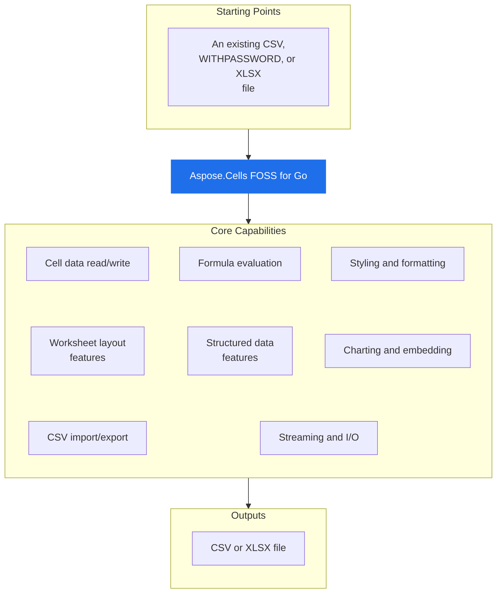

# Aspose.Cells FOSS for Go

[](https://pkg.go.dev/github.com/aspose-cells-foss/Aspose.Cells-FOSS-for-Go/v26)  [](LICENSE) [](https://github.com/aspose-cells-foss/Aspose.Cells-FOSS-for-Go/graphs/contributors)

[](https://products.aspose.org/cells/go/)

Aspose.Cells FOSS for Go reads and writes `.xlsx` files, reads and writes `.csv` files, and reads `.withpassword` files. It supports streaming row processing via `NewStreamingReader` and `StreamingReader.ProcessRows`, formula calculation via `CalculateFormula`, and password-protected workbook operations via `LoadWithPassword`, `LoadFromWithPassword`, `Workbook.SetPassword`, and `Workbook.CheckPassword`.

## Navigation

- [At a Glance](#at-a-glance)
- [Key Capabilities](#key-capabilities)
- [Installation](#installation)
- [Dependencies](#dependencies)
- [Quick Start](#quick-start)
- [Additional Examples](#additional-examples)
- [API Reference](#api-reference)
- [Documentation & Resources](#documentation--resources)
- [Scope and Limitations](#scope-and-limitations)
- [Development and Testing](#development-and-testing)
- [License](#license)

## At a Glance



## Key Capabilities

- **Cell data read/write.** `Cell` data read/write uses `Cells.Get` and `Cells.Set` with A1-style references to handle string, float64, int, and bool values, and provides type-safe `Cell.AsString`, `Cell.AsFloat64`, and `Cell.AsInt` accessors for reading.
- **Formula evaluation.** Formula evaluation stores formulas with `Cell.SetFormula`, retrieves them with `Cell.GetFormula`, and evaluates them using `CalculateFormula`, supporting 22 functions, cross-sheet references, and Excel error values.
- **Styling and formatting.** Styling and formatting creates `Style` objects with `NewStyle`, configures `Font`, `Fill`, `Border`, and `Alignment` properties, applies them to cells via `Cell.SetStyle`, and retrieves them with `Cell.GetStyle`.
- **Worksheet layout features.** `Worksheet` layout features support merged cells via `Worksheet.AddMergedCells`, frozen panes with `Worksheet.FrozenCol` and `Worksheet.FrozenRow`, auto-filters with `Worksheet.SetAutoFilter`, row operations with `Worksheet.InsertRow` and `Worksheet.DeleteRow`, and dimension control via `Worksheet.SetColumnWidth` and `Worksheet.SetRowHeight`.
- **Structured data features.** Structured data features create tables with `NewTable` and `Worksheet.AddTable`, add data validation rules via `Worksheet.AddDataValidation`, apply conditional formatting with `Worksheet.AddConditionalFormatting`, and build pivot tables using `PivotTable` and `Worksheet.AddPivotTable`.
- **Charting and embedding.** Charting and embedding adds `Chart` objects such as bar, line, pie, scatter, and area charts via `Worksheet.AddChart`, and embeds `Picture` objects from PNG or JPEG images using `Worksheet.AddPicture`.
- **CSV import/export.** CSV import/export moves data between `.csv` files and workbooks using `Workbook.ImportFromCSV` and `Workbook.ExportToCSV`, supporting caller-supplied delimiters and converting types as Excel does.
- **Streaming and I/O.** Streaming and I/O loads workbooks from a source path with `LoadFrom`, saves workbooks with `SaveWorkbook`, and processes large files row-by-row using `NewStreamingReader` and `StreamingReader.ProcessRows` to keep memory usage proportional to one row.

- `Workbook.ExportToCSV` and `Workbook.ImportFromCSV` move data to and from CSV with a
  caller-supplied delimiter; export converts typed cell values to their CSV string form via
  `CellToString` and writes a UTF-8 BOM with CRLF line endings for Excel, while import infers
  numeric and boolean types the way Excel does.

## Installation

Install the published package from pkg.go.dev (`github.com/aspose-cells-foss/Aspose.Cells-FOSS-for-Go/v26`, version v26.11.0):

```bash
go get github.com/aspose-cells-foss/Aspose.Cells-FOSS-for-Go/v26
```

Verify the install:

```bash
go list github.com/aspose-cells-foss/Aspose.Cells-FOSS-for-Go/v26/aspose/cells_foss
```

## Dependencies

### Required Package Dependencies

No required third-party package dependencies; in `go.mod`, no `require` directive a consumer would install is declared.

### Native and System Requirements

- Requires Go `1.24.5` (`go` in `go.mod`).

## Quick Start

Create a new workbook, write values to cells, and save the file as Excel XLSX by importing the module and calling `NewWorkbook`, `Cells.Set`, and Save.

```go
package main

import cells_foss "github.com/aspose-cells-foss/Aspose.Cells-FOSS-for-Go/v26/aspose/cells_foss"

func main() {
	// Create.
	wb := cells_foss.NewWorkbook()
	ws := wb.Worksheets[0]

	// Write.
	ws.Cells().Set("A1", "Hello, World!")
	ws.Cells().Set("B1", 42)

	// Save.
	wb.Save("hello.xlsx")
}
```

`Load` an existing workbook, read a cell value, update it, and save the changes by calling `LoadWorkbook`, `Cells.Get`, `AsString`, `Cells.Set`, and Save.

```go
wb, _ := cells_foss.LoadWorkbook("input.xlsx")
ws := wb.Worksheets[0]

cell, _ := ws.Cells().Get("A1")
fmt.Println("Current value:", cell.AsString())

ws.Cells().Set("A1", "Updated value")
wb.Save("output.xlsx")
```

Run `go run main.go` to produce `hello.xlsx`.

## Additional Examples

The following examples demonstrate workflows for formulas, data validation, streaming, styling, tables, and CSV import.

### Create a Spreadsheet with SUM and AVERAGE Formulas and Evaluate Them

```go
func main() {
	wb := cells_foss.NewWorkbook()
	ws := wb.Worksheets[0]

	// ---- Populate sales data ----
	data := []float64{1200, 850, 1400, 960, 1780}
	headers := []string{"Month", "Sales"}

	ws.Cells().Set("A1", headers[0])
	ws.Cells().Set("B1", headers[1])

	months := []string{"Jan", "Feb", "Mar", "Apr", "May"}
	for i, m := range months {
		row := i + 2
		ws.Cells().Set(fmt.Sprintf("A%d", row), m)
		ws.Cells().Set(fmt.Sprintf("B%d", row), data[i])
	}

	// ---- Add formula cells ----
	lastDataRow := len(data) + 1
	totalRef := fmt.Sprintf("B2:B%d", lastDataRow)

	// SUM formula.
	ws.Cells().Set("B7", nil)
	sumCell, _ := ws.Cells().Get("B7")
	sumCell.SetFormula(fmt.Sprintf("SUM(%s)", totalRef))

	// AVERAGE formula.
	ws.Cells().Set("B8", nil)
	avgCell, _ := ws.Cells().Get("B8")
	avgCell.SetFormula(fmt.Sprintf("AVERAGE(%s)", totalRef))

	// Labels.
	ws.Cells().Set("A7", "TOTAL")
	ws.Cells().Set("A8", "AVERAGE")

	// ---- Evaluate formulas with the engine ----
	for _, row := range []int{7, 8} {
		cell, _ := ws.Cells().Get(fmt.Sprintf("B%d", row))
		formula := cell.GetFormula()
		result, err := cells_foss.CalculateFormula(formula, ws)
		if err != nil {
			fmt.Printf("  %s = ERROR: %v\n", formula, err)
		} else {
			fmt.Printf("  %s = %v\n", formula, result)
		}
	}

	wb.Save("outputfiles/formula.xlsx")
}
```

<details>
<summary>View Additional Examples</summary>

### Apply List-Type Data Validation to Restrict Cell Input to Predefined Options

```go
func main() {
	wb := cells_foss.NewWorkbook()
	ws := wb.Worksheets[0]

	ws.Cells().Set("A1", "Fruit")
	ws.Cells().Set("A2", "Apple")
	ws.Cells().Set("A3", "Banana")

	// Create a list-type data validation.
	dv := &cells_foss.DataValidation{
		Type:             cells_foss.DataValidationTypeList,
		Formula1:         `"Apple,Banana,Cherry,Dragonfruit"`,
		AllowBlank:       true,
		ShowErrorMessage: true,
		ErrorTitle:       "Invalid Fruit",
		ErrorMessage:     "Please pick a fruit from the list.",
		ErrorStyle:       cells_foss.ErrorStyleStop,
	}

	if err := ws.AddDataValidation("A2:A10", dv); err != nil {
		fmt.Printf("Error: %v\n", err)
		return
	}

	wb.Save("outputfiles/data_validation.xlsx")
}
```

### Stream Large Excel Files Row by Row to Compute Totals Efficiently

```go
func main() {
	sr := cells_foss.NewStreamingReader("outputfiles/streaming_data.xlsx")
	rowCount := 0
	var totalScore float64

	err := sr.ProcessRows("Sheet1", func(rowIdx int, cells map[string]string) error {
		rowCount++
		if score, ok := cells["C"+fmt.Sprint(rowIdx)]; ok {
			var s float64
			fmt.Sscanf(score, "%f", &s)
			totalScore += s
		}
		return nil
	})
	if err != nil {
		fmt.Fprintf(os.Stderr, "Error streaming: %v\n", err)
		os.Exit(1)
	}
	fmt.Printf("Streamed %d rows, total score %.0f\n", rowCount, totalScore)
}
```

### Apply Bold Font and Solid Fill Styling to Header Cells

```go
func main() {
	wb := cells_foss.NewWorkbook()
	ws := wb.Worksheets[0]

	boldStyle := cells_foss.NewStyle()
	boldStyle.Font.Bold = true
	boldStyle.Font.Size = 12

	highlightStyle := cells_foss.NewStyle()
	highlightStyle.Font.Color = "FFFFFFFF"
	highlightStyle.Font.Bold = true
	highlightStyle.Fill = &cells_foss.Fill{
		Type:  cells_foss.FillTypeSolid,
		Color: "FF4472C4",
	}

	headers := []string{"Item", "Category", "Price", "In Stock"}
	for i, h := range headers {
		ref := string(rune('A'+i)) + "1"
		ws.Cells().Set(ref, h)
		cell, _ := ws.Cells().Get(ref)
		cell.SetStyle(boldStyle)
	}

	wb.Save("outputfiles/style.xlsx")
}
```

### Create a Structured Table with a Built-In Style

```go
func main() {
	wb := cells_foss.NewWorkbook()
	ws := wb.Worksheets[0]

	headers := []string{"Product", "Q1", "Q2", "Q3", "Q4", "Total"}
	for i, h := range headers {
		ref := string(rune('A'+i)) + "1"
		ws.Cells().Set(ref, h)
	}

	// ... populate data rows (see examples/table/main.go) ...

	tbl := ws.AddTable("A1:F6")
	tbl.HasHeaderRow = true
	tbl.StyleName = "TableStyleMedium6"

	wb.Save("outputfiles/table.xlsx")
}
```

### Import Data from a CSV File into a New Excel Workbook

```go
func main() {
	csvPath := "outputfiles/employees.csv"

	wb := cells_foss.NewWorkbook()
	if err := wb.ImportFromCSV(csvPath, "Employees", ','); err != nil {
		fmt.Fprintf(os.Stderr, "Error importing CSV: %v\n", err)
		os.Exit(1)
	}

	ws := wb.Worksheets[1] // second sheet; index 0 is the default "Sheet1"
	fmt.Printf("Imported sheet: %q\n", ws.Name)

	wb.Save("outputfiles/csv_imported.xlsx")
}
```

```go
import cells_foss "github.com/aspose-cells-foss/Aspose.Cells-FOSS-for-Go/v26/aspose/cells_foss"
```

</details>

## API Reference

Aspose.Cells FOSS for Go provides workbook and worksheet management through the `Workbook` and `Worksheet` types, with `Cells` offering A1-keyed cell access. The `Workbook` type supports loading from files or streams and saving to files or buffers, while `Worksheet` exposes cell collections and layout operations.

The public API has 37 types.

<details>
<summary>View the Complete Public API Surface</summary>

### Core API

| Class | Description |
| --- | --- |
| `Alignment` | Alignment controls how cell content is positioned within the cell bounds. |
| `Border` | Border defines which sides of a cell have a visible rule and the colour of those rules. |
| `Cell` | Cell represents a single cell in a worksheet grid. |
| `CellNotFoundError` | CellNotFoundError is returned when attempting to access a cell that does not exist in the worksheet. |
| `Cells` | Cells is a collection of Cell values indexed by A1-style string references. |
| `Chart` | Chart represents a chart embedded in a worksheet. |
| `ChartAnchor` | ChartAnchor specifies the position of a chart on the worksheet. |
| `ChartAxis` | ChartAxis configures one axis of a chart. |
| `ChartLegend` | ChartLegend configures a chart's legend. |
| `ChartSeries` | ChartSeries represents a single data series in a chart. |
| `ChartType` | ChartType enumerates the supported chart types. |
| `ColorScale` | ColorScale is a 2- or 3-color gradient rule (CT_ColorScale). |
| `CondThreshold` | CondThreshold is one conditional-format value object (CT_Cfvo): a color scale stop, a data bar endpoint, or an icon set cutoff. |
| `ConditionalFormatting` | ConditionalFormatting represents a set of conditional formatting rules applied to a range of cells on a worksheet. |
| `ConditionalFormattingRule` | ConditionalFormattingRule represents a single conditional formatting rule. |
| `DataBar` | DataBar is an in-cell bar rule (CT_DataBar). |
| `DataValidation` | DataValidation represents a single data-validation rule applied to a range of cells on a worksheet. |
| `ErrorValue` | ErrorValue represents an Excel error value such as #DIV/0!. |
| `Fill` | Fill describes the background appearance of a cell. |
| `Font` | Font describes the typographic properties applied to cell text. |
| `FormulaError` | FormulaError is returned when a formula cannot be parsed or evaluated. |
| `Hyperlink` | Hyperlink is a link attached to a single cell. |
| `IconSet` | IconSet is an icon-overlay rule (CT_IconSet). |
| `InvalidRefError` | InvalidRefError is returned when a cell reference string is malformed or cannot be parsed. |
| `LegendPosition` | LegendPosition enumerates where a chart legend is drawn (ST_LegendPos). |
| `Picture` | Picture represents an image embedded in a worksheet. |
| `PivotDataField` | PivotDataField represents a value field in a pivot table with aggregation. |
| `PivotTable` | PivotTable represents a pivot table on a worksheet. |
| `RowCallback` | RowCallback is invoked by StreamingReader.ProcessRows once for every row in the worksheet. |
| `SheetNotFoundError` | SheetNotFoundError is returned when attempting to access a worksheet by name that does not exist in the workbook. |
| `StreamOptions` | StreamOptions configures filtering for streaming row processing. |
| `StreamingReader` | StreamingReader reads an .xlsx workbook row by row without loading the entire sheet XML into memory. |
| `Style` | Style groups font, fill, alignment, and border settings into a named formatting record. |
| `Table` | Table represents a structured range of data (a "table" in Excel terminology) with optional header row and built-in auto-filter. |
| `VBAProject` | VBAProject holds the binary data of a VBA project. |
| `Workbook` | Workbook is the top-level object representing an Excel workbook. |
| `Worksheet` | Worksheet represents a single sheet within a workbook. |

#### Detailed Member Reference

### Cells

The `Cells` collection provides A1-keyed access to cells with `Cells.Get` to retrieve a `Cell`, `Cells.Set` to assign a value, `Cells.All` to enumerate all cells, and `Cells.Remove` to delete a cell.

- `All`: All returns the underlying map of all cells keyed by A1 reference.
- `Get`: Get returns the Cell at the given A1 reference.
- `Remove`: Remove deletes the cell at the given A1 reference.
- `Set`: Set stores a value at the given A1 reference.

### Cell

A `Cell` represents a single cell with type-safe accessors including `Cell.AsString`, `Cell.AsFloat64`, and `Cell.AsInt`, along with `Cell.Formula`, `Cell.GetFormula`, `Cell.SetFormula`, `Cell.GetStyle`, and `Cell.SetStyle` for formula and style management.

- `AsFloat64`: AsFloat64 returns the cell value as float64.
- `AsInt`: AsInt returns the cell value as int.
- `AsString`: AsString returns the cell value as a string.
- `GetFormula`: GetFormula returns the formula expression stored in this cell, or an empty string when the cell contains no formula.
- `GetStyle`: GetStyle returns the Style currently applied to this cell, or nil when the cell has no parent Workbook or the StyleID cannot be resolved.
- `SetFormula`: SetFormula stores a formula expression in this cell and marks the owning worksheet and workbook as modified.
- `SetStyle`: SetStyle assigns the given Style to this cell.

### Workbook

A `Workbook` is created with `NewWorkbook` or loaded with `LoadWorkbook`, exposes its worksheets via `Workbook.Worksheets`, and supports saving to files with `Workbook.Save` or to streams with `Workbook.SaveTo`, as well as CSV import and export via `Workbook.ImportFromCSV` and `Workbook.ExportToCSV`.

- `AddWorksheet`: AddWorksheet appends a new worksheet with the given name to the workbook and returns it.
- `CheckPassword`: CheckPassword returns true if the workbook is password-protected and the provided password matches.
- `ClearVBAProject`: ClearVBAProject removes the VBA project from the workbook.
- `ExportToCSV`: ExportToCSV writes the worksheet at sheetIndex to a CSV file using the given delimiter.
- `GetVBAProject`: GetVBAProject returns the VBA project data attached to the workbook, or nil if no VBA project is present.
- `HasVBAProject`: HasVBAProject reports whether the workbook has an attached VBA project.
- `ImportFromCSV`: ImportFromCSV reads a CSV file and imports its contents into a new worksheet with the given name.
- `Save`: Save writes the workbook to the given file path in .xlsx format.
- `SaveTo`: SaveTo writes the workbook in .xlsx format to w — an HTTP response, a zip entry, a network connection, or any other stream.
- `SetPassword`: SetPassword configures an open password for the workbook.
- `SetVBAProject`: SetVBAProject attaches a VBA project to the workbook.
- `VerifyPassword`: VerifyPassword reports whether pw matches the password that was used to encrypt this workbook (as set by SetPassword, or read from an encrypted file).

### Worksheet

A `Worksheet` provides access to its cells via `Worksheet.Cells`, supports merged cells with `Worksheet.AddMergedCells`, freeze panes via `Worksheet.FrozenCol` and `Worksheet.FrozenRow`, auto-filter with `Worksheet.SetAutoFilter`, row operations with `Worksheet.InsertRow` and `Worksheet.DeleteRow`, column width and row height control via `Worksheet.SetColumnWidth` and `Worksheet.SetRowHeight`, and hyperlinks with `Worksheet.AddHyperlink`.

- `AddChart`: AddChart adds a chart to the worksheet.
- `AddConditionalFormatting`: AddConditionalFormatting adds a conditional formatting rule set to the worksheet.
- `AddDataValidation`: AddDataValidation appends a data-validation rule to the worksheet.
- `AddHyperlink`: AddHyperlink attaches an external link (URL or file path) to a cell.
- `AddInternalHyperlink`: AddInternalHyperlink attaches a link to a location inside the same workbook.
- `AddMergedCells`: AddMergedCells merges the cells of an A1 range ("A1:B2").
- `AddPicture`: AddPicture attaches pic to the worksheet, assigns it a unique name, and marks the workbook as modified.
- `AddPivotTable`: AddPivotTable adds a pivot table to the worksheet.
- `AddTable`: AddTable creates a new Table covering the given range, assigns it a unique auto-generated name ("Table1", "Table2", …), appends it to the worksheet, and returns it for further configuration.
- `Cells`: Cells returns the Cells collection for this worksheet, enabling cell-level read and write operations via A1-style references.
- `DeleteRow`: DeleteRow removes the row at the given 1-based row number, shifting everything below it up by one.
- `FreezePanes`: FreezePanes freezes the top row rows and the leftmost col columns of the sheet, keeping them visible while scrolling.
- `FromCSV`: FromCSV populates the worksheet with data from a 2D string slice.
- `GetTable`: GetTable returns the Table with the given name, or nil when no match is found.
- `InsertRow`: InsertRow inserts an empty row at the given 1-based row number, shifting that row and everything below it down by one.
- `RemoveChart`: RemoveChart removes the chart at the specified index.
- `RemoveConditionalFormatting`: RemoveConditionalFormatting removes the first conditional formatting rule set whose Ref exactly matches the given ref string.
- `RemoveDataValidation`: RemoveDataValidation removes the first data-validation rule whose Ref exactly matches the given ref string.
- `RemoveHyperlink`: RemoveHyperlink detaches the link from a cell.
- `RemoveMergedCells`: RemoveMergedCells un-merges a previously merged range.
- `RemovePivotTable`: RemovePivotTable removes the pivot table with the given name.
- `SetAutoFilter`: SetAutoFilter enables the drop-down filter buttons over an A1 range ("A1:C10"); the range is normalized before it is stored.
- `SetColumnWidth`: SetColumnWidth sets the width of a column, identified by its letter ("A", "BC"), in Excel character units (the default width is 8.43).
- `SetRowHeight`: SetRowHeight sets the height of a 1-based row in points (the default height is 15).
- `ToCSV`: ToCSV converts the worksheet's cells into a 2D string slice suitable for writing with encoding/CSV.

### Style

A `Style` is created with `NewStyle` and exposes formatting properties including `Style.Font`, `Style.Fill`, `Style.Border`, `Style.Alignment`, and `Style.NumberFormat`.

### DataValidation

`DataValidation` is configured with `DataValidation.Type`, `DataValidation.Formula1`, and `DataValidation.Operator`, and added to a worksheet using `Worksheet.AddDataValidation`.

### ConditionalFormatting

`ConditionalFormatting` is defined with `ConditionalFormatting.Ref` and `ConditionalFormatting.Rules`, and added to a worksheet using `Worksheet.AddConditionalFormatting`.

### Table

A `Table` is created with `NewTable` and configured with `Table.HasHeaderRow` and `Table.StyleName`, then added to a worksheet using `Worksheet.AddTable`.

### Chart

A `Chart` is created with `Chart.Type`, `Chart.Series`, `Chart.Title`, and `Chart.Legend`, and added to a worksheet using `Worksheet.AddChart`.

### PivotTable

A `PivotTable` is defined with `PivotTable.Ref`, `PivotTable.RowFields`, `PivotTable.ColFields`, and `PivotTable.DataFields`, and added to a worksheet using `Worksheet.AddPivotTable`.

### Picture

A `Picture` is created with `NewPicture`, configured with `Picture.Data` and `Picture.SetAnchor`, and added to a worksheet using `Worksheet.AddPicture`.

- `SetAnchor`: SetAnchor positions the picture at the given 0-based row and column.

### StreamingReader

A `StreamingReader` is created with `NewStreamingReader` and processes rows using `StreamingReader.ProcessRows`, `StreamingReader.ProcessRowsWithColumns`, `StreamingReader.ProcessRowsWithFilter`, or `StreamingReader.ProcessRowsWithRange`.

- `ProcessRows`: ProcessRows opens the workbook, resolves the named sheet to its XML part, loads the shared-strings table (if present), and then streams through the sheet data one row at a time, calling callback for each row.
- `ProcessRowsWithColumns`: ProcessRowsWithColumns streams through all rows but only returns cells from the specified columns.
- `ProcessRowsWithFilter`: ProcessRowsWithFilter opens the workbook and streams through the named sheet, applying the filters specified in opts.
- `ProcessRowsWithRange`: ProcessRowsWithRange streams through rows in the specified range [startRow, endRow].

The library source lives under `aspose/cells_foss/`, with runnable examples, tests, a
verification tool, and a usage guide alongside it at the repository root:

```
├── aspose/cells_foss/        # Library source code
│   ├── workbook.go           #   Workbook entry point, save/load dispatch, stream I/O
│   ├── worksheet.go          #   Worksheet model, AddWorksheet (Excel name rules)
│   ├── cell.go / cells.go    #   Cell model and A1-keyed collection
│   ├── style.go              #   Font, fill, border, alignment, number format
│   ├── number_format.go      #   Number format codes and Excel date serials (1900 system)
│   ├── layout.go             #   Merges, column widths, row heights, freeze panes, auto-filter
│   ├── rowops.go             #   InsertRow/DeleteRow with full feature shifting
│   ├── hyperlink.go          #   Cell hyperlinks (external and internal)
│   ├── formula_engine.go     #   Formula evaluation (functions, arithmetic, cross-sheet refs)
│   ├── error_value.go        #   Excel error values with propagation through formulas
│   ├── datavalidation.go     #   Data validation (types and comparison operators)
│   ├── conditional_format.go #   Conditional formatting (DXF, scales, bars, icons, top-N)
│   ├── table.go              #   Structured tables
│   ├── chart.go              #   Charts: bar, line, pie, scatter, area; axes and legend
│   ├── pivot_table.go        #   Pivot tables
│   ├── picture.go            #   Picture embedding
│   ├── macro.go              #   VBA project storage (.xlsm round-trip)
│   ├── csv_handler.go        #   CSV import/export
│   ├── streaming_reader.go   #   Streaming row reader for large files
│   ├── crypto.go             #   Agile Encryption (SHA-512 + AES-256-CBC)
│   ├── olecfb.go             #   OLE/CFB container for encrypted workbooks
│   ├── errors.go             #   Custom error types
│   ├── xmlloader.go / xmlsaver.go                    # Workbook and sheet XML load/save
│   ├── xml_feature_loader.go / xml_feature_saver.go  # Styles, tables, drawings, CF, charts
│   ├── xml_sharedstrings_loader.go                   # sharedStrings.xml loading
│   └── test_helpers.go       #   Deprecated helpers used by tests/
├── tests/                    # Integration tests (public API)
├── examples/                 # 21 runnable example programs
│   ├── basic/                #   Create and save
│   ├── load_modify_save/     #   Load → modify → save
│   ├── typed_access/         #   Type-safe cell accessors
│   ├── style/                #   Style application
│   ├── number_format/        #   Number formats and date serials
│   ├── formula/              #   Formulas and calculation
│   ├── layout/               #   Merges, widths, freeze panes, auto-filter
│   ├── row_operations/       #   InsertRow/DeleteRow shifting
│   ├── stream_io/            #   SaveTo/LoadFrom over buffers
│   ├── streaming/            #   Streaming large data
│   ├── add_worksheet/        #   Adding named worksheets
│   ├── data_validation/      #   Data validation rules and operators
│   ├── conditional_format/   #   Conditional formatting rules
│   ├── table/                #   Structured tables
│   ├── chart/                #   Charts with axes and legend
│   ├── pivot_table/          #   Pivot tables
│   ├── picture/              #   Picture embedding
│   ├── macro/                #   VBA project round-trip (.xlsm)
│   ├── encryption/           #   Password-protected workbooks
│   ├── csv_export/           #   CSV export
│   ├── csv_import/           #   CSV import
│   └── go.mod                #   Separate module for examples (see Development and Testing)
├── docs/                     # Documentation
│   └── usage.md              #   Detailed usage guide
├── verify/                   # Verification tool
│   └── check_open_xlsx.go    #   .xlsx structure validator
├── doc.go                    # Package-level documentation
├── AGENTS.md                 # AI-assisted development guide
├── CHANGELOG.md              # Release history
├── go.mod
├── go.sum
└── README.md
```

| Class                       | Description                                                                                                                     |
| --------------------------- | ------------------------------------------------------------------------------------------------------------------------------- |
| `Alignment`                 | Alignment controls how cell content is positioned within the cell bounds.                                                       |
| `Border`                    | Border defines which sides of a cell have a visible rule and the colour of those rules.                                         |
| `Cell`                      | Cell represents a single cell in a worksheet grid.                                                                              |
| `CellNotFoundError`         | Error returned by `Cells.Get` when the reference does not exist in the worksheet.                                               |
| `Cells`                     | Cells is a collection of Cell values indexed by A1-style string references (e.g. "A1", "B2", "Z100").                           |
| `Chart`                     | Chart represents a chart embedded in a worksheet (bar, line, pie, scatter, area).                                               |
| `ChartAnchor`               | ChartAnchor specifies the cell-based position and size of a chart on the worksheet.                                             |
| `ChartAxis`                 | ChartAxis configures one axis of a Cartesian chart (title, visibility).                                                         |
| `ChartLegend`               | ChartLegend configures a chart's legend (position, overlay).                                                                    |
| `ChartSeries`               | ChartSeries represents a single data series, referencing its category and value ranges.                                         |
| `ChartType`                 | Enum of the supported chart types.                                                                                              |
| `ColorScale`                | ColorScale is a gradient color-scale rule with thresholds and matching ARGB colours.                                            |
| `CondThreshold`             | CondThreshold is one color-scale stop, data-bar endpoint, or icon-set cutoff.                                                   |
| `ConditionalFormatting`     | ConditionalFormatting is a group of conditional-formatting rules applied to a range of cells (sqref).                           |
| `ConditionalFormattingRule` | ConditionalFormattingRule represents a single rule (cellIs, text, expression, colorScale, dataBar, iconSet, top10).             |
| `DataBar`                   | DataBar is an in-cell data-bar rule.                                                                                            |
| `DataValidation`            | DataValidation represents a single data-validation rule applied to a range of cells on a worksheet.                            |
| `ErrorValue`                | Excel error values (`#DIV/0!`, `#N/A`, …) usable as cell values and returned by formula evaluation.                             |
| `Fill`                      | Fill describes the background appearance of a cell.                                                                             |
| `Font`                      | Font describes the typographic properties applied to cell text.                                                                 |
| `FormulaError`              | Error returned when a formula cannot be parsed or evaluated.                                                                    |
| `Hyperlink`                 | Hyperlink is a cell hyperlink — external (`Target`) or internal (`Location`).                                                   |
| `IconSet`                   | IconSet is an icon-set rule with per-icon thresholds (17 built-in icon sets).                                                   |
| `InvalidRefError`           | Error for cell references that cannot be parsed.                                                                                |
| `LegendPosition`            | Enum of where a chart legend is drawn.                                                                                          |
| `Picture`                   | Picture represents an image embedded in a worksheet.                                                                            |
| `PivotDataField`            | PivotDataField represents a value field in a pivot table with its aggregation.                                                  |
| `PivotTable`                | PivotTable represents a pivot table on a worksheet (row, column, and data fields).                                              |
| `RowCallback`               | RowCallback is invoked by StreamingReader.ProcessRows once for every row in the worksheet.                                      |
| `SheetNotFoundError`        | Error for a formula reference to a sheet name that does not exist in the workbook.                                              |
| `StreamOptions`             | Optional row/column filters for StreamingReader; zero values mean no filtering.                                                 |
| `StreamingReader`           | StreamingReader reads an .xlsx workbook row by row without loading the entire sheet XML into memory.                            |
| `Style`                     | Style groups font, fill, alignment, border, and number-format settings into a named formatting record.                          |
| `Table`                     | Table represents a structured range of data (a "table" in Excel terminology) with optional header row and built-in auto-filter. |
| `VBAProject`                | Raw `vbaProject.bin` storage for macro-enabled (.xlsm) round-trips.                                                             |
| `Workbook`                  | Workbook is the top-level object representing an Excel workbook.                                                                |
| `Worksheet`                 | Worksheet represents a single sheet within a workbook.                                                                          |

For the complete API reference and usage guide, see **[docs/usage.md](docs/usage.md)**.

</details>

## Documentation & Resources

- **[Getting started guide](https://docs.aspose.org/cells/go/)** — The getting started guide covers loading, editing, styling, and saving spreadsheets in Go.
- **[How-to guides & FAQ](https://kb.aspose.org/cells/go/)** — The how-to guides and FAQ provide articles, answers, and troubleshooting for common tasks with Aspose.Cells FOSS for Go.
- **[Full API reference](https://reference.aspose.org/cells/go/)** — The full API reference offers a complete, browsable reference for the public API. It covers all 37 public types; the [API Reference](#api-reference) section above covers the essentials.
- **[CHANGELOG.md](CHANGELOG.md)** — The `CHANGELOG.md` file documents the release history, with the current release being 26.11.
- **[AGENTS.md](AGENTS.md)** — The `AGENTS.md` file outlines the repository's contribution guide for AI-assisted development, including source-of-truth conventions and areas to avoid changing without review.
- Found a bug or have a feature request? [Open an issue](https://github.com/aspose-cells-foss/Aspose.Cells-FOSS-for-Go/issues).

## Scope and Limitations

Aspose.Cells FOSS for Go reads and writes Excel files using the XLSX format and provides a Go API for cell manipulation, formula calculation, chart creation, pivot table generation, and VBA project storage. It supports A1-style cell references, the 1900 date system, and ECMA-376-compatible XML generation, preserving unmodified content byte-for-byte on save.

- `Cell` references are A1-style strings only; tuple or array indices are not supported, and the `Cells.Get` and `Cells.Set` methods operate exclusively with this reference style.
- `CalculateFormula` covers only 22 functions, arithmetic/comparison operators, and same-workbook cross-sheet references; the full Excel function library, external-workbook references, and dependency-driven recalculation are not included, and `FormulaError` may be returned for unsupported formulas.
- `TimeToSerial` and `SerialToTime` use the 1900 date system only, reject serials below 61 due to Excel's 1900 leap-year bug, and do not support dates beyond 9999-12-31 or the 1904 date system.
- `Chart` supports bar, line, pie, scatter, and area with axis titles, hidden axes, and legends; 3D and combo charts, secondary axes, data labels, and gridline styling are not supported, and chart data is referenced by cell range, not embedded. `PivotTable` covers row, column, and data fields; calculated fields, grouping, and custom aggregations are not supported.
- VBA support is storage-only: `VBAProject` bytes round-trip via `Workbook.GetVBAProject`, but VBA code cannot be created, edited, or executed.
- `Workbook.Save` reuses unmodified content verbatim from the original XML byte-for-byte and regenerates only content touched since load; `Workbook.SourceXML` exposes the underlying XML, and generated XML follows ECMA-376 element ordering to preserve round-trip compatibility.

- Hidden rows/columns, outline grouping, print setup, and sheet protection are not modeled.
  Parts the library does not model (themes, docProps, comments, calcChain) are preserved
  byte-for-byte on round-trip instead.

- **A1-style references** (e.g. `"A1"`, `"B2"`) — tuple/array indices (e.g. `[0, 0]`) are not supported
- Modified content regenerates XML; unmodified content reuses original XML
- ECMA-376-compatible element ordering
- No third-party dependencies — Go standard library only
- Do not commit generated `.xlsx` files or contents of `outputfiles/`

These limitations don't apply to [full-featured Aspose.Cells for Go — Enterprise Edition](https://products.aspose.com/cells/go-cpp/). It adds the complete Excel formula function library, additional file-format coverage, and commercial support.

## Development and Testing

The toolchain requires Go 1.24.5 or later, as specified by the `go.mod` directive. The full test suite and integration tests cover the public API surface. Example programs under the examples directory write output files to a subdirectory and must not be committed with generated artifacts.

The suite covers 31 test files under `tests/`.

To build from a clone, run:

```bash
go build ./...
```

```bash
go get github.com/aspose-cells-foss/Aspose.Cells-FOSS-for-Go/v26/aspose/cells_foss
```

- Go 1.24 or later (`go.mod`'s own `go 1.24.5` directive).

Run the full test suite from the repository root:

```bash
go test ./...
```

```bash
go test ./tests/ -v
```

```bash
cd examples
for d in */; do go run ./$d; done
```

`examples/` is its own Go module, with a `replace` directive already pointing it back at the
repository root — the exact version named in its `require` line never needs to resolve to a real
published release, only to satisfy Go's own version-string syntax. If building or running anything
under `examples/` reports an invalid module version, replace that line's version with any
well-formed pseudo-version for major version 26 and re-run.

Example programs under `examples/` write their output files to `examples/outputfiles/` (created
on first run) — avoid committing generated `.xlsx`/`.csv` files or that directory's contents.

For a complete usage walkthrough beyond this README, see the repository's own
[docs/usage.md](docs/usage.md).

## License

This project is licensed under the [MIT License](LICENSE). The MIT License permits use, copying, modification, distribution, sublicensing, and commercial use, provided its copyright and permission notice are retained. The software is provided without warranty.
