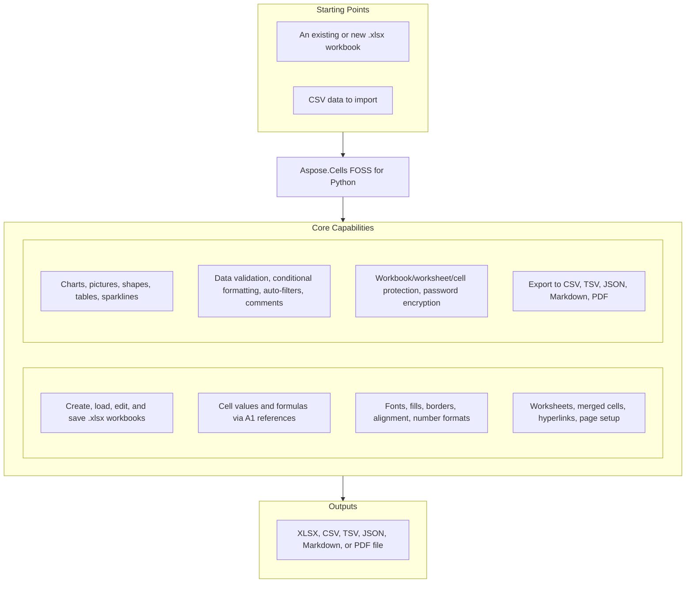

# Aspose.Cells FOSS for Python

[](https://pypi.org/project/aspose-cells-foss/)
[](https://pypi.org/project/aspose-cells-foss/)
[](License/LICENSE.txt)
[](https://github.com/aspose-cells-foss/Aspose.Cells-FOSS-for-Python/graphs/contributors)

[](https://products.aspose.org/cells/python/)

Aspose.Cells FOSS for Python is a free, open-source, pure-Python library for creating, reading,
modifying, and exporting Excel `.xlsx` workbooks without requiring Microsoft Excel.

## Navigation

- [At a Glance](#at-a-glance)
- [Key Capabilities](#key-capabilities)
- [Installation](#installation)
- [Quick Start](#quick-start)
- [Supported Formats](#supported-formats)
- [Scope and Limitations](#scope-and-limitations)
- [Documentation & Resources](#documentation--resources)
- [Development and Testing](#development-and-testing)
- [License](#license)

## At a Glance



## Key Capabilities

- Create, load, edit, and save `.xlsx` workbooks
- Read and write cell values and formulas using A1 references
- Apply fonts, fills, borders, alignment, and number formats
- Manage worksheets, merged cells, hyperlinks, page setup, and page breaks
- Create and preserve charts, pictures, shapes, tables, and sparklines
- Add data validation, conditional formatting, auto-filters, and comments
- Configure workbook, worksheet, and cell protection
- Read and write password-encrypted `.xlsx` files
- Import CSV and export CSV, TSV, JSON, Markdown, and PDF
- Preserve unsupported workbook parts where possible during load/save round trips

## Installation

Install the package from PyPI:

```bash
pip install aspose-cells-foss
```

The package requires Python 3.10 or later. Its core runtime dependencies are
`pycryptodome>=3.15.0` and `olefile>=0.46`.

### PDF support

PDF export uses `skia-python`, which is not currently installed by the core package.
Install the renderer separately:

```bash
pip install "skia-python>=144.0.post2,<145"
```

## Quick Start

### Create a workbook

```python
from aspose.cells_foss import Workbook

workbook = Workbook()
worksheet = workbook.worksheets[0]

worksheet.cells["A1"].value = "Product"
worksheet.cells["B1"].value = "Revenue"
worksheet.cells["A2"].value = "Widget"
worksheet.cells["B2"].value = 1250.50

workbook.save("report.xlsx")
```

### Read a workbook

```python
from aspose.cells_foss import Workbook

workbook = Workbook("report.xlsx")
worksheet = workbook.worksheets[0]

print(worksheet.cells["B2"].value)
```

### Apply cell styling

```python
from aspose.cells_foss import Workbook

workbook = Workbook()
cell = workbook.worksheets[0].cells["A1"]
cell.value = "Quarterly Report"

style = cell.get_style()
style.font.bold = True
style.font.color = "#FF0000"
style.font.size = 14
cell.apply_style(style)

workbook.save("styled.xlsx")
```

### Add a validation list

```python
from aspose.cells_foss import DataValidationType, Workbook

workbook = Workbook()
worksheet = workbook.worksheets[0]

validation = worksheet.data_validations.add("A1:A10")
validation.type = DataValidationType.LIST
validation.formula1 = '"Yes,No"'

workbook.save("validation.xlsx")
```

### Export a workbook

The output format is inferred from the file extension:

```python
from aspose.cells_foss import Workbook

workbook = Workbook("report.xlsx")
workbook.save("report.csv")
workbook.save("report.json")
workbook.save("report.md")
workbook.save("report.pdf")  # Requires skia-python
```

### Encrypt a workbook

```python
from aspose.cells_foss import Workbook

workbook = Workbook()
workbook.worksheets[0].cells["A1"].value = "Confidential"
workbook.save("protected.xlsx", password="example-password")

loaded = Workbook("protected.xlsx", password="example-password")
print(loaded.worksheets[0].cells["A1"].value)
```

## Supported Formats

| Format | Load | Save |
|---|:---:|:---:|
| XLSX | Yes | Yes |
| Encrypted XLSX | Yes | Yes |
| CSV | Yes | Yes |
| TSV | No | Yes |
| JSON | No | Yes |
| Markdown | No | Yes |
| PDF | No | Yes |

CSV import is available through `Workbook.load_csv()` or `load_csv_workbook()`.

## Scope and Limitations

- Formula expressions and cached results are preserved, but this project is not a full Excel
  calculation engine.
- Native workbook loading and saving targets the Open XML `.xlsx` format. Other spreadsheet
  formats such as `.xls`, `.ods`, and `.xlsb` are not supported.
- Some advanced Excel features are preserved as source package parts rather than exposed as
  editable Python objects.
- PDF output depends on locally available fonts and the optional `skia-python` renderer.

These limitations don't apply to
[Aspose.Cells for Python — Enterprise Edition](https://products.aspose.com/cells/python-net/), which adds
a full Excel calculation engine, broader legacy-format support (`.xls`, `.ods`, `.xlsb`), and
additional rendering capabilities that this FOSS build leaves unimplemented.

## Documentation & Resources

- Browse the executable [examples](examples) for feature-specific workflows.
- See the package's public exports in
  [`aspose/cells_foss/__init__.py`](aspose/cells_foss/__init__.py).
- Read the current [release notes](RELEASE_NOTES.md).
- Review development conventions in [AGENTS.md](AGENTS.md).
- Found a bug or have a feature request? [Open an issue](https://github.com/aspose-cells-foss/Aspose.Cells-FOSS-for-Python/issues).

## Development and Testing

Install the development dependencies and collect or run the examples:

```bash
pip install -e ".[dev]"
python -m pytest examples -v
```

Generated workbooks are written below `examples/outputfiles/` and are not intended for source
control.

## License

This project is licensed under the [MIT License](License/LICENSE.txt). Third-party notices are
available in [License/ThirdPartyNotices.txt](License/ThirdPartyNotices.txt).
