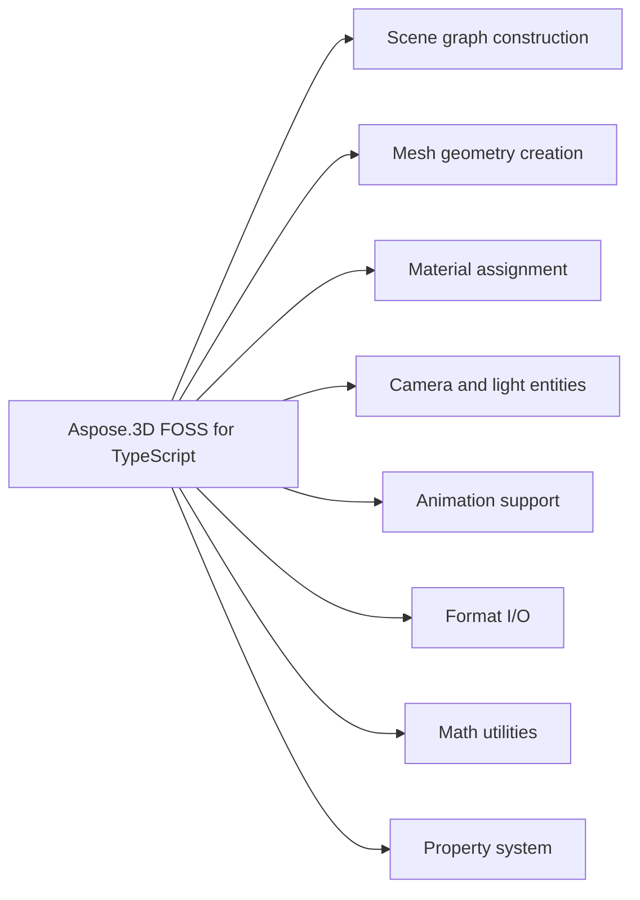

# Aspose.3D FOSS for TypeScript

It reads and writes 3D scene data in formats such as glTF, OBJ, STL, FBX, and COLLADA, converts scenes between these formats using `Scene.fromFile`, `Scene.openFromBuffer`, `Scene.save`, and `Scene.saveToBuffer`, and builds and manipulates 3D scenes through `Scene`, `Node`, `Mesh`, `Material`, `Camera`, and `Light` objects, supporting geometry construction, material assignment, and animation with keyframes.

Aspose.3D FOSS for TypeScript is a free, open-source, MIT-licensed TypeScript/JavaScript library
for building and converting 3D scenes in Node.js. It exposes an Aspose.3D-compatible scene-graph
API — `Scene`, `Node`, `Mesh`, `Material` — for constructing scenes from meshes and vertex
attribute data, assigning shading materials, animating node hierarchies with keyframes, and
reading and writing widely used interchange formats such as glTF, OBJ, STL, FBX, and COLLADA, as
pure TypeScript with no native bindings.

## Navigation

- [At a Glance](#at-a-glance)
- [Key Capabilities](#key-capabilities)
- [Installation](#installation)
- [Dependencies](#dependencies)
- [API Reference](#api-reference)
- [Scope and Limitations](#scope-and-limitations)

## At a Glance

## Key Capabilities

- **Scene graph construction.** `Scene` graph construction uses the `Scene` class as the root container, with `Node` instances holding `Transform`, optional `Entity` references (`Mesh`, `Camera`, or `Light`), and child nodes accessible through childNodes; nodes are created via `Node.addChildNode`, `Node.addEntity`, or `Node.createChildNode`.
- **Mesh geometry creation.** `Mesh` geometry creation relies on the `Mesh` class with a controlPoints array and methods like `Mesh.addControlPoint` and `Mesh.createPolygon` to define polygonal faces, while per-vertex attribute channels such as normals (`VertexElementNormal`) and UVs (`VertexElementUV`) are attached through the `VertexElement` hierarchy.
- **Material assignment.** `Material` assignment supports `LambertMaterial` (diffuse-only), `PhongMaterial` (adds specular and shininess), and `PbrMaterial` (metallic/roughness matching glTF 2.0 PBR), with `Material.getTexture` and `Material.setTexture` methods to manage texture references.
- **Camera and light entities.** `Camera` and light entities are placed as scene nodes, with `Camera` exposing projectionType and fieldOfView properties, and `Light` supporting multiple types (POINT, DIRECTIONAL, SPOT, AREA, VOLUME) via lightType and direction properties.
- **Animation support.** Animation support uses `AnimationClip` to group `AnimationNode` tracks, each containing `AnimationChannel` instances with `KeyframeSequence` time/value samples, where `KeyFrame.interpolation` defines how values are interpolated between keyframes.
- **Format I/O.** Format I/O reads glTF 2.0 (JSON and binary GLB) and Wavefront OBJ scenes and writes STL (ASCII and binary), FBX (ASCII), COLLADA (.dae), and glTF 2.0 JSON scenes using `Scene.fromFile`, `Scene.open`, and `Scene.save`, with dedicated options types for each format.
- **Math utilities.** Math utilities provide `FVector2`, `FVector3`, and `FVector4` vector types, `Matrix4` for 4x4 transformations, `Quaternion` for rotations, and `MathUtils` for common operations, supporting geometric and transformation calculations.
- **Property system.** The property system exposes `Property` and `PropertyCollection` types, with `A3DObject.findProperty` and `A3DObject.setProperty` methods enabling runtime inspection and modification of object properties.

- Triangulate raw polygon data with the standalone `PolygonModifier.triangulate()` utility, or
  triangulate an existing mesh's own polygons in place with `Mesh.triangulate()`.
- Read and write 3MF (3D Manufacturing Format) archives — suited to modern 3D printing
  workflows — through `ThreeMfImporter`/`ThreeMfExporter`; see the real npm packaging defect
  disclosed in Scope and Limitations before relying on this format in production.

## Installation

The package `@aspose/3d` is not yet published on npm (package registry: distribution not found on npm).

## Dependencies

### Required Package Dependencies

- `xmldom ^0.6.0`

### Development Dependencies

- `adm-zip ^0.5.16`
- `eslint ^8.57.1`
- `jest ^29.7.0`
- `ts-jest ^29.3.4`
- `@types/adm-zip ^0.5.7`
- `@types/jest ^29.5.12`
- `@types/node ^22.15.17`
- `typescript ^5.8.3`
- `@typescript-eslint/eslint-plugin ^8.33.0`
- `@typescript-eslint/parser ^8.33.0`

## API Reference

Aspose.3D FOSS for TypeScript provides the @aspose/3d package (version 24.12.0) with `Scene` as the primary entry point for loading, saving, and manipulating 3D scenes. `Scene.open`, `Scene.fromFile`, and `Scene.openFromBuffer` load files or buffers, `Scene.save` and `Scene.saveToBuffer` write output, and `Scene.rootNode` exposes the node hierarchy for scene graph operations.

The verified public surface has 81 types.

View the Complete Public API Surface

### Core API

| Class | Description |
| --- | --- |
| `A3DObject` | A3DObject represents the base class for all 3D objects in Aspose.3D FOSS for TypeScript. |
| `AnimationChannel` | AnimationChannel defines a single animation channel that controls how animation data is applied over time. |
| `AnimationClip` | AnimationClip holds a collection of animation channels that together represent a complete animation sequence. |
| `AnimationNode` | AnimationNode represents a node in the animation system that can be animated using keyframes or other animation data. |
| `ApertureMode` | ApertureMode specifies how the camera aperture is defined in rendering settings. |
| `AssetInfo` | AssetInfo stores metadata about a 3D asset such as author, creation date, and units. |
| `BindPoint` | BindPoint defines a binding location for skinning or other skeletal animations. |
| `BooleanOperation` | BooleanOperation represents a boolean operation such as union, intersection, or difference between two geometries. |
| `BoundingBox` | BoundingBox describes the three-dimensional bounding volume of an object using minimum and maximum coordinates. |
| `BoundingBox2D` | BoundingBox2D describes the two-dimensional bounding volume of an object using minimum and maximum coordinates. |
| `BoundingBoxExtent` | BoundingBoxExtent provides the size and center of a bounding box. |
| `Camera` | Camera defines a view frustum and projection settings for rendering a 3D scene. |
| `ComposeOrder` | ComposeOrder specifies the order in which transformations are applied during composition. |
| `CustomObject` | CustomObject allows users to define and embed custom 3D objects with specific properties. |
| `Entity` | Entity is the base class for all 3D entities such as meshes, lights, and cameras. |
| `Extrapolation` | Extrapolation defines how animation values are computed outside the defined keyframe range. |
| `FMatrix4` | FMatrix4 represents a 4x4 matrix of single-precision floating-point numbers used for transformations. |
| `FVector2` | FVector2 represents a two-dimensional vector of single-precision floating-point numbers. |
| `FVector3` | FVector3 represents a three-dimensional vector of single-precision floating-point numbers. |
| `FVector4` | FVector4 represents a four-dimensional vector of single-precision floating-point numbers. |
| `FileFormat` | FileFormat identifies the format of a 3D file such as OBJ, STL, or GLTF. |
| `FileSystem` | FileSystem provides an abstraction layer for file and directory operations. |
| `Geometry` | Geometry defines the shape of a 3D object through vertices, indices, and other topological data. |
| `GlobalTransform` | GlobalTransform stores the absolute transformation matrix of an object in world space. |
| `IIndexedVertexElement` | IIndexedVertexElement represents an indexed vertex element used in mesh rendering. |
| `INamedObject` | INamedObject is an interface for objects that have a name property. |
| `IOExtension` | IOExtension provides support for loading and saving 3D files in various formats. |
| `ImageRenderOptions` | ImageRenderOptions controls how a 3D scene is rendered to an image. |
| `KeyFrame` | KeyFrame represents a single keyframe in an animation sequence with a time and value. |
| `KeyframeSequence` | KeyframeSequence holds a sequence of keyframes that define an animation curve. |
| `LambertMaterial` | LambertMaterial defines a simple diffuse lighting material based on the Lambertian reflectance model. |
| `Light` | Light defines a light source in a 3D scene with configurable properties such as color and intensity. |
| `LightType` | LightType specifies the kind of light such as point, directional, or spot. |
| `MappingMode` | MappingMode defines how texture coordinates are mapped onto a surface. |
| `Material` | Material defines the visual appearance of a 3D object through surface properties. |
| `MathUtils` | MathUtils provides utility functions for common mathematical operations used in 3D graphics. |
| `Matrix4` | Matrix4 represents a 4x4 matrix of double-precision floating-point numbers used for transformations. |
| `Mesh` | Mesh represents a polygonal mesh composed of vertices, edges, and faces. |
| `Node` | Node represents an object in a scene hierarchy that can hold geometry and other entities. |
| `ParseException` | ParseException indicates an error that occurred while parsing a 3D file format. |
| `PbrMaterial` | PbrMaterial defines a physically based rendering material with properties such as base color, metallic factor, and roughness. |
| `PhongMaterial` | PhongMaterial defines a Phong shading material with properties such as ambient, diffuse, and specular colors. |
| `PolygonModifier` | PolygonModifier provides utilities for modifying polygonal geometry, such as triangulation. |
| `ProjectionType` | ProjectionType specifies the type of projection used in a camera, such as perspective or orthographic. |
| `Property` | Property represents a named value that can be attached to scene objects for metadata. |
| `PropertyCollection` | PropertyCollection is a container for a set of properties associated with a scene object. |
| `Quaternion` | Quaternion represents a four-dimensional vector used to describe 3D rotations. |
| `Rect` | Rect defines a rectangle using left, top, width, and height values. |
| `ReferenceMode` | ReferenceMode specifies how a reference to another object is interpreted during import or export. |
| `RelativeRectangle` | RelativeRectangle defines a rectangle using relative coordinates and dimensions. |
| `RotationMode` | RotationMode specifies the method used to interpret rotation values. |
| `RotationOrder` | RotationOrder defines the sequence in which rotations around the X, Y, and Z axes are applied. |
| `Scene` | Scene represents a complete 3D scene containing nodes, entities, and materials. |
| `SceneObject` | SceneObject is the base class for all objects that can be part of a 3D scene. |
| `SemanticAttribute` | SemanticAttribute defines the meaning of a vertex attribute, such as position or normal. |
| `SplitMeshPolicy` | SplitMeshPolicy specifies how meshes should be split during export or processing. |
| `TextureMapping` | TextureMapping specifies how a texture is mapped onto a surface. |
| `Transform` | Transform represents a 4x4 matrix used to apply translation, rotation, and scaling to objects. |
| `TransformBuilder` | TransformBuilder provides a fluent interface for constructing transformation matrices. |
| `Vector2` | Vector2 represents a two-dimensional vector with X and Y components. |
| `Vector3` | Vector3 represents a three-dimensional vector with X, Y, and Z components. |
| `Vector4` | Vector4 represents a four-dimensional vector with X, Y, Z, and W components. |
| `Vertex` | Vertex represents a single point in a mesh with associated attributes such as position and normal. |
| `VertexDeclaration` | VertexDeclaration describes the layout of vertex data for rendering. |
| `VertexElement` | VertexElement is the base class for individual components of a vertex, such as position or normal. |
| `VertexElementFVector` | VertexElementFVector represents a vertex element containing floating-point vector data. |
| `VertexElementIntsTemplate` | VertexElementIntsTemplate represents a vertex element containing integer data. |
| `VertexElementNormal` | VertexElementNormal represents a vertex element containing normal vector data. |
| `VertexElementSmoothingGroup` | VertexElementSmoothingGroup represents a vertex element containing smoothing group information. |
| `VertexElementTangent` | VertexElementTangent represents a vertex element containing tangent vector data. |
| `VertexElementType` | VertexElementType specifies the data type of a vertex element, such as float or integer. |
| `VertexElementUV` | VertexElementUV represents a vertex element containing texture coordinate data. |
| `VertexElementVertexColor` | VertexElementVertexColor represents a vertex element containing vertex color data. |
| `VertexField` | VertexField defines a named field within a vertex declaration. |
| `VertexFieldDataType` | VertexFieldDataType specifies the data type of a vertex field, such as float3 or uint8. |
| `VertexFieldSemantic` | VertexFieldSemantic defines the semantic meaning of a vertex field, such as position or color. |
| `Watermark` | Watermark represents a visual overlay that can be added to exported 3D files. |

#### Enumerations

| Enumeration | Description |
| --- | --- |
| `ExtrapolationType` | ExtrapolationType specifies the method used to extrapolate animation values beyond keyframe boundaries. |
| `Interpolation` | Interpolation defines the method used to calculate values between keyframes. |
| `StepMode` | StepMode defines how vertex data is advanced per vertex or per instance during rendering. |
| `WeightedMode` | WeightedMode represents a weighting strategy used in mesh processing operations. |

#### Detailed Member Reference

### Scene

`Scene` serves as the root container for a 3D scene, supporting loading via `Scene.open`, `Scene.openFromBuffer`, and `Scene.fromFile`, and saving via `Scene.save` and `Scene.saveToBuffer`; it exposes `Scene.rootNode` for the node hierarchy and `Scene.animationClips`, `Scene.createAnimationClip`, and `Scene.getAnimationClip` for managing animation clips.

### Node

`Node` represents a named node in the scene tree, providing `Scene.rootNode` access to the hierarchy, with `Node.addChildNode`, `Node.addEntity`, `Node.createChildNode`, `Node.childNodes`, `Node.entities`, `Node.entity`, `Node.globalTransform`, `Node.transform`, and `Node.material` for building and inspecting the scene graph.

### Mesh

`Mesh` provides geometry data with `Mesh.addControlPoint`, `Mesh.createPolygon`, `Mesh.controlPoints`, `Mesh.vertexElements`, `Mesh.getVertexElementOfUV`, and `Mesh.triangulate` for constructing and inspecting polygonal geometry.

### Material

`Material`, `LambertMaterial`, `PhongMaterial`, and `PbrMaterial` support `Material.getTexture` and `Material.setTexture` for managing surface properties on nodes.

### AnimationClip

`AnimationClip`, `AnimationNode`, `AnimationChannel`, `KeyframeSequence`, and `KeyFrame` support animation data management through `Scene.createAnimationClip` and `Scene.getAnimationClip` on `Scene`.

### FileFormat

`FileFormat` supports format detection and registration via `FileFormat.canImport`, `FileFormat.canExport`, `FileFormat.getFormatByExtension`, and `FileFormat.registerFormat`.

### Camera

`Camera` exposes `Camera.projectionType`, `Camera.fieldOfView`, `Camera.nearPlane`, and `Camera.farPlane` for configuring camera properties.

### Light

`Light` exposes `Light.lightType`, `Light.direction`, and `Light.fieldOfView` for configuring light properties.

### Quaternion

`Quaternion` supports `Quaternion.normalize`, `Quaternion.slerp`, and `Quaternion.toString` for quaternion operations.

### Matrix4

`Matrix4` supports `Matrix4.identity`, `Matrix4.concatenate`, and `Matrix4.inverse` for matrix operations.

### Property

`Property` and `PropertyCollection` support `A3DObject.findProperty` and `A3DObject.setProperty` for custom property management.

### FileSystem

`FileSystem` supports `FileSystem.readFile` and `FileSystem.writeFile` for file I/O operations.

- `xmldom` `^0.6.0` — parses and serializes XML for `ColladaImporter`/`ColladaExporter` and the
  internal XML content inside 3MF archives (`ThreeMfImporter`).

- `typescript` `^5.8.3` — compiler.
- `jest` `^29.7.0`, `ts-jest` `^29.3.4` — test runner.
- `eslint` `^8.57.1`, `@typescript-eslint/eslint-plugin` `^8.33.0`, `@typescript-eslint/parser`
  `^8.33.0` — linting.
- `adm-zip` `^0.5.16`, `@types/adm-zip` `^0.5.7` — 3MF archive handling used in tests (see Scope
  and Limitations for a real packaging gap affecting a published install's use of this package).
- `@types/jest` `^29.5.12`, `@types/node` `^22.15.17` — TypeScript type declarations.

The `entity` accessor gets/sets the first attached entity for convenience, but a node can carry several: `addEntity(entity)`, `removeEntity(entity)`, and `clearEntities()` manage the full collection (mesh, camera, light, or other `SceneObject`). |
| `Entity` | Base class for all objects that can be attached to a `Node` as its primary entity.

## Scope and Limitations

Aspose.3D FOSS for TypeScript reads and writes 3D scenes using formats such as OBJ, STL, GLTF, and others; it provides basic scene construction, node hierarchy, and mesh entities.

- Rendering is not implemented in this FOSS build — `Scene.render` throws an error.
- `Mesh` Boolean operations (union, difference, intersect), optimize, and isManifold all throw Error('... is not implemented') in this FOSS build.
- `VertexElement.setIndices` and `VertexElement.clear` throw Error('... is not implemented') in this FOSS build.
- `Node.selectSingleObject` and `Node.selectObjects` throw Error('... is not implemented') in this FOSS build.
- The `FileSystem` virtualization abstraction (readFile, writeFile, createZipFileSystem, createLocalFileSystem, createDummyFileSystem) is entirely unimplemented in this FOSS build — every method throws.
- `Scene.save` is functional for direct file I/O but the `FileSystem` abstraction it relies on is unimplemented.

- A real npm packaging defect affects 3MF import/export in this FOSS build — a normal package
  install does not pull in a dependency the 3MF code path needs at runtime, so using it throws
  immediately.
- Text watermarking is not currently functional in this FOSS build (the identical defect
  independently confirmed on the sibling `3d/net` platform).
- A real npm packaging defect affects this package's declared entry point — the real build does
  not produce the file `package.json` points consumers at, so a published install of this package
  as currently configured would fail to resolve on import; this README's own examples import from
  the real, present build output path instead of the package name.
- OBJ import does not currently assign per-face materials from the source file, regardless of the
  relevant load option's value — confirmed by direct testing against a real fixture.
- OBJ export only writes geometry attached at the very top of the scene graph — geometry attached
  via the standard child-node construction pattern used throughout this README and the product's
  own test suite is silently omitted from the output. When export does produce output, any
  material data present is not written in a form other tools can read back as a companion material
  file. Confirmed by direct testing.
- Binary GLB export currently fails for any non-empty mesh; the JSON/ASCII form (the default) is
  unaffected. Binary GLB import is unaffected either way — reading a real, externally-produced
  binary file into a scene works correctly. Confirmed by direct testing.
- Re-importing a scene this library exported to glTF can come back with extra, duplicate top-level
  nodes not present in the original — confirmed by direct testing. Importing files produced by
  other tools is unaffected.
