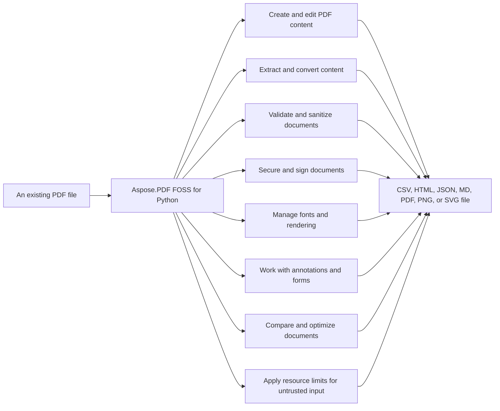

# Aspose.PDF FOSS for Python


Aspose.PDF FOSS for Python reads and writes PDF documents (`.pdf`), converts them to HTML (`.html`), Markdown (`.md`), SVG (`.svg`), PNG (`.png`), and CSV (`.csv`), extracts text, words, and tables, validates links and PDF/A compliance, sanitizes documents, and compares visual content between PDFs. It supports font substitution, font embedding, and resource limits to control memory usage during loading. The library is open-source under the MIT license, targets Python 3.11 and later, and depends only on cryptography and asn1crypto at its core.

Aspose.PDF FOSS for Python is an open-source, MIT-licensed Python library for creating, reading,
editing, rendering, and validating PDF documents. It targets Python 3.11 and later, ships type
information (`py.typed`), and depends only on `cryptography` and `asn1crypto` at its core. The
project is currently in alpha, so its public APIs and feature coverage continue to evolve ahead
of a first stable release.

## Navigation

- [At a Glance](#at-a-glance)
- [Key Capabilities](#key-capabilities)
- [Installation](#installation)
- [Dependencies](#dependencies)
- [Quick Start](#quick-start)
- [Additional Examples](#additional-examples)
- [API Reference](#api-reference)
- [Scope and Limitations](#scope-and-limitations)

## At a Glance



## Key Capabilities

- **Create and edit PDF content.** Add text, images, tables, and stamps to pages, or draw custom paths with stroke and fill control.
- **Extract and convert content.** Extract text, words, and tables, and convert documents to HTML, Markdown, or SVG formats.
- **Validate and sanitize documents.** Validate links and PDF/A compliance, and sanitize documents by removing metadata, scripts, attachments, and comments.
- **Secure and sign documents.** Apply password encryption, validate digital signatures, and sign documents with certificates for PAdES conformance.
- **Manage fonts and rendering.** Substitute missing fonts, embed fonts for portability, and rasterize pages to images with configurable DPI and output formats.
- **Work with annotations and forms.** Add highlights, export annotations as JSON, create text fields, and validate form data.
- **Compare and optimize documents.** Compare page layouts visually, detect differences with bounding boxes, and reduce file size through resource deduplication and compression.
- **Apply resource limits for untrusted input.** Set maximum input size, decoded stream bytes, and image pixel counts for untrusted input, raising `PdfResourceLimitException` when limits are exceeded.

- The `Document` class is the central entry point: `Document(source, password=..., limits=...)`
  creates a new PDF or loads an existing one from a file path, raw bytes, or a binary stream —
  equivalent to `Document().load_from(source, ...)` — and merges instances together — a missing
  file, non-PDF data, or a missing password always raises rather than silently handing back an
  empty document.
- Colour is grey, RGB or CMYK wherever one is taken — `page.draw_rectangle(..., fill_color=(0, 0.2, 1,
  0.05))` sets an ink, `fill_color="#336699"` a web colour, `fill_color=0.25` a grey — with
  `Color.gray/rgb/cmyk/from_hex` for a value object to pass around. Grey and RGB channels may be
  0..1 or 0..255; CMYK is 0..1, because a percentage and an 8-bit value cannot be told apart from a
  fraction.
- The facade layer carries the classes ported Aspose.PDF code expects — `PdfFileInfo`,
  `PdfFileSecurity`, `PdfBookmarkEditor`, `PdfAnnotationEditor`, `PdfFileStamp`, `PdfPageEditor`,
  `PdfXmpMetadata`, `PdfConverter` beside `PdfExtractor` and `PdfFileEditor`. Each binds a
  document (a path, bytes, a stream, or one you already have open), works on it, and saves;
  page numbers there are 1-based, as in the original API.

- JPEG 2000 (`/JPXDecode`) images — what scanners emit — decode with a bundled pure-Python
  decoder, so a default install reads them. Pillow is used when present because it is far faster;
  an image neither can decode is left undrawn rather than painted as noise.

- `Document.find_low_resolution_images()` flags image placements below a DPI
  threshold so teams can replace weak assets before printing or publishing.

- `Document.destinations` names places in the document — `destinations["chapter-2"] =
  XYZDestination(page=7, top=760)` — so a link, a bookmark or another file points at the name
  (`page.add_link(rect, "chapter-2")`) and repointing it moves every reference at once. Bookmarks
  also carry a title colour and an open/closed state.
- `ImagePlacementAbsorber` collects the images a page draws, and `ImagePlacement.replace` /
  `hide` change them in the document — the new picture keeps the old one's place and size.
- `Document.generate_outlines()` builds the bookmark tree from the document's own headings — the
  structure tree when it is tagged, the inferred size tiers when it is not — nesting them by level
  and pointing each one at the heading itself rather than at the top of its page.
- `Permissions` gives the `/P` word names: `Permissions.denying("copy")` instead of `-20`, with
  `document.permissions.can_print` and `.allowed` to read one back. It is an `int` subclass, so it
  goes anywhere the raw number did, and it keeps the reserved bits that ORing the bit values by
  hand clears. Checked against qpdf flag for flag, in both directions.
- Stamps, page numbers and redaction bars are marked as `/Artifact`, so a tagged document stays
  PDF/UA-conformant once it is stamped — and `validate_pdfua()` reports any mark that is neither
  tagged nor an artifact. `artifact=` on `Page.add_text`, `add_image` and the path helpers says the
  same thing about decoration drawn by hand.

- Fields carry their own look and their own behaviour: `border_color`, `background_color`,
  `border_width`, `border_style`, `rotation`, `text_color` and `font_size=0` for auto-size, plus
  `field.actions["validate"] = JavaScriptAction(...)` for the keystroke, format, validate and
  calculate scripts that make a form compute. `page.actions`, `document.actions` and
  `document.javascript` are the page, catalog and document-level script equivalents.

- One annotation class per subtype — `page.annotations.add_square(...)`, `add_highlight(...)`,
  `add_line(...)`, `add_ink(...)` and the rest — with the entries each subtype is defined by named
  (`interior_color`, `quad_points`, `vertices`, `ink_list`, `opacity`, `border_width`), and
  `annotation.reply("...")` / `annotation.add_popup()` for comment threads and popup windows.
- `SignatureAppearance` makes a signature **visible**: who signed, when, why and where, plus a
  scanned signature or seal, drawn into the field instead of the empty box a signature field is
  otherwise. It is written before the document is serialised, so the signature covers it — edit
  the drawn name and the signature fails. pyHanko reports a file signed this way as intact with
  whole-file coverage.
- The `aspose_pdf.lowcode` plugin layer wraps common batch workflows behind a uniform
  `DataSource`/`ResultContainer` interface: `Merger`, `Splitter` (per page, per range,
  or by bookmark level),
  `Optimizer`, `TextExtractor`, `ImageExtractor`, `ImagesToPdf`, `Converter` (HTML, Markdown, SVG,
  TIFF, PNG, JPEG, WebP), `PdfAConverter`, `Rotator`, `PageRemover`, `Stamper`, `FormFlattener`,
  `Encryptor` and `Decryptor` — each one a composition of the operations above, so a batch job is
  a few lines and the same code works on files, bytes or streams.
  `ImagesToPdf` also converts multipage TIFF scans with the optional `images` extra.

- `Pillow` >=12.3 — enables the `images` extra (JPX/JPEG 2000 decoding, arithmetic-coded JPEG,
  multipage TIFF import, WebP export).
- `Brotli` >=1.2 — enables the `woff2` extra (WOFF2 web-font decoding).
- `uharfbuzz` >=0.37 — enables the `text-layout` extra (HarfBuzz-driven complex-text shaping).
- `fonttools` >=4.60.2 — enables the `text-layout` extra (font introspection for shaping).
- `atheris` >=2.3 — enables the `fuzz` extra (fuzz-testing harness).

- `build` >=1.2
- `pytest` >=8
- `ruff` >=0.6
- `setuptools` >=83
- `twine` >=5
- `wheel`
- `Brotli` >=1.2 — needed to test the `woff2` extra.
- `fonttools` >=4.60.2 — needed to test the `text-layout` extra.
- `Pillow` >=12.3 — needed to test the `images` extra.
- `uharfbuzz` >=0.37 — needed to test the `text-layout` extra.
- `python-bidi` >=0.6 — needed to test the `text-layout` extra.
- `reportlab` >=4.2 — imported by `scripts/build_agl_data.py`.

## Installation

The package `aspose-pdf-foss-for-python` is not yet published on PyPI (package registry: distribution not found).

To work from a source checkout instead, install the clone with pip:

```bash
git clone https://github.com/aspose-pdf-foss/Aspose-PDF-FOSS-for-Python.git
cd Aspose-PDF-FOSS-for-Python
pip install .
```

Verify the install:

```bash
python -c "import aspose_pdf"
```

The package declares `python_requires` as `>=3.11`.

## Dependencies

### Required Package Dependencies

- `asn1crypto>=1.5`
- `cryptography>=50`

### Optional Dependencies

- `atheris>=2.3` (extra `fuzz`)
- `Pillow>=12.3` (extra `images`)
- `fonttools>=4.60.2` (extra `text-layout`)
- `python-bidi>=0.6` (extra `text-layout`)
- `uharfbuzz>=0.37` (extra `text-layout`)
- `Brotli>=1.2` (extra `woff2`)

### Native and System Requirements

- Requires Python 3.11 or later (`python_requires=">=3.11"` in `pyproject.toml`).

### Development Dependencies

- `Brotli>=1.2` (extra `dev`)
- `build>=1.2` (extra `dev`)
- `fonttools>=4.60.2` (extra `dev`)
- `Pillow>=12.3` (extra `dev`)
- `pytest>=8` (extra `dev`)
- `python-bidi>=0.6` (extra `dev`)
- `reportlab>=4.2` (extra `dev`)
- `ruff>=0.6` (extra `dev`)
- `setuptools>=83` (extra `dev`)
- `twine>=5` (extra `dev`)
- `uharfbuzz>=0.37` (extra `dev`)
- `wheel` (extra `dev`)

## Quick Start

The first example opens a PDF file and prints its page count, version, and document information using the `Document` class from `aspose_pdf`.

```python
from aspose_pdf import Document

with Document("input.pdf") as document:
    print(f"Pages: {document.page_count}")
    print(f"PDF version: {document.version}")
    print(document.info)
```

The second example loads a PDF file and saves its first page as a PNG image with 144 DPI resolution using the `Document` class from `aspose_pdf`.

```python
from aspose_pdf import Document

with Document() as document:
    document.load_from("input.pdf")
    document.pages[0].save_as_image("page-1.png", dpi=144)
```

## Additional Examples

The following workflows demonstrate reading, converting, extracting, and inspecting PDF content.

### Convert a PDF to Markdown and HTML with Embedded Resources

```python
from aspose_pdf import Document

with Document("report.pdf") as document:
    document.save_as_markdown("report.md")
    # Images as files in report_files/ rather than data: URIs; one HTML file per page.
    document.save_as_html("report.html", resources_directory="report_files", split_into_pages=True)
    print(document.to_markdown(pages=[0], markdown_format="CommonMark"))
```

<details>
<summary>View Additional Examples</summary>

### Extract Tables from Specific Pages and Save Them as CSV

```python
from aspose_pdf import Document

with Document("report.pdf") as document:
    for number, table in enumerate(document.extract_tables(pages=[0, 1]), 1):
        print(table.page_index, table.to_list())  # Zero-based source page; all rows retained.
        table.save_csv(f"tables/table-{number}.csv", overwrite=False)
        # table.to_csv(delimiter=";") returns a string without writing a file.
```

### Export Pages as SVG with Selectable Text Support

```python
from aspose_pdf import Document

with Document("report.pdf") as document:
    document.pages[0].save_as_svg("page-1.svg")
    document.save_as_svg("report.svg")  # one file per page: report-1.svg, ...

    # text="both" keeps the glyph outlines and puts selectable <text> over them,
    # so the page looks identical and its words can be searched and copied.
    # text="text" writes the words instead of the curves: far smaller, and the
    # glyph shapes become whatever font the viewer resolves the name to.
    document.pages[0].save_as_svg("page-1-selectable.svg", text="both")
```

### Render a Page Using System Fonts When Embedded Fonts Are Missing

```python
from aspose_pdf import Document, FontSubstitutionOptions

with Document("report-cjk.pdf") as document:
    # Use the machine's own fonts; FontSubstitutionOptions(["/opt/fonts"]) or
    # FontSubstitutionOptions(fonts={"SimSun": data}) keep it reproducible.
    document.font_substitution = FontSubstitutionOptions.system()
    document.save_page_as_image(0, "page-1.png", dpi=144)
```

### List Fonts and Check Which Ones Are Embedded in the Document

```python
from aspose_pdf import Document

with Document("report.pdf") as document:
    for font in document.fonts:
        print(font)
    # Arial (TrueType, embedded TrueType) on pages 1, 2
    # Helvetica (Type1, not embedded) on pages 2, 3

    missing = [f.name for f in document.fonts if not f.embedded]
    weight = sum(f.stored_bytes or 0 for f in document.fonts)
```

### Extract Full Text from a PDF Using `PdfExtractor`

```python
from aspose_pdf import PdfExtractor

with PdfExtractor() as extractor:
    extractor.bind_pdf("input.pdf")
    extractor.extract_text()
    print(extractor.get_text())
```

### Extract Text from a Specific Rectangular Region on a Page

```python
from aspose_pdf import Document

with Document("input.pdf") as document:
    print(document.pages[0].extract_text(clip=(72, 650, 300, 750)))
```

### Validate Internal Links and Report Issues with Details

```python
from aspose_pdf import Document

with Document("manual.pdf") as document:
    for issue in document.validate_links():
        print(issue.source, issue.page_index, issue.annotation_index,
              issue.outline_path, issue.code, issue.message)
```

### Export Annotations as JSON and Read Them Back as a List

```python
from aspose_pdf import AnnotationType, Document

with Document("reviewed.pdf") as document:
    document.export_annotations_json(
        "review/comments.json", pages=[0],
        subtypes=[AnnotationType.TEXT, AnnotationType.HIGHLIGHT], overwrite=False,
    )
    for comment in document.pages[0].annotations.to_list(subtypes="Text"):
        print(comment["author"], comment["contents"], comment["rect"])
```

### Rotate a Scanned PDF and Convert Each Page to PNG

```python
from aspose_pdf.lowcode import (
    ByteArrayDataSource, Converter, ConvertOptions, FileDataSource, Rotator, RotateOptions,
)

# Straighten a scan, keeping each page's existing rotation in account.
rotated = Rotator().process(
    RotateOptions(90).add_input(FileDataSource("scan.pdf")).add_output(FileDataSource("upright.pdf"))
)

# Then turn the result into one PNG per page.
pages = Converter().process(
    ConvertOptions("png", dpi=150).add_input(ByteArrayDataSource(rotated[0].to_array()))
)
for index, page in enumerate(pages):
    page.save(f"page-{index + 1}.png")
```

### Concatenate Multiple PDF Files into One Document

```python
from aspose_pdf import PdfFileEditor

with PdfFileEditor() as editor:
    if not editor.concatenate(["part-1.pdf", "part-2.pdf"], "merged.pdf"):
        raise RuntimeError(editor.last_exception)
```

### Extract Words with Their Positions and Page Indices

```python
from aspose_pdf import Document

with Document("input.pdf") as document:
    for word in document.pages[0].extract_words():
        print(word.text, word.bbox, word.page_index)

    selected = document.extract_words(
        pages=[0, 2], clip=(72, 650, 300, 750), skip_artifacts=True
    )
```

### Split a Document at Blank Pages and Save Each Part

```python
from aspose_pdf import Document

with Document("batch.pdf") as document:
    parts = document.split_by_blank_pages()
    try:
        for number, part in enumerate(parts, 1):
            part.save(f"part-{number:03d}.pdf")
    finally:
        for part in parts:
            part.dispose()
```

### Find Blank Pages and Check a Page for Blankness

```python
from aspose_pdf import Document

with Document("scans.pdf") as document:
    blank_pages = document.find_blank_pages()
    print(blank_pages)  # Zero-based page indices; the document is unchanged.
    print(document.pages[0].is_blank())

    # Explicitly tolerate a small amount of scan noise.
    tolerant_matches = document.find_blank_pages(
        white_threshold=245, max_ink_ratio=0.0005, dpi=96
    )
```

### Detect Duplicate Pages and Group Them by Index

```python
from aspose_pdf import Document

with Document("batch.pdf") as document:
    groups = document.find_duplicate_pages(dpi=96)
    print(groups)  # For example: [[0, 3], [1, 4, 7]]; zero-based indices.
```

### Compare Two PDFs Visually and Save Difference Images

```python
from aspose_pdf import Document

with Document("before.pdf") as before, Document("after.pdf") as after:
    results = before.compare_visual(after, dpi=96, include_diff_images=True)
    for pair, result in enumerate(results):
        if not result.matches:
            print(result.page_index, result.other_page_index,
                  result.difference_ratio, result.bbox)
            result.diff_image.save(f"diff-{pair + 1}.png")
```

### Load a PDF with Strict Resource Limits and Handle Exceptions

```python
from aspose_pdf import Document, PdfLoadLimits, PdfResourceLimitException

limits = PdfLoadLimits(
    max_input_bytes=64 * 1024 * 1024,
    max_decoded_stream_bytes=16 * 1024 * 1024,
    max_image_pixels=25_000_000,
)

try:
    with Document(limits=limits) as document:
        document.load_from("input.pdf")
except PdfResourceLimitException as error:
    print(f"PDF rejected: {error}")
```

A document loads just as easily from an existing path, in-memory bytes, or a binary stream:

More real, runnable examples from the project's own documentation are collected below.

Remove excess white space around scanned or drawn content:

`margin` is padding in PDF points. Detection uses the current visible area,
page rotation and visible annotations; blank-looking pages stay unchanged.
Only CropBox changes: cropped-out content remains stored in the PDF.
Detection is approximate at the chosen DPI; dark scan borders and speckles
count as content. See [cropping details](supported-features.md#pages).

</details>

## API Reference

The `aspose_pdf.Document` class serves as the central entry point for PDF operations, providing access to pages, form fields, and annotations alongside encryption, text extraction, and conversion capabilities. The `aspose_pdf.PdfExtractor` class extracts text and images from PDF documents, and the `aspose_pdf.PdfFileEditor` class provides file-level editing operations.

The verified public surface has 370 types.

<details>
<summary>View the Complete Public API Surface</summary>

### Core API

| Class | Description |
| --- | --- |
| `Action` | Base class for an interactive action. |
| `Annotation` | Live view over a single annotation on a page. |
| `AnnotationCollection` | Mutable sequence-like wrapper over page annotations. |
| `AutoLinkResult` | Created links and detected addresses that were left unchanged. |
| `ByteArrayDataSource` | A data source backed by in-memory bytes. |
| `Cell` | One cell of a table: what it says, and how it says it. |
| `CircleAnnotation` | An ellipse drawn inside the annotation's rectangle (Circle). |
| `aspose_pdf.Color` | A colour in one of the three PDF device spaces, or a gradient pattern. |
| `DataSource` | Base class for plugin inputs and outputs. |
| `Destination` | Base class for a view destination on a document page. |
| `Document` | Pythonic wrapper for PDF document lifecycle and core operations. |
| `DocumentFont` | One font the document draws with. |
| `ExtractedTable` | An inferred table, independent of the document it came from. |
| `Field` | A field of an interactive form. |
| `FieldWidget` | Where one of a field's widgets sits: the page and the rectangle on it. |
| `FileAttachmentAnnotation` | A file attached at a point on the page (FileAttachment). |
| `FileDataSource` | A data source backed by a file on disk. |
| `FileFontSource` | Discover the font(s) contained in a single file. |
| `FileSpecification` | A document-level embedded file (/Filespec) with typed metadata. |
| `FitBDestination` | Fit the page's bounding box in the window. |
| `FitBHDestination` | Fit the bounding-box width with top at the top of the window. |
| `FitBVDestination` | Fit the bounding-box height with left at the left of the window. |
| `FitDestination` | Fit the whole page in the window. |
| `FitHDestination` | Fit the page width with top at the top of the window. |
| `FitRDestination` | Fit the rectangle (left, bottom, right, top) in the window. |
| `FitVDestination` | Fit the page height with left at the left of the window. |
| `FolderFontSource` | Collect fonts from a directory (optionally recursing into subfolders). |
| `FontDescriptor` | Represents a discoverable font. |
| `FontEmbeddingException` | Raised when there is an error embedding fonts in the PDF. |
| `FontRepository` | Aggregate font sources and resolve fonts by name. |
| `FontSource` | Base class for external font providers. |
| `FontSubstitutionOptions` | Font sources the renderer may substitute from. |
| `Form` | Represents an interactive form (AcroForm) within a PDF document. |
| `aspose_pdf.FormValidationIssue` | FormValidationIssue represents a validation issue found in a form field, including the field name, error code, and descriptive message. |
| `FreeTextAnnotation` | Text drawn straight onto the page (FreeText). |
| `GoToAction` | Jump to a destination within this document. |
| `GoToRAction` | Jump to a destination in another (remote) PDF file. |
| `GraphicsPath` | A path made of subpaths, to be filled, stroked or clipped with. |
| `HighlightAnnotation` | Text marked with a highlighter (Highlight). |
| `ImageStamp` | An image, scaled to the box it is given. |
| `InkAnnotation` | Freehand strokes (Ink). |
| `JavaScriptAction` | Run a JavaScript script (serialized verbatim, not validated). |
| `LaunchAction` | Launch an application or open a file (serialized verbatim). |
| `LineAnnotation` | A single line between two points (Line). |
| `LinkAnnotation` | A clickable area that goes somewhere (Link). |
| `LinkValidationIssue` | One local navigation problem, with zero-based source coordinates. |
| `ListItem` | One item: what it says, what hangs under it, and how it differs. |
| `MarkupAnnotation` | An annotation a person made, with the entries every one of them shares. |
| `MemoryFontSource` | Expose a font program supplied as in-memory bytes. |
| `MergeOptions` | Options for :class:Merger: concatenate all inputs in order. |
| `Merger` | Concatenate every input PDF into a single document. |
| `NamedAction` | A predefined named action, e.g. NextPage, FirstPage, Print. |
| `NamedDestinationCollection` | The document's named destinations, as a mapping of name to destination. |
| `NamespaceProvider` | Resolve XMP namespace prefixes and URIs. |
| `OperationResult` | A single result produced by a plugin. |
| `OptimizationOptions` | OptimizationOptions provides settings to control PDF optimization behavior, such as image compression and font embedding. |
| `OptimizeOptions` | Options for :class:Optimizer. |
| `Optimizer` | Optimize each input PDF (compression + unused-object cleanup). |
| `OutlineCollection` | Top-level collection of :class:OutlineItem bookmarks. |
| `OutlineItem` | A single bookmark entry in a PDF outline tree. |
| `Page` | A page of a PDF document. |
| `PageCollection` | A collection to manage PDF pages within a Document. |
| `PageLabel` | The labelling of one range of pages. |
| `PageLabelCollection` | A document's label ranges, keyed by the index of the page each starts at. |
| `PageNumberStamp` | A text stamp whose text is the page's number. |
| `PageSize` | A page's width and height in PDF points. |
| `PageStamp` | A page of a document, drawn onto a page -- a letterhead, a background form. |
| `PageVisualComparison` | One pair of rendered pages, using zero-based source page indices. |
| `Paragraph` | One paragraph: what it says, and how it differs from the block. |
| `PdfAValidateOptions` | Container for PDF/A validation settings. |
| `PdfAValidationResult` | Detailed result of a PDF/A validation run. |
| `PdfAValidator` | Plugin that runs PDF/A validation on one or more inputs. |
| `PdfAnnotationEditor` | Reading, deleting and flattening annotations across pages. |
| `PdfBookmarkEditor` | The document's outline, as the ported API edits it. |
| `PdfConverter` | Rendering the bound document's pages, one image at a time. |
| `PdfExtractor` | Simple PDF text and image extractor. |
| `PdfFileEditor` | Facade for PDF file editing operations. |
| `PdfFileInfo` | The document information dictionary, and the geometry of its pages. |
| `PdfFileSecurity` | Passwords and permissions on the bound document. |
| `PdfFileStamp` | Stamps, running heads and page numbers on the bound document. |
| `PdfLoadLimits` | Immutable safety limits for untrusted PDF input and authored assets. |
| `PdfPageEditor` | Turning, resizing, moving and removing pages. Page numbers are 1-based. |
| `PdfPlugin` | Base class for low-code plugins. |
| `PdfResourceLimitException` | Raised when processing a PDF would exceed a configured resource limit. |
| `PdfSignature` | Represent a PDF digital signature. |
| `PdfUaValidateOptions` | Container for batch PDF/UA validation settings. |
| `PdfUaValidationResult` | Detailed result of a PDF/UA structure check (heuristic). |
| `PdfUaValidator` | Plugin that runs heuristic PDF/UA validation on one or more inputs. |
| `PdfXValidateOptions` | Container for batch PDF/X validation settings. |
| `PdfXValidationResult` | Detailed result of a PDF/X validation run (heuristic). |
| `PdfXValidator` | Plugin that runs heuristic PDF/X validation on one or more inputs. |
| `PdfXmpMetadata` | The document's XMP packet, read and written by prefix and name. |
| `Permissions` | What a reader may do with an encrypted document: /P, with names. |
| `PluginOptions` | Hold input/output data sources and their PDF resource-limit policy. |
| `PolyLineAnnotation` | An open shape through a list of points (PolyLine). |
| `PolygonAnnotation` | A closed shape through a list of points (Polygon). |
| `PopupAnnotation` | The window that shows another annotation's contents (Popup). |
| `RasterizedPage` | A rendered PDF page in packed RGB format. |
| `Recipient` | One certificate that may open the document, and what it may then do. |
| `RedactAnnotation` | An area marked for removal (Redact). |
| `ResetFormAction` | Reset the form's fields to their default values. |
| `ResultContainer` | Holds the ordered results of a plugin operation. |
| `Row` | One row of a table: its cells, and what they have in common. |
| `SanitizationReport` | How much of each kind of thing :meth:~aspose_pdf.Document.sanitize removed. |
| `SignatureAppearance` | How a visible signature is drawn: its text, its image, and its frame. |
| `SplitOptions` | Options for :class:Splitter. |
| `Splitter` | Split every input PDF per page, per selection, or by bookmark level. |
| `SquareAnnotation` | A rectangle drawn inside the annotation's rectangle (Square). |
| `SquigglyAnnotation` | Text with a wavy line under it (Squiggly). |
| `Stamp` | What every stamp says about where it goes and how it is drawn. |
| `StampAnnotation` | A rubber stamp (Stamp). |
| `StreamDataSource` | A data source backed by a binary stream (e.g. io.BytesIO). |
| `StrikeOutAnnotation` | Text with a line through it (StrikeOut). |
| `StructureElement` | A mutable logical-structure element in a tagged PDF. |
| `SubmitFormAction` | Send the form's field values to *URL*. |
| `SystemFontSource` | Collect fonts from common system font directories. |
| `Table` | A table of rows, ready to be placed on a page. |
| `TaggedContent` | Editable view of a document's logical structure tree. |
| `TextAnnotation` | A sticky note: an icon that opens a window (Text). |
| `TextBlock` | Paragraphs ready to be placed on a page, with the styles they share. |
| `TextExtractor` | Extract plain text from each input PDF. |
| `TextExtractorOptions` | Extract text from all or selected pages, optionally within a clip. |
| `TextHighlightResult` | Highlights created and matches skipped because their geometry was uncertain. |
| `TextLayoutOptions` | Configure complex-text shaping and line layout for Page.add_text. |
| `TextList` | Items ready to be placed on a page, with the styles they share. |
| `TextStamp` | A line of text, set in one of the 14 standard fonts. |
| `TextWord` | A detached positioned word in unrotated PDF coordinates, in points. |
| `URIAction` | Resolve a uniform resource identifier (typically a web link). |
| `UnderlineAnnotation` | Text with a line under it (Underline). |
| `UnsignedContent` | Represents a collection of unsigned content elements in a PDF document. |
| `UnsignedContentAbsorber` | Extract the pages, form fields and annotations no signature covers. |
| `UnsupportedFeatureException` | Raised when a compatibility surface names a feature this package lacks. |
| `ValidationOptions` | Configuration for signature validation. |
| `ValidationResult` | Structured result returned by signature validation. |
| `ViewerPreferences` | The document's /ViewerPreferences, read and written in place. |
| `XYZDestination` | Position (left, top) at the upper-left with an optional zoom. |
| `XmpArray` | An ordered XMP array value. |
| `XmpField` | A single XMP property. |
| `XmpPacket` | An in-memory XMP packet: an ordered collection of properties. |
| `XmpProperty` | A property carrying arbitrary qualifiers. |
| `XmpStruct` | A structured XMP value (an rdf:parseType="Resource" block). |
| `ActionCollection` | A mapping of trigger name to :class:~aspose_pdf.interactive.Action. |
| `JavaScriptCollection` | The document's own scripts, as a mapping of name to source. |
| `Name` | A str subclass that marks a value to be serialized as a PDF name. |
| `PDF3DAnnotation` | Minimal annotation wrapper for prerelease imports. |
| `PDF3DArtwork` | Container for 3D content and named views. |
| `PDF3DContent` | Reference to 3D content stored on disk. |
| `PDF3DView` | Lightweight description of a saved 3D view. |
| `CgmLoadOptions` | Options for loading CGM files. |
| `Cluster` | Represents a cluster of data points. |
| `ClusterCollection` | A collection of clusters. |
| `DataPoint` | Represents a data point in clustering operations. |
| `GradientAxialShading` | Represents axial (linear) gradient shading. |
| `Point` | Represents a point in 2D space. |
| `drawing.Rectangle` | Represents a rectangle with position and size. |
| `GeneratedAppearance` | A synthesised appearance: content bytes plus any required ExtGState entries. |
| `LayoutElement` | A positioned piece of page content (a text object or an image paint). |
| `TextObject` | A BT ... ET text object located in a content stream. |
| `ccitt.Decoder` | Decoder performs CCITT fax decoding of compressed image data. |
| `ChainResult` | Result of building and validating a certificate path. |
| `CffOutlines` | Decode glyph outlines from a CFF (Type 2 charstring) font program. |
| `SignedDataInfo` | Everything we need from a parsed CMS SignedData. |
| `SignerVerification` | Outcome of verifying a single signer. |
| `PdfXStandardRules` | What one PDF/X conformance level requires, as data. |
| `AuthoredImage` | Prepared image data and PDF image XObject metadata. |
| `Isolation` | What to put around a page's content before appending to it. |
| `ContentStreamParser` | Parse a PDF content stream and extract plain text. |
| `PdfArray` | PdfArray is a container for ordered PDF objects, supporting append operations. |
| `PdfBoolean` | PdfBoolean represents a PDF boolean value, either true or false. |
| `PdfDictionary` | PdfDictionary is a collection of key-value pairs used to represent PDF objects, supporting get and pop operations. |
| `PdfDocument` | Container for a PDF's COS object graph. |
| `PdfIndirectReference` | PdfIndirectReference holds a reference to an indirect PDF object by its object ID and generation number. |
| `cos.PdfName` | PdfName represents a PDF name object, a short string beginning with a hash mark. |
| `cos.PdfNull` | Represent PDF null object. |
| `cos.PdfNumber` | PdfNumber represents a PDF numeric value and supports conversion to integer and double. |
| `PdfObject` | Base class for all PDF COS objects. |
| `PdfStream` | A stream object: a dictionary plus a byte payload. |
| `PdfString` | PdfString represents a PDF string object, which may contain binary data. |
| `data.Color` | Represents a color in PDF documents. |
| `Encoding` | Encoding provides methods to encode text into byte sequences according to a specific encoding scheme. |
| `data.PdfNull` | PdfNull represents the PDF null object, indicating the absence of a value. |
| `PdfObjectID` | PdfObjectID uniquely identifies a PDF object by its object number and generation number. |
| `PdfObjectRegistry` | PdfObjectRegistry manages registration and retrieval of PDF objects by their IDs. |
| `PdfTrailerable` | PdfTrailerable provides access to the trailer dictionary of a PDF document. |
| `number.PdfNumber` | Represents a PDF number primitive (integer or real). |
| `types.PdfName` | Represents a PDF name object. |
| `XmpNamespaceProvider` | Bidirectional XMP namespace prefix <-> URI resolver. |
| `DecodedJpeg` | A decoded JPEG image. |
| `DssMaterial` | Validation material destined for (or harvested from) a /DSS. |
| `EncryptionUtils` | Utility class for PDF-compliant AES-CBC, RC4 encryption, and key derivation. |
| `StreamDecoder` | Decode PDF stream data using supported filters. |
| `StreamEncoder` | Encode raw bytes into PDF stream data, the inverse of :class:StreamDecoder. |
| `AuthoredFont` | A normalized embedded font and the mutable CID mapping for authored text. |
| `FontResolver` | Index external font sources and resolve PDF font names against them. |
| `ResolvedFace` | A font program picked for a non-embedded PDF font. |
| `FieldData` | One field's entry in an FDF or XFDF file. |
| `form_validation.FormValidationIssue` | An immutable field-value problem; messages never contain stored values. |
| `TrueTypeOutlines` | Decode glyph outlines from an embedded TrueType (glyf) program. |
| `AbsorbedElement` | One painted path or placed image, in page (user) space. |
| `GlyphVariations` | The gvar table of one font, read on demand per glyph. |
| `Heading` | One heading: what it says, how deep it is, and where it is. |
| `TiffPage` | One image in a TIFF file. |
| `IncrementalUpdate` | Generate an incremental update section for an existing PDF. |
| `IncrementalWriter` | Utility that appends incremental updates to an existing PDF. |
| `InlineImage` | A BI ... ID ... EI image: its dictionary, expanded, and its samples. |
| `BitStream` | Minimal bit-oriented buffer used by compatibility code. |
| `jbig2.Decoder` | JBIG2 decoder that parses segment structure and extracts bitmap data. |
| `DecodedImage` | A decoded JPEG 2000 image as interleaved 8-bit samples. |
| `jpx.Decoder` | JPEG 2000 (JPX) Stream Decoder. |
| `OptionalContent` | The document's optional content groups and their default visibility. |
| `OptionalContentConfiguration` | One optional content configuration: /D, or an entry of /Configs. |
| `OptionalContentGroup` | One optional content group (/OCG) of the document. |
| `LabelRange` | How the pages from one range start onward are labelled. |
| `ParseWarnings` | Collects warnings during parsing. |
| `PdfCorruptedError` | Unrecoverable PDF corruption. |
| `PdfEncodingError` | Font or content stream encoding error. |
| `PdfMalformedError` | Recoverable malformed PDF structure. |
| `PdfParseError` | Base exception for PDF parsing errors. |
| `PdfParseWarning` | Non-fatal parsing issue that was recovered from. |
| `PdfSecurityError` | Encryption or permission related error. |
| `PdfValidationError` | PDF/A or general structural validation error. |
| `LazyPdfObjectStore` | Object-number → COS object map that parses from a :class:PdfCosParser on demand. |
| `PdfCosParser` | Parse a PDF file (bytes) into a :class:PdfDocument. |
| `PdfCosWriter` | Serialize a :class:PdfDocument to a PDF byte sequence. |
| `WriterEncryption` | The security handler, applied as :class:PdfCosWriter serialises. |
| `CharacterCollection` | A CIDSystemInfo registry, ordering, and supplement triple. |
| `PredefinedCMap` | A resolved predefined CMap and its semantic Unicode mapping. |
| `PredefinedCMapEncoding` | Compact code-to-CID view of a predefined CMap. |
| `Matrix` | Matrix represents a 3x3 transformation matrix used for coordinate transformations, supporting multiplication and translation operations. |
| `RecipientPayload` | What one opened envelope carries. |
| `RedactionContext` | Metadata associated with the operands changed in one content stream. |
| `RevocationResult` | RevocationResult contains the outcome of a certificate revocation check. |
| `RichRun` | RichRun represents a run of rich text with consistent formatting properties. |
| `RichStyle` | The resolved style of a text run. |
| `SfntFace` | Metadata recovered from a single SFNT face. |
| `Shading` | Base class for bounded RGB sampling in a shading's target space. |
| `Placement` | A laid-out appearance: the size chosen, and where each line goes. |
| `Revision` | Revision represents a signature revision in a PDF document. |
| `SignedChanges` | The objects that are new or different since the newest signed revision. |
| `SigningUtils` | Utility class for generating certificates and PKCS#7 signatures. |
| `CosExtractor` | Extract pages, streams, images and metadata from a PdfDocument. |
| `simple_pdf.ImagePlacement` | Represents an image placement on a page. |
| `simple_pdf.ImagePlacementAbsorber` | Absorber that finds image placements in a PDF. |
| `LazyImageDict` | Dictionary that decodes image streams on demand to save memory. |
| `SimplePdf` | Native Python PDF document representation. |
| `simple_pdf.TextFragmentAbsorber` | Absorber that extracts text fragments from a SimplePdf instance. |
| `TextFragmentCollection` | Collection of TextFragment objects. |
| `StandardFonts` | Utility class for the PDF Standard 14 fonts. |
| `StrokeRun` | StrokeRun represents a run of stroked path segments with consistent stroke properties. |
| `Subpath` | Keep an explicit closepath distinct from a line back to the start. |
| `CidTextCodec` | Code codec for a composite (Type0) font's show strings. |
| `Reshaper` | Policy for shaping complex-script replacements during a text edit. |
| `Block` | One piece of exported structure. |
| `GlyphPlacement` | One shaped glyph at an em-relative position within a laid-out line. |
| `LayoutLine` | One visual line with logical replacement text and shaped glyphs. |
| `LayoutResult` | Complete line layout; glyph coordinates and widths are in em units. |
| `CompositeFontMetric` | Advance metrics for a composite (Type0) font. |
| `LocatedText` | Where a match sits on the page, and what it is set in. |
| `SimpleFontMetric` | Advance metrics for a single-byte simple font, in 1000-unit glyph space. |
| `TimestampInfo` | Result of verifying an RFC 3161 timestamp token. |
| `Entry` | One line of the contents: what it says, and where it points. |
| `Type1Outlines` | Decode glyph outlines from a Type 1 (/FontFile) font program. |
| `AsposePdfException` | Base class for all aspose_pdf exceptions. |
| `DeprecatedFeatureException` | Raised when a deprecated PDF feature is used that is not allowed in newer PDF versions. |
| `IncorrectCMapUsageException` | Raised when there is an incorrect usage of CMap. |
| `InvalidPasswordException` | Raised when an incorrect password is provided for an encrypted document. |
| `InvalidPdfFileFormatException` | Raised when the PDF file format is invalid or corrupted. |
| `InvalidValueFormatException` | Raised when an invalid value is encountered during parsing or conversion. |
| `PdfException` | Base class for PDF-related exceptions. |
| `PdfIOException` | Raised when there is an I/O error during PDF processing. |
| `PdfParseException` | Raised when there is an error parsing a PDF document. |
| `PdfSecurityException` | Raised when there is an encryption, signature, or permissions error. |
| `PdfValidationException` | Raised when a PDF document fails validation or compliance checks. |
| `FontRegistry` | Singleton registry for resolving well-known font names. |
| `InvalidFormTypeOperationException` | Exception thrown when an invalid form type operation is attempted. |
| `Matrix3D` | Represents a 3D transformation matrix. |
| `Point3D` | Represents a 3D point. |
| `GraphicElement` | A painted path or a placed image, read from a page's content stream. |
| `GraphicElementCollection` | An in-memory list of :class:GraphicElement objects. |
| `GraphicsAbsorber` | Absorbs graphic elements from PDF pages. |
| `InvalidOperationException` | Raised when a graphics element is attached to the wrong parent. |
| `HtmlLoadOptions` | Options for loading HTML documents. |
| `HtmlSaveOptions` | Options for saving PDF documents as HTML. |
| `images.ImagePlacement` | Represent an image placed on a PDF page. |
| `images.ImagePlacementAbsorber` | Absorber to collect image placements from PDF pages. |
| `images.Rectangle` | Rectangle representing image placement bounds on a PDF page. |
| `LatexFragment` | Small value object that stores LaTeX source text. |
| `Layer` | One optional content group, and whether it is currently shown. |
| `LayerCollection` | The document's layers, indexable by position or by name. |
| `LayerConfiguration` | A named optional content configuration a viewer can switch to. |
| `License` | License management class for Aspose.PDF. |
| `StatisticsEntry` | Entry for tracking statistics and timing information. |
| `CdrLoadOptions` | Options for loading CDR files. |
| `load_options.SvgLoadOptions` | Options for loading SVG files. |
| `WarichuWPElement` | Minimal tagged-element type for API compatibility. |
| `ConvertOptions` | Options for :class:Converter: render or re-express each input. |
| `Converter` | Re-express each input in another format -- HTML, Markdown, SVG or a raster. |
| `DecryptOptions` | Options for :class:Decryptor: the password that opens each input. |
| `Decryptor` | Remove the standard security handler from each input. |
| `EncryptOptions` | Options for :class:Encryptor, as :meth:~aspose_pdf.Document.encrypt. |
| `Encryptor` | Encrypt each input with the standard security handler. |
| `FlattenOptions` | Select fields, non-widget annotations and zero-based pages to flatten. |
| `FormFlattener` | Bake the fields and annotations selected by :class:FlattenOptions. |
| `ImageExtractor` | Pull every embedded image out of each input, as a real image file. |
| `ImageExtractorOptions` | Options for :class:ImageExtractor: pull the images out of each input. |
| `ImagesToPdf` | Make a PDF out of JPEG, PNG or TIFF inputs, one page per image/frame. |
| `ImagesToPdfOptions` | Options for :class:ImagesToPdf. |
| `PageRemoveOptions` | Options for :class:PageRemover: pages are the 0-based pages to drop. |
| `PageRemover` | Drop the named pages from each input. |
| `PdfAConvertOptions` | Options for :class:PdfAConverter: the level to convert each input to. |
| `PdfAConverter` | Convert each input to PDF/A. |
| `RotateOptions` | Options for :class:Rotator. |
| `Rotator` | Turn pages of each input by a multiple of 90 degrees. |
| `StampOptions` | Options for :class:Stamper: the stamp to put on pages. |
| `Stamper` | Put one stamp on the pages of each input. |
| `MarkdownSaveOptions` | Options for saving PDF documents as Markdown. |
| `OfdLoadOptions` | Options for loading OFD files. |
| `PdfConsts` | PdfConsts provides utility methods for common PDF-related constants, including decimal and octal conversions. |
| `PdfAConversionResult` | Result of a PDF/A conversion operation. |
| `FillMode` | Fill mode enumeration for path operations. |
| `IMatrix` | Interface for matrix operations. |
| `IPath` | A path built segment by segment, in the shape ported code expects. |
| `ColorPrimitive` | Very small color primitive with transparency support. |
| `PrinterSettings` | PrinterSettings holds configuration options for printing a PDF document. |
| `CompromiseCheckResult` | CompromiseCheckResult indicates whether a certificate has been compromised. |
| `SignaturesCompromiseDetector` | Detect possible compromise indicators around signed PDFs. |
| `Margin` | Margin defines the whitespace around an SVG content area. |
| `PageInfo` | PageInfo specifies dimensions and layout properties for SVG page rendering. |
| `svg.SvgLoadOptions` | SvgLoadOptions controls how SVG content is loaded and converted to PDF. |
| `TaggedContext` | TaggedContext provides access to the logical structure and tagging information of a tagged PDF document. |
| `RegexResult` | Wraps a single regular-expression match found on a PDF page. |
| `TextAbsorber` | Absorbs text from PDF pages (legacy class, alias for TextFragmentAbsorber). |
| `TextExtractionOptions` | Options for text extraction from PDF pages. |
| `TextFormattingMode` | Text formatting mode for text extraction. |
| `TextFragment` | A text fragment found inside a PDF page. |
| `text.TextFragmentAbsorber` | Absorbs text fragments from a PDF page or document. |
| `TextSearchOptions` | Options controlling how text search is performed. |
| `PerformanceLogger` | Collects named phase timings, and free-form lines. |
| `VirtualizationPerformance` | A process-global stopwatch. Nothing in this package writes to it. |

#### Enumerations

| Enumeration | Description |
| --- | --- |
| `AnnotationFlags` | Flags that define annotation behaviour. |
| `AnnotationType` | Known annotation subtype names (PDF 32000-1:2008, Table 169). |
| `CertificationLevel` | DocMDP certification level of a signature. |
| `DuplexMode` | How the print dialogue starts out handling both sides (/Duplex). |
| `FieldType` | Type of form field. |
| `FormType` | Type of PDF form. |
| `HorizontalAlignment` | Which way a stamp is placed across the page. |
| `NumberingStyle` | How the number part of a label is written (/S). |
| `PageBoundary` | A page box, for the entries that say which one to view or print. |
| `PageLayout` | How the pages are arranged (/PageLayout). |
| `PageMode` | What a viewer shows beside the page when the document opens (/PageMode). |
| `PdfXStandard` | The PDF/X conformance levels this library validates and writes. |
| `Plugin` | Identifiers for the available low-code plugins. |
| `PrintScaling` | What the print dialogue starts on (/PrintScaling). |
| `ReadingDirection` | The reading order of a two-column or two-page layout (/Direction). |
| `RevocationStatus` | Certificate revocation outcome (OCSP/CRL). |
| `TrustStatus` | Outcome of building/validating the signer's certificate chain. |
| `ValidationMethod` | Selects the signature format / validation algorithm. |
| `ValidationMode` | Controls whether certificate revocation is checked via network. |
| `ValidationStatus` | Outcome of a :class:ValidationResult. |
| `VerticalAlignment` | Which way a stamp is placed up the page. |
| `PDF3DLightingScheme` | PDF3DLightingScheme is an enumeration of predefined lighting schemes for 3D annotations. |
| `PDF3DRenderMode` | PDF3DRenderMode is an enumeration of rendering modes for 3D annotations. |
| `EncodingType` | EncodingType is an enumeration of supported text encoding types. |
| `FilterType` | FilterType is an enumeration of supported data filter types used in PDF streams. |
| `StructureTypeStandard` | StructureTypeStandard is an enumeration of standard structure types for tagged PDF content. |
| `Duplex` | Duplex is an enumeration of duplex printing modes. |
| `PrintRange` | PrintRange is an enumeration of print range options. |
| `SaveFormat` | Format for saving PDF documents. |
| `DocFormat` | Target format for a save operation. |
| `PadesLevel` | PAdES baseline conformance level reached by a signature. |

#### Detailed Member Reference

### Document

The `aspose_pdf.Document` class exposes pages, form, outlines, and `tagged_content` for structural editing alongside encrypt, decrypt, merge, optimize, and flatten operations, and provides `extract_text` and `save_as_html` methods for content access.

- `actions`: What the document does around saving, printing and closing (/AA).
- `add_attachment`: Embed *content* as a document-level file attachment named *name*.
- `add_document_timestamp`: Add a document timestamp when the document is next saved.
- `add_ltv`: Add long-term validation material (a /DSS) when the document is next saved.
- `add_stamp`: Put *stamp* on *pages*, or on every page when none are named.
- `add_table_of_contents`: Put a contents page in front of the document, and return its pages.
- `attachments`: Get the collection of attachments in the document.
- `auto_link`: Make recognized web and email addresses in existing text clickable.
- `auto_tag`: Heuristically tag existing page content into the structure tree.
- `booklet`: Return a new document imposed as a saddle-stitched booklet.
- `change_passwords`: Change the document's passwords and keep everything else.
- `check`: Check PDF integrity.
- `close`: Alias of :meth:dispose (matches .NET Close).
- `compare_visual`: Compare rendered page pairs and optionally retain red difference images.
- `compress_streams`: Compress uncompressed document streams.
- `convert_to_pdfa`: Convert the document to PDF/A format in-place.
- `convert_to_pdfua`: Add the catalog-level PDF/UA prerequisites to the document in place.
- `convert_to_pdfx`: Convert the document toward a PDF/X standard in place.
- `decrypt`: Remove the document's password protection.
- `destinations`: The document's named destinations, as a mapping of name to destination.
- `dispose`: Release the document and underlying engine resources (primary lifecycle API).
- `embed_fonts`: Embed a real font program for every font the document only names.
- `embedded_files`: The document's embedded files as typed :class:FileSpecification.
- `encrypt`: Encrypt the PDF document with the standard security handler.
- `encrypt_for_recipients`: Encrypt for certificate *recipients* with the public-key handler.
- `export_annotations_json`: Return UTF-8 JSON annotation metadata, optionally writing it.
- `export_attachments_zip`: Return embedded-file payloads as ZIP bytes, optionally writing them.
- `export_bookmarks_json`: Return version 1 UTF-8 JSON for the current bookmark tree.
- `extract_pages`: Return an independent document containing selected pages in order.
- `extract_tables`: Extract regular text grids as detached :class:ExtractedTable values.
- `extract_text`: The text of all or selected pages, separated by one line break.
- `extract_words`: Return detached positioned words from selected pages in content order.
- `find_blank_pages`: Find visually blank pages without changing this document.
- `find_duplicate_pages`: Find groups of pages with identical rendered views without editing them.
- `flatten`: Bake selected form fields and annotations into static page content.
- `flatten_layers`: Resolve optional content once and for all; return pages changed.
- `font_substitution`: Font sources the renderer may substitute non-embedded fonts from.
- `fonts`: Every font this document draws with, one entry each.
- `form`: Get the interactive form of the document.
- `free_memory`: Free memory by clearing caches.
- `generate_appearances`: Synthesise missing annotation appearance streams across all pages.
- `generate_field_appearances`: Regenerate AcroForm field appearance streams from their values.
- `generate_outlines`: Build a bookmark tree from the document's headings.
- `get_embedded_file`: Return the embedded file named *name* as a :class:FileSpecification,
- `highlight_text`: Add one highlight annotation per reliably placed text match.
- `id`: Return the two-element file-identifier array from the PDF trailer.
- `import_annotations_json`: Append version 1 JSON review annotations and return the number added.
- `import_bookmarks_json`: Import a complete JSON bookmark tree and return the added node count.
- `info`: Get or set the document metadata (info dictionary).
- `interleave`: Return a new document alternating this document's pages with *other*.
- `is_encrypted`: Return True if document is encrypted.
- `is_pdfa_compliant`: Check if the document complies with the specified PDF/A level.
- `is_pdfua_compliant`: Heuristic PDF/UA-1 catalog structure check (tagged PDF shell).
- `is_pdfx_compliant`: Whether the document conforms to a PDF/X level (heuristic).
- `iter_page_content_streams`: Yield decoded content stream bytes for each page, one at a time.
- `iter_pages`: Iterate over the pages of the document one at a time.
- `javascript`: The document-level scripts, as a mapping of name to source.
- `layers`: The document's optional content groups (layers).
- `load_from`: Load a PDF from a file path, raw bytes, or a binary stream.
- `load_limits`: Return limits used for loading, lazy processing, and authored assets.
- `merge`: Merge the supplied documents into this one.
- `n_up`: Return a new document with rows * columns pages on each sheet.
- `open_action`: Where the document opens, or what it does when opened.
- `open_streaming`: Open a PDF in streaming/lazy mode for memory-efficient page processing.
- `optimize`: Process the document and remove unused resources.
- `optimize_resources`: Alias for :meth:optimize.
- `outlines`: Bookmark tree for this document.
- `page_count`: Return the current number of pages.
- `page_labels`: The page label ranges, keyed by the index of the page each starts at.
- `page_layout`: How the pages are arranged (/PageLayout, table 28).
- `page_mode`: What a viewer shows beside the page when the document opens.
- `pages`: Get the collection of pages.
- `permissions`: What a reader may do with this document: the /P word, with names.
- `redact_text`: Remove existing text from simple page-content text-showing operands.
- `remove_attachment`: Remove the embedded file named *name*.
- `render_contact_sheet`: Render a page overview as one RGB image without changing the PDF.
- `render_page`: Render a page to an RGB raster image.
- `repair`: Attempt to repair the PDF document.
- `replace_text`: Replace existing text in simple page-content text-showing operands.
- `resize_pages`: Give *pages* a new sheet size and scale their drawing onto it.
- `sanitize`: Take out everything the document carries that is not what it shows.
- `save`: Save the document to a file path or a binary stream.
- `save_as_html`: Write the document as HTML and return the HTML files written.
- `save_as_markdown`: Write the document as one Markdown file and return its path.
- `save_as_svg`: Write pages as SVG and return the files written.
- `save_as_tiff`: Render pages into a single multi-page TIFF file.
- `save_contact_sheet`: Save a contact sheet as PNG, TIFF, JPEG or optional WebP.
- `save_page_as_image`: Render one page and save it as PNG, TIFF, JPEG or WebP.
- `sign`: Sign the document when it is next saved.
- `signatures`: The digital signatures in the document, in the order the file holds them.
- `split_by_blank_pages`: Split a scan batch into independent parts using visibly blank pages.
- `split_by_bookmarks`: Return independent chapter documents using bookmarks at level.
- `split_by_text`: Return independent parts starting at pages whose extracted text matches.
- `sync_metadata`: Synchronise the /Info dictionary and the XMP metadata packet.
- `tagged_content`: Get an editable view of the document's tagged structure tree.
- `to_html`: Return the document's inferred structure as one HTML document.
- `to_markdown`: Return the document's inferred structure as Markdown.
- `to_tiff`: Render pages into the bytes of one multi-page TIFF.
- `update_attachment`: Change one embedded file, keeping everything not named here.
- `validate`: Validate the PDF document.
- `validate_links`: Report broken local navigation without changing the document.
- `validate_pdfa`: Validate the document against PDF/A standards (heuristic checks).
- `validate_pdfua`: Validate catalog-level PDF/UA prerequisites (heuristic).
- `validate_pdfx`: Validate the document against a PDF/X standard (heuristic checks).
- `version`: PDF version string as it appears in the file header (e.g. '1.7').
- `viewer_preferences`: The window, the reading direction and the print dialogue.
- `xmp_metadata`: Get or set the document's XMP metadata packet (catalog /Metadata).

### Page

The `aspose_pdf.Page` class provides `add_text`, `draw_path`, and `add_image` methods for placing content on a PDF page.

- `accept`: Dispatch this page to an object implementing visit(page).
- `actions`: What the page does when it is opened or closed (/AA).
- `add_image`: Place an image on this page and return its resource name.
- `add_link`: Add a clickable link over *rect* triggering *target*.
- `add_list`: Draw *text_list* with the top-left of its measure at (x, y).
- `add_stamp`: Put *stamp* on this page, over or under what it already draws.
- `add_table`: Draw *table* with its top-left corner at (x, y) on this page.
- `add_text`: Append positioned text to this page.
- `add_text_block`: Draw *block* with the top-left of its measure at (x, y).
- `annotations`: Get the collection of annotations on the page.
- `art_box`: The page's /ArtBox -- the extent of its meaningful content.
- `auto_crop`: Trim visible white margins by shrinking only this page's CropBox.
- `auto_link`: Link recognized addresses on this page and report skips/duplicates.
- `bleed_box`: The page's /BleedBox -- what a production run clips the page to.
- `content`: Get the page content stream.
- `crop_box`: The page CropBox (x0, y0, x1, y1); falls back to the MediaBox when unset.
- `draw_line`: Append a stroked line segment to this page.
- `draw_path`: Append a :class:~aspose_pdf.paths.GraphicsPath to this page.
- `draw_rectangle`: Append a stroked and/or filled rectangle to this page.
- `extract_tables`: Extract this page's text grids as detached table snapshots.
- `extract_text`: The text this page says, with the line breaks it was written in.
- `extract_words`: Return this page's words and PDF-coordinate bounds as frozen snapshots.
- `get_box`: The page box *boundary* names, with its default applied.
- `graphics`: A context manager holding a graphics state over what is drawn inside it.
- `highlight_text`: Highlight phrase or regex matches on this page and report skips.
- `index`: The zero-based index of the page.
- `is_blank`: Whether this page renders blank on white paper at the chosen DPI.
- `label`: The page's label -- "iii", "12", "A-1" -- as a viewer shows it.
- `layer`: Author content onto *layer*, as a context manager.
- `media_box`: The page's /MediaBox (x0, y0, x1, y1) -- the sheet it is on.
- `rect`: Get the page rectangle (MediaBox).
- `redact_text`: Remove existing text from simple text-showing operands on this page.
- `render`: Render this page to an RGB raster image.
- `replace_text`: Replace existing text in simple text-showing operands on this page.
- `resize`: Give this page a new sheet size and scale its drawing onto it.
- `rotation`: The page rotation in degrees, clockwise (one of 0, 90, 180, 270).
- `save_as_image`: Render this page and save it as PNG, TIFF, JPEG or WebP.
- `save_as_svg`: Write this page to *path* as SVG and return the path.
- `scale_content`: Scale everything this page draws, leaving the sheet the size it is.
- `set_box`: Set the page box *boundary* names; rect=None removes the entry.
- `size`: The page's size in points, from its media box.
- `to_html`: Return this page's inferred structure as an HTML fragment document.
- `to_markdown`: Return this page's inferred structure as Markdown (GFM).
- `to_svg`: Return this page as an SVG document.
- `trim_box`: The page's /TrimBox -- the finished page's size after trimming.
- `validate_links`: Check this page's link annotations, resolving names as needed.

### PdfExtractor

The `aspose_pdf.PdfExtractor` class provides `bind_pdf` and `extract_text` methods for extracting text and images from PDF documents.

- `bind_pdf`: Bind to a PDF source for extraction.
- `close`: Close the extractor and release resources.
- `dispose`: Mark the extractor as disposed.
- `extract_attachment`: Extract attachments from bound PDF.
- `extract_image`: Collect the bound document's images, each as a real image file.
- `extract_text`: Extract text from all or selected pages of the bound document.
- `get_attach_names`: Return list of attachment names.
- `get_attachment`: Return attached file by name.
- `get_next_image`: The next image as an image file, advancing the cursor.
- `get_next_image_name`: The name of the image :meth:get_next_image will hand back next.
- `get_next_page_text`: Return text for the next page, advancing cursor.
- `get_text`: Return all extracted text concatenated.
- `has_next_image`: Return True if there is another image available.
- `has_next_page_text`: Return True if there is another page's text available.
- `password`: Optional owner/user password used when binding encrypted PDFs (maps .NET Password).

### PdfFileEditor

The `aspose_pdf.PdfFileEditor` class provides concatenate and extract methods for file-level PDF editing operations.

- `add_page_break`: Add a blank page to the PDF.
- `append`: Append pages from one PDF to another.
- `close`: Close the editor and release resources.
- `concatenate`: Concatenate multiple PDF files into one.
- `delete`: Delete specified pages from a PDF.
- `dispose`: Mark the editor as disposed.
- `extract`: Extract pages from source to destination.
- `insert`: Insert pages from one PDF into another.
- `last_exception`: Exception from the last failed operation, or None if none.
- `make_booklet`: Impose *source* as a saddle-stitched booklet into *destination*.
- `make_n_up`: Impose *source* as rows x columns pages per sheet into *destination*.

### AnnotationCollection

The `aspose_pdf.AnnotationCollection` class provides `add_highlight` and `export_json` methods for managing annotations on a PDF page.

- `add_circle`: Add an ellipse (Circle) drawn inside *rect*.
- `add_free_text`: Add text drawn straight onto the page (FreeText).
- `add_highlight`: Add a highlight (Highlight) over *quads*.
- `add_ink`: Add freehand strokes (Ink): a list of lists of (x, y) points.
- `add_line`: Add a line (Line) from *start* to *end*.
- `add_polygon`: Add a closed shape (Polygon) through *vertices*.
- `add_polyline`: Add an open shape (PolyLine) through *vertices*.
- `add_redact`: Mark an area for removal (Redact).
- `add_square`: Add a rectangle (Square) drawn inside *rect*.
- `add_squiggly`: Add a wavy underline (Squiggly) under *quads*.
- `add_stamp`: Add a rubber stamp (Stamp) named *icon*.
- `add_strike_out`: Add a strike-through (StrikeOut) over *quads*.
- `add_text`: Add a sticky note (Text) -- an icon that opens a window.
- `add_underline`: Add an underline (Underline) under *quads*.
- `export_json`: Export this page's annotations as versioned UTF-8 JSON.
- `generate_appearances`: Synthesise missing appearance streams for every annotation on the page.
- `import_json`: Append a single source page's JSON annotations onto this page.
- `to_list`: Return fresh JSON-compatible metadata snapshots for this page.

### Form

The `aspose_pdf.Form` class provides `add_text_field` and validate methods for working with interactive form fields in a PDF document.

- `add_checkbox`: Add a check box with generated Off/on appearances.
- `add_combo_box`: Add a combo box, optionally allowing values outside its option list.
- `add_list_box`: Add a list box with string or export/display options.
- `add_push_button`: Add a push button with generated caption/rollover/down appearances.
- `add_radio_group`: Add a radio field whose option names map to widget rectangles.
- `add_signature_field`: Add an empty (unsigned) signature field and return it.
- `add_text_field`: Add an editable text field and return it.
- `export_fdf`: The form's data as FDF (ISO 32000-1 12.7.8), written to *destination* if given.
- `export_json`: Return UTF-8 JSON form data, optionally writing a path or binary stream.
- `export_xfdf`: The form's data as XFDF (ISO 19444-1), written to *destination* if given.
- `fields`: A list of all fields in the form.
- `fill`: Fill fields from a flat mapping and return the names updated, in order.
- `flatten`: Bake selected fields, with the filters of :meth:Document.flatten.
- `generate_appearances`: Regenerate field appearance streams from the current field values.
- `import_fdf`: Fill the form from FDF data and return the names of the fields it named.
- `import_json`: Fill from UTF-8 JSON in a path, bytes, or readable binary stream.
- `import_xfdf`: Fill the form from XFDF data; see :meth:import_fdf.
- `remove_field`: Remove a field by fully qualified name and return the removed field.
- `reset`: Restore all fields, or selected fully qualified names, to their defaults.
- `to_dict`: Return a snapshot of field values keyed by fully qualified names.
- `validate`: Check stored field values without modifying the PDF.

### PdfLoadLimits

The `aspose_pdf.PdfLoadLimits` class defines immutable safety limits for untrusted PDF input, and processing that exceeds these limits raises a `PdfResourceLimitException`.

- `unlimited`: Return a configuration with every limit disabled.

### Converter

The `aspose_pdf.lowcode.Converter` class works with `ConvertOptions` to perform low-code conversion operations on PDF documents.

### encrypt

The `aspose_pdf.Document` class provides encrypt, decrypt, and sign methods for securing PDF documents with passwords and digital signatures.

### font_substitution

The `aspose_pdf.Document` class provides `font_substitution`, `embed_fonts`, and `render_page` methods for managing fonts during PDF processing and rendering.

### compare_visual

The `aspose_pdf.Document` class provides `compare_visual` and optimize methods for comparing PDF documents visually and optimizing their content.

### validate_links

The `aspose_pdf.Document` class provides `validate_links`, `validate_pdfa`, and sanitize methods for validating document structure, compliance, and content safety.

272 public types are organized by module below.

| Class | Description |
|---|---|
| `AbsorbedElement` | One painted path or placed image, in page (user) space. |
| `AnnotationName` | A ``str`` subclass that marks a value to be serialized as a PDF name. |
| `AuthoredFont` | A normalized embedded font and the mutable CID mapping for authored text. |
| `AuthoredImage` | Prepared image data and PDF image XObject metadata. |
| `BitStream` | Minimal bit-oriented buffer used by compatibility code. |
| `Block` | One piece of exported structure. |
| `CffOutlines` | Decode glyph outlines from a CFF (Type 2 charstring) font program. |
| `ChainResult` | Result of building and validating a certificate path. |
| `CharacterCollection` | A CIDSystemInfo registry, ordering, and supplement triple. |
| `CidTextCodec` | Code codec for a composite (Type0) font's show strings. |
| `Codestream` | Class with 2 methods and 8 properties. |
| `Color` | Represents a color in PDF documents. |
| `CompositeFontMetric` | Advance metrics for a composite (Type0) font. |
| `ContentStreamParser` | Parse a PDF content stream and extract plain text. |
| `CosExtractor` | Extract pages, streams, images and metadata from a PdfDocument. |
| `DecodedImage` | A decoded JPEG 2000 image as interleaved 8-bit samples. |
| `DecodedJpeg` | A decoded JPEG image. |
| `Decoder-ccitt` | Decoder.decode(data, params, limits) returns the raw bytes of a decoded stream for supported codecs like JBIG2 and JPEG 2000. |
| `Decoder-jbig2` | JBIG2 decoder that parses segment structure and extracts bitmap data. |
| `Decoder-jpx` | JPEG 2000 (JPX) Stream Decoder. |
| `DssMaterial` | Validation material destined for (or harvested from) a ``/DSS``. |
| `Encoding` | Class with 1 method and 4 members. |
| `EncodingType` | Enum with 5 members. |
| `EncryptionUtils` | Utility class for PDF-compliant AES-CBC, RC4 encryption, and key derivation. |
| `FilterType` | The FilterType enum lists the supported stream filter names such as FLATE_DECODE, LZW_DECODE, and DCT_DECODE. |
| `FontResolver` | Index external font sources and resolve PDF font names against them. |
| `GeneratedAppearance` | A synthesised appearance: content bytes plus any required ExtGState entries. |
| `GlyphPlacement` | One shaped glyph at an em-relative position within a laid-out line. |
| `ImagePlacement-simple_pdf` | Represents an image placement on a page. |
| `ImagePlacementAbsorber-simple_pdf` | Absorber that finds image placements in a PDF. |
| `IncrementalUpdate` | Generate an incremental update section for an existing PDF. |
| `IncrementalWriter` | Utility that appends incremental updates to an existing PDF. |
| `Jpeg2000Error` | A JPEG 2000 codestream that cannot be decoded. |
| `LayoutElement` | A positioned piece of page content (a text object or an image paint). |
| `LayoutLine` | One visual line with logical replacement text and shaped glyphs. |
| `LayoutResult` | Complete line layout; glyph coordinates and widths are in em units. |
| `LazyImageDict` | Dictionary that decodes image streams on demand to save memory. |
| `LazyPdfObjectStore` | Object-number → COS object map that parses from a :class:`PdfCosParser` on demand. |
| `Matrix` | Matrix supports 2‑D transformations with translate(x, y) and multiply(other) methods, exposing the a‑f components of the affine matrix. |
| `MQDecoder` | The MQ arithmetic decoder of Annex C. |
| `OptionalContent` | The document's optional content groups and their default visibility. |
| `OptionalContentGroup` | One optional content group (`/OCG`) of the document. |
| `ParseWarnings` | Collects warnings during parsing. |
| `PdfArray` | PdfArray provides an items collection and an append method to build PDF array objects. |
| `PdfBoolean` | PdfBoolean represents a PDF boolean value via its 'value' property. |
| `PdfCorruptedError` | Unrecoverable PDF corruption. |
| `PdfCosParser` | Parse a PDF file (bytes) into a :class:`PdfDocument`. |
| `PdfCosWriter` | Serialize a :class:`PdfDocument` to a PDF byte sequence. |
| `PdfDictionary` | PdfDictionary behaves like a mapping with get and pop methods to access entries. |
| `PdfDocument` | Container for a PDF's COS object graph. |
| `PdfEncodingError` | Font or content stream encoding error. |
| `PdfIndirectReference` | PdfIndirectReference exposes the object number and generation number of an indirect PDF object. |
| `PdfMalformedError` | Recoverable malformed PDF structure. |
| `PdfName` | Represents a PDF name object. |
| `PdfNull` | Represent PDF null object. |
| `PdfNumber` | Represents a PDF number primitive (integer or real). |
| `PdfObject` | Base class for all PDF COS objects. |
| `PdfObjectID` | Class with 2 properties. |
| `PdfObjectRegistry` | PdfObjectRegistry.register(obj) returns a PdfObjectID that uniquely identifies the stored PDF object within the registry. |
| `PdfParseError` | Base exception for PDF parsing errors. |
| `PdfParseWarning` | Non-fatal parsing issue that was recovered from. |
| `PdfSecurityError` | Encryption or permission related error. |
| `PdfStream` | Class with 3 methods and 2 properties. |
| `PdfString` | Class with 1 method and 1 property. |
| `PdfTrailerable` | Class with 1 method. |
| `PdfValidationError` | PDF/A or general structural validation error. |
| `PredefinedCMap` | A resolved predefined CMap and its semantic Unicode mapping. |
| `PredefinedCMapEncoding` | Compact code-to-CID view of a predefined CMap. |
| `RasterizedPage` | A rendered PDF page in packed RGB format. |
| `RecipientPayload` | What one opened envelope carries. |
| `Reshaper` | Policy for shaping complex-script replacements during a text edit. |
| `ResolvedFace` | A font program picked for a non-embedded PDF font. |
| `RevocationResult` | Class with 3 properties. |
| `RichRun` | Class with 2 properties. |
| `RichStyle` | The resolved style of a text run. |
| `SfntFace` | Metadata recovered from a single SFNT face. |
| `Shading` | Base class for bounded RGB sampling in a shading's target space. |
| `SignedDataInfo` | Everything we need from a parsed CMS ``SignedData``. |
| `SignerVerification` | Outcome of verifying a single signer. |
| `SigningUtils` | Utility class for generating certificates and PKCS#7 signatures. |
| `SimpleFontMetric` | Advance metrics for a single-byte simple font, in 1000-unit glyph space. |
| `SimplePdf` | Native Python PDF document representation. |
| `StandardFonts` | Utility class for the PDF Standard 14 fonts. |
| `StreamDecoder` | Decode PDF stream data using supported filters. |
| `StreamEncoder` | Encode raw bytes into PDF stream data, the inverse of :class:`StreamDecoder`. |
| `TagTree` | The tag tree of ISO 32000-2 clause 14.8, used for structure inclusion. |
| `TextFragmentAbsorber-simple_pdf` | Absorber that extracts text fragments from a SimplePdf instance. |
| `TextObject` | A ``BT`` ... ``ET`` text object located in a content stream. |
| `TiffPage` | One image in a TIFF file. |
| `TimestampInfo` | Result of verifying an RFC 3161 timestamp token. |
| `TrueTypeOutlines` | Decode glyph outlines from an embedded TrueType (``glyf``) program. |
| `Type1Outlines` | Decode glyph outlines from a Type 1 (``/FontFile``) font program. |
| `XmpArray` | An ordered XMP array value. |
| `XmpField` | A single XMP property. |
| `XmpNamespaceProvider` | Bidirectional XMP namespace prefix URI resolver. |
| `XmpPacket` | An in-memory XMP packet: an ordered collection of properties. |
| `XmpProperty` | A property carrying arbitrary qualifiers. |
| `XmpStruct` | A structured XMP value (an ``rdf:parseType="Resource"`` block). |

| Class | Description |
|---|---|
| `Document-generated_document` | Re-export of `aspose_pdf.Document`. |
| `PdfAValidateOptions-generated_pdfa` | Re-export of `aspose_pdf.pdfa.PdfAValidateOptions`. |
| `PdfAValidationResult-generated_pdfa` | Re-export of `aspose_pdf.pdfa.PdfAValidationResult`. |
| `UnsignedContent-generated_forms` | Re-export of `aspose_pdf.forms.UnsignedContent`. |
| `UnsignedContentAbsorber-generated_forms` | Re-export of `aspose_pdf.forms.UnsignedContentAbsorber`. |

</details>

## Scope and Limitations

Aspose.PDF FOSS for Python reads and writes PDF files, renders pages to images, validates PDF/A and PDF/UA documents heuristically, replaces and redacts text in place, and exports pages to SVG. It supports public-key encryption for RSA recipients only and requires optional dependencies for WOFF2 decoding and complex-text shaping.

- `Page` rendering is a best-effort rasterizer, not a certification-grade visual engine: its overprint support is a composite RGB preview rather than a plate-accurate separation model, and complete PDF 2.0 imaging semantics are not implemented.
- `Document.validate_pdfa()` and `Document.validate_pdfua()` are heuristic checks against document structure, not certification-grade validation — use a dedicated validator such as veraPDF for formal compliance.
- OCR and layout reflow are not implemented; `Document.replace_text()` and `Document.redact_text()` rewrite matched runs in place but never reflow the surrounding layout.
- SVG export writes polylines rather than curves and text as glyph outlines, which renders exactly but is not selectable; blend modes and transparency groups are not expressed; mesh and function shadings are sampled into an embedded image.
- Public-key encryption covers RSA recipients only; key-agreement, password, and KEK recipient types, and RC2-encrypted envelopes, are rejected explicitly. No PDF 2.0 message authentication code (/`AuthCode`) is produced or checked for either security handler.
- WOFF2 decoding and complex-text shaping each need an optional extra (woff2 and text-layout); without them these paths fall back to file-name metadata or fail explicitly.

These limitations don't apply to
[Aspose.PDF for Python — Enterprise Edition](https://products.aspose.com/pdf/python-net/), which
adds full format conversion to and from Word, Excel, HTML, and image formats, certification-grade
PDF/A and PDF/UA validation, and commercial support.
