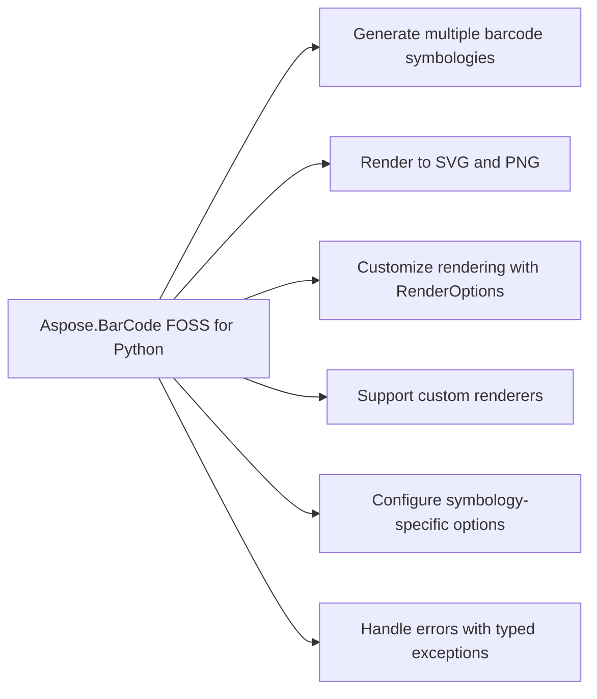

# Aspose.BarCode FOSS for Python


Aspose.BarCode FOSS for Python generates deterministic, standards-compliant barcodes for linear and 2D symbologies including Code 128, Code 39 (base and Extended), EAN-13, EAN-8, UPC-A, UPC-E, and QR Code. It encodes data through dedicated helper functions or the generic generate entry point, returning a `Barcode` object that supports `to_png` and `to_svg` output methods. Rendering options are configured via `RenderOptions` and resolved via `ResolvedRenderOptions`, and rendering is performed by renderers such as `SvgRenderer`, `PngRenderer`, and `PdfRenderer`. The library produces PNG and SVG output with no system-level dependencies beyond Pillow for PNG output.

Aspose.BarCode FOSS for Python is a free, open-source, MIT-licensed, pure-Python library for
generating deterministic, standards-compliant barcodes. It encodes linear and 2D symbologies —
Code 128, Code 39 (base and Extended), EAN-13, EAN-8, UPC-A, UPC-E, and QR Code — through the
`Barcode` object returned by dedicated helper functions or the generic `generate()` entry point,
and renders the result as SVG or PNG, with no system-level dependencies beyond Pillow for PNG
output.

## Navigation

- [At a Glance](#at-a-glance)
- [Key Capabilities](#key-capabilities)
- [Installation](#installation)
- [Dependencies](#dependencies)
- [Quick Start](#quick-start)
- [Additional Examples](#additional-examples)
- [API Reference](#api-reference)
- [Scope and Limitations](#scope-and-limitations)

## At a Glance



## Key Capabilities

- **Generate multiple barcode symbologies.** It generates barcodes using the code128, code39, code39ext, ean13, ean8, upca, upce, qr, and generate symbologies.
- **Render to SVG and PNG.** It renders barcodes to SVG and PNG formats via the `to_svg` and `to_png` methods, supporting options such as scale, `show_text`, dpi, and `module_width`.
- **Customize rendering with RenderOptions.** It customizes rendering using `RenderOptions` and produces `ResolvedRenderOptions` to apply settings like scale and `module_width` to the output.
- **Support custom renderers.** It supports custom renderers through the render method and the renderers module, including `SvgRenderer`, `PngRenderer`, and `PdfRenderer`.
- **Configure symbology-specific options.** It configures symbology-specific options using `Code128Options`, `Code39Options`, `Ean13Options`, `Ean8Options`, `UpcaOptions`, `UpceOptions`, and `QrOptions`.
- **Handle errors with typed exceptions.** It handles errors with typed exceptions including `BarcodeError`, `EncodingError`, `InvalidInputError`, `RenderingError`, `SymbologyNotFoundError`, `UnsupportedCapabilityError`, and `UnsupportedFeatureError`.

## Installation

The package `aspose-barcode-foss` is not yet published on PyPI (package registry: distribution not found).

To work from a source checkout instead, install the clone with pip:

```bash
git clone https://github.com/aspose-barcode-foss/Aspose.BarCode-FOSS-for-Python.git
cd Aspose.BarCode-FOSS-for-Python
pip install .
```

Verify the install:

```bash
python -c "import aspose_barcode_foss"
```

The package declares `python_requires` as `>=3.12`.

## Dependencies

### Required Package Dependencies

- `Pillow>=10.1.0`

### Native and System Requirements

- Requires Python 3.12 or later (`python_requires=">=3.12"` in `pyproject.toml`).

## Quick Start

This example creates a Code 128 barcode for the text Hello-World and renders it to both SVG and PNG formats using the `to_svg` and `to_png` methods.

```python
from aspose_barcode_foss import code128

barcode = code128("Hello-World")
svg = barcode.to_svg()   # -> str
png = barcode.to_png()   # -> bytes
```

## Additional Examples

The following workflows demonstrate generating barcodes, configuring QR options, adding check digits, and controlling render output.

### Render a Code 128 Barcode to SVG and PNG with Custom Options

```python
from aspose_barcode_foss import code128, RenderOptions

barcode = code128("Hello-World")
svg = barcode.to_svg(options=RenderOptions(scale=2.0, show_text=True))
png = barcode.to_png(options=RenderOptions(dpi=300, module_width=3.0))
```

<details>
<summary>View Additional Examples</summary>

### Generate a QR Barcode and Render It as PNG

```python
from aspose_barcode_foss import generate

barcode = generate("qr", "https://example.com")
png = barcode.to_png()
```

### Configure QR Error Correction Level and Encoding Mode

```python
from aspose_barcode_foss import qr, QrOptions, QrErrorCorrectionLevel, QrEncodeMode

barcode = qr(
    "PAYLOAD",
    encode=QrOptions(
        error_correction_level=QrErrorCorrectionLevel.H,
        encoding_mode=QrEncodeMode.AUTO,
    ),
)
```

### Add a modulo-43 Check Digit to a Code 39 Barcode

```python
from aspose_barcode_foss import code39, Code39Options

barcode = code39("ABC-123", encode=Code39Options(add_check_digit=True))
```

### Render a Code 128 Barcode Using a Specific Renderer Instance

```python
from aspose_barcode_foss import code128, SvgRenderer, RenderOptions

renderer = SvgRenderer()
barcode = code128("Hello-World")
artifact = barcode.render(renderer, options=RenderOptions(scale=3.0))
svg = artifact.data
```

Requires Python 3.12+ and Pillow >= 10.1.0 (a real, declared runtime dependency, used only for
PNG rendering) — otherwise the library has no system-level dependencies, and ships a `py.typed`
marker for full type-checker support.

- `Pillow` >=10.1.0 — used only for PNG rendering; SVG output has no third-party dependency.

Runnable scripts are available in the [`examples`](examples/) directory
(`all_symbologies.py`, `render_options.py`, `error_handling.py`, `quickstart.py`). Additional
worked examples cover the generic entry point and per-symbology encoding options below.

Select a symbology by name through `generate()`:

Configure QR Code encoding options:

Add a modulo-43 check character to a Code 39 barcode:

Control render output with `RenderOptions`:

Render through a specific `Renderer` instance directly:

</details>

## API Reference

Aspose.BarCode FOSS for Python provides barcode generation and rendering capabilities through the `aspose_barcode_foss.Barcode` class, which serves as the primary entry point and is returned by the `generate()` function and per-symbology helpers such as `code128()` and `qr()`. The `Barcode` class exposes `to_png()`, `to_svg()`, and `render()` methods to produce rendered output.

The verified public surface has 51 types.

<details>
<summary>View the Complete Public API Surface</summary>

### Core API

| Class | Description |
| --- | --- |
| `Barcode` | Public barcode object returned by the high-level API. |
| `aspose_barcode_foss.BarcodeError` | aspose_barcode_foss.BarcodeError represents a base exception for barcode-related errors. |
| `aspose_barcode_foss.Code128Options` | aspose_barcode_foss.Code128Options provides configuration options for Code 128 barcode generation. |
| `aspose_barcode_foss.Code39Options` | aspose_barcode_foss.Code39Options provides configuration options for Code 39 barcode generation. |
| `aspose_barcode_foss.Ean13Options` | aspose_barcode_foss.Ean13Options provides configuration options for EAN-13 barcode generation. |
| `aspose_barcode_foss.Ean8Options` | aspose_barcode_foss.Ean8Options provides configuration options for EAN-8 barcode generation. |
| `aspose_barcode_foss.EncodeOptions` | aspose_barcode_foss.EncodeOptions provides common encoding options for barcode generation. |
| `aspose_barcode_foss.EncodingError` | aspose_barcode_foss.EncodingError represents an error that occurs during barcode encoding. |
| `aspose_barcode_foss.InvalidInputError` | aspose_barcode_foss.InvalidInputError represents an error caused by invalid input data. |
| `aspose_barcode_foss.PdfRenderer` | aspose_barcode_foss.PdfRenderer renders barcodes to PDF format. |
| `aspose_barcode_foss.PngRenderer` | aspose_barcode_foss.PngRenderer renders barcodes to PNG image format. |
| `aspose_barcode_foss.QrOptions` | aspose_barcode_foss.QrOptions provides configuration options for QR barcode generation. |
| `aspose_barcode_foss.RenderOptions` | aspose_barcode_foss.RenderOptions provides common rendering options for barcode output. |
| `aspose_barcode_foss.Renderer` | aspose_barcode_foss.Renderer is the base class for barcode rendering implementations. |
| `aspose_barcode_foss.RenderingError` | aspose_barcode_foss.RenderingError represents an error that occurs during barcode rendering. |
| `aspose_barcode_foss.ResolvedRenderOptions` | aspose_barcode_foss.ResolvedRenderOptions holds the final resolved rendering configuration. |
| `aspose_barcode_foss.SvgRenderer` | aspose_barcode_foss.SvgRenderer renders barcodes to SVG format. |
| `aspose_barcode_foss.SymbologyNotFoundError` | aspose_barcode_foss.SymbologyNotFoundError represents an error when a symbology is not found. |
| `aspose_barcode_foss.UnsupportedCapabilityError` | aspose_barcode_foss.UnsupportedCapabilityError represents an error for unsupported capabilities. |
| `aspose_barcode_foss.UnsupportedFeatureError` | aspose_barcode_foss.UnsupportedFeatureError represents an error for unsupported features. |
| `aspose_barcode_foss.UpcaOptions` | aspose_barcode_foss.UpcaOptions provides configuration options for UPC-A barcode generation. |
| `aspose_barcode_foss.UpceOptions` | aspose_barcode_foss.UpceOptions provides configuration options for UPC-E barcode generation. |
| `exceptions.BarcodeError` | aspose_barcode_foss.exceptions.BarcodeError represents a base exception for barcode-related errors. |
| `exceptions.EncodingError` | aspose_barcode_foss.exceptions.EncodingError represents an error that occurs during barcode encoding. |
| `exceptions.InvalidInputError` | aspose_barcode_foss.exceptions.InvalidInputError represents an error caused by invalid input data. |
| `exceptions.RenderingError` | aspose_barcode_foss.exceptions.RenderingError represents an error that occurs during barcode rendering. |
| `exceptions.SymbologyNotFoundError` | aspose_barcode_foss.exceptions.SymbologyNotFoundError represents an error when a symbology is not found. |
| `exceptions.UnsupportedCapabilityError` | aspose_barcode_foss.exceptions.UnsupportedCapabilityError represents an error for unsupported capabilities. |
| `exceptions.UnsupportedFeatureError` | aspose_barcode_foss.exceptions.UnsupportedFeatureError represents an error for unsupported features. |
| `options.Code128Options` | aspose_barcode_foss.options.Code128Options provides configuration options for Code 128 barcode generation. |
| `options.Code39Options` | aspose_barcode_foss.options.Code39Options provides configuration options for Code 39 barcode generation. |
| `options.Ean13Options` | aspose_barcode_foss.options.Ean13Options provides configuration options for EAN-13 barcode generation. |
| `options.Ean8Options` | aspose_barcode_foss.options.Ean8Options provides configuration options for EAN-8 barcode generation. |
| `options.EncodeOptions` | aspose_barcode_foss.options.EncodeOptions provides common encoding options for barcode generation. |
| `options.QrOptions` | QrOptions provides configuration settings specific to QR barcode generation. |
| `options.RenderOptions` | RenderOptions defines common rendering parameters used when generating barcodes. |
| `options.ResolvedRenderOptions` | ResolvedRenderOptions holds the final resolved rendering settings after applying defaults and overrides. |
| `options.UpcaOptions` | UpcaOptions provides configuration settings specific to UPCA barcode generation. |
| `options.UpceOptions` | UpceOptions provides configuration settings specific to UPCE barcode generation. |
| `renderers.PdfRenderer` | PdfRenderer renders barcodes into PDF format. |
| `renderers.PngRenderer` | PngRenderer renders barcodes into PNG image format. |
| `renderers.Renderer` | Renderer is the base class for all barcode rendering implementations. |
| `renderers.SvgRenderer` | SvgRenderer renders barcodes into SVG vector format. |

#### Enumerations

| Enumeration | Description |
| --- | --- |
| `aspose_barcode_foss.Code128EncodeMode` | aspose_barcode_foss.Code128EncodeMode specifies the encoding mode for Code 128 barcodes. |
| `aspose_barcode_foss.Code39EncodeMode` | aspose_barcode_foss.Code39EncodeMode specifies the encoding mode for Code 39 barcodes. |
| `aspose_barcode_foss.QrEncodeMode` | aspose_barcode_foss.QrEncodeMode specifies the encoding mode for QR barcodes. |
| `aspose_barcode_foss.QrErrorCorrectionLevel` | aspose_barcode_foss.QrErrorCorrectionLevel specifies the error correction level for QR barcodes. |
| `options.Code128EncodeMode` | aspose_barcode_foss.options.Code128EncodeMode specifies the encoding mode for Code 128 barcodes. |
| `options.Code39EncodeMode` | aspose_barcode_foss.options.Code39EncodeMode specifies the encoding mode for Code 39 barcodes. |
| `options.QrEncodeMode` | aspose_barcode_foss.options.QrEncodeMode specifies the encoding mode for QR barcodes. |
| `options.QrErrorCorrectionLevel` | QrErrorCorrectionLevel represents the error correction level for QR codes, supporting AUTO and H levels. |

#### Detailed Member Reference

### Barcode

The `aspose_barcode_foss.Barcode` class provides `to_png()`, `to_svg()`, and `render()` methods to generate image and vector outputs from barcode data.

- `render`: Render the barcode with the provided renderer.
- `to_pdf`: Render the barcode as PDF when the backend is available.
- `to_png`: Render the barcode as PNG.
- `to_svg`: Render the barcode as SVG.

### code128

The `aspose_barcode_foss.code128` helper constructs a `Barcode` instance for Code 128 symbology, accepting `aspose_barcode_foss.Code128Options` and `aspose_barcode_foss.Code128EncodeMode` to configure encoding behavior.

### qr

The `aspose_barcode_foss.qr` helper constructs a `Barcode` instance for QR Code symbology, accepting `aspose_barcode_foss.QrOptions`, `aspose_barcode_foss.QrEncodeMode`, and `aspose_barcode_foss.QrErrorCorrectionLevel` to control encoding and error correction.

### generate

The `aspose_barcode_foss.generate` function returns a `Barcode` instance for automatic symbology selection based on the input data.

### aspose_barcode_foss.RenderOptions

The `aspose_barcode_foss.RenderOptions` and `aspose_barcode_foss.ResolvedRenderOptions` classes provide configuration options for rendering barcodes.

### aspose_barcode_foss.SvgRenderer

The `aspose_barcode_foss.SvgRenderer` and `aspose_barcode_foss.renderers.SvgRenderer` classes support rendering barcodes as SVG output.

### aspose_barcode_foss.PngRenderer

The `aspose_barcode_foss.PngRenderer` and `aspose_barcode_foss.renderers.PngRenderer` classes support rendering barcodes as PNG output.

### exceptions

The `aspose_barcode_foss.exceptions` module defines `BarcodeError`, `EncodingError`, `InvalidInputError`, `RenderingError`, `SymbologyNotFoundError`, `UnsupportedCapabilityError`, and `UnsupportedFeatureError` for error handling.

</details>

## Scope and Limitations

Aspose.BarCode FOSS for Python generates (encodes) barcodes in PNG and SVG formats for every symbology.

- PDF rendering is not implemented — `aspose_barcode_foss.Barcode.to_pdf` raises `NotImplementedError`.
- ECI normalization and validation and GS1 data parsing and validation are not implemented, even though `aspose_barcode_foss.EncodeOptions` exposes `eci_assignment_number` and `gs1_enabled` fields.
- The library only generates (encodes) barcodes — it does not read or decode existing barcode images for any symbology.

This project is licensed under the [MIT License](LICENSE). The MIT License permits use, copying, modification, distribution, sublicensing, and commercial use, provided its copyright and permission notice are retained. The software is provided without warranty.
