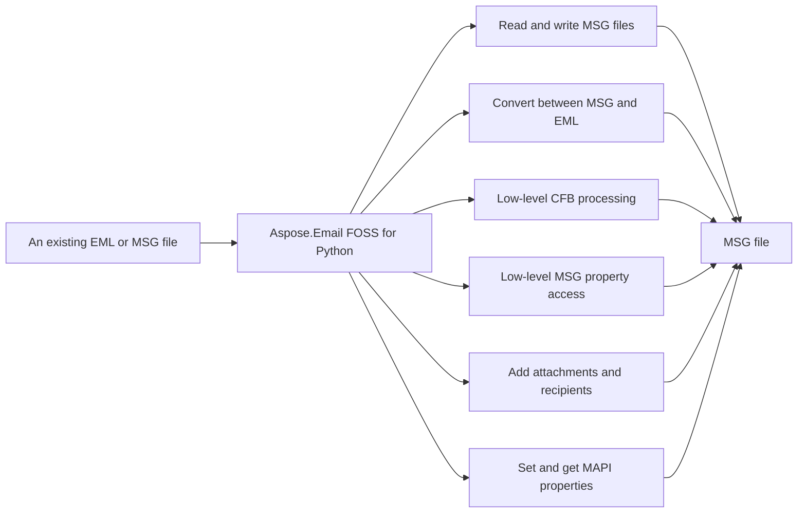

# Aspose.Email FOSS for Python

[](https://pypi.org/project/aspose-email-foss/) 

Aspose.Email FOSS for Python reads and writes `.eml` and `.msg` formats, and processes Compound File Binary (CFB) structures. It converts messages between the `.msg` format and Python's email message handling, and provides low-level CFB readers and writers alongside a high-level `MapiMessage` API for creating, editing, and saving messages. It supports reading `.txt` attachments as part of message processing. The library requires Python >=3.10 and has no external dependencies.

Aspose.Email FOSS for Python is a free, open-source, MIT-licensed, pure-Python library for
deterministic Compound File Binary (CFB) and Outlook `.msg` message processing — no Microsoft
Outlook installation, COM interop, or compiled extensions required. It provides low-level CFB and
MSG readers/writers alongside a high-level, mutable `MapiMessage` API for creating, editing, and
saving messages, including two-way conversion with Python's own
[`email.message.EmailMessage`](https://docs.python.org/3/library/email.message.html#email.message.EmailMessage).

## Navigation

- [At a Glance](#at-a-glance)
- [Key Capabilities](#key-capabilities)
- [Installation](#installation)
- [Dependencies](#dependencies)
- [Quick Start](#quick-start)
- [Additional Examples](#additional-examples)
- [API Reference](#api-reference)
- [Scope and Limitations](#scope-and-limitations)

## At a Glance



## Key Capabilities

- **Read and write MSG files.** It reads and writes Outlook MSG files using the `MapiMessage` class, which loads messages from a file with `from_file()` and saves them with `save()`, exposing subject, body, and `body_html` properties, and supports conversion to and from EmailMessage objects.
- **Convert between MSG and EML.** It converts between MSG and EML formats by transforming `MapiMessage` objects to EmailMessage instances via `to_email_message()` and writing them as EML bytes, and reconstructing `MapiMessage` objects from EML files using `from_email_message()`.
- **Low-level CFB processing.** It processes Compound File Binary (CFB) containers at a low level using `CFBReader` to read streams and storages from files or bytes, and `CFBWriter` to serialize `CFBDocument` structures built with `CFBStorage` and `CFBStream`.
- **Low-level MSG property access.** It provides low-level MSG property access through `MsgReader`, which parses top-level and subobject property streams, exposes the underlying CFB structure via `cfb_reader`, and supports iteration over attachment and recipient storages.
- **Add attachments and recipients.** It adds attachments and recipients to messages using `MapiMessage.add_recipient()` and `MapiMessage.add_attachment()`, supporting both regular file attachments and embedded-message attachments via `MapiAttachment`.
- **Set and get MAPI properties.** It sets and gets MAPI properties on messages using `MapiMessage.set_property()` and `MapiMessage.get_property_value()` with `PropertyId` constants such as SENDER_NAME and SENDER_EMAIL_ADDRESS, and supports named properties via `MapiNamedProperty`.

- Outlook-oriented compatibility defaults — a default `SMTP` sender address type, one-off
  recipient entry IDs, and search keys — are applied automatically when creating a new message
  from scratch, so authored messages interoperate cleanly with real Outlook clients.

## Installation

Install the published package from PyPI (`aspose-email-foss`, version 26.3):

```bash
pip install aspose-email-foss
```

To work from a source checkout instead, install the clone with pip:

```bash
git clone https://github.com/aspose-email-foss/Aspose.Email-FOSS-for-Python.git
cd Aspose.Email-FOSS-for-Python
pip install .
```

Verify the install:

```bash
python -c "import aspose.email_foss"
```

The package declares `python_requires` as `>=3.10`.

## Dependencies

### Required Package Dependencies

No required third-party package dependencies; in `pyproject.toml`, no `project.dependencies` is declared.

### Native and System Requirements

- Requires Python 3.10 or later (`python_requires=">=3.10"` in `pyproject.toml`).

## Quick Start

The first example reads and prints the subject of an MSG file using the `MapiMessage` class.

```python
from aspose.email_foss import msg

with msg.MapiMessage.from_file("sample.msg") as message:
    print(message.subject)
```

The second example creates a new MSG file with sender, recipient, and attachment properties, then converts it to an EML file.

```python
from aspose.email_foss import msg

message = msg.MapiMessage.create("Hello", "Body")
message.set_property(msg.PropertyId.SENDER_NAME, "Alice")
message.set_property(msg.PropertyId.SENDER_EMAIL_ADDRESS, "alice@example.com")
message.add_recipient("bob@example.com", display_name="Bob")
message.add_attachment("note.txt", b"abc", mime_type="text/plain")
message.save("hello.msg")

with msg.MapiMessage.from_file("hello.msg") as loaded:
    email_message = loaded.to_email_message()
    with open("hello.eml", "wb") as target:
        target.write(email_message.as_bytes())
```

## Additional Examples

The following workflows demonstrate converting between MSG and EML formats, and building a CFB container directly.

### Convert MSG to EML Using `from_file` And `to_email_message`

```python
from aspose.email_foss import msg

with msg.MapiMessage.from_file("message.msg") as message:
    email_message = message.to_email_message()

with open("message.eml", "wb") as target:
    target.write(email_message.as_bytes())
```

<details>
<summary>View Additional Examples</summary>

### Convert EML to MSG Using `BytesParser` And `from_email_message`

```python
from email import policy
from email.parser import BytesParser

from aspose.email_foss import msg

with open("message.eml", "rb") as source:
    email_message = BytesParser(policy=policy.default).parse(source)

message = msg.MapiMessage.from_email_message(email_message)
message.save("message.msg")
```

### Build a CFB Container from Scratch and Read a Stream Back

```python
from aspose.email_foss.cfb import CFBDocument, CFBReader, CFBStorage, CFBStream, CFBWriter, ROOT_ENTRY_NAME

root = CFBStorage(ROOT_ENTRY_NAME)
root.add_stream(CFBStream("Summary", b"hello"))

data = CFBWriter.to_bytes(CFBDocument(root=root, major_version=3))
reader = CFBReader(data)
entry = reader.resolve_path(["Summary"])
print(reader.get_stream_data(entry.stream_id))
```

Create a message and save it as both MSG and EML:

Construct a CFB container from scratch, write it to bytes, and read a stream back (mirrors the
library's own round-trip test suite):

</details>

## API Reference

Aspose.Email FOSS for Python provides classes to read and write Microsoft Outlook MSG and MAPI messages, as well as compound file binary (CFB) structures. The `email_foss.msg.MapiMessage` class serves as the primary entry point for working with MAPI messages, while `email_foss.msg.MsgReader` and `email_foss.msg.MsgWriter` handle MSG file parsing and serialization, and `email_foss.cfb.CFBReader` and `email_foss.cfb.CFBWriter` provide low-level access to CFB containers.

The verified public surface has 30 types.

<details>
<summary>View the Complete Public API Surface</summary>

### Core API

| Class | Description |
| --- | --- |
| `CFBDocument` | Mutable Compound File Binary (CFB) document description. |
| `CFBError` | Raised for malformed or unsupported Compound File Binary (CFB) content. |
| `CFBReader` | Reusable reader for Compound File Binary (CFB) containers. |
| `CFBStorage` | Mutable storage node used by the CFB writer. |
| `CFBStream` | Mutable stream node used by the CFB writer. |
| `CFBWriter` | Deterministic serializer for Compound File Binary (CFB) containers. |
| `DirectoryEntry` | Fixed-size directory record for one storage/stream object and its tree links. |
| `Header` | Header record at file offset 0 defining Compound File Binary (CFB) geometry and allocation chain entry points. |
| `MapiAttachment` | Mutable attachment object. |
| `MapiMessage` | Mutable high-level MSG object with MSG and EmailMessage conversion support. |
| `MapiNamedProperty` | Identifier for a named MAPI property. |
| `MapiProperty` | Logical MAPI property with optional named-property identity. |
| `MapiRecipient` | Mutable recipient object. |
| `MsgDocument` | Mutable MSG document model that can be serialized through the CFB writer. |
| `MsgError` | Raised for malformed or unsupported MSG structures. |
| `MsgReader` | Normative top-level MSG containment and stream requirements for container traversal. |
| `MsgStorage` | Mutable MSG storage node with role classification and parsed property-stream metadata. |
| `MsgStream` | Mutable MSG stream node with raw bytes and CFB metadata. |
| `MsgWriter` | Serializer that writes a MsgDocument into a CFB-backed .msg payload. |
| `PropertyEntryFixedLength` | Fixed-length property stream entry containing property tag, flags, and inline 8-byte value payload. |
| `PropertyStreamHeaderSubobject` | Property stream header used in recipient and attachment storages, containing only reserved bytes. |
| `PropertyStreamHeaderTopLevel` | Top-level property stream header containing next-id counters and counts for recipients and attachments. |
| `StorageLayout` | Naming and containment rules for recipient, attachment, embedded message, and nameid storages. |
| `MapiPropertyCollection` | The MapiPropertyCollection class represents a collection of MAPI properties associated with a MapiMessage object. |

#### Enumerations

| Enumeration | Description |
| --- | --- |
| `DirectoryColorFlag` | Stores the red-black tree color used by directory sibling links. |
| `DirectoryObjectType` | Classifies the directory entry payload as unallocated, storage, stream, or root storage. |
| `SectorMarker` | Special FAT marker values reserved for sector allocation metadata. |
| `CommonMessagePropertyId` | Common MAPI property identifiers used by the MSG reader/writer for core message semantics. |
| `PropertyId` | Common property identifiers paired with their default MAPI property types. |
| `PropertyTypeCode` | MAPI property type codes used in MSG property tags and value stream names. |

#### Detailed Member Reference

### MapiMessage

The `email_foss.msg.MapiMessage` class represents a MAPI message and supports creation from files, email messages, or MSG documents, as well as conversion to various formats including email messages, bytes, and MSG documents, with methods such as create, `from_file`, `from_email_message`, `to_email_message`, `to_bytes`, and save.

### MsgReader

The `email_foss.msg.MsgReader` class parses MSG files and exposes their internal CFB structure through the `cfb_reader` property, providing access to message properties, recipients, and attachments via methods such as `from_file`, `parse_top_level_property_stream`, `iter_recipient_storages`, and `iter_attachment_storages`.

- `parse_message_property_stream`: Read the property stream in the top level or an embedded-message storage.
- `parse_subobject_property_stream`: Read the property stream in recipient/attachment storage and decode fixed-length entries.
- `parse_subobject_property_stream_data`: Decode recipient/attachment property stream header and fixed-length entries.
- `parse_top_level_property_stream`: Decode top-level property stream header and fixed-length entries.

### MsgWriter

The `email_foss.msg.MsgWriter` class serializes `MapiMessage` instances to MSG files or bytes, supporting output via `write_file` and `to_bytes` methods.

### CFBReader

The `email_foss.cfb.CFBReader` class provides low-level access to compound file binary structures, offering methods such as `from_file`, `get_entry`, `get_stream_data`, `iter_streams`, `iter_storages`, and `resolve_path` to navigate and extract data from CFB containers.

- `iter_tree`: Yield a depth-first tree traversal as (depth, entry) tuples.
- `resolve_path`: Resolve a storage/stream path by exact directory-entry names.

### CFBWriter

The `email_foss.cfb.CFBWriter` class enables creation and modification of compound file binary structures, supporting operations such as adding streams and storages, and writing the final structure to a file or bytes.

</details>

## Scope and Limitations

Aspose.Email FOSS for Python reads and writes local CFB and MSG files, and converts to/from EML through Python's own email package. It does not connect to mail servers, does not parse or generate TNEF, has no dedicated calendar/appointment API, and does not implement direct `.eml` file parsing by itself.

- The library does not connect to mail servers and provides no IMAP, SMTP, or POP3 support.
- TNEF (Transport Neutral Encapsulation Format, `winmail.dat`) is not parsed or generated.
- There is no dedicated calendar/appointment API, though calendar-specific MAPI properties can still be accessed generically through `set_property()` and `get_property_value()`.
- Direct `.eml` file parsing is not implemented by this library itself; EML support goes through `MapiMessage.from_email_message()` and `to_email_message()` together with Python's own `email.parser` and `email.message.EmailMessage`, not a dedicated `load_from_eml()` method.

This project is licensed under the [MIT License](LICENSE). The MIT License permits use, copying,
modification, distribution, sublicensing, and commercial use, provided its copyright and
permission notice are retained. The software is provided without warranty.
