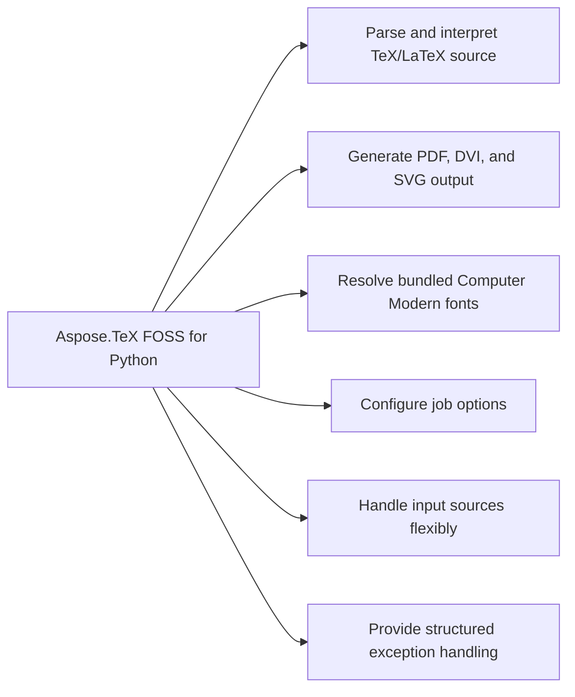

# Aspose.TeX FOSS for Python


It parses real `TeX` and LaTeX source through its own interpreter and writes the result to PDF, DVI, or SVG output, resolving bundled Computer Modern fonts and handling input sources via dedicated modules.

Aspose.TeX FOSS for Python is a free, open-source, pure-Python library for TeX/LaTeX processing.
It parses real TeX/LaTeX source through its own from-scratch interpreter and produces PDF, DVI,
and SVG output, with no external TeX installation required — Computer Modern fonts ship bundled
inside the package.

## Navigation

- [At a Glance](#at-a-glance)
- [Key Capabilities](#key-capabilities)
- [Installation](#installation)
- [Dependencies](#dependencies)
- [Quick Start](#quick-start)
- [API Reference](#api-reference)
- [Scope and Limitations](#scope-and-limitations)

## At a Glance



## Key Capabilities

- **Parse and interpret TeX/LaTeX source.** It parses and interprets real `TeX`/LaTeX source through TeXJob, driving the tokenizer, macro expander, and mode-machine dispatch that process control sequences, groups, and paragraph text.
- **Generate PDF, DVI, and SVG output.** It generates PDF, DVI, and SVG output by writing finished pages through PdfDevice, DviDevice, or SvgDevice, passing a Path for file output or leaving the destination empty for in-memory bytes.
- **Resolve bundled Computer Modern fonts.** It resolves font metrics and glyph outlines from the bundled Computer Modern tfm and pfb data, independent of the output format a job targets.
- **Configure job options.** It configures a job with TeXOptions, supporting job name, magnification, and additional search paths for input files.
- **Handle input sources flexibly.** It handles input sources flexibly by accepting content from files or in-memory buffers.
- **Provide structured exception handling.** It provides structured exception handling through `AsposeTeXError`, `InputError`, `EngineError`, and `FontError`, allowing callers to distinguish and respond to specific failure modes.

## Installation

The package `aspose-tex` is not yet published on PyPI (package registry: distribution not found).

To work from a source checkout instead, install the clone with pip:

```bash
git clone https://github.com/aspose-tex-foss/Aspose.TeX-FOSS-for-Python.git
cd Aspose.TeX-FOSS-for-Python
pip install .
```

The package declares `python_requires` as `>=3.10`.

## Dependencies

### Required Package Dependencies

No required third-party package dependencies; in `pyproject.toml`, no `project.dependencies` is declared.

### Native and System Requirements

- Requires Python 3.10 or later (`python_requires=">=3.10"` in `pyproject.toml`).

### Development Dependencies

- `build>=1.2` (extra `dev`)
- `pytest>=7.4` (extra `dev`)
- `ruff>=0.4` (extra `dev`)
- `tomli>=2.0; python_version < '3.11'` (extra `dev`)
- `twine>=5.0` (extra `dev`)

## Quick Start

To enable logging for Aspose.TeX FOSS for Python, configure the logging module and set the logger level for the `aspose_tex` module to INFO.

```python
import logging

logging.basicConfig(level=logging.INFO)
logging.getLogger("aspose_tex").setLevel(logging.INFO)
```

- `pytest` (>=7.4), `ruff` (>=0.4), `build` (>=1.2), and `twine` (>=5.0) — the test runner,
  linter, and packaging/publishing tools used for development; `tomli` (>=2.0) is an additional
  dev dependency on Python versions before 3.11. None of these are required to use the library
  itself.

## API Reference

The Aspose.TeX FOSS for Python package provides the `aspose_tex` module as its primary entry point, which exposes the TeXJob class for processing `TeX` input and the `aspose_tex.exceptions` module for error handling. The TeXJob class combines an InputSource, an OutputDevice, and TeXOptions into a runnable job, while the exceptions module defines a hierarchy of error types for `TeX` processing failures.

The verified public surface has 4 types.

<details>
<summary>View the Complete Public API Surface</summary>

### Core API

| Class | Description |
| --- | --- |
| `AsposeTeXError` | Base exception for all aspose_tex errors. |
| `EngineError` | Raised for TeX engine errors (infinite recursion, undefined register, etc.). |
| `FontError` | Raised for font-related failures (TFM not found, corrupt file, invalid char, etc.). |
| `InputError` | Raised for input reading failures (file not found, stack underflow, etc.). |

#### Detailed Member Reference

### aspose_tex

The `aspose_tex` module serves as the main entry point for `TeX` processing, exposing the TeXJob class that combines an InputSource, an OutputDevice (PdfDevice, DviDevice, or SvgDevice), and TeXOptions into a runnable job.

### exceptions

The `aspose_tex.exceptions` module defines the exception hierarchy for the package, including `AsposeTeXError` as the base exception, `InputError` for input reading failures, `EngineError` for `TeX` engine errors, and `FontError` for font-related failures.

| Class | Description |
|---|---|
| `DviDevice` | DVI output device — wraps `DviWriter`. |
| `OutputDevice` | Abstract base class for all output devices. |
| `PdfDevice` | PDF output device — wraps `PdfWriter`. |
| `SvgDevice` | SVG output device — wraps `SvgWriter`. |
| `TeXJob` | Main entry point for processing TeX input. |
| `TeXOptions` | Configuration for a TeX processing job — job name, magnification, and font/format search paths. |

- **[Getting started guide](https://docs.aspose.org/tex/python/)** — installation, walkthroughs, and feature guides for this library.
- **[How-to guides & FAQ](https://kb.aspose.org/tex/python/)** — task-focused answers for common TeX/LaTeX-processing questions.
- **[Full API reference](https://reference.aspose.org/tex/python/)** — the complete, browsable reference for the public API surface (the [API reference](#api-reference) section above covers the essentials).
- Found a bug or have a feature request? [Open an issue](https://github.com/aspose-tex-foss/Aspose.TeX-FOSS-for-Python/issues) on GitHub.

Install the development extras and run the test suite:

```bash
pip install -e ".[dev]"
pytest
```

68 test modules cover the tokenizer, macro expander, box and page builder, font subsystem, and
each output writer, including an automated end-to-end suite that compiles fixture documents
through the public `TeXJob` API and compares the result against committed MiKTeX-generated DVI
baselines — semantically (page count, glyph stream, line and rule positions, font metadata), not
byte-for-byte, so the suite has no MiKTeX dependency at test time. Lint with:

```bash
ruff check .
```

The package registers a `logging.NullHandler` on the `aspose_tex` logger, so integrating
applications can opt into standard Python logging without unexpected default-handler warnings.

</details>

## Scope and Limitations

Aspose.TeX FOSS for Python reads and writes `TeX` documents to PDF, DVI, and SVG output formats using the `aspose_tex` package, supporting Python 3.10 and above with version 26.5.

- This is a Pre-Alpha release: the core engine and public API are under active development, and interfaces may change between releases; the default `load_format`=plain option (`TeXOptions`) does not yet fully load Knuth's Plain `TeX` macro cascade in this milestone — every example above passes `load_format`=False for a runnable, from-primitives document; math-mode content ($...$, $$...$$) is parsed through a shell surface but not laid out — no math atoms, fractions, or radicals reach the page; table alignment (halign, valign) is registered but not implemented — invoking either raises `NotImplementedError`; automatic hyphenation is not active: patterns and hyphenation are parsed and discarded, and the bundled hyphenation/ pattern directory is currently empty; hyphenchar and the hyphenation-penalty parameters are supported but have no pattern data to apply; named file-stream I/O (openin, openout, closein, closeout, read) raises `NotImplementedError` — only write 16 (message log), write -1 (silent log), message, and errmessage are implemented; ifeof always evaluates false.
- The import path `aspose_tex` exposes the core module, but automatic hyphenation is not active: patterns and hyphenation are parsed and discarded, and the bundled hyphenation/ pattern directory is currently empty; hyphenchar and the hyphenation-penalty parameters are supported but have no pattern data to apply.
- Table alignment (halign, valign) is registered but not implemented — invoking either raises `NotImplementedError`.
- Automatic hyphenation is not active: patterns and hyphenation are parsed and discarded, and the bundled hyphenation/ pattern directory is currently empty; hyphenchar and the hyphenation-penalty parameters are supported but have no pattern data to apply.
- Named file-stream I/O (openin, openout, closein, closeout, read) raises `NotImplementedError` — only write 16 (message log), write -1 (silent log), message, and errmessage are implemented; ifeof always evaluates false.
- Math-mode content ($...$, $$...$$) is parsed through a shell surface but not laid out — no math atoms, fractions, or radicals reach the page.
