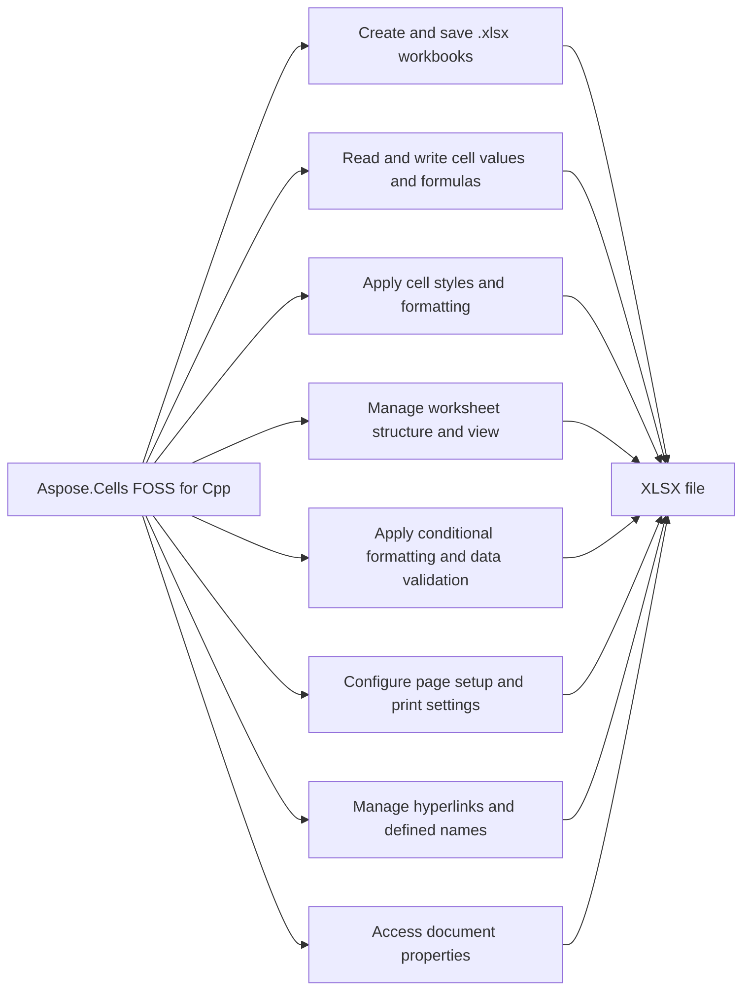

# Aspose.Cells FOSS for Cpp


Aspose.Cells FOSS for Cpp reads and writes Excel `.xlsx` workbooks. It exposes an Aspose.Cells-compatible API surface for common XLSX scenarios — the same `Workbook`, `Worksheet`, and `Cell` object shape used by Aspose's commercial spreadsheet products — built as a dependency-free, header-and-source C++17 library with no external runtime dependencies.

Aspose.Cells FOSS for C++ is a free, open-source, MIT-licensed C++ library for creating, loading,
editing, and saving Excel `.xlsx` workbooks without requiring Microsoft Excel. It exposes an
Aspose.Cells-compatible API surface for common XLSX scenarios — the same `Workbook`, `Worksheet`,
and `Cell` object shape used by Aspose's commercial spreadsheet products — built as a
dependency-free, header-and-source C++17 library with no external runtime dependencies.

## Navigation

- [At a Glance](#at-a-glance)
- [Key Capabilities](#key-capabilities)
- [Installation](#installation)
- [Dependencies](#dependencies)
- [Quick Start](#quick-start)
- [API Reference](#api-reference)
- [Scope and Limitations](#scope-and-limitations)

## At a Glance



## Key Capabilities

- **Create and save .xlsx workbooks.** It creates blank workbooks with the default workbook constructor and saves them to `.xlsx` files using `Workbook.Save`, while `WorkbookSaveException` reports errors during save operations.
- **Read and write cell values and formulas.** It writes cell values with `Cell.PutValue` for strings, integers, doubles, bools, and `DateTime`, reads them via `CellValue` returned by `Cell.GetValue`, and handles formulas with `Cell.SetFormula` and `Cell.GetFormula`, raising `FormulaException` for invalid formula text.
- **Apply cell styles and formatting.** It applies cell styles using `Cell.GetStyle` and `Cell.SetStyle`, where `Style` bundles `Font` (bold, color), `FillPattern`, `Color` for foreground and background, `Borders`, alignment, and text wrap, and supports cloning and number format patterns.
- **Manage worksheet structure and view.** It manages worksheet visibility with `VisibilityType` (visible, hidden, very hidden), gridline and header visibility, right-to-left layout, and protection via `WorksheetProtection` on `Worksheet`.
- **Apply conditional formatting and data validation.** It applies conditional formatting through `ConditionalFormattingCollection` and `FormatCondition`, and manages data validation with `ValidationCollection` and `Validation` scoped to cell ranges.
- **Configure page setup and print settings.** It configures page setup and print settings using `PageSetup`, supporting `PaperSizeType`, `PageOrientationType`, margins, scaling, print area, print titles, headers, footers, and page breaks.
- **Manage hyperlinks and defined names.** It attaches hyperlinks to cell ranges via `HyperlinkCollection` and `Hyperlink` for external, internal, or mailto links, and manages workbook- or sheet-scoped named ranges with `DefinedNameCollection` and `DefinedName`.
- **Access document properties.** It accesses core and extended document metadata through `WorkbookProperties`, `DocumentProperties`, and `ExtendedDocumentProperties` exposed by `Workbook.GetProperties` and `Workbook.GetDocumentProperties`.

## Installation

The library is published on NuGet as `Aspose.Cells.Cpp.FOSS`.

To work from a source checkout instead, configure the clone with cmake:

```bash
git clone https://github.com/aspose-cells-foss/Aspose.Cells-FOSS-for-Cpp.git
cd Aspose.Cells-FOSS-for-Cpp
cmake -S . -B build
```

## Dependencies

### Required Package Dependencies

No required third-party package dependencies; in `Aspose.Cells.Foss.Cpp/CMakeLists.txt`, no dependency is on the library target's public link interface, so a consumer links nothing beyond the library itself.

### Native and System Requirements

- Requires C++ `17` (`CMAKE_CXX_STANDARD` in `Aspose.Cells.Foss.Cpp/CMakeLists.txt`).
- Requires CMake 3.16 or later (`cmake_minimum_required` in `Aspose.Cells.Foss.Cpp/CMakeLists.txt`).

## Quick Start

This example creates a workbook, names the first worksheet Products, writes product names and prices into cells, adds a SUM formula for the total, applies a styled header, and saves the file as `products.xlsx`.

```cpp
#include "aspose/cells_foss/Workbook.h"
#include "aspose/cells_foss/WorksheetCollection.h"
#include "aspose/cells_foss/Worksheet.h"
#include "aspose/cells_foss/Cell.h"
#include "aspose/cells_foss/Style.h"
#include "aspose/cells_foss/Color.h"
#include "aspose/cells_foss/Font.h"

using namespace Aspose::Cells_FOSS;

int main() {
    Workbook workbook;
    Worksheet& sheet = workbook.GetWorksheets()[0];

    sheet.SetName("Products");
    sheet.GetCells()["A1"].PutValue("Product");
    sheet.GetCells()["B1"].PutValue("Price");
    sheet.GetCells()["A2"].PutValue("Apple");
    sheet.GetCells()["B2"].PutValue(2.99);
    sheet.GetCells()["A3"].PutValue("Orange");
    sheet.GetCells()["B3"].PutValue(1.99);
    sheet.GetCells()["B4"].SetFormula("=SUM(B2:B3)");

    Style headerStyle = sheet.GetCells()["A1"].GetStyle();
    Font font;
    font.SetBold(true);
    font.SetColor(Color::FromArgb(255, 255, 255, 255));
    headerStyle.SetFont(font);
    headerStyle.SetPattern(FillPattern::Solid);
    headerStyle.SetForegroundColor(Color::FromArgb(255, 34, 120, 212));
    sheet.GetCells()["A1"].SetStyle(headerStyle);
    sheet.GetCells()["B1"].SetStyle(headerStyle);

    workbook.Save("products.xlsx");
    return 0;
}
```

Aspose.Cells FOSS for C++ is published on NuGet as `Aspose.Cells.Cpp.FOSS`, but the package
ships prebuilt static libraries for **Windows only** (`lib/win_x86`, `lib/win_x86_64`) built with
the MSVC `v14x` toolset — its own bundled `aspose.cells.cpp.foss.targets` file errors the build
for any other toolset or platform. There are no Linux/macOS binaries in the package.

```bash
nuget install Aspose.Cells.Cpp.FOSS
```

In an MSBuild-based Visual Studio project:

```xml
<PackageReference Include="Aspose.Cells.Cpp.FOSS" Version="26.4.1" />
```

Or in a CMake project on Windows, point at the package's own bundled config, which defines an
`Aspose.Cells.Cpp.FOSS` imported target:

```cmake
set(aspose.cells.cpp.foss_DIR "path/to/packages/Aspose.Cells.Cpp.FOSS.26.4.1/build/native/Aspose.Cells.Cpp.FOSS")
find_package(aspose.cells.cpp.foss CONFIG REQUIRED)
target_link_libraries(your_target PRIVATE Aspose.Cells.Cpp.FOSS)
```

Clone the repository and run the GTest-based test suite from the dedicated test project:

```bash
git clone https://github.com/aspose-cells-foss/Aspose.Cells-FOSS-for-Cpp.git
cd Aspose.Cells-FOSS-for-Cpp/Aspose.Cells.Foss.Cpp.Tests
cmake -S . -B build
cmake --build build
ctest --test-dir build --output-on-failure
```

## API Reference

Aspose.Cells FOSS for Cpp provides the `Aspose.Cells_FOSS.Workbook` class as the root entry point for loading, manipulating, and saving spreadsheet files, with `Aspose.Cells_FOSS.Worksheet` and its `Aspose.Cells_FOSS.Cells` collection forming the primary object graph for cell-level operations.

The verified public surface has 195 types.

<details>
<summary>View the Complete Public API Surface</summary>

### Core API

| Class | Description |
| --- | --- |
| `AutoFilter` | Aspose.Cells_FOSS.AutoFilter represents an auto filter applied to a range of cells in a worksheet. |
| `AutoFilterColorFilter` | Aspose.Cells_FOSS.AutoFilterColorFilter represents a color filter used in an auto filter. |
| `AutoFilterCustomFilter` | Aspose.Cells_FOSS.AutoFilterCustomFilter represents a custom filter condition in an auto filter. |
| `AutoFilterCustomFilterCollection` | Aspose.Cells_FOSS.AutoFilterCustomFilterCollection is a collection of custom filter conditions for an auto filter. |
| `AutoFilterCustomFilterCollection.Iterator` | Aspose.Cells_FOSS.AutoFilterCustomFilterCollection.Iterator provides iteration over the custom filter conditions in the collection. |
| `AutoFilterDynamicFilter` | Aspose.Cells_FOSS.AutoFilterDynamicFilter represents a dynamic filter used in an auto filter. |
| `AutoFilterSortCondition` | Aspose.Cells_FOSS.AutoFilterSortCondition represents a sort condition used in an auto filter. |
| `AutoFilterSortConditionCollection` | Aspose.Cells_FOSS.AutoFilterSortConditionCollection is a collection of sort conditions for an auto filter. |
| `AutoFilterSortConditionCollection.Iterator` | Aspose.Cells_FOSS.AutoFilterSortConditionCollection.Iterator provides iteration over the sort conditions in the collection. |
| `AutoFilterSortState` | Aspose.Cells_FOSS.AutoFilterSortState represents the sort state of an auto filter. |
| `AutoFilterSupport` | Aspose.Cells_FOSS.AutoFilterSupport provides support for auto filtering operations. |
| `AutoFilterTop10` | Aspose.Cells_FOSS.AutoFilterTop10 represents a top 10 filter used in an auto filter. |
| `Border` | Aspose.Cells_FOSS.Border represents a border of a cell. |
| `Borders` | Aspose.Cells_FOSS.Borders represents all borders of a cell. |
| `CalculationProperties` | Aspose.Cells_FOSS.CalculationProperties holds calculation settings for a workbook. |
| `Cell` | Aspose.Cells_FOSS.Cell represents a cell in a worksheet. |
| `CellArea` | Aspose.Cells_FOSS.CellArea represents a rectangular area of cells. |
| `CellFormatValue` | Aspose.Cells_FOSS.CellFormatValue represents the formatted value of a cell. |
| `CellValue` | Aspose.Cells_FOSS.CellValue represents the value stored in a cell. |
| `Cells` | Aspose.Cells_FOSS.Cells represents the collection of cells in a worksheet. |
| `CellsException` | Aspose.Cells_FOSS.CellsException is raised when an error occurs during cell operations. |
| `Color` | Aspose.Cells_FOSS.Color represents a color used in formatting. |
| `Column` | Aspose.Cells_FOSS.Column represents a column in a worksheet. |
| `ColumnCollection` | Aspose.Cells_FOSS.ColumnCollection is a collection of columns in a worksheet. |
| `ConditionalFormattingCollection` | Aspose.Cells_FOSS.ConditionalFormattingCollection is a collection of conditional formatting rules in a worksheet. |
| `AlignmentValue` | Aspose.Cells_FOSS.Core.AlignmentValue specifies the alignment of text in a cell. |
| `AutoFilterColorFilterModel` | Aspose.Cells_FOSS.Core.AutoFilterColorFilterModel provides a model for color filter settings in an auto filter. |
| `AutoFilterCustomFilterModel` | Aspose.Cells_FOSS.Core.AutoFilterCustomFilterModel provides a model for custom filter settings in an auto filter. |
| `AutoFilterDynamicFilterModel` | Aspose.Cells_FOSS.Core.AutoFilterDynamicFilterModel provides a model for dynamic filter settings in an auto filter. |
| `AutoFilterModel` | Aspose.Cells_FOSS.Core.AutoFilterModel provides a model for auto filter settings. |
| `AutoFilterSortConditionModel` | Aspose.Cells_FOSS.Core.AutoFilterSortConditionModel provides a model for sort condition settings in an auto filter. |
| `AutoFilterSortStateModel` | Aspose.Cells_FOSS.Core.AutoFilterSortStateModel provides a model for sort state settings in an auto filter. |
| `AutoFilterTop10Model` | Aspose.Cells_FOSS.Core.AutoFilterTop10Model provides a model for top 10 filter settings in an auto filter. |
| `BorderSideValue` | Aspose.Cells_FOSS.Core.BorderSideValue specifies a side of a cell border. |
| `BordersValue` | Aspose.Cells_FOSS.Core.BordersValue represents the border settings of a cell. |
| `CalculationPropertiesModel` | Aspose.Cells_FOSS.Core.CalculationPropertiesModel provides a model for workbook calculation settings. |
| `CellAddress` | Aspose.Cells_FOSS.Core.CellAddress represents the address of a cell. |
| `CellRecord` | Aspose.Cells_FOSS.Core.CellRecord represents a cell record containing its value, formula, style, and metadata. |
| `ColorValue` | Aspose.Cells_FOSS.Core.ColorValue represents a color using its red, green, blue, and alpha components. |
| `ColumnRangeModel` | Aspose.Cells_FOSS.Core.ColumnRangeModel defines a range of columns with properties such as width, hidden state, and style index. |
| `ConditionalFormattingModel` | Aspose.Cells_FOSS.Core.ConditionalFormattingModel holds conditional formatting rules applied to specific cell areas. |
| `CoreDocumentPropertiesModel` | Aspose.Cells_FOSS.Core.CoreDocumentPropertiesModel stores core document properties such as title, author, and creation date. |
| `DateSerialConverter` | Aspose.Cells_FOSS.Core.DateSerialConverter converts between date serial numbers and date values. |
| `DefinedNameModel` | Aspose.Cells_FOSS.Core.DefinedNameModel represents a defined name in a workbook with its reference and comment. |
| `DiagnosticBag` | Aspose.Cells_FOSS.Core.DiagnosticBag collects diagnostic entries generated during processing. |
| `DiagnosticEntry` | Aspose.Cells_FOSS.Core.DiagnosticEntry represents a single diagnostic message with severity and description. |
| `DocumentPropertiesModel` | Aspose.Cells_FOSS.Core.DocumentPropertiesModel provides access to both core and extended document properties. |
| `ExtendedDocumentPropertiesModel` | Aspose.Cells_FOSS.Core.ExtendedDocumentPropertiesModel stores extended document properties such as company and manager. |
| `FilterColumnModel` | Aspose.Cells_FOSS.Core.FilterColumnModel defines a filtered column in an AutoFilter range. |
| `FontValue` | Aspose.Cells_FOSS.Core.FontValue describes font attributes such as name, size, and color. |
| `FormatConditionModel` | Aspose.Cells_FOSS.Core.FormatConditionModel represents a single format condition within conditional formatting. |
| `HeaderFooterModel` | Aspose.Cells_FOSS.Core.HeaderFooterModel defines the header and footer content for a worksheet. |
| `HyperlinkModel` | Aspose.Cells_FOSS.Core.HyperlinkModel represents a hyperlink attached to a cell with display text and screen tip. |
| `MergeRegion` | Aspose.Cells_FOSS.Core.MergeRegion defines a merged cell region by its top-left and bottom-right coordinates. |
| `NumberFormatValue` | Aspose.Cells_FOSS.Core.NumberFormatValue specifies the number format string applied to a cell. |
| `PageMarginsModel` | Aspose.Cells_FOSS.Core.PageMarginsModel defines the page margins for printing a worksheet. |
| `PageSetupModel` | Aspose.Cells_FOSS.Core.PageSetupModel configures page setup options such as orientation, paper size, and print area. |
| `PrintOptionsModel` | Aspose.Cells_FOSS.Core.PrintOptionsModel controls print settings such as gridlines and draft quality. |
| `ProtectionValue` | Aspose.Cells_FOSS.Core.ProtectionValue specifies the protection settings for a worksheet or workbook. |
| `RowModel` | Aspose.Cells_FOSS.Core.RowModel represents a worksheet row with properties such as height and hidden state. |
| `SharedStringRepository` | Aspose.Cells_FOSS.Core.SharedStringRepository manages shared string entries used in the workbook. |
| `StyleRepository` | Aspose.Cells_FOSS.Core.StyleRepository stores and manages cell styles used in a workbook. |
| `StyleValue` | Aspose.Cells_FOSS.Core.StyleValue encapsulates all formatting attributes for a cell. |
| `ValidationModel` | Aspose.Cells_FOSS.Core.ValidationModel defines data validation rules for a range of cells. |
| `WorkbookModel` | Aspose.Cells_FOSS.Core.WorkbookModel represents a workbook containing worksheets and shared resources. |
| `WorkbookPropertiesModel` | Aspose.Cells_FOSS.Core.WorkbookPropertiesModel stores workbook-level properties such as calculation settings. |
| `WorkbookProtectionModel` | Aspose.Cells_FOSS.Core.WorkbookProtectionModel specifies protection settings for the entire workbook. |
| `WorkbookSettingsModel` | Aspose.Cells_FOSS.Core.WorkbookSettingsModel holds workbook-wide settings such as default font and precision. |
| `WorkbookViewModel` | Aspose.Cells_FOSS.Core.WorkbookViewModel defines the view settings for a workbook such as window state and zoom. |
| `WorksheetModel` | Represents a worksheet in a workbook and provides access to its cells, columns, rows, protection, view, and other properties. |
| `WorksheetProtectionModel` | Represents the protection settings for a worksheet, including password hash, algorithm name, and various permission flags. |
| `WorksheetViewModel` | Represents the view settings for a worksheet, such as gridlines, headers, and pane state. |
| `CoreDocumentProperties` | Represents the core document properties of a workbook, such as title, author, and keywords. |
| `DateTime` | Represents a date and time value used within the spreadsheet engine. |
| `DefinedName` | Represents a defined name in a workbook, which can refer to a cell, range, formula, or constant. |
| `DefinedNameCollection` | Represents a collection of defined names in a workbook. |
| `DefinedNameUtility` | Provides utility methods for working with defined names in a workbook. |
| `DisplayFormatSectionInfo` | Contains information about a section of a formatted display string. |
| `DisplayTextDateFormatSupport` | Provides support for date format patterns used in display text. |
| `DisplayTextFormatter` | Formats cell values into their display string representations. |
| `DisplayTextFormatterSupport` | Provides support for formatting cell values into display strings. |
| `DisplayTextLocaleSupport` | Provides locale-specific support for display text formatting. |
| `DocumentProperties` | Represents both core and extended document properties of a workbook. |
| `ExtendedDocumentProperties` | Represents the extended document properties of a workbook, such as company and manager. |
| `FillValue` | Represents the value used for a fill pattern in cell styling. |
| `FilterColumn` | Represents a filtered column in an AutoFilter range. |
| `FilterColumnCollection` | Represents a collection of filtered columns in an AutoFilter range. |
| `FilterColumnCollection.Iterator` | Provides an iterator over the filtered columns in a FilterColumnCollection. |
| `FilterValueCollection` | Represents a collection of filter values for a filtered column. |
| `Font` | Represents the font settings used in cell styling. |
| `FormatCondition` | Represents a conditional formatting rule applied to a range of cells. |
| `FormatConditionCollection` | Represents a collection of conditional formatting rules for a worksheet. |
| `FormulaException` | Represents an exception thrown when a formula error occurs. |
| `Hyperlink` | Represents a hyperlink in a worksheet. |
| `HyperlinkCollection` | Represents a collection of hyperlinks in a worksheet. |
| `IWarningCallback` | Defines a callback interface for receiving warnings during file processing. |
| `ValidationMessage` | Represents a validation message generated during workbook validation. |
| `WorkbookValidator` | Validates a workbook against defined rules and returns validation messages. |
| `InvalidFileFormatException` | Represents an exception thrown when a file format is invalid or unsupported. |
| `LoadDiagnostics` | Contains diagnostic information about issues encountered while loading a workbook. |
| `LoadIssue` | Represents a single issue encountered during file loading. |
| `LoadOptions` | Provides options for loading a workbook from a file or stream. |
| `NumberFormat` | NumberFormat represents a number format code used to format cell values in a spreadsheet. |
| `CaseInsensitiveEqual` | CaseInsensitiveEqual provides a case-insensitive equality comparison for string keys in packaging operations. |
| `CaseInsensitiveHash` | CaseInsensitiveHash computes a hash value for string keys in a case-insensitive manner for packaging operations. |
| `IPackageReader` | IPackageReader defines an interface for reading parts and relationships from a package structure. |
| `IPackageWriter` | IPackageWriter defines an interface for writing parts and relationships to a package structure. |
| `MissingPartException` | MissingPartException is raised when a required part is missing from a package during loading. |
| `PackageLoadContext` | PackageLoadContext provides context information used during the loading of a package model. |
| `PackageModel` | PackageModel represents the logical structure of a package, including its parts and relationships. |
| `PackagePartDescriptor` | PackagePartDescriptor describes a single part within a package, including its URI, content type, and category. |
| `PackageStructureException` | PackageStructureException is raised when a package's internal structure is invalid or unsupported. |
| `PackagingConventions` | PackagingConventions defines constants and rules for packaging formats used by Aspose.Cells FOSS for Cpp. |
| `RelationshipDescriptor` | RelationshipDescriptor describes a relationship between two parts in a package, including its type and target. |
| `RelationshipResolutionException` | RelationshipResolutionException is raised when a relationship target cannot be resolved during package loading. |
| `PageSetup` | PageSetup holds page layout settings for a worksheet, including margins, orientation, paper size, and print options. |
| `Row` | Row represents a single row in a worksheet and provides access to its cells and formatting. |
| `RowCollection` | RowCollection contains and manages all rows in a worksheet. |
| `SaveOptions` | SaveOptions provides configuration settings for saving a workbook in a specific format. |
| `Style` | Style defines the visual appearance of a cell, including font, border, fill, and alignment settings. |
| `StyleException` | StyleException is raised when an invalid style operation is attempted. |
| `StyleValueSanitizer` | StyleValueSanitizer ensures that style property values conform to supported limits and constraints. |
| `StylesheetLoadContext` | StylesheetLoadContext provides context information used during the loading of a stylesheet. |
| `StylesheetSaveContext` | StylesheetSaveContext provides context information used during the saving of a stylesheet. |
| `UnsupportedFeatureException` | UnsupportedFeatureException is raised when an operation attempts to use a feature not supported by Aspose.Cells FOSS for Cpp. |
| `Validation` | Validation defines data validation rules applied to a range of cells in a worksheet. |
| `ValidationCollection` | ValidationCollection contains and manages all data validation rules in a worksheet. |
| `WarningInfo` | WarningInfo contains details about a warning generated during workbook processing. |
| `Workbook` | Workbook represents an entire Excel workbook and provides access to its worksheets and properties. |
| `WorkbookLoadException` | WorkbookLoadException is raised when an error occurs while loading a workbook from a file or stream. |
| `WorkbookProperties` | WorkbookProperties holds global properties for a workbook, such as calculation settings and default style. |
| `WorkbookPropertySupport` | WorkbookPropertySupport indicates whether a specific workbook property is supported by Aspose.Cells FOSS for Cpp. |
| `WorkbookProtection` | WorkbookProtection provides methods to protect or unprotect a workbook structure and windows. |
| `WorkbookSaveException` | Represents an exception thrown when a workbook save operation fails. |
| `WorkbookSettings` | Provides settings for a workbook, including culture and date system configuration. |
| `WorkbookView` | Represents the view settings of a workbook, such as window position, size, and visibility options. |
| `Worksheet` | Represents a worksheet in a workbook, providing access to cells, formatting, protection, and other properties. |
| `WorksheetCollection` | Represents a collection of worksheets within a workbook. |
| `WorksheetDefinedNamesState` | Represents the state of defined names for a worksheet. |
| `WorksheetProtection` | Represents protection settings for a worksheet. |
| `XNamespace` | Represents an XML namespace used in workbook documents. |
| `XlsxDocumentProperties` | Represents document properties for an XLSX workbook. |
| `XlsxWorkbookArchiveHelpers` | Provides helper methods for working with XLSX workbook archives. |
| `XlsxWorkbookAutoFilter` | Represents auto filter settings for an XLSX workbook. |
| `XlsxWorkbookConditionalFormatting` | Represents conditional formatting settings for an XLSX workbook. |
| `XlsxWorkbookDefinedNames` | Represents defined names for an XLSX workbook. |
| `XlsxWorkbookHyperlinks` | Represents hyperlinks for an XLSX workbook. |
| `XlsxWorkbookPageSetup` | Represents page setup settings for an XLSX workbook. |
| `XlsxWorkbookProperties` | Represents workbook properties for an XLSX file. |
| `XlsxWorkbookSerializer` | Handles serialization of an XLSX workbook. |
| `XlsxWorkbookSerializerCommon` | Provides common functionality for XLSX workbook serialization. |
| `XlsxWorkbookStyles` | Represents styles for an XLSX workbook. |
| `XlsxWorkbookStylesValueHelpers` | Provides helper methods for working with XLSX workbook style values. |
| `XlsxWorkbookStylesXml` | Handles XML representation of styles for an XLSX workbook. |
| `XlsxWorkbookValidations` | Represents data validation settings for an XLSX workbook. |
| `XlsxWorkbookWorksheetProtection` | Represents worksheet protection settings for an XLSX workbook. |
| `XlsxWorkbookWorksheetViews` | Represents worksheet view settings for an XLSX workbook. |
| `SharedStringTableXmlMapper` | Maps shared string table data in XML format for workbook processing. |
| `StylesheetXmlMapper` | Maps stylesheet data in XML format for workbook processing. |
| `WorkbookXmlMapper` | Maps workbook data in XML format. |
| `WorksheetXmlMapper` | Maps worksheet data in XML format. |
| `XmlParsingException` | Represents an exception thrown during XML parsing. |
| `XmlAttribute` | Represents an XML attribute. |
| `XmlDocument` | Represents an XML document. |
| `XmlElement` | Represents an XML element. |
| `XmlNodeData` | Represents data for an XML node. |
| `ZipArchive` | Represents a ZIP archive used for workbook storage. |
| `ZipArchiveEntry` | Represents an entry within a ZIP archive. |

#### Enumerations

| Enumeration | Description |
| --- | --- |
| `BorderStyleType` | Aspose.Cells_FOSS.BorderStyleType specifies the style of a cell border. |
| `CellValueType` | Aspose.Cells_FOSS.CellValueType specifies the type of value stored in a cell. |
| `BorderStyle` | Aspose.Cells_FOSS.Core.BorderStyle specifies the style of a cell border. |
| `CellValueKind` | Aspose.Cells_FOSS.Core.CellValueKind indicates the type of value stored in a cell. |
| `DateSystem` | Aspose.Cells_FOSS.Core.DateSystem specifies the date system used for serial date values. |
| `Core.DiagnosticSeverity` | Aspose.Cells_FOSS.Core.DiagnosticSeverity indicates the severity level of a diagnostic entry. |
| `FillPatternKind` | Aspose.Cells_FOSS.Core.FillPatternKind specifies the fill pattern used in cell styling. |
| `HorizontalAlignment` | Aspose.Cells_FOSS.Core.HorizontalAlignment specifies the horizontal alignment of text in a cell. |
| `PageOrientation` | Aspose.Cells_FOSS.Core.PageOrientation specifies whether a page is printed in portrait or landscape orientation. |
| `SheetVisibility` | Aspose.Cells_FOSS.Core.SheetVisibility specifies whether a worksheet is visible, hidden, or very hidden. |
| `VerticalAlignment` | Aspose.Cells_FOSS.Core.VerticalAlignment specifies the vertical alignment of text in a cell. |
| `Cells_FOSS.DiagnosticSeverity` | Indicates the severity level of a diagnostic issue encountered during file processing. |
| `FillPattern` | Specifies the fill pattern used in cell styling. |
| `FilterOperatorType` | Specifies the operator type used in AutoFilter criteria. |
| `FormatConditionType` | Specifies the type of a conditional formatting rule. |
| `HorizontalAlignmentType` | Specifies the horizontal alignment of text in a cell. |
| `ValidationMessageSeverity` | Indicates the severity level of a validation message. |
| `LoadFormat` | Specifies the format of a file being loaded. |
| `OperatorType` | OperatorType specifies the comparison operator used in conditional formatting and validation rules. |
| `PageOrientationType` | PageOrientationType specifies the orientation of a page when printing or exporting a worksheet. |
| `PaperSizeType` | PaperSizeType specifies the paper size used when printing or exporting a worksheet. |
| `SaveFormat` | SaveFormat specifies the file format used when saving a workbook to disk. |
| `TargetModeType` | TargetModeType specifies whether a relationship target is internal to the package or external. |
| `ValidationAlertType` | ValidationAlertType specifies the style of alert shown when a user enters invalid data. |
| `ValidationType` | ValidationType specifies the type of data validation applied to a cell range. |
| `VerticalAlignmentType` | VerticalAlignmentType specifies the vertical alignment of text within a cell. |
| `VisibilityType` | VisibilityType specifies the visibility state of a worksheet, such as visible, hidden, or very hidden. |

#### Detailed Member Reference

### Workbook

The `Aspose.Cells_FOSS.Workbook` class loads spreadsheets from files or streams using `Aspose.Cells_FOSS.LoadOptions` and saves them using `Aspose.Cells_FOSS.SaveOptions`, exposing workbook-level properties via `Aspose.Cells_FOSS.WorkbookProperties`, document metadata via `Aspose.Cells_FOSS.DocumentProperties` and `Aspose.Cells_FOSS.ExtendedDocumentProperties`, and access to worksheets through `Aspose.Cells_FOSS.WorksheetCollection`; it raises `Aspose.Cells_FOSS.WorkbookLoadException` or `Aspose.Cells_FOSS.WorkbookSaveException` on load or save errors.

### Worksheet

The `Aspose.Cells_FOSS.Worksheet` class represents a single worksheet within a workbook, providing access to its cells via `Aspose.Cells_FOSS.Cells`, managing visibility through `Aspose.Cells_FOSS.VisibilityType`, supporting worksheet protection via `Aspose.Cells_FOSS.WorksheetProtection`, and exposing defined names state via `Aspose.Cells_FOSS.WorksheetDefinedNamesState` through the `Aspose.Cells_FOSS.WorksheetCollection`.

### Cell

The `Aspose.Cells_FOSS.Cell` class exposes individual cell data through `Aspose.Cells_FOSS.CellValue` and `Aspose.Cells_FOSS.CellFormatValue`, supports multiple value types via `Aspose.Cells_FOSS.CellValueType`, and allows formatting with `Aspose.Cells_FOSS.Style`, `Aspose.Cells_FOSS.Font`, `Aspose.Cells_FOSS.Color`, `Aspose.Cells_FOSS.FillPattern`, and `Aspose.Cells_FOSS.NumberFormat`, raising `Aspose.Cells_FOSS.FormulaException` for formula errors.

### Cells

The `Aspose.Cells_FOSS.Cells` class provides access to all cells in a worksheet, supporting row and column collections via `Aspose.Cells_FOSS.RowCollection` and `Aspose.Cells_FOSS.ColumnCollection`, and enabling operations on cell ranges defined by `Aspose.Cells_FOSS.CellArea`, `Aspose.Cells_FOSS.Row`, and `Aspose.Cells_FOSS.Column`.

### Style

The `Aspose.Cells_FOSS.Style` class controls cell appearance through font settings via `Aspose.Cells_FOSS.Font`, color management via `Aspose.Cells_FOSS.Color`, fill patterns via `Aspose.Cells_FOSS.FillPattern`, number formatting via `Aspose.Cells_FOSS.NumberFormat`, and alignment via `Aspose.Cells_FOSS.HorizontalAlignmentType` and `Aspose.Cells_FOSS.VerticalAlignmentType`, with border styling provided by `Aspose.Cells_FOSS.Borders` and `Aspose.Cells_FOSS.Border`.

### ConditionalFormattingCollection

The `Aspose.Cells_FOSS.ConditionalFormattingCollection` class manages conditional formatting rules via `Aspose.Cells_FOSS.FormatConditionCollection` and `Aspose.Cells_FOSS.FormatCondition`, supporting condition types via `Aspose.Cells_FOSS.FormatConditionType` and comparison operators via `Aspose.Cells_FOSS.OperatorType`.

### ValidationCollection

The `Aspose.Cells_FOSS.ValidationCollection` class holds data validation rules via `Aspose.Cells_FOSS.Validation`, supporting validation types via `Aspose.Cells_FOSS.ValidationType`, alert types via `Aspose.Cells_FOSS.ValidationAlertType`, and operator definitions via `Aspose.Cells_FOSS.OperatorType`.

### HyperlinkCollection

The `Aspose.Cells_FOSS.HyperlinkCollection` class manages hyperlinks in a worksheet through `Aspose.Cells_FOSS.Hyperlink` objects.

### DefinedNameCollection

The `Aspose.Cells_FOSS.DefinedNameCollection` class holds named ranges via `Aspose.Cells_FOSS.DefinedName` and provides utility methods via `Aspose.Cells_FOSS.DefinedNameUtility`.

### PageSetup

The `Aspose.Cells_FOSS.PageSetup` class configures page layout settings including orientation via `Aspose.Cells_FOSS.PageOrientationType`, paper size via `Aspose.Cells_FOSS.PaperSizeType`, and print area, titles, and footers.

### WorkbookProperties

The `Aspose.Cells_FOSS.WorkbookProperties` class exposes workbook-level metadata and settings such as backup file name, calculation options, code name, theme version, filter privacy, pivot field list visibility, external link values, border display, ink annotations, objects visibility, update links, and view preferences.

### AutoFilter

The `Aspose.Cells_FOSS.AutoFilter` class supports filtering operations via `Aspose.Cells_FOSS.AutoFilterSupport`, color filters via `Aspose.Cells_FOSS.AutoFilterColorFilter`, custom filters via `Aspose.Cells_FOSS.AutoFilterCustomFilter`, dynamic filters via `Aspose.Cells_FOSS.AutoFilterDynamicFilter`, top 10 filters via `Aspose.Cells_FOSS.AutoFilterTop10`, and sort conditions and states via `Aspose.Cells_FOSS.AutoFilterSortCondition` and `Aspose.Cells_FOSS.AutoFilterSortState`.

</details>

## Scope and Limitations

Aspose.Cells FOSS for Cpp reads and writes Excel workbooks in the `.xlsx` format, supporting a focused subset of Excel spreadsheet features including named ranges, basic filtering, and warning diagnostics during load and save operations.

- Only `.xlsx` (OOXML) is supported for load and save; `LoadFormat` and `SaveFormat` each declare a single Xlsx member, and saving to any other format throws `Aspose.Cells_FOSS.UnsupportedFeatureException`.
- Legacy `SpreadsheetML` (the pre-OOXML Excel 2003 XML dialect) is not implemented; the mapper classes for it exist in source but their read/write methods unconditionally throw `Aspose.Cells_FOSS.UnsupportedFeatureException`.
- `Cell`-level comments/notes are not modeled as a distinct object; the only Comment field in the public API belongs to `DefinedName` — a description string on a named range, not an Excel cell note or threaded comment.
- Some advanced conditional-formatting rule types are recognized on load but not preserved; an unsupported rule type is dropped with a `WarningInfo` diagnostic rather than failing the load outright, and `IWarningCallback` enables custom handling of such warnings.
- `AutoFilter` date-group filters using certain patterns are rejected as unsupported during load rather than approximated; `AutoFilter` supports basic range and sort state management but not all Excel filter patterns.
- The library is distributed as `Aspose.Cells.Cpp.FOSS` and targets C++17 with CMake 3.16 or later, requiring build from source on Linux, macOS, or with non-MSVC toolchains.

On Linux, macOS, or with a non-MSVC toolchain, build from source instead — the library itself is
a plain, dependency-free CMake target and targets C++17 on MSVC, GCC, and Clang alike:

```cmake
add_subdirectory(Aspose.Cells.Foss.Cpp)
target_link_libraries(your_target PRIVATE aspose_cells_foss)
```

This project is licensed under the [MIT License](License/LICENSE.txt). The MIT License permits use, copying, modification, distribution, sublicensing, and commercial use, provided its copyright and permission notice are retained. The software is provided without warranty.
