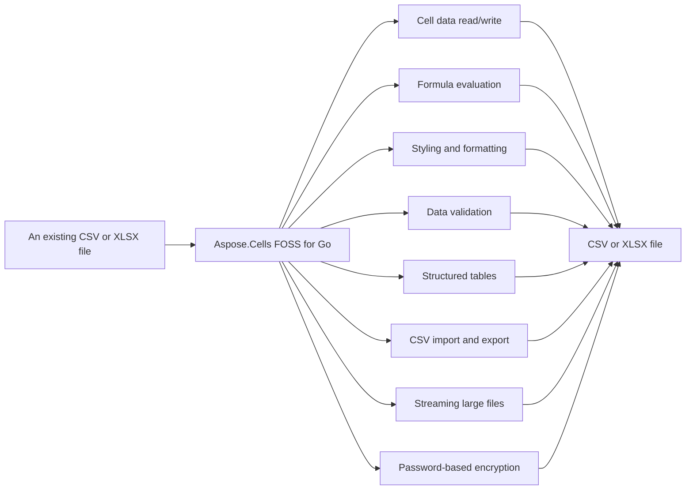

# Aspose.Cells FOSS for Go

[](https://pkg.go.dev/github.com/aspose-cells-foss/Aspose.Cells-FOSS-for-Go/v26) 

Aspose.Cells FOSS for Go reads and writes Excel workbooks in ECMA-376 Office Open XML `.xlsx` format, and imports and exports `.csv` files. It supports cell data and A1-style addressing, visual formatting with `Style`, `Font`, `Fill`, and `Alignment`, a built-in formula engine that evaluates formulas via `CalculateFormula`, data validation via `DataValidation` and `Worksheet.AddDataValidation`, structured tables via `NewTable`, `Worksheet.AddTable`, and `Table.HasHeaderRow`, low-memory row streaming for large files via `NewStreamingReader` and `StreamingReader.ProcessRows`, and password-based workbook encryption via `Workbook.SetPassword` and `Workbook.VerifyPassword`.

Aspose.Cells FOSS for Go is a pure-Go library for creating, reading, and writing Excel workbooks —
ECMA-376 Office Open XML `.xlsx` spreadsheets — with no third-party dependency. It covers cell
data and A1-style addressing, visual formatting, a built-in formula engine, data validation,
structured tables, embedded pictures, CSV import and export, low-memory row streaming for large
files, and password-based workbook encryption.

## Navigation

- [At a Glance](#at-a-glance)
- [Key Capabilities](#key-capabilities)
- [Installation](#installation)
- [Dependencies](#dependencies)
- [Quick Start](#quick-start)
- [Additional Examples](#additional-examples)
- [API Reference](#api-reference)
- [Scope and Limitations](#scope-and-limitations)

## At a Glance



## Key Capabilities

- **Cell data read/write.** `Cell` data read/write operations use `Cells.Get` and `Cells.Set` with A1-style references to access `Cell.Value` for string, float64, int, and bool types.
- **Formula evaluation.** Formula evaluation stores formulas via `Cell.SetFormula` and computes results using `CalculateFormula` for SUM, AVERAGE, MAX, and MIN over single cells or A1-style ranges.
- **Styling and formatting.** Styling and formatting combine `Font`, `Fill`, `Alignment`, and borders into a `Style` applied to any cell via `Cell.SetStyle`, with automatic deduplication of identical styles during save.
- **Data validation.** Data validation rules restrict ranges to dropdown lists or numeric ranges with custom error messages and styles, attached to a `Worksheet` via `Worksheet.AddDataValidation`.
- **Structured tables.** Structured tables created with `NewTable` and attached via `Worksheet.AddTable` support header rows indicated by `Table.HasHeaderRow` and built-in auto-filters.
- **CSV import and export.** CSV import and export move data to and from `.csv` files using `Workbook.ImportFromCSV` and `Workbook.ExportToCSV` with a caller-supplied delimiter.
- **Streaming large files.** Streaming large files uses `NewStreamingReader` and `StreamingReader.ProcessRows` to process rows one at a time without building the full `Workbook` model, keeping memory proportional to one row's width.
- **Password-based encryption.** Password-based encryption secures workbooks using `Workbook.SetPassword` and `Workbook.VerifyPassword` with ECMA-376 Agile Encryption (SHA-512 key derivation, AES-256-CBC).

## Installation

Install the published package from pkg.go.dev (`github.com/aspose-cells-foss/Aspose.Cells-FOSS-for-Go/v26`):

```bash
go get github.com/aspose-cells-foss/Aspose.Cells-FOSS-for-Go/v26
```

Verify the install:

```bash
go list github.com/aspose-cells-foss/Aspose.Cells-FOSS-for-Go/v26/aspose/cells_foss
```

## Dependencies

### Required Package Dependencies

No required third-party package dependencies; in `go.mod`, no `require` directive a consumer would install is declared.

### Native and System Requirements

- Requires Go `1.24.5` (`go` in `go.mod`).

## Quick Start

Create a new workbook, write values to cells A1 and B1, and save the file as `hello.xlsx`.

```go
package main

import cells_foss "github.com/aspose-cells-foss/Aspose.Cells-FOSS-for-Go/v26/aspose/cells_foss"

func main() {
	// Create.
	wb := cells_foss.NewWorkbook()
	ws := wb.Worksheets[0]

	// Write.
	ws.Cells().Set("A1", "Hello, World!")
	ws.Cells().Set("B1", 42)

	// Save.
	wb.Save("hello.xlsx")
}
```

`Load` an existing workbook, read the value in cell A1, update it, and save the changes to `output.xlsx`.

```go
wb, _ := cells_foss.LoadWorkbook("input.xlsx")
ws := wb.Worksheets[0]

cell, _ := ws.Cells().Get("A1")
fmt.Println("Current value:", cell.Value)

ws.Cells().Set("A1", "Updated value")
wb.Save("output.xlsx")
```

The module supports Go 1.24.5 or later and has zero third-party dependencies — encryption and
everything else builds on the Go standard library alone. Because the package name (`cells_foss`)
differs from the module path's final segment (`v26`), import it with an explicit alias:

Run `go run main.go` to produce `hello.xlsx`.

Load an existing workbook, read and update a cell, then save the result:

## Additional Examples

The following workflows demonstrate key capabilities: formulas with the calculation engine, data validation, streaming large files, styling, tables, and CSV import.

### Create a Sales Table and Evaluate SUM and AVERAGE Formulas

```go
func main() {
	wb := cells_foss.NewWorkbook()
	ws := wb.Worksheets[0]

	// ---- Populate sales data ----
	data := []float64{1200, 850, 1400, 960, 1780}
	headers := []string{"Month", "Sales"}

	ws.Cells().Set("A1", headers[0])
	ws.Cells().Set("B1", headers[1])

	months := []string{"Jan", "Feb", "Mar", "Apr", "May"}
	for i, m := range months {
		row := i + 2
		ws.Cells().Set(fmt.Sprintf("A%d", row), m)
		ws.Cells().Set(fmt.Sprintf("B%d", row), data[i])
	}

	// ---- Add formula cells ----
	lastDataRow := len(data) + 1
	totalRef := fmt.Sprintf("B2:B%d", lastDataRow)

	// SUM formula.
	ws.Cells().Set("B7", nil)
	sumCell, _ := ws.Cells().Get("B7")
	sumCell.SetFormula(fmt.Sprintf("SUM(%s)", totalRef))

	// AVERAGE formula.
	ws.Cells().Set("B8", nil)
	avgCell, _ := ws.Cells().Get("B8")
	avgCell.SetFormula(fmt.Sprintf("AVERAGE(%s)", totalRef))

	// Labels.
	ws.Cells().Set("A7", "TOTAL")
	ws.Cells().Set("A8", "AVERAGE")

	// ---- Evaluate formulas with the engine ----
	for _, row := range []int{7, 8} {
		cell, _ := ws.Cells().Get(fmt.Sprintf("B%d", row))
		formula := cell.GetFormula()
		result, err := cells_foss.CalculateFormula(formula, ws)
		if err != nil {
			fmt.Printf("  %s = ERROR: %v\n", formula, err)
		} else {
			fmt.Printf("  %s = %v\n", formula, result)
		}
	}

	wb.Save("outputfiles/formula.xlsx")
}
```

<details>
<summary>View Additional Examples</summary>

### Apply List-Type Data Validation to a Cell Range

```go
func main() {
	wb := cells_foss.NewWorkbook()
	ws := wb.Worksheets[0]

	ws.Cells().Set("A1", "Fruit")
	ws.Cells().Set("A2", "Apple")
	ws.Cells().Set("A3", "Banana")

	// Create a list-type data validation.
	dv := &cells_foss.DataValidation{
		Type:             cells_foss.DataValidationTypeList,
		Formula1:         `"Apple,Banana,Cherry,Dragonfruit"`,
		AllowBlank:       true,
		ShowErrorMessage: true,
		ErrorTitle:       "Invalid Fruit",
		ErrorMessage:     "Please pick a fruit from the list.",
		ErrorStyle:       cells_foss.ErrorStyleStop,
	}

	if err := ws.AddDataValidation("A2:A10", dv); err != nil {
		fmt.Printf("Error: %v\n", err)
		return
	}

	wb.Save("outputfiles/data_validation.xlsx")
}
```

### Stream Rows from an Excel File and Compute Totals

```go
func main() {
	sr := cells_foss.NewStreamingReader("outputfiles/streaming_data.xlsx")
	rowCount := 0
	var totalScore float64

	err := sr.ProcessRows("Sheet1", func(rowIdx int, cells map[string]string) error {
		rowCount++
		if score, ok := cells["C"+fmt.Sprint(rowIdx)]; ok {
			var s float64
			fmt.Sscanf(score, "%f", &s)
			totalScore += s
		}
		return nil
	})
	if err != nil {
		fmt.Fprintf(os.Stderr, "Error streaming: %v\n", err)
		os.Exit(1)
	}
	fmt.Printf("Streamed %d rows, total score %.0f\n", rowCount, totalScore)
}
```

### Apply Bold and Solid-Fill Styles to Header Cells

```go
func main() {
	wb := cells_foss.NewWorkbook()
	ws := wb.Worksheets[0]

	boldStyle := cells_foss.NewStyle()
	boldStyle.Font.Bold = true
	boldStyle.Font.Size = 12

	highlightStyle := cells_foss.NewStyle()
	highlightStyle.Font.Color = "FFFFFFFF"
	highlightStyle.Font.Bold = true
	highlightStyle.Fill = &cells_foss.Fill{
		Type:  cells_foss.FillTypeSolid,
		Color: "FF4472C4",
	}

	headers := []string{"Item", "Category", "Price", "In Stock"}
	for i, h := range headers {
		ref := string(rune('A'+i)) + "1"
		ws.Cells().Set(ref, h)
		cell, _ := ws.Cells().Get(ref)
		cell.SetStyle(boldStyle)
	}

	wb.Save("outputfiles/style.xlsx")
}
```

### Create a Styled Table from a Data Range

```go
func main() {
	wb := cells_foss.NewWorkbook()
	ws := wb.Worksheets[0]

	headers := []string{"Product", "Q1", "Q2", "Q3", "Q4", "Total"}
	for i, h := range headers {
		ref := string(rune('A'+i)) + "1"
		ws.Cells().Set(ref, h)
	}

	// ... populate data rows (see examples/table/main.go) ...

	tbl := ws.AddTable("A1:F6")
	tbl.HasHeaderRow = true
	tbl.StyleName = "TableStyleMedium6"

	wb.Save("outputfiles/table.xlsx")
}
```

### Import a CSV File into a New Excel Workbook

```go
func main() {
	csvPath := "outputfiles/employees.csv"

	wb := cells_foss.NewWorkbook()
	if err := wb.ImportFromCSV(csvPath, "Employees", ','); err != nil {
		fmt.Fprintf(os.Stderr, "Error importing CSV: %v\n", err)
		os.Exit(1)
	}

	ws := wb.Worksheets[1] // second sheet; index 0 is the default "Sheet1"
	fmt.Printf("Imported sheet: %q\n", ws.Name)

	wb.Save("outputfiles/csv_imported.xlsx")
}
```

</details>

## API Reference

Aspose.Cells FOSS for Go provides the `Workbook` class as the top-level object representing an Excel workbook and the `Worksheet` class as a single sheet within a workbook, with `Worksheet.Cells` exposing a `Cells` collection for cell-level operations.

The verified public surface has 28 types.

<details>
<summary>View the Complete Public API Surface</summary>

### Core API

| Class | Description |
| --- | --- |
| `Alignment` | Alignment controls how cell content is positioned within the cell bounds. |
| `Border` | Border defines which sides of a cell have a visible rule and the colour of those rules. |
| `Cell` | Cell represents a single cell in a worksheet grid. |
| `CellNotFoundError` | CellNotFoundError is returned when attempting to access a cell that does not exist in the worksheet. |
| `Cells` | Cells is a collection of Cell values indexed by A1-style string references (e.g. |
| `Chart` | Chart represents a chart embedded in a worksheet. |
| `ChartAnchor` | ChartAnchor specifies the position of a chart on the worksheet. |
| `ChartSeries` | ChartSeries represents a single data series in a chart. |
| `ChartType` | ChartType enumerates the supported chart types. |
| `ConditionalFormatting` | ConditionalFormatting represents a set of conditional formatting rules applied to a range of cells on a worksheet. |
| `ConditionalFormattingRule` | ConditionalFormattingRule represents a single conditional formatting rule. |
| `DataValidation` | DataValidation represents a single data-validation rule applied to a range of cells on a worksheet. |
| `Fill` | Fill describes the background appearance of a cell. |
| `Font` | Font describes the typographic properties applied to cell text. |
| `FormulaError` | FormulaError is returned when a formula cannot be parsed or evaluated. |
| `InvalidRefError` | InvalidRefError is returned when a cell reference string is malformed or cannot be parsed. |
| `Picture` | Picture represents an image embedded in a worksheet. |
| `PivotDataField` | PivotDataField represents a value field in a pivot table with aggregation. |
| `PivotTable` | PivotTable represents a pivot table on a worksheet. |
| `RowCallback` | RowCallback is invoked by StreamingReader.ProcessRows once for every row in the worksheet. |
| `SheetNotFoundError` | SheetNotFoundError is returned when attempting to access a worksheet by name that does not exist in the workbook. |
| `StreamOptions` | StreamOptions configures filtering for streaming row processing. |
| `StreamingReader` | StreamingReader reads an .xlsx workbook row by row without loading the entire sheet XML into memory. |
| `Style` | Style groups font, fill, alignment, and border settings into a named formatting record. |
| `Table` | Table represents a structured range of data (a "table" in Excel terminology) with optional header row and built-in auto-filter. |
| `VBAProject` | VBAProject holds the binary data of a VBA project. |
| `Workbook` | Workbook is the top-level object representing an Excel workbook. |
| `Worksheet` | Worksheet represents a single sheet within a workbook. |

#### Detailed Member Reference

### Workbook

The `Workbook` class represents an Excel workbook and supports loading from and saving to files via `Workbook.Save`, importing from CSV via `Workbook.ImportFromCSV`, exporting to CSV via `Workbook.ExportToCSV`, and password protection via `Workbook.SetPassword` and `Workbook.VerifyPassword`.

- `CheckPassword`: CheckPassword returns true if the workbook is password-protected and the provided password matches.
- `ClearVBAProject`: ClearVBAProject removes the VBA project from the workbook.
- `ExportToCSV`: ExportToCSV writes the worksheet at sheetIndex to a CSV file using the given delimiter (e.g.
- `GetVBAProject`: GetVBAProject returns the VBA project data attached to the workbook, or nil if no VBA project is present.
- `HasVBAProject`: HasVBAProject reports whether the workbook has an attached VBA project.
- `ImportFromCSV`: ImportFromCSV reads a CSV file and imports its contents into a new worksheet with the given name.
- `Save`: Save writes the workbook to the given file path in .xlsx format.
- `SetPassword`: SetPassword configures an open password for the workbook.
- `SetVBAProject`: SetVBAProject attaches a VBA project to the workbook.
- `VerifyPassword`: VerifyPassword reports whether pw matches the password that was used to encrypt this workbook (as set by SetPassword, or read from an encrypted file).

### Worksheet

The `Worksheet` class represents a single sheet within a workbook and provides access to its cell collection via `Worksheet.Cells`, as well as methods to add structured tables via `Worksheet.AddTable`, data validation rules via `Worksheet.AddDataValidation`, and embedded pictures via `Worksheet.AddPicture`.

- `AddChart`: AddChart adds a chart to the worksheet.
- `AddConditionalFormatting`: AddConditionalFormatting adds a conditional formatting rule set to the worksheet.
- `AddDataValidation`: AddDataValidation appends a data-validation rule to the worksheet.
- `AddPicture`: AddPicture attaches pic to the worksheet, assigns it a unique name, and marks the workbook as modified.
- `AddPivotTable`: AddPivotTable adds a pivot table to the worksheet.
- `AddTable`: AddTable creates a new Table covering the given range, assigns it a unique auto-generated name ("Table1", "Table2", …), appends it to the worksheet, and returns it for further configuration.
- `Cells`: Cells returns the Cells collection for this worksheet, enabling cell-level read and write operations via A1-style references.
- `FromCSV`: FromCSV populates the worksheet with data from a 2D string slice.
- `GetTable`: GetTable returns the Table with the given name, or nil when no match is found.
- `RemoveChart`: RemoveChart removes the chart at the specified index.
- `RemoveConditionalFormatting`: RemoveConditionalFormatting removes the first conditional formatting rule set whose Ref exactly matches the given ref string.
- `RemoveDataValidation`: RemoveDataValidation removes the first data-validation rule whose Ref exactly matches the given ref string.
- `RemovePivotTable`: RemovePivotTable removes the pivot table with the given name.
- `ToCSV`: ToCSV converts the worksheet's cells into a 2D string slice suitable for writing with encoding/CSV.

### Cells

The `Cells` collection is indexed by A1-style string references and supports retrieving cell values via `Cells.Get`, setting cell values via `Cells.Set`, and removing cells via `Cells.Remove`.

- `All`: All returns the underlying map of all cells keyed by A1 reference.
- `Get`: Get returns the Cell at the given A1 reference.
- `Remove`: Remove deletes the cell at the given A1 reference.
- `Set`: Set stores a value at the given A1 reference.

### Cell

The `Cell` class represents a single cell in a worksheet grid and exposes its value via `Cell.Value`, supports formula operations via `Cell.SetFormula` and `Cell.GetFormula`, and allows formatting via `Cell.SetStyle`.

- `AsFloat64`: AsFloat64 returns the cell value as float64.
- `AsInt`: AsInt returns the cell value as int.
- `AsString`: AsString returns the cell value as a string.
- `GetFormula`: GetFormula returns the formula expression stored in this cell, or an empty string when the cell contains no formula.
- `GetStyle`: GetStyle returns the Style currently applied to this cell, or nil when the cell has no parent Workbook or the StyleID cannot be resolved.
- `SetFormula`: SetFormula stores a formula expression in this cell and marks the owning Workbook as modified.
- `SetStyle`: SetStyle assigns the given Style to this cell.

### Style

The `Style` class groups font, fill, alignment, and border settings into a named formatting record and exposes its components via `Style.Font`, `Style.Fill`, `Style.Alignment`, and `Style.Border`.

### DataValidation

The `DataValidation` class represents a single data-validation rule applied to a range of cells and defines its scope via `DataValidation.Ref`, its validation type via `DataValidation.Type`, and its validation expression via `DataValidation.Formula1`.

### Table

The `Table` class represents a structured range of data with optional header row and built-in auto-filter and exposes its range via `Table.Range`, its header row setting via `Table.HasHeaderRow`, and its formatting style via `Table.StyleName`.

### StreamingReader

The `StreamingReader` class reads an `.xlsx` workbook row by row without loading the entire sheet XML into memory and processes each row by invoking a callback via `StreamingReader.ProcessRows`, created using `NewStreamingReader`.

- `ProcessRows`: ProcessRows opens the workbook, resolves the named sheet to its XML part, loads the shared-strings table (if present), and then streams through the sheet data one row at a time, calling callback for each row.
- `ProcessRowsWithColumns`: ProcessRowsWithColumns streams through all rows but only returns cells from the specified columns.
- `ProcessRowsWithFilter`: ProcessRowsWithFilter opens the workbook and streams through the named sheet, applying the filters specified in opts.
- `ProcessRowsWithRange`: ProcessRowsWithRange streams through rows in the specified range [startRow, endRow].

### CalculateFormula

The `CalculateFormula` function evaluates Excel formulas and returns the result, with `FormulaError` indicating when a formula cannot be evaluated.

### Font

The `Font` class describes the typographic properties applied to cell text and exposes its bold setting via `Font.Bold`, its color via `Font.Color`, and its size via `Font.Size`.

### Fill

The `Fill` class describes the background appearance of a cell and exposes its fill type via `Fill.Type` and its color via `Fill.Color`.

### Border

The `Border` class defines which sides of a cell have a visible rule and the colour of those rules and exposes its top, bottom, left, and right settings via `Border.Top`, `Border.Bottom`, `Border.Left`, and `Border.Right`.

</details>

## Scope and Limitations

Aspose.Cells FOSS for Go reads and writes Excel files, supports formula calculation with SUM, AVERAGE, MAX, and MIN, and imports data from CSV files using A1-style cell references.

- `CalculateFormula` supports only SUM, AVERAGE, MAX, and MIN; any other formula returns an error rather than being evaluated, and cell references must be A1-style strings only.
- `Workbook.ImportFromCSV` stores every field as a Go string and does not infer numeric or boolean types the way `Cells()`.Set does when called directly with typed values.
- `Workbook.SourceXML` and `Workbook.StylesXML` expose raw XML content, and on save unmodified content is reused verbatim from the original XML byte-for-byte, and only content touched since load is regenerated.
- Generated XML follows ECMA-376's own element ordering; this preserves round-trip compatibility but isn't independently configurable. `CalculateFormula` supports only SUM, AVERAGE, MAX, and MIN; any other formula returns an error rather than being evaluated. `Workbook.ImportFromCSV` stores every field as a Go string and does not infer numeric or boolean types the way `Cells()`.Set does when called directly with typed values. `Workbook.SourceXML` and `Workbook.StylesXML` expose raw XML content, and on save unmodified content is reused verbatim from the original XML byte-for-byte, and only content touched since load is regenerated.

This project is licensed under the [MIT License](LICENSE). The MIT License permits use, copying,
modification, distribution, sublicensing, and commercial use, provided its copyright and
permission notice are retained. The software is provided without warranty.
