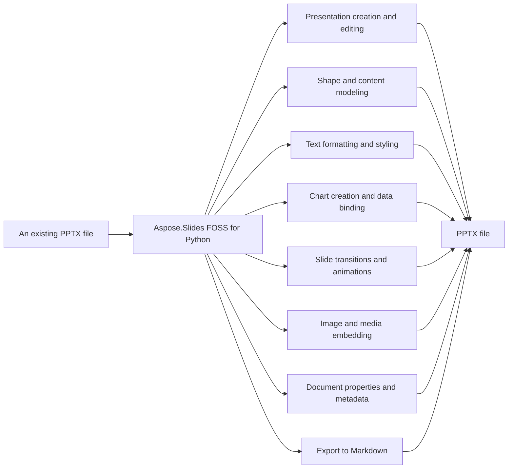

# Aspose.Slides FOSS for Python

[](https://pypi.org/project/aspose-slides-foss/) 

Aspose.Slides FOSS for Python reads and writes PowerPoint `.pptx` presentations. It creates, reads, and edits presentations by modeling them as `Presentation`, `Slide`, `Shape`, and `TextFrame` objects, with no Microsoft Office installation or COM interop required. It supports adding shapes, tables, connectors, images, charts, text formatting, slide transitions, and document properties.

Aspose.Slides FOSS for Python is the official open-source Python library by Aspose.Slides for
creating, reading, and editing PowerPoint `.pptx` presentations. It models a presentation the way
PowerPoint itself does — `Presentation`, `Slide`, `Shape`, `TextFrame` — so slides, shapes, and
text feel native to work with, with no Microsoft Office installation or COM interop required.

## Navigation

- [At a Glance](#at-a-glance)
- [Key Capabilities](#key-capabilities)
- [Installation](#installation)
- [Dependencies](#dependencies)
- [Quick Start](#quick-start)
- [Additional Examples](#additional-examples)
- [API Reference](#api-reference)
- [Scope and Limitations](#scope-and-limitations)

## At a Glance



## Key Capabilities

- **Presentation creation and editing.** It creates new presentations and edits existing ones by adding empty slides with `add_empty_slide`, cloning slides with `add_clone`, and removing slides at specific indices with `remove_at`, always saving to `.pptx` format.
- **Shape and content modeling.** It adds auto shapes such as rectangles and circles, tables with configurable rows and columns, and connectors like bent connectors to link shapes, all through the `ShapeCollection` methods `add_auto_shape`, `add_table`, and `add_connector`.
- **Text formatting and styling.** It formats text at the portion level with `font_height` and `font_bold`, and at the paragraph level with bullet formatting, using `NullableBool` to represent tri-state boolean values for properties like `font_bold`.
- **Chart creation and data binding.** It creates charts of types like ClusteredColumn through `ChartType`, binds data via an embedded `ChartDataWorkbook`, and populates `ChartSeries` with data points for bars, columns, and other chart elements.
- **Slide transitions and animations.** It applies slide transitions such as Circle using `TransitionType`, configures `MorphTransition` effects, and manages animation sequences with `Sequence` to control timing and effect ordering.
- **Image and media embedding.** It embeds images from files or streams using `Images.from_file` and `Images.from_stream`, and adds them to slides as picture frames via `ImageCollection.add_image`.
- **Document properties and metadata.** It sets core document properties like title and author, and adds custom metadata properties through `DocumentProperties.set_custom_property_value`.
- **Export to Markdown.** It exports presentations to Markdown using `SaveFormat`.MD with `MarkdownSaveOptions` to control flavor, line endings, hidden slides, comments, and slide numbering.

## Installation

Install the published package from PyPI (`aspose-slides-foss`, version 26.8.0):

```bash
pip install aspose-slides-foss
```

To work from a source checkout instead, install the clone with pip:

```bash
git clone https://github.com/aspose-slides-foss/Aspose.Slides-FOSS-for-Python.git
cd Aspose.Slides-FOSS-for-Python
pip install .
```

Verify the install:

```bash
python -c "import aspose.slides_foss"
```

The package declares `python_requires` as `>=3.10`.

## Dependencies

### Required Package Dependencies

- `lxml>=4.9`

### Native and System Requirements

- Requires Python 3.10 or later (`python_requires=">=3.10"` in `pyproject.toml`).

### Development Dependencies

- `pytest>=7` (extra `test`)
- `python-pptx>=1.0` (extra `test`)

## Quick Start

The example opens an existing presentation to inspect its slide count and save a copy, then creates a new presentation and saves it, demonstrating basic file I/O with Aspose.Slides FOSS for Python.

```python
import aspose.slides_foss as slides
from aspose.slides_foss.export import SaveFormat

# Open an existing presentation
with slides.Presentation("input.pptx") as prs:
    print(f"Slides: {len(prs.slides)}")
    prs.save("output.pptx", SaveFormat.PPTX)

# Create a new presentation
with slides.Presentation() as prs:
    slide = prs.slides[0]
    prs.save("new.pptx", SaveFormat.PPTX)
```

## Additional Examples

The following examples demonstrate common tasks with Aspose.Slides FOSS for Python, including adding shapes, formatting text, inserting tables and connectors, applying fills, embedding images, adding speaker notes, inserting comments, setting document properties, creating charts, configuring slide transitions, and grouping shapes.

### Create a Clustered Column Chart and Populate Its Data from an Embedded Workbook

```python
from aspose.slides_foss.charts import ChartType
import aspose.slides_foss as slides
from aspose.slides_foss.export import SaveFormat

with slides.Presentation() as prs:
    slide = prs.slides[0]

    # Pass has_default_data=False to start with an empty workbook
    chart = slide.shapes.add_chart(ChartType.CLUSTERED_COLUMN, 50, 50, 600, 400, False)
    chart.chart_title.add_text_frame_for_overriding("Quarterly Sales")

    cd = chart.chart_data
    wb = cd.chart_data_workbook  # embedded XLSX workbook backing the chart

    cd.series.clear()
    cd.categories.clear()

    # Workbook layout (worksheet 0):
    #          col 0   col 1      col 2
    #  row 0            "Revenue"  "Expenses"   <- series name row
    #  row 1   "Q1"     1200       800
    #  row 2   "Q2"     1500       900
    #  row 3   "Q3"     1800       1000
    #  row 4   "Q4"     2100       1100

    # Categories — column 0, rows 1..4
    for row, name in enumerate(["Q1", "Q2", "Q3", "Q4"], start=1):
        cd.categories.add(wb.get_cell(0, row, 0, name))

    # Series 1 (Revenue) — name at (row 0, col 1), values at (rows 1..4, col 1)
    s1 = cd.series.add(wb.get_cell(0, 0, 1, "Revenue"), chart.type)
    for row, value in enumerate([1200, 1500, 1800, 2100], start=1):
        s1.data_points.add_data_point_for_bar_series(wb.get_cell(0, row, 1, value))

    # Series 2 (Expenses) — name at (row 0, col 2), values at (rows 1..4, col 2)
    s2 = cd.series.add(wb.get_cell(0, 0, 2, "Expenses"), chart.type)
    for row, value in enumerate([800, 900, 1000, 1100], start=1):
        s2.data_points.add_data_point_for_bar_series(wb.get_cell(0, row, 2, value))

    prs.save("chart.pptx", SaveFormat.PPTX)
```

<details>
<summary>View Additional Examples</summary>

### Add a Rectangle Shape with Text to a Slide and Save as PPTX

```python
from aspose.slides_foss import ShapeType
import aspose.slides_foss as slides
from aspose.slides_foss.export import SaveFormat

with slides.Presentation() as prs:
    slide = prs.slides[0]
    shape = slide.shapes.add_auto_shape(ShapeType.RECTANGLE, 50, 50, 300, 100)
    shape.add_text_frame("Hello, world!")
    prs.save("shapes.pptx", SaveFormat.PPTX)
```

### `Format` Text Font Height, Bold, and Solid Fill Color

```python
from aspose.slides_foss import ShapeType, NullableBool, FillType
from aspose.slides_foss.drawing import Color
import aspose.slides_foss as slides
from aspose.slides_foss.export import SaveFormat

with slides.Presentation() as prs:
    shape = prs.slides[0].shapes.add_auto_shape(ShapeType.RECTANGLE, 50, 50, 400, 150)
    tf = shape.add_text_frame("Formatted text")
    fmt = tf.paragraphs[0].portions[0].portion_format
    fmt.font_height = 24
    fmt.font_bold = NullableBool.TRUE
    fmt.fill_format.fill_type = FillType.SOLID
    fmt.fill_format.solid_fill_color.color = Color.from_argb(255, 0, 70, 127)
    prs.save("text.pptx", SaveFormat.PPTX)
```

### Create a Table with Specified Columns and Rows and Set Cell Text

```python
import aspose.slides_foss as slides
from aspose.slides_foss.export import SaveFormat

with slides.Presentation() as prs:
    table = prs.slides[0].shapes.add_table(50, 50, [120.0, 120.0, 120.0], [40.0, 40.0])
    table.rows[0][0].text_frame.text = "Name"
    table.rows[0][1].text_frame.text = "Value"
    prs.save("table.pptx", SaveFormat.PPTX)
```

### Connect Two Rectangles with a Bent Connector Shape

```python
from aspose.slides_foss import ShapeType
import aspose.slides_foss as slides
from aspose.slides_foss.export import SaveFormat

with slides.Presentation() as prs:
    slide = prs.slides[0]
    box1 = slide.shapes.add_auto_shape(ShapeType.RECTANGLE, 50, 100, 150, 60)
    box2 = slide.shapes.add_auto_shape(ShapeType.RECTANGLE, 350, 100, 150, 60)
    conn = slide.shapes.add_connector(ShapeType.BENT_CONNECTOR3, 0, 0, 10, 10)
    conn.start_shape_connected_to = box1
    conn.start_shape_connection_site_index = 3  # right
    conn.end_shape_connected_to = box2
    conn.end_shape_connection_site_index = 1    # left
    prs.save("connector.pptx", SaveFormat.PPTX)
```

### Apply a Solid Fill Color to a Rectangle Shape

```python
from aspose.slides_foss import ShapeType, FillType
from aspose.slides_foss.drawing import Color
import aspose.slides_foss as slides
from aspose.slides_foss.export import SaveFormat

with slides.Presentation() as prs:
    shape = prs.slides[0].shapes.add_auto_shape(ShapeType.RECTANGLE, 50, 50, 300, 150)
    shape.fill_format.fill_type = FillType.SOLID
    shape.fill_format.solid_fill_color.color = Color.from_argb(255, 30, 120, 200)
    prs.save("fill.pptx", SaveFormat.PPTX)
```

### Load an Image from a File and Insert It as a Picture Frame

```python
import aspose.slides_foss as slides
from aspose.slides_foss import ShapeType
from aspose.slides_foss.export import SaveFormat

with slides.Presentation() as prs:
    with open("picture.png", "rb") as fh:
        image = prs.images.add_image(fh)      # or add_image(fh.read())
    prs.slides[0].shapes.add_picture_frame(ShapeType.RECTANGLE, 50, 50, 300, 200, image)
    prs.save("picture.pptx", SaveFormat.PPTX)
```

### Add a Notes Slide and Set Speaker Notes Text

```python
import aspose.slides_foss as slides
from aspose.slides_foss.export import SaveFormat

with slides.Presentation() as prs:
    notes = prs.slides[0].notes_slide_manager.add_notes_slide()
    notes.notes_text_frame.text = "Speaker notes go here."
    prs.save("notes.pptx", SaveFormat.PPTX)
```

### Add a Comment Author and Insert a Comment on a Slide

```python
from aspose.slides_foss.drawing import PointF
from datetime import datetime
import aspose.slides_foss as slides
from aspose.slides_foss.export import SaveFormat

with slides.Presentation() as prs:
    author = prs.comment_authors.add_author("Jane Smith", "JS")
    slide = prs.slides[0]
    author.comments.add_comment("Review this slide", slide, PointF(2.0, 2.0), datetime.now())
    prs.save("comments.pptx", SaveFormat.PPTX)
```

### Set Document Properties Including Title, Author, and Custom Fields

```python
import aspose.slides_foss as slides
from aspose.slides_foss.export import SaveFormat

with slides.Presentation() as prs:
    prs.document_properties.title = "Q1 Results"
    prs.document_properties.author = "Finance Team"
    prs.document_properties.set_custom_property_value("Version", 3)
    prs.save("deck.pptx", SaveFormat.PPTX)
```

### Configure a Circle Transition with Click and Time-Based Advance

```python
from aspose.slides_foss.slideshow import TransitionType
import aspose.slides_foss as slides
from aspose.slides_foss.export import SaveFormat

with slides.Presentation() as prs:
    slide = prs.slides[0]
    slide.slide_show_transition.type = TransitionType.CIRCLE
    slide.slide_show_transition.advance_on_click = True
    slide.slide_show_transition.advance_after_time = 3000  # ms
    prs.save("transition.pptx", SaveFormat.PPTX)
```

### Group Two Rectangle Shapes Under a Named Group Shape

```python
from aspose.slides_foss import ShapeType
import aspose.slides_foss as slides
from aspose.slides_foss.export import SaveFormat

with slides.Presentation() as prs:
    slide = prs.slides[0]
    group = slide.shapes.add_group_shape()
    group.shapes.add_auto_shape(ShapeType.RECTANGLE, 300, 100, 100, 100)
    group.shapes.add_auto_shape(ShapeType.RECTANGLE, 500, 100, 100, 100)
    group.name = "TwoRectangles"
    prs.save("group.pptx", SaveFormat.PPTX)
```

### Import the Aspose-Slides-Foss Package to Begin Using Its API

```python
import aspose.slides_foss as slides
```

- `lxml` >= 4.9 — the XML/XPath library backing this project's OPC/OOXML parsing; installed
  automatically as a dependency.

- Python 3.10 or later (`requires-python = ">=3.10"` in `pyproject.toml`). Pure Python — there is
  nothing to compile.
- Continuous integration runs the full test suite on Python 3.10, 3.11, 3.12, 3.13, and 3.14, on
  Linux, Windows, and macOS — fifteen jobs, and a release is gated on all of them passing.

- `pytest` >= 7 — the test runner, installed via the `test` extra (`pip install -e .[test]`).
- `python-pptx` >= 1.0 — a second, independent reader one conformance test uses to check this
  library's own output; that test skips if it is absent.

</details>

## API Reference

Aspose.Slides FOSS for Python provides the `slides_foss` module with the `Presentation` class as the primary entry point, which owns a `SlideCollection` of `Slide` objects, each exposing its shapes through `Slide.shapes` (a `ShapeCollection`).

The verified public surface has 516 types.

<details>
<summary>View the Complete Public API Surface</summary>

### Core API

| Class | Description |
| --- | --- |
| `AdjustValue` | Represents a geometry shape's adjustment value. These values affect shape's form. |
| `AdjustValueCollection` | Reprasents a collection of shape's adjustments. |
| `AutoShape` | Represents an AutoShape. |
| `Background` | Represents background of a slide. |
| `BaseHandoutNotesSlideHeaderFooterManager` | BaseHandoutNotesSlideHeaderFooterManager represents a manager for header and footer elements on handout and notes slides. |
| `BasePortionFormat` | Common text portion formatting properties. |
| `BaseShapeLock` | BaseShapeLock provides base locking functionality for shape properties. |
| `BaseSlide` | Represents common data for all slide types. |
| `BulletFormat` | Represents paragraph bullet formatting properties. |
| `Camera` | Represents Camera. |
| `Cell` | Represents a cell of a table. |
| `CellCollection` | Represents a collection of cells. |
| `CellFormat` | Represents format of a table cell. |
| `ColorFormat` | Represents a color used in a presentation. |
| `Column` | Represents a column in a table. |
| `ColumnCollection` | Represents collection of columns in a table. |
| `Comment` | Represents a comment on a slide. |
| `CommentAuthor` | Represents an author of comments. |
| `CommentAuthorCollection` | Represents a collection of comment authors. |
| `CommentCollection` | Represents a collection of comments of one author. |
| `Connector` | Represents a connector. |
| `DocumentProperties` | Represents properties of a presentation. |
| `EffectFormat` | Represents effect properties of shape. |
| `FillFormat` | Represents a fill formatting options. |
| `FontData` | Represents a font definition. Immutable. |
| `Fonts` | Fonts collection. |
| `GeometryShape` | GeometryShape represents a shape with geometric properties derived from IGeometryShape. |
| `GlobalLayoutSlideCollection` | Represents a collection of all layout slides in presentation. Extends LayoutSlideCollection class with methods for adding/cloning layout slides in context of uniting of the individual collections of master's layout slides. |
| `GradientFormat` | Represent a gradient format. |
| `GradientStop` | Represents a gradient format. |
| `GradientStopCollection` | Represnts a collection of gradient stops. |
| `GraphicalObject` | GraphicalObject represents a graphical shape with properties derived from IGraphicalObject. |
| `GraphicalObjectLock` | GraphicalObjectLock provides locking capabilities for graphical object properties. |
| `GroupShape` | Represents a group of shapes on a slide. |
| `GroupShapeLock` | Determines which operations are disabled on the parent GroupShape. |
| `HeadingPair` | Represents a 'Heading pair' property of the document. It indicates the group name of document parts and the number of parts in group. |
| `Hyperlink` | Represents a hyperlink to an external target. |
| `IAdjustValue` | Represents a geometry shape's adjustment value. These values affect shape's form. |
| `IAdjustValueCollection` | Reprasents a collection of shape's adjustments. |
| `IAnimationTimeLine` | Represents timeline of animation. |
| `IAutoShape` | Represents an AutoShape. |
| `IBackground` | Represents background of a slide. |
| `IBackgroundEffectiveData` | Immutable object which contains effective background properties. |
| `IBasePortionFormat` | This class contains the text portion formatting properties. Unlike , all properties of this class are writeable. |
| `IBaseShapeLock` | Represents Shape lock (disabled operation). |
| `IBaseSlide` | Represents common data for all slide types. |
| `IBulkTextFormattable` | Represents an object with possibility of bulk setting child text elements' formats. |
| `IBulletFormat` | Represents paragraph bullet formatting properties. |
| `ICamera` | Represents Camera. |
| `ICell` | Represents a cell in a table. |
| `ICellCollection` | Represents a collection of cells. |
| `ICellFormat` | Represents format of a table cell. |
| `IColorFormat` | Represents a color used in a presentation. |
| `IColumn` | Represents a column in a table. |
| `IColumnCollection` | Represents collection of columns in a table. |
| `IComment` | Represents a comment on a slide. |
| `ICommentAuthor` | Represents an author of comments. |
| `ICommentAuthorCollection` | Represents a collection of comment authors. |
| `ICommentCollection` | Represents a collection of comments of one author. |
| `IConnector` | Represents a connector. |
| `IDocumentProperties` | Represents properties of a presentation. |
| `IEffectFormat` | Represents effect properties of shape. |
| `IEffectParamSource` | IEffectParamSource defines a source for effect parameter values. |
| `IFillFormat` | Represents a fill formatting options. |
| `IFillParamSource` | IFillParamSource defines a source for fill parameter values. |
| `IFontData` | Represents a font definition. |
| `IFonts` | Represents fonts collection. |
| `IGeometryShape` | Represents the parent class for all geometric shapes. |
| `IGlobalLayoutSlideCollection` | Represents a collection of all layout slides in presentation. Extends ILayoutSlideCollection interface with methods for adding/cloning layout slides in context of uniting of the individual collections of master's layout slides. |
| `IGradientFormat` | Represent a gradient format. |
| `IGradientStop` | Represents a gradient format. |
| `IGradientStopCollection` | Represnts a collection of gradient stops. |
| `IGraphicalObject` | Represents abstract graphical object. |
| `IGroupShape` | Represents a group of shapes on a slide. |
| `IGroupShapeLock` | Determines which operations are disabled on the parent GroupShape. |
| `IHeadingPair` | Represents a 'Heading pair' property of the document. It indicates the group name of document parts and the number of parts in group. |
| `IHyperlink` | Represents a hyperlink. |
| `IHyperlinkContainer` | Represents an object that can carry hyperlinks. |
| `IImage` | Represents a raster or vector image. |
| `IImageCollection` | Represents collection of PPImage. |
| `ILayoutSlide` | Represents a layout slide. |
| `ILayoutSlideCollection` | Represents a base class for collection of a layout slides. |
| `ILightRig` | Represents LightRig. |
| `ILineFillFormat` | Represents properties for lines filling. |
| `ILineFormat` | Represents format of a line. |
| `ILineParamSource` | ILineParamSource defines a source for line parameter values. |
| `ILoadOptions` | ILoadOptions defines options for loading a presentation. |
| `IMasterLayoutSlideCollection` | IMasterLayoutSlideCollection represents a collection of master layout slides. |
| `IMasterSlide` | Represents a master slide in a presentation. |
| `IMasterSlideCollection` | Represents a collection of master slides. |
| `INotesSize` | Represents a size of notes slide. |
| `INotesSlide` | Represents a notes slide in a presentation. |
| `INotesSlideHeaderFooterManager` | Represents manager which holds behavior of the notes slide placeholders, including header placeholder. |
| `INotesSlideManager` | Notes slide manager. |
| `IPPImage` | Represents an image in a presentation. |
| `IParagraph` | Represents a paragraph of a text. |
| `IParagraphCollection` | Represents a collection of a paragraphs. |
| `IParagraphFormat` | This class contains the paragraph formatting properties. Unlike , all properties of this class are writeable. |
| `IPatternFormat` | Represents a pattern to fill a shape. |
| `IPictureFillFormat` | Represents a picture fill style. |
| `IPictureFrame` | Represents a frame with a picture inside. |
| `IPictureFrameLock` | Determines which operations are disabled on the parent PictureFrameEx. |
| `IPortion` | Represents a portion of text inside a text paragraph. |
| `IPortionCollection` | Represents a collection of a portions. |
| `IPortionFormat` | IPortionFormat defines formatting properties for a text portion. |
| `IPresentation` | Presentation document |
| `IPresentationComponent` | Represents a component of a presentation. |
| `IRow` | Represents a row in a table. |
| `IRowCollection` | Represents table row collection. |
| `ISection` | ISection defines properties and behavior for a presentation section. |
| `IShape` | Represents a shape on a slide. |
| `IShapeBevel` | Represents properties of shape's main face relief. |
| `IShapeCollection` | Represents a collection of shapes. |
| `IShapeFrame` | Represents shape frame's properties. |
| `ISlide` | Represents a slide in a presentation. |
| `ISlideCollection` | Represents a collection of a slides. |
| `ISlideComponent` | Represents a component of a slide. |
| `ISlideShowTransition` | Represents slide show transition. |
| `ISlidesPicture` | Represents a picture in a presentation. |
| `ITable` | Represents a table on a slide. |
| `ITableFormat` | Represents format of a table. |
| `ITextFrame` | Represents a TextFrame. |
| `ITextFrameFormat` | Contains the TextFrame's formatting properties. |
| `IThreeDFormat` | Represents 3-D properties. |
| `IThreeDParamSource` | IThreeDParamSource defines a source for three-dimensional parameter values. |
| `Image` | Represents a raster or vector image. |
| `ImageCollection` | Represents collection of PPImage. |
| `Images` | Methods to instantiate and work with . |
| `LayoutSlide` | Represents a layout slide. |
| `LayoutSlideCollection` | Represents a base class for collection of a layout slides. |
| `LightRig` | Represents LightRig. |
| `LineFillFormat` | Represents properties for lines filling. |
| `LineFormat` | Represents format of a line. |
| `MasterLayoutSlideCollection` | Represents a collections of all layout slides of defined master slide. Extends LayoutSlideCollection class with methods for adding/inserting/removing/cloning/reordering layout slides in context of the individual collections of master's layout slides. |
| `MasterSlide` | Represents a master slide in a presentation. |
| `MasterSlideCollection` | Represents a collection of master slides. |
| `NotesSize` | Represents a size of notes slide. |
| `NotesSlide` | Represents a notes slide in a presentation. |
| `NotesSlideHeaderFooterManager` | Represents manager which holds behavior of the notes slide placeholders, including header placeholder. |
| `NotesSlideManager` | Notes slide manager. |
| `PPImage` | Represents an image in a presentation. |
| `PVIObject` | Encapsulates basic service infrastructure for objects can be a subject of property value inheritance. |
| `Paragraph` | Represents a paragraph of text. |
| `ParagraphCollection` | Represents a collection of a paragraphs. |
| `ParagraphFormat` | This class contains the paragraph formatting properties. Unlike , all properties of this class are writeable. |
| `PatternFormat` | Represents a pattern to fill a shape. |
| `Picture` | Represents a picture in a presentation. |
| `PictureFillFormat` | Represents a picture fill style. |
| `PictureFrame` | Represents a frame with a picture inside. |
| `PictureFrameLock` | Determines which operations are disabled on the parent PictureFrame. |
| `Portion` | Represents a portion of text inside a text paragraph. |
| `PortionCollection` | Represents a collection of portions. |
| `PortionFormat` | This class contains the text portion formatting properties. Unlike , all properties of this class are writeable. |
| `Presentation` | Represents a Microsoft PowerPoint presentation. |
| `Row` | Represents a row in a table. |
| `RowCollection` | Represents table row collection. |
| `Shape` | Represents a shape on a slide. This is an abstract base class. |
| `ShapeBevel` | Contains the properties of shape's main face relief. |
| `ShapeCollection` | Represents a collection of shapes. |
| `ShapeFrame` | Represents shape frame's properties. |
| `Slide` | Represents a slide in a presentation. |
| `SlideCollection` | Represents a collection of a slides. |
| `Table` | Represents a table on a slide. |
| `TableFormat` | Represents format of a table. |
| `TextFrame` | Represents a TextFrame. |
| `TextFrameFormat` | Contains the TextFrame's formatTextFrameFormatting properties. |
| `ThreeDFormat` | Represents 3-D properties. |
| `AnimationTimeLine` | Represents timeline of animation. |
| `Behavior` | Represent base class behavior of effect. |
| `BehaviorCollection` | Represents collection of behavior effects. |
| `BehaviorFactory` | Factory for creating behavior effect instances. |
| `BehaviorProperty` | Represent property types for animation behavior. Follows the list of properties from https://msdn.microsoft.com/en-us/library/dd949052(v=office.15).aspx and https://msdn.microsoft.com/en-us/library/documentformat.openxml.presentation.attributename(v=office.15).aspx |
| `BehaviorPropertyCollection` | Represents collection of behavior properties. |
| `ColorEffect` | Represent color effect behavior of effect. |
| `ColorOffset` | Represent color offset. |
| `CommandEffect` | Represent command effect behavior of effect. |
| `Effect` | Represents animation effect. |
| `FilterEffect` | Represent filter effect behavior of effect. |
| `IBehavior` | Represent base class behavior of effect. |
| `IBehaviorCollection` | Represents collection of behavior effects. |
| `IBehaviorFactory` | Allows to create animation effects |
| `IBehaviorProperty` | Represent property types for animation behavior. Follows the list of properties from https://msdn.microsoft.com/en-us/library/dd949052(v=office.15).aspx and https://msdn.microsoft.com/en-us/library/documentformat.openxml.presentation.attributename(v=office.15).aspx |
| `IBehaviorPropertyCollection` | Represents timing properties for the effect behavior. |
| `IColorEffect` | Represents a color effect for an animation behavior. |
| `IColorOffset` | Represent color offset. |
| `ICommandEffect` | Represents a command effect for an animation behavior. |
| `IEffect` | Represents animation effect. |
| `IFilterEffect` | Represent filter effect of behavior. |
| `IMotionCmdPath` | Represent one command of a path. |
| `IMotionEffect` | Represent motion effect behavior of effect. |
| `IMotionPath` | Represent motion path. |
| `IPoint` | Represent animation point. |
| `IPointCollection` | Represents a collection of portions. |
| `IPropertyEffect` | Represent property effect behavior. |
| `IRotationEffect` | Represent rotation behavior of effect. |
| `IScaleEffect` | Represents animation scale effect. |
| `ISequence` | Represents sequence (collection of effects). |
| `ISequenceCollection` | Represents collection of interactive sequences. |
| `ISetEffect` | Represents a set effect for an animation behavior. |
| `ITextAnimation` | Represent text animation. |
| `ITextAnimationCollection` | Represents collection of text animations. |
| `ITiming` | Represents animation timing. |
| `MotionCmdPath` | Represent one command of a path. |
| `MotionEffect` | Represent motion effect behavior of effect. |
| `MotionPath` | Represent motion path. |
| `Point` | Represents animation point. |
| `PointCollection` | Represents a collection of animation points. |
| `PropertyEffect` | Represent property effect behavior of effect. |
| `RotationEffect` | Represent rotation effect behavior of effect. |
| `ScaleEffect` | Represent scale effect behavior of effect. |
| `Sequence` | Represents sequence (collection of effects). |
| `SequenceCollection` | Represents collection of interactive sequences. |
| `SetEffect` | Represent set effect behavior of effect. |
| `TextAnimation` | Represent text animation. |
| `TextAnimationCollection` | Represents collection of text animations. |
| `Timing` | Represents animation timing. |
| `AxesManager` | Provides access to chart axes. |
| `Axis` | Encapsulates the object that represents a chart's axis. |
| `BaseChartValue` | Base class for chart value types. |
| `Chart` | Represents a chart on a slide. |
| `ChartCategory` | Represents a chart category. |
| `ChartCategoryCollection` | Represents collection of chart categories. |
| `ChartData` | Represents data used for chart plotting. |
| `ChartDataCell` | Represents a cell in the chart data workbook. |
| `ChartDataPoint` | Represents a series data point. |
| `ChartDataPointCollection` | Represents collection of data points for a series. |
| `ChartDataWorkbook` | Provides access to the embedded Excel workbook for chart data. |
| `ChartDataWorksheet` | Represents a worksheet in the chart data workbook. |
| `ChartLinesFormat` | Represents gridlines format properties. |
| `ChartPlotArea` | Represents rectangle where chart should be plotted. |
| `ChartPortionFormat` | Chart portion formatting — wraps <a:defRPr> inside <c:txPr>. |
| `ChartSeries` | Represents a chart series. |
| `ChartSeriesCollection` | Represents collection of chart series. |
| `ChartSeriesGroup` | Represents group of series. |
| `ChartSeriesGroupCollection` | Collection of ChartSeriesGroup objects. |
| `ChartSeriesReadonlyCollection` | Readonly view of chart series belonging to a single series group. |
| `ChartTextFormat` | Specifies default text formatting for chart text elements. |
| `ChartTitle` | Represents chart title properties. |
| `ChartWall` | Represents walls on 3D charts. |
| `DataLabel` | Represents a series data point label. |
| `DataLabelCollection` | Represents the labels of a chart series. |
| `DataLabelFormat` | Represents formatting options for DataLabel. |
| `DataSourceTypeForErrorBarsCustomValues` | Specifies types of values in ChartDataPoint.ErrorBarsCustomValues properties list. |
| `DataTable` | Represents data table properties. |
| `DoubleChartValue` | Represents a double value backed by a workbook cell or literal. |
| `ErrorBarsCustomValues` | Specifies the error bar values for a single data point. |
| `ErrorBarsFormat` | Represents error bars of chart series. |
| `Format` | Represents chart format properties (fill, line, effect, 3D). |
| `IActualLayout` | Specifies actual position of a chart element. |
| `IAxesManager` | Provides access to chart axes. |
| `IAxis` | Encapsulates the object that represents a chart's axis. |
| `IAxisFormat` | Represents chart format properties. |
| `IBaseChartValue` | Represents a value of a chart. |
| `IChart` | Represents an graphic chart on a slide. |
| `IChartCategory` | Represents chart categories. |
| `IChartCategoryCollection` | Represents collection of |
| `IChartCategoryLevelsManager` | Managed container of the values of the chart category levels. |
| `IChartCellCollection` | Represents collection of a cells with data. |
| `IChartComponent` | Represents a component of a chart. |
| `IChartData` | Represents data used for a chart plotting. |
| `IChartDataCell` | Represents cell for chart data. |
| `IChartDataPoint` | Represents series data point. |
| `IChartDataPointCollection` | Represents collection of a series data point. |
| `IChartDataWorkbook` | Provides access to embedded Excel workbook |
| `IChartDataWorksheet` | Represents worksheet associated with |
| `IChartDataWorksheetCollection` | Represents the collection of worksheets of chart data workbook. |
| `IChartLinesFormat` | Represents gridlines format properties. |
| `IChartParagraphFormat` | Represents a paragraph formatting properties of a chart. |
| `IChartPlotArea` | Represents chart title properties. |
| `IChartPortionFormat` | Represents the chart portion formatting properties used in charts. |
| `IChartSeries` | Represents a chart series. |
| `IChartSeriesCollection` | Represents collection of |
| `IChartSeriesGroup` | Represents group of series. |
| `IChartSeriesGroupCollection` | Represents the collection of groups of combinable series. |
| `IChartSeriesReadonlyCollection` | Represents a readonly collection of |
| `IChartTextBlockFormat` | Represents formatting properties for chart text elements. |
| `IChartTextFormat` | Chart operate with restricted set of text format properties. IChartTextFormat, IChartTextBlockFormat, IChartParagraphFormat, IChartPortionFormat interfaces describe this restricted set. |
| `IChartTitle` | Represents chart title properties. |
| `IChartWall` | Represents walls on 3d charts. |
| `IDataLabel` | Represents a series labels. |
| `IDataLabelCollection` | Represents a series labels. |
| `IDataLabelFormat` | Represents formatting options for DataLabel. |
| `IDataSourceTypeForErrorBarsCustomValues` | Specifies types of values in ChartDataPoint.ErrorBarsCustomValues properties list |
| `IDataTable` | Represents data table properties. |
| `IDoubleChartValue` | Represent double value which can be stored in PPTX presentation document in two ways: 1) in cell/cells of workbook related to chart; 2) as literal value. |
| `IErrorBarsCustomValues` | Specifies the errors bar values. It shall be used only when the Error bars value type is Custom. |
| `IErrorBarsFormat` | Represents error bars of chart series. ErrorBars custom values are in IChartDataPointCollection (in property). |
| `IFormat` | Represents chart format properties. |
| `IFormattedTextContainer` | Represents chart text format. |
| `ILayoutable` | Specifies the exact position of a chart element. |
| `ILegend` | Represents chart's legend properties. |
| `ILegendEntryCollection` | Represents legends collection. |
| `ILegendEntryProperties` | Represents legend properties of a chart. |
| `IMarker` | Represents marker of a chert. |
| `IMultipleCellChartValue` | Represents a collection of a chart cells. |
| `IOverridableText` | Represents overridable text for a chart. |
| `IPieSplitCustomPointCollection` | Represents a collection of points that shall be drawn in the second pie or bar on a bar-of-pie or pie-of-pie chart with a custom split. |
| `IRotation3D` | Represents 3D rotation of a chart. |
| `ISingleCellChartValue` | Represents a chart data cell. |
| `IStringChartValue` | Represent string value which can be stored in PPTX presentation document in two ways: 1) in cell/cells of workbook related to chart; 2) as literal value. |
| `IStringOrDoubleChartValue` | Represent string or double value which can be stored in PPTX presentation document in two ways: 1) in cell/cells of workbook related to chart; 2) as literal value. |
| `ITrendline` | Class represents trend line of chart series |
| `ITrendlineCollection` | Represents a collection of TrendlineEx |
| `IUpDownBarsManager` | Provide access to up/down bars of Line- or Stock-chart. |
| `Legend` | Represents chart's legend properties. |
| `LegendEntryCollection` | Collection of legend entries. |
| `LegendEntryProperties` | Represents legend properties of a chart entry. |
| `Marker` | Represents a chart marker (symbol at data points). |
| `Rotation3D` | Represents 3D rotation of a chart. |
| `StringChartValue` | Represents a string value backed by workbook cells or literal. |
| `StringOrDoubleChartValue` | Represents a value that can be string or double, backed by a cell or literal. |
| `Trendline` | Represents a trend line of a chart series. |
| `TrendlineCollection` | Represents a collection of Trendline objects for a chart series. |
| `Color` | Represents an ARGB color, equivalent to System.Drawing.Color. |
| `PointF` | Represents a 2D point with float coordinates, equivalent to System.Drawing.PointF. |
| `Size` | Represents a 2D size with integer dimensions, equivalent to System.Drawing.Size. |
| `SizeF` | Represents a 2D size with float dimensions, equivalent to System.Drawing.SizeF. |
| `Blur` | Represents a Blur effect that is applied to the entire shape, including its fill. All color channels, including alpha, are affected. |
| `FillOverlay` | Represents a Fill Overlay effect. A fill overlay may be used to specify an additional fill for an object and blend the two fills together. |
| `Glow` | Represents a Glow effect, in which a color blurred outline is added outside the edges of the object. |
| `IBlur` | Represents a Blur effect that is applied to the entire shape, including its fill. All color channels, including alpha, are affected. |
| `IFillOverlay` | Represents a Fill Overlay effect. A fill overlay may be used to specify an additional fill for an object and blend the two fills together. |
| `IGlow` | Represents a Glow effect, in which a color blurred outline is added outside the edges of the object. |
| `IImageTransformOperation` | IImageTransformOperation defines an operation that transforms an image. |
| `IInnerShadow` | Represents a inner shadow effect. |
| `IOuterShadow` | Represents an Outer Shadow effect. |
| `IPresetShadow` | Represents a Preset Shadow effect. |
| `IReflection` | Represents a reflection effect. |
| `ISoftEdge` | Represents a Soft Edge effect. The edges of the shape are blurred, while the fill is not affected. |
| `ImageTransformOperation` | ImageTransformOperation represents an operation that transforms an image. |
| `InnerShadow` | Represents a Inner Shadow effect. |
| `OuterShadow` | Represents an Outer Shadow effect. |
| `PresetShadow` | Represents a Preset Shadow effect. |
| `Reflection` | Represents a Reflection effect. |
| `SoftEdge` | Represents a soft edge effect. The edges of the shape are blurred, while the fill is not affected. |
| `ISaveOptions` | Options that control how a presentation is saved. |
| `MarkdownSaveOptions` | Represents options that control how presentation should be saved to markdown. |
| `SaveOptions` | Abstract class with options that control how a presentation is saved. |
| `CornerDirectionTransition` | Corner direction slide transition effect. |
| `EightDirectionTransition` | Eight direction slide transition effect. |
| `EmptyTransition` | Empty slide transition effect. |
| `FlyThroughTransition` | Fly-through slide transition effect. |
| `GlitterTransition` | Glitter slide transition effect. |
| `ICornerDirectionTransition` | Corner direction slide transition effect. |
| `IEightDirectionTransition` | Eight direction slide transition effect. |
| `IEmptyTransition` | Empty slide transition effect. |
| `IFlyThroughTransition` | Fly-through slide transition effect. |
| `IGlitterTransition` | Glitter slide transition effect. |
| `IInOutTransition` | In-Out slide transition effect. |
| `ILeftRightDirectionTransition` | Left-right direction slide transition effect. |
| `IMorphTransition` | Ripple slide transition effect. |
| `IOptionalBlackTransition` | Optional black slide transition effect. |
| `IOrientationTransition` | Orientation slide transition effect. |
| `IRevealTransition` | Reveal slide transition effect. |
| `IRippleTransition` | Ripple slide transition effect. |
| `IShredTransition` | Shred slide transition effect. |
| `ISideDirectionTransition` | Side direction slide transition effect. |
| `ISplitTransition` | Split slide transition effect. |
| `ITransitionValueBase` | Represents base class for slide transition effects. |
| `IWheelTransition` | Wheel slide transition effect. |
| `InOutTransition` | In-Out slide transition effect. |
| `LeftRightDirectionTransition` | Left-right direction slide transition effect. |
| `MorphTransition` | Morph slide transition effect. |
| `OptionalBlackTransition` | Optional black slide transition effect. |
| `OrientationTransition` | Orientation slide transition effect. |
| `RevealTransition` | Reveal slide transition effect. |
| `RippleTransition` | Ripple slide transition effect. |
| `ShredTransition` | Shred slide transition effect. |
| `SideDirectionTransition` | Side direction slide transition effect. |
| `SlideShowTransition` | Represents slide show transition. |
| `SplitTransition` | Split slide transition effect. |
| `TransitionValueBase` | Base class for slide transition effects. |
| `WheelTransition` | Wheel slide transition effect. |
| `BaseOverrideThemeManager` | Base class for classes that provide access to different types of overriden themes. |
| `BaseThemeManager` | Base class for classes that provide access to different types of themes. |
| `ColorScheme` | Stores theme-defined colors. |
| `EffectStyle` | Represents an effect style. |
| `EffectStyleCollection` | Represents a collection of effect styles. |
| `ExtraColorScheme` | Represents an additional color scheme which can be assigned to a slide. |
| `ExtraColorSchemeCollection` | Represents a collection of additional color schemes. |
| `FillFormatCollection` | Represents the collection of fill styles. |
| `FontScheme` | Stores theme-defined fonts. |
| `FormatScheme` | Stores theme-defined formats for the shapes. |
| `IColorScheme` | Stores theme-defined colors. |
| `IEffectStyle` | Represents an effect style. |
| `IEffectStyleCollection` | Represents a collection of effect styles. |
| `IExtraColorScheme` | Represents an additional color scheme which can be assigned to a slide. |
| `IExtraColorSchemeCollection` | Represents a collection of additional color schemes. |
| `IFillFormatCollection` | Represents the collection of fill styles. |
| `IFontScheme` | Stores theme-defined fonts. |
| `IFormatScheme` | Stores theme-defined formats for the shapes. |
| `ILineFormatCollection` | Represents the collection of line styles. |
| `IMasterTheme` | Represents a master theme. |
| `IMasterThemeManager` | Provides access to presentation master theme. |
| `IMasterThemeable` | Represent master theme manager. |
| `IOverrideTheme` | Represents a overriding theme. |
| `IOverrideThemeManager` | Provides access to different types of overriden themes. |
| `IOverrideThemeable` | Represents override theme manager. |
| `ITheme` | Represents a theme. |
| `IThemeManager` | Represent theme properties. |
| `IThemeable` | Represents objects that can be themed with . |
| `LayoutSlideThemeManager` | Provides access to layout slide theme overriden. |
| `LineFormatCollection` | Represents the collection of line styles. |
| `MasterTheme` | Represents a master theme. |
| `MasterThemeManager` | Provides access to presentation master theme. |
| `NotesSlideThemeManager` | Provides access to notes slide theme overriden. |
| `OverrideTheme` | Represents a overriding theme. |
| `SlideThemeManager` | Provides access to slide theme overriden. |
| `Theme` | Represents a theme. |

#### Enumerations

| Enumeration | Description |
| --- | --- |
| `BackgroundType` | Defines the slide background fill source. |
| `BevelPresetType` | Constants which define 3D bevel of shape. |
| `BulletType` | Represents the type of the extended bullets. |
| `CameraPresetType` | Constants which define camera preset type. |
| `ColorType` | Represents different color modes. |
| `FillBlendMode` | Determines blend mode. |
| `FillType` | Specifies the interior fill type of various visual objects. |
| `FontAlignment` | Represents vertical font alignment. |
| `GradientDirection` | Represents the gradient style. |
| `GradientShape` | Represents the shape of gradient fill. |
| `LightRigPresetType` | Constants which define light preset types. |
| `LightingDirection` | Constants which define light directions. |
| `LineAlignment` | Represents the lines alignment type. |
| `LineArrowheadLength` | Represents the length of an arrowhead. |
| `LineArrowheadStyle` | Represents the style of an arrowhead. |
| `LineArrowheadWidth` | Represents the width of an arrowhead. |
| `LineCapStyle` | Represents the line cap style. |
| `LineDashStyle` | Represents the line dash style. |
| `LineJoinStyle` | Represents the lines join style. |
| `LineStyle` | Represents the style of a line. |
| `MaterialPresetType` | Constants which define material of shape. |
| `NullableBool` | Represents triple boolean values. |
| `NumberedBulletStyle` | Represents the style of the numbered bullets. |
| `Orientation` | Represents the orientation of a shape. |
| `PatternStyle` | Represents the pattern style. |
| `PictureFillMode` | Determines how picture will fill area. |
| `PresetColor` | Represents predefined color presets. |
| `PresetShadowType` | Represents a preset for a shadow effect. |
| `RectangleAlignment` | Defines 2-dimension allignment. |
| `SchemeColor` | Represents colors in a color scheme. |
| `ShapeType` | Represents preset geometry of geometry shapes. |
| `SlideLayoutType` | Represents the slide layout type. |
| `SourceFormat` | Represents source file format. |
| `TableStylePreset` | Represents builtin table styles. |
| `TextAlignment` | Represents different text alignment styles. |
| `TextAnchorType` | text box alignment within a text area. |
| `TextAutofitType` | Represents text autofit mode. |
| `TextCapType` | Represents the type of text capitalisation. |
| `TextShapeType` | Represents text wrapping shape. |
| `TextStrikethroughType` | Represents the type of text strikethrough. |
| `TextUnderlineType` | Represents the type of text underline. |
| `TextVerticalType` | Determines vertical writing mode for a text. |
| `TileFlip` | Defines tile flipping mode. |
| `AfterAnimationType` | Represents the after animation type of an animation effect. |
| `AnimateTextType` | Represents the animate text type of an animation effect. |
| `BehaviorAccumulateType` | Represents types of accumulation of effect behaviors. |
| `BehaviorAdditiveType` | Represents additive type for effect behavior. |
| `BuildType` | Determines how text will appear on a shape during animation. |
| `ColorDirection` | Represents color direction for color effect behavior. |
| `ColorSpace` | Represents color space for color effect behavior. |
| `CommandEffectType` | Represents command effect type for command effect behavior. |
| `EffectChartMajorGroupingType` | Represents the type of an animation effect for chart's element. |
| `EffectChartMinorGroupingType` | Represents the type of an animation effect for chart's element in series or category. |
| `EffectFillType` | Represent fill types. |
| `EffectPresetClassType` | Represent effect class types. |
| `EffectRestartType` | Represent restart types for timing. |
| `EffectSubtype` | Represents subtypes of animation effect. |
| `EffectTriggerType` | Represent trigger type of effect. |
| `EffectType` | Represents the type of an animation effect. |
| `FilterEffectRevealType` | Represents filter reveal type. |
| `FilterEffectSubtype` | Represents filter effect subtypes. |
| `FilterEffectType` | Represents filter effect types. |
| `MotionCommandPathType` | Represent types of command for animation motion effect behavior. |
| `MotionOriginType` | Specifies what the origin of the motion path is relative to. Such as the layout of the slide, or the parent. |
| `MotionPathEditMode` | Specifies how the motion path moves when the target shape is moved |
| `MotionPathPointsType` | Represent types of points in animation motion path. |
| `PropertyCalcModeType` | Represent calc mode for animation property. |
| `PropertyValueType` | Represent property value types. |
| `AxisPositionType` | Determines a position of axis. |
| `BubbleSizeRepresentationType` | Specifies the possible ways to represent data as bubble chart sizes. |
| `CategoryAxisType` | Represents a type of a category axis. |
| `ChartDataSourceType` | Represents a type of data source of the chart. |
| `ChartType` | Represents a type of chart. |
| `CombinableSeriesTypesGroup` | Enumeration of groups of combinable series types. Each element relates to group of types of chart series that can persist simultaneously in one ChartSeriesGroup. For example: ChartType.PercentsStackedArea series cannot be simultaneously with ChartType.StackedArea series in one ChartSeriesGroup. But two or more ChartType.PercentsStackedArea can be in one ChartSeriesGroup simultaneously (CombinableSeriesTypesGroup.AreaChart_PercentsStackedArea). And ChartType.Line series can be with ChartType.LineWithMarkers series simultaneously in one CombinableSeriesTypesGroup.LineChart_Line ChartSeriesGroup. |
| `CrossesType` | Determines where axis will cross. |
| `DataSourceType` | Data source types. |
| `DisplayBlanksAsType` | Determines how missing data will be displayed. |
| `DisplayUnitType` | Determines multiplicity of the displayed data. |
| `ErrorBarType` | Represents type of error bar |
| `ErrorBarValueType` | Represents type of error bar value |
| `LayoutTargetType` | If layout of the plot area defined manually this property specifies whether |
| `LegendDataLabelPosition` | Determines position of data labels. |
| `LegendPositionType` | Determines a position of legend on a chart. |
| `MarkerStyleType` | Determines form of marker on chart's data point. |
| `PieSplitType` | Represents a type of splitting points in the second pie or bar on a pie-of-pie or bar-of-pie chart. |
| `StyleType` | Represents chart style. |
| `TickLabelPositionType` | Represents the position type of tick-mark labels on the specified axis. |
| `TickMarkType` | Represents the tick mark type for the specified axis. |
| `TimeUnitType` | Represents the base unit for the category axis |
| `TrendlineType` | Represents type of trend line |
| `Flavor` | All markdown specifications used in program. |
| `HandleRepeatedSpaces` | Specifies how repeated regular space characters should be handled during Markdown export. |
| `MarkdownExportType` | Type of rendering document. |
| `NewLineType` | Type of new line that will be used in generated document. |
| `SaveFormat` | Constants which define the format of a saved presentation. |
| `TransitionCornerAndCenterDirectionType` | Specifies a direction restricted to the corners and center. |
| `TransitionCornerDirectionType` | Represent corner direction transition types. |
| `TransitionEightDirectionType` | Represent eight direction transition types. |
| `TransitionInOutDirectionType` | Represent in or out direction transition types. |
| `TransitionLeftRightDirectionType` | Specifies a direction restricted to the values of left and right. |
| `TransitionMorphType` | Represent a type of morph transition. |
| `TransitionPattern` | Specifies a geometric pattern that tiles together to fill a larger area. |
| `TransitionShredPattern` | Specifies a geometric shape that tiles together to fill a larger area. |
| `TransitionSideDirectionType` | Represent side direction transition types. |
| `TransitionSoundMode` | Represent sound mode of transition. |
| `TransitionSpeed` | Represent transition speed types. |
| `TransitionType` | Represent slide show transition type. |

#### Detailed Member Reference

### slides_foss

The `slides_foss` module supports creating and modifying presentations through methods such as `slides_foss.Presentation.save` for saving, `slides_foss.SlideCollection.add_empty_slide` and `slides_foss.SlideCollection.add_clone` for adding slides, `slides_foss.SlideCollection.remove_at` for removing slides, `slides_foss.ShapeCollection.add_auto_shape`, `slides_foss.ShapeCollection.add_table`, and `slides_foss.ShapeCollection.add_connector` for adding shapes, `slides_foss.AutoShape.add_text_frame` for adding text frames, `slides_foss.BasePortionFormat.font_height` for text sizing, `slides_foss.ParagraphFormat.bullet` for bullet formatting, and `slides_foss.NullableBool` for triple-state boolean values.

The primary entry point is `Presentation`, which owns a `SlideCollection` of `Slide` objects,
each exposing its shapes through `Slide.shapes` (a `ShapeCollection`).

| Class | Description |
|---|---|
| `AdjustValue` | Represents a geometry shape's adjustment value. |
| `AdjustValueCollection` | Reprasents a collection of shape's adjustments. |
| `AutoShape` | Represents an AutoShape. |
| `Background` | Represents background of a slide. |
| `BaseHandoutNotesSlideHeaderFooterManager` | Common base class for the header/footer visibility managers shared by handout and notes slides. |
| `BasePortionFormat` | Common text portion formatting properties. |
| `BaseShapeLock` | Common base class for shape-specific lock settings, extended by `GroupShapeLock` and `PictureFrameLock`. |
| `BaseSlide` | Represents common data for all slide types. |
| `BulletFormat` | Represents paragraph bullet formatting properties. |
| `Camera` | Represents Camera. |
| `Cell` | Represents a cell of a table. |
| `CellCollection` | Represents a collection of cells. |
| `CellFormat` | Represents format of a table cell. |
| `ColorFormat` | Represents a color used in a presentation. |
| `Column` | Represents a column in a table. |
| `ColumnCollection` | Represents collection of columns in a table. |
| `Comment` | Represents a comment on a slide. |
| `CommentAuthor` | Represents an author of comments. |
| `CommentAuthorCollection` | Represents a collection of comment authors. |
| `CommentCollection` | Represents a collection of comments of one author. |
| `Connector` | Represents a connector. |
| `DocumentProperties` | Represents properties of a presentation. |
| `EffectFormat` | Represents effect properties of shape. |
| `FillFormat` | Represents a fill formatting options. |
| `FontData` | Represents a font definition. |
| `Fonts` | Fonts collection. |
| `GeometryShape` | Abstract base class for shapes with adjustable preset geometry, extended by `AutoShape` and `PictureFrame`. |
| `GlobalLayoutSlideCollection` | Represents a collection of all layout slides in presentation. |
| `GradientFormat` | Represent a gradient format. |
| `GradientStop` | Represents a gradient format. |
| `GradientStopCollection` | Represnts a collection of gradient stops. |
| `GraphicalObject` | Abstract base class for slide-embedded graphical objects that support placeholder association, locking, and custom data (extends `Shape`). |
| `GraphicalObjectLock` | Class extending BaseShapeLock. |
| `GroupShape` | Represents a group of shapes on a slide. |
| `GroupShapeLock` | Determines which operations are disabled on the parent GroupShape. |
| `HeadingPair` | Represents a 'Heading pair' property of the document. |
| `Image` | Represents a raster or vector image. |
| `ImageCollection` | Represents collection of PPImage. |
| `Images` | Methods to instantiate and work with . |
| `LayoutSlide` | Represents a layout slide. |
| `LayoutSlideCollection` | Represents a base class for collection of a layout slides. |
| `LightRig` | Represents LightRig. |
| `LineFillFormat` | Represents properties for lines filling. |
| `LineFormat` | Represents format of a line. |
| `MasterLayoutSlideCollection` | Represents a collections of all layout slides of defined master slide. |
| `MasterSlide` | Represents a master slide in a presentation. |
| `MasterSlideCollection` | Represents a collection of master slides. |
| `NotesSize` | Represents a size of notes slide. |
| `NotesSlide` | Represents a notes slide in a presentation. |
| `NotesSlideHeaderFooterManager` | Represents manager which holds behavior of the notes slide placeholders, including header placeholder. |
| `NotesSlideManager` | Notes slide manager. |
| `PPImage` | Represents an image in a presentation. |
| `PVIObject` | Encapsulates basic service infrastructure for objects can be a subject of property value inheritance. |
| `Paragraph` | Represents a paragraph of text. |
| `ParagraphCollection` | Represents a collection of a paragraphs. |
| `ParagraphFormat` | This class contains the paragraph formatting properties. |
| `PatternFormat` | Represents a pattern to fill a shape. |
| `Picture` | Represents a picture in a presentation. |
| `PictureFillFormat` | Represents a picture fill style. |
| `PictureFrame` | Represents a frame with a picture inside. |
| `PictureFrameLock` | Determines which operations are disabled on the parent PictureFrame. |
| `Portion` | Represents a portion of text inside a text paragraph. |
| `PortionCollection` | Represents a collection of portions. |
| `PortionFormat` | This class contains the text portion formatting properties. |
| `Presentation` | Represents a Microsoft PowerPoint presentation. |
| `Row` | Represents a row in a table. |
| `RowCollection` | Represents table row collection. |
| `Shape` | Represents a shape on a slide. |
| `ShapeBevel` | Contains the properties of shape's main face relief. |
| `ShapeCollection` | Represents a collection of shapes. |
| `ShapeFrame` | Represents shape frame's properties. |
| `Slide` | Represents a slide in a presentation. |
| `SlideCollection` | Represents a collection of a slides. |
| `Table` | Represents a table on a slide. |
| `TableFormat` | Represents format of a table. |
| `TextFrame` | Represents a TextFrame. |
| `TextFrameFormat` | Contains the TextFrame's formatTextFrameFormatting properties. |
| `ThreeDFormat` | Represents 3-D properties. |

| Enumeration | Description |
|---|---|
| `BackgroundType` | Defines the slide background fill source. |
| `BevelPresetType` | Constants which define 3D bevel of shape. |
| `BulletType` | Represents the type of the extended bullets. |
| `CameraPresetType` | Constants which define camera preset type. |
| `ColorType` | Represents different color modes. |
| `FillBlendMode` | Determines blend mode. |
| `FillType` | Specifies the interior fill type of various visual objects. |
| `FontAlignment` | Represents vertical font alignment. |
| `GradientDirection` | Represents the gradient style. |
| `GradientShape` | Represents the shape of gradient fill. |
| `LightRigPresetType` | Constants which define light preset types. |
| `LightingDirection` | Constants which define light directions. |
| `LineAlignment` | Represents the lines alignment type. |
| `LineArrowheadLength` | Represents the length of an arrowhead. |
| `LineArrowheadStyle` | Represents the style of an arrowhead. |
| `LineArrowheadWidth` | Represents the width of an arrowhead. |
| `LineCapStyle` | Represents the line cap style. |
| `LineDashStyle` | Represents the line dash style. |
| `LineJoinStyle` | Represents the lines join style. |
| `LineStyle` | Represents the style of a line. |
| `MaterialPresetType` | Constants which define material of shape. |
| `NullableBool` | Represents triple boolean values. |
| `NumberedBulletStyle` | Represents the style of the numbered bullets. |
| `Orientation` | Represents the orientation of a shape. |
| `PatternStyle` | Represents the pattern style. |
| `PictureFillMode` | Determines how picture will fill area. |
| `PresetColor` | Represents predefined color presets. |
| `PresetShadowType` | Represents a preset for a shadow effect. |
| `RectangleAlignment` | Defines 2-dimension allignment. |
| `SchemeColor` | Represents colors in a color scheme. |
| `ShapeType` | Represents preset geometry of geometry shapes. |
| `SlideLayoutType` | Represents the slide layout type. |
| `SourceFormat` | Represents source file format. |
| `TableStylePreset` | Represents builtin table styles. |
| `TextAlignment` | Represents different text alignment styles. |
| `TextAnchorType` | text box alignment within a text area. |
| `TextAutofitType` | Represents text autofit mode. |
| `TextCapType` | Represents the type of text capitalisation. |
| `TextShapeType` | Represents text wrapping shape. |
| `TextStrikethroughType` | Represents the type of text strikethrough. |
| `TextUnderlineType` | Represents the type of text underline. |
| `TextVerticalType` | Determines vertical writing mode for a text. |
| `TileFlip` | Defines tile flipping mode. |

</details>

## Scope and Limitations

Aspose.Slides FOSS for Python reads and writes OOXML presentation formats, including PPTX, PPTM, PPSX, PPSM, POTX, and POTM, and supports Markdown export via `SaveFormat.MD`; it does not render or convert to PDF, HTML, XPS, or image formats, nor does it support layout, rasterization, or non-OOXML save paths beyond those two families.

- Rendering and conversion of any kind is not implemented, so PDF, HTML, XPS, and image export are unavailable.
- `SmartArt`, OLE objects, and mathematical text are not yet implemented and raise `NotImplementedError`.
- VBA macros and digital signatures are not yet implemented.
- Action settings other than external hyperlinks are not yet implemented.
- `TextAnimation.add_effect` is explicitly stubbed and raises `NotImplementedError`.
- `Presentation.sections` does not exist and there is no public API to read or change slide size.

The following are not implemented, and the API member is absent rather than present and inert:

- Assigning to a property a shape or a formatting object does not have raises `AttributeError`
  rather than being silently accepted and discarded, so a misspelt property name fails where it
  is written; names beginning with an underscore are unaffected.
- The file name's extension and the `SaveFormat` passed to `save()` are independent — saving as
  `SaveFormat.POTX` under a `.pptx` name writes a genuine template whose declared content type
  disagrees with the extension, and PowerPoint will refuse to open it; give the file the
  extension that matches the requested format.
- Comment threads are written using only the classic comment-list schema on every save;
  reply-to-a-reply chains are preserved (via each comment's `parent_comment`), but any features
  that require a modern PowerPoint-authored thread format are not represented. Loading and
  saving without touching comments leaves existing threads untouched.

Unknown XML parts encountered during load are preserved verbatim on save, so opening and
re-saving a file never strips content this library does not yet understand.

This project is licensed under the [MIT License](LICENSE). The MIT License permits use, copying,
modification, distribution, sublicensing, and commercial use, provided its copyright and
permission notice are retained. The software is provided without warranty. View it directly on
GitHub:
https://github.com/aspose-slides-foss/Aspose.Slides-FOSS-for-Python/blob/main/LICENSE.
