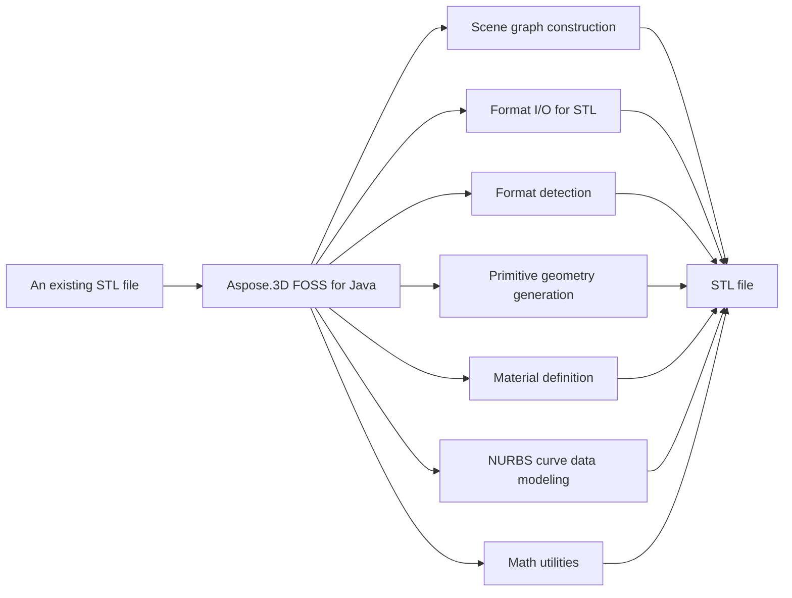

# Aspose.3D FOSS for Java


Aspose.3D FOSS for Java is a free, open-source, MIT-licensed Java library for building and inspecting 3D scenes. It reads `.stl`, `.fbx`, `.glb`, `.gltf`, and `.obj` files and writes `.stl`, `.fbx`, `.glb`, `.gltf`, and `.obj` files. It exposes the same `com.aspose.threed`.* package, method signatures, and class names around a scene graph for organizing cameras and transforms as the commercial library. It requires Java 21 or later and has no required third-party package dependencies.

Add it to
your project as a dependency — no extra repositories or configuration required.

- No native/system libraries beyond the JVM itself.

## Navigation

- [At a Glance](#at-a-glance)
- [Key Capabilities](#key-capabilities)
- [Installation](#installation)
- [Dependencies](#dependencies)
- [API Reference](#api-reference)
- [Scope and Limitations](#scope-and-limitations)

## At a Glance



## Key Capabilities

- **Scene graph construction.** Build a 3D scene graph with `Scene`, `Node`, and `Entity`, attaching geometry through `Node.addEntity` or `Node.createChildNode` and organizing it into a parent-child hierarchy.
- **Format I/O for STL.** Import and export STL geometry (binary or ASCII) with `StlLoadOptions` or `StlSaveOptions`, dispatched through `Scene.fromFile` or `Scene.save`.
- **Format detection.** Detect a 3D file's format automatically, or resolve an explicit format from a file path or binary stream using `FileFormat.detect` or `FileFormat.getFormatByExtension`.
- **Primitive geometry generation.** Generate primitive solids as ready-to-use geometry — `Box`, `Cylinder`, `Sphere`, and `Dish` each implement toMesh to produce a `Mesh` — and IFC-style 2D profiles such as `CircleShape` and `EllipseShape`.
- **Material definition.** Define materials with `LambertMaterial`, `PhongMaterial`, and `PbrMaterial` — albedo, metallic/roughness, occlusion, and emissive channels, plus texture references — and assign them per node via `Node.setMaterial`.
- **NURBS curve data modeling.** Model NURBS curves through `NurbsCurve`, exposing control points, knot vectors, and degree/order data.
- **Math utilities.** Work with the transform and geometry math that underlies every scene operation — `Vector2`, `Vector3`, `Vector4`, `Matrix4`, `Quaternion`, and `BoundingBox`.

## Installation

Install the published package from Maven Central (`org.aspose:aspose-3d-foss`, version 26.5.0):

```bash
mvn dependency:get -Dartifact=org.aspose:aspose-3d-foss:26.5.0
```

Or declare it in Maven:

```xml
<dependency>
  <groupId>org.aspose</groupId>
  <artifactId>aspose-3d-foss</artifactId>
  <version>26.5.0</version>
</dependency>
```

Or declare it in Gradle:

```groovy
implementation 'org.aspose:aspose-3d-foss:26.5.0'
```

## Dependencies

### Required Package Dependencies

No required third-party package dependencies; in `pom.xml`, every `<dependency>` the POM declares is `test`, `provided` or optional.

### Native and System Requirements

- Requires Java `21` (`maven.compiler.target` in `pom.xml`).

### Development Dependencies

- `org.junit.jupiter:junit-jupiter 5.10.0`

## API Reference

Aspose.3D FOSS for Java provides the `Scene` class as its central entry point, offering `Scene.fromFile` and `Scene.save` for automatic format detection and export. The `com.aspose.threed` package hosts the public API surface, with `Scene`, `Node`, and `Entity` forming the core scene graph hierarchy.

The verified public surface has 266 types.

<details>
<summary>View the Complete Public API Surface</summary>

### Core API

| Class | Description |
| --- | --- |
| `A3DObject` | A3DObject represents a base class for all 3D objects in Aspose.3D FOSS for Java and provides common properties such as name and properties. |
| `A3dwSaveOptions` | Options for A3DW saving. |
| `AmfSaveOptions` | Options for AMF saving. |
| `AnimationChannel` | Animation channel. |
| `AnimationClip` | AnimationClip represents an animation clip containing keyframe animation data in Aspose.3D FOSS for Java. |
| `AnimationNode` | Animation node. |
| `ArbitraryProfile` | This class allows you to construct a 2D profile directly from arbitrary curve. |
| `ArrayListAdapter` | ArrayListAdapter provides a wrapper to support list operations in Aspose.3D FOSS for Java. |
| `AssetInfo` | AssetInfo stores metadata about a 3D file such as author, creation date, and application information in Aspose.3D FOSS for Java. |
| `AxisSystem` | AxisSystem defines a coordinate system using three axes in Aspose.3D FOSS for Java. |
| `Bone` | A bone defines the subset of the geometry's control point, and defined blend weight for each control point. |
| `BonePose` | The BonePose contains the transformation matrix for a bone node / |
| `BooleanOperand` | This class encapsulates the transformed mesh as Boolean operation's operand. |
| `BooleanOperator` | Boolean operator allows you to apply Boolean operation on two IMeshConvertible instances. |
| `BoundingBox` | The axis-aligned bounding box / |
| `BoundingBox2D` | The axis-aligned bounding box for Vector2 / |
| `Box` | Box primitive. |
| `CShape` | IFC compatible C-shape profile that defined by parameters. |
| `Camera` | Camera represents a camera entity used for rendering 3D scenes in Aspose.3D FOSS for Java. |
| `Cancellation` | Cancellation provides a mechanism to cancel long-running operations in Aspose.3D FOSS for Java. |
| `CenterLineProfile` | IFC compatible center line profile. |
| `Circle` | A Circle curve consists of a set of points in the edge of the circle shape. |
| `CircleShape` | IFC compatible circle profile, which can be used to construct a mesh through LinearExtrusion. |
| `ColladaSaveOptions` | ColladaSaveOptions specifies options for saving scenes in COLLADA format in Aspose.3D FOSS for Java. |
| `CompositeCurve` | A CompositeCurve is consisting of several curve segments. |
| `CryptoUtils` | Utility class for cryptographic operations. |
| `CullFaceMode` | What face to cull. |
| `Curve` | The base class of all curve implementations. |
| `CustomObject` | CustomObject allows users to define custom 3D objects in Aspose.3D FOSS for Java. |
| `Cylinder` | Parameterized Cylinder. |
| `Deformer` | Deformer represents a component that modifies geometry in Aspose.3D FOSS for Java. |
| `Discreet3dsLoadOptions` | Load options for 3DS file. |
| `Discreet3dsSaveOptions` | Save options for 3DS file. |
| `Dish` | Parameterized dish. |
| `DracoFormat` | Google Draco format Example: The following code shows how to encode and decode a Mesh to/from byte array: Mesh mesh = (new Sphere()).toMesh(); //encode mesh |
| `DracoSaveOptions` | Options for Draco compression. |
| `DrawOperation` | DrawOperation describes a single draw call in the rendering pipeline in Aspose.3D FOSS for Java. |
| `DummyFileSystem` | DummyFileSystem provides a no-op file system implementation in Aspose.3D FOSS for Java. |
| `Ellipse` | An Ellipse defines a set of points that form the shape of ellipse. |
| `EllipseShape` | IFC compatible ellipse profile, which can be used to construct a mesh through LinearExtrusion. |
| `EndPoint` | The end point to trim the curve, can be a parameter value or a Cartesian point. |
| `Entity` | Entity represents a base class for all 3D entities such as meshes and primitives in Aspose.3D FOSS for Java. |
| `EntityRendererKey` | The key of registered entity renderer. |
| `Enumerable` | Generic enumerable interface for collection of type T / |
| `Enumerator` | Generic enumerator for collection of type T / |
| `EventCallback` | Event callback interface for handling events with arguments. |
| `ExportException` | ExportException is thrown when an error occurs during exporting a 3D scene in Aspose.3D FOSS for Java. |
| `Extrapolation` | Extrapolation defines how to do when sampled value is out of the range which defined by the first and last key-frames. |
| `FMatrix4` | FMatrix4 represents a 4x4 matrix of single-precision floating-point numbers in Aspose.3D FOSS for Java. |
| `FVector2` | FVector2 represents a 2D vector of single-precision floating-point numbers in Aspose.3D FOSS for Java. |
| `FVector3` | FVector3 represents a 3D vector of single-precision floating-point numbers in Aspose.3D FOSS for Java. |
| `FVector4` | FVector4 represents a 4D vector of single-precision floating-point numbers in Aspose.3D FOSS for Java. |
| `FbxLoadOptions` | Load options for FBX format. |
| `FbxSaveOptions` | Save options for FBX format. |
| `FileFormat` | FileFormat identifies a supported 3D file format in Aspose.3D FOSS for Java. |
| `FileFormatType` | FileFormatType enumerates the supported file format types in Aspose.3D FOSS for Java. |
| `FileStream` | File stream for reading and writing files. |
| `FileSystem` | File system encapsulation. |
| `FileSystemFactory` | Factory for creating file system instances. |
| `Frustum` | The base class of Camera and Light / |
| `Geometry` | Geometry represents geometric data such as vertices and indices in Aspose.3D FOSS for Java. |
| `GlobalTransform` | Global transform is similar to Transform but it's immutable while it represents the final evaluated transformation. |
| `GltfLoadOptions` | Load options for glTF format. |
| `GltfSaveOptions` | Save options for glTF format. |
| `Group` | A Group represents the logical relationships of Node. |
| `HShape` | The HShape provides the defining parameters of an 'H' or 'I' shape. |
| `HalfSpace` | HalfSpace represents a infinity space which is split by a plane, this can be used with BooleanOperator. |
| `HollowCircleShape` | IFC compatible hollow circle profile. |
| `HollowRectangleShape` | IFC compatible hollow rectangular shape with both inner/outer rounding corners. |
| `Html5SaveOptions` | Options for HTML5 saving. |
| `IBuffer` | IBuffer is an interface for buffer objects used in rendering in Aspose.3D FOSS for Java. |
| `IDescriptorSet` | IDescriptorSet is an interface for managing descriptor sets in the rendering pipeline in Aspose.3D FOSS for Java. |
| `IIndexBuffer` | IIndexBuffer is an interface for index buffer objects used in rendering in Aspose.3D FOSS for Java. |
| `IIndexedVertexElement` | VertexElement with indices data. |
| `IMeshConvertible` | IMeshConvertible is an interface for objects that can be converted to mesh data in Aspose.3D FOSS for Java. |
| `INamedObject` | INamedObject is an interface for objects that have a name in Aspose.3D FOSS for Java. |
| `IOConfig` | IO config for serialization/deserialization. |
| `IOExtension` | Utilities to write matrix/vector to binary writer. |
| `IOrientable` | Orientable entities shall implement this interface. |
| `IPipeline` | IPipeline is an interface for rendering pipelines in Aspose.3D FOSS for Java. |
| `IRenderQueue` | IRenderQueue is an interface for managing renderable objects in the rendering pipeline in Aspose.3D FOSS for Java. |
| `IRenderTarget` | IRenderTarget is an interface for render targets such as textures or windows in Aspose.3D FOSS for Java. |
| `IRenderTexture` | IRenderTexture is an interface for texture-based render targets in Aspose.3D FOSS for Java. |
| `IRenderWindow` | IRenderWindow is an interface for window-based render targets in Aspose.3D FOSS for Java. |
| `ITextureUnit` | ITextureUnit is an interface for texture units in the rendering pipeline in Aspose.3D FOSS for Java. |
| `IVertexBuffer` | IVertexBuffer is an interface for vertex buffer objects used in rendering in Aspose.3D FOSS for Java. |
| `ImageRenderOptions` | ImageRenderOptions specifies options for rendering scenes to images in Aspose.3D FOSS for Java. |
| `ImportException` | ImportException is thrown when an error occurs during importing a 3D file in Aspose.3D FOSS for Java. |
| `InitializationException` | Initialization exception / |
| `JtLoadOptions` | Options for JPEG2000 loading. |
| `KeyFrame` | KeyFrame represents a single keyframe in an animation curve with time, value, and tangent properties. |
| `KeyframeSequence` | The sequence of key-frames, it describes the transformation of a sampled value over time. |
| `LShape` | IFC compatible L-shape profile that defined by parameters. |
| `LambertMaterial` | Material for lambert shading model. |
| `License` | License management class (not available in FOSS version). |
| `Light` | Light defines a light source in a scene with properties such as color, enabled state, and falloff. |
| `Line` | A polyline is a path defined by a set of points with getControlPoints(), and connected by getSegments(), which means it can also be a set of connected line segments. |
| `LinearExtrusion` | Linear extrusion takes a 2D shape as input and extends the shape in the 3rd dimension. |
| `LoadOptions` | The base class to configure options in file loading for different types. |
| `LocalFileSystem` | LocalFileSystem provides file system access using the local file system. |
| `Material` | Material defines the parameters necessary for visual appearance of geometry. |
| `MaterialConverter` | Custom converter to convert the geometry's original material to GLTF's PBR material. |
| `MathUtils` | Utility class with mathematical functions. |
| `Matrix4` | Matrix4 represents a 4x4 matrix used for 3D transformations. |
| `MemoryFileSystem` | MemoryFileSystem provides file system access using in-memory storage. |
| `MemoryStream` | Memory stream for reading and writing data in memory. |
| `Mesh` | Mesh defines a geometric mesh composed of vertices, normals, texture coordinates, and faces. |
| `Metered` | Metered license management class (not available in FOSS version). |
| `Microsoft3MFSaveOptions` | Microsoft3MFSaveOptions specifies options for saving files in the Microsoft 3MF format. |
| `MirroredProfile` | IFC compatible mirror profile. |
| `MorphTargetChannel` | A MorphTargetChannel is used by MorphTargetDeformer to organize the target geometries. |
| `MorphTargetDeformer` | MorphTargetDeformer provides per-vertex animation. |
| `Node` | Node represents an object in the scene graph that can hold geometry, materials, and children. |
| `NodeVisitor` | A callback to travel through the whole node hierarchy. |
| `NotImplementedException` | Exception thrown when a feature is not implemented. |
| `NurbsCurve` | NURBS curve is a curve represented by NURBS(Non-uniform rational basis spline), A NURBS curve is defined by its getOrder(), a set of weighted Geometry.getControlPoints() and a getKnotVectors() The w |
| `NurbsDirection` | NurbsDirection specifies the direction of a NURBS curve or surface. |
| `ObjLoadOptions` | ObjLoadOptions specifies options for loading OBJ files. |
| `ObjSaveOptions` | ObjSaveOptions specifies options for saving files in the OBJ format. |
| `ObjectProperty` | Concrete property implementation for Object values. |
| `ParameterizedProfile` | The base class of all parameterized profiles. |
| `ParseException` | ParseException is thrown when an error occurs during parsing of a file. |
| `PbrMaterial` | Material for physically based rendering based on albedo color/metallic/roughness. |
| `PbrSpecularMaterial` | Material for physically based rendering based on diffuse color/specular/glossiness / |
| `PdfLoadOptions` | Options for PDF loading. |
| `PdfSaveOptions` | The save options in PDF exporting. |
| `PhongMaterial` | Material for blinn-phong shading model. |
| `Plane` | Parameterized plane. |
| `PlyLoadOptions` | PlyLoadOptions specifies options for loading PLY files. |
| `PlySaveOptions` | PlySaveOptions specifies options for saving files in the PLY format. |
| `PointCloud` | A point cloud represents a collection of points in 3D space. |
| `PolygonModifier` | Polygon modifier utilities. |
| `Pose` | The pose is used to store transformation matrix when the geometry is skinned. |
| `Primitive` | Base class for all primitives. |
| `Profile` | 2D Profile in xy plane. |
| `Property` | Class to hold user-defined properties. |
| `PropertyCollection` | PropertyCollection holds a collection of properties associated with a scene object. |
| `Pyramid` | Parameterized pyramid. |
| `Quaternion` | Quaternion represents a quaternion used for 3D rotations. |
| `Rect` | A class to represent the rectangle / |
| `RectangleShape` | IFC compatible rectangular shape with rounding corners. |
| `RectangularTorus` | Parameterized rectangular torus. |
| `RelativeRectangle` | Relative rectangle The formula between relative component to absolute value is: Scale * (Reference Width) + offset So if we want it to represent an absolute value, leave all scale fields zero, and use offset fields instead. |
| `RenderFactory` | RenderFactory creates render resources and manages rendering pipelines. |
| `RenderParameters` | RenderParameters holds parameters used during rendering. |
| `RenderQueueGroupId` | RenderQueueGroupId identifies a group of render queues for organizing rendering tasks. |
| `RenderResource` | RenderResource represents a resource used in the rendering pipeline. |
| `RenderStage` | RenderStage defines a stage in the rendering pipeline. |
| `RenderState` | RenderState holds the current state of the rendering pipeline. |
| `Renderer` | Renderer performs rendering of a scene using specified parameters and resources. |
| `RendererException` | RendererException is thrown when an error occurs during rendering. |
| `RendererVariableManager` | RendererVariableManager manages variables used by the renderer. |
| `RevolvedAreaSolid` | This class represents a solid model by revolving a cross section provided by a profile about an axis. |
| `RvmLoadOptions` | Load options for AVEVA Plant Design Management System's RVM file. |
| `RvmSaveOptions` | Save options for Aveva PDMS RVM file. |
| `SaveOptions` | The base class to configure options in file saving for different types. |
| `Scene` | Scene represents a 3D scene containing nodes, geometry, and materials. |
| `SceneObject` | SceneObject is the base class for all objects that can be part of a scene. |
| `Segment` | Segment of CompositeCurve. |
| `ShaderMaterial` | A shader material that allows describing the material by external rendering engine or shader language. |
| `ShaderProgram` | ShaderProgram represents a compiled shader program used in rendering. |
| `ShaderSource` | ShaderSource holds the source code for a shader program. |
| `ShaderTechnique` | A shader technique represents a concrete rendering implementation. |
| `Shape` | The shape describes the deformation on a set of control points, which is similar to the cluster deformer in Maya. |
| `Skeleton` | A skeleton defines a hierarchical structure of bones for skinning. |
| `SkinDeformer` | A skin deformer contains multiple bones to work, each bone blends a part of the geometry by control point's weights. |
| `Sphere` | Parameterized sphere. |
| `StlLoadOptions` | Load options for STL. |
| `StlSaveOptions` | Save options for STL. |
| `Stream` | Created by lexchou on 12/14/2016. |
| `Struct` | Struct defines a structured data type used in shaders. |
| `Structs` | Base class of struct array. |
| `TShape` | IFC compatible T-shape defined by parameters. |
| `Texture` | This class defines the texture from an external file. |
| `TextureBase` | Base class for all concrete textures. |
| `TextureData` | TextureData holds the pixel data for a texture. |
| `TextureSlot` | Texture slot in Material, can be enumerated through material instance. |
| `Torus` | Parameterized torus. |
| `Transform` | Transform represents a transformation matrix for positioning and orienting objects. |
| `TransformBuilder` | Utility class for building transformation matrices. |
| `TrapeziumShape` | IFC compatible Trapezium shape defined by parameters. |
| `TriMesh` | A TriMesh contains raw data that can be used by GPU directly. |
| `TrialException` | Trial exception for evaluation mode. |
| `U3dLoadOptions` | Options for U3D loading. |
| `U3dSaveOptions` | Save options for universal 3d. |
| `UShape` | IFC compatible U-shape defined by parameters. |
| `UsdSaveOptions` | Options for USD saving. |
| `Vector2` | Vector2 represents a two-dimensional vector with U and V components and provides operations such as addition, subtraction, multiplication, division, dot product, cross product, normalization, and length calculation. |
| `Vector3` | Vector3 represents a three-dimensional vector with X, Y, and Z components and provides operations such as addition, subtraction, multiplication, division, dot product, cross product, normalization, length calculation, and comparison. |
| `Vector4` | Vector4 represents a four-dimensional vector and provides operations for vector arithmetic and comparison. |
| `Version` | Version provides version information for Aspose.3D FOSS for Java. |
| `Vertex` | Vertex reference, used to access the raw vertex in TriMesh. |
| `VertexDeclaration` | VertexDeclaration defines the structure of vertex data for a mesh by specifying a sequence of vertex elements. |
| `VertexElement` | Base class for all vertex element types. |
| `VertexElementBinormal` | VertexElementBinormal stores binormal data for each vertex in a mesh. |
| `VertexElementDoublesTemplate` | VertexElementDoublesTemplate is a template class for vertex elements that store double-precision floating-point values. |
| `VertexElementEdgeCrease` | VertexElementEdgeCrease stores edge crease values for mesh edges. |
| `VertexElementFVector` | VertexElementFVector stores floating-point vector data for vertices. |
| `VertexElementHole` | VertexElementHole identifies which vertices belong to holes in a mesh. |
| `VertexElementIntsTemplate` | VertexElementIntsTemplate is a template class for vertex elements that store integer values. |
| `VertexElementMaterial` | VertexElementMaterial assigns material indices to vertices or polygons in a mesh. |
| `VertexElementNormal` | VertexElementNormal stores normal vectors for vertices in a mesh. |
| `VertexElementPolygonGroup` | VertexElementPolygonGroup organizes polygons into logical groups. |
| `VertexElementSmoothingGroup` | VertexElementSmoothingGroup specifies smoothing groups for polygons in a mesh. |
| `VertexElementSpecular` | VertexElementSpecular stores specular color or intensity data for vertices. |
| `VertexElementTangent` | VertexElementTangent stores tangent vectors for vertices in a mesh. |
| `VertexElementTemplate` | VertexElementTemplate is the base class for all vertex element types. |
| `VertexElementUV` | VertexElementUV stores texture coordinate data for vertices. |
| `VertexElementUserData` | VertexElementUserData stores user-defined data for vertices. |
| `VertexElementVector4` | VertexElementVector4 stores four-component vector data for vertices. |
| `VertexElementVertexColor` | VertexElementVertexColor stores per-vertex color data. |
| `VertexElementVertexCrease` | VertexElementVertexCrease stores vertex crease values for mesh vertices. |
| `VertexElementVisibility` | VertexElementVisibility controls the visibility of vertices in a mesh. |
| `VertexElementWeight` | VertexElementWeight stores vertex skinning weights for skeletal animation. |
| `VertexField` | VertexField represents a single field within a vertex element. |
| `Watermark` | Utility to encode/decode blind watermark to/from a mesh. |
| `WeightedMode` | Weighted mode. |
| `WindowHandle` | WindowHandle encapsulates a platform-specific window handle for rendering. |
| `XLoadOptions` | Options for X (DirectX) loading. |
| `ZShape` | IFC compatible Z-shape profile defined by parameters. |
| `ZipFileSystem` | ZipFileSystem provides a file system interface for reading and writing ZIP archives. |

#### Enumerations

| Enumeration | Description |
| --- | --- |
| `AlphaSource` | Defines whether the texture contains the alpha channel. |
| `ApertureMode` | Camera aperture modes. |
| `Axis` | Axis represents a single axis in a coordinate system in Aspose.3D FOSS for Java. |
| `BindPoint` | Animation binding point. |
| `BlendFactor` | Blend factor specify pixel arithmetic. |
| `BoneLinkMode` | A bone's link mode refers to the way in which a bone is connected or linked to its parent bone within a hierarchical structure. |
| `BooleanOperation` | Mesh's Boolean operation / |
| `BoundingBoxExtent` | The extent of the bounding box. |
| `ColladaTransformStyle` | ColladaTransformStyle defines how transforms are represented in COLLADA files in Aspose.3D FOSS for Java. |
| `CompareFunction` | The compare function used in depth/stencil testing. |
| `ComposeOrder` | The order to compose transform matrix. |
| `CoordinateSystem` | CoordinateSystem represents a right-handed or left-handed coordinate system in Aspose.3D FOSS for Java. |
| `CubeFace` | CubeFace identifies one of the six faces of a cube in Aspose.3D FOSS for Java. |
| `CurveDimension` | The dimension of the curves. |
| `DracoCompressionLevel` | Compression level for Draco format. |
| `ExtrapolationType` | Extrapolation type. |
| `FileContentType` | FileContentType specifies the type of content stored in a file in Aspose.3D FOSS for Java. |
| `FrontFace` | Define front- and back-facing polygons. |
| `GltfEmbeddedImageFormat` | How glTF exporter will embed the textures during the exporting. |
| `IndexDataType` | IndexDataType specifies the data type used for indices in a mesh. |
| `Interpolation` | Interpolation defines the method used to calculate values between keyframes. |
| `LightType` | LightType specifies the type of light source, such as point, directional, or spot. |
| `MappingMode` | MappingMode defines how texture coordinates are mapped onto geometry. |
| `NurbsType` | NURBS types. |
| `PatchDirection` | The direction of a patch. |
| `PatchDirectionType` | The type of patch direction. |
| `PdfLightingScheme` | LightingScheme specifies the lighting to apply to 3D artwork. |
| `PdfRenderMode` | Render mode specifies the style in which the 3D artwork is rendered. |
| `PolygonMode` | The polygon rasterization mode. |
| `PoseType` | Pose type. |
| `PresetShaders` | PresetShaders provides a set of predefined shader programs for rendering. |
| `ProjectionType` | Camera's projection types. |
| `ReferenceMode` | ReferenceMode specifies how references are resolved during file loading. |
| `RotationMode` | The frustum's rotation mode / |
| `RotationOrder` | The order controls which rx ry rz are applied in the transformation matrix. |
| `SkeletonType` | The type of skeleton. |
| `SplitMeshPolicy` | Share vertex/control point data between sub-meshes or each sub-mesh has its own compacted data. |
| `StepMode` | Interpolation step mode. |
| `TextureFilter` | Filter options during texture sampling. |
| `TextureMapping` | TextureMapping defines how a texture is applied to geometry. |
| `TextureType` | TextureType specifies the type of texture, such as 2D or cube map. |
| `VertexElementType` | VertexElementType enumerates the supported types of vertex elements. |
| `VertexFieldDataType` | Vertex field's data type. |
| `VertexFieldSemantic` | The semantic of the vertex field. |
| `WrapMode` | Texture's wrap mode. |

#### Detailed Member Reference

### com

The top-level com namespace exposes the `com.aspose` package as its primary public API surface.

### aspose

The `com.aspose` namespace provides the `aspose.threed` module, which contains the 3D scene graph and I/O functionality.

### threed

The `com.aspose.threed` namespace hosts the `Scene` class, which loads geometry via `Scene.fromFile` with automatic format detection, exposes the scene graph through getRootNode, and writes output via `Scene.save`.

</details>

## Scope and Limitations

Aspose.3D FOSS for Java reads and writes 3D scene data in `.fbx`, `.glb`, `.gltf`, `.obj`, and `.stl` formats, and provides a subset of the commercial Aspose.3D API for Java developers targeting Java 21.

- Only STL (import and export) is fully functional in the published 26.5.0 package; OBJ import is present in the upstream source but ships as a stub in the published Maven Central artifact, and several other recognized formats fail silently rather than throwing an error when used.
- A handful of primitive-shape classes have mesh-conversion methods that are present but not yet implemented; `Box`, `Cylinder`, `Sphere`, and `Dish` are confirmed to convert correctly.
- `NurbsCurve` exposes its full control-point, knot, and degree data model, but sampling points along the curve is not yet implemented.
- `PbrSpecularMaterial`'s accessors are unimplemented in this edition; the PBR material capability described above uses the alternative that works.
- Licensing, trial, and DRM-related functionality (`License`, `Metered`) is intentionally excluded, as are cryptographic helpers and ZIP-packaged file-system read/write, and `Scene` rendering is not implemented in this edition.

- `org.junit.jupiter:junit-jupiter` — the JUnit 5 test framework, used only by the test suite.

- STL (import and export) is the only format that is fully functional in the published `26.5.0` package; a handful of other formats have recognized options classes registered with `FileFormat` but no working load/save path behind them in that package — see [FILE_FORMATS.md](FILE_FORMATS.md) for format-by-format notes, keeping in mind its summary table and later detail sections don't fully agree with each other.
- Additional format coverage beyond STL (including proprietary and high-performance formats) is a commercial-edition feature; see the closing note below.

This project is licensed under the [MIT License](LICENSE). The MIT License permits use, copying,
modification, distribution, sublicensing, and commercial use, provided its copyright and
permission notice are retained. The software is provided without warranty.
